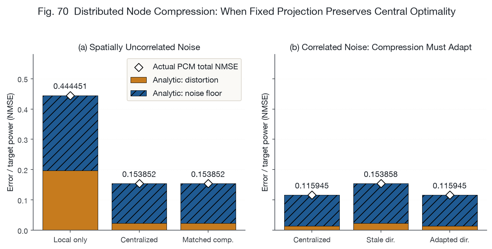
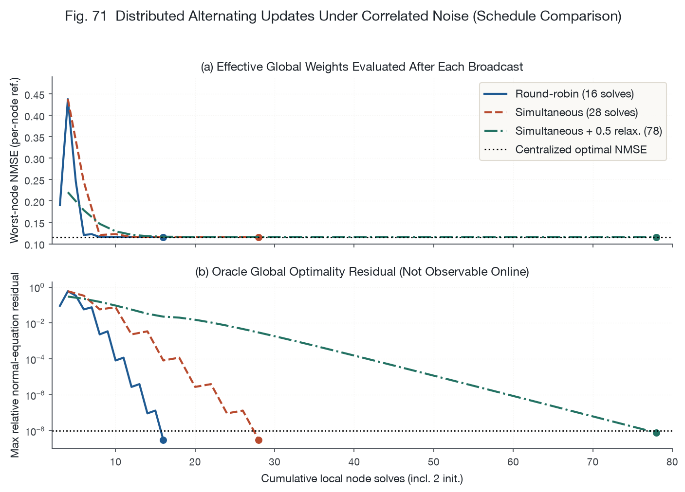
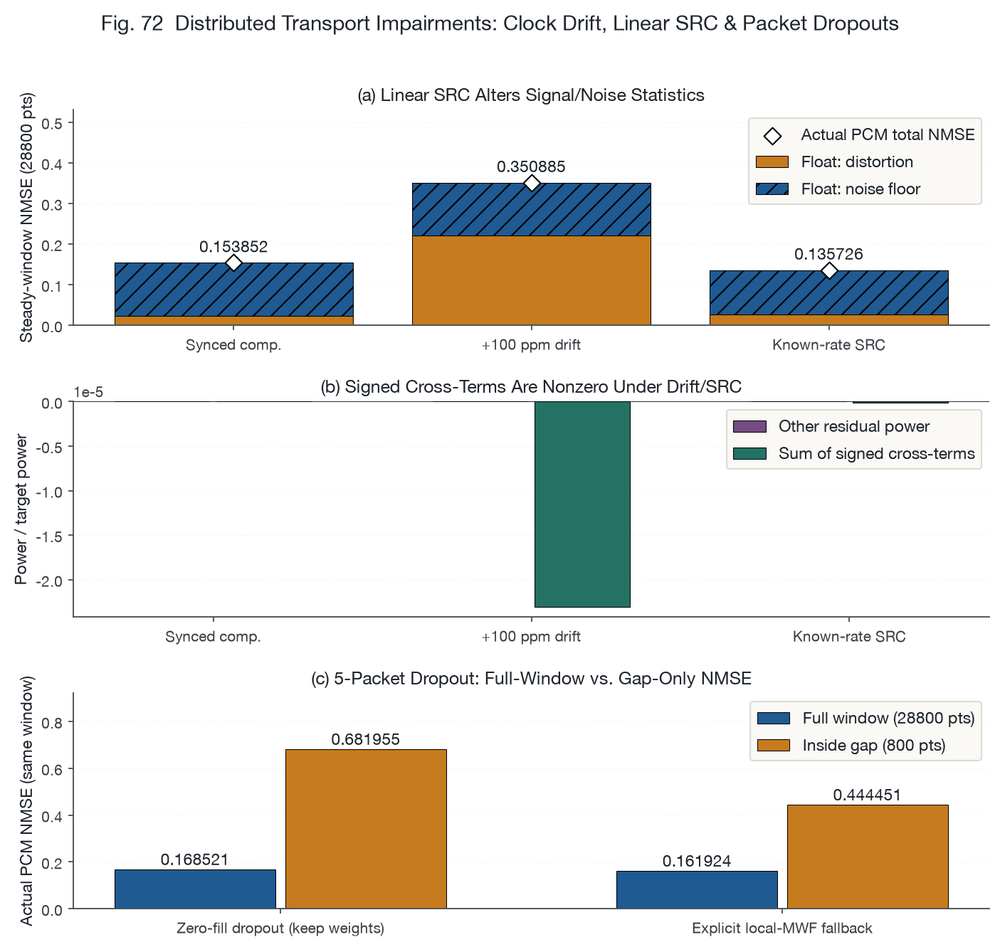

🌐 [简体中文](../chapters/13_distributed-enhancement.md) ｜ **English**

> ⚠️ This chapter is Chapter 13 of the main text (Extended Topic II; the main text comprises 16 chapters in total, Chapters 0–15, where Chapters 12–15 are four extended special topics accompanied by Appendices A and B), immediately following Chapter 12 on acoustic imaging, introducing how multiple pickup nodes collaborate to enhance sound under constrained communication bandwidth. Block Schur complements and Generalized Eigenvalue Decomposition derivations can be reviewed in [Chapter 0, §0.3](00_math-foundations.md#sec-0-3) and [§0.4](00_math-foundations.md#sec-0-4), and global notation references appear in [Chapter 16, Appendix A](16_appendix-symbols-math.md).
>
> Overview Home: [00_overview.md](00_overview.md) ｜ Previous: [12_acoustic-imaging.md](12_acoustic-imaging.md) ｜ Next: [14_spatial-wearable-arrays.md](14_spatial-wearable-arrays.md)

---

## Chapter 13: Distributed Microphone Collaborative Enhancement

### 13.1 Why Multiple Nodes Exchange Sound

#### Define the Collaborative Output Objective First

Imagine a long conference table holding two smart pickup devices, each equipped with two microphones: Device 1 sits right next to the main presenter, whereas Device 2 sits beside an HVAC diffuser or projector cooling fan. From a signal-processing standpoint, a remote device's audio offers two distinct forms of collaborative value—it might sit closer to the target talker than the local device, supplying a high-SNR speech observation; or it might sit right next to an interferer, supplying the clean noise reference the local device desperately needs to cancel correlated interference. Crudely "switching on only the loudest device" throws away the spatial noise-cancellation aperture of every other device; conversely, running ASR independently on each device and merging transcripts at the text level abandons waveform-level phase coherence across devices altogether.

This chapter focuses on **waveform-level distributed collaborative enhancement**: each node in a Wireless Acoustic Sensor Network (WASN) retains all of its own local multi-channel observations while receiving a small number of linearly compressed broadcast streams from peer nodes, fusing both locally to synthesize its own enhanced waveform. Crucially, distinct nodes typically seek to recover the target acoustic image as heard *at their own physical location* (for instance, left and right binaural hearing-aid nodes must preserve their respective head-related binaural cues), so optimal output waveforms need not be sample-wise identical across nodes. Formulating this rigorously requires unifying three questions inside one mathematical model: "which observation dimensions did communication compression discard?", "which reference acoustic image does each node target?", and "when do node clocks and broadcast filters change?"

[Chapter 10, §10.7](10_engineering-practice.md#sec-10-7) surveyed time-axis alignment, amplitude–phase consistency, and multi-stream fusion from a system-architecture perspective. Here we dive into the algorithmic core to answer four progressive questions step by step: without transmitting all raw microphone channels, under what exact condition can nodes still attain the optimal linear estimate of a centralized full array? How do nodes alternately update broadcast filters without knowing global statistics? How do multiple sources and non-fully-connected network topologies bound broadcast dimensionality? And when transitioning to finite windowed frames, 16-bit quantization, crystal Sampling Rate Offset (SRO), and wireless packet loss, how do we transform statistical coordinates and score errors honestly?

| Collaboration Tier | Primary Inter-Node Exchange | Output Form and Fundamental Limits |
|---|---|---|
| Centralized full-channel enhancement | All raw multi-channel waveforms, or equivalent global cross-spectral statistics | Solved at a single fusion center; demands high backhaul bandwidth and strict sample-level synchronization |
| Best-channel / device selection | Speech quality scores plus the selected node's audio stream | Outputs audio from one winning device; forfeits spatial interference cancellation across unselected nodes |
| Waveform-level distributed enhancement | A few locally compressed waveforms / short-time complex spectra plus control state | Each node solves independently for its own node-specific target image; requires compression-subspace and sample-sync conditions |
| Post-ASR transcript fusion | Word-token lattices, confidence scores, and speaker timestamps | Outputs merged text transcripts only; produces no cross-device noise-suppressed audible waveform |

#### Terminology and Prerequisites for This Chapter

Core abbreviations and their roles in this chapter are summarized below for quick reference:

| Abbreviation | Full Term | Role in This Chapter |
|---|---|---|
| WASN | Wireless Acoustic Sensor Network | Collaborative network of pickup nodes, each carrying local microphones, compute, and wireless links |
| LMMSE | Linear Minimum Mean-Squared Error | Statistical criterion minimizing mean-square estimation error of a target acoustic image over linear combinations of available observations |
| MWF | Multichannel Wiener Filter | Estimates the target acoustic image at a designated reference channel under the LMMSE criterion from second-order mixture statistics |
| DANSE | Distributed Adaptive Node-specific Signal Estimation | Classical distributed algorithm updating local estimation weights and outbound broadcast compression filters sequentially or simultaneously |
| TI | Topology Independent | Extensions relaxing full-mesh broadcast assumptions via multi-hop in-network aggregation over trees or general connected graphs |
| GEVD | Generalized Eigenvalue Decomposition | Extracts low-rank target speech subspaces under a noise-whitened metric to suppress finite-snapshot covariance errors |
| WOLA | Weighted Overlap-Add | Time–frequency framework windowing time streams into frequency bins for filtering before inverse transform, synthesis windowing, and overlap-add |
| SRO | Sampling Rate Offset | Relative sampling-clock frequency skew between independent crystal oscillators across nodes (typically in parts per million, $\mathrm{ppm}$) |

Before reading ahead, review [Chapter 5, §5.5.1 on Multichannel Wiener Filtering (MWF)](05_beamforming.md#sec-5-5-1), alongside complex inner products, Hermitian positive-definite matrices, and generalized eigenvalues in [Chapter 0, §§0.3–0.4](00_math-foundations.md#sec-0-3) and [Appendix A, §16.3](16_appendix-symbols-math.md#sec-16-3). To build rock-solid geometric intuition for "why compressing down to a single broadcast channel can incur zero performance loss," Sections 13.2–13.11 start at a single frequency bin under ideal synchronous sampling and exact population second-order statistics; Sections 13.12–13.15 then introduce subspace estimation, WOLA frame-boundary timing, bandwidth/memory budgets, and SRO / packet-drop compensation.

### 13.2 Writing Local Observations and Node-Specific References Separately

#### Partitioning the Global Observation Vector by Node

Consider a network of $U$ collaborative pickup nodes where node $u$ carries $M_u$ local microphones ($u = 1, \ldots, U$), giving $M = \sum_{u=1}^U M_u$ microphones network-wide. Fixing frequency bin $k$, stack node $u$'s local frequency-domain observations at frame $\ell$ into column vector $\vec x_u[k, \ell] \in \mathbb{C}^{M_u \times 1}$. Stacking all $U$ nodes vertically from a god's-eye view forms the $M$-dimensional global observation vector $\vec x \in \mathbb{C}^{M \times 1}$. Starting with a single latent scalar target source $s$ (omitting fixed $[k, \ell]$ indices below):

$$\begin{gathered}
\vec x=[\vec x_1^\top,\ldots,\vec x_U^\top]^\top,\\
\vec x=\vec a s+\vec n,\qquad d_u=c_u s.
\end{gathered}\tag{13-1}$$

Here $s \in \mathbb{C}$ is the dry source phasor at this bin, $\vec a \in \mathbb{C}^{M \times 1}$ is the acoustic transfer vector from the source to all $M$ microphones, and $\vec n \in \mathbb{C}^{M \times 1}$ is the global additive noise vector.

Pay special attention to $d_u = c_u s$ on the right: it defines **the node-specific target reference signal that node $u$ wishes to recover**, where scalar $c_u \in \mathbb{C}$ is node $u$'s chosen reference acoustic transfer entry. Practically, node $u$ typically designates one of its own local microphones (global index $r_u$) as its reference sensor so $c_u = a_{r_u}$—preserving the exact amplitude and phase (acoustic image) of target speech arriving at microphone $r_u$ while stripping away additive noise $n_{r_u}$.

Throughout this chapter we use forward Fourier kernel $e^{-\mathrm{j}2\pi f t}$ and conjugate inner-product filter output $y = \vec w^H\vec x$. Index conventions: frequency bin $k$, frame $\ell$, time sample $n$, node indices $u, v$, iteration index $i$, multi-source latent target subspace dimension $S$, outbound compressed broadcast dimension $Q$ per node, and acoustic wavenumber $\kappa = 2\pi f / c$.

Transfer vector $\vec a$ in Eq. (13-1) may represent either free-field direct propagation or room early-reflection transfer functions; finite frame lengths and causal hop delays upon returning to the time domain are examined in §13.13.

#### Power Units and Zero-Mean Orthogonality Conditions

Assuming zero-mean random variables $s$ and $\vec n$ with finite second moments and source–noise orthogonality $\mathbb{E}[s\vec n^H] = \vec 0^H$, dry source power $\phi_s$, global noise covariance $\mathbf R_{nn}$, and global observation covariance $\mathbf R_{xx}$ are:

$$\begin{aligned}
\phi_s&=\mathbb{E}[|s|^2],\qquad
\mathbf R_{nn}=\mathbb{E}[\vec n\vec n^H],\\
\mathbf R_{xx}&=\mathbb{E}[\vec x\vec x^H]
=\phi_s\vec a\vec a^H+\mathbf R_{nn}.
\end{aligned}\tag{13-2}$$

Here $\phi_s \ge 0$ is real, and $\mathbf R_{nn}, \mathbf R_{xx} \in \mathbb{C}^{M \times M}$ are Hermitian positive semidefinite. Uncalibrated digital inputs carry dimensionless squared digital units, acquiring physical $\mathrm{Pa}^2$ units only when all channels are pressure-calibrated (with $\vec a$ and $\vec w$ dimensionless). Switching FFT normalization conventions requires scaling $\mathbf R_{xx}$, cross-correlation vectors, and reference power $\phi_{d_u}$ identically.

Note a statistical subtlety: finite-$L$ sample outer-product averages $\frac{1}{L}\sum_{\ell=1}^L \vec x_\ell\vec x_\ell^H$ are uncentered sample second moments, differing slightly from centered sample covariances whenever finite sample means are nonzero ([Appendix A, E16-02](16_appendix-symbols-math.md#sec-u-e77b562c1e)). Sections 13.3–13.11 analyze exact population second moments, while §13.15 specifies exact integer-period steady-window averaging on deterministic synthetic waveforms.

### 13.3 What Centralized MWF Actually Minimizes

#### Write the Complete Cost Function for Arbitrary Weights First

Before introducing communication compression, we establish the centralized gold standard: if bandwidth were unlimited so node $u$ could linearly filter all $M$ microphones network-wide via $\hat d_u = \vec w^H\vec x$, which weight vector $\vec w$ is optimal? Multichannel Wiener Filtering (MWF) minimizes Mean-Squared Error (MSE) between node reference $d_u$ and estimate $\hat d_u$. Writing reference power $\phi_{d_u} = \mathbb{E}[|d_u|^2]$ and $M \times 1$ cross-correlation vector $\vec r_{xd_u} = \mathbb{E}[\vec x d_u^*]$, expanding MSE cost $J_u(\vec w)$ for **any arbitrary** weight vector $\vec w \in \mathbb{C}^{M \times 1}$ gives:

$$\begin{aligned}
J_u(\vec w)&=\mathbb{E}\big[|d_u-\vec w^H\vec x|^2\big]\\
&=\mathbb{E}\big[(d_u-\vec w^H\vec x)(d_u^*-\vec x^H\vec w)\big]\\
&=\phi_{d_u}-\vec w^H\vec r_{xd_u}-\vec r_{xd_u}^H\vec w
+\vec w^H\mathbf R_{xx}\vec w\\
&=\phi_{d_u}-2\operatorname{Re}(\vec w^H\vec r_{xd_u})
+\vec w^H\mathbf R_{xx}\vec w.
\end{aligned}\tag{13-3}$$

Conjugate scalars $\vec w^H\vec r_{xd_u}$ and $\vec r_{xd_u}^H\vec w$ sum to $2\operatorname{Re}(\vec w^H\vec r_{xd_u})$. Keep the universality of Eq. (13-3) front and center: **whether $\vec w$ is the global optimum, a mid-iteration unconverged estimate, or a stale effective weight transiently mismatched after a remote broadcast update, plugging the actually applied global weight into Eq. (13-3) always yields exact true MSE.**

When $\mathbf R_{xx} \succ 0$ is strictly positive definite, setting the Wirtinger gradient with respect to $\vec w^*$ ([Appendix A, §16.3](16_appendix-symbols-math.md#sec-16-3)), $\mathbf R_{xx}\vec w - \vec r_{xd_u}$, to zero yields the unique centralized Wiener–Hopf normal equations, optimal weight $\vec w_u^\star$, and centralized MMSE floor $J_u^\star$:

$$\begin{aligned}
\mathbf R_{xx}\vec w_u^\star&=\vec r_{xd_u},\qquad
\vec w_u^\star=\mathbf R_{xx}^{-1}\vec r_{xd_u},\\
J_u^\star&=\phi_{d_u}
-\vec r_{xd_u}^H\mathbf R_{xx}^{-1}\vec r_{xd_u}.
\end{aligned}\tag{13-4}$$

Numerical implementations solve $\mathbf R_{xx}\vec w_u^\star = \vec r_{xd_u}$ via Hermitian positive-definite Cholesky solvers rather than forming $\mathbf R_{xx}^{-1}$ explicitly. Crucially, the simplified expression $J_u^\star = \phi_{d_u} - \vec r_{xd_u}^H\vec w_u^\star$ in the bottom line of Eq. (13-4) cancels quadratic terms via $\mathbf R_{xx}\vec w_u^\star = \vec r_{xd_u}$ and therefore **holds exclusively at exact Wiener–Hopf solutions**—any suboptimal or stale weight must be evaluated via all three terms of Eq. (13-3) ([Bertrand & Moonen 2010, Part I §II-A Eqs. (1), (2)](https://homes.esat.kuleuven.be/~abertran/reports/09-65.pdf)).

#### Target References Cannot Be Read Straight Off Noisy Recordings

Newcomers to MWF often ask: "Since microphone $r_u$ is our reference channel, why not plug raw recording $x_{r_u}$ in for $d_u$ when forming $\mathbb{E}[\vec x x_{r_u}^*]$?" **Never!** Because $x_{r_u} = c_u s + n_{r_u}$ contains channel $r_u$'s own noise $n_{r_u}$, substituting $x_{r_u}$ for $d_u$ turns the normal equations into $\mathbf R_{xx}\vec w = \mathbf R_{xx}\vec e_{r_u}$, collapsing trivially to unit coordinate vector $\vec w = \vec e_{r_u}$—passing the noisy reference channel through untouched with zero noise reduction!

In real deployments where clean $d_u$ is unobservable, Voice Activity Detection (VAD) or time–frequency masks estimate $\hat{\mathbf R}_{nn}$ during noise-only frames and $\hat{\mathbf R}_{xx}$ during active speech, forming target covariance $\hat{\mathbf R}_{ss} = \hat{\mathbf R}_{xx} - \hat{\mathbf R}_{nn}$ (or the robust low-rank GEVD estimate of §13.12) and extracting column $r_u$ as $\vec r_{xd_u} = \hat{\mathbf R}_{ss}\vec e_{r_u}$. Note also that Eq. (13-3) corresponds to unweighted MWF (speech-distortion-weighted SDW-MWF of [Chapter 5](05_beamforming.md) at trade-off parameter $\mu = 1$); if nodes choose *different* noise-weighting factors $\mu_u$, their centralized optimal weights cease to be collinear under multi-source noise and single-channel broadcast theorems require modification.

### 13.4 Reference Scale and Conjugation in the Rank-One Model

#### One Shared Source, Distinct Node-Specific Targets

Under single-point-source rank-one model Eq. (13-1), centralized optimal weights Eq. (13-4) admit an illuminating closed form. Substituting $d_u = c_u s$ with $\mathbb{E}[s\vec n^H] = \vec 0^H$ gives:

$$\begin{aligned}
\vec r_{xd_u}&=\mathbb{E}[(\vec a s+\vec n)c_u^* s^*]
=\phi_s c_u^*\vec a,\\
\phi_{d_u}&=\mathbb{E}[|c_u s|^2]=|c_u|^2\phi_s.
\end{aligned}\tag{13-5}$$

Assuming $\phi_s > 0$, $\vec a \ne \vec 0$, and $\mathbf R_{nn} \succ 0$, define key dimensionless scalar $q = \vec a^H\mathbf R_{nn}^{-1}\vec a > 0$ (physically, $\phi_s q$ is the **global maximum output SNR** after full-array matched filtering). Without memorizing Sherman–Morrison, left-multiplying $\mathbf R_{nn}^{-1}\vec a$ by $\mathbf R_{xx}$ directly yields:

$$\begin{aligned}
\mathbf R_{xx}(\mathbf R_{nn}^{-1}\vec a)
&=(\mathbf R_{nn}+\phi_s\vec a\vec a^H)\mathbf R_{nn}^{-1}\vec a\\
&=\vec a+\phi_s\vec a(\vec a^H\mathbf R_{nn}^{-1}\vec a)
=(1+\phi_s q)\vec a.
\end{aligned}$$

Left-multiplying by $\mathbf R_{xx}^{-1}$ and dividing by $(1 + \phi_s q)$ gives $\mathbf R_{xx}^{-1}\vec a = \mathbf R_{nn}^{-1}\vec a / (1 + \phi_s q)$. Combining with Eqs. (13-4)–(13-5) produces node $u$'s centralized rank-one weight, MMSE, and Normalized MSE (NMSE):

$$\begin{aligned}
\vec w_u^\star&=\frac{\phi_s c_u^*}{1+\phi_s q}
\mathbf R_{nn}^{-1}\vec a,\\
J_u^\star&=\phi_{d_u}-\frac{\phi_s^2|c_u|^2 q}{1+\phi_s q}
=\frac{|c_u|^2\phi_s}{1+\phi_s q},\\
\operatorname{NMSE}_u^\star&=\frac{J_u^\star}{\phi_{d_u}}
=\frac{1}{1+\phi_s q}.
\end{aligned}\tag{13-6}$$

Pause to appreciate the physical factorization in Line 1 of Eq. (13-6). Multiplying numerator and denominator by $q = \vec a^H\mathbf R_{nn}^{-1}\vec a$ and writing centralized MVDR beamformer $\vec w_{\mathrm{MVDR}} = (\mathbf R_{nn}^{-1}\vec a)/q$ factors $\vec w_u^\star$ into **three cascaded physical operators**:

$$\begin{aligned}
\vec w_{\mathrm{MVDR}}
&=\frac{1}{q}\mathbf R_{nn}^{-1}\vec a,\\
\vec w_u^\star&=\vec w_{\mathrm{MVDR}}\cdot c_u^*
\cdot\frac{\phi_s q}{1+\phi_s q}.
\end{aligned}$$

Writing scalar Wiener gain $g_{\mathrm{W}} = \frac{\phi_s q}{1 + \phi_s q}$, conjugate inner-product output $\hat d_u = (\vec w_u^\star)^H\vec x = g_{\mathrm{W}} c_u(\vec w_{\mathrm{MVDR}}^H\vec x)$ executes three transparent steps:

1. **Step 1 (Network-wide common MVDR spatial filter)**: Regardless of node $u$, extract dry source $s$ distortionlessly via the exact same global Minimum Variance Distortionless Response beamformer $\vec w_{\mathrm{MVDR}}$ while minimizing spatial output noise (output power $\phi_s + 1/q$, achieving output SNR $\rho = \mathrm{SNR}_{\mathrm{out}} = \phi_s q$);
2. **Step 2 (Node-specific acoustic image projection)**: Multiply by node $u$'s reference transfer factor $c_u$ (appearing conjugated as $c_u^*$ inside $\vec w_u^\star$ so $\vec w^H\vec x$ restores $c_u$), projecting dry $s$ onto node $u$'s true acoustic image $c_u s$;
3. **Step 3 (Single-channel real Wiener shrinkage)**: Multiply by scalar Wiener gain $g_{\mathrm{W}} = \frac{\rho}{1 + \rho} \in (0, 1)$, trading a slight target amplitude shrinkage for steeper residual noise reduction to land squarely at $\operatorname{NMSE}_u^\star = 1 / (1 + \rho)$.

This three-factor structure immediately reveals the deepest secret of distributed collaborative enhancement: **because centralized optimal weights $\vec w_u^\star$ across every node $u = 1, \ldots, U$ are merely distinct complex scalar multiples of the *exact same* global vector $\mathbf R_{nn}^{-1}\vec a$, each node only ever needs to contribute a *one-dimensional* spatial projection to the rest of the network!** (Note that $\operatorname{NMSE}_u^\star$ requires $\phi_{d_u} > 0$, i.e., $\phi_s > 0$ and $c_u \ne 0$.)

#### Why Averaging Unnormalized MSE Across Nodes Distorts Rankings

Equation (13-6) exposes a classic distributed evaluation trap. Suppose Node 1 sits farther from the talker with $d_1 = s$, while Node 2 sits closer where acoustic pressure is twice as strong: $d_2 = 2s$. By Eq. (13-6), Node 2's optimal weight is $2\times$ Node 1's, and its unnormalized MSE $J_2^\star = 4 J_1^\star$ is **$4\times$ larger**!

Yet Node 2's enhancement is *not* worse—its target reference power $\phi_{d_2} = 4\phi_{d_1}$ is also $4\times$ larger, making normalized $\operatorname{NMSE}_1^\star = \operatorname{NMSE}_2^\star = \frac{1}{1 + \phi_s q}$ identical. Averaging raw unnormalized MSEs across nodes penalizes whichever node sits closest to the talker!

Always check conjugation of complex $c_u$ in code as well: for $c_u = 1 + \mathrm{j}$, $\vec w_u^\star$ carries $c_u^* = 1 - \mathrm{j}$ so $(\vec w_u^\star)^H\vec x$ conjugates it back to $1 + \mathrm{j}$; omitting conjugation flips output phase by $90^\circ$ (see [E13-07](#e13-07) and [Chapter 5, E05-20](05_beamforming.md#e05-20)).

### 13.5 Compressed Covariance and Effective Global Weights

#### Broadcast Streams Are Linear Combinations of Local Sensors

Now impose communication bandwidth limits: node $v$ owns $M_v$ microphones, but its wireless link permits transmitting only $Q$ compressed streams ($Q \ll M_v$, and $Q = 1$ for a single source). Fixing local linear compression matrices $\mathbf F_v \in \mathbb{C}^{M_v \times Q}$ first, each node $v$ broadcasts $Q \times 1$ compressed vector $\vec z_v = \mathbf F_v^H\vec x_v$.

At receiving node $u$, available inputs stack all $M_u$ uncompressed local channels $\vec x_u$ atop the $(U - 1)Q$ compressed streams $\vec z_{-u}$ received from peers $v \ne u$ (ordered by ascending node index). Stacking these forms $L_u = M_u + (U - 1)Q$-dimensional local observation $\tilde{\vec x}_u$, written compactly as a block-sparse linear projection $\mathbf T_u \in \mathbb{C}^{M \times L_u}$ applied to global $\vec x \in \mathbb{C}^{M \times 1}$:

$$\begin{gathered}
\tilde{\vec x}_u=[\vec x_u^\top,\vec z_{-u}^\top]^\top,\qquad
L_u=M_u+(U-1)Q,\\
\tilde{\vec x}_u=\mathbf T_u^H\vec x,\qquad
\mathbf T_u\in\mathbb{C}^{M\times L_u}.
\end{gathered}\tag{13-7}$$

Matrix $\mathbf T_u$ places identity $\mathbf I_{M_u}$ in node $u$'s row block across its first $M_u$ columns (uncompressed local pass-through), places each remote node $v$'s broadcast matrix $\mathbf F_v$ in row block $v$ across the trailing $(U - 1)Q$ columns, and zeroes all other blocks. Note that $\mathbf T_u^H\vec x$ projects $M$ global channels down to $L_u$ locally accessible channels—it never reconstructs individual remote microphone waveforms.

Holding broadcast matrices fixed at one frequency bin and statistical window, substituting $\tilde{\vec x}_u = \mathbf T_u^H\vec x$ yields local covariance $\tilde{\mathbf R}_u \in \mathbb{C}^{L_u \times L_u}$, local cross-correlation $\tilde{\vec r}_u \in \mathbb{C}^{L_u \times 1}$, and $L_u$-dimensional local Wiener–Hopf equations:

$$\begin{aligned}
\tilde{\mathbf R}_u&=\mathbb{E}[\tilde{\vec x}_u\tilde{\vec x}_u^H]
=\mathbf T_u^H\mathbf R_{xx}\mathbf T_u,\\
\tilde{\vec r}_u&=\mathbb{E}[\tilde{\vec x}_u d_u^*]
=\mathbf T_u^H\vec r_{xd_u},\\
\tilde{\mathbf R}_u\vec h_u^\star&=\tilde{\vec r}_u.
\end{aligned}\tag{13-8}$$

When is $\tilde{\mathbf R}_u \succ 0$ guaranteed nonsingular? Given $\mathbf R_{xx} \succ 0$, for any nonzero $\vec b \in \mathbb{C}^{L_u}$ with lifted vector $\vec v = \mathbf T_u\vec b$, $\vec b^H\tilde{\mathbf R}_u\vec b = \vec v^H\mathbf R_{xx}\vec v > 0 \iff \mathbf T_u\vec b \ne \vec 0$—i.e., **$\mathbf T_u$ must have full column rank**. Zero broadcasts ($\mathbf F_v = \mathbf 0$), linearly dependent broadcast columns, or setting $Q > M_v$ make $\mathbf T_u$ rank-deficient and $\tilde{\mathbf R}_u$ singular (safe fallback handling in [E13-13](#e13-13)).

#### Local Filter Coefficients Versus Effective Global Weights

Once node $u$ solves for $L_u$-dimensional local weight $\vec h_u$, its output is $\hat d_u = \vec h_u^H\tilde{\vec x}_u$. Comparing directly against centralized $M$-dimensional $\vec w_u^\star$ substitutes $\tilde{\vec x}_u = \mathbf T_u^H\vec x$:

$$\begin{aligned}
\hat d_u&=\vec h_u^H(\mathbf T_u^H\vec x)
=(\mathbf T_u\vec h_u)^H\vec x,\\
\vec w_{u,\mathrm{eff}}&=\mathbf T_u\vec h_u,
\qquad\vec w_{u,\mathrm{eff}}\in\mathbb{C}^{M\times 1}.
\end{aligned}\tag{13-9}$$

We call $\vec w_{u,\mathrm{eff}} = \mathbf T_u\vec h_u$ node $u$'s **effective global weight** across all $M$ raw microphones. Watch out for the #1 conjugation bug here: if remote node $v$ sends scalar $z_v = \vec f_v^H\vec x_v$ and local node $u$ applies scalar receiving weight $g_{uv}$, that branch contributes $g_{uv}^* z_v = g_{uv}^*(\vec f_v^H\vec x_v) = (\vec f_v g_{uv})^H\vec x_v$—so the effective weight on remote microphones $\vec x_v$ is the **unconjugated product** $\vec f_v g_{uv}$, never $\vec f_v g_{uv}^*$!

Similarly, normalizing compressed columns internally for numerical conditioning ($\mathbf T'_u = \mathbf T_u\mathbf D$) rescales local coefficients to $\vec h'_u = \mathbf D^{-1}\vec h_u$ while leaving effective global weight $\mathbf T'_u\vec h'_u = \mathbf T_u\vec h_u$ and physical output completely invariant (see [E13-08](#e13-08)).

### 13.6 Proving Task-Specific Losslessness of Fixed Compression

#### Squared Error Yields a Directly Verifiable Subspace Criterion

By how much does MSE increase when compressing $M$ channels down to $L_u < M$—and when is the increase **identically zero**? Orthogonal decomposition answers this in four lines.

Writing weight discrepancy $\vec e = \mathbf T_u\vec h - \vec w_u^\star$ and plugging $\vec w = \vec w_u^\star + \vec e$ into true cost Eq. (13-3), centralized optimality $\mathbf R_{xx}\vec w_u^\star = \vec r_{xd_u}$ cancels all linear cross-terms:

$$\begin{aligned}
J_u(\vec w_u^\star+\vec e)-J_u(\vec w_u^\star)
&=2\operatorname{Re}\big(\vec e^H\mathbf R_{xx}\vec w_u^\star\big)
-2\operatorname{Re}\big(\vec e^H\vec r_{xd_u}\big)\\
&\quad+\vec e^H\mathbf R_{xx}\vec e\\
&=\vec e^H\mathbf R_{xx}\vec e\ge 0.
\end{aligned}\tag{13-10}$$

Under $\mathbf R_{xx} \succ 0$, excess MSE $\vec e^H\mathbf R_{xx}\vec e$ vanishes if and only if $\vec e = \vec 0$—i.e., there exists $\vec h \in \mathbb{C}^{L_u \times 1}$ satisfying $\mathbf T_u\vec h = \vec w_u^\star$:

$$\vec w_u^\star\in\operatorname{range}(\mathbf T_u).
\tag{13-11}$$

Geometrically, Eq. (13-11) is crystal clear: broadcast compression restricts node $u$ to the $L_u$-dimensional **feasible subspace** $\operatorname{range}(\mathbf T_u) \subset \mathbb{C}^M$. Whenever remote block $v$ of $\vec w_u^\star$ lies inside $\operatorname{range}(\mathbf F_v)$ for every $v \ne u$, LMMSE incurs zero compression loss; whenever $\vec w_u^\star \notin \operatorname{range}(\mathbf T_u)$, even an exact nonsingular local solve pays positive excess MSE $\vec e^H\mathbf R_{xx}\vec e > 0$. Estimating multiple targets $\mathbf W^\star$ losslessly requires every column of $\mathbf W^\star$ to lie inside $\operatorname{range}(\mathbf T_u)$, dictating minimum broadcast dimension $Q$.

#### Qualify "Lossless" by the Exact Estimation Task

Whenever papers write "lossless compression," qualify its scope explicitly: Eq. (13-11) certifies **zero LMMSE degradation for designated target $d_u$ under fixed second-order statistics**. It does *not* reconstruct individual remote raw channels from a scalar broadcast, nor remain lossless if another non-collinear talker starts speaking or noise covariance shifts, nor preserve arbitrary higher-order non-Gaussian statistics for nonlinear neural enhancers (under joint Gaussianity LMMSE coincides with general MMSE). We therefore write "lossless for the specified LMMSE task" throughout.

### 13.7 Spatially White Noise Benchmark: Combining Two Remote Microphones into One Stream

#### Centralized Array Versus Local-Only Processing

Let us work through a four-microphone rational-number benchmark carried across the rest of the chapter. Here "spatially white noise" means $\mathbf R_{nn} = \mathbf I_4$ at the analyzed frequency bin (mutually uncorrelated unit-variance channel noises, without restricting temporal spectra across frames).

**Inputs**: $U = 2$ nodes with $2$ microphones each (Node 1 owns Channels $1, 2$; Node 2 owns Channels $3, 4$; $M = 4$):

$$\vec a=\big[1,\;\tfrac{1}{2},\;2,\;-\tfrac{1}{2}\big]^\top,\qquad
\phi_s=1,\qquad
\mathbf R_{nn}=\mathbf I_4,\qquad
d_1=s\;\;(c_1=1).$$

**Centralized vs. local-only benchmarks**: Global SNR factor is $q = \vec a^\top\mathbf I_4^{-1}\vec a = 1 + 1/4 + 4 + 1/4 = 11/2$ ($1 + \phi_s q = 13/2$). Equation (13-6) gives Node 1's **centralized 4-mic optimum**:

$$\begin{aligned}
\vec w_1^\star&=\frac{2}{13}[1,\;0.5,\;2,\;-0.5]^\top\\
&=\frac{1}{13}[2,\;1,\;4,\;-1]^\top,\\
J_1^\star&=\frac{1}{1+11/2}=\frac{2}{13}\approx 0.153846.
\end{aligned}$$

Decomposing $2/13$ physically: target amplitude response $(\vec w_1^\star)^\top\vec a = (2 + 1/2 + 8 + 1/2)/13 = 11/13$ incurs **target distortion power** $(11/13 - 1)^2 = 4/169$, while white noise through $\vec w_1^\star$ leaves **residual noise power** $\|\vec w_1^\star\|_2^2 = (4 + 1 + 16 + 1)/169 = 22/169$, summing to $\frac{4 + 22}{169} = \frac{26}{169} = \frac{2}{13}$—illustrating how MWF intentionally shrinks target gain to $11/13$ to slash noise far deeper than distortionless MVDR.

Using Node 1's local channels $[1, 1/2]^\top$ alone drops SNR to $q_{\mathrm{local}} = 1 + 1/4 = 5/4$ with local weight $[4, 2]^\top / 9$ and MSE $J_{\mathrm{local}} = 4/9 \approx 0.444444$—nearly $3\times$ worse than centralized $2/13 \approx 0.153846$ because remote Channel 3 enjoys high target amplitude $2$.

#### Term-by-Term Verification of the Compressed Local System

Now let Node 2 transmit just **one** scalar combination $z_2 = 2x_3 - \frac{1}{2}x_4$ ($\vec f_2 = [2, -1/2]^\top$) instead of $x_3, x_4$. Does Node 1's 3D input $\tilde{\vec x}_1 = [x_1, x_2, z_2]^\top$ recover 4-mic centralized performance?

The $4 \times 3$ projection matrix $\mathbf T_1$ in Eq. (13-7) is:

$$\mathbf T_1=
\begin{bmatrix}
1 & 0 & 0\\
0 & 1 & 0\\
0 & 0 & 2\\
0 & 0 & -\tfrac{1}{2}
\end{bmatrix}.$$

In 3D compressed space, $\tilde{\vec r}_1 = \mathbf T_1^\top\vec a = [1, 1/2, 17/4]^\top$ (since $2\times 2 + (-1/2)^2 = 17/4$) and compressed noise covariance $\tilde{\mathbf R}_{nn,1} = \mathbf T_1^\top\mathbf I_4\mathbf T_1 = \operatorname{diag}(1, 1, 17/4)$ (note Channel 3's noise variance is $17/4$, not $1$!), giving $3 \times 3$ local covariance $\tilde{\mathbf R}_1$:

$$\begin{aligned}
\tilde{\mathbf R}_1
&=\tilde{\vec r}_1\tilde{\vec r}_1^\top
+\operatorname{diag}\!\big(1,\;1,\;\tfrac{17}{4}\big)\\
&=\begin{bmatrix}
2 & \tfrac{1}{2} & \tfrac{17}{4}\\
\tfrac{1}{2} & \tfrac{5}{4} & \tfrac{17}{8}\\
\tfrac{17}{4} & \tfrac{17}{8} & \tfrac{357}{16}
\end{bmatrix}.
\end{aligned}$$

Solving $\tilde{\mathbf R}_1\vec h_1^\star = [1, 1/2, 17/4]^\top$ gives $\vec h_1^\star = \frac{1}{13}[2, 1, 2]^\top$ (Row 1 check: $\frac{4 + 1/2 + 17/2}{13} = 1$). Lifting back via Eq. (13-9) yields:

$$\begin{aligned}
\vec w_{1,\mathrm{eff}}&=\mathbf T_1\vec h_1^\star
=\frac{1}{13}[2,\;1,\;2\times 2,\;-1]^\top\\
&=\frac{1}{13}[2,\;1,\;4,\;-1]^\top=\vec w_1^\star!
\end{aligned}$$

Exact 4-mic centralized weights and MSE $2/13$ are recovered! Equation (13-11) explains why: remote block $[4, -1]^\top / 13 = \frac{2}{13}[2, -1/2]^\top$ is collinear with $\vec f_2 = [2, -1/2]^\top$—and remains collinear for Node 2's own target $d_2 = 2s$ (unnormalized MSE $8/13$, NMSE $2/13$).

### 13.8 Correlated-Noise Counterexample: Useful Observations Outside the Target Direction

#### Change Only the Noise Covariance, and the Old Broadcast Fails

After seeing §13.7, it is tempting to conclude: "Remote nodes just beamform toward the talker locally ($\vec f_2 = \vec a_2 = [2, -1/2]^\top$) and broadcast that!" Let us hold talker position, power, and node layout completely fixed while introducing **cross-node noise correlation** between remote sensors and local Mic 1 (e.g., HVAC duct noise or table vibration coupling across devices):

$$\mathbf R_{nn}=
\begin{bmatrix}
1 & 0 & \tfrac{1}{5} & \tfrac{4}{5}\\
0 & 1 & 0 & 0\\
\tfrac{1}{5} & 0 & 1 & 0\\
\tfrac{4}{5} & 0 & 0 & 1
\end{bmatrix}.$$

Eigenvalues of $\mathbf R_{nn}$ are $1, 1, 1 \pm \sqrt{17}/5$ with $\lambda_{\min} = 1 - \sqrt{17}/5 \approx 0.175379 > 0$ (strictly positive definite). Solving $\mathbf R_{nn}\vec u = \vec a$ gives $\mathbf R_{nn}^{-1}\vec a = [25, 4, 11, -24]^\top / 8$ and $q = (25 + 2 + 22 + 12)/8 = 61/8$ ($1 + q = 69/8$), yielding the **centralized correlated-noise optimum**:

$$\vec w_1^\star=\frac{1}{69}[25,\;4,\;11,\;-24]^\top,\qquad
J_1^\star=\frac{8}{69}\approx 0.115942.$$

Notice that cross-node noise correlation *lowers* centralized MSE from $2/13 \approx 0.153846$ down to $8/69 \approx 0.115942$ because the full array exploits remote sensors to cancel correlated noise inside local Mic 1!

What happens if Node 2 stubbornly keeps sending white-noise target-matched broadcast $z_2 = 2x_3 - \frac{1}{2}x_4$? Cross-correlating $z_2$'s noise against $n_1$ gives $\mathbb{E}[n_1(2n_3 - n_4/2)] = 2\times(1/5) - (1/2)\times(4/5) = 0$—exact cancellation!

Consequently, Node 1 sees the *exact same* $3 \times 3$ local covariance as under white noise, stays stuck at $[2, 1, 2]^\top / 13$ with MSE $2/13 \approx 0.153846$, and forfeits $2/13 - 8/69 = 34/897 \approx 0.037904$ of collaborative noise cancellation because remote block $[11, -24]^\top / 69$ no longer lies along $[2, -1/2]^\top$, violating Eq. (13-11).

#### Why a Zero-Target Remote Combination Aids Speech Enhancement

What information did the old broadcast throw away? Inspect orthogonal remote combination $p_2 = \frac{1}{2}x_3 + 2x_4$ ($[1/2, 2]^\top$):

- Target response is $\frac{1}{2} \times 2 + 2 \times (-\frac{1}{2}) = 0$—**target speech cancels to exact zero; listening to $p_2$ on headphones reveals pure hum/noise without a syllable of speech!**
- Yet its cross-correlation with local noise $n_1$ is $(1/2)\times(1/5) + 2\times(4/5) = 17/10 = 1.7$—**strongly correlated with the interference corrupting Node 1!**

Physically, speech-free combination $p_2$ acts as a **distributed Generalized Sidelobe Canceller (GSC) blocking-matrix noise reference** ([Chapter 5](05_beamforming.md)): Node 2 nulls the talker locally to extract a clean interference probe for Node 1 to subtract from $x_1$. Decomposing optimal remote block $[11, -24]^\top$ onto target-matched $[2, -1/2]^\top$ and blocking-reference $[1/2, 2]^\top$ shows both branches working together:

$$\begin{bmatrix}11\\-24\end{bmatrix}
=8\begin{bmatrix}2\\-\tfrac{1}{2}\end{bmatrix}
-10\begin{bmatrix}\tfrac{1}{2}\\2\end{bmatrix}.$$

Transmitting only the first term severs the distributed GSC noise-cancellation path—so during field debugging, never dismiss a remote node as useless just because its broadcast stream sounds noisy!

Better still, Node 2 still needs only **one** broadcast channel: transmitting adapted combination $z'_2 = 11x_3 - 24x_4$ lets Node 1 solve $\vec h_1^\star = [25, 4, 1]^\top / 69$, recovering $[25, 4, 11, -24]^\top / 69$ and MSE $8/69$ with zero loss ([E13-06](#e13-06)). The sole remaining question—how Node 2 discovers $[11, -24]^\top$ automatically without knowing cross-node correlations upfront—brings us to DANSE.

### 13.9 Sequential DANSE: Updating Local Estimation and Outbound Broadcast Together

#### Single-Stream Broadcast State and One Sequential Update

How can nodes seeing only local sensors plus compressed peer broadcasts iteratively align onto the globally optimal subspace? Bertrand and Moonen's Sequential DANSE provides an elegant round-robin solution.

For a single target and scalar broadcast ($Q = 1$), partition node $u$'s $L_u = M_u + (U - 1)$-dimensional local weight into local sensor block $\vec f_u \in \mathbb{C}^{M_u \times 1}$ and peer-broadcast receiving block $\vec g_u \in \mathbb{C}^{(U-1) \times 1}$. Distinguish node $u$'s outbound broadcast $z_u$ strictly from its local enhanced output $\hat d_u$:

$$\begin{aligned}
z_u&=\vec f_u^H\vec x_u,\\
\hat d_u&=\vec f_u^H\vec x_u+\vec g_u^H\vec z_{-u}.
\end{aligned}\tag{13-12}$$

Two natural questions arise at Eq. (13-12): **First, why does reusing node $u$'s local filter block $\vec f_u$ as its outbound broadcast help every other node? Second, why not broadcast the cleaner full output $\hat d_u$ instead?**

Section 13.4's rank-one structure answers both immediately: centralized optimal weights across all nodes share the same global vector $\mathbf R_{nn}^{-1}\vec a$ up to scalar factors. When active node $u$ solves local Eq. (13-8) $\hat d_u = \vec f_u^H\vec x_u + \vec g_u^H\vec z_{-u}$ given fixed $\vec z_{-u}$, local block $\vec f_u^H\vec x_u$ extracts **the best linear combination of node $u$'s own raw microphones $\vec x_u$ under the current global approximation**, whereas peer nodes already receive $\vec z$ from everyone else directly and lack *only* node $u$'s local slice! Broadcasting pure $z_u = \vec f_u^H\vec x_u$ hands neighbors the exact uncontaminated local update they need.

Broadcasting full $\hat d_u$ (containing $\vec g_u^H\vec z_{-u}$) would recirculate peer broadcasts in closed feedback loops across the network, destroying DANSE's loop-free subspace projection structure ([Bertrand & Moonen 2010, Part I §III-A Eqs. (6)–(14)](https://homes.esat.kuleuven.be/~abertran/reports/09-65.pdf)).

Round-robin execution activates one token-holding node $u$ per step ($1 \to 2 \to \cdots \to U \to 1 \to \cdots$): holding peer broadcasts fixed, node $u$ solves Eq. (13-8) for $[\vec f_u^\top, \vec g_u^\top]^\top$, updates its outbound broadcast to $\vec f_u$ and local output to $[\vec f_u^\top, \vec g_u^\top]^\top$, and passes the token. Distinguish offline population analysis (where $\mathbf T_u^H\mathbf R_{xx}\mathbf T_u$ updates immediately) from online streaming hardware (where past transmitted samples cannot be recalled, requiring fresh frame accumulation or coordinate transformation as in §13.13).

#### Exact Hand Calculation of Three Round-Robin Updates

On §13.7's 4-mic white-noise setup ($\vec a = [1, 1/2, 2, -1/2]^\top, \phi_s = 1, \mathbf R_{nn} = \mathbf I_4$) with $d_1 = s$ and $d_2 = 2s$, let us trace three $3 \times 3$ updates ($1 \to 2 \to 1$) to watch them reach exact 4-mic centralized optimality:

**Initialization**: Each node broadcasts its first local mic: $\vec f_1^{(0)} = \vec f_2^{(0)} = [1, 0]^\top$ ($z_1 = x_1, z_2 = x_3$).

1. **Update 1 (Node 1 active)**: Input $[x_1, x_2, x_3]^\top$ has target vector $[1, 1/2, 2]^\top$ and unit white noise, giving $q = 1 + 1/4 + 4 = 21/4$ ($1 + q = 25/4$). Equation (13-6) yields $[\vec f_1^\top, g_1]^\top = \frac{4}{25}[1, 1/2, 2]^\top = [4, 2, 8]^\top / 25$. Node 1 sets $\vec f_1^{(1)} = [4, 2]^\top / 25$, achieving effective weight $[4, 2, 8, 0]^\top / 25$ and dropping MSE from local $4/9 \approx 0.4444$ to $4/25 = 0.16$.
2. **Update 2 (Node 2 active)**: Input $[x_3, x_4, z_1]^\top$ ($z_1 = \frac{4x_1 + 2x_2}{25}$) targets $d_2 = 2s$. Because $z_1$ already bundles Mics 1 and 2 in optimal $2:1$ ratio, solving Node 2's $3 \times 3$ system yields $[\vec f_2^\top, g_2]^\top = [8, -2, 25]^\top / 13$, lifting to local $[8, -2]^\top / 13$ and remote $\frac{25}{13}[4, 2]^\top / 25 = [4, 2]^\top / 13$, i.e., $[4, 2, 8, -2]^\top / 13$—**at Step 2, Node 2 already attains exact 4-mic centralized optimality** (MSE $8/13$, NMSE $2/13$)! Node 2 updates $\vec f_2^{(2)} = [8, -2]^\top / 13$.
3. **Update 3 (Node 1 active)**: Receiving $z_2 = \frac{8x_3 - 2x_4}{13}$, Node 1 solves $[2/13, 1/13, 1/2]^\top$, lifting remote $\frac{1}{2}[8, -2]^\top / 13 = [4, -1]^\top / 13$ to reach $[2, 1, 4, -1]^\top / 13$—**Node 1 also locks onto exact 4-mic centralized optimality with MSE $2/13 \approx 0.153846$!**

#### Stale Receiving Weights Temporarily Inflate Error

Hidden inside those three steps is a subtle real-time phenomenon often missed by naive simulation scripts: **during the interval right after Step 2 switches Node 2's broadcast to $\vec f_2^{(2)} = [8, -2]^\top / 13$ *before* Step 3 re-solves Node 1, what happens to Node 1's live audio output?**

During that gap, Node 1 still applies old scalar $g_1^{(1)} = 8/25$ (calibrated for $z_2 = x_3$) to the newly scaled stream $z_2 = \frac{8x_3 - 2x_4}{13}$, forming transient effective global weight:

$$\begin{aligned}
\vec w_{1,\mathrm{stale}}
&=\big[\tfrac{4}{25},\;\tfrac{2}{25},\;
\tfrac{8}{25}\cdot\tfrac{8}{13},\;
-\tfrac{8}{25}\cdot\tfrac{2}{13}\big]^\top\\
&=\frac{1}{325}[52,\;26,\;64,\;-16]^\top.
\end{aligned}$$

Plugging into universal Eq. (13-3): target gain drops to $\frac{52 + 13 + 128 + 8}{325} = \frac{201}{325}$ (distortion $(1 - 201/325)^2 = \frac{15376}{105625}$) plus residual noise $\frac{7732}{105625}$, rebounding live MSE to $\frac{23108}{105625} \approx 0.218774 > 0.16$ until Step 3 readjusts $g_1$ from $8/25$ to $1/2$!

Monotonic descent in DANSE proofs applies to a **shared surrogate global objective** at consistent states—never assume "every non-updating node's live audio improves monotonically whenever a peer changes its broadcast." Honest evaluation must recombine each node's cached receiving weights against the *currently active* remote broadcast at every instant.



Figure 70 compares six fixed weight configurations across §13.7 white noise and §13.8 cross-node correlated noise (stacked orange = analytical target distortion, hatched blue = analytical residual noise, white diamonds = 16-bit PCM WAV integer error ratios over $28800$ steady samples):

- **Panel (a) Spatially white noise**: Local 2-mic processing suffers high target distortion ($16/81 \approx 0.1975$) and noise ($20/81 \approx 0.2469$) for NMSE $4/9 \approx 0.44444$ (PCM $0.444451$); 4-mic centralized processing drops NMSE to $2/13 \approx 0.15385$ ($4/169$ distortion + $22/169$ noise), matched identically by scalar broadcast $2x_3 - \frac{1}{2}x_4$ per Eq. (13-11).
- **Panel (b) Cross-node correlated noise**: Centralized processing exploits inter-node correlation to reach $8/69 \approx 0.11594$; keeping the stale white-noise broadcast forfeits the blocking reference and stalls at $2/13 \approx 0.15385$ (PCM $0.153858$), whereas adapted scalar broadcast $11x_3 - 24x_4$ restores $8/69$ losslessly, with white PCM diamonds matching analytical bar tops throughout.

### 13.10 Convergence Guarantees Across Sequential, Simultaneous, Relaxed, and Asynchronous Updates

#### Sequential Convergence Under Exact Stationary Statistics

While §13.7 converged in three steps, cross-node noise coupling in §13.8 requires alternating iterations. Bertrand and Moonen proved that whenever $\mathbf R_{xx} \succ 0$ (requiring full-rank *noisy observation* covariance rather than full-rank signal covariance), all node targets are full-rank linear transforms of a shared $S$-dimensional latent source vector, broadcast dimension satisfies $Q = S$, and nodes update round-robin under exact stationary second-order statistics, every node's output converges to its centralized LMMSE optimum ([Bertrand & Moonen 2010, Part I §III-B Theorem III.1 & §IV-B Theorem IV.1](https://homes.esat.kuleuven.be/~abertran/reports/09-65.pdf)).

Thus cross-node correlated noise never blocks Sequential DANSE—it automatically folds §13.8's GSC blocking reference into the scalar broadcast—whereas fixed non-adaptive beams enjoy no such guarantee.

#### Simultaneous Updates Change Peer Inputs Underneath Each Solve

Can all $U$ nodes solve local normal equations in parallel from iteration $i$'s broadcasts and switch to new broadcasts simultaneously (**Simultaneous DANSE**)?

Beware the coupling hazard: Node 1 optimizes assuming Node 2 keeps sending $\vec f_2^i$ while Node 2 simultaneously optimizes assuming Node 1 keeps sending $\vec f_1^i$; the moment both switch broadcasts together, the peer signals assumed by both solves vanish simultaneously—just like two pedestrians stepping toward the same side of a hallway at once! Block-wise local optimality does *not* guarantee descent of a simultaneous step (Exercise [E13-21](#e13-21) constructs a $3 \times 3$ SPD Jacobi divergence counterexample).

To damp simultaneous oscillations, practical implementations often apply convex relaxation with step size $0 < \alpha_i \le 1$:

$$\begin{aligned}
\vec f_u^{i+1}
&=(1-\alpha_i)\vec f_u^i+\alpha_i\vec f_{u,\mathrm{new}}.
\end{aligned}\tag{13-13}$$

Interfaces using Eq. (13-13) must specify whether receiving weights $\vec g_u$ are relaxed in lockstep and which weights form live outputs. While $\alpha_i = 1$ and $\alpha_i = 0.5$ both converge numerically on our well-conditioned 4-mic benchmark, "constant step size $< 1$" alone does not guarantee global convergence across arbitrary ill-conditioned matrices.

#### Provably Convergent Relaxed DANSE Adds a Basis-Alignment Subproblem

Why is naive convex mixing Eq. (13-13) insufficient for general theoretical proofs at $Q \ge 1$? Consider basis gauge freedom: right-multiplying $\mathbf F_u^i$ by any invertible $Q \times Q$ rotation/scaling matrix (or flipping sign $-1$) leaves its $Q$-dimensional broadcast subspace unchanged! If $\mathcal F_u(\{\mathbf F_v^i\})$ happens to carry an opposite sign or rotated basis relative to $\mathbf F_u^i$, naive averaging in Eq. (13-13) can cancel valid subspace directions destructively!

Bertrand and Moonen resolved this in **$rS$-DANSE$^+$** ([Part II §IV-B Eqs. (22)–(28) & Theorem IV.1](https://homes.esat.kuleuven.be/~abertran/reports/09-178.pdf)): before convex mixing, solve a small auxiliary problem in broadcast space alone to find $Q \times Q$ basis-alignment block $\mathbf G_{uu}^{i+1}$, rotating $\mathbf F_u^i\mathbf G_{uu}^{i+1}$ into phase with the current target coordinate system prior to step-size $\alpha_i$ blending:

$$\begin{aligned}
\mathbf F_u^{i+1}
&=(1-\alpha_i)\mathbf F_u^i\mathbf G_{uu}^{i+1}
+\alpha_i\mathcal F_u(\{\mathbf F_v^i\}).
\end{aligned}\tag{13-14}$$

With basis alignment, $\mathbf R_{xx} \succ 0$, full-rank shared-subspace targets ($Q = S$), exact statistics, and deterministic diminishing step sizes $\{\alpha_i\}$ satisfying:

$$\begin{gathered}
\alpha_i\in(0,1],\\
\lim_{i\to\infty}\alpha_i=0,\\
\sum_{i=0}^{\infty}\alpha_i=\infty,
\end{gathered}\tag{13-15}$$

both simultaneous and asynchronous updates are guaranteed to converge globally!

In Eq. (13-15), $\alpha_i \to 0$ quells late-stage simultaneous coupling perturbations, while $\sum_{i=0}^\infty \alpha_i = \infty$ supplies infinite total travel distance so iterates never stall short of the optimum from distant initializations (deterministic exact-statistics analysis requires no $\sum_i \alpha_i^2 < \infty$ condition).

Harmonic steps $\alpha_i = 1/(i + 1)$ satisfy all three conditions; constant $0.5$ violates $\alpha_i \to 0$; geometric $2^{-i-1}$ sums to $1 < \infty$ and stalls ([E13-22](#e13-22)). (Notation map to the original papers: their $J, K, Q$ denote nodes, broadcast streams, and sources—matching our $U, Q, S$, so their $K = Q$ is our $Q = S$.)

#### Asynchronous Parameter Updates Still Require Synchronous Sample Clocks

"Asynchronous DANSE" in the literature refers strictly to **asynchronous filter-parameter update instants**—allowing nodes to wake up and update weights at irregular intervals without a central token coordinator (provided every node updates infinitely often; Part II §IV-D fn. 8). Never misread "asynchronous weight updates" as "unsynchronized ADC sampling clocks"! Under crystal SRO, inter-node phases at bin $k$ rotate continuously every second, invalidating stationary spatial covariance Eq. (13-2) itself.

### 13.11 Multiple Targets and Network Topologies: Broadcast Dimension Governs Retained Directions

#### Two Targets Cannot Be Verified Through a Single Weight Vector

With $S$ simultaneous target sources (or an $S$-dimensional diffuse target subspace), $\vec x = \mathbf A\vec s + \vec n$ ($\mathbf A \in \mathbb{C}^{M \times S}, \vec s \in \mathbb{C}^{S \times 1}$). When node $u$ estimates $Q$-dimensional target $\vec d_u = \mathbf B_u\vec s$ ($\mathbf B_u \in \mathbb{C}^{Q \times S}$) via $\mathbf W_u^\star \in \mathbb{C}^{M \times Q}$, lossless compression across *all* $Q$ outputs generalizes Eq. (13-11) to column-space inclusion:

$$\begin{aligned}
\mathbf R_{xx}\mathbf W_u^\star&=\mathbf R_{xd_u},\\
\operatorname{range}(\mathbf W_u^\star)
&\subseteq\operatorname{range}(\mathbf T_u),
\end{aligned}\tag{13-16}$$

where $\mathbf R_{xd_u} = \mathbb{E}[\vec x\vec d_u^H] \in \mathbb{C}^{M \times Q}$. Always inspect per-target MSEs individually alongside total trace MSE so a lossless Channel 1 never hides a degraded Channel 2.

An orthogonal 4-mic, 2-source example makes "why two independent sources require $Q = 2$ broadcasts" immediate. For uncorrelated unit-variance $s_1, s_2$ under $\mathbf R_{nn} = \mathbf I_4$ (Node 1: Mics $1, 2$; Node 2: Mics $3, 4$):

$$\mathbf A=\begin{bmatrix}
1 & 0\\
0 & 1\\
1 & 1\\
1 & -1
\end{bmatrix}.
\tag{13-17}$$

Columns 1 and 2 of $\mathbf A$ are orthogonal ($0 + 0 + 1 - 1 = 0$) with squared norm $3$ each, decoupling centralized 4-mic estimates of $s_1$ and $s_2$ at MMSE $\frac{1}{1 + 3} = \frac{1}{4} = 0.25$ each.

Locally at Node 1 ($x_1 = s_1 + n_1, x_2 = s_2 + n_2$), local MSE is $\frac{1}{1 + 1} = \frac{1}{2} = 0.50$ per source. If Node 2 broadcasts only scalar sum $z_2 = x_3 + x_4 = 2s_1 + (n_3 + n_4)$, $s_2$ cancels out completely: Node 1's MSE on $s_1$ drops to centralized $1/4$, while $s_2$ stalls at local $1/2$! Expanding to $Q = 2$ streams ($x_3 + x_4$ and $x_3 - x_4 = 2s_2 + (n_3 - n_4)$) spans $\operatorname{range}(\mathbf W_1^\star)$ in Eq. (13-16) and restores $1/4$ on both sources simultaneously ([E13-12](#e13-12)).

#### Full Meshes, Trees, and In-Network Sums Are Distinct Implementations

Classical DANSE assumes a **fully connected** graph where every node hears all $U - 1$ peers directly ($L_u = M_u + (U - 1)Q$). In large halls, cabin buses, or multi-hop IoT networks where nodes communicate only with immediate neighbors (chains, stars, trees, or general connected graphs), full-mesh inputs are unavailable.

Over cycle-free **tree topologies**, the core communication primitive is **multi-hop same-sample in-network summation**: each node forms $Q$-dimensional $\vec z_u$; leaves aggregate partial sums upward to a chosen root (up-cast) to form $\vec z_{\mathrm{sum}} = \sum_{v=1}^U \vec z_v$, which disseminates back down the tree (down-cast); subtracting own $\vec z_u$ gives every node $u$ the sum of all peers $\vec z_{-u,\mathrm{sum}} = \vec z_{\mathrm{sum}} - \vec z_u$. On chain $1 \leftrightarrow 2 \leftrightarrow 3$ rooted at Node 2, Nodes 1 and 3 send to 2 and receive $\vec z_{\mathrm{sum}}$ back in $2(U - 1) = 4$ directed messages (provided every summed packet carries identical sample timestamps!).

Crucially, **in-network summation alone does not yet constitute Topology-Independent DANSE (TI-DANSE)**: whereas full-mesh DANSE assigns each peer $v$ an independent receiving block, in-network summation welds all peers together into a single $Q$-dimensional sum $\vec z_{-u,\mathrm{sum}}$, shrinking local input dimension to $M_u + Q$!

To make peer broadcasts directly summable without per-peer receiving matrices, Bertrand and Moonen introduced transmitter-side inverse coordinate normalization ($\mathbf P_u = \mathbf W_{uu}\mathbf G_u^{-1}$ in [TI-DANSE §§III–IV Theorems 1–2](https://homes.esat.kuleuven.be/~abertran/reports/15-87.pdf)). Exercise [E13-23](#e13-23) audits tree routing, message counts, and link-drop impacts; real networks must pair spanning-tree repair with statistical reset handling.

### 13.12 GEVD and Recent Extensions: Which Step Each Method Modifies

#### Noise Whitening Turns the Noise Metric into a Euclidean Metric

In §13.3, solving $\mathbf R_{xx}\vec w_u = \vec r_{xd_u}$ hinged on estimating $\mathbf R_{ss}$ cleanly from noisy observations ($\vec r_{xd_u} = \mathbf R_{ss}\vec e_{r_u}$). Naive subtraction $\hat{\mathbf R}_{xx} - \hat{\mathbf R}_{nn}$ suffers finite-snapshot negative eigenvalues and inflates a low-rank $S$-dimensional target into a full-rank noisy matrix. **Generalized Eigenvalue Decomposition (GEVD)** resolves both by mapping observations into a **noise-whitened coordinate frame** first.

Given $\mathbf R_{nn} \succ 0$ with Hermitian square root $\mathbf R_{nn}^{1/2}$ and inverse $\mathbf R_{nn}^{-1/2}$, left-multiplying observations by $\mathbf R_{nn}^{-1/2}$ maps noise covariance to $\mathbf I$, turning whitened total covariance $\mathbf C$ into a standard Hermitian matrix whose eigendecomposition solves the generalized eigenvalue problem:

$$\begin{aligned}
\mathbf W_n&=\mathbf R_{nn}^{-1/2},\qquad
\mathbf C=\mathbf W_n\mathbf R_{xx}\mathbf W_n,\\
\mathbf C\vec v_j&=\lambda_j\vec v_j,\qquad
\vec v_i^H\vec v_j=\delta_{ij},\\
\vec q_j&=\mathbf W_n\vec v_j,\\
\mathbf R_{xx}\vec q_j&=\lambda_j\mathbf R_{nn}\vec q_j.
\end{aligned}\tag{13-18}$$

Why whiten via $\mathbf W_n = \mathbf R_{nn}^{-1/2}$ instead of running standard PCA on $\mathbf R_{xx}$? Under strong directional interference, standard top eigenvectors of $\mathbf R_{xx}$ point straight at loud interferers; inside whitened $\mathbf C = \mathbf I + \mathbf W_n\mathbf R_{ss}\mathbf W_n$, background noise power equals $1$ isotropically along *every* direction! Consequently, under $\mathbf R_{ss} \succeq 0$, generalized eigenvalues obey $\lambda_1 \ge \lambda_2 \ge \cdots \ge \lambda_M \ge 1$: directions with $\lambda_j > 1$ carry target speech at SNR $\lambda_j - 1$, whereas $\lambda_j = 1$ represents pure noise (clamping finite-sample $\hat\lambda_j < 1$ to $1$ eliminates negative target powers completely).

Stacking the top $S$ eigenvectors ($\lambda_j > 1$) into semi-unitary $\mathbf V_S = [\vec v_1, \ldots, \vec v_S] \in \mathbb{C}^{M \times S}$, whitened target power along mode $j$ is $\lambda_j - 1$, giving whitened rank-$S$ covariance $\mathbf V_S\operatorname{diag}(\lambda_1 - 1, \ldots, \lambda_S - 1)\mathbf V_S^H$. De-whitening on both sides via $\mathbf R_{nn}^{1/2}$ yields the guaranteed-PSD **rank-$S$ target covariance estimate**:

$$\begin{aligned}
\hat{\mathbf R}_{ss}
&=\mathbf R_{nn}^{1/2}\mathbf V_S
\operatorname{diag}(\lambda_1-1,\ldots,\lambda_S-1)\\
&\quad\cdot\mathbf V_S^H\mathbf R_{nn}^{1/2}.
\end{aligned}$$

Combining $\hat{\mathbf R}_{ss}$ with $\mathbf R_{xx}^{-1}=\mathbf R_{nn}^{-1/2}\bigl(\sum_{j=1}^M\lambda_j^{-1}\vec v_j\vec v_j^H\bigr)\mathbf R_{nn}^{-1/2}$ and $\mathbf V_S^H\vec v_j=\vec e_j$ ($j\le S$) collapses multichannel estimator $\mathbf W_{\mathrm{GEVD}}^H=\hat{\mathbf R}_{ss}\mathbf R_{xx}^{-1}$ into a five-stage cascade:

$$\mathbf W_{\mathrm{GEVD}}^H
=\mathbf R_{nn}^{1/2}\mathbf V_S
\operatorname{diag}\!\left(1-\frac{1}{\lambda_1},\ldots,1-\frac{1}{\lambda_S}\right)
\mathbf V_S^H\mathbf R_{nn}^{-1/2}.$$

Reading right-to-left on $\vec x$: whiten via $\mathbf R_{nn}^{-1/2}$ $\rightarrow$ project onto $S$ target modes via $\mathbf V_S^H$ $\rightarrow$ apply scalar Wiener gains $(\lambda_j - 1)/\lambda_j = 1 - 1/\lambda_j$ $\rightarrow$ lift via $\mathbf V_S$ $\rightarrow$ de-whiten back to physical microphone coordinates via $\mathbf R_{nn}^{1/2}$, reading row $r_u$ ($\vec w_u=\mathbf W_{\mathrm{GEVD}}\vec e_{r_u}$) for reference sensor $r_u$ ([Serizel et al. 2014; Hassani, Bertrand & Moonen 2016 GEVD-DANSE §III Eqs. (9)–(17)](https://ftp.esat.kuleuven.be/SISTA/abertran/reports/GEVD_DS_TSP2016.pdf)). Choosing $S$ below true target rank discards target modes beyond $S$.

Distinguish "estimating sensor acoustic image $c_u s$" from "estimating unscaled dry source $s$": even on scalar $x = 2s + n$ ($\phi_s = 1, \sigma_n^2 = 1, \lambda_1 = 5$), recovering sensor image $d = 2s$ applies $1 - 1/\lambda_1 = 4/5$ directly to give $\frac{4}{5}x$, whereas targeting dry $s$ ($\mathbb{E}[x s^*] = 2$) gives $\frac{2}{5}x$—eigenvalue $\lambda_1 = 5$ measures SNR without choosing reference scale.

#### A Two-Channel Hand-Calculable GEVD Example

Let us cross-check GEVD whitening against direct MWF on $\vec a = [1, 2]^\top$, $\phi_s = 1$, and correlated two-channel noise:

$$\mathbf R_{nn}=\begin{bmatrix}1 & 1/2\\1/2 & 1\end{bmatrix}.
\tag{13-19}$$

Route 1 (direct Eq. (13-6)): $\mathbf R_{nn}^{-1}$ (diagonals $4/3$, off-diagonals $-2/3$) times $\vec a = [1, 2]^\top$ gives $\mathbf R_{nn}^{-1}\vec a = [0, 2]^\top$ and $q = 4$, so generalized eigenvalues are $\lambda_1 = 1 + q = 5$ and $\lambda_2 = 1$; dry-source MWF weight is $\frac{1}{5}[0, 2]^\top = [0, 2/5]^\top$ with MMSE $1/5 = 0.2$.

Route 2 (**Cholesky triangular whitening**, standard in numerical code): factor $\mathbf R_{nn} = \mathbf L\mathbf L^H$ and whiten via $\mathbf L^{-1}$ to form $\tilde{\mathbf C} = \mathbf L^{-1}\mathbf R_{xx}\mathbf L^{-H}$ (crucially, because lower-triangular $\mathbf L$ is not Hermitian, the right factor *must* be conjugate-transpose inverse $\mathbf L^{-H} = (\mathbf L^H)^{-1}$, never $\mathbf L^{-1}$!):

$$\begin{aligned}
\mathbf L&=\begin{bmatrix}
1 & 0\\
1/2 & \sqrt{3}/2
\end{bmatrix},\\
\mathbf L^{-1}&=\begin{bmatrix}
1 & 0\\
-1/\sqrt{3} & 2/\sqrt{3}
\end{bmatrix},\\
\mathbf L^{-1}\vec a&=[1,\;\sqrt{3}]^\top,\\
\tilde{\mathbf C}&=\mathbf L^{-1}\mathbf R_{xx}\mathbf L^{-H}
=\mathbf I_2+\begin{bmatrix}1\\\sqrt{3}\end{bmatrix}[1,\sqrt{3}]\\
&=\begin{bmatrix}2 & \sqrt{3}\\\sqrt{3} & 4\end{bmatrix}.
\end{aligned}$$

Whitened target $[1, \sqrt{3}]^\top$ has squared norm $1 + 3 = 4$, immediately giving eigenvalue $1 + 4 = 5$ along $[1, \sqrt{3}]^\top$ and $1$ along orthogonal $[-\sqrt{3}, 1]^\top$. Notice why Mic 1 receives exact weight $0$ in $[0, 2/5]^\top$: Mic 1's target amplitude is half of Mic 2's ($1 : 2$) while noise coupling from Mic 2 into Mic 1 is *also* $1/2$, making Mic 2 a sufficient statistic for $s$ so adding Mic 1 would only inject extra independent noise ([E13-24](#e13-24)).

#### Preconditions and Engineering Boundaries of Recent Extensions

Recent advances extend DANSE across low-rank subspace estimation, SRO compensation, general topologies, and constrained spatial filtering:

| Extension | Algorithmic Link Modified | Preconditions and Practical Boundaries |
|---|---|---|
| GEVD-DANSE | Performs local GEVD low-rank $\hat{\tilde{\mathbf R}}_{ss}$ reconstruction inside compressed space before weight updates | Sequential proof assumes exact statistics and true rank $S$; under-estimating rank alters the target objective |
| SRO-aware DANSE | Tracks inter-frame cross-spectral phase rotation to apply per-bin linear phase shifts and integer hop slips online | Assumes static geometry and quasi-constant SRO over estimation windows; packet drops and clock steps require gating |
| TI-GEVD-DANSE | Embeds local GEVD inside tree in-network summation with shared cross-node coordinate normalization | Normalization must transform filters and covariances consistently; low-rank truncation differs from full-rank proofs |
| TI-DANSE$^+$ | Retains per-branch subtree partial sums at the root for higher-dimensional fusion before down-casting | Root dimension grows with node degree; topology/root switches require batch-isolated covariance tracking |

Note the boundary between theoretical proofs and empirical observations: GEVD-DANSE proves sequential round-robin convergence rigorously while demonstrating simultaneous updates empirically ([Hassani et al. 2016, §§IV-B/C/F & V-A](https://ftp.esat.kuleuven.be/SISTA/abertran/reports/GEVD_DS_TSP2016.pdf)); SRO-aware DANSE decomposes estimated clock skew into frequency-proportional linear phase slopes plus integer frame-shift slips rather than a frequency-flat constant phase ([Chinaev, Thiergart & Habets, §§IV-A–C Eqs. (11)–(20)](https://arxiv.org/html/2211.02489v2)).

On general trees, TI-GEVD-DANSE stabilizes shared-sum scaling ([Didier et al. 2024, §§III–IV](https://ftp.esat.kuleuven.be/sista/pdidier/eusipco2024/eusipco24_pdidier_submission_v1.pdf)), while TI-DANSE$^+$ accelerates convergence via multi-branch root fusion and analyzes batch-isolated covariance estimation across broadcast updates ([2025 conference paper §§III–IV](https://arxiv.org/html/2506.20001v1); [2026 extended preprint §§III-C, III-G](https://arxiv.org/html/2506.02797v2)). Unifying all of these, Musluoglu and Bertrand's **Distributed Adaptive Signal Fusion (DASF)** framework (*IEEE TSP* 2022, Parts I & II) casts DANSE, distributed MVDR/LCMV, distributed GEVD, and distributed Canonical Correlation Analysis (CCA) as alternating compressed-subspace optimization over communication graphs.

#### The Unified DASF Framework: When Compressed Subspaces Are Lossless for Constrained Beamformers

Extending beyond unconstrained MSE $J_u(\vec w)$ to MVDR, max-SNR GEVD, and multi-null LCMV beamformers, **DASF** shows that whenever objectives and linear constraints depend on data solely through $\vec w^H\vec x$ second-order statistics, node $u$ receiving $R$ streams per peer ($L_u = M_u + (U - 1)R$, projection $\mathbf T_u \in \mathbb{C}^{M \times L_u}$) solves an isomorphic compressed problem:

$$\begin{aligned}
\tilde{\mathbf R}_{xx,u}&=\mathbf T_u^H\mathbf R_{xx}\mathbf T_u,\\
\tilde{\mathbf R}_{nn,u}&=\mathbf T_u^H\mathbf R_{nn}\mathbf T_u,\\
\tilde{\mathbf C}_u&=\mathbf T_u^H\mathbf C,\\
\min_{\vec h_u}\;&\vec h_u^H\tilde{\mathbf R}_{nn,u}\vec h_u,\\
\text{s.t.}\;&\tilde{\mathbf C}_u^H\vec h_u=\vec f.
\end{aligned}$$

Under rank-one single-source $\mathbf R_{ss} = \phi_s\vec a\vec a^H$, centralized MWF, single-constraint MVDR ($\vec a^H\vec w = 1$), and principal GEVD (maximizing $\vec w^H\mathbf R_{xx}\vec w / \vec w^H\mathbf R_{nn}\vec w$) are all collinear with $\mathbf R_{nn}^{-1}\vec a$—so in §13.8's correlated-noise benchmark, Node 2's single adapted broadcast $z_2 = 11x_3 - 24x_4$ makes local MWF, local MVDR, and local principal GEVD at Node 1 **all simultaneously lossless**!

Once interference nulls form $P$ linear constraints $\mathbf C^H\vec w = \vec f$ ($\mathbf C \in \mathbb{C}^{M \times P}$ full column rank), with $\mathbf M = \mathbf C^H\mathbf R_{nn}^{-1}\mathbf C$ and $\vec\mu = \mathbf M^{-1}\vec f$, centralized $\vec w_{\mathrm{LCMV}}^\star = \mathbf R_{nn}^{-1}\mathbf C\vec\mu$ swings its remote block away from $\mathbf R_{nn}^{-1}\vec a$; keeping the old MVDR broadcast satisfies constraints locally at inflated output noise until DASF updates realign the compressor.

Constrained DASF obeys a strict **local residual degrees-of-freedom rule**: local dimension $L_u$ must strictly exceed constraint count $P$ ($L_u > P$). If $L_u = P$, square constraint system $\tilde{\mathbf C}_u^H\vec h_u = \vec f$ locks $\vec h_u$ uniquely with $L_u - P = 0$ degrees of freedom left to reduce noise, freezing alternating updates at Step 1 until $R$ is increased so $L_u > P$ (full three-stage hand verification in [E13-27](#e13-27)).

#### TI-dMWF: Finite-Pass Discovery and Estimation Require a Structured Source Model

Can centralized MWF be computed in **finite non-iterative tree passes**? **TI-dMWF** ([2026 preprint §§2–3, Theorem 1 & Remark 1](https://arxiv.org/html/2607.05561v1)) achieves two-pass exactness under a structured **global / strictly-local source dichotomy**: every latent speech or noise source must either be observed by *all* nodes network-wide (global) or by *one single* node exclusively (strictly local), with mutually uncorrelated sources, full-column-rank global mixing, and root sensor count at least equal to total global source dimension (counting global interferers alongside target talkers).

Under these assumptions, a down-cast reference discovery pass followed by an up-cast local LMMSE compression pass synthesizes the exact centralized MWF at the root without iterative subspace alternation—though sample covariance accumulation and multi-hop latency remain, and partially shared local cross-node interferers heard by two or three neighbors violate the dichotomy.

### 13.13 Finite WOLA: Covariance Update, Broadcast Update, and Waveform Activation Span Three Distinct Instants

#### From Single-Bin Models to Bounded Time-Domain Waveforms

Sections 13.2–13.12 suppressed bin index $k$ and frame index $\ell$ to spotlight spatial subspaces. Real continuous audio streams run inside a Weighted Overlap-Add (WOLA) framework: each node windows local frames, computes $N$-point FFTs, applies broadcast compression and receiving fusion per bin, and synthesizes continuous audio via inverse FFT, synthesis windowing, and hop-$H$ overlap-add. Finite frames introduce window COLA normalization, causal hop latency, cross-frame weight smoothing, and boundary transients—so single-bin algebraic losslessness never implies zero sample-wise error at frame boundaries.

Even more importantly, in online recursive-covariance streaming systems, "acquiring microphone samples," "triggering covariance/weight updates," and "having new broadcasts actually arrive at peer inputs" occur at **three distinct timeline instants** that must never be collapsed into a single iteration index:

| Frame Timeline Stage | Remote Broadcast Channel State | Local Covariance Accumulation & Solve | Outbound Broadcast & Audio Synthesis |
|---|---|---|---|
| **Instant 1: Sample acquisition & buffering** ($\ell < \ell_{\mathrm{upd}}$) | Continues receiving peer streams generated by old filters $\mathbf F_v^{\mathrm{old}}$ | Recursively accumulates $\hat{\tilde{\mathbf R}}_u^{\mathrm{old}}$ in the consistent old broadcast basis | Transmits via $\mathbf F_u^{\mathrm{old}}$ and synthesizes audio via old receiving weights |
| **Instant 2: Parameter solve trigger** ($\ell = \ell_{\mathrm{upd}}$) | Arriving frame packets were still generated by pre-update broadcast filters | Solves local normal equations from accumulated statistics to obtain $\mathbf F_u^{\mathrm{new}}$ and new receiving blocks | New weights computed (or fed to smoother); cannot retroactively alter already-transmitted frames |
| **Instant 3: Network-wide activation** ($\ell \ge \ell_{\mathrm{eff}}$) | After TX buffering and link transport, new weights alter the remote stream basis seen by peers | Peer old statistics now mismatch new input coordinates; require coordinate transform or fresh batching | New broadcast serves the network; peers not yet re-solved experience transient receiving mismatch |

Whereas offline population simulations recompute $\mathbf T_u^H\mathbf R_{xx}\mathbf T_u$ instantaneously, streaming WOLA engines must manage all three timeline stages alongside VAD active-frame sufficiency and transport buffering.

#### Transform Old Statistics into New Coordinates Whenever Broadcast Versions Switch

Inspecting "Instant 3" reveals a pervasive online bug: even if talkers and background noise remain completely stationary, a remote node doubling its broadcast gain quadruples that stream's variance and doubles its cross-spectra with local mics! Both old and new covariances are valid SPD matrices in their respective coordinates, yet blending them directly via an exponential forgetting factor feeds the solver a "mixed-coordinate chimera"—producing finite weights without a single warning while degrading physical output quality!

Whenever old and new inputs are related by a **known invertible linear transformation** (such as scalar gain rescaling or full-rank basis rotation), sandwiching old covariances and cross-correlations through that transformation aligns them cleanly into new coordinates prior to recursive blending (Exercise [E13-25](#e13-25) works out all four matrices and exact MSE deltas by hand).

Coordinate transformation cannot resurrect directions previously annihilated by projection, however: whenever DANSE rotates a low-dimensional broadcast into a genuinely *new* sensor subspace orthogonal to the old broadcast, low-dimensional old statistics carry zero information along that new direction—requiring either fresh active/noise frame accumulation under the new broadcast or recomputation from a ring buffer of raw local frames ([TI-DANSE$^+$ extended preprint §III-G1](https://arxiv.org/html/2506.02797v2#S3.SS7.SSS1)).

Intermittent wireless packet drops can trigger a second subtle covariance bug—**"every channel pair is PSD individually, yet the assembled matrix predicts negative power!"** Suppose staggered packet drops across three channels yield pairwise sample correlations $r_{12} = 0.9$, $r_{13} = 0.9$, and $r_{23} = -0.9$ estimated over non-identical frame subsets. Every $2 \times 2$ submatrix has eigenvalues $0.1$ and $1.9 > 0$.

Assembling all three into one $3 \times 3$ unit-diagonal matrix $\mathbf R$ and multiplying test vector $\vec v = [-1, 1, 1]^\top$ gives $\mathbf R\vec v = -0.8\vec v$—an unphysical negative eigenvalue $-0.8$ that crashes Cholesky factorization immediately (see the classic pairwise-complete covariance note in [R's `cor` documentation](https://stat.ethz.ch/R-manual/R-devel/library/stats/html/cor.html))! Online covariance estimators must accumulate outer products exclusively over **complete frames where all channels are simultaneously valid under the same broadcast version**, logging valid snapshot counts explicitly.

#### Engineering Implementation Details in Author Reference MATLAB Code

Auditing open-source distributed audio codebases (such as the DANSE authors' MATLAB scripts and Python's `paderwasn`) reveals crucial smoothing and framing details beyond paper block diagrams (full source-level contract audits appear in the [Industrial Deployment Manual](../codes/chapters/ch00/research_en/03_industrial_deployment.md)):

1. **Dual-filter smoothing and two-frame activation lag**: Reference code separates outbound filter $\mathbf W_{\mathrm{ext}}$ from local output filter $\mathbf W_{\mathrm{int}}$. Round-robin tokens gate updates to `Wext_target`, while `Wext` smooths exponentially toward `Wext_target` every frame and `Wint` updates every frame. Ordering creates a two-frame lag—tracing scalar state from $1$ with target switched to $3$ at Frame $0$ and smoothing factor $1/2$: because TX filtering precedes state update, Frame $0$ transmits $1$, Frame $1$ *still* transmits $1$ (smoothing to $(1 + 3)/2 = 2$ at end of Frame $1$), and only Frame $2$ transmits $2$!
2. **Standard eigendecomposition vs. whitened GEVD**: Some legacy scripts run standard `eig` on $\hat{\mathbf R}_{xx} - \hat{\mathbf R}_{nn}$, picking algebraic `max(real(D))` before `abs`. Algebraic max differs from magnitude max—on negative eigenvalues $-4$ and $-1$, algebraic max selects $-1$ (`abs` $= 1$) rather than $4$! Prefer positive-definite whitened GEVD Eq. (13-18) with explicit $\max(\lambda_j, 1)$ clamping.
3. **WOLA window overlap-squared sum, tail truncation, and diagonal loading**: Applying symmetric $\sqrt{\text{Hann}}$ windows at analysis and synthesis without dividing by overlap-squared sum leaves ripple—for $8$-point symmetric Hann $h[n] = \big(1 - \cos(2\pi n / 7)\big)/2$ ($n = 0, \ldots, 7$) at hop $H = 4$, steady overlap sums cycle through $h[0] + h[4] \approx 0.950484$ and $h[1] + h[5] \approx 0.799516 \ne 1$ (periodic $\sqrt{\text{Hann}}$ sums identically to $1$ at $H = N/2$). Check loop bounds too (an off-by-one upper bound on $24$ samples with $N=8, H=4$ processes starts $0, 4, 8, 12$ while dropping valid final frame $16$), and include diagonal loading against duplicate-channel singularity ([Bertrand et al. IWAENC 2010 §§II-C, III](https://homes.esat.kuleuven.be/~abertran/reports/IWAENC10.pdf)).
4. **Aligned signal and VAD gating slices in SRO estimators**: In Dynamic Weighted Average Coherence Drift (DWACD)-style clock estimators, verify that the delayed correlation slice and VAD activity-count slice span the exact same sample range: slicing $8192$ samples for correlation while counting VAD activity over $16384$ samples lets $8192$ trailing speech samples pass a $6144$-sample gate while feeding $8192$ leading silence samples into cross-correlation!

### 13.14 Budgeting Communication Bitrate, Matrix Memory, and Solver Compute

#### Declare the Transmitted Signal Representation First

Never claim vaguely that "compressing to one channel saves bandwidth" without writing out exact payload bitrates. At $f_s = 16\,\mathrm{kHz}$, 16-bit integer PCM (PCM16) mono carries net payload $16000 \times 16 = 256000\,\mathrm{bit/s}$ ($32\,\mathrm{kB/s}$; $64000$ bytes over $2\,\mathrm{s}$), whereas `float32` doubles to $512000\,\mathrm{bit/s}$ ($64\,\mathrm{kB/s}$)—before RTP/UDP/IP headers, checksums, encryption, and wireless retransmissions.

What if a node transmits WOLA **one-sided complex spectra** instead of reconstructing a time-domain broadcast stream? An $N$-point real FFT has $\lfloor N/2 \rfloor + 1$ non-negative bins (including DC $k=0$ and even-$N$ Nyquist $k=N/2$). At hop $H$ ($f_s / H$ frames/s), $Q$ streams, and `complex64` ($32$-bit real + $32$-bit imag $= 64$ bits/bin), net spectral bitrate is:

$$\begin{aligned}
B_{\mathrm{spec}}
&=\frac{f_s}{H}(\lfloor N/2\rfloor+1)Q\times 64
\quad\text{bit/s}.
\end{aligned}\tag{13-20}$$

At standard $50\%$ overlap ($f_s = 16000\,\mathrm{Hz}, N = 512, H = 256, Q = 1$): $62.5$ frames/s $\times 257$ bins $\times 64$ bits $= 1028000\,\mathrm{bit/s}$—**more than $4\times$ higher than time-domain PCM16 ($256000\,\mathrm{bit/s}$)** due to $2\times$ overlap oversampling and $64$-bit unquantized complex floats! Unless paired with subband quantization or active-bin pruning, practical nodes typically synthesize a time-domain broadcast stream via inverse WOLA before encoding ([E13-15](#e13-15)).

Link-layer primitives multiply air-time as well: true physical-layer broadcast over a shared medium sends $U$ packets/frame across $U$ nodes; point-to-point unicast over a full mesh sends $U(U - 1)$ packets/frame; and up-cast + down-cast over a tree sends $2(U - 1)$ directed link messages plus multi-hop latency.

#### Smaller Per-Node Matrices Do Not Imply Smaller Network-Wide Memory

Now check RAM and solver FLOPs. In full-mesh DANSE at $Q = 1$, node $u$ tracks $L_u = M_u + U - 1$ channels. One `complex128` ($16$ bytes/entry) dense covariance matrix per bin occupies $16 L_u^2$ bytes—doubled for $(\hat{\tilde{\mathbf R}}_{xx}, \hat{\tilde{\mathbf R}}_{nn})$ and multiplied by $F$ bins.

For $U = 4, M_u = 2$ ($M = 8$): a centralized $8 \times 8$ matrix takes $64 \times 16 = 1024$ bytes/bin; each distributed node ($L_u = 2 + 3 = 5$) takes only $25 \times 16 = 400$ bytes/bin (slashing single-device RAM and $O(L_u^3)$ Cholesky cost), whereas total memory across all $4$ devices sums to $4 \times 400 = 1600$ bytes/bin due to replicated broadcast statistics.

When comparing convergence speed across schedules, never plot raw "outer iteration events" alone: one sequential event executes $1$ local matrix solve, whereas one simultaneous event executes $U$ local solves—always align horizontal axes by **cumulative node linear-system solves** ([E13-16](#e13-16) and Fig. 71).

#### Global Residuals Must Audit Currently Active Effective Weights

Checking an active node's *local* compressed residual $\tilde{\mathbf R}_u\vec h_u - \tilde{\vec r}_u$ right after solving always reads zero—even under a completely wrong remote broadcast (§13.8)! Proper offline convergence diagnostics plug node $u$'s live effective global weight $\vec w_{u,\mathrm{eff}} = \mathbf T_u\vec h_u$ back into the centralized normal equations to form **global relative residual** $\epsilon_u$:

$$\begin{aligned}
\vec\rho_u&=\mathbf R_{xx}\vec w_{u,\mathrm{eff}}-\vec r_{xd_u},\\
\epsilon_u&=\frac{\|\vec\rho_u\|_2}{\|\vec r_{xd_u}\|_2}.
\end{aligned}\tag{13-21}$$

For $\vec r_{xd_u} \ne \vec 0$, $\epsilon_u$ is scale-invariant (computed with max-entry scaling against underflow, switching to covariance-normalized absolute residual if $\vec r_{xd_u} = \vec 0$). Always recombine non-updating peers' cached receiving weights with the **newest live broadcasts** when evaluating Eq. (13-21) so transient cross-node mismatches are captured faithfully.



Figure 71 tracks Sequential, Simultaneous ($\alpha = 1$), and half-step Relaxed ($\alpha = 0.5$) DANSE on §13.8's 4-mic correlated-noise benchmark ($d_1 = s, d_2 = 2s$, initialized at $[1, 1/2]^\top$ and $[2, -1/2]^\top$) against **cumulative node matrix solves** (including the $2$ initial local solves):

- **Panel (a) Worst-node live NMSE**: Notice the prominent spike on solid blue (Sequential) at Solves 3–4 ($\approx 0.43787$)—that is §13.9's stale-receiving-weight mismatch right after one node updates its broadcast before its peer re-solves! Immediately afterward it plunges onto centralized floor $8/69 \approx 0.11594$ (black dotted) within $16$ total solves, compared to $28$ solves for Simultaneous (red dashed) and $78$ solves for $\alpha = 0.5$ Relaxed (green dash-dot).
- **Panel (b) Log global relative normal-equation residual**: Tracks $\max_u \epsilon_u$ down to $10^{-8}$ (black dotted), serving as an offline oracle diagnostic (online devices monitor step/output deltas without access to global $\mathbf R_{xx}$).

### 13.15 Audio, Sampling Rate Offset, and Packet Loss: Honest Scoring on Finite Recordings

#### Audible Control WAVs from a Known-Statistics Mixture Model

To turn matrix algebra into audible, sample-verifiable waveforms, `codes/chapters/ch13/distributed_audio/` archives $17$ synthetic $16\,\mathrm{kHz}$, $32000$-sample ($2\,\mathrm{s}$) WAVs at common export gain $1$. Target speech sums $700\,\mathrm{Hz}$ and $1300\,\mathrm{Hz}$ cosines (peak amplitudes $0.1$ and $0.06$, steady-window mean-square power $P = (0.1^2 + 0.06^2)/2 = 0.0068$); four mutually orthogonal noise bases use disjoint $1900 / 2300 / 2900 / 3500\,\mathrm{Hz}$ sinusoids mixed instantaneously.

Scaling everything by $P = 0.0068$ leaves all optimal weights and dimensionless NMSEs identical to our unit-power hand calculations while scaling unnormalized MSEs by $P$ (e.g., white centralized MSE $\frac{2}{13}P$). Scoring slices steady interior window $[1600, 30400)$ ($28800$ samples $= 1.8\,\mathrm{s}$), spanning exact integer cycles of all six frequencies so target and noise bases are strictly orthogonal in wideband zero-lag time-domain inner products—reproducing §§13.7–13.8's exact channel second-moment matrices over finite recordings (in wideband zero-lag sense across distinct carrier frequencies rather than narrowband single-bin white noise).

#### Three Scoring Tiers Answer Three Distinct Questions

Regression checks separate three tiers strictly: **Analytical** evaluates exact fractions via Eq. (13-3); **Float** decomposes pre-export `float64` target distortion, residual noise, and finite-window cross-terms; and **PCM read-back** reloads quantized 16-bit integer WAVs from disk (scaled strictly by $32768$, never $32767$) to accumulate exact 64-bit integer squared sums over $\mathcal I = [1600, 30400)$:

$$\begin{aligned}
E_{\mathrm{PCM}}&=\sum_{n\in\mathcal I}(Y[n]-D[n])^2,\\
P_{\mathrm{ref}}&=\sum_{n\in\mathcal I}D[n]^2,\\
\mathrm{NMSE}_{\mathrm{PCM}}&=E_{\mathrm{PCM}}/P_{\mathrm{ref}}.
\end{aligned}\tag{13-22}$$

Tier 3 is indispensable because both $D[n]$ and $Y[n]$ undergo independent 16-bit rounding, and post-hoc gain/delay fitting is strictly prohibited.

#### SRO Compensation Alters Observation Statistics Rather Than Labels Alone

Hardware clocking comes first in cross-device pickup ([Chapter 10, §10.2](10_engineering-practice.md#sec-10-2)). Over wired LANs in boardrooms or broadcast studios, **AES67 / IEEE 1588 PTPv2** interfaces phase-lock every node's local ADC clock to a single Grandmaster, eliminating SRO physically: at $48\,\mathrm{kHz}$, $\pm 1\,\mu\mathrm{s}$ worst-case opposing skew induces a static $1.728^\circ$ phase offset at $2.4\,\mathrm{kHz}$ ($< 0.001\,\mathrm{dB}$ coherent-sum loss).

Across ad-hoc consumer wireless networks (phones, tablets, earbuds, smart speakers) with independent quartz crystals drifting by $20$–$100\,\mathrm{ppm}$, $100\,\mathrm{ppm}$ rotates $2.4\,\mathrm{kHz}$ inter-node phase at $86.4^\circ/\mathrm{s}$—hitting a complete $180^\circ$ cancellation null in just $2.083\,\mathrm{s}$ and forcing software SRO tracking, Asynchronous Sample Rate Conversion (SRC), and packet-drop recovery ([E13-26](#e13-26)).

Our clock control runs remote Node 2 $+100\,\mathrm{ppm}$ fast ($f_d = 16000 \times 1.0001 = 16001.6\,\mathrm{Hz}$, zero initial offset). At final local index $n = 31999$, the fast remote clock has elapsed $3.20$ fewer reference sample periods; conversely, reconstructing local instant $n = 31999$ via SRC queries remote **device array coordinate**

$$m = n \times 1.0001 = 31999 \times 1.0001 = 32002.1999,$$

interpolating between remote indices $32002$ and $32003$—requiring at least $32004$ remote samples (and corresponding lookahead buffering in real-time streams).

Running this clock experiment reveals an instructive surprise: uncompensated $+100\,\mathrm{ppm}$ degrades steady-window NMSE from $2/13 \approx 0.153846$ to $0.350880$; applying known-rate linear-interpolation SRC (producing bit-identical results across full-buffer and stateful $257$-sample streaming chunks) drops fused NMSE to **$0.135724$—below the synchronous Wiener floor $2/13 \approx 0.153846$!** Did linear interpolation beat optimal Wiener theory? Of course not!

**Two-point linear interpolation acts as a first-order low-pass filter, attenuating remote $2900\,\mathrm{Hz}$ and $3500\,\mathrm{Hz}$ high-frequency noise carriers substantially while barely touching the $700 / 1300\,\mathrm{Hz}$ target**—altering input noise covariance $\mathbf R_{nn}$ so the two numbers reflect different input statistical models!

For wireless packet-drop gaps, deterministic recovery policies ("zero-fill remote stream under fixed weights," "repeat previous frame," or "explicitly switch to local 2-mic MWF weights") must be scored on matched denominators.

Excising $800$ contiguous remote samples over $[16000, 16800)$ ($5 \times 10\,\mathrm{ms}$ packets of $160$ samples), we report *both* full $28800$-sample steady-window NMSE and $800$-sample in-gap NMSE: inside the $800$-sample gap, naive zero-fill under unchanged weights spikes to $461/676 \approx 0.68195$ (PCM $0.681955$), whereas explicit fallback to local 2-mic MWF holds $4/9 \approx 0.44444$ (PCM $0.444451$); looking only at full-window averages ($0.168516$ vs. $0.161918$) dilutes a $50\,\mathrm{ms}$ dropout across $1.8\,\mathrm{s}$ of clean audio!

Streaming systems must also separate **late packet arrivals** from offline backfill: at $16\,\mathrm{kHz}$ ($160$ samples $= 10\,\mathrm{ms}$), if the packet starting at sample $16000$ ($1000\,\mathrm{ms}$) arrives at $1020\,\mathrm{ms}$ after wireless retransmission while local DMA playback committed at hard deadline $1018\,\mathrm{ms}$, that late packet already missed real-time playout! Standard RTP/RTCP ([RFC 3550 §§5.1, 6.4.1](https://www.rfc-editor.org/rfc/rfc3550)) logs sender media timestamps, RTP sequence numbers, local NIC arrival times, and playout deadlines separately.



Figure 72 summarizes SRO compensation and $5$-packet ($800$-sample) dropout recovery across our $16\,\mathrm{kHz}$ WAVs ([E13-17](#e13-17) & [E13-18](#e13-18)):

- **Panel (a) SRO and linear SRC**: Synchronous compressed NMSE is $0.153852$; uncompensated $+100\,\mathrm{ppm}$ inflates target distortion (orange) to $0.350885$; known-rate linear SRC restores target alignment while low-passing high-frequency noise (hatched blue) to $0.135726$ under the modified noise covariance.
- **Panel (b) Finite-window cross-term diagnostic**: Exact zero under synchronous integer-period windows, versus $\approx -2.3 \times 10^{-5}$ signed cross-power (green) under $+100\,\mathrm{ppm}$ drift where carrier cycles lose exact orthogonality.
- **Panel (c) Full-window vs. in-gap scoring across $800$ dropped samples**: Full-window blue bars ($0.168521$ vs. $0.161924$) look deceptively close, whereas in-gap orange bars expose zero-fill's $0.681955$ collapse versus local-MWF fallback's $0.444451$.

#### Quantization Error Bounds for PCM16 Remote Transport

Quantizing floating-point streams to 16-bit PCM ($\Delta = 1/32768$) over wireless links obeys exact deterministic bounds across two architectures.

Architecture 1 (quantize raw remote mics individually with $|e_m[n]| \le \Delta / 2$, then weight by $\vec w_r$ locally): triangle inequality gives peak and window mean-square bounds:

$$\begin{aligned}
|e_{\mathrm{link}}[n]|&\le\frac{\Delta}{2}\sum_{m}|w_{r,m}|,\\
\frac{1}{|\mathcal I|}\sum_{n\in\mathcal I}|e_{\mathrm{link}}[n]|^2
&\le\left(\frac{\Delta}{2}\sum_{m}|w_{r,m}|\right)^2.
\end{aligned}\tag{13-23}$$

For §13.7's $\vec w_r = [4, -1]^\top / 13$, per-mic quantization bounds peak link error by $(\Delta / 2)(5/13) = 5\Delta / 26$.

Architecture 2 (distributed scalar broadcast): Node 2 forms $z_2 = 2x_3 - \frac{1}{2}x_4$ in `float64` first, quantizes $z_2$ once ($\le \Delta / 2$), and Node 1 multiplies by $g_{12} = 2/13$—tightening peak float-fusion link error to $(2/13)(\Delta / 2) = \Delta / 13 \approx 2.347506 \times 10^{-6}$; actual read-back of `remote_scalar_white.wav` measures $2.347005 \times 10^{-6}$, strictly inside the bound ([E13-19](#e13-19), prior to final output WAV quantization).

#### Reproducible Entry Points and Audio Groups

Core solvers live in [`codes/chapters/ch13/core/distributed.py`](../codes/chapters/ch13/core/distributed.py), AES67/PTPv2 and DASF solvers in [`codes/chapters/ch13/core/dasf_and_ptp.py`](../codes/chapters/ch13/core/dasf_and_ptp.py), and synthetic audio/transport controls in [`codes/chapters/ch13/core/distributed_audio.py`](../codes/chapters/ch13/core/distributed_audio.py). Note one transpose convention: prose writes $\tilde{\vec x} = \mathbf T^H\vec x$ with tall $\mathbf T$, whereas function parameter `projection` accepts wide row-mapping $\mathbf B = \mathbf T^H$ directly (so complex broadcast $\vec f^H\vec x$ enters `projection` as conjugated row $\vec f^H$, never $\vec f^\top$).

Internally, `compressed_weights` and `raw_compressed_weights` return normalized-basis and raw-broadcast local weights respectively, while iteration logs separate `outputs_at_last_solve` from live recombined `cached_outputs`—reproducing Fig. 71(a)'s transient spikes directly.

Generate or strictly verify all $17$ WAVs and `MANIFEST.json` from the repository root via:

```bash
.venv/bin/python -m codes.chapters.ch13.examples.generate_distributed_audio
.venv/bin/python -m codes.chapters.ch13.examples.generate_distributed_audio --check
```

`chapter13_exercises.run_experiments()` returns `E13-01`–`E13-27`. In Fig. 71 ($\max_u \epsilon_u < 10^{-8}$), Sequential, Simultaneous, and $\alpha=0.5$ Relaxed take $14, 26, 76$ update events ($16, 28, 78$ total matrix solves including $2$ initial local solves). The $17$ WAVs form eight comparison groups:

| Audio Group | WAV Files | Listening & Numerical Verification Focus |
|---|---|---|
| Clean node references | [Node 1](../codes/chapters/ch13/distributed_audio/reference_node1.wav)<br>[Node 2](../codes/chapters/ch13/distributed_audio/reference_node2.wav) | Reference scale difference ($s$ vs. $2s$) across nodes |
| 4-Ch array mixtures | [White noise](../codes/chapters/ch13/distributed_audio/array_white.wav)<br>[Correlated noise](../codes/chapters/ch13/distributed_audio/array_correlated.wav) | Channels $x_1..x_4$ under spatially white vs. cross-node correlated noise |
| White-noise collaboration | [Local only](../codes/chapters/ch13/distributed_audio/local_node1.wav)<br>[Centralized](../codes/chapters/ch13/distributed_audio/central_white.wav)<br>[Lossless compressed](../codes/chapters/ch13/distributed_audio/compressed_white.wav) | Audible noise drop upon adding remote broadcast, confirming lossless scalar compression |
| Correlated-noise broadcast directions | [Centralized](../codes/chapters/ch13/distributed_audio/central_correlated.wav)<br>[Adapted compressed](../codes/chapters/ch13/distributed_audio/compressed_correlated.wav)<br>[Stale direction](../codes/chapters/ch13/distributed_audio/stale_correlated.wav) | Residual interference under stale broadcast vs. full cancellation under adapted broadcast |
| Node 2 target output | [Centralized Node 2](../codes/chapters/ch13/distributed_audio/central_node2_correlated.wav) | Confirms Node 2 scores against `reference_node2.wav` denominator |
| PCM16 broadcast link | [Remote scalar](../codes/chapters/ch13/distributed_audio/remote_scalar_white.wav)<br>[PCM16-link fused](../codes/chapters/ch13/distributed_audio/transport_pcm16_white.wav) | Tiny $\le \Delta/13$ error from 16-bit link quantization |
| Crystal SRO & SRC | [Misaligned](../codes/chapters/ch13/distributed_audio/clock_misaligned_white.wav)<br>[Linear SRC corrected](../codes/chapters/ch13/distributed_audio/clock_linear_corrected_white.wav) | Audible $+100\,\mathrm{ppm}$ phase comb distortion and SRC restoration |
| Contiguous packet-drop recovery | [Zero-fill](../codes/chapters/ch13/distributed_audio/packet_zerofill_white.wav)<br>[Local fallback](../codes/chapters/ch13/distributed_audio/packet_local_fallback_white.wav) | $50\,\mathrm{ms}$ dropout at $1.00$–$1.05\,\mathrm{s}$: amplitude dip vs. smooth local-MWF fallback |

Exact disk integer ratios $E_{\mathrm{PCM}} / P_{\mathrm{ref}}$: white centralized $= 32352145920 / 210281178240$, correlated centralized $= 24381142920 / 210281178240$, correlated stale $= 32353470360 / 210281178240$, with Node 2 reference denominator $841117066920$ (independently rounded rather than exact $4\times$ Node 1's denominator); full records appear in [`MANIFEST.json`](../codes/chapters/ch13/distributed_audio/MANIFEST.json), the [Industrial Deployment Manual](../codes/chapters/ch00/research_en/03_industrial_deployment.md), and the [Exercises & Audio Manual](../codes/chapters/ch00/research_en/05_exercises_and_audio.md).

### 13.16 Twenty-Seven Exercises: From Compression Directions to End-to-End System Verification

Exercises 1–12 cover compressed subspaces and sequential/simultaneous updates, 13–24 cover rank deficiency, bitrate/RAM accounting, SRO/dropout transport, and step-size rules, and 25–27 derive broadcast-switch coordinate transforms, AES67/PTPv2 sub-microsecond budgets, and unified DASF constrained subspaces. Unless noted otherwise, $d = s$ and $\phi_s = 1$, verifying every effective global weight via Eq. (13-3).

<a id="e13-01"></a>
#### E13-01: Node Partitioning and Node-Specific Target Scaling

**Problem.** Two 2-mic nodes have $\vec a = [1, 1/2, 2, -1/2]^\top$. Write local/global observation vectors and dimensions; for $d_1 = s$ vs. $d_2 = 2s$, compare $\vec r_{xd_u}$ and explain whether unnormalized MSEs can be compared directly.

**Solution.** Local $\vec x_1 = [x_1, x_2]^\top$ and $\vec x_2 = [x_3, x_4]^\top$ are $2 \times 1$; stacked $\vec x$ is $4 \times 1$ with $4 \times 4$ $\mathbf R_{xx}$. Cross-correlations are $\vec r_{xd_1} = \vec a$ ($\phi_{d_1} = 1$) and $\vec r_{xd_2} = 2\vec a$ ($\phi_{d_2} = 4$).

Node 2's optimal weight is $2\times$ Node 1's and its unnormalized MSE is $4\times$ Node 1's, yet normalized NMSEs are identical—always normalize by $\phi_{d_u}$ before cross-node comparison.

<a id="e13-02"></a>
#### E13-02: Complete Decomposition of Centralized White-Noise MWF

**Problem.** Under $\mathbf R_{nn} = \mathbf I_4$, hand-calculate Node 1's centralized optimal weight, target amplitude response, target distortion power, residual noise power, and total MSE.

**Solution.** $q = 1 + 1/4 + 4 + 1/4 = 11/2$ gives $\vec w_1^\star = [2, 1, 4, -1]^\top / 13$ via Eq. (13-6). Target gain $(\vec w_1^\star)^\top\vec a = 11/13$ gives distortion $(11/13 - 1)^2 = 4/169$ plus residual white noise $\|\vec w_1^\star\|_2^2 = 22/169$, summing to $26/169 = 2/13$.

<a id="e13-03"></a>
#### E13-03: Cost of Local-Only Processing

**Problem.** Compute Node 1's optimal weight and MSE using local $x_1, x_2$ alone and compare against [E13-02](#e13-02).

**Solution.** $q_{\mathrm{local}} = 1 + 1/4 = 5/4$ gives $\vec w_{\mathrm{local}} = [4, 2]^\top / 9$ ($[4, 2, 0, 0]^\top / 9$ globally), target gain $5/9$, distortion $16/81$, noise $20/81$, and total MSE $4/9 \approx 0.4444 \gg 2/13 \approx 0.1538$.

<a id="e13-04"></a>
#### E13-04: Recovering the 4-Mic Optimum from One Scalar Broadcast

**Problem.** Node 2 broadcasts $z_2 = 2x_3 - x_4 / 2$ so Node 1 observes $[x_1, x_2, z_2]^\top$. Write $\mathbf T_1$, compressed noise covariance, $\tilde{\vec r}_1$, $\vec h_1^\star$, and $\vec w_{1,\mathrm{eff}}$.

**Solution.** Rows of $4 \times 3$ $\mathbf T_1$ are $[1, 0, 0], [0, 1, 0], [0, 0, 2], [0, 0, -1/2]$. Compressed noise $\mathbf T_1^\top\mathbf I_4\mathbf T_1 = \operatorname{diag}(1, 1, 17/4)$ ($17/4 \ne 1$!) and $\tilde{\vec r}_1 = [1, 1/2, 17/4]^\top$ give $\vec h_1^\star = [2, 1, 2]^\top / 13$ and $\mathbf T_1\vec h_1^\star = [2, 1, 4, -1]^\top / 13$, recovering [E13-02](#e13-02)'s MSE $2/13$ losslessly.

<a id="e13-05"></a>
#### E13-05: Why the Old Broadcast Becomes Lossy Under Correlated Noise

**Problem.** Add cross-node $R_{nn,13} = R_{nn,31} = 1/5$ and $R_{nn,14} = R_{nn,41} = 4/5$ to [E13-02](#e13-02) while keeping $z_2 = 2x_3 - x_4 / 2$. Verify SPD, compare centralized vs. compressed MSE, and identify the missing direction.

**Solution.** Eigenvalues $1, 1, 1 \pm \sqrt{17}/5 > 0$ confirm SPD. $\mathbf R_{nn}^{-1}\vec a = [25, 4, 11, -24]^\top / 8$ ($q = 61/8$) gives centralized $[25, 4, 11, -24]^\top / 69$ and MSE $8/69$. Because $2(1/5) - (1/2)(4/5) = 0$, $z_2$ cancels cross-node correlation completely, stalling compressed MSE at $2/13$ (excess loss $34/897$) by dropping zero-target GSC blocking reference $x_3 / 2 + 2x_4$ (correlation $17/10$ with $n_1$).

<a id="e13-06"></a>
#### E13-06: Noise-Adapted Scalar Broadcast

**Problem.** Switch remote broadcast in [E13-05](#e13-05) to $z'_2 = 11x_3 - 24x_4$; find Node 1's local optimum and verify losslessness.

**Solution.** Input $[x_1, x_2, z'_2]^\top$ has $\tilde{\vec r}_1 = [1, 1/2, 34]^\top$ and local covariance:

$$\tilde{\mathbf R}_1=
\begin{bmatrix}
2 & 1/2 & 17\\
1/2 & 5/4 & 17\\
17 & 17 & 1853
\end{bmatrix}.\tag{13-24}$$

Solving gives $\vec h_1^\star = [25, 4, 1]^\top / 69$, lifting to $[25, 4, 11, -24]^\top / 69$ and MSE $8/69$ via $[11, -24]^\top = 8[2, -1/2]^\top - 10[1/2, 2]^\top$. (Code passes scaled $[11, -24]^\top / 69$, rescaling raw local weight to $[25/69, 4/69, 1]^\top$ with identical lifted $\vec w_{1,\mathrm{eff}}$.)

<a id="e13-07"></a>
#### E13-07: Complex Reference Conjugation Cannot Be Omitted

**Problem.** Under 4-mic white noise, set $d = (1 + \mathrm{j})s$: compute $\vec r_{xd}$, $\vec w^\star$, MSE, and NMSE.

**Solution.** By Eq. (13-5), $\vec r_{xd} = \mathbb{E}[\vec x d^*] = (1 - \mathrm{j})\vec a$ gives $\vec w^\star = (1 - \mathrm{j})[2, 1, 4, -1]^\top / 13$, so $(\vec w^\star)^H\vec x$ conjugates $(1 - \mathrm{j})^*$ back to $(1 + \mathrm{j})$. With $|1 + \mathrm{j}|^2 = 2$, MSE doubles to $4/13$ while NMSE stays $2/13$ (omitting conjugation rotates output phase by $90^\circ$; code also checks $\vec a = [1, \mathrm{j}/2, 2, -1/2]^\top$ with Mic 2 reference $d = (\mathrm{j}/2)s$, giving MSE $1/26$ and NMSE $2/13$).

<a id="e13-08"></a>
#### E13-08: Broadcast Rescaling Invariance of Effective Global Weights

**Problem.** Scale [E13-04](#e13-04)'s broadcast filter by $\vec f'_2 = \gamma\vec f_2$ ($\gamma = 2\mathrm{j}$): relate $z'_2$ and $g'_{12}$, and state when norm normalization must be gated.

**Solution.** $z'_2 = (\vec f'_2)^H\vec x_2 = \gamma^* z_2 = -2\mathrm{j}z_2$, so $(g'_{12})^* z'_2 = g_{12}^* z_2 \iff g'_{12} = g_{12} / \gamma$ (recomputing $\tilde{\mathbf R}_1$ consistently). For any $\gamma \in \mathbb{C}\setminus\{0\}$, $\vec w_{1,\mathrm{eff}}$ is invariant; in finite precision, gate zero/near-zero broadcasts with a positive energy floor rather than dividing by zero norm.

<a id="e13-09"></a>
#### E13-09: True Round-Robin Updates and Stale Receiving Snapshots

**Problem.** Trace $1 \to 2 \to 1$ from $\vec f_1^{(0)} = \vec f_2^{(0)} = [1, 0]^\top$ in §13.9, explaining why Step 2 transiently degrades Node 1's live output.

**Solution.** Local solves yield $[4, 2, 8]^\top / 25$, $[8, -2, 25]^\top / 13$ (input order $[x_3, x_4, z_1]^\top$), and $[2/13, 1/13, 1/2]^\top$. Right after Step 2 switches Node 2 to $[8, -2]^\top / 13$, Node 1 still holds $g_1 = 8/25$, forming $[52, 26, 64, -16]^\top / 325$ with MSE $23108 / 105625 \approx 0.2188 > 0.16$ until Step 3 re-solves Node 1 (code logs 6 sequential steps on [E13-05](#e13-05) as well).

<a id="e13-10"></a>
#### E13-10: Finite Update Budgets Require Reporting Live Directions and Global Residuals

**Problem.** After 1, 2, or 3 sequential updates, why is checking the active node's local normal-equation residual insufficient?

**Solution.** An active node's local residual vanishes identically inside its current compressed subspace, hiding both subspace truncation loss and peers' stale-coefficient mismatch. Recombine every node's cached receiving weights with live broadcasts (`cached_outputs` vs. `outputs_at_last_solve`) and evaluate both Eq. (13-3) MSE and Eq. (13-21) global residual $\epsilon_u$ (reaching $< 10^{-8}$ after $14$ updates / $16$ solves on [E13-05](#e13-05)).

<a id="e13-11"></a>
#### E13-11: Simultaneous Versus Fixed Half-Step Relaxed Updates

**Problem.** Compare $\alpha = 1$ Simultaneous and $\alpha = 1/2$ simplified Relaxed updates on [E13-05](#e13-05), noting whether $rS$-DANSE$^+$ proofs apply directly.

**Solution.** Reaching $\max_u \epsilon_u < 10^{-8}$ takes $26$ rounds ($28$ solves) at $\alpha = 1$ and $76$ rounds ($78$ solves) at $\alpha = 1/2$, both converging to NMSE $8/69$. Constant $\alpha = 1/2$ violates $\alpha_i \to 0$ in Eq. (13-15) and omits basis alignment $\mathbf G_{uu}^{i+1}$ in Eq. (13-14), so convergence here reflects benign conditioning rather than $rS$-DANSE$^+$'s general guarantee.

<a id="e13-12"></a>
#### E13-12: Rank-Deficient Broadcast Under Two Simultaneous Targets

**Problem.** On two-source Eq. (13-17) where Node 2 broadcasts scalar $x_3 + x_4$, find centralized vs. compressed MSEs on $s_1, s_2$ and the minimal lossless fix.

**Solution.** Centralized MMSE is $1/4$ on each source. Scalar $x_3 + x_4 = 2s_1 + n_3 + n_4$ cancels $s_2$, giving $1/4$ on $s_1$ but degrading $s_2$ to local $1/2$. Adding difference stream $x_3 - x_4$ ($Q = 2$) satisfies column-space inclusion Eq. (13-16) and restores $1/4$ on both.

<a id="e13-13"></a>
#### E13-13: Zero Broadcast and Safe Local Fallback

**Problem.** When $\vec f_2 = \vec 0$ due to mute gating or fault, what happens to $\tilde{\mathbf R}_1$ and how should solvers fall back?

**Solution.** Zero $\vec f_2$ creates a zero column in $\mathbf T_1$ and zero row/column in $\tilde{\mathbf R}_1$ (singular!). Detect zero-energy broadcast columns, prune them, and fall back cleanly to local 2-mic MWF (MSE $4/9$)—muting a link discards remote signal and noise alike rather than achieving "zero noise."

<a id="e13-14"></a>
#### E13-14: Indefinite Matrices, Ill-Conditioning, and Diagonal Loading

**Problem.** Contrast $\begin{bmatrix}1 & 2 \\ 2 & 1\end{bmatrix}$ against $\operatorname{diag}(1, 10^{-12})$, and state what adding $\delta\mathbf I$ ($\delta > 0$) changes mathematically.

**Solution.** $\begin{bmatrix}1 & 2 \\ 2 & 1\end{bmatrix}$ has eigenvalues $3$ and $-1 < 0$ (indefinite—reject as an upstream bug!), whereas $\operatorname{diag}(1, 10^{-12}) \succ 0$ is physically valid with condition number $10^{12}$. Solving $(\mathbf R_{xx} + \delta\mathbf I)\vec w = \vec r_{xd_u}$ minimizes regularized objective $J_u(\vec w) + \delta\|\vec w\|_2^2$ (synthetic $\delta$ white noise); always score loaded weights back on **unloaded** Eq. (13-3).

<a id="e13-15"></a>
#### E13-15: Payload Bitrates Across PCM16, Float32, Complex64 Spectra, and Cast Modes

**Problem.** Compute $16\,\mathrm{kHz}$ mono payload bitrates for PCM16, `float32`, and `complex64` one-sided spectra ($N = 512, H = 256$), plus packet counts per cycle across 4 nodes under broadcast vs. unicast.

**Solution.** Net payloads are $256000$, $512000$, and $1028000\,\mathrm{bit/s}$ (`complex64` is $64$ bits total). Four-node broadcast sends $4$ packets/cycle vs. $4 \times 3 = 12$ under unicast. (Code's `resource_control` uses $H = 128$, doubling spectral rate to $2056000\,\mathrm{bit/s}$/node; odd $N = 511$ at $H = 256$ has $256$ bins for $1024000\,\mathrm{bit/s}$ with complex highest bin $\frac{255}{511}f_s < f_s/2$.)

<a id="e13-16"></a>
#### E13-16: Per-Node RAM, Network-Wide RAM, and Cumulative Matrix Solves

**Problem.** For $U = 4, M_u = 2, Q = 1$ storing one `complex128` ($16$-byte) matrix/bin, compare per-node and 4-node bytes against centralized $8 \times 8$.

**Solution.** $L_u = 2 + 3 = 5$ takes $5^2 \times 16 = 400$ bytes/node ($1600$ bytes across 4 nodes) versus centralized $8^2 \times 16 = 1024$ bytes—lowering per-device RAM while replicating broadcast stats network-wide. Count actual node linear solves ($U$ per simultaneous step vs. $1$ per sequential step).

<a id="e13-17"></a>
#### E13-17: Known SRO and Linear-Interpolation SRC Control

**Problem.** Explain interpolation direction for $+100\,\mathrm{ppm}$ remote clock ($f_d = 16001.6\,\mathrm{Hz}$) and why SRC steady-window NMSE ($0.135724$) drops below synchronous $2/13$.

**Solution.** Local sample $n / 16000\,\mathrm{s}$ queries remote index $m = 1.0001 n$ (needing $32004$ remote samples for $32000$ outputs, identical across batch and stateful $257$-sample chunks). NMSE drops from $0.350880$ to $0.135724 < 2/13$ because two-point linear interpolation low-passes $2900 / 3500\,\mathrm{Hz}$ remote noise carriers, altering $\mathbf R_{nn}$.

<a id="e13-18"></a>
#### E13-18: Matching Denominators Across Packet-Drop Gap Strategies

**Problem.** Over an $800$-sample remote dropout, hand-calculate in-gap and $28800$-sample full-window NMSEs for zero-fill vs. local-MWF fallback.

**Solution.** Inside the $800$-sample gap:

1. **Zero-fill under fixed weights** ($[2, 1, 0, 0]^\top / 13$): target gain $5/26$ gives distortion $(1 - 5/26)^2 = 441/676$ + noise $5/169 = 20/676 = 461/676 \approx 0.68195$ (PCM $0.681955$).
2. **Local 2-mic MWF fallback** ($[4, 2, 0, 0]^\top / 9$): MSE $4/9 \approx 0.44444$ (PCM $0.444451$).

With gap fraction $\eta = 800 / 28800 = 1 / 36$, full-window $(1 - \eta)(2/13) + \eta J_{\mathrm{gap}}$ gives $0.168516$ vs. $0.161918$—reporting both windows prevents long steady segments from masking acute dropout artifacts.

<a id="e13-19"></a>
#### E13-19: Exact PCM16 Remote Transport Error Bounds

**Problem.** Compare peak link-quantization bounds ($\Delta = 1/32768$) for quantized scalar broadcast $z_2 = 2x_3 - x_4 / 2$ ($\times 2/13$) versus quantizing $x_3, x_4$ separately.

**Solution.** Scalar broadcast quantization adds at most $(2/13)(\Delta / 2) = \Delta / 13 \approx 2.347506 \times 10^{-6}$ (measured $2.347005 \times 10^{-6}$); separate remote-mic quantization loosens Eq. (13-23) to $(5/13)(\Delta / 2) = 5\Delta / 26$.

<a id="e13-20"></a>
#### E13-20: Reconciling Analytical, Float, and Integer PCM Tiers

**Problem.** Explain why analytical fractions, pre-export `float64` components, and WAV integer ratios $E_{\mathrm{PCM}} / P_{\mathrm{ref}}$ agree to high precision without bit-for-bit identity.

**Solution.** Analytical evaluates exact covariances; `float64` matches to $\sim 10^{-15}$ over exact integer-cycle window $28800$; and disk PCM incorporates two independent 16-bit integer roundings on $D[n]$ and $Y[n]$.

<a id="e13-21"></a>
#### E13-21: Divergence Counterexample Under Unrelaxed Jacobi Coupling

**Problem.** On $3 \times 3$ SPD $\mathbf R = 0.1\mathbf I_3 + 0.9\,\vec 1\vec 1^\top$ with $\vec r = [1, 1, 1]^\top$, compare $\vec w^{i+1} = \vec w^i + \alpha(\vec r - \mathbf R\vec w^i)$ from $\vec 0$ at $\alpha = 1$ vs. $\alpha = 1/2$.

**Solution.** Eigenvalues $2.8, 0.1, 0.1 > 0$ give $\vec w^\star = \frac{5}{14}[1, 1, 1]^\top$, converging iff $|1 - \alpha\lambda| < 1 \iff 0 < \alpha < 2 / 2.8 = 5/7$. At unrelaxed Jacobi $\alpha = 1$, mode $2.8$ multiplies error by $1 - 2.8 = -1.8$, oscillating wildly ($1, -0.8, 2.44, -3.392, \ldots$); at $\alpha = 1/2 < 5/7$, factor $-0.4$ converges smoothly ($0.5, 0.3, 0.38, 0.348 \to 5/14$).

<a id="e13-22"></a>
#### E13-22: Auditing the Three Step-Size Conditions of $rS$-DANSE$^+$

**Problem.** Test $1/(i + 1)$, $1/2$, $2^{-i-1}$, and $1/(i + 1)^2$ against Eq. (13-15), and note whether Eq. (13-15) suffices without $\mathbf G_{uu}^{i+1}$.

**Solution.** Checking $\alpha_i \in (0, 1]$, $\alpha_i \to 0$, and $\sum \alpha_i = \infty$:

1. **Harmonic $1/(i + 1)$**: **passes all three** (dyadic blocks $[2^j, 2^{j+1}-1]$ each sum $\ge 1/2 \implies \infty$);
2. **Constant $1/2$**: fails $\alpha_i \to 0$;
3. **Geometric $2^{-i-1}$**: sums to $1 < \infty$, stalling from distant starts;
4. **Inverse-square $1/(i + 1)^2$**: converges to $\pi^2 / 6 < \infty$, failing infinite travel.

Equation (13-15) must also pair with basis-alignment $\mathbf G_{uu}^{i+1}$ in Eq. (13-14), $\mathbf R_{xx} \succ 0$, and $Q = S$.

<a id="e13-23"></a>
#### E13-23: Directed Message Trace for Tree Same-Sample In-Network Summation

**Problem.** On chain $1 \leftrightarrow 2 \leftrightarrow 3$ rooted at Node $1$ with $z_1 = 1, z_2 = 2, z_3 = 3$, list all directed messages and peer sums.

**Solution.** $2(U - 1) = 4$ directed messages:

- **Up-cast to root**: $3 \to 2$ sends $3$; $2 \to 1$ sends partial sum $2 + 3 = 5$; Root $1$ forms $z_{\mathrm{sum}} = 1 + 5 = 6$.
- **Down-cast from root**: $1 \to 2$ sends $6$; $2 \to 3$ forwards $6$.

Subtracting own $z_u$ gives Nodes $1, 2, 3$ exact peer sums $5, 4, 3$; link drops or stale-frame mixing break linear synchronous consistency.

<a id="e13-24"></a>
#### E13-24: Cross-Checking GEVD Whitening Against Direct MWF

**Problem.** On Eq. (13-19) ($\mathbf R_{nn}$ diagonals $1$, off-diagonals $1/2$) and $\vec a = [1, 2]^\top$, verify whitened eigenvalues, GEVD rank-1 weight, and MSE.

**Solution.** $\mathbf R_{nn}^{-1}\vec a = [0, 2]^\top$ ($q = 4$) gives $\|\mathbf R_{nn}^{-1/2}\vec a\|_2^2 = 4$, so whitened $\mathbf C$ has $\lambda_1 = 5$ and pure-noise $\lambda_2 = 1$. Discarding $\lambda_2 = 1$ is exact ($S = 1$), yielding $\vec w^\star = [0, 2/5]^\top$ (distortion $(4/5 - 1)^2 = 1/25$ + noise $4/25 = 1/5$), with symmetric square root $\mathbf G_n = \mathbf R_{nn}^{1/2}$ satisfying:

$$\begin{aligned}
\hat{\mathbf R}_{ss}
&=(\lambda_1-1)\mathbf G_n\vec v_1\vec v_1^H\mathbf G_n
=\vec a\vec a^\top.
\end{aligned}$$

<a id="e13-25"></a>
#### E13-25: Transforming Statistics into Consistent Coordinates After a Broadcast Version Switch

**Problem.** Two single-mic nodes observe $x_1 = s + n_1, x_2 = s + n_2$ ($d = s$; zero-mean uncorrelated unit-variance $s, n_1, n_2$). Old input at Node 1 is $\vec y = [x_1, x_2]^\top$; after Node 2 doubles broadcast gain, new input becomes $\vec y' = [x_1, 2x_2]^\top$.

Hand-calculate: (1) old and new covariances, cross-correlations, and optimal weights; (2) mixed weight and true physical MSE on $[x_1, 2x_2]^\top$ when averaging old and new statistics $50/50$ without transformation; (3) lossless reuse via invertible transform $\mathbf C$ versus non-invertible subspace rotation.

**Step 1: Invertible coordinate transformation rules.** For $\vec y' = \mathbf C\vec y$ with $d' = d$, $\vec p = \mathbb{E}[\vec y d^*]$, and $\mathbf C^{-H} = (\mathbf C^H)^{-1}$:

$$\begin{aligned}
\vec y'&=\mathbf C\vec y,\qquad d'=d,\\
\mathbf R'&=\mathbf C\mathbf R\mathbf C^H,\\
\vec p'&=\mathbf C\vec p,\\
\vec h'&=\mathbf C^{-H}\vec h,
\end{aligned}\tag{13-25}$$

preserving $(\vec h')^H\vec y' = \vec h^H\vec y$ identically (here $\mathbf C = \operatorname{diag}(1, 2)$).

**Step 2: Exact benchmarks in old and new coordinates.**

$$\begin{aligned}
\mathbf R_0&=\begin{bmatrix}2 & 1\\1 & 2\end{bmatrix},\qquad
\vec p_0=[1,\;1]^\top,\\
\mathbf R_1&=\mathbf C\mathbf R_0\mathbf C^H
=\begin{bmatrix}2 & 2\\2 & 8\end{bmatrix},\\
\vec p_1&=\mathbf C\vec p_0=[1,\;2]^\top.
\end{aligned}\tag{13-26}$$

Old optimum is $\vec h_{\mathrm{old}}^\star = [1/3, 1/3]^\top$; new optimum solves $2h'_1 + 2h'_2 = 1, 2h'_1 + 8h'_2 = 2 \Rightarrow \vec h_{\mathrm{new}}^\star = [1/3, 1/6]^\top$, mapping on $[x_1, 2x_2]^\top$ back to identical physical weight $[1/3, 1/3]^\top$!

**Step 3: Unconverted $50/50$ statistical mixing.** Averaging $\mathbf R_0, \mathbf R_1$ and $\vec p_0, \vec p_1$ directly:

$$\begin{aligned}
\mathbf R_{\mathrm{mix}}&=\frac{\mathbf R_0+\mathbf R_1}{2}
=\begin{bmatrix}2 & 3/2\\3/2 & 5\end{bmatrix},\\
\vec p_{\mathrm{mix}}&=\frac{\vec p_0+\vec p_1}{2}
=[1,\;3/2]^\top,\\
2u+\tfrac{3}{2}v&=1,\qquad
\tfrac{3}{2}u+5v=\tfrac{3}{2}.
\end{aligned}\tag{13-27}$$

Eliminating $u$ gives $(31/8)v = 3/4 \Rightarrow v = 6/31, u = 11/31$. Although $\mathbf R_{\mathrm{mix}} \succ 0$ ($\det = 31/4 > 0$) triggers zero solver warnings, applying $[11/31, 6/31]^\top$ to $[x_1, 2x_2]^\top$ yields skewed physical weight $[11/31, 12/31]^\top$!

**Step 4: Exact physical MSE penalty.** On $[x_1, x_2]^\top$ ($H = w_1 + w_2$):

$$\begin{aligned}
J_{\mathrm{correct}}&=\left(\frac{2}{3}-1\right)^2+\frac{2}{9}
=\frac{1}{9}+\frac{2}{9}=\frac{1}{3},\\
H_{\mathrm{mix}}&=\frac{11+12}{31}=\frac{23}{31},\\
J_{\mathrm{mix}}&=(H_{\mathrm{mix}}-1)^2+\frac{11^2+12^2}{31^2}\\
&=\frac{64+265}{961}=\frac{329}{961},\\
\Delta J&=J_{\mathrm{mix}}-J_{\mathrm{correct}}
=\frac{329}{961}-\frac{1}{3}=\frac{26}{2883}>0.
\end{aligned}\tag{13-28}$$

Unconverted mixing inflates MSE by $\Delta J = \frac{26}{2883} \approx 0.00902$.

**Step 5: Proper coordinate transform vs. irreversible subspace switches.** Transforming $\mathbf C\mathbf R_0\mathbf C^H = \mathbf R_1$ and $\mathbf C\vec p_0 = \vec p_1$ via Eq. (13-25) before averaging preserves $J_{\mathrm{correct}} = 1/3$. Conversely, switching from $\vec y = [x_1, x_2]^\top$ to $\vec y' = [x_1, x_3]^\top$ maps $[0, 0, 1]^\top$ from $\vec y = \vec 0$ to $\vec y' = [0, 1]^\top \ne \vec 0$, which *no* $2 \times 2$ matrix $\mathbf C$ can achieve—requiring fresh frame accumulation whenever DANSE rotates into unseen subspaces. Verify via:

```bash
.venv/bin/python -m codes.chapters.ch13.chapter13_exercises --exercise E13-25
```

<a id="e13-26"></a>
#### E13-26: AES67/PTPv2 Sub-Microsecond Sync Budget Versus Software SRO-DANSE

**Problem.** On a $f_s = 48\,\mathrm{kHz}$ two-node system at $f = 2.4\,\mathrm{kHz}$: (1) under wired AES67 / IEEE 1588 PTPv2 ($|\tau_u| \le \tau_{\mathrm{PTP}} = 1\,\mu\mathrm{s}$), compute $T_s$, worst-case sample/phase skew, power attenuation of $\hat s = \frac{1}{2}(1 + e^{-\mathrm{j}\phi_{\max}})s$, and static waveform MSE relative to Node 1; (2) under wireless $\varepsilon = 100\,\mathrm{ppm}$ SRO, compute sample slip rate, $1$-sample slip period, $2.4\,\mathrm{kHz}$ phase rotation rate, first $180^\circ$ null time $t_{\mathrm{null}}$, and per-hop fractional shift / phase step at $N = 1024, H = 512$.

**Step 1: AES67 / PTPv2 static hardware-locked budget.** $T_s = 1 / 48000\,\mathrm{s} = 125 / 6\,\mu\mathrm{s} \approx 20.833333\,\mu\mathrm{s}$. Single-node $\tau_{\mathrm{PTP}} = 1\,\mu\mathrm{s} = 0.048\,T_s$ shifts $2400\,\mathrm{Hz}$ by $0.864^\circ$ ($0.0048\pi\,\mathrm{rad}$).

Worst-case opposing skew $|\Delta\tau_{12}| = 2\,\mu\mathrm{s} = 0.096\,T_s$ ($\phi_{\max} = \Delta\phi_{12,\max}$, $H = (1 + e^{-\mathrm{j}\phi_{\max}})/2$) gives:

$$\begin{aligned}
\phi_{\max}&=4\pi f\tau_{\mathrm{PTP}}
=0.0096\pi\,\mathrm{rad}\approx 1.728^\circ,\\
|H|^2&=\cos^2(\phi_{\max}/2)\approx 0.99977262,\\
|H-1|^2&=\sin^2(\phi_{\max}/2)\approx 2.2738\times 10^{-4}.
\end{aligned}\tag{13-29}$$

Power loss $-10\log_{10}|H|^2 \approx 0.000988\,\mathrm{dB}$ ($< 0.001\,\mathrm{dB}$) and static waveform MSE $|H - 1|^2$ ($-36.43\,\mathrm{dB}$) stay **permanently bounded** ($\varepsilon = 0$).

**Step 2: Free-running $100\,\mathrm{ppm}$ drift and first null instant.** At $\varepsilon = 10^{-4}$, slip rate $f_s\varepsilon = 4.8\ \text{samples/s}$ crosses $1$ full sample every $t_{\mathrm{slip}} = 5 / 24\,\mathrm{s} \approx 0.208333\,\mathrm{s}$.

At $2400\,\mathrm{Hz}$, phase rotates at $360^\circ f\varepsilon = 86.4^\circ/\mathrm{s}$ ($0.48\pi\,\mathrm{rad/s}$), hitting its first $180^\circ$ cancellation null ($\cos(\pi/2) = 0$) and WOLA ($N=1024, H=512$) hop steps at:

$$\begin{aligned}
t_{\mathrm{null}}&=\frac{1}{2f\varepsilon}
=\frac{25}{12}\,\mathrm{s}\approx 2.083333\,\mathrm{s},\\
\Delta m_{\mathrm{hop}}&=H\varepsilon=0.0512,\\
\Delta\phi_{\mathrm{hop}}&=360^\circ f(H/f_s)\varepsilon\\
&=0.9216^\circ.
\end{aligned}\tag{13-30}$$

Uncompensated $100\,\mathrm{ppm}$ wipes out $2.4\,\mathrm{kHz}$ speech completely at $2.08\,\mathrm{s}$, whereas SRO-DANSE must apply $0.9216^\circ$/hop linear phase slopes plus integer hop slips every $1 / 0.0512 \approx 19.53$ frames (verify via `.venv/bin/python -m codes.chapters.ch13.chapter13_exercises --exercise E13-26`).

<a id="e13-27"></a>
#### E13-27: Unified DASF Subspaces: When Distributed MWF, MVDR, GEVD, and LCMV Align Versus Diverge

**Problem.** On §13.8 / [E13-05](#e13-05)'s 4-mic correlated-noise model ($\vec a = [1, 1/2, 2, -1/2]^\top, \phi_s = 1$, $\mathbf R_{nn}^{-1}\vec a = [25, 4, 11, -24]^\top / 8, q = 61/8$):

(1) Prove centralized MWF, MVDR ($\vec a^\top\vec w = 1$), and unit-noise-norm principal GEVD are collinear and simultaneously lossless under $z_2 = 11x_3 - 24x_4$; (2) add null $\vec b = [0, 1, 1, 0]^\top$ ($\mathbf C = [\vec a, \vec b], \vec f = [1, 0]^\top, P = 2$), hand-calculating centralized $\vec w_{\mathrm{LCMV}}^\star$, $P_{n,\mathrm{LCMV}}^\star$, stale-broadcast $P_{n,\mathrm{stale}}$, and sequential DASF-LCMV convergence; (3) add $\vec c_3 = [0, 0, 0, 1]^\top$ ($P = 3$), explaining $R = 1$ ($L_u = 3$) DOF lockup vs. $R = 2$ ($L_u = 4$) unlocking.

**Stage 1: Shared 1D broadcast across three rank-one criteria.** Writing $\vec v_0 = [25, 4, 11, -24]^\top = 8\mathbf R_{nn}^{-1}\vec a$: $\vec w_{\mathrm{MWF}}^\star = \vec v_0 / 69$ (MSE $8/69$), $\vec w_{\mathrm{MVDR}}^\star = \vec v_0 / 61$ ($P_n = 8/61 \approx 0.131148$), and $\vec w_{\mathrm{GEVD}}^\star = \vec v_0 / (2\sqrt{122})$ ($\lambda_{\max} = 69/8 = 8.625$). Under $z_2 = 11x_3 - 24x_4$ ($\tilde{\vec a}_1 = [1, 1/2, 34]^\top$), local MWF $[25, 4, 1]^\top / 69$, local MVDR $[25, 4, 1]^\top / 61$, and local GEVD all lift via $\mathbf T_1$ with exact zero error!

**Stage 2: Two-constraint LCMV subspace shift and stale-broadcast penalty.** Solving $\mathbf R_{nn}\vec u_b = \vec b$ gives $\mathbf R_{nn}^{-1}\vec b = [-5, 8, 9, 4]^\top / 8$, Gram matrix $\mathbf M = \mathbf C^\top\mathbf R_{nn}^{-1}\mathbf C$ ($M_{11} = 61/8, M_{12} = 15/8, M_{22} = 17/8, \det(8\mathbf M) = 812 = 4\times 203$), and $\vec\mu = \mathbf M^{-1}\vec f = \frac{2}{203}[17, -15]^\top$:

$$\begin{aligned}
\vec w_{\mathrm{LCMV}}^\star
&=\frac{1}{203}[125,\;-13,\;13,\;-117]^\top,\\
P_{n,\mathrm{LCMV}}^\star
&=\frac{34}{203}\approx 0.167488.
\end{aligned}\tag{13-31}$$

Checking $\vec a^\top\vec w_{\mathrm{LCMV}}^\star = 1$ and $\vec b^\top\vec w_{\mathrm{LCMV}}^\star = 0$ shows remote block $\frac{13}{203}[1, -9]^\top \nparallel [11, -24]^\top$.

Under stale $z_2 = 11x_3 - 24x_4$, $\tilde{\mathbf C}_1$ has columns $[1, 1/2, 34]^\top$ and $[0, 1, 11]^\top$ with $\tilde{\mathbf R}_{nn,1}$ entries $R_{11}=R_{22}=1, R_{13}=-17, R_{33}=697$. Eliminating $h_2 = -11h_3$ and $h_1 = 1 - \frac{57}{2}h_3$ reduces $\vec h^\top\tilde{\mathbf R}_{nn,1}\vec h$ to $1 - 91h_3 + \frac{10397}{4}h_3^2$, minimized at $h_3^\star = 182 / 10397$ ($\vec h_{\mathrm{stale}} = [5210, -2002, 182]^\top / 10397$):

$$\begin{aligned}
P_{n,\mathrm{stale}}
&=1-\frac{91^2}{10397}
=\frac{2116}{10397}\approx 0.203520,\\
P_{n,\mathrm{stale}}-P_{n,\mathrm{LCMV}}^\star
&=\frac{76050}{2110591}>0.
\end{aligned}\tag{13-32}$$

Because $L_u = 3 > P = 2$ retains $1$ noise-reduction DOF, sequential DASF-LCMV descends monotonically back to $34/203$ and Eq. (13-31).

**Stage 3: $P = 3 = L_u$ DOF lockup vs. $R = 2$ unlocking.** Adding $\vec c_3 = [0, 0, 0, 1]^\top$ ($\vec f_3 = [1, 0, 0]^\top, P = 3$) gives centralized $[34, -26, 26, 0]^\top / 73$ ($P_n^\star = 196/365 \approx 0.536986$). At $R = 1$ ($L_u = 3 = P$, $L_u - P = 0$ DOFs!), from $\vec f_1^{(0)} = [1, 0]^\top, \vec f_2^{(0)} = [11, -24]^\top$, $3 \times 3$ $\tilde{\mathbf C}_1^\top\vec h_1 = [1, 0, 0]^\top$ welds $\vec h_1 = [1, 0, 0]^\top$ and global $[1, 0, 0, 0]^\top$ permanently at noise $1.0 > 196/365$; expanding to $R = 2$ ($L_u = 4 > 3$) unlocks $196/365$ on Pass 1 (verify via `.venv/bin/python -m codes.chapters.ch13.chapter13_exercises --exercise E13-27`).

---

> 📄 Page Info: 3 Figures ｜ [Back to Overview](00_overview.md)
