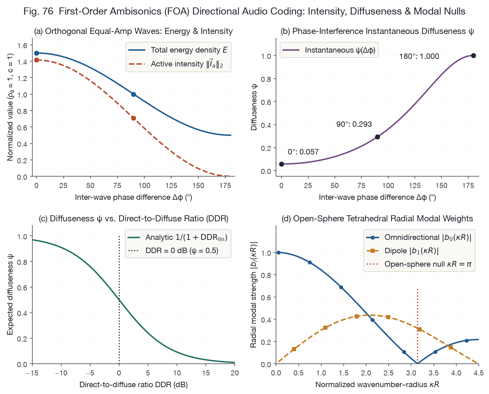
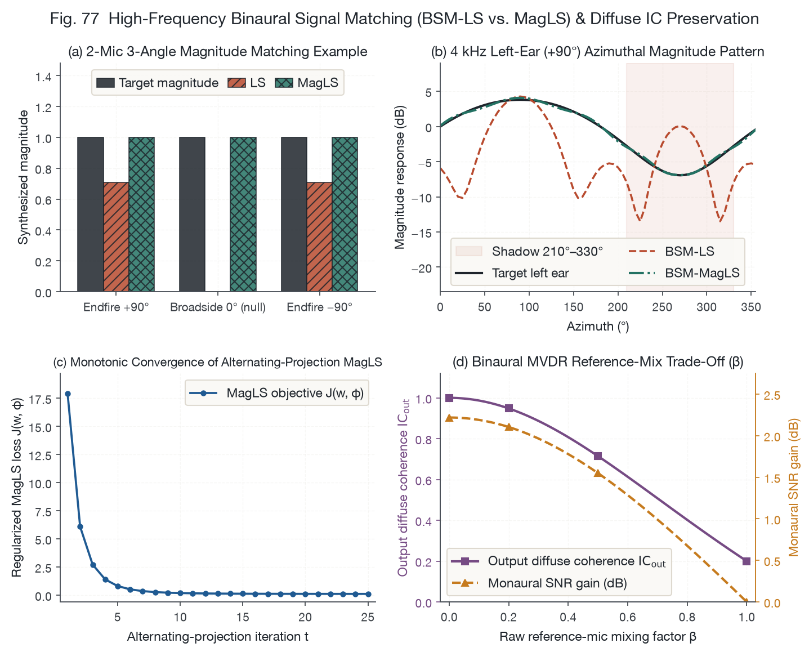
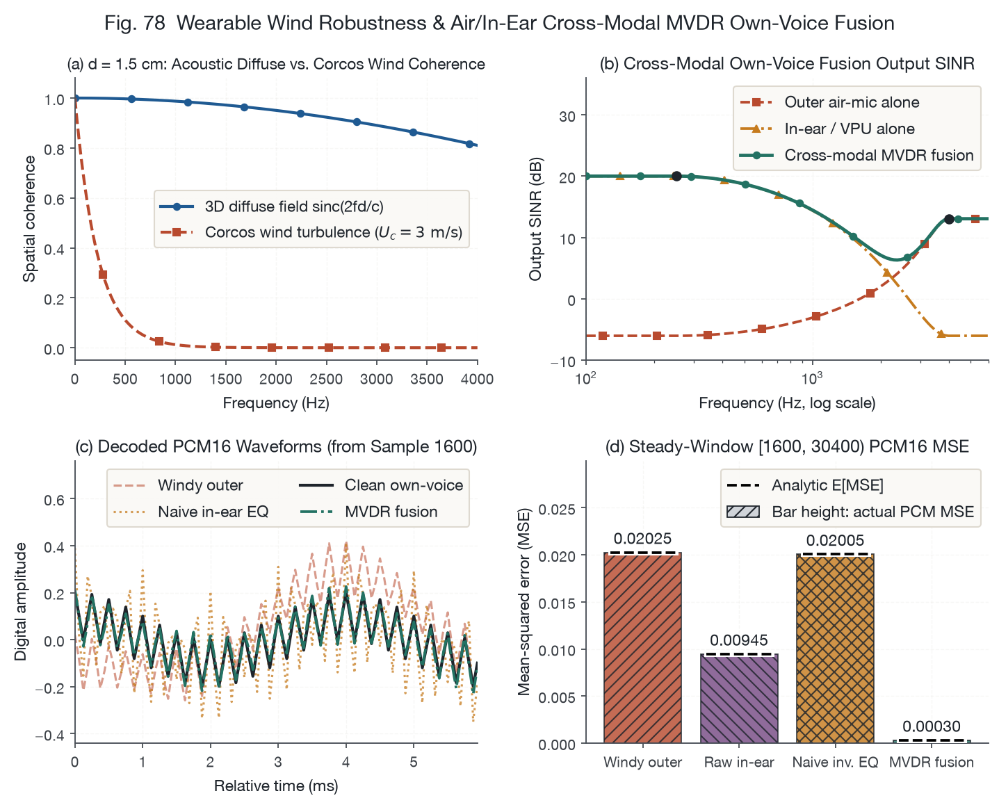
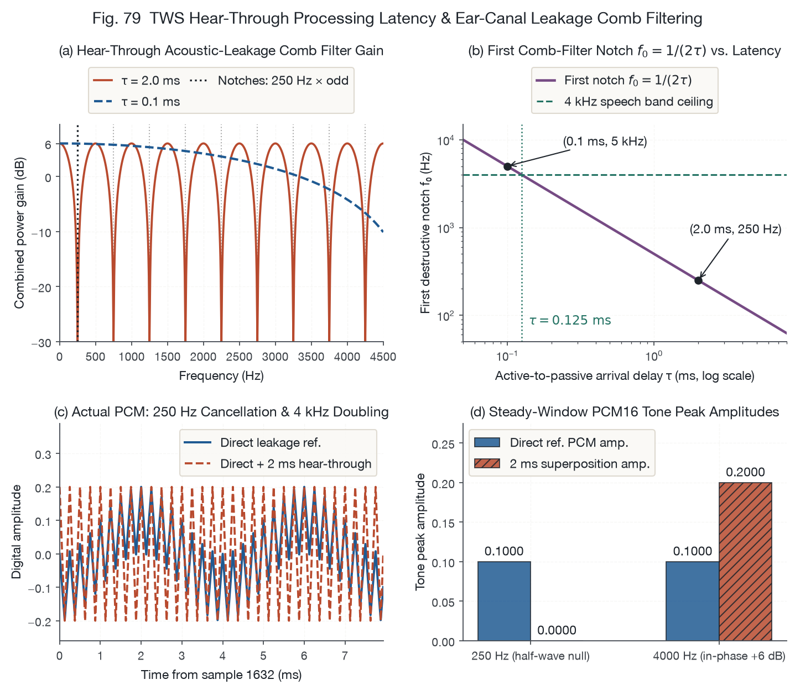

🌐 [简体中文](../chapters/14_spatial-wearable-arrays.md) ｜ **English**

> ⚠️ This chapter is Chapter 14 of the main text (Extended Topic III; the main text comprises 16 chapters in total, Chapters 0–15, where Chapters 12–15 are four extended special topics accompanied by Appendices A and B), immediately following Chapter 13 on distributed collaborative enhancement, systematically introducing three-dimensional spatial sound-field capture, parametric spatial audio coding, and wearable microphone array processing. Three-dimensional rotation group $\mathrm{SO}(3)$, Wirtinger complex gradients, and spherical harmonic derivations appear in [Chapter 0, §0.1](00_math-foundations.md#sec-0-1), [§0.5](00_math-foundations.md#sec-0-5), and [§0.7](00_math-foundations.md#sec-0-7), with global notation references in [Chapter 16, Appendix A](16_appendix-symbols-math.md).
>
> Overview Home: [00_overview.md](00_overview.md) | Previous: [13_distributed-enhancement.md](13_distributed-enhancement.md) | Next: [15_target-extraction-diarization.md](15_target-extraction-diarization.md)

---

## Chapter 14: Spatial Sound Field Capture, Parametric Coding, and Wearable Arrays

### 14.1 From Mono Speech Enhancement to Panoramic Spatial Capture and Wearable Audition

#### Unifying Both Ends Under the Same Physical Wave Equations

The tabletop circular arrays, linear soundbar arrays, and ceiling conference arrays studied in earlier chapters mostly pursued a single-channel objective: extracting a distant talker's voice as cleanly as possible into one mono waveform for Automatic Speech Recognition or far-end telephony. In panoramic spatial recording, Extended Reality (XR) headsets, smart glasses, True Wireless Stereo (TWS) earbuds, and digital hearing aids, however, the audio pipeline undergoes two fundamental paradigm shifts.

First, **the desired output is no longer a directionally flattened mono waveform, but a full 3D directional sound field or binaural ear-canal pressure signal preserving externalized spatial envelopment**. Whether encoding First-Order Ambisonics (FOA) from a compact four-capsule tetrahedral microphone or synthesizing eardrum pressures from miniature microphones scattered across eyeglass frames, spatial filtering must preserve accurate Interaural Time Differences (ITDs), Interaural Level Differences (ILDs), and diffuse environmental envelopment simultaneously. As the wearer rotates their head, rendered virtual sound images must counter-rotate smoothly in real time so acoustic sources stay world-locked in physical space.

Second, **physical form-factor constraints and acoustic interference mechanisms on wearables differ drastically from tabletop devices**. A TWS earbud shell typically spans less than $2\ \mathrm{cm}$—tiny compared to low- and mid-frequency acoustic wavelengths; strong scattering and shadowing by the human head and pinnae invalidate free-field plane-wave steering vectors; and outdoor walking or cycling subjects exposed air-conduction microphones to millimeter-scale turbulent boundary-layer wind buffeting.

Simultaneously, when active Hear-Through (Transparency Mode) is enabled, even a $2\ \mathrm{ms}$ end-to-end digital processing delay causes electro-acoustic playback to interfere with passive acoustic leakage past the eartip, carving periodic comb-filter notches right through the speech band. To overcome the physical limits of exposed air-conduction sensors alone, modern hearables pair outer microphones with occluded in-ear microphones or bone-conduction vibration sensors, fusing modalities statistically to extract clean own-voice speech.

| Application Form Factor | Typical Sensor Suite | Target Output | Core Physical & Engineering Bottlenecks |
|---|---|---|---|
| Compact panoramic capture | Tetrahedral $4$-capsule spherical array | Orthonormal spherical harmonic streams & parametric scene metadata | High-frequency spatial aliasing, open-sphere radial nulls, multi-source interference bias |
| Smart glasses / XR headset pickup | $4$–$6$ irregular MEMS mics across temples and nose bridge | Binaural Signal Matching (BSM) or steerable beams | High-frequency phase wrapping inducing magnitude notches, head-shadow scattering |
| Binaural hearing-aid collaboration | $2$ mics per left/right earhook + wireless binaural link | Low-noise binaural audio preserving binaural cues | Single-target beamformers collapsing diffuse background noise into an in-head point source |
| TWS voice calls & Hear-Through | Outer dual air mics + occluded in-ear mic / bone VPU | Wind-robust own-voice uplink & natural Hear-Through | Spatially incoherent wind buffeting, high-frequency bone-conduction roll-off, leakage comb filtering |

Despite diverse industrial designs, all four systems share the exact same pressure–velocity wave equations, aperture-constrained spatial matching optimization, and multi-sensor second-order statistical fusion principles. This chapter unfolds along the arc: "3D spherical harmonic encoding $\to$ active-intensity parametric coding $\to$ wearable binaural matching and interaural coherence preservation $\to$ wind-robust cross-modal own-voice fusion and sub-$100\ \mu\mathrm{s}$ Hear-Through."

#### Core Terminology and Prerequisite Roadmap

Core abbreviations appearing throughout this chapter are collected below:

| Abbreviation | Full Term | Role in This Chapter |
|---|---|---|
| FOA | First-Order Ambisonics | Represents a local 3D sound field via zeroth-order omnidirectional pressure $W$ plus three orthogonal first-order dipoles $X, Y, Z$ |
| ACN | Ambisonic Channel Number | Standardized spherical-harmonic $(l, m)$ channel ordering; first order maps to $[W, Y, Z, X]^\top$ |
| SN3D | Schmidt Semi-Normalized 3D | Spherical harmonic normalization setting directional peak magnitudes of zeroth- and first-order real bases uniformly to $1$ |
| DirAC | Directional Audio Coding | Parametric spatial analysis estimating instantaneous DOA and diffuseness $\psi$ from short-time pressure and particle velocity |
| BSM | Binaural Signal Matching | Synthesizes target Head-Related Transfer Functions (HRTFs) linearly from arbitrary-geometry wearable arrays |
| MagLS | Magnitude Least-Squares | High-frequency matching criterion relaxing rigid phase targets via alternating phase projection to preserve smooth directional magnitudes |
| IC | Interaural Coherence | Magnitude of normalized interaural cross-correlation governing perceived background width and envelopment |
| OE | Occlusion Effect | Low-frequency ear-canal sound pressure boost induced by skull-conducted own-voice vibrations when an eartip seals the ear canal |

Review [Chapter 1's three binaural localization cues](01_problem-definition.md#sec-1-2), [Chapter 2, §2.3 plane waves and inner-product conventions](02_basics-signal-model.md#sec-2-3), and [Chapter 5, §5.4 MVDR](05_beamforming.md#sec-5-4), [§5.5 multi-constraint LCMV](05_beamforming.md#sec-5-5), and [§5.8 spherical harmonic beamforming](05_beamforming.md#sec-5-8); review $\mathrm{SO}(3)$ rotations, Wirtinger calculus, spherical Bessel functions, and real spherical harmonics in [Chapter 0, §§0.1, 0.5, 0.7](00_math-foundations.md#sec-0-1) and [Appendix A](16_appendix-symbols-math.md). Throughout this chapter we use forward Fourier kernel $e^{-\mathrm{j}2\pi f t}$ (positive-frequency phasor time factor $e^{+\mathrm{j}\omega t}$ with $\omega = 2\pi f$ and wavenumber $\kappa = \omega / c$) and conjugate inner-product output $y = \vec w^H \vec x$.

### 14.2 First-Order Ambisonics (FOA) and Tetrahedral Array Encoding

#### Spherical Angles, First-Order Real Spherical Harmonics, and SN3D / ACN Conventions

In 3D spatial sound capture, clarify coordinate axes and azimuth zero-points relative to 2D planar array broadside conventions first. Under the standard right-handed listener-local Cartesian Ambisonic convention (AmbiX / ISO / AES69 `SOFA`), place the origin at the array center with $+x$ pointing straight ahead, $+y$ pointing due left, and $+z$ pointing straight up. Aligning listener-front physically with the broadside $+y_{\mathrm{book}}$ axis of [Chapter 3, §3.1](03_array-geometry.md#sec-3-1) and [Appendix A, §16.1](16_appendix-symbols-math.md#sec-16-1) yields the Cartesian bridge $[x_{\mathrm{AmbiX}}, y_{\mathrm{AmbiX}}, z_{\mathrm{AmbiX}}]^\top = [y_{\mathrm{book}}, -x_{\mathrm{book}}, z_{\mathrm{book}}]^\top$. Measuring far-field source azimuth $\theta \in (-\pi, \pi]$ counter-clockwise in the horizontal plane from $+x$ toward $+y$, it relates to the clockwise-from-$+y_{\mathrm{book}}$ planar-array angle $\theta_{\mathrm{book}}$ via $\theta \equiv -\theta_{\mathrm{book}} \pmod{360^\circ}$ (wrapped to $(-180^\circ, 180^\circ]$; note that this physical front-to-front listener-local frame differs by $90^\circ$ from the unrotated same-basis mathematical spherical-harmonic azimuth $\alpha = (90^\circ - \theta_{\mathrm{book}}) \bmod 360^\circ$ in [Chapter 0, §0.1.1 Eq. (0-2)](00_math-foundations.md#sec-0-1-1) and [Chapter 5, §5.8](05_beamforming.md#sec-5-8)). With elevation $\phi \equiv \phi_{\mathrm{el}} \in [-\pi/2, \pi/2]$ positive upward toward $+z$, the unit vector **pointing from the origin toward the source** is:

$$\vec n_{\mathrm{src}}(\theta,\phi)
=\begin{bmatrix}n_x\\n_y\\n_z\end{bmatrix}
=\begin{bmatrix}
\cos\phi\cos\theta\\
\cos\phi\sin\theta\\
\sin\phi
\end{bmatrix}.
\tag{14-1}$$

Inspect the four elementary functions in Eq. (14-1): constant $1$ is the omnidirectional zeroth-order ($l = 0$) monopole, while $n_x, n_y, n_z$ trace figure-of-eight cosine dipoles along front–back, left–right, and up–down—the three mutually orthogonal first-order ($l = 1$) real spherical harmonics. Under **SN3D (Schmidt Semi-Normalized 3D)** scaling, directional peak magnitudes of $l = 0$ and $l = 1$ bases all equal $1$ (legacy FuMa multiplied $W$ by $1/\sqrt{2}$; modern toolchains standardize on AmbiX = **ACN channel order + SN3D normalization**). Connecting [Chapter 0, §0.7.4](00_math-foundations.md#sec-0-7-4) and [Chapter 5, §5.8](05_beamforming.md#sec-5-8)'s unit-sphere orthonormal basis $Y_{l,m}^{\mathrm{ortho}}$ ($\int_{S^2}|Y_{l,m}^{\mathrm{ortho}}(\Omega)|^2\,\mathrm{d}\Omega = 1$) with **N3D (Normalized 3D, unit sphere-mean-square)** and **SN3D** used in `spharpy` and `spaudiopy`, all three obey exact conversion at arbitrary $(l, m)$:

$$Y_{l,m}^{\mathrm{N3D}}(\Omega)
=\sqrt{2l+1}\,Y_{l,m}^{\mathrm{SN3D}}(\Omega)
=\sqrt{4\pi}\,Y_{l,m}^{\mathrm{ortho}}(\Omega).$$

Checking peaks and sphere-mean-square $\frac{1}{4\pi}\int_{S^2}|\cdot|^2\,\mathrm{d}\Omega$ at $l = 1$ ($2l + 1 = 3$): $Y_{1,m}^{\mathrm{SN3D}}$ ($n_y, n_z, n_x$) has peak $1$ and sphere-mean-square $1/3$; multiplying by $\sqrt{3}$ gives $Y_{1,m}^{\mathrm{N3D}}$ with peak $\sqrt{3}$ and sphere-mean-square $1$ (integral $4\pi$); dividing by $\sqrt{4\pi}$ gives $Y_{1,m}^{\mathrm{ortho}}$ with peak $\sqrt{3/(4\pi)}$ and integral $1$ (at $l = 0$, $Y_{0,0}^{\mathrm{N3D}} = Y_{0,0}^{\mathrm{SN3D}} = 1$ while $Y_{0,0}^{\mathrm{ortho}} = 1/\sqrt{4\pi}$). For a plane wave of origin pressure phasor $p \in \mathbb{C}$ arriving from $\vec n_{\mathrm{src}}(\theta,\phi)$, ideal first-order B-format in intuitive Cartesian `WXYZ` order versus standard `ACN` order is:

$$\begin{aligned}
\vec b_{\mathrm{WXYZ}}
&=\begin{bmatrix}W & X & Y & Z\end{bmatrix}^\top\\
&=p\begin{bmatrix}1 & n_x & n_y & n_z\end{bmatrix}^\top,\\
\vec b_{\mathrm{ACN}}
&=\begin{bmatrix}W & Y & Z & X\end{bmatrix}^\top\\
&=p\begin{bmatrix}1 & n_y & n_z & n_x\end{bmatrix}^\top.
\end{aligned}\tag{14-2}$$

Using $\vec b_{\mathrm{WXYZ}} = [W, X, Y, Z]^\top$ aligns the last three rows directly with Cartesian $[x, y, z]^\top$ during 3D rotation and acoustic-intensity derivations, while a fixed permutation converts losslessly to/from ACN indices $[0, 1, 2, 3] \leftrightarrow [W, Y, Z, X]$ for standard file I/O (supported bidirectionally in `reorder_foa`).

#### Exact A-Format to B-Format Encoding Matrix for a Regular Tetrahedron

Because four physical dipole capsules cannot occupy a zero-volume point simultaneously, the classic compact 3D capture geometry is the **Regular Tetrahedral Microphone Array**. Selecting four non-adjacent vertices of a cube inscribes a regular tetrahedron on the sphere, stacking capsule look-direction unit vectors (conventionally ordered Front-Left-Up `FLU`, Front-Right-Down `FRD`, Back-Left-Down `BLD`, Back-Right-Up `BRU`, known collectively as raw **A-format**) into $\mathbf U \in \mathbb{R}^{4 \times 3}$:

$$\begin{aligned}
\mathbf U
&=\bigl[\vec u_1,\vec u_2,\vec u_3,\vec u_4\bigr]^\top\\
&=\frac{1}{\sqrt{3}}\begin{bmatrix}
+1 & +1 & +1\\
+1 & -1 & -1\\
-1 & +1 & -1\\
-1 & -1 & +1
\end{bmatrix}.
\end{aligned}\tag{14-3}$$

Two inner-product checks confirm exact tetrahedral isotropy: first, every column of $\mathbf U$ contains two $+1$s and two $-1$s so the four directions sum to zero ($\vec 1_4^\top \mathbf U = \vec 0^\top$); second, distinct columns multiply entry-wise to two $+1$s and two $-1$s (orthogonal) while each column squared sums to $4/3$, giving $\mathbf U^\top \mathbf U = \frac{4}{3}\mathbf I_3$.

Under the low-frequency coincident-capsule model where capsule $q \in \{1..4\}$ has first-order cardioid directivity parameter $\alpha \in (0, 1)$ (standard cardioid $\alpha = 1/2$), capsule response sums omnidirectional $(1 - \alpha)p$ and dipole $\alpha(\vec u_q^\top\vec n_{\mathrm{src}})p$ into $\vec a = [a_1, a_2, a_3, a_4]^\top$:

$$\vec a
=(1-\alpha)p\vec 1_4+\alpha p\mathbf U\vec n_{\mathrm{src}}.
\tag{14-4}$$

Inverting $\vec a$ for $W = p$ and $[X, Y, Z]^\top = p\vec n_{\mathrm{src}}$ uses our two orthogonality identities directly:

1. Left-multiply $\vec a$ by $\vec 1_4^\top$: $\vec 1_4^\top \mathbf U = \vec 0^\top$ cancels the directional term, leaving $\vec 1_4^\top \vec a = 4(1 - \alpha)p \implies W = p$ upon dividing by $4(1 - \alpha)$.
2. Left-multiply $\vec a$ by $\mathbf U^\top$: $\mathbf U^\top \vec 1_4 = \vec 0$ cancels the omnidirectional term, leaving $\mathbf U^\top\vec a = \frac{4\alpha}{3}p\vec n_{\mathrm{src}} \implies [X, Y, Z]^\top = p\vec n_{\mathrm{src}}$ upon multiplying by $\frac{3}{4\alpha}$.

Absorbing $\frac{3}{4\alpha}$ into $\mathbf U^\top$ (simplifying to $\frac{\sqrt{3}}{4\alpha}$) yields the exact $4 \times 4$ real encoding matrix $\mathbf E_{\mathrm{A}\to\mathrm{B}}$ into `WXYZ` SN3D B-format:

$$\begin{aligned}
\vec b_{\mathrm{WXYZ}}
&=\mathbf E_{\mathrm{A}\to\mathrm{B}}\vec a,\\
\mathbf E_{\mathrm{A}\to\mathrm{B}}
&=\begin{bmatrix}
g_W & g_W & g_W & g_W\\
g_1 & g_1 & -g_1 & -g_1\\
g_1 & -g_1 & g_1 & -g_1\\
g_1 & -g_1 & -g_1 & g_1
\end{bmatrix},
\end{aligned}\tag{14-5}$$

where $g_W = \frac{1}{4(1 - \alpha)}$ and $g_1 = \frac{\sqrt{3}}{4\alpha}$. Standard cardioids ($\alpha = 1/2$) give $g_W = \frac{1}{2}$ and $g_1 = \frac{\sqrt{3}}{2} \approx 0.866025$. Notice both singular limits: as $\alpha \to 0$ (four coincident omnis), $g_1 \to \infty$ (zero gradient observability); as $\alpha \to 1$ (four pure figure-of-eights), $g_W \to \infty$ (four dipoles sum identically to zero, losing $W$).

#### Open-Sphere vs. Rigid-Sphere Radial Modal Weights and the $\kappa R = \pi$ Forbidden Null

Real tetrahedral capsules sit at finite radius $R > 0$ rather than a mathematical point. On an acoustically transparent **open sphere** of radius $R$ populated with omnidirectional pressure sensors, an incident unit plane wave $p(R,\Omega) = e^{+\mathrm{j}\kappa R\,\vec n_{\mathrm{src}}^\top\vec u(\Omega)}$ expands via Jacobi–Anger into $\sum_{l=0}^{\infty}(2l+1)\mathrm{j}^l j_l(\kappa R)P_l(\vec n_{\mathrm{src}}^\top\vec u)$. Pairing peak-normalized SN3D real harmonics with the continuous **sphere-mean projection** operator:

$$\tilde{B}_{l,m}(\kappa R)
=\frac{1}{4\pi}\int_{S^2}p(R,\Omega)\,
Y_{l,m}^{\mathrm{SN3D}}(\Omega)\,\mathrm{d}\Omega.$$

Why does factor $2l + 1 = 3$ in Jacobi–Anger's first-order term $3\mathrm{j}\,j_1(\kappa R)(\vec n_{\mathrm{src}}^\top\vec u)$ cancel out in the final radial modal weight? Because continuous isotropic second-moment integration over the sphere gives $\frac{1}{4\pi}\int_{S^2}(\vec n_{\mathrm{src}}^\top\vec u)\vec u\,\mathrm{d}\Omega = \frac{1}{3}\vec n_{\mathrm{src}}$: factor $1/3$ cancels $2l + 1 = 3$ identically so the continuous spherical projection obeys $\tilde{B}_{l,m}(\kappa R) = b_l^{\mathrm{open}}(\kappa R)\,Y_{l,m}^{\mathrm{SN3D}}(\Omega_{\mathrm{src}})$, yielding sphere-mean-normalized open-sphere radial weights (differing from orthonormal-basis $4\pi\mathrm{j}^l j_l(\kappa R)$ in [Chapter 0, §0.7.3](00_math-foundations.md#sec-0-7-3) Eq. (0-63) and [Chapter 5, §5.8](05_beamforming.md#sec-5-8) Eq. (5-24) solely by solid-angle constant $4\pi$, with identical zeros at $\kappa R = \pi$):

$$\begin{aligned}
b_0^{\mathrm{open}}(\kappa R)
&=j_0(\kappa R)
=\frac{\sin(\kappa R)}{\kappa R},\\
b_1^{\mathrm{open}}(\kappa R)
&=\mathrm{j}\,j_1(\kappa R)\\
&=\mathrm{j}\,\frac{\sin(\kappa R)-\kappa R\cos(\kappa R)}
{(\kappa R)^2}.
\end{aligned}\tag{14-6}$$

When approximating this continuous integral by equal-weight discrete quadrature $\frac{1}{4}[\vec 1_4, \mathbf U]^\top\vec p$ on a four-capsule regular tetrahedron, mind one critical discrete boundary: although Eq. (14-3) satisfies $\frac{1}{4}\mathbf U^\top\mathbf U = \frac{1}{3}\mathbf I_3$, a four-point regular tetrahedron forms only a **spherical 2-design** (exact solely for products of spherical harmonics with $l_1 + l_2 \le 2$, while third-order moments remain nonzero). Consequently, second-order quadrupole modes ($l = 2$) are not orthogonal to first-order dipole bases ($l = 1$) on the four-point grid, so obliquely incident plane waves leak via aliasing into the $X, Y, Z$ channels even below $\kappa R = 1$. For a horizontal plane wave at $\theta = 45^\circ, \phi = 0^\circ$ ($\vec n_{\mathrm{src}} = [1/\sqrt{2}, 1/\sqrt{2}, 0]^\top$), the capsule projections are $\mathbf U\vec n_{\mathrm{src}} = [\sqrt{2/3}, 0, 0, -\sqrt{2/3}]^\top$, so equal-weight open-sphere quadrature $\frac{1}{4}\mathbf U^\top e^{+\mathrm{j}\kappa R\,\mathbf U\vec n_{\mathrm{src}}}$ yields the exact closed form:

$$\begin{aligned}
X&=\frac{\mathrm{j}}{2\sqrt{3}}\sin\!\left(\kappa R\sqrt{\tfrac{2}{3}}\right),\\
Z&=\frac{1}{2\sqrt{3}}\!\left[\cos\!\left(\kappa R\sqrt{\tfrac{2}{3}}\right)-1\right],\\
\frac{|Z|}{|X|}&=\tan\!\left(\frac{\kappa R}{\sqrt{6}}\right).
\end{aligned}$$

Thus the vertical channel $Z$ suffers spurious leakage $|Z|/|X| \approx 20.70\%$ already at $\kappa R = 0.5$ and $43.26\%$ at $\kappa R = 1.0$. Moreover, commercial tetrahedral microphones typically employ cardioid (rather than omnidirectional) capsules whose radial response combines monopole and radial-gradient terms, altering the modal weights of Eq. (14-6) and mitigating the open-sphere omnidirectional null at $\kappa R = \pi$.

Equation (14-6) establishes two fundamental physical boundaries for spherical arrays:

- **High-frequency open-sphere forbidden null ($\kappa R = \pi$) vs. rigid-sphere $h_l^{(2)}$ scattering closure**: When half a wavelength equals sphere radius, $\kappa R = \pi$ ($f_{\mathrm{null}} = \frac{c}{2R}$), $\sin(\pi) = 0$ drives $b_0^{\mathrm{open}}(\pi) = 0$—omnidirectional pressures integrate to zero across the sphere, so digital radial equalization amplifies thermal noise without recovering $W$. Flush-mounting sensors on a **rigid baffle sphere** enforces zero radial velocity $\left.\partial_r p\right|_{r=R} = 0$, exciting an outgoing scattered wave; applying the spherical Bessel Wronskian ([Chapter 0, §0.7.3](00_math-foundations.md#sec-0-7-3) Eq. (0-63)) yields the exact rigid-sphere radial weight:

    $$b_l^{\mathrm{rigid}}(\kappa R)
    =\mathrm{j}^l\left[j_l(\kappa R)
    -\frac{j_l'(\kappa R)}{h_l^{(2)\prime}(\kappa R)}\,
    h_l^{(2)}(\kappa R)\right]
    =\frac{\mathrm{j}^{l-1}}
    {(\kappa R)^2\,h_l^{(2)\prime}(\kappa R)}.$$

    Mind the time-harmonic sign convention here: under forward Fourier kernel $e^{-\mathrm{j}\omega t}$ (phasor time factor $e^{+\mathrm{j}\omega t}$), outgoing waves lagging in phase with increasing $r$ **must use spherical Hankel functions of the second kind** $h_l^{(2)}(\kappa r) = j_l(\kappa r) - \mathrm{j}y_l(\kappa r)$; copying $h_l^{(1)}(\kappa r)$ from acoustics texts adopting $e^{-\mathrm{j}\omega t}$ phasors conjugates scattering phase completely.

    Because $h_l^{(2)\prime}(\kappa R)$ is zero-free along the positive real axis, a rigid sphere eliminates interior eigen-nulls such as $\kappa R = \pi$. Moreover, for $x = \kappa R \ll 1$, $y_1(x) \approx -1/x^2 \implies h_1^{(2)\prime}(x) \approx -2\mathrm{j}/x^3$, giving $b_1^{\mathrm{rigid}}(x) \approx \mathrm{j}\frac{x}{2} \approx \frac{3}{2}b_1^{\mathrm{open}}(x)$—rigid diffraction expands effective first-order acoustic aperture by $3/2\times$, boosting low-frequency dipole sensitivity by $20\log_{10}(3/2) \approx +3.52\ \mathrm{dB}$ (matching [Chapter 3, E03-17](03_array-geometry.md#e03-17)).
- **Low-frequency WNG penalty, high-frequency spatial aliasing, and Higher-Order Ambisonics (HOA) extension**: For $\kappa R \ll 1$, $|b_1(\kappa R)| \approx \kappa R / 3$ rolls off at $6\ \mathrm{dB/oct}$, requiring Tikhonov-limited radial inverse filters $1/b_1(\kappa R)$ against sensor self-noise; at high frequencies, $4 = (1 + 1)^2$ capsules alias $l \ge 2$ harmonics into $W, X, Y, Z$ once $\kappa R > 1$ ($f_{\mathrm{alias}} \approx \frac{c}{2\pi R}$; see [E14-02](#e14-02)). To achieve narrower spatial mainlobes and suppress multi-source crosstalk over a wider band, practical systems adopt $N$-th-order **Higher-Order Ambisonics (HOA)**: a full 3D $N$-th-order expansion requires $(N + 1)^2$ independent channels (and at least $Q \ge (N + 1)^2$ uniform spherical capsules—for instance, a $32$-capsule rigid spherical array stably encodes up to $N = 4$ with $25$ channels), extending the alias-free ceiling linearly to $f_{\mathrm{alias}} \approx \frac{N c}{2\pi R}$; because higher-order modes roll off more steeply at low frequencies as $(\kappa R)^N$, order-dependent Tikhonov radial regularization filters are mandatory to prevent severe white-noise amplification (see [Chapter 5, §5.8](05_beamforming.md#sec-5-8) for spherical-harmonic beamforming foundations).

### 14.3 Three-Dimensional Sound-Field Rotation and Head-Tracked Coordinate Transforms

#### Cascaded Euler Rotation Matrices and Zeroth-Order Invariance

FOA's decisive advantage for spatial production and XR rendering is that **rotating an entire 3D sound scene arbitrarily requires neither counting sources nor separating streams—just one $4 \times 4$ real orthogonal matrix multiplication on B-format**. By Eq. (14-2), scalar pressure $W = p$ is rotationally invariant while $[X, Y, Z]^\top = p\vec n_{\mathrm{src}}$ transforms identically to a Cartesian 3-vector.

Adopting intrinsic right-handed $Z$-$Y$-$X$ Euler angles—and denoting yaw about $+z$, pitch about $+y$, and roll about $+x$ by $(\phi_z, \phi_y, \phi_x)$ to avoid colliding with capsule directivity $\alpha$ in §14.2 and reference mixing ratio $\beta$ in §14.7—the three elementary axis rotation matrices are:

$$\begin{aligned}
\mathbf R_z(\phi_z)&=\begin{bmatrix}
\cos\phi_z & -\sin\phi_z & 0\\
\sin\phi_z & \cos\phi_z & 0\\
0 & 0 & 1
\end{bmatrix},\\
\mathbf R_y(\phi_y)&=\begin{bmatrix}
\cos\phi_y & 0 & \sin\phi_y\\
0 & 1 & 0\\
-\sin\phi_y & 0 & \cos\phi_y
\end{bmatrix},\\
\mathbf R_x(\phi_x)&=\begin{bmatrix}
1 & 0 & 0\\
0 & \cos\phi_x & -\sin\phi_x\\
0 & \sin\phi_x & \cos\phi_x
\end{bmatrix}.
\end{aligned}\tag{14-7}$$

Cascading $\mathbf R_{\mathrm{scene}}(\phi_z,\phi_y,\phi_x) = \mathbf R_z(\phi_z)\mathbf R_y(\phi_y)\mathbf R_x(\phi_x) \in \mathrm{SO}(3)$ ($\mathbf R_{\mathrm{scene}}^\top = \mathbf R_{\mathrm{scene}}^{-1}, \det = +1$) forms the $4 \times 4$ active scene-rotation matrix on $\vec b_{\mathrm{WXYZ}}$:

$$\vec b'_{\mathrm{WXYZ}}
=\begin{bmatrix}
1 & \vec 0^\top\\
\vec 0 & \mathbf R_{\mathrm{scene}}(\phi_z,\phi_y,\phi_x)
\end{bmatrix}\vec b_{\mathrm{WXYZ}}.
\tag{14-8}$$

Finite 3D rotations do not commute ($90^\circ$ yaw then $90^\circ$ pitch $\ne$ $90^\circ$ pitch then $90^\circ$ yaw), so IMU quaternion/Euler axis orders must be verified first during integration.

Extending this transform to $N$-th-order Higher-Order Ambisonics (HOA) preserves each spherical-harmonic order $l = 0, 1, \ldots, N$ as an invariant subspace without cross-order mixing: an $(N+1)^2$-channel HOA vector rotates via a block-diagonal $(N+1)^2 \times (N+1)^2$ real orthogonal matrix $\mathbf D_{\mathrm{HOA}} = \operatorname{blkdiag}\bigl(1, \mathbf D^{(1)}, \ldots, \mathbf D^{(N)}\bigr)$ of $(2l+1) \times (2l+1)$ real Wigner-D blocks (constructed recursively from $\mathbf D^{(1)}$ via the Ivanic–Ruedenberg recurrence), whose first-order block in `WXYZ` order reduces identically to $\mathbf D^{(1)} = \mathbf R_{\mathrm{scene}}$ in Eq. (14-8).

#### Active Scene Rotation Versus Inverse Head-Tracking Counter-Rotation

In XR headsets and head-tracked earbuds, the most common sign error confuses **"rotating a virtual source actively" with "counter-rotating a static world scene when the wearer turns their head."** Check a concrete anchor: a talker stands stationary straight ahead at world $+x$ ($\vec n_{\mathrm{world}} = [1, 0, 0]^\top$, $\vec b_{\mathrm{world}} = [1, 1, 0, 0]^\top$).

Now the wearer yaws their head left by $\phi_z = +90^\circ$ (nose turns from world $+x$ to world $+y$, pointing the right ear at world $+x$). In the wearer's **head-locked frame**, that stationary world-$+x$ talker now sits **due right** along $-y_{\mathrm{head}}$ ($\vec n_{\mathrm{head}} = [0, -1, 0]^\top$). Whenever head pose relative to the world is $\mathbf R_{\mathrm{head}} = \mathbf R_{\mathrm{scene}}$, mapping a world-locked scene into head coordinates applies the **inverse (transpose)** $\mathbf R_{\mathrm{head}}^\top$:

$$\vec b_{\mathrm{head}}
=\begin{bmatrix}
1 & \vec 0^\top\\
\vec 0 & \mathbf R_{\mathrm{scene}}^\top(\phi_z,\phi_y,\phi_x)
\end{bmatrix}\vec b_{\mathrm{world}}.
\tag{14-9}$$

Omitting the rotation-block transpose $^\top$ in Eq. (14-9) maps the world-$+x$ source to head-$+y$ (left), whereas the correct result is head-$-y$ (right). The two directions differ by $180^\circ$, reversing left and right ([E14-03](#e14-03)).

Before binaural HRIR convolution, enforce two additional engineering checks: first, validate `SOFA` (AES69-2022) spherical-vs.-Cartesian coordinate attributes and left/right ear polarity; second, hold total Motion-to-Sound latency (IMU + wireless link + audio buffer) inside dynamic perceptual bounds so rapid head turns do not drag world-locked images ([E14-15](#e14-15)).

### 14.4 Active Intensity, Total Energy Density, and Parametric Spatial Audio (DirAC)

#### Pressure–Velocity Phase and Sign Conventions Under Euler's Momentum Equation

Linear first-order decoding alone (e.g., virtual cardioids) exhibits wide spatial mainlobes causing localization blur and coloration. Pulkki's (2007) **Directional Audio Coding (DirAC)** leverages human psychoacoustics—within one critical band at one instant, the auditory system resolves one dominant arrival direction plus surround diffuseness—estimating instantaneous energy transport direction and diffuse fraction at each STFT bin $(k, \ell)$ from origin pressure $p \in \mathbb{C}$ and 3D particle velocity $\vec u = [u_x, u_y, u_z]^\top \in \mathbb{C}^3$.

Sort out **wave-propagation direction versus source DOA signs** under forward kernel $e^{-\mathrm{j}\omega t}$ first (notation note: throughout §14.4, $\vec u$ denotes the complex acoustic particle velocity vector in $\mathrm{m/s}$, whereas dimensionless unit direction vectors for sources, capsules, and loudspeakers are denoted $\vec n_{\mathrm{src}}, \vec u_q$, and $\vec u_\ell$, respectively). In a linear inviscid fluid of ambient density $\rho_0$, Newton's second law $\rho_0 \partial_t \vec u = -\nabla p$ maps under phasor factor $e^{+\mathrm{j}\omega t}$ ($\partial_t \leftrightarrow +\mathrm{j}\omega$) to $+\mathrm{j}\omega\rho_0\vec u = -\nabla p$.

A plane wave arriving from source direction $\vec n_{\mathrm{src}}$ propagates along $\vec d_{\mathrm{prop}} = -\vec n_{\mathrm{src}}$; under [Chapter 3, §3.1's steering convention](03_array-geometry.md#sec-3-1), points closer to the source lead in phase ($\varphi = \kappa\vec n_{\mathrm{src}}^\top\vec r$, $p(\vec r) = p_0 e^{\mathrm{j}\varphi}$). Taking $\nabla p = +\mathrm{j}\kappa \vec n_{\mathrm{src}} p$, substituting into $+\mathrm{j}\omega\rho_0\vec u = -\nabla p$, and using $\kappa / \omega = 1/c$ links physical particle velocity to FOA dipoles:

$$\begin{aligned}
\vec u
&=-\frac{p}{\rho_0 c}\vec n_{\mathrm{src}}
=+\frac{p}{\rho_0 c}\vec d_{\mathrm{prop}}\\
&=-\frac{1}{\rho_0 c}\begin{bmatrix}X & Y & Z\end{bmatrix}^\top.
\end{aligned}\tag{14-10}$$

Equation (14-10) keeps both vectors distinct: in-phase particle velocity $\vec u$ points along **net acoustic energy propagation** $\vec d_{\mathrm{prop}}$, whereas FOA $[X, Y, Z]^\top = p\vec n_{\mathrm{src}}$ points **back toward the source** $\vec n_{\mathrm{src}} = -\vec d_{\mathrm{prop}}$. Complex intensity $\vec I_c = \frac{1}{2}p^*\vec u = \vec I_a + \mathrm{j}\vec I_r$ splits into time-averaged **active intensity** $\vec I_a$ (net propagating flux) and **reactive intensity** $\vec I_r$ (local oscillatory sloshing), paired with **time-averaged total acoustic energy density** $E$ (potential + kinetic):

$$\begin{aligned}
\vec I_a&=\frac{1}{2}\operatorname{Re}\{p^*\vec u\},\\
\vec I_r&=\frac{1}{2}\operatorname{Im}\{p^*\vec u\},\\
E&=\frac{|p|^2}{4\rho_0 c^2}+\frac{\rho_0\|\vec u\|_2^2}{4}.
\end{aligned}\tag{14-11}$$

Factor $1/4$ combines $1/2$ (peak-squared to time-mean-square) with physical $1/2$ in $\frac{p^2(t)}{2\rho_0 c^2}$ and $\frac{1}{2}\rho_0\|\vec u(t)\|_2^2$. For a single free-field traveling wave ($\|\vec u\|_2 = |p|/(\rho_0 c)$), potential and kinetic densities each equal $\frac{|p|^2}{4\rho_0 c^2}$, giving $E = \frac{|p|^2}{2\rho_0 c^2}$ and $\|\vec I_a\|_2 = \frac{|p|^2}{2\rho_0 c} = cE$. Whenever $\bar{\vec I}_a = \mathbb{E}[\vec I_a] \ne \vec 0$, unit source DOA is $\hat{\vec n}_{\mathrm{DOA}} = -\bar{\vec I}_a / \|\bar{\vec I}_a\|_2$.

#### Rigorous Proof That Diffuseness $\psi \in [0, 1]$

In reverberant, standing-wave, or multi-source interference fields where energy oscillates locally or cancels partially, net flux $\|\mathbb{E}[\vec I_a]\|_2$ falls below $c\,\mathbb{E}[E]$, motivating dimensionless **diffuseness** $\psi$:

$$\psi
=1-\frac{\|\mathbb{E}[\vec I_a]\|_2}{c\,\mathbb{E}[E]}.
\tag{14-12}$$

Why is $\psi \in [0, 1]$ guaranteed across *arbitrary* complex pressures, 3D complex velocities, and snapshot distributions? On a single snapshot, $\|\operatorname{Re}\{p^*\vec u\}\|_2 \le |p|\,\|\vec u\|_2$ gives:

$$\begin{aligned}
cE-\|\vec I_a\|_2
&=\frac{|p|^2}{4\rho_0 c}+\frac{\rho_0 c\|\vec u\|_2^2}{4}
-\frac{1}{2}\|\operatorname{Re}\{p^*\vec u\}\|_2\\
&\ge\frac{|p|^2}{4\rho_0 c}+\frac{\rho_0 c\|\vec u\|_2^2}{4}
-\frac{1}{2}|p|\,\|\vec u\|_2\\
&=\frac{1}{4}\left(\frac{|p|}{\sqrt{\rho_0 c}}
-\sqrt{\rho_0 c}\,\|\vec u\|_2\right)^2\ge 0.
\end{aligned}\tag{14-13}$$

Taking expectations across snapshots via Jensen's triangle inequality $\|\bar{\vec I}_a\|_2 \le \mathbb{E}[\|\vec I_a\|_2] \le c\,\mathbb{E}[E]$ and dividing by $c\,\mathbb{E}[E] > 0$ proves $0 \le \psi \le 1$, with exact physical endpoint characterizations:

- $\psi = 0 \iff |p| = \rho_0 c\|\vec u\|_2$, $\vec I_r = \vec 0$, and identical flux direction across every snapshot—a **pure single-direction free-field traveling wave**.
- $\psi = 1 \iff \mathbb{E}[\vec I_a] = \vec 0$—covering isotropic diffuse reverberation, equal-amplitude opposing standing waves, and pure $90^\circ$-quadrature reactive near fields.

Further consider an uncorrelated superposition of a single stationary plane wave (energy density $E_{\mathrm{dir}}$, $\|\mathbb{E}[\vec I_{a,\mathrm{dir}}]\|_2 = c E_{\mathrm{dir}}$) and an isotropic diffuse field ($E_{\mathrm{diff}}$, $\mathbb{E}[\vec I_{a,\mathrm{diff}}] = \vec 0$). Zero cross-expectation yields additive total energy $\mathbb{E}[E] = E_{\mathrm{dir}} + E_{\mathrm{diff}}$ and net flux magnitude $c E_{\mathrm{dir}}$; defining linear Direct-to-Diffuse Ratio $\mathrm{DDR}_{\mathrm{lin}} = E_{\mathrm{dir}} / E_{\mathrm{diff}}$, Eq. (14-12) immediately produces the closed-form curve plotted in Figure 76(c):

$$\psi
=1-\frac{c E_{\mathrm{dir}}}{c(E_{\mathrm{dir}}+E_{\mathrm{diff}})}
=\frac{1}{1+E_{\mathrm{dir}}/E_{\mathrm{diff}}}
=\frac{1}{1+\mathrm{DDR}_{\mathrm{lin}}}.$$

DirAC splits each time–frequency tile into a **direct directional stream** of energy $(1 - \psi)E$ panned to $\hat{\vec n}_{\mathrm{DOA}}$ and a **diffuse ambient stream** of energy $\psi E$ fed through decorrelators around the listener.

This short-time parametric model has evolved directly into core international spatial audio standards: inside the 5G immersive conversational codec **3GPP TS 26.253 (IVAS)** (standardized 2024–2025), DirAC underpins **Metadata-Assisted Spatial Audio (MASA)**, pairing $1$–$2$ transport channels with low-bitrate direction, diffuseness, and coherence metadata for real-time mobile spatial communications; on the volumetric media side, **ISO/IEC 23090-4:2025 (MPEG-I Immersive Audio)** extends 3DoF Ambisonics and HRTF rendering to full 6DoF translational acoustics incorporating occlusion, diffraction, and Doppler effects.

#### Worked Calculation 14-1: Single Wave, In-Phase Dual Waves, and Quadrature Dual Waves

Setting normalized medium constants $\rho_0 = 1, c = 1$, let us hand-calculate three canonical wavefields (`active_intensity_and_diffuseness`):

1. **Single $+x$-propagating plane wave** ($p = 1, \vec u = [1, 0, 0]^\top$): Eq. (14-11) gives $\vec I_a = [0.5, 0, 0]^\top$ ($\|\vec I_a\|_2 = 0.5$), $E = 0.25 + 0.25 = 0.5$, and $\psi = 1 - 0.5/0.5 = 0$.

2. **Two equal-amplitude orthogonal waves in phase ($\Delta\phi = 0^\circ$)**: Wave 1 along $+x$ ($p_1 = 1, \vec u_1 = [1, 0, 0]^\top$) + Wave 2 along $+y$ ($p_2 = 1, \vec u_2 = [0, 1, 0]^\top$) give $p = 2$ and $\vec u = [1, 1, 0]^\top$ ($\|\vec u\|_2^2 = 2$):

    $$\begin{aligned}
    \vec I_a&=\frac{1}{2}\operatorname{Re}\{2\times[1,1,0]^\top\}
    =[1,1,0]^\top,\\
    \|\vec I_a\|_2&=\sqrt{2},\qquad
    E=\frac{|2|^2}{4}+\frac{2}{4}=1.5,\\
    \psi&=1-\frac{\sqrt{2}}{1.5}
    =1-\frac{2\sqrt{2}}{3}\approx 0.057191.
    \end{aligned}$$

    Flux points along $[1, 1, 0]^\top / \sqrt{2}$—the **$45^\circ$ phantom direction** midway between both waves—while constructive pressure interference ($|p|^2 = 4 > 2$) makes potential density ($1.0$) exceed kinetic density ($0.5$), inducing slight instantaneous diffuseness $\psi \approx 0.057191$.

3. **Two equal-amplitude orthogonal waves in $90^\circ$ quadrature ($\Delta\phi = 90^\circ$)**: Setting $p_2 = \mathrm{j}, \vec u_2 = [0, \mathrm{j}, 0]^\top$ gives $p = 1 + \mathrm{j}$ ($|p|^2 = 2$), $\vec u = [1, \mathrm{j}, 0]^\top$ ($\|\vec u\|_2^2 = 2$), and $p^*\vec u = [1 - \mathrm{j},\ 1 + \mathrm{j},\ 0]^\top$:

    $$\begin{aligned}
    \vec I_a&=\frac{1}{2}\operatorname{Re}\{p^*\vec u\}
    =[0.5,0.5,0]^\top,\\
    \vec I_r&=\frac{1}{2}\operatorname{Im}\{p^*\vec u\}
    =[-0.5,+0.5,0]^\top,\\
    \|\vec I_a\|_2&=\frac{1}{\sqrt{2}},\qquad E=0.5+0.5=1.0,\\
    \psi&=1-\frac{1/\sqrt{2}}{1.0}
    =1-\frac{1}{\sqrt{2}}\approx 0.292893.
    \end{aligned}$$

**What this shows**: Shifting phase from $0^\circ$ to $90^\circ$ keeps the phantom azimuth at $45^\circ$ while converting part of forward transport into transverse reactive sloshing $\vec I_r = [-0.5, +0.5, 0]^\top$, raising $\psi$ from $0.057191$ to $0.292893$ (if the two waves are uncorrelated across frames, the long-window statistical average likewise converges to $1 - 1/\sqrt{2} \approx 0.292893$; see Figure 76(a)–(b) for the full phase-dependence curves).

**Where single-direction parameterization breaks down**: When two talkers overlap in the same time–frequency bin, active intensity reports only their energy-weighted vector sum; in particular, two equal-power talkers facing each other ($+x$ and $-x$) cancel net flux to $\mathbb{E}[\vec I_a] = \vec 0$ and $\psi = 1$, misclassifying two clean voices as $100\%$ diffuse reverberation ([E14-05](#e14-05)).

#### Reading Figure 76 and Multi-Source Boundaries of Parametric Spatial Coding



Figure 76 connects dual-wave interference, DDR mapping, and spherical modal bounds across four panels:

- **Panel (a) Active-intensity norm and total energy density of orthogonal waves**: Across $\Delta\phi \in [0^\circ, 180^\circ]$ ($\rho_0 = c = 1$), solid blue $E(\Delta\phi) = 1 + \frac{1}{2}\cos\Delta\phi$ and dashed red $\|\vec I_a(\Delta\phi)\|_2 = \frac{\sqrt{2}}{2}(1 + \cos\Delta\phi)$ mark our $0^\circ$ and $90^\circ$ anchors; at $\Delta\phi = 180^\circ$ ($p = 0$ pressure node), $\|\vec I_a\|_2 = 0$ while kinetic energy retains $E = 0.5$.
- **Panel (b) Instantaneous diffuseness vs. phase difference**: Solid purple rises from $0.057$ ($0^\circ$) through $0.293$ ($90^\circ$) to $1.000$ ($180^\circ$), illustrating why practical DirAC smooths $\vec I_a$ and $E$ temporally across frames.
- **Panel (c) Direct-to-Diffuse Ratio (DDR) mapping**: Plots $\psi = 1/(1 + \mathrm{DDR}_{\mathrm{lin}})$ against $\mathrm{DDR} = 10\log_{10}(E_{\mathrm{dir}}/E_{\mathrm{diff}}) \in [-15, +20]\ \mathrm{dB}$ (distinct from RIR early/late $\mathrm{DRR}$ in [Chapter 2, §2.4.3](02_basics-signal-model.md#sec-2-4-3)), crossing $\psi = 0.5$ at $\mathrm{DDR} = 0\ \mathrm{dB}$.
- **Panel (d) Open-sphere radial modal magnitudes**: Over $\kappa R \in [0.05, 4.5]$, solid blue $|b_0(\kappa R)|$ plunges to zero at $\kappa R = \pi$ (red dotted), while dashed orange $|b_1(\kappa R)|$ vanishes as $\kappa R \to 0$, peaks at $\approx 0.436$ near $\kappa R \approx 2.08$, and then plunges into its first dipole null at the right edge $\kappa R \approx 4.493$ (solving $\tan(\kappa R) = \kappa R$), jointly framing the usable bandwidth of compact spherical arrays.

In loudspeaker or virtual-speaker binaural rendering, parametric DirAC pairs with linear Ambisonic decoding (see Zotter & Frank's 2019 monograph for comprehensive 3D theory and practice). For $L$ loudspeakers at unit directions $\{\vec u_\ell\}_{\ell=1}^L$ with real feed-gain vector $\vec d = [d_1, \ldots, d_L]^\top$ and $N$-th-order **Higher-Order Ambisonics (HOA)** spherical-harmonic sampling matrix $\mathbf Y_L \in \mathbb{R}^{L \times (N+1)^2}$, four linear decoder architectures $\mathbf D \in \mathbb{R}^{L \times (N+1)^2}$ address progressively less regular layouts:

- **Sampling Ambisonic Decoder (SAD)**: Here $\mathbf Y_L$ uses real spherical harmonics orthonormal under the sphere-mean inner product (N3D), with the input coefficients converted to that same normalization. Then $\mathbf D_{\mathrm{SAD}}=\mathbf Y_L/L$ reproduces modal coefficients on a uniform $t$-design for $t\ge2N$. The stronger $t\ge2N+1$ condition can support energy-vector design; it is not needed merely to integrate degree-$2N$ harmonic products. For SN3D, include degree normalization: FOA tetrahedral $[1,u_x,u_y,u_z]$ gives $\mathbf Y_L^\top\mathbf Y_L/L=\operatorname{diag}(1,1/3,1/3,1/3)$, requiring column factors $[1,3,3,3]/L$ rather than bare $1/L$.
- **Mode-Matching Decoder (MMD)**: takes the pseudoinverse $\mathbf D_{\mathrm{MMD}} = \mathbf Y_L(\mathbf Y_L^\top\mathbf Y_L)^{-1}$ when $L \ge (N+1)^2$ and $\mathbf Y_L$ has full column rank (satisfying $\mathbf Y_L^\top\mathbf D_{\mathrm{MMD}} = \mathbf I_{(N+1)^2}$), reproducing spherical-harmonic modes up to order $N$ exactly; on irregular setups (5.1/7.1.4) or rigs missing lower-hemisphere speakers, however, ill-conditioned $\mathbf Y_L$ produces large opposing speaker gains and severe energy/noise instability.
- **Energy-Preserving Ambisonic Decoder (EPAD; Zotter, Pomberger, & Noisternig, 2012)**: applies SVD polar factorization $\mathbf Y_L = \mathbf U\boldsymbol\Sigma\mathbf V^\top \implies \mathbf D_{\mathrm{EPAD}} \propto \mathbf U\mathbf V^\top$, enforcing orthonormal columns ($\mathbf D_{\mathrm{EPAD}}^\top\mathbf D_{\mathrm{EPAD}} \propto \mathbf I$) so total radiated loudness stays strictly direction-invariant across moderately irregular layouts without inverting small singular values.
- **All-Round Ambisonic Decoding (AllRAD; Zotter & Frank, 2012)**: decouples decoding into two stages, $\mathbf D_{\mathrm{AllRAD}} = \mathbf G_{\mathrm{VBAP}}\,\mathbf D_{\mathrm{virt}}$, first decoding HOA onto a uniform virtual spherical $t$-design loudspeaker grid and then mapping each virtual node onto its nearest physical loudspeaker triangle via Vector Base Amplitude Panning (VBAP)—placing an imaginary absorbing sink across lower-hemisphere voids to prevent energy wrap-around—preserving smooth directional panning and stable energy across arbitrary irregular layouts.

**Dual-band velocity/energy crossover and $N$-th-order $\max\text{-}r_E$ modal weights**: Below $\approx 700\ \mathrm{Hz}$, where human localization relies on interaural phase cues, Basic decoding ($a_n = 1$) preserves the exact **Gerzon velocity vector** $\vec r_V = \frac{\sum_\ell d_\ell \vec u_\ell}{\sum_\ell d_\ell}$; above $\approx 700\ \mathrm{Hz}$, a phase-matched crossover transitions smoothly to $\max\text{-}r_E$ modal weights maximizing the **Gerzon energy vector** $\vec r_E = \frac{\sum_\ell d_\ell^2 \vec u_\ell}{\sum_\ell d_\ell^2}$ (or non-negative in-phase weights) to narrow high-frequency image spread and suppress opposite-side antiphase crosstalk. For 3D $N$-th-order HOA, Zotter & Frank (2012) give the Legendre-polynomial ($P_n$) closed-form approximation:

$$a_n \approx P_n\!\left(\cos\frac{137.9^\circ}{N+1.51}\right),\qquad n=0,1,\ldots,N,$$

which evaluates at $N = 1$ to $a_1 \approx \cos 54.94^\circ \approx 0.5744$, closely matching the exact 3D octahedral Legendre root $1/\sqrt{3} \approx 0.5774$ derived in [E14-14](#e14-14) (whereas 2D regular polygons follow the Chebyshev root $1/\sqrt{2}$; diffuse-field energy normalization is applied when switching bands to keep loudness flat). Extending this frequency-split philosophy to headphone binaural playback highlights the architectural contrast between **HOA-MagLS** (Schörkhuber et al., 2018) and **BSM-MagLS** (§14.6): **HOA-MagLS** operates in the *spherical-harmonic domain* on an already-encoded $(N+1)^2$-channel HOA stream, matching complex SH-domain HRTFs below order cutoff $f_c \approx \frac{N c}{2\pi r_{\mathrm{head}}}$ for accurate low-frequency ITDs while relaxing phase targets above $f_c$ to eliminate spatial-order truncation roll-off and coloration—retaining effortless block-diagonal Wigner-D head rotation Eq. (14-9). By contrast, **BSM-MagLS** (§14.6) skips an ill-conditioned intermediate spherical-harmonic encoding step and fits target binaural HRTFs directly in the *sensor array domain*, making it far better suited to irregular head-scattered smart glasses and AR headsets at the cost of rotating or recomputing the target HRTF sampling grid directly during head tracking.

### 14.5 Wearable Irregular Micro-Aperture Arrays and Binaural Signal Matching (BSM)

#### Eyeglass Temples, Head Shadowing, and the BSM Objective

Distinguish **Binaural Signal Matching (BSM)** here from **binaural LCMV / MVDR** in [Chapter 5, §5.5](05_beamforming.md#sec-5-5) (and [§5.9](05_beamforming.md#sec-5-9)): binaural LCMV/MVDR targets hearing-aid noise reduction by imposing distortionless constraints on known talker directions and adapting to live $\mathbf R_{nn}$; BSM targets panoramic spatial capture on AR/VR headsets and smart glasses, designing fixed time-invariant filters that approximate the wearer's full-sphere free-field binaural HRTF manifold across all directions simultaneously.

Moving from spherical arrays to smart glasses or ear-worn devices breaks spherical harmonic orthogonality immediately: $M$ MEMS mics sit asymmetrically across nose pads, brow rims, and temples around a strongly scattering human head. How can irregular sensor observations $\vec x(f) \in \mathbb{C}^{M \times 1}$ linearly synthesize $\hat p_e(f) = \vec w_e^H(f)\vec x(f)$ matching left ($e = \mathrm{L}$) and right ($e = \mathrm{R}$) eardrum pressures?

**BSM** samples $Q$ directions $\Omega_1, \ldots, \Omega_Q$ around the head in an anechoic chamber or BEM solver. At frequency $f$ (suppressed below), stacking wearable array transfer vectors $\vec h(\Omega_q) \in \mathbb{C}^{M \times 1}$ into $\mathbf H \in \mathbb{C}^{M \times Q}$ and true target-ear HRTF complex responses $p_e(\Omega_q) \in \mathbb{C}$ into $\vec p_e \in \mathbb{C}^{Q \times 1}$:

$$\begin{aligned}
\mathbf H&=\bigl[\vec h(\Omega_1),\ldots,\vec h(\Omega_Q)\bigr]
\in\mathbb{C}^{M\times Q},\\
\vec p_e&=\bigl[p_e(\Omega_1),\ldots,p_e(\Omega_Q)\bigr]^\top
\in\mathbb{C}^{Q\times 1}.
\end{aligned}\tag{14-14}$$

Verify conjugation carefully under $\hat p_e(\Omega_q) = \vec w_e^H \vec h(\Omega_q)$: transposing row $\vec w_e^H \mathbf H$ gives $\hat{\vec p}_e = \mathbf H^\top \vec w_e^*$, whose complex conjugate is **$\mathbf H^H \vec w_e = \hat{\vec p}_e^*$**—so left-multiplying column $\vec w_e$ by $\mathbf H^H$ fits **conjugated target vector $\vec p_e^*$** (omitting $^*$ inverts phases and swaps left/right ITD lead-lag).

#### Normal Equations for Complex Least-Squares BSM (BSM-LS)

With non-negative directional quadrature weights $\mathbf W_\Omega = \operatorname{diag}(w_{\Omega,1},\ldots,w_{\Omega,Q})$ (compensating grid solid angles or emphasizing the frontal field of view) and Tikhonov regularization $\lambda \ge 0$ controlling WNG, **BSM-LS** minimizes:

$$\begin{aligned}
J_{\mathrm{LS}}(\vec w_e)
&=\bigl(\mathbf H^H\vec w_e-\vec p_e^*\bigr)^H
\mathbf W_\Omega\bigl(\mathbf H^H\vec w_e-\vec p_e^*\bigr)\\
&\quad+\lambda\|\vec w_e\|_2^2.
\end{aligned}\tag{14-15}$$

Expanding the Hermitian quadratic form:

$$\begin{aligned}
J_{\mathrm{LS}}(\vec w_e)
&=\vec w_e^H\bigl(\mathbf H\mathbf W_\Omega\mathbf H^H
+\lambda\mathbf I_M\bigr)\vec w_e\\
&\quad-\vec w_e^H\mathbf H\mathbf W_\Omega\vec p_e^*
-\vec p_e^\top\mathbf W_\Omega\mathbf H^H\vec w_e\\
&\quad+\vec p_e^\top\mathbf W_\Omega\vec p_e^*.
\end{aligned}$$

Taking the Wirtinger gradient with respect to $\vec w_e^*$ ([Chapter 0, §0.5](00_math-foundations.md#sec-0-5); [Appendix A, §16.3](16_appendix-symbols-math.md#sec-16-3)) with $\mathbf G = \mathbf H\mathbf W_\Omega\mathbf H^H$, $\mathbf A = \mathbf G + \lambda\mathbf I_M \succ 0$, and $\vec b_e = \mathbf H\mathbf W_\Omega\vec p_e^*$ gives the unique closed-form minimizer:

$$\begin{aligned}
\mathbf A
&=\mathbf G+\lambda\mathbf I_M,\\
\vec w_{e,\mathrm{LS}}
&=\mathbf A^{-1}\vec b_e
=\mathbf A^{-1}\mathbf H\mathbf W_\Omega\vec p_e^*.
\end{aligned}\tag{14-16}$$

Below $\sim 1.5\ \mathrm{kHz}$ where wavelengths exceed head width, HRTF phases vary gently across azimuth and human ITD sensitivity peaks, allowing BSM-LS Eq. (14-16) to match both binaural phase and magnitude accurately. Above $1.5$–$2\ \mathrm{kHz}$, however, complex LS suffers severe magnitude collapse.

Individual acoustic mismatch in the target model itself introduces a second boundary: Eq. (14-14) assumes the target ear response $\vec p_e$ matches the wearer's own anatomy. Directly substituting a non-personalized generic HRTF from a standard dummy head such as KEMAR keeps horizontal left–right cues roughly accurate via ITD/ILD, but shifts the $6$–$12\ \mathrm{kHz}$ pinna reflection notches governed by individual ear-fold geometry—readily triggering **front–back reversals** and **elevation collapse** along the **Cone of Confusion** (loci of identical ITD and ILD). High-end spatial audio engines therefore combine dynamic head tracking (exploiting dynamic ITD gradients during head turns to disambiguate front from back) with smartphone 3D pinna scans, anthropometric database nearest-neighbor selection, or personalized Boundary Element Method (BEM) simulation to customize $\vec p_e$.

For adaptive enhancement on smart glasses and body-worn arrays, several public benchmarks and motion-robust beamforming designs have become standard references: Donley et al. (2021) introduced the **EasyCom** dataset ($6$-microphone AR glasses paired with egocentric video and 6-DoF head pose), alongside Meta's **Project Aria** research glasses (Engel et al., 2023, featuring a $7$-microphone egocentric spatial array); to handle non-stationary noise covariances induced by rapid head turns, Hafezi et al. (ICASSP 2023) developed **Subspace Hybrid MVDR beamforming** combining a signal-independent filter dictionary with PCA-based adaptive post-filtering; and when eyeglass microphones collaborate with chest- or collar-mounted accessories whose relative geometry shifts with body movement, Corey & Singer (WASPAA 2019) formulated **motion-tolerant beamforming for deformable wearable arrays**.

### 14.6 High-Frequency Magnitude Least-Squares (BSM-MagLS) and Alternating Phase Projection

#### Why Rigid High-Frequency Phase Matching Carves Deep Magnitude Notches

Why does fitting complex phase hurt high-frequency magnitude so badly? Compare degrees of freedom: smart glasses carry $M = 4$ microphones to fit $Q = 72+$ HRTF directions. Above $4\ \mathrm{kHz}$ ($\lambda \approx 8.6\ \mathrm{cm}$), a few centimeters of offset between eyeglass mics and the ear canal makes $p_e(\Omega_q)$ wrap rapidly in phase across $\Omega_q$—far beyond what a $4$-dimensional manifold subspace can track.

Inspect the complex-plane geometry: if target response is $-1$ (unit magnitude at $180^\circ$) along a direction where the low-dimensional subspace can only output positive reals, outputting $+1$ pays $|1 - (-1)|^2 = 4$, whereas **collapsing output magnitude to $0$** cuts squared error fourfold to $|0 - (-1)|^2 = 1$. BSM-LS systematically digs deep magnitude notches wherever phases conflict, creating hollow coloration and high-frequency dullness.

Psychoacoustic **Duplex Theory** unlocks the solution: behavioral sensitivity to pure-tone fine-structure ITD weakens near $1.5\ \mathrm{kHz}$; this is not a universal neural phase-locking cutoff. Higher-frequency localization places more weight on **Interaural Level Differences (ILDs) and monaural pinna spectral magnitudes** $m_{e,q} = |p_e(\Omega_q)|$. Releasing directional target phases as free auxiliary variables $\vec\phi = [\phi_1,\ldots,\phi_Q]^\top \in (-\pi, \pi]^Q$ yields **BSM-MagLS** (Schörkhuber et al., 2018; Madmoni et al., 2020 / 2025).

#### Alternating Phase Projection and Proof of Monotonic Descent

Replacing fixed $\vec p_e^*$ in Eq. (14-15) by $\vec m_e \odot e^{-\mathrm{j}\vec\phi}$ ($\vec m_e \ge 0$, where $\odot$ denotes entry-wise Hadamard multiplication; cf. [Appendix A, §16.1](16_appendix-symbols-math.md#sec-16-1)):

$$\begin{aligned}
J_{\mathrm{MagLS}}(\vec w_e,\vec\phi)
&=\bigl\|\mathbf W_\Omega^{1/2}\bigl(\mathbf H^H\vec w_e
-\vec m_e\odot e^{-\mathrm{j}\vec\phi}\bigr)\bigr\|_2^2\\
&\quad+\lambda\|\vec w_e\|_2^2.
\end{aligned}\tag{14-17}$$

Pointwise,

$$\begin{aligned}
\bigl|(\mathbf H^H\vec w_e)_q-m_{e,q}e^{-\mathrm{j}\phi_q}\bigr|^2
&=\bigl|\hat p_e(\Omega_q)-m_{e,q}e^{\mathrm{j}\phi_q}\bigr|^2\\
&\ge\bigl(|\hat p_e(\Omega_q)|-m_{e,q}\bigr)^2,
\end{aligned}$$

attaining equality iff $\phi_q = \angle\hat p_e(\Omega_q)$. Although non-convex jointly, **Alternating Phase Projection** reuses $\mathbf A = \mathbf G + \lambda\mathbf I_M$ to guarantee monotonic descent:

$$\begin{aligned}
\vec w_e^{(t+1)}&=\mathbf A^{-1}\mathbf H\mathbf W_\Omega
\bigl(\vec m_e\odot e^{-\mathrm{j}\vec\phi^{(t)}}\bigr),\\
\phi_q^{(t+1)}
&=\angle\bigl(\vec w_e^{(t+1)H}\vec h(\Omega_q)\bigr),\\
&\quad q=1,\ldots,Q.
\end{aligned}\tag{14-18}$$

(Retaining $\phi_q^{(t+1)} = \phi_q^{(t)}$ whenever $\vec w_e^{(t+1)H}\vec h(\Omega_q) = 0$.) Monotonicity $J^{(t+1)} \le J^{(t)}$ follows in two steps:

1. **Weight update (fixed $\vec\phi^{(t)}$)**: $J(\vec w_e, \vec\phi^{(t)})$ is strictly convex quadratic in $\vec w_e$, globally minimized by Line 1 of Eq. (14-18), so $J(\vec w_e^{(t+1)}, \vec\phi^{(t)}) \le J^{(t)}$.
2. **Phase projection (fixed $\vec w_e^{(t+1)}$)**: $\lambda\|\vec w_e^{(t+1)}\|_2^2$ is constant while all $Q$ directions decouple; setting $\phi_q^{(t+1)} = \angle\hat p_e^{(t+1)}(\Omega_q)$ achieves the pointwise lower bound $(|\hat p| - m)^2$, so $J^{(t+1)} \le J(\vec w_e^{(t+1)}, \vec\phi^{(t)})$.

Bounded below by $0$, $\{J^{(t)}\}$ converges monotonically. Factoring $M \times M$ $\mathbf A$ once outside the loop via Cholesky makes inner triangular back-substitutions cheap.

Across frequency bins, distinguish two engineering strategies while guarding against time-domain ringing: besides running multiple Eq. (14-18) alternating-projection iterations per bin (warm-started from the converged phase of the adjacent lower bin), Schörkhuber et al. (2018) also proposed non-iterative **bin-by-bin recursive MagLS**, starting at the low-frequency BSM-LS crossover bin and stepping upward by borrowing the preceding bin's synthesized phase $\phi_q(f_k) = \angle\bigl[\vec w_e^H(f_{k-1})\vec h(\Omega_q, f_{k-1})\bigr]$ to build each current complex target, naturally enforcing smooth cross-frequency phase evolution; for dynamic head tracking, head-tracked BSM counter-rotates the target HRTF sampling grid via $p_e(\mathbf R_{\mathrm{head}}^\top \Omega_q)$ to maintain world-locked spatial images (Madmoni et al., 2025). Under either iterative or recursive workflows, never select jumping phases independently across bins: random inter-bin phase discontinuities transformed via IFFT into a finite-length time-domain FIR filter cause severe **non-causal pre-ringing and circular wrap-around truncation artifacts**, so cross-frequency phase continuity and global group-delay alignment must be applied before exporting time-domain kernels.

#### Worked Calculation 14-2: Two-Mic Three-Direction BSM-LS Broadside Null vs. One-Step MagLS Recovery

Consider $M = 2$ brow-mounted mics across $Q = 3$ directions (following §14.2's SOFA / AmbiX listener-local azimuth convention: left endfire $+90^\circ$, frontal broadside $0^\circ$, right endfire $-90^\circ$—opposite in sign to the clockwise $\theta$ of [Chapter 3, §3.1](03_array-geometry.md#sec-3-1); `bsm_ls_weights` & `bsm_magls_weights`). With $\mathbf W_\Omega = \mathbf I_3$, $\lambda = 0$, and unit-magnitude $\vec p_e$ carrying phase flip $-1$ at broadside $0^\circ$:

$$\mathbf H
=\begin{bmatrix}
1 & 1 & 1\\
\mathrm{j} & 1 & -\mathrm{j}
\end{bmatrix},\qquad
\vec p_e
=\begin{bmatrix}1\\-1\\1\end{bmatrix}.
\tag{14-19}$$

**BSM-LS closed form**: $\mathbf H\mathbf H^H$ has diagonals $3$, off-diagonals $1(-\mathrm{j}) + 1(1) + 1(+\mathrm{j}) = 1$, and $\det = 8$:

$$\mathbf H\mathbf H^H
=\begin{bmatrix}3 & 1\\1 & 3\end{bmatrix},\qquad
(\mathbf H\mathbf H^H)^{-1}
=\frac{1}{8}\begin{bmatrix}3 & -1\\-1 & 3\end{bmatrix}.$$

With $\mathbf H\vec p_e^* = [1 - 1 + 1,\; \mathrm{j} - 1 - \mathrm{j}]^\top = [1, -1]^\top$, Eq. (14-16) gives:

$$\begin{aligned}
\vec w_{\mathrm{LS}}
&=\frac{1}{8}\begin{bmatrix}3 & -1\\-1 & 3\end{bmatrix}
\begin{bmatrix}1\\-1\end{bmatrix}
=\begin{bmatrix}1/2\\-1/2\end{bmatrix},\\
\hat{\vec p}_{\mathrm{LS}}
&=\begin{bmatrix}
(1-\mathrm{j})/2 & 0 & (1+\mathrm{j})/2
\end{bmatrix}^\top,\\
|\hat{\vec p}_{\mathrm{LS}}|
&=\begin{bmatrix}1/\sqrt{2} & 0 & 1/\sqrt{2}\end{bmatrix}^\top.
\end{aligned}$$

Instead of flat $0\ \mathrm{dB}$ ($1$), BSM-LS drops endfire power by $-3.01\ \mathrm{dB}$ and creates an **exact $0$ ($-\infty\ \mathrm{dB}$) cancellation null directly ahead at broadside $0^\circ$**, incurring mean magnitude MSE $\frac{4 - 2\sqrt{2}}{3} \approx 0.390524$.

**BSM-MagLS in 1 step**: From $\vec m_e = [1, 1, 1]^\top$ and $\vec\phi^{(0)} = [0, 0, 0]^\top$, $\mathbf H[1, 1, 1]^\top = [3, 1]^\top$ gives:

$$\vec w_{\mathrm{MagLS}}^{(1)}
=\frac{1}{8}\begin{bmatrix}3 & -1\\-1 & 3\end{bmatrix}
\begin{bmatrix}3\\1\end{bmatrix}
=\frac{1}{8}\begin{bmatrix}8\\0\end{bmatrix}
=\begin{bmatrix}1\\0\end{bmatrix}.$$

Checking $\vec w_{\mathrm{MagLS}}^{(1)H}\mathbf H = [1, 1, 1]$ shows flat $0\ \mathrm{dB}$ across all three directions—**driving magnitude MSE to $0.0$ in a single step.**

**What this example shows**: In underdetermined high-frequency matching, releasing perceptually insensitive absolute phase degrees of freedom prevents the array from sacrificing on-axis energy to compromise with conflicting phase reversals.

**Boundary note**: Applying unconstrained MagLS below $1.5\ \mathrm{kHz}$ lets independent left/right free phases corrupt low-frequency ITDs, so production binaural renderers cross over smoothly from **low-frequency BSM-LS to high-frequency BSM-MagLS**.

### 14.7 Spatial Cue Preservation and Reference Mixing in Binaural Beamforming

#### From Binaural MVDR Collinear Collapse to Reference Mixing and the Role of BSM-MagLS

On binaural hearing aids and hearables, **where residual background noise sounds located** matters just as much as target intelligibility. Diffuse room noise naturally exhibits low mid-/high-frequency **Interaural Coherence (IC)** near zero, evoking spacious externalized envelopment.

As proven in [Chapter 5, §5.5](05_beamforming.md#sec-5-5), imposing single-target distortionless constraints ($\vec w_e^H \vec a = a_{r_e}$, $e \in \{\mathrm{L}, \mathrm{R}\}$) across an $M$-microphone binaural wearable array with reference sensors $r_{\mathrm{L}}, r_{\mathrm{R}}$ yields the closed-form **Binaural MVDR (BMVDR)** beamformer with a strictly collinear rank-one structure:

$$\vec w_{e,\mathrm{BMVDR}}
=\frac{\mathbf R_{nn}^{-1}\vec a}
{\vec a^H\mathbf R_{nn}^{-1}\vec a}a_{r_e}^*,
\qquad e\in\{\mathrm{L},\mathrm{R}\}.
\tag{14-20}$$

Because left and right filters differ solely by complex scalar $a_{r_{\mathrm{R}}}^* / a_{r_{\mathrm{L}}}^*$, residual background noise at the two ears becomes strictly linearly correlated, collapsing output interaural coherence to $\mathrm{IC}_{\mathrm{out}} \equiv 1$ (the $\mathrm{MSC}_{\mathrm{LR}} \equiv 1$ "in-head collapse" of [Chapter 5, §5.5](05_beamforming.md#sec-5-5)). Unlike BSM-MagLS above—which uses time-invariant filters to fit full-sphere HRTF envelopes—adaptive hearing-aid noise reduction must simultaneously maintain high noise attenuation and restore spacious diffuse ambience. Alongside BLCMV for discrete directional interferers ([Chapter 5, §5.5](05_beamforming.md#sec-5-5)), the classic ultra-low-complexity solution for diffuse background noise is **reference microphone mixing**, derived next.

#### Analytical IC-vs.-SNR Trade-Off Under Reference Microphone Mixing $\beta$

**BMVDR with Reference Mixing** blends $(1 - \beta)$ of BMVDR with $\beta \in [0, 1]$ of raw left/right reference microphones ($\vec e_{r_{\mathrm{L}}}, \vec e_{r_{\mathrm{R}}}$):

$$\begin{aligned}
\tilde{\vec w}_{\mathrm{L}}(\beta)
&=(1-\beta)\vec w_{\mathrm{L},\mathrm{BMVDR}}
+\beta\vec e_{r_{\mathrm{L}}},\\
\tilde{\vec w}_{\mathrm{R}}(\beta)
&=(1-\beta)\vec w_{\mathrm{R},\mathrm{BMVDR}}
+\beta\vec e_{r_{\mathrm{R}}}.
\end{aligned}\tag{14-21}$$

Target preservation holds identically for all $\beta \in [0, 1]$ since $(1 - \beta)a_{r_e} + \beta a_{r_e} = a_{r_e}$—**preserving target ITD and ILD with zero distortion** while linearly independent $\vec e_{r_{\mathrm{L}}}, \vec e_{r_{\mathrm{R}}}$ break rank-one collinearity for any $\beta > 0$. Output per-ear noise variance, cross-ear covariance, and unsquared magnitude IC (related to [Chapter 5, §5.5](05_beamforming.md#sec-5-5)'s MSC via $\mathrm{MSC}_{\mathrm{LR}} = \mathrm{IC}_{\mathrm{out}}^2$) are:

$$\begin{aligned}
\sigma_{e,\mathrm{out}}^2(\beta)
&=\tilde{\vec w}_e^H(\beta)\,\mathbf R_{nn}\,
\tilde{\vec w}_e(\beta),\\
r_{\mathrm{LR}}(\beta)
&=\tilde{\vec w}_{\mathrm{L}}^H(\beta)\,\mathbf R_{nn}\,
\tilde{\vec w}_{\mathrm{R}}(\beta),\\
\mathrm{IC}_{\mathrm{out}}(\beta)
&=\frac{|r_{\mathrm{LR}}(\beta)|}
{\sqrt{\sigma_{\mathrm{L},\mathrm{out}}^2(\beta)\,
\sigma_{\mathrm{R},\mathrm{out}}^2(\beta)}}.
\end{aligned}\tag{14-22}$$

In the positive real symmetric $\gamma=0.2$ example below, IC decreases with $\beta$. It need not decrease generally: $\mathbf R_{nn}=[[1,-0.5],[-0.5,1]]$ gives $\mathrm{IC}=|0.25-0.75\beta^2|/(0.25+0.75\beta^2)$, which first reaches zero and then rises to $0.5$.

#### Worked Calculation 14-3: Diffuse-Field IC Collapse and Mixing Recovery (with Figure 77)

On symmetric $M = 2$ ears ($r_{\mathrm{L}} = 1, r_{\mathrm{R}} = 2$, $0$-based `(0, 1)`, `binaural_coherence_with_mixing`) with frontal $\vec a = [1, 1]^\top$, $\phi_s = 1$ ($0\ \mathrm{dB}$ input SNR), unit-variance diffuse noise, and real input coherence $\gamma_{\mathrm{in}} = 0.2$:

1. **Pure BMVDR ($\beta = 0$)**: $\vec w_{\mathrm{L}} = \vec w_{\mathrm{R}} = [0.5, 0.5]^\top$ gives $\sigma_{\mathrm{out}}^2 = (1 + \gamma_{\mathrm{in}})/2 = 0.6$ ($+2.22\ \mathrm{dB}$ SNR gain), while $r_{\mathrm{LR}}(0) = 0.6$ collapses $\mathrm{IC}_{\mathrm{out}}(0) = 1.00000$.

2. **Reference mixing $\beta \in (0, 1]$**: $\tilde{\vec w}_{\mathrm{L}} = \frac{1}{2}[1+\beta, 1-\beta]^\top$ and $\tilde{\vec w}_{\mathrm{R}} = \frac{1}{2}[1-\beta, 1+\beta]^\top$. Expanding the quadratic forms $\tilde{\vec w}_{\mathrm{L}}^H\mathbf R_{nn}\tilde{\vec w}_{\mathrm{L}}$ and $\tilde{\vec w}_{\mathrm{L}}^H\mathbf R_{nn}\tilde{\vec w}_{\mathrm{R}}$ gives:

    $$\begin{aligned}
    \sigma_{\mathrm{out}}^2(\beta)
    &=\tfrac{1}{4}\bigl[(1+\beta)^2+(1-\beta)^2
    +2\gamma_{\mathrm{in}}(1-\beta^2)\bigr]\\
    &=\frac{1+\gamma_{\mathrm{in}}}{2}
    +\frac{1-\gamma_{\mathrm{in}}}{2}\beta^2
    =0.6+0.4\beta^2,\\
    r_{\mathrm{LR}}(\beta)
    &=\tfrac{1}{4}\bigl[2(1-\beta^2)
    +\gamma_{\mathrm{in}}\bigl((1+\beta)^2+(1-\beta)^2\bigr)\bigr]\\
    &=\frac{1+\gamma_{\mathrm{in}}}{2}
    -\frac{1-\gamma_{\mathrm{in}}}{2}\beta^2
    =0.6-0.4\beta^2,\\
    \mathrm{IC}_{\mathrm{out}}(\beta)
    &=\frac{0.6-0.4\beta^2}{0.6+0.4\beta^2}
    =\frac{3-2\beta^2}{3+2\beta^2}.
    \end{aligned}$$

    At **$\beta = 0.2$**, $\sigma_{\mathrm{out}}^2 = 0.616$ ($+2.10\ \mathrm{dB}$ SNR gain, just $10\log_{10}(0.616/0.6) \approx 0.11\ \mathrm{dB}$ below pure BMVDR) with $\mathrm{IC}_{\mathrm{out}} = 73/77 \approx 0.94805$; at **$\beta = 0.5$**, $\sigma_{\mathrm{out}}^2 = 0.700$ ($+1.55\ \mathrm{dB}$ gain) while $\mathrm{IC}_{\mathrm{out}}$ drops to $5/7 \approx 0.71429$; at **$\beta = 1.0$**, raw pass-through restores $\mathrm{IC}_{\mathrm{out}} = 0.20000$ at $0\ \mathrm{dB}$ gain. Beyond scalar reference mixing, Marquardt, Hohmann, & Doclo (2015) and Marquardt & Doclo (2018) generalize IC preservation to **coherence-constrained binaural multi-channel Wiener filtering (BMWF-IC)** and **partial noise estimation with spectral postfiltering**, achieving finer noise-reduction versus spatial-envelopment trade-offs on general asymmetric hearing-aid arrays and head-related transfer functions.



Figure 77 synthesizes §§14.5–14.7 across four panels:

- **Panel (a) Two-mic three-direction benchmark**: At broadside $0^\circ$, red BSM-LS drops to $0$ while endfires drop to $1/\sqrt{2} \approx 0.707$; green BSM-MagLS matches gray target $1.0$ across all three angles in 1 step.
- **Panel (b) $4\ \mathrm{kHz}$ left-ear ($+90^\circ$) azimuthal pattern**: A $2.5\ \mathrm{cm}$-radius 4-mic ring ($Q = 72$ angles at $5^\circ$ step, $\mathbf W_\Omega = \mathbf I_{72}, \lambda = 0.05$, target head-shadow envelope $1 + 0.55\sin\varphi$; see [E14-06](#e14-06) for the coarser $Q = 12$ sensitivity control) fits a left-ear ($+90^\circ$) target response with head-shadowing amplitude and rapid cross-head phase wrapping (solid dark gray): dashed red BSM-LS suffers $> 12\ \mathrm{dB}$ contralateral phase-wrap ripples across $210^\circ$–$330^\circ$ (mean magnitude MSE $0.2483$), whereas dash-dot green $25$-iter BSM-MagLS tracks the target envelope smoothly (error cut to $0.00058$).
- **Panel (c) Monotonic BSM-MagLS descent**: Confirms $J^{(t+1)} \le J^{(t)}$ across $t = 1..25$ with rapid initial drop over the first $10$ iterations.
- **Panel (d) BMVDR reference-mixing $\beta$ trade-off**: Over raw reference mixing ratio $\beta \in [0, 1]$, dual y-axes separate spatial cue fidelity from noise-reduction gain. The left y-axis plots the solid purple curve with square anchors ($\beta = 0, 0.2, 0.5, 1.0$), showing output diffuse-noise interaural coherence $\mathrm{IC}_{\mathrm{out}}(\beta)$ descending smoothly across $[0, 1]$ from complete collapse $1.0$ back to the natural ambient value $0.2$; the right y-axis plots the dashed orange curve directly in $\mathrm{dB}$ for monaural SNR gain ($+2.22\ \mathrm{dB}$ at $\beta = 0$, falling to $0\ \mathrm{dB}$ at $\beta = 1$), demonstrating visually that modest mixing (e.g., $\beta \in [0.3, 0.5]$) recovers substantial ambient envelopment at minimal SNR cost.

### 14.8 Turbulent Wind-Noise Physics on Micro-Aperture Wearable Arrays

#### Why Corcos Convective Turbulence Coherence Lengths Are Far Shorter Than Acoustic Wavelengths

When walking briskly, cycling, or taking a phone call on a breezy street corner wearing TWS earbuds, the primary disturbance confronting traditional two-microphone beamformers is **turbulent wind noise**. Beginners often picture "wind" as a low-frequency acoustic wave propagating from afar, expecting a $d = 1.5\ \mathrm{cm}$ differential mic pair to cancel it cleanly. Physically, the exact opposite happens: low-frequency wind rumble buffeting a microphone diaphragm is *not* an acoustic wave traveling at $c \approx 343\ \mathrm{m/s}$, but **local turbulent boundary-layer hydrodynamic pseudo-sound** shed across pinna folds and earbud edges.

Fluid mechanics' **Corcos (1964) turbulent wall-pressure cross-spectral model** quantifies why: turbulent eddies convect downstream at speed $U_c \approx 0.6\text{–}0.8\,U_\infty$ ($2$–$5\ \mathrm{m/s}$ during brisk walking or jogging—two orders of magnitude slower than sound) while decaying rapidly. Across longitudinal sensor spacing $d$, wind-pressure spatial coherence $\gamma_{\mathrm{wind}}(f)$ decays exponentially with convective wavenumber $\kappa_c = 2\pi f / U_c$, contrasting starkly against 3D isotropic acoustic diffuse sinc coherence $\gamma_{\mathrm{acoustic}}(f)$:

$$\begin{aligned}
\gamma_{\mathrm{wind}}(f)
&=\exp\!\left(-\alpha_{\mathrm{long}}
\frac{2\pi f d}{U_c}\right),\\
\gamma_{\mathrm{acoustic}}(f)
&=\operatorname{sinc}\!\left(\frac{2fd}{c}\right)\\
&=\frac{\sin(2\pi fd/c)}{2\pi fd/c},
\end{aligned}\tag{14-23}$$

where $\alpha_{\mathrm{long}} \approx 0.14$ streamwise (decaying even faster cross-stream at $\alpha_{\mathrm{lat}} \approx 0.7$). Note that Eq. (14-23) expresses the **magnitude** of complex coherence; under the positive-frequency phasor time factor $e^{+\mathrm{j}\omega t}$, the complete streamwise Corcos complex coherence of downstream sensor $2$ relative to upstream sensor $1$ carries the convective propagation phase factor $e^{-\mathrm{j}2\pi f d / U_c}$, namely $\Gamma_{21,\mathrm{wind}}(f) = \gamma_{\mathrm{wind}}(f)\,e^{-\mathrm{j}2\pi f d / U_c}$. Plugging realistic earbud numbers $d = 0.015\ \mathrm{m}, U_c = 3.0\ \mathrm{m/s}, c = 343\ \mathrm{m/s}$ at $f = 250\ \mathrm{Hz}$ into Eq. (14-23): acoustic phase product $2\pi fd / c \approx 0.0687\ \mathrm{rad}$ keeps diffuse acoustic coherence at $\gamma_{\mathrm{acoustic}} \approx 0.9992$ (virtually identical across both mics), whereas convective phase product $2\pi fd / U_c = 2.5\pi \approx 7.854\ \mathrm{rad}$ not only plunges wind magnitude to $\gamma_{\mathrm{wind}}(250\ \mathrm{Hz}) \approx 0.333$, but also yields $e^{-\mathrm{j}2.5\pi} = -\mathrm{j}$ so that $\operatorname{Re}\{\Gamma_{21,\mathrm{wind}}(250\ \mathrm{Hz})\} = 0$, before dropping to $0.012$ at $1000\ \mathrm{Hz}$—effectively **spatially uncorrelated** across $15\ \mathrm{mm}$.

#### Mechanism of Superdirective Wind-Noise Amplification and Detection Gating

Seeing that wind buffeting is spatially incoherent immediately explains why [Chapter 5, §5.3 superdirective differential beamformers](05_beamforming.md#sec-5-3) amplify wind noise severely outdoors. For a two-microphone endfire differential output $y = x_1 - e^{-\mathrm{j}\omega\tau} x_2$ across spacing $d$ (with target speech propagating from mic $1$ to mic $2$, so $x_2 = e^{-\mathrm{j}\kappa d} x_1$), the forward target transfer magnitudes and differential wind-noise output variance (for per-mic wind variance $\sigma_w^2$) are:

$$\begin{aligned}
|H_{\mathrm{card}}(f)|
&=\bigl|1-e^{-\mathrm{j}2\kappa d}\bigr|=2|\sin(\kappa d)|
\quad(\tau=d/c),\\
|H_{\mathrm{dip}}(f)|
&=\bigl|1-e^{-\mathrm{j}\kappa d}\bigr|=2|\sin(\kappa d/2)|
\quad(\tau=0),\\
\sigma_{\mathrm{diff,wind}}^2(f)
&=2\sigma_w^2\bigl[1-\gamma_{\mathrm{wind}}(f)
\cos(2\pi fd/U_c\pm\omega\tau)\bigr],
\end{aligned}$$

where the plus sign in $\pm\omega\tau$ corresponds to downstream flow (mic $1$ to mic $2$, where internal delay $\tau$ adds to convective delay $d/U_c$) and the minus sign to upstream flow (mic $2$ to mic $1$, where internal delay $\tau$ partially cancels $d/U_c$). At $250\ \mathrm{Hz}$ ($\lambda = 1.37\ \mathrm{m}$) across $d = 1.5\ \mathrm{cm}$, a first-order cardioid differential array ($\tau = d/c$, $180^\circ$ rear null) requires equalization $1/[2\sin(\kappa d)] \approx \frac{c}{4\pi fd} \approx 7.3\times$ ($+17.25\ \mathrm{dB}$) to maintain unit talker response, while a zero-delay figure-of-eight dipole ($\tau = 0$) requires $\frac{c}{2\pi fd} \approx 14.6\times$ ($+23.26\ \mathrm{dB}$). While highly correlated far-field ambient sound cancels upon subtraction, the zero-delay dipole at $250\ \mathrm{Hz}$ hits $\cos(2.5\pi) = 0$ for an exact $+3.01\ \mathrm{dB}$ wind-variance doubling, and the delayed cardioid shifts slightly to $+3.11\ \mathrm{dB}$ (downstream) or $+2.91\ \mathrm{dB}$ (upstream) via $\pm\omega\tau$—amplifying output low-frequency wind power by **$+20.2$ to $+20.4\ \mathrm{dB}$ (cardioid) and $+26.3\ \mathrm{dB}$ (dipole)** above a single omnidirectional microphone.

Commercial hearables therefore run real-time wind detectors monitoring **low-frequency inter-mic coherence drop plus steep sub-$500\ \mathrm{Hz}$ spectral tilt**: as soon as $50$–$500\ \mathrm{Hz}$ coherence plunges below acoustic bounds amid surging low-band energy, the pipeline boosts diagonal loading (gracefully relaxing toward delay-and-sum) or hands low-frequency speech capture over to occluded internal sensors.

**Strouhal Vortex-Shedding Physics of Open-Cell Foam and Fur Windscreens**: Before relying solely on electronic wind suppression, it is worth examining why conventional microphones depend on porous windscreens. Airflow at speed $U$ past a bare bluff body such as a microphone capsule or earbud stem of characteristic diameter $D$ sheds periodic Kármán vortices at the **Strouhal shedding frequency** $f_s = \mathrm{St}\,U / D$, where $\mathrm{St} \approx 0.2$ for cylindrical stems in subcritical flow. At a modest cycling or brisk outdoor wind speed $U = 5\ \mathrm{m/s}$ and stem diameter $D = 6\ \mathrm{mm}$, shedding falls at $f_s = 0.2 \times 5 / 0.006 \approx 167\ \mathrm{Hz}$—squarely inside the human voice fundamental band, where simple high-pass filtering cannot remove it without thinning speech. Open-cell polyurethane foam and long-fiber fur ("deadcat") windscreens suppress wind buffeting through **two coupled physical mechanisms**: (i) expanding the effective aerodynamic boundary-layer diameter $D_{\mathrm{eff}} \gg D$ lowers vortex-shedding frequency and energy while shifting turbulent eddy generation away from the diaphragm so evanescent hydrodynamic pressure decays before reaching the acoustic port, and (ii) spatially averaging and decorrelating small-scale convective eddies (whose Corcos correlation length satisfies $\ell_c \sim U_c / \omega \ll D_{\mathrm{eff}}$) across the enlarged porous surface while leaving long-wavelength far-field acoustic waves ($\kappa D_{\mathrm{eff}} \ll 1$) nearly unattenuated. In practice, thick foam or fur windscreens deliver roughly $15$–$30\ \mathrm{dB}$ of low-frequency wind rejection at the cost of $1$–$4\ \mathrm{dB}$ of high-frequency acoustic insertion loss—and suffer severe pore blockage and high-frequency roll-off once wetted by sweat or rain. This physical size-and-moisture trade-off explains why ultra-compact TWS earbuds cannot accommodate thick windscreens and must combine recessed mesh-screened acoustic port geometry with §14.8 Corcos cross-mic coherence wind detection and §14.9 in-ear cross-modal fusion.

### 14.9 Cross-Modal Own-Voice Fusion of Air-Conduction and Occluded In-Ear / Bone-Conduction Sensors

#### Ear-Canal Occlusion Effect and High-Frequency Bone-Conduction Roll-Off

When the wearer speaks, own-voice energy reaches an earbud along two complementary physical pathways: airborne radiation diffracting around the cheek to outer **air-conduction microphones**, and vocal-tract / mandible / skull-cartilage vibrations exciting acoustic pressure inside the eartip-sealed ear canal (captured by an inward **In-Ear Microphone**) or driving a **Voice Pickup Unit (VPU)** bone-conduction accelerometer pressed against the ear-canal wall:

- **Low-frequency occlusion boost and wind isolation**: Across $100$–$800\ \mathrm{Hz}$, sealing the ear canal traps bone-conducted energy via the **Occlusion Effect (OE)**, potentially boosting low-frequency in-ear own-voice pressure, with magnitude depending on seal, insertion depth, and measurement point; the eartip also physically shields the canal from external wind buffeting and much ambient noise. The later example uses declared synthetic gains.
- **High-frequency bone roll-off and naive-equalization hiss**: Above $2\ \mathrm{kHz}$ across unvoiced fricatives/plosives (`/s/`, `/sh/`, `/t/`), tissue, contact, and housing transfer may substantially attenuate bone conduction, requiring the actual transfer function to be measured just where external wind turbulence naturally dies away and outer air-conduction microphones retain high SNR. Naively multiplying a single in-ear sensor by $1/H_{\mathrm{occ}}(f)$ to flatten high-frequency speech boosts internal thermal self-noise tens-fold into audible high-frequency noise.

During hardware selection, distinguish the physical behavior of an **in-ear feedback microphone** from a **bone-conduction accelerometer (VPU)**: although the unified two-channel linear model below abstracts both into a single transfer function $H_{\mathrm{occ}}(f)$, a bone-conduction VPU's effective mechanical vibration bandwidth typically tops out around $1$–$2\ \mathrm{kHz}$ (rolling off steeply above this band due to soft-tissue and housing coupling), and its sensitivity depends strongly on contact pressure against concha cartilage—loose fit or micro-slippage induces amplitude and phase drift in $H_{\mathrm{occ}}(f)$. Furthermore, while a VPU is nearly immune to external airborne sound fields, it directly registers non-speech body-conducted mechanical artifacts such as footstep impacts during running, chewing, swallowing, and finger rubs on the housing, requiring production pipelines to combine voice activity detection with online adaptive relative-transfer-function tracking.

#### Derivation of Distortionless Cross-Modal MVDR and Wiener Post-Filtered (MMSE) Fusion

Stacking outer reference air-mic spectrum $Y_{\mathrm{air}}(f)$ atop occluded in-ear / VPU spectrum $Y_{\mathrm{in}}(f)$ into $\vec y(f) \in \mathbb{C}^{2 \times 1}$ and designating **clean outer-mic own-voice $S_{\mathrm{air}}(f)$** as our natural-timbre target reference (suppressing $f$):

$$\begin{aligned}
\vec y
&=\begin{bmatrix}Y_{\mathrm{air}}\\Y_{\mathrm{in}}\end{bmatrix}
=\vec c\,S_{\mathrm{air}}+\vec v,\\
\vec c
&=\begin{bmatrix}1\\H_{\mathrm{occ}}\end{bmatrix},\qquad
\mathbf R_{nn}=\mathbb{E}[\vec v\vec v^H].
\end{aligned}\tag{14-24}$$

Here $H_{\mathrm{occ}} \in \mathbb{C}$ is the cross-modal own-voice relative transfer function ($|H_{\mathrm{occ}}| > 1$ at low frequencies, $|H_{\mathrm{occ}}| \ll 1$ at high frequencies; tracked adaptively during quiet wind-free own-voice speech), $\phi_s = \mathbb{E}[|S_{\mathrm{air}}|^2] > 0$ is own-voice PSD, and $\mathbf R_{nn} \succ \mathbf 0$ combines external wind/crowd noise with internal sensor self-noise under $\mathbb{E}[S_{\mathrm{air}}\vec v^H] = \vec 0^\top$.

Minimizing output noise $\vec g^H\mathbf R_{nn}\vec g$ subject to distortionless timbre constraint $\vec g^H \vec c = 1$ yields **cross-modal MVDR fusion** $\vec g_{\mathrm{MVDR}}$. Under the zero cross-correlation assumption, the observation covariance is $\mathbf R_{yy} = \phi_s\vec c\vec c^H + \mathbf R_{nn}$; applying the Sherman–Morrison / Woodbury rank-one inverse identity gives $\mathbf R_{yy}^{-1}\vec c = \frac{\mathbf R_{nn}^{-1}\vec c}{1 + \phi_s\vec c^H\mathbf R_{nn}^{-1}\vec c}$, so the Wiener minimizer $\vec g_{\mathrm{MMSE}} = \phi_s\mathbf R_{yy}^{-1}\vec c$ of $\mathbb{E}[|\vec g^H\vec y - S_{\mathrm{air}}|^2]$ factors cleanly into MVDR followed by scalar Wiener shrinkage:

$$\begin{aligned}
\vec g_{\mathrm{MVDR}}
&=\frac{\mathbf R_{nn}^{-1}\vec c}
{\vec c^H\mathbf R_{nn}^{-1}\vec c},\\
\sigma_{\mathrm{out,MVDR}}^2
&=\frac{1}{\vec c^H\mathbf R_{nn}^{-1}\vec c},\\
\gamma_{\mathrm{out}}
&=\phi_s\bigl(\vec c^H\mathbf R_{nn}^{-1}\vec c\bigr),\\
\vec g_{\mathrm{MMSE}}
&=\frac{\gamma_{\mathrm{out}}}{1+\gamma_{\mathrm{out}}}
\vec g_{\mathrm{MVDR}}.
\end{aligned}\tag{14-25}$$

Its minimum mean-square error evaluates directly in closed form to:

$$\mathrm{MSE}_{\mathrm{MMSE}}
=\phi_s\bigl(1-\vec c^H\vec g_{\mathrm{MMSE}}\bigr)
=\frac{\phi_s}{1+\gamma_{\mathrm{out}}}.$$

Under uncorrelated channel noises $\mathbf R_{nn} = \operatorname{diag}(\sigma_{\mathrm{air}}^2, \sigma_{\mathrm{in}}^2)$ with $q = \vec c^H\mathbf R_{nn}^{-1}\vec c$:

$$\begin{aligned}
q
&=\frac{1}{\sigma_{\mathrm{air}}^2}
+\frac{|H_{\mathrm{occ}}|^2}{\sigma_{\mathrm{in}}^2},\\
g_{\mathrm{MVDR},2}
&=\frac{H_{\mathrm{occ}}/\sigma_{\mathrm{in}}^2}{q}.
\end{aligned}$$

**Fused output SINR equals the exact algebraic sum of outer-mic SNR and in-ear SNR.** When heavy wind swamps the outer mic at low frequencies ($\sigma_{\mathrm{air}}^2 \to \infty$), $\vec g_{\mathrm{MVDR}} \to [0, 1/H_{\mathrm{occ}}^*]^\top$ automatically equalizes occlusion coloration; when bone conduction vanishes at high frequencies ($H_{\mathrm{occ}} \to 0$), $\vec g_{\mathrm{MVDR}} \to [1, 0]^\top$ automatically shuts off in-ear noise amplification.

Building upon linear cross-modal fusion, when extreme wind and noise overwhelm the outer microphone even at high frequencies—leaving only low-pass bone-conducted or in-ear cues—modern hearables incorporate **lightweight neural bandwidth extension and attention-gated air–bone fusion**. Following early multimodal time-domain enhancement such as SEANet (Tagliasacchi et al., 2020), **Configurable EBEN** (Hauret et al., *IEEE/ACM TASLP* 2023) reconstructs attenuated high-frequency harmonics from body-conducted speech at low latency, while hybrid Transformer–Mamba **TRAMBA** (Sui et al., 2024) achieves wearable-grade bone-conduction super-resolution within tight mobile memory budgets, connecting classical MVDR/MMSE front-ends directly to on-device neural own-voice restoration.

#### Worked Calculation 14-4 (Part A): Cross-Modal Fusion Under 250 Hz Wind vs. 4000 Hz Roll-Off

With unit own-voice power $\phi_s = 1.0$, evaluate Eq. (14-25) at $250\ \mathrm{Hz}$ and $4000\ \mathrm{Hz}$ (`cross_modal_mvdr_mmse`):

1. **Low frequency $250\ \mathrm{Hz}$ (heavy outer wind + ear-canal occlusion boost)**: $H_{\mathrm{occ}} = 2.0$ ($\vec c = [1, 2]^\top$), outer wind $\sigma_{\mathrm{air}}^2 = 4.0$ (air SINR $-6.02\ \mathrm{dB}$), sealed in-ear floor $\sigma_{\mathrm{in}}^2 = 0.04$ (in-ear SINR $4/0.04 = 100 \leftrightarrow +20.00\ \mathrm{dB}$):

    $$\begin{aligned}
    \mathbf R_{nn}^{-1}\vec c
    &=\begin{bmatrix}1/4.0 & 2.0/0.04\end{bmatrix}^\top
    =\begin{bmatrix}0.25 & 50\end{bmatrix}^\top,\\
    \vec c^H\mathbf R_{nn}^{-1}\vec c
    &=0.25+100=\frac{401}{4},\\
    \vec g_{\mathrm{MVDR}}(250\ \mathrm{Hz})
    &=\frac{4}{401}\begin{bmatrix}0.25\\50\end{bmatrix}
    =\begin{bmatrix}1/401\\200/401\end{bmatrix}.
    \end{aligned}$$

    Distortionless check: $\frac{1}{401}(1) + \frac{200}{401}(2) = 1$. Outer wind weight drops to $0.00249$ while the in-ear channel receives $\approx 0.5$ de-occlusion gain, achieving $\mathrm{SINR}_{\mathrm{out}} = 100.25$ (**$+20.01\ \mathrm{dB}$**, $> 26\ \mathrm{dB}$ above the outer mic).

2. **High frequency $4000\ \mathrm{Hz}$ (wind subsided + severe bone roll-off)**: $H_{\mathrm{occ}} = 0.1$ ($-20\ \mathrm{dB}$, $\vec c = [1, 0.1]^\top$), outer ambient $\sigma_{\mathrm{air}}^2 = 0.05$ (air SINR $20 \leftrightarrow +13.01\ \mathrm{dB}$), in-ear floor $\sigma_{\mathrm{in}}^2 = 0.04$ (in-ear SNR $0.01/0.04 = 0.25 \leftrightarrow -6.02\ \mathrm{dB}$; naive $10\times$ inverse equalization would amplify $\sigma_{\mathrm{in}}^2$ by $100\times$ to $4.0$, a $+20.00\ \mathrm{dB}$ penalty):

    $$\begin{aligned}
    \mathbf R_{nn}^{-1}\vec c
    &=\begin{bmatrix}1/0.05 & 0.1/0.04\end{bmatrix}^\top
    =\begin{bmatrix}20 & 2.5\end{bmatrix}^\top,\\
    \vec c^H\mathbf R_{nn}^{-1}\vec c
    &=20+0.25=\frac{81}{4},\\
    \vec g_{\mathrm{MVDR}}(4000\ \mathrm{Hz})
    &=\frac{4}{81}\begin{bmatrix}20\\2.5\end{bmatrix}
    =\begin{bmatrix}80/81\\10/81\end{bmatrix}.
    \end{aligned}$$

    Distortionless check: $(80 + 1)/81 = 1$. The outer air mic supplies $80/81 \approx 98.8\%$ of high-frequency speech, reaching $\mathrm{SINR}_{\mathrm{out}} = 20.25$ (**$+13.06\ \mathrm{dB}$**) without high-frequency noise amplification.

#### Reading Figure 78: Why Naive Inverse Equalization Amplifies High-Frequency Noise by 20 dB



Figure 78 aligns theoretical coherence, wideband fusion SINR, and decoded 16-bit PCM MSEs:

- **Panel (a) Acoustic diffuse vs. turbulent wind coherence at $1.5\ \mathrm{cm}$ spacing**: Solid blue diffuse sound stays $> 0.95$ up to $2\ \mathrm{kHz}$, whereas dashed red Corcos wind ($U_c = 3\ \mathrm{m/s}, \alpha_{\mathrm{long}} = 0.14$) plunges toward zero within a few hundred Hz.
- **Panel (b) Cross-modal fused output SINR across $100$–$6000\ \mathrm{Hz}$**: Even with cosine-monotone log-frequency interpolation of $H_{\mathrm{occ}}(f)$ and $\sigma_{\mathrm{air}}^2(f)$ across $250$–$4000\ \mathrm{Hz}$, solid green fused SINR traces a non-monotone crossover valley—starting at $+20.01\ \mathrm{dB}$ ($250\ \mathrm{Hz}$), dipping to $\approx +6.34\ \mathrm{dB}$ around $2.37\ \mathrm{kHz}$ (where bone gain has rolled off before wind fully vanishes), and climbing back to $+13.06\ \mathrm{dB}$ ($4000\ \mathrm{Hz}$)—strictly enveloping both single-modality curves everywhere.
- **Panel (c) Decoded 16-bit PCM waveform slice** ($0$–$6\ \mathrm{ms}$ past steady-window start sample $1600$): Dashed red outer wind exhibits large low-frequency excursions, dotted orange naive in-ear EQ contains dense $5\ \mathrm{kHz}$ noise, and dash-dot green cross-modal MVDR closely tracks the solid gray clean reference.
- **Panel (d) Steady-window $[1600, 30400)$ PCM MSEs**: Outer wind $= 0.02025$, raw occluded in-ear $= 0.00945$ (timbre distortion), naive inverse EQ $= 0.02005$ ($100\times$ noise inflation), and cross-modal MVDR $= 0.00030$—nearly two orders of magnitude lower.

### 14.10 TWS Hear-Through (Transparency Mode) and Processing-Delay Comb Filtering

#### Coherent Superposition of Passive Ear-Canal Leakage and Active Electro-Acoustic Playback

**Hear-Through (Transparency Mode)** captures ambient sound via outer mics, compensates passive eartip insertion loss digitally, and plays it into the ear canal in real time.

For comparable passive and active path gains, moving the first comb notch to at least $5\ \mathrm{kHz}$ requires $\tau_{\mathrm{proc}}\le100\ \mu\mathrm{s}$. This is a conditional design target, not a universal perceptual latency threshold. Low- and mid-frequency ambient sound *also* enters the ear canal directly via **passive acoustic leakage** around the eartip seal. Writing real passive-leakage gain $g_{\mathrm{leak}}$ and active Hear-Through gain $g_{\mathrm{ht}}$ delayed by $\tau_{\mathrm{proc}} \ge 0$ relative to passive leakage (the difference between the two paths’ total propagation and processing delays, with ADC, DSP, and DAC contributing to the active path), net eardrum transfer function $H_{\mathrm{total}}(f)$ and power gain $|H_{\mathrm{total}}(f)|^2$ are:

$$\begin{aligned}
H_{\mathrm{total}}(f)
&=g_{\mathrm{leak}}
+g_{\mathrm{ht}}e^{-\mathrm{j}2\pi f\tau_{\mathrm{proc}}},\\
|H_{\mathrm{total}}(f)|^2
&=g_{\mathrm{leak}}^2+g_{\mathrm{ht}}^2\\
&\quad+2g_{\mathrm{leak}}g_{\mathrm{ht}}
\cos(2\pi f\tau_{\mathrm{proc}}).
\end{aligned}\tag{14-26}$$

For same-polarity paths ($g_{\mathrm{leak}} g_{\mathrm{ht}} > 0$) of comparable magnitude, odd half-wavelength delays $2\pi f_m \tau_{\mathrm{proc}} = (2m + 1)\pi$ ($\cos = -1$) carve periodic **destructive comb notches**:

$$f_m
=\frac{2m+1}{2\tau_{\mathrm{proc}}},\qquad
m=0,1,2,\ldots
\tag{14-27}$$

Equation (14-27) illustrates the comb filtering that STFT buffering can cause: an active-to-passive arrival delay of $8\ \mathrm{ms}$ places the first notch at $f_0 = \frac{1}{2 \times 0.008} = 62.5\ \mathrm{Hz}$ followed by notches every $125\ \mathrm{Hz}$ alternating with constructive $+6\ \mathrm{dB}$ peaks at $f_m^{\mathrm{peak}} = m / \tau_{\mathrm{proc}}$, imparting severe metallic "hollow pipe" coloration to ambient sound and own voice alike. In practical earpieces, passive acoustic leakage $g_{\mathrm{leak}}(f)$ is low-pass and frequency-dependent, making the peak-to-notch depth equal to $20\log_{10}\frac{\bigl||g_{\mathrm{leak}}(f)| - |g_{\mathrm{ht}}(f)|\bigr|}{|g_{\mathrm{leak}}(f)| + |g_{\mathrm{ht}}(f)|}$, which becomes infinitely deep only at crossover frequencies where $|g_{\mathrm{leak}}(f)| = |g_{\mathrm{ht}}(f)|$. Check transducer polarity during hardware bring-up too: inverting balanced-armature receiver leads ($g_{\mathrm{leak}} g_{\mathrm{ht}} < 0$) flips the cosine sign in Eq. (14-26), swapping constructive peaks and destructive notches and turning $f = 0\ \mathrm{Hz}$ into a broadband low-frequency cancellation hole.

Within a complete hearable acoustic control loop, feedforward Hear-Through equalization does not operate in isolation, but interacts with three tightly coupled physical constraints: first, **acoustic feedback howling**—sound emitted by the receiver leaks back through vents or eartip gaps to the outer microphone along feedback path $H_{\mathrm{fb}}(f)$; whenever the open-loop response satisfies $|G_{\mathrm{ht}}(f) H_{\mathrm{fb}}(f)| \ge 1$ at frequencies with integer-$2\pi$ phase lag (violating the Nyquist stability margin), the Hear-Through chain breaks into piercing self-oscillation, forcing designers to preserve headroom between high-frequency compensation gain and acoustic feedback cancellation (AFC) margin; second, **smooth coupled switching between hybrid ANC and Hear-Through**, where modern earbuds morph seamlessly between noise cancellation and transparency by cross-fading coefficients on the same low-latency feedforward/feedback biquad filters; third, **Active Occlusion Effect Cancellation (OEC)**—merely enabling outer Hear-Through cannot remove the low-frequency booming of the wearer's own voice inside a sealed ear canal, requiring a sub-$100\ \mu\mathrm{s}$ closed-loop antiphase control loop between the inward feedback microphone and receiver to cancel low-frequency standing ear-canal pressure (Liebich & Vary, *IEEE/ACM TASLP* 2022) for genuinely "acoustically transparent" perception.

#### Worked Calculation 14-4 (Part B): 250 Hz Comb Notch at 2 ms Latency and Reading Figure 79

Even at a tight $\tau_{\mathrm{proc}} = 2.0\ \mathrm{ms}$ ($D = 16000 \times 0.002 = 32$ samples at $f_s = 16\ \mathrm{kHz}$) with $g_{\mathrm{leak}} = g_{\mathrm{ht}} = 1.0$ (`hear_through_response`):

- **Comb-notch series**: First notch lands at $f_0 = \frac{1}{2 \times 0.002} = 250\ \mathrm{Hz}$ ($4\ \mathrm{ms} = 64$-sample period, so $32$ samples $= \lambda/2 \implies e^{-\mathrm{j}\pi} = -1 \implies H_{\mathrm{total}}(250\ \mathrm{Hz}) = 0$), repeating every $500\ \mathrm{Hz}$ at $750, 1250, \ldots, 3750\ \mathrm{Hz}$.
- **Constructive peak**: At $f = 4000\ \mathrm{Hz}$, $f\tau_{\mathrm{proc}} = 8$ full cycles ($e^{-\mathrm{j}16\pi} = +1$) doubles amplitude to $H_{\mathrm{total}}(4000\ \mathrm{Hz}) = 2.0$ ($+6.02\ \mathrm{dB}$).
- **First-notch frequency condition**: In the equal-gain, same-polarity model above, pushing $f_0 \ge 5\ \mathrm{kHz}$ requires $\frac{1}{2\tau_{\mathrm{proc}}} \ge 5000\ \mathrm{Hz} \implies$ **$\tau_{\mathrm{proc}} \le 0.1\ \mathrm{ms} = 100\ \mu\mathrm{s}$**. This first-notch condition does not remove amplitude ripple at lower frequencies.



Figure 79 verifies Hear-Through comb filtering across frequency response, latency scaling, and 16-bit PCM waveforms:

- **Panel (a) Equal-gain leakage-plus-playback power response**: Solid red ($\tau = 2.0\ \mathrm{ms}$, clamped at $-30\ \mathrm{dB}$ for display) plunges into deep notches at $250, 750, \ldots, 4250\ \mathrm{Hz}$ while peaking at $+6.02\ \mathrm{dB}$ at $500, 1000, \ldots, 4000\ \mathrm{Hz}$; dashed blue ($\tau = 0.1\ \mathrm{ms}$) avoids destructive comb notches across the speech band (staying within $3\ \mathrm{dB}$ of its DC level up to $2.5\ \mathrm{kHz}$ and gently rolling off toward its first notch at $5000\ \mathrm{Hz}$).
- **Panel (b) Log-log scaling of first notch $f_0 = 1/(2\tau)$**: Marks $(0.1\ \mathrm{ms}, 5000\ \mathrm{Hz})$, $(2.0\ \mathrm{ms}, 250\ \mathrm{Hz})$, and the $\tau \le 0.125\ \mathrm{ms}$ threshold clearing $4\ \mathrm{kHz}$.
- **Panel (c) PCM waveform slice** ($0$–$8\ \mathrm{ms}$ from sample $1632$, past the $32$-sample causal delay): Solid blue `wearable_clean_ref.wav` carries $4\ \mathrm{kHz}$ ripples atop a $4\ \mathrm{ms}$-period $250\ \mathrm{Hz}$ carrier; dashed red `wearable_hearthrough_comb.wav` wipes out the $250\ \mathrm{Hz}$ carrier completely while doubling $4\ \mathrm{kHz}$ peak amplitude to $0.20$.
- **Panel (d) Steady-window DFT tone projections**: Clean reference reads $0.1000$ at both $250\ \mathrm{Hz}$ and $4000\ \mathrm{Hz}$; $2\ \mathrm{ms}$ comb output reads $0.0000$ at $250\ \mathrm{Hz}$ and $0.2000$ at $4000\ \mathrm{Hz}$.

#### Microsecond Time-Domain Hardware Pipelines and Milliwatt Compute Budgets

This latency divide dictates **heterogeneous dual-path audio SoC architectures** on modern hearables:

1. **Ultra-low-latency sample-by-sample time-domain coprocessor (serving Active Noise Cancellation & Hear-Through)**: Bypasses FFT framing completely, running at $96$–$384\ \mathrm{kHz}$ ($2.6$–$10.4\ \mu\mathrm{s}$/sample) with low-order $\Sigma$-$\Delta$ converters and cascaded IIR Biquads or $16$–$32$-tap FIR filters to hold analog-mic-to-receiver group delay within $30$–$80\ \mu\mathrm{s}$.
2. **Block-based WOLA DSP / NPU pipeline (serving uplink call denoising, cross-modal fusion & spatial rendering)**: Far-end callers never hear local eartip leakage, tolerating $10$–$20\ \mathrm{ms}$ buffering so $16\ \mathrm{kHz}$ WOLA ($N = 256 \leftrightarrow 16\ \mathrm{ms}$, hop $H = 128 \leftrightarrow 8\ \mathrm{ms}$ cadence) can execute Eq. (14-25) across $129$ bins. Tight coin-cell battery budgets keep state in on-chip tightly coupled SRAM: storing one $M = 3$ `complex64` ($8$-byte) covariance matrix across $129$ bins takes just $129 \times 9 \times 8 = 9288$ bytes ([E14-12](#e14-12)).

**Wearable ANC and voice-uplink coexistence**: In hybrid-ANC earbuds, the same outer feedforward (FF) microphone(s) and inward ear-canal feedback (FB) microphone typically serve both the sub-$100\ \mu\mathrm{s}$ ANC loop and the block-based voice-uplink DSP, creating two tightly coupled closed-loop interactions: first, **ear-canal secondary-path $S(z)$ echo cancellation prior to §14.9 fusion**—during calls, the earbud receiver simultaneously plays far-end speech plus ANC anti-noise into the sealed ear canal, coupling strongly into the inward FB microphone through the receiver-to-FB-mic **secondary path $S(z)$** (often $+10$ to $+25\ \mathrm{dB}$ louder than bone-conducted own voice); an in-ear linear echo canceller driven by the known receiver feed and online-tracked $\hat S(z)$ must therefore subtract this playback component *before* the FB channel enters §14.9's cross-modal own-voice MVDR/MMSE fusion, lest far-end voice and ANC anti-noise leak into the uplink or corrupt $H_{\mathrm{occ}}(f)$ estimation. Second, **`FxLMS` adaptation gating during own-voice speech**—adaptive feedback/hybrid ANC relies on Filtered-x LMS (`FxLMS`) using $\hat S(z)$ to drive ear-canal residual error to zero; whenever the wearer speaks, high-energy bone-conducted own voice enters the FB error microphone as a strong near-end disturbance, so unchecked `FxLMS` either diverges or attempts to cancel and distort the wearer's own voice. Production hearables therefore pair an own-voice activity detector (OVAD, combining FF/FB energy ratios and coherence) to freeze or throttle `FxLMS` step sizes during own-voice speech while transitioning smoothly to Active Occlusion Effect Cancellation (OEC).

**Bluetooth Classic HFP vs. BLE LE Audio uplink trade-offs**: Front-end spatial capability is also bounded by the wireless transport profile. Legacy **Bluetooth Classic HFP (`SCO` / `eSCO`)** enforces a **mono-only uplink**—progressing from $8\ \mathrm{kHz}$ narrowband `CVSD` ($64\ \mathrm{kbps}$) and ubiquitous $16\ \mathrm{kHz}$ wideband `mSBC` ($7.5\ \mathrm{ms}$ frame) to HFP 1.9's $32\ \mathrm{kHz}$ Super Wideband (`SWB` via `LC3-SWB`)—forcing all earbud-side beamforming and §14.9 cross-modal fusion to collapse to one mono uplink stream (and typically downgrading simultaneous downlink audio to voice-band quality while the mic is active). **BLE LE Audio** replaces `mSBC` with the higher-efficiency **`LC3` codec** ($8$–$48\ \mathrm{kHz}$ at $7.5\ \mathrm{ms}$ or $10\ \mathrm{ms}$ frame intervals, maintaining low distortion at $32$–$64\ \mathrm{kbps}$/channel) over **Connected Isochronous Streams (`CIS`)** for synchronized, independent bidirectional unicast links to both left and right earbuds (complemented by one-to-many **Broadcast Isochronous Streams (`BIS` / `Auracast`)** for public assistive listening). Within a $\sim 20$–$40\ \mathrm{ms}$ end-to-end wireless latency budget, `CIS` makes **binaural stereo uplink** (enabling spatial calling, XR capture, and host-side binaural beamforming) alongside concurrent wideband downlink playback feasible, subject to RF packet-loss concealment (PLC) and sub-microsecond inter-ear clock synchronization ([Chapter 10, §10.2](10_engineering-practice.md#sec-10-2) & [Chapter 13](13_distributed-enhancement.md)).

### 14.11 Reproducible Code Entry Points, Synthetic Audio Controls, and Exercises (E14-01–E14-16)

#### Code Architecture and Six Synthetic WAV Controls

Pure-NumPy kernels under `codes/chapters/ch14/` implement every equation in this chapter: [`spatial_parametric.py`](../codes/chapters/ch14/core/spatial_parametric.py) (tetrahedral A/B-format encoding, 3D Euler rotations, active intensity & diffuseness); [`binaural_matching.py`](../codes/chapters/ch14/core/binaural_matching.py) (BSM-LS, monotonic BSM-MagLS & reference-mixed IC); [`wearable_fusion.py`](../codes/chapters/ch14/core/wearable_fusion.py) (cross-modal MVDR/MMSE, Hear-Through comb response & Corcos wind coherence); and [`ambisonic_sofa_rendering.py`](../codes/chapters/ch14/core/ambisonic_sofa_rendering.py) (FOA $\max\text{-}r_E$ decoding, `SOFA` geometry verification & head-tracking lag bounds).

[`generate_wearable_audio.py`](../codes/chapters/ch14/examples/generate_wearable_audio.py) writes $6$ deterministic $16\ \mathrm{kHz}$, $32000$-sample ($2.0\ \mathrm{s}$) PCM16 WAVs plus [`MANIFEST.json`](../codes/chapters/ch14/wearable_audio/MANIFEST.json) under `codes/chapters/ch14/wearable_audio/` at common gain $1.0$, with $1600$-sample raised-cosine fades bracketing $28800$-sample ($1.8\ \mathrm{s}$) integer-cycle steady window $[1600, 30400)$.

These mathematical test signals isolate cross-modal subband weighting, 16-bit quantization, and delay cancellation without claiming to be natural speech or wind-tunnel recordings; **lower headphone volume before listening due to $4$–$5\ \mathrm{kHz}$ tones**:

- [Clean dual-tone reference `wearable_clean_ref.wav`](../codes/chapters/ch14/wearable_audio/wearable_clean_ref.wav) (mono): $250\ \mathrm{Hz} + 4000\ \mathrm{Hz}$ tones at peak $0.10$ each ($0.005$ mean-square per tone, $0.010$ total).
- [Wind-buffeted outer 2-mic `wearable_air_wind_2ch.wav`](../codes/chapters/ch14/wearable_audio/wearable_air_wind_2ch.wav) (stereo): spatially uncorrelated low-frequency wind—Ch 0 adds peak-$0.20$ $125\ \mathrm{Hz}$ wind ($0.020$) + $3500\ \mathrm{Hz}$ ambient ($0.00025$); Ch 1 adds orthogonal $375\ \mathrm{Hz}$ wind + $4500\ \mathrm{Hz}$ ambient ($\mathrm{MSE} \approx 0.02025$).
- [Raw occluded in-ear `wearable_inear_occluded.wav`](../codes/chapters/ch14/wearable_audio/wearable_inear_occluded.wav) (mono): $2.0\times$ boost at $250\ \mathrm{Hz}$ (peak $0.20$), $0.1\times$ roll-off at $4000\ \mathrm{Hz}$ (peak $0.01$), plus peak-$0.02$ $175\ \mathrm{Hz}$ and $5000\ \mathrm{Hz}$ sensor floor ($0.0002$ each; muffled timbre $\mathrm{MSE} \approx 0.00945$).
- [Naive inverse-equalized in-ear `wearable_inear_equalized.wav`](../codes/chapters/ch14/wearable_audio/wearable_inear_equalized.wav) (mono): subband $\times 0.5$ low / $\times 10.0$ high restores $0.10$ target tones while amplifying the $5000\ \mathrm{Hz}$ noise floor by $10\times$ in amplitude ($100\times = +20\ \mathrm{dB}$ in power to $0.020$; $\mathrm{MSE} \approx 0.02005$).
- [Cross-modal MVDR fused `wearable_fused_output.wav`](../codes/chapters/ch14/wearable_audio/wearable_fused_output.wav) (mono): fuses outer Ch 0 + occluded in-ear via $[1/401, 200/401]^\top$ low and $[80/81, 10/81]^\top$ high, dropping steady-window $\mathrm{MSE}$ to $0.000297$.
- [Hear-Through 2 ms comb `wearable_hearthrough_comb.wav`](../codes/chapters/ch14/wearable_audio/wearable_hearthrough_comb.wav) (mono): adds $32$-sample ($2.0\ \mathrm{ms}$) delayed copy to clean reference, canceling $250\ \mathrm{Hz}$ completely while doubling $4\ \mathrm{kHz}$ to peak $0.20$ (steady $\mathrm{MSE} = 0.010$).

Run generation, asset verification, figure rendering, or individual exercises from the repository root:

```bash
.venv/bin/python -m codes.chapters.ch14.examples.generate_wearable_audio
.venv/bin/python -m codes.chapters.ch14.examples.generate_wearable_audio --check
.venv/bin/python scripts/make_wearable_figures.py
.venv/bin/python -m codes.chapters.ch14.chapter14_exercises --exercise E14-06
```

Exercises `E14-01`–`E14-16` log analytical expectations, pre-export `float64` components, and decoded 16-bit integer WAV ratios (scaled by $32768$) separately:

$$\mathrm{NMSE}_{\mathrm{PCM}}
=\frac{\sum_{n=1600}^{30399}\bigl(Y_{\mathrm{int}}[n]
-D_{\mathrm{int}}[n]\bigr)^2}
{\sum_{n=1600}^{30399}D_{\mathrm{int}}[n]^2}.
\tag{14-28}$$

<a id="e14-01"></a>

#### E14-01: Tetrahedral A-Format to SN3D B-Format Encoding and Channel Ordering

**Problem.** Verify $\vec 1_4^\top\mathbf U = \vec 0^\top$ and $\mathbf U^\top\mathbf U = \frac{4}{3}\mathbf I_3$ in Eq. (14-3). At $\alpha = 0.5$, hand-calculate A-format responses to a unit wave at $\theta = 45^\circ, \phi = 0^\circ$ and encode into `WXYZ` and `ACN` SN3D B-format via Eq. (14-5).

**Solution.** Each column of $\mathbf U$ has two $+1/\sqrt{3}$ and two $-1/\sqrt{3}$ entries (sum $0$, squared norm $4/3$, cross-column inner product $(1 - 1 - 1 + 1)/3 = 0$). At $\theta = 45^\circ, \phi = 0^\circ$, $\vec n_{\mathrm{src}} = [1/\sqrt{2}, 1/\sqrt{2}, 0]^\top$ gives via Eq. (14-4) ($\alpha = 0.5$):

- Capsules 1 (FLU) & 4 (BRU) ($u_{q,x} + u_{q,y} = \pm 2/\sqrt{3}$): $a_1 = \frac{1}{2} + \frac{1}{\sqrt{6}} \approx 0.908248$, $a_4 = \frac{1}{2} - \frac{1}{\sqrt{6}} \approx 0.091752$;
- Capsules 2 (FRD) & 3 (BLD): $+1/\sqrt{3} - 1/\sqrt{3} = 0 \implies a_2 = a_3 = 0.5$.

Left-multiplying Eq. (14-5) ($g_W = 1/2, g_1 = \sqrt{3}/2$) yields $W = 1, X = 1/\sqrt{2}, Y = 1/\sqrt{2}, Z = 0$, i.e., `WXYZ` $= [1, 1/\sqrt{2}, 1/\sqrt{2}, 0]^\top$ and `ACN` ($[W, Y, Z, X]^\top$) $= [1, 1/\sqrt{2}, 0, 1/\sqrt{2}]^\top$.

<a id="e14-02"></a>

#### E14-02: Open-Sphere Modal Null $\kappa R = \pi$ and Spatial Aliasing Ceiling

**Problem.** For open-sphere tetrahedral radius $R = 1.5\ \mathrm{cm}$ at $c = 343\ \mathrm{m/s}$, find: (1) first $b_0(\kappa R) = 0$ null $f_{\mathrm{null}}$; (2) $\kappa R = 1$ aliasing limit $f_{\mathrm{alias}}$; (3) $|b_1(\kappa R)|$ and inverse-EQ dB boost at $f = 100\ \mathrm{Hz}$, and explain the discrete aliasing leakage boundary of a regular tetrahedron as a spherical 2-design for $\kappa R < 1$.

**Solution.** (1) $\kappa R = \pi \implies f_{\mathrm{null}} = c / (2R) = 343 / 0.03 \approx 11433.33\ \mathrm{Hz}$, where $b_0(\pi) = 0$ and the open-sphere omnidirectional sum loses zeroth-order pressure completely. (2) $\kappa R = 1 \implies f_{\mathrm{alias}} = c / (2\pi R) \approx 3639.34\ \mathrm{Hz}$, above which higher-order harmonics heavily alias into first-order channels. (3) At $100\ \mathrm{Hz}$, $\kappa R = 3\pi / 343 \approx 0.0274775$ gives $|b_1| \approx 0.0091585$ via Eq. (14-6), requiring $-20\log_{10}(0.0091585) \approx +40.76\ \mathrm{dB}$ radial boost—mandating low-frequency WNG gain limiting. On the discrete sampling boundary, evaluating the §14.2 spherical 2-design closed form $|Z|/|X| = \tan(\kappa R/\sqrt{6})$ confirms that a horizontal $\theta = 45^\circ$ plane wave induces $20.70\%$ and $43.26\%$ spurious vertical quadrupole leakage at $\kappa R = 0.5$ and $1.0$, respectively.

<a id="e14-03"></a>

#### E14-03: Active 3D Scene Rotation Versus Head-Tracked Counter-Rotation

**Problem.** Given world Source A at $+x$ ($\vec b_A = [1, 1, 0, 0]^\top$) and Source B at $+y$ ($\vec b_B = [1, 0, 1, 0]^\top$): (1) rotate the scene actively by yaw $\phi_z = +90^\circ$; (2) hold the scene fixed while the wearer yaws left $\phi_z = +90^\circ$; (3) verify non-commutativity of $+90^\circ$ yaw and $+90^\circ$ pitch.

**Solution.** $\mathbf R_z(\pi/2)$ maps $+x \to +y$ and $+y \to -x$. (1) Active scene rotation maps Source A to $[1, 0, 1, 0]^\top$ ($+y$). (2) Head yaw $+90^\circ$ applies $\mathbf R_z^\top(\pi/2)$ via Eq. (14-9): world-$+x$ Source A maps to $[1, 0, -1, 0]^\top$ (due right $-y_{\mathrm{head}}$), while world-$+y$ Source B maps to $[1, 1, 0, 0]^\top$ (directly ahead $+x_{\mathrm{head}}$). (3) $\mathbf R_z(\pi/2)\mathbf R_y(\pi/2) - \mathbf R_y(\pi/2)\mathbf R_z(\pi/2)$ has $6$ entries of $\pm 1$ with Frobenius norm $\sqrt{6} \approx 2.4495 > 0$.

<a id="e14-04"></a>

#### E14-04: Endpoint Verification of Active Intensity, Reactive Intensity, and Diffuseness $\psi \in [0, 1]$

**Problem.** At $\rho_0 = c = 1$, compute $\vec I_a, \vec I_r, E, \psi$ for: (1) traveling wave $p = 1, \vec u = [1, 0, 0]^\top$; (2) standing-wave pressure antinode $p = 2, \vec u = \vec 0$; (3) pure quadrature reactive field $p = 1, \vec u = [\mathrm{j}, 0, 0]^\top$.

**Solution.** Via Eqs. (14-11)–(14-12): (1) $\vec I_a = [0.5, 0, 0]^\top, \vec I_r = \vec 0, E = 0.5, \psi = 0$. (2) $\vec I_a = \vec 0, \vec I_r = \vec 0, E = 1.0, \psi = 1.0$ (net active flux vanishes, so dominant DOA is undefined and implementations should flag an invalid direction and skip normalization). (3) $p^*\vec u = [\mathrm{j}, 0, 0]^\top \implies \vec I_a = \vec 0, \vec I_r = [0.5, 0, 0]^\top, E = 0.5, \psi = 1.0$.

<a id="e14-05"></a>

#### E14-05: DirAC Direct/Diffuse Energy Split and Opposing-Talker Failure Mode

**Problem.** (1) Split $E = 1.0, \psi = 1 - 1/\sqrt{2}$ ($\Delta\phi = 90^\circ$) into $(1 - \psi)E$ and $\psi E$; (2) average two equal-power four-phase-orthogonal opposing sources along $+x$ and $-x$ ($0^\circ, 90^\circ, 180^\circ, 270^\circ$) to expose DirAC's multi-source boundary.

**Solution.**

- (1) Direct $(1 - \psi)E = \frac{1}{\sqrt{2}} \approx 0.707107$, diffuse $\psi E = 1 - \frac{1}{\sqrt{2}} \approx 0.292893$ (sum $= 1.0$).
- (2) Snapshot $k$ has $p_k = 1 + e^{\mathrm{j}\phi_k}, u_{x,k} = 1 - e^{\mathrm{j}\phi_k}$: four-snapshot averages give $\mathbb{E}[|p|^2] = \mathbb{E}[|u_x|^2] = 2 \implies \mathbb{E}[E] = 1.0$, whereas $p_k^* u_{x,k} = -2\mathrm{j}\sin\phi_k$ is purely imaginary so $\mathbb{E}[\vec I_a] = \vec 0$ and $\psi = 1.0$—routing $100\%$ of two opposing talkers into diffuse decorrelators. Co-channel multi-source scenes require HOA or subspace parametric methods (spatial reassignment or COMEDIE covariance-eigenvalue diffuseness estimation, Epain & Jin, 2016).

<a id="e14-06"></a>

#### E14-06: One-Step BSM-MagLS Exact Recovery and Monotonicity Verification

**Problem.** (1) On the two-mic three-direction array of Eq. (14-19) (Worked Calculation 14-2), run $1$ step of BSM-MagLS from zero initial phase and verify exact match to the target magnitudes; (2) as a coarse-grid sensitivity control alongside the dense $Q = 72$ grid in Figure 77(b), run $25$ iterations of BSM-MagLS on a $2.5\ \mathrm{cm}$ 4-mic circular array at $4\ \mathrm{kHz}$ across $Q = 12$ uniform azimuths (target envelope $1 + 0.60\sin\varphi$, $\lambda = 0.05$), verifying monotonic non-increasing objective values and substantially lower weighted magnitude MSE than BSM-LS.

**Solution.** (1) Matching Worked Calculation 14-2, zero-phase initialization yields $\vec w^{(1)} = [1, 0]^\top$ and flat magnitudes $|\hat{\vec p}| = [1, 1, 1]^\top$, reducing magnitude MSE to $0.0$ in one step (eliminating BSM-LS's broadside null and $(4 - 2\sqrt{2})/3 \approx 0.390524$ error). (2) Running `E14-06` in `chapter14_exercises` on the coarse $Q = 12$ setup yields BSM-LS mean magnitude MSE $\approx 0.2441$, whereas $25$ BSM-MagLS iterations drive it down to $\approx 0.00049$ (exact $0.000485$, $\le 0.34\ \mathrm{dB}$ peak directional deviation) while strictly satisfying $J^{(t+1)} - J^{(t)} \le 0$ at every iteration.

<a id="e14-07"></a>

#### E14-07: Directional Quadrature Weighting vs. Tikhonov Regularization in BSM

**Problem.** On Eq. (14-19) with frontal priority $\mathbf W_\Omega = \operatorname{diag}(1, 4, 1)$, compare $\vec w$, $\|\vec w\|_2^2$, and frontal $|\hat p_2|$ at $\lambda = 0$ vs. $\lambda = 2.0$.

**Solution.**

$$\begin{aligned}
\mathbf H\mathbf W_\Omega\mathbf H^H
&=\begin{bmatrix}6 & 4\\4 & 6\end{bmatrix},\\
\mathbf H\mathbf W_\Omega\vec p_e^*
&=\begin{bmatrix}-2 & -4\end{bmatrix}^\top.
\end{aligned}$$

(1) $\lambda = 0$ ($\det = 20$): $\vec w = [0.2, -0.8]^\top$, $\hat p_2 = -0.6$ ($|\hat p_2| = 0.6$, eliminating the null), $\|\vec w\|_2^2 = 0.68$. (2) $\lambda = 2.0$ (diagonals $8, \det = 48$): $\vec w = [0, -0.5]^\top$, cutting $\|\vec w\|_2^2$ to $0.25$ ($4.35\ \mathrm{dB}$ less WNG amplification) with $|\hat p_2| = 0.5$.

<a id="e14-08"></a>

#### E14-08: Fine Trade-Off Between Interaural Coherence and Noise Reduction via Reference Mixing $\beta$

**Problem.** In Worked Calculation 14-3's symmetric binaural model ($\gamma_{\mathrm{in}} = 0.2$), first verify the output coherence and noise-reduction gain of pure BMVDR ($\beta = 0$), then solve for the minimum reference mixing ratio $\beta_{\min}$ enforcing $\mathrm{IC}_{\mathrm{out}} \le \mathrm{IC}_{\max} = 0.5$ along with the retained monaural SNR gain.

**Solution.** From Worked Calculation 14-3, pure BMVDR ($\beta = 0$) gives output noise variance $\sigma_{\mathrm{out}}^2 = 0.6$ ($+2.22\ \mathrm{dB}$ SNR gain) while collapsing background interaural coherence to $\mathrm{IC}_{\mathrm{out}}(0) = 1.00000$. Imposing $(3 - 2\beta^2)/(3 + 2\beta^2) \le 1/2$ gives $6 - 4\beta^2 \le 3 + 2\beta^2 \implies \beta \ge 1/\sqrt{2} \approx 0.707107$. At $\beta_{\min} = 1/\sqrt{2}$, $\sigma_{\mathrm{out}}^2 = 0.6 + 0.4(0.5) = 0.8$, holding $\mathrm{IC}_{\mathrm{out}} = 0.50000$ with distortionless target binaural cues and $+0.9691\ \mathrm{dB}$ collaborative SNR gain.

<a id="e14-09"></a>

#### E14-09: Corcos Wind Coherence vs. Acoustic Diffuse Coherence Across Frequency

**Problem.** At $d = 1.5\ \mathrm{cm}, U_c = 3.0\ \mathrm{m/s}, \alpha_{\mathrm{long}} = 0.14, c = 343\ \mathrm{m/s}$, evaluate $\gamma_{\mathrm{wind}}(f)$ and $\gamma_{\mathrm{acoustic}}(f)$ across $f \in \{100, 250, 500, 1000, 2000\}\ \mathrm{Hz}$.

**Solution.** Substituting $\frac{2\pi d}{U_c} = 0.01\pi\ \mathrm{s}$ into Eq. (14-23):

- $100\ \mathrm{Hz}$: $\gamma_{\mathrm{wind}} = e^{-0.14\pi} \approx 0.64415$, $\gamma_{\mathrm{acoustic}} \approx 0.99987$;
- $250\ \mathrm{Hz}$: $\gamma_{\mathrm{wind}} = e^{-0.35\pi} \approx 0.33302$, $\gamma_{\mathrm{acoustic}} \approx 0.99921$;
- $500\ \mathrm{Hz}$: $\gamma_{\mathrm{wind}} = e^{-0.70\pi} \approx 0.11090$, $\gamma_{\mathrm{acoustic}} \approx 0.99686$;
- $1000\ \mathrm{Hz}$: $\gamma_{\mathrm{wind}} = e^{-1.40\pi} \approx 0.01230$, $\gamma_{\mathrm{acoustic}} \approx 0.98746$;
- $2000\ \mathrm{Hz}$: $\gamma_{\mathrm{wind}} = e^{-2.80\pi} \approx 0.00015$, $\gamma_{\mathrm{acoustic}} \approx 0.95042$.

Above $500\ \mathrm{Hz}$, wind degenerates nearly to spatially white diagonal noise while ambient sound stays above $0.95$ up to $2\ \mathrm{kHz}$, making the cross-mic coherence gap a reliable physical discriminator between wind buffeting and far-field sound.

<a id="e14-10"></a>

#### E14-10: Cross-Modal MVDR and Wiener Post-Filtered MMSE Weights

**Problem.** Using the two parameter sets from Worked Calculation 14-4—low frequency $250\ \mathrm{Hz}$ ($H_{\mathrm{occ}} = 2.0$, $\mathbf R_{nn} = \operatorname{diag}(4.0, 0.04)$) and high frequency $4000\ \mathrm{Hz}$ ($H_{\mathrm{occ}} = 0.1$, $\mathbf R_{nn} = \operatorname{diag}(0.05, 0.04)$)—at $\phi_s = 1$, evaluate the Eq. (14-25) Wiener post-filter gains, $\vec g_{\mathrm{MMSE}}$, and minimum mean-square error $\mathrm{MSE}_{\mathrm{MMSE}}$, and verify the noise amplification factor of naive single-in-ear inverse equalization at $4000\ \mathrm{Hz}$.

**Solution.** (1) $250\ \mathrm{Hz}$: given $\mathrm{SINR}_{\mathrm{out}} = 100.25 = 401/4$, the scalar Wiener gain is $401/405 \approx 0.990123$, $\vec g_{\mathrm{MMSE}} = [1/405, 200/405]^\top$, and $\mathrm{MSE}_{\mathrm{MMSE}} = 4/405 \approx 0.009877$. (2) $4000\ \mathrm{Hz}$: given $\mathrm{SINR}_{\mathrm{out}} = 20.25 = 81/4$, the scalar Wiener gain is $81/85 \approx 0.952941$, $\vec g_{\mathrm{MMSE}} = [80/85, 10/85]^\top$, and $\mathrm{MSE}_{\mathrm{MMSE}} = 4/85 \approx 0.047059$. (3) Naive single-in-ear inverse equalization multiplies by $1/0.1 = 10$ at $4000\ \mathrm{Hz}$, inflating sensor self-noise variance from $0.04$ to $10^2 \times 0.04 = 4.0$ (power degradation $10\log_{10}(100) = +20.00\ \mathrm{dB}$)—$81\times$ higher than fused cross-modal MVDR residual noise variance ($4/81 \approx 0.04938$).

<a id="e14-11"></a>

#### E14-11: Hear-Through Comb-Notch Enumeration and Phase-Lag Ceiling

**Problem.** At $g_{\mathrm{leak}} = g_{\mathrm{ht}} = 1.0$: (1) list all notches in $[0, 4500]\ \mathrm{Hz}$ at $\tau_{\mathrm{proc}} = 2.0\ \mathrm{ms}$; (2) find the maximum active-to-passive arrival delay $\tau_{\max}$ keeping their phase lag $\le 30^\circ$ ($\pi/6\ \mathrm{rad}$) across $f \le 2000\ \mathrm{Hz}$.

**Solution.** (1) $f_m = 250(2m + 1)\ \mathrm{Hz}$ for $m = 0..8$ gives $9$ notches: $250, 750, 1250, 1750, 2250, 2750, 3250, 3750, 4250\ \mathrm{Hz}$. (2) $2\pi(2000)\tau_{\max} \le \pi/6 \implies \tau_{\max} = 1/24000\ \mathrm{s} \approx 41.67\ \mu\mathrm{s}$ ($\lvert H_{\mathrm{total}}(2000)\rvert = 2\cos 15^\circ \approx 1.9319$).

<a id="e14-12"></a>

#### E14-12: Ultra-Low-Power Compute, SRAM, and Frame-Cadence Budgets

**Problem.** Compare two pipelines running on the same wearable audio SoC: (1) a 3-channel (dual outer air mics + single in-ear mic) uplink WOLA cross-modal fusion pipeline at $f_s = 16\ \mathrm{kHz}$, FFT window length $N = 256$, and hop length $H = 128$—compute the analysis window duration, steady frame hop cadence, non-negative FFT bin count, and SRAM bytes required to store one set of `complex64` noise covariance matrices; (2) a $16$-tap mono time-domain Hear-Through FIR filter running at $96\ \mathrm{kHz}$—compute the single-sample period and multiply-accumulates per second (MAC/s).

**Solution.**

- (1) Uplink analysis window duration is $256 / 16000 = 16.0\ \mathrm{ms}$, and steady frame hop cadence is $H / f_s = 128 / 16000 = 8.0\ \mathrm{ms}$ (per [Chapter 10, §10.4.2](10_engineering-practice.md#sec-10-4-2) Eq. (10-20), the RTF denominator must use the new-audio hop $8.0\ \mathrm{ms}$ rather than the $16.0\ \mathrm{ms}$ analysis window). The non-negative FFT bin count is $256/2 + 1 = 129$; each bin stores a $3 \times 3$ matrix of $9$ `complex64` entries ($8$ bytes each), requiring $129 \times 9 \times 8 = 9288$ bytes in SRAM ($18576$ bytes in `complex128`).
- (2) Single-sample period at $96\ \mathrm{kHz}$ is $10^6 / 96000 \approx 10.417\ \mu\mathrm{s}$, requiring just $96000 \times 16 = 1.536 \times 10^6\ \mathrm{MAC/s}$ ($\approx 1.54\ \mathrm{MMAC/s}$) per ear—low enough to run continuously on a milliwatt-class ultra-low-power hardware filter coprocessor.

<a id="e14-13"></a>

#### E14-13: Three-Tier Reconciliation Across All Six Wearable Synthetic WAVs

**Problem.** Run `E14-13` in `chapter14_exercises` to verify steady-window $[1600, 30400)$ analytical, `float64`, and 16-bit PCM MSEs across `wearable_air_wind_2ch` (Ch 0), `wearable_inear_equalized`, `wearable_fused_output`, and `wearable_hearthrough_comb` relative to clean reference `wearable_clean_ref`, explaining the $\approx 7.83 \times 10^{-9}$ causal boundary delta ($4000\ \mathrm{Hz}$ projection delta $\approx 3.64 \times 10^{-8}$) on `wearable_hearthrough_comb`.

**Solution.** Over the $28800$-sample integer-cycle steady window:

- Outer wind Ch 0: analytical & float $= 0.020 + 0.00025 = 0.020250$, 16-bit PCM $\approx 0.020250$ ($\mathrm{NMSE} \approx 2.025$);
- Naive inverse-EQ in-ear: zero target distortion, $100\times$ high-frequency noise boost gives analytical & float $= 0.00005 + 0.020 = 0.020050$, 16-bit PCM $\approx 0.020049$ ($\mathrm{NMSE} \approx 2.005$);
- Cross-modal MVDR fused: analytical & float $= 0.005/100.25 + 0.005/20.25 \approx 0.00029679$, 16-bit PCM $\approx 0.00029680$ ($\mathrm{NMSE} \approx 0.02968$, $> 67\times$ lower than single-modality);
- Hear-Through $2\ \mathrm{ms}$ comb: infinite steady-state analytical $= 0.005 + 0.005 = 0.010000$, causal finite-window `float64` $\approx 0.010000$ ($\approx 7.83 \times 10^{-9}$ below steady value, $4000\ \mathrm{Hz}$ projection delta $\approx 3.64 \times 10^{-8}$), 16-bit PCM $\approx 0.010001$ ($\mathrm{NMSE} \approx 1.00011$)—because the causal delayed waveform at $n \in [1600, 1632)$ reads $n - 32 \in [1568, 1600)$ at the top of the raised-cosine fade-in ramp ($0.999013 \to 1.0$), cleanly separating infinite periodic steady-state formulas from finite causal sequence boundaries.

<a id="e14-14"></a>

#### E14-14: First-Order Ambisonic Energy-Vector ($\max\text{-}r_E$) Decoding and Sidelobe Suppression

**Problem.** Consider an $L$-loudspeaker centrally symmetric $D$-dimensional 3-design isotropic layout with vanishing first and third directional moments ($\sum_\ell \vec u_\ell = \vec 0$, $\sum_\ell (\vec u_\ell^\top \vec n_s)^2 \vec u_\ell = \vec 0$) and second moment $\mathbf U^\top\mathbf U = \frac{L}{D}\mathbf P_D$ ($D = 2$: horizontal regular hexagon $L = 6$ with $\mathbf P_2 = \operatorname{diag}(1, 1, 0)$; $D = 3$: 3D regular octahedron $L = 6$ with $\mathbf P_3 = \mathbf I_3$; note §14.2's 4-point tetrahedron is only a spherical 2-design and does not zero third moments).

A first-order decoder feeds loudspeaker $\ell$ with dipole order weight $g_1 \ge 0$: (1) prove total radiated power $\sum_\ell d_\ell^2$ is independent of source direction $\vec n_s$, derive the unified closed form for Gerzon's energy vector $\vec r_E$, and find optimal $g_1^{\star}$ maximizing $\|\vec r_E\|_2$ for $D = 2$ and $D = 3$; (2) for frontal source $\vec n_s = [1, 0, 0]^\top$, calculate $\|\vec r_E\|_2$, minimum loudspeaker gain, and rear sidelobe power suppression ratio for both the 2D hexagon and 3D octahedron under Basic ($g_1 = 1$), $\max\text{-}r_E$, and in-phase ($g_1 = 1/D$) decoding.

**Solution.** (1) On a $D \in \{2, 3\}$ spherical 3-design, unit vector $\vec n_s$ satisfies $\sum_{\ell=1}^L (\vec u_\ell^\top \vec n_s) = 0$, $\sum_{\ell=1}^L (\vec u_\ell^\top \vec n_s)^2 = L / D$, and $\sum_{\ell=1}^L (\vec u_\ell^\top \vec n_s)^2 \vec u_\ell = \vec 0$. Squaring and summing feed gains cancels cross-terms to leave total power $(1 + D g_1^2) / L$ strictly independent of $\vec n_s$, while $\sum_{\ell=1}^L d_\ell^2 \vec u_\ell$ cancels zeroth- and second-order odd terms to leave $\frac{2 g_1}{L}\vec n_s$:

$$\begin{aligned}
d_\ell(\vec n_s)
&=\frac{1}{L}\bigl(1+D\,g_1\,\vec u_\ell^\top\vec n_s\bigr),\\
\vec r_E
&=\frac{\sum_{\ell=1}^L d_\ell^2\vec u_\ell}
{\sum_{\ell=1}^L d_\ell^2}
=\frac{2g_1}{1+D\,g_1^2}\,\vec n_s.
\end{aligned}\tag{14-29}$$

Differentiating $f(g_1) = 2g_1 / (1 + Dg_1^2)$ sets $2(1 - D g_1^2) = 0 \implies g_1^{\star} = 1 / \sqrt{D}$: 2D rings ($D = 2$) correspond to the positive root of Chebyshev polynomial $T_2(g_1) = 2g_1^2 - 1 = 0$ ($1/\sqrt{2} \approx 0.707107$), while 3D spheres ($D = 3$) correspond to the positive root of Legendre polynomial $P_2(g_1) = \frac{1}{2}(3g_1^2 - 1) = 0$ ($1/\sqrt{3} \approx 0.577350$); never apply the 2D Chebyshev root to a 3D spherical rig.

(2) Evaluating at $\vec n_s = [1, 0, 0]^\top$ (`ambisonic_sofa_rendering.py` & `E14-14`):

- **2D Regular Hexagon ($D = 2, L = 6$)**: Basic ($g_1 = 1$) gives $\|\vec r_E\|_2 = 2/3 \approx 0.666667$ and rear $-x$ gain $-1/6 \approx -0.166667$; $\max\text{-}r_E$ ($g_1 = 1/\sqrt{2}$) raises $\|\vec r_E\|_2$ to $1/\sqrt{2} \approx 0.707107$ (narrowing energy spread $2\arccos\|\vec r_E\|_2$ to $90.00^\circ$), reduces rear gain to $(1 - \sqrt{2})/6 \approx -0.069036$, and suppresses rear crosstalk power by $(\sqrt{2}-1)^2 \leftrightarrow -7.66\ \mathrm{dB}$; in-phase ($g_1 = 0.5$) zeroes rear gain while keeping $\|\vec r_E\|_2 = 2/3$.
- **3D Regular Octahedron ($D = 3, L = 6$)**: Basic ($g_1 = 1$) gives gains $[2/3, -1/3, 1/6, 1/6, 1/6, 1/6]$, $\|\vec r_E\|_2 = 1/2 = 0.500000$, and a strong $-1/3$ rear antiphase lobe; 3D $\max\text{-}r_E$ ($g_1 = 1/\sqrt{3}$) lifts $\|\vec r_E\|_2$ to $1/\sqrt{3} \approx 0.577350$, lowers rear gain to $(1 - \sqrt{3})/6 \approx -0.122008$, and suppresses rear lobe power by $((\sqrt{3}-1)/2)^2 \leftrightarrow -8.73\ \mathrm{dB}$; 3D in-phase ($g_1 = 1/3$) gives non-negative $[1/3, 0, 1/6, 1/6, 1/6, 1/6]$, completely eliminating antiphase coloration at off-center listening positions.

<a id="e14-15"></a>

#### E14-15: SOFA Binaural Coordinate Conventions and Head-Tracking Latency Bounds

ReceiverPosition is listener-local (+x front, +y left, +z up), whereas ListenerView/ListenerUp specify global directions. A head yaw therefore does not rotate local receiver coordinates a second time. The teaching audit checks local ear signs; its symmetric-pair and radius tests are application heuristics, not a complete AES69 conformance verdict.

**Problem.** (1) Under AES69-2022 (`SOFA 2.1`) `SimpleFreeFieldHRIR`, spherical triplets `[az_deg, el_deg, r_m]` map to right-handed Cartesian coordinates ($+x$ front, $+y$ left, $+z$ up) via $x = r\cos\phi\cos\theta$, $y = r\cos\phi\sin\theta$, and $z = r\sin\phi$. Hand-calculate exact Cartesian coordinates for `[30, 45, 1.5]`, and diagnose the physical failures triggered under default pose by omitting `Type = "spherical"` on receiver matrix `[[90, 0, 0.09], [-90, 0, 0.09]]` versus writing left/right ears as `[[0, -0.09, 0], [0, +0.09, 0]]`; (2) for a horizontal-plane ($\phi = 0^\circ$) unit plane wave $\lvert p\rvert = 1$ under head yaw rate $\dot\theta_{\mathrm{yaw}} = 180^\circ/\mathrm{s}$, derive angular lag and FOA chord error for $\tau_{\mathrm{lag}} = 20\ \mathrm{ms}$, $80\ \mathrm{ms}$, and $\hat\tau = 65\ \mathrm{ms}$ linear lookahead (including steady lag and sudden-stop overshoot).

**Solution.** (1) Substituting $\theta = 30^\circ$ ($\cos 30^\circ = \sqrt{3}/2$), $\phi = 45^\circ$ ($\cos 45^\circ = \sin 45^\circ = \sqrt{2}/2$), and $r = 3/2\ \mathrm{m}$ yields exact Cartesian coordinates $[3\sqrt{6}/8, 3\sqrt{2}/8, 3\sqrt{2}/4]^\top \approx [0.918559, 0.530330, 1.060660]^\top\ \mathrm{m}$ (norm $= 1.5\ \mathrm{m}$). Under default pose, left-ear axis $\vec v_{\mathrm{up}} \times \vec v_{\mathrm{view}}$ points along $+y$, so valid spherical ears map to Left $[0, +0.09, 0]^\top\ \mathrm{m}$ and Right $[0, -0.09, 0]^\top\ \mathrm{m}$: omitting `Type = "spherical"` misreads $90^\circ$ as far-field $x = +90\ \mathrm{m}$, while $y_{\mathrm{L}} = -0.09\ \mathrm{m} < 0$ mirror-swaps left/right ITD & ILD (`audit_sofa_simple_freefield_geometry` flags both automatically).

(2) Under pure yaw, zeroth-order $W$ and vertical $Z$ are invariant; horizontal dipole chord error under lag $\delta = \Delta\theta_{\mathrm{lag}} \in [0, \pi]$ simplifies via $2 - 2\cos\delta = 4\sin^2(\delta/2)$ to:

$$\begin{aligned}
\Delta\theta_{\mathrm{lag}}
&=|\dot\theta_{\mathrm{yaw}}|\,\tau_{\mathrm{lag}},\\
\|\vec b_{\mathrm{lag}}-\vec b_{\mathrm{ideal}}\|_2
&=2|p|\cos\phi\,\sin(\Delta\theta_{\mathrm{lag}}/2).
\end{aligned}\tag{14-30}$$

At $\dot\theta_{\mathrm{yaw}} = 180^\circ/\mathrm{s}$ ($\lvert p\rvert = 1, \phi = 0^\circ$):

- **Low-latency link ($\tau_{\mathrm{lag}} = 20\ \mathrm{ms}$)**: $\Delta\theta_{\mathrm{lag}} = 3.60^\circ$ (chord $2\sin 1.80^\circ \approx 0.062822$), slightly above the static frontal Minimum Audible Angle ($\mathrm{MAA} \approx 1^\circ$–$2^\circ$) yet safely within the dynamic Minimum Audible Movement Angle ($\mathrm{MAMA} \approx 4^\circ$–$6^\circ$) during rapid head turns;
- **Buffered wireless link ($\tau_{\mathrm{lag}} = 80\ \mathrm{ms}$)**: $\Delta\theta_{\mathrm{lag}} = 14.40^\circ$ (chord $\approx 0.250666$), more than seven times the static MAA and visibly dragging world-locked images;
- **Linear lookahead ($\hat\tau = 65\ \mathrm{ms}$)**: cuts steady-turn lag to $\lvert 80 - 65\rvert = 15\ \mathrm{ms} \implies 2.70^\circ$ (chord $\approx 0.047120$), but a sudden head stop incurs $\lvert\dot\theta_{\mathrm{yaw}}\rvert\hat\tau = 11.70^\circ$ reverse overshoot—motivating $20$–$40\ \mathrm{ms}$ prediction horizons with angular-acceleration damping.

<a id="e14-16"></a>

#### E14-16: Rigid-Sphere Higher-Order Ambisonics ($N=2$, 9-Channel vs. $N=1$, 4-Channel) Radial Mode Boost and Low-Frequency WNG Amplification

**Problem.** Consider a rigid solid spherical array of radius $R = 4.2\ \mathrm{cm}$ (commercial $Q = 32$-capsule Eigenmike em32 scale) at sound speed $c = 343\ \mathrm{m/s}$, using the sphere-mean normalization of §14.2 ($4\pi$-free, with DC limit $b_0^{\mathrm{rigid}}(0) = 1$, differing from [Chapter 5, §5.8](05_beamforming.md#sec-5-8) Eq. (5-24) solely by constant $4\pi$):

$$b_n^{\mathrm{rigid}}(\kappa R)=\mathrm{j}^n\!\left[j_n(\kappa R)-\frac{j_n'(\kappa R)}{h_n^{(2)\prime}(\kappa R)}\,h_n^{(2)}(\kappa R)\right]=\frac{\mathrm{j}^{n-1}}{(\kappa R)^2\,h_n^{(2)\prime}(\kappa R)}.$$

Compare first-order FOA ($N = 1$, $(N+1)^2 = 4$ channels, orders $n = 0, 1$) against second-order HOA ($N = 2$, $9$ channels, orders $n = 0, 1, 2$) across $\kappa R \in \{0.2, 0.5, 1.0\}$: (1) compute the corresponding frequencies $f$, exact modal magnitudes $\lvert b_n^{\mathrm{rigid}}(\kappa R)\rvert$, and unregularized inverse-equalization boosts $20\log_{10}(1/\lvert b_n^{\mathrm{rigid}}(\kappa R)\rvert)$, verifying the low-frequency scaling slopes ($+20\ \mathrm{dB/dec}$ for $n = 1$ vs. $+40\ \mathrm{dB/dec}$ for $n = 2$); (2) apply Tikhonov-regularized radial equalization $g_n^{\mathrm{reg}} = b_n^{\mathrm{rigid}*} / (\lvert b_n^{\mathrm{rigid}}\rvert^2 + \beta^2)$ ($\beta = 0.05$), comparing unregularized versus regularized modal boosts, retained modal responses $h_n^{\mathrm{reg}} = g_n^{\mathrm{reg}} b_n^{\mathrm{rigid}}$, spherical-harmonic plane-wave decomposition (PWD) white noise gain $\mathrm{WNG}^{(N)}/Q$ (and $\mathrm{WNG}_{Q=32}^{(N)}$ at $Q = 32$), and mean per-channel N3D white-noise amplification $\bar{G}_{\mathrm{noise}}^{(N)}$, showing quantitatively why practical HOA encoders gracefully roll back from $N = 2$ to $N = 1$ (or $N = 0$) below the spatial cutoff frequency.

**Solution.** (1) From $f = \kappa R \cdot c / (2\pi R)$, $\kappa R \in \{0.2, 0.5, 1.0\}$ map to $f \approx 259.95, 649.88, 1299.77\ \mathrm{Hz}$. Expanding the derivatives of $h_n^{(2)}(x)$ yields exact rational-polynomial identities convenient for hand checks (writing $x = \kappa R$):

$$\frac{1}{\lvert b_0^{\mathrm{rigid}}(x)\rvert^2}=1+x^2,\qquad \frac{1}{\lvert b_1^{\mathrm{rigid}}(x)\rvert^2}=\frac{4}{x^2}+x^2,\qquad \frac{1}{\lvert b_2^{\mathrm{rigid}}(x)\rvert^2}=\frac{81}{x^4}+\frac{9}{x^2}-2+x^2.$$

These immediately yield low-frequency asymptotics $\lvert b_1^{\mathrm{rigid}}(x)\rvert \approx x/2$ (inverse boost $2/x$, i.e., $+20\ \mathrm{dB/dec}$) and $\lvert b_2^{\mathrm{rigid}}(x)\rvert \approx x^2/9$ (inverse boost $9/x^2$, i.e., $+40\ \mathrm{dB/dec}$). By AM–GM, the Tikhonov filter magnitude obeys the strict peak ceiling $\lvert g_n^{\mathrm{reg}}\rvert \le \frac{1}{2\beta} = 10$ ($+20.00\ \mathrm{dB}$, attained at $\lvert b_n\rvert = \beta$). Evaluating every mode across all three operating points (`E14-16` in `chapter14_exercises`):

| $\kappa R$ ($f$) | Order $n$ (Channels) | $\lvert b_n^{\mathrm{rigid}}\rvert$ | Unreg Boost (dB) | Reg Gain $\lvert g_n^{\mathrm{reg}}\rvert$ (dB) | Retained Response $h_n^{\mathrm{reg}}$ |
|---|---|---:|---:|---:|---:|
| $0.2$ ($259.95\ \mathrm{Hz}$) | $n=0$ ($1$) | $0.980581$ | $+0.17$ | $+0.15$ | $0.9974$ |
| $0.2$ ($259.95\ \mathrm{Hz}$) | $n=1$ ($3$) | $0.099980$ | $+20.00$ | $+18.06$ | $0.7999$ |
| $0.2$ ($259.95\ \mathrm{Hz}$) | $n=2$ ($5$) | $0.004435$ | $+47.06$ | $+4.91$ | $0.0078$ |
| $0.5$ ($649.88\ \mathrm{Hz}$) | $n=0$ ($1$) | $0.894427$ | $+0.97$ | $+0.94$ | $0.9969$ |
| $0.5$ ($649.88\ \mathrm{Hz}$) | $n=1$ ($3$) | $0.248069$ | $+12.11$ | $+11.76$ | $0.9610$ |
| $0.5$ ($649.88\ \mathrm{Hz}$) | $n=2$ ($5$) | $0.027418$ | $+31.24$ | $+18.52$ | $0.2312$ |
| $1.0$ ($1299.77\ \mathrm{Hz}$) | $n=0$ ($1$) | $0.707107$ | $+3.01$ | $+2.97$ | $0.9950$ |
| $1.0$ ($1299.77\ \mathrm{Hz}$) | $n=1$ ($3$) | $0.447214$ | $+6.99$ | $+6.88$ | $0.9877$ |
| $1.0$ ($1299.77\ \mathrm{Hz}$) | $n=2$ ($5$) | $0.106000$ | $+19.49$ | $+17.75$ | $0.8180$ |

Moving down from $\kappa R = 0.5$ to $0.2$ ($\log_{10}(2.5) \approx 0.3979\ \mathrm{dec}$), first-order unregularized boost climbs by $7.89\ \mathrm{dB}$ ($19.84\ \mathrm{dB/dec}$) whereas second-order boost surges by $15.82\ \mathrm{dB}$ ($39.76\ \mathrm{dB/dec}$), confirming $(\kappa R)^{-n}$ scaling. Notably, $\kappa R = 1.0$ gives exact values $\lvert b_0\rvert = 1/\sqrt{2}$, $\lvert b_1\rvert = 1/\sqrt{5}$, and $\lvert b_2\rvert = 1/\sqrt{89}$, while at $\kappa R = 0.2$ ($260\ \mathrm{Hz}$), unregularized $n = 2$ inverse equalization explodes to $225.50\times$ ($+47.06\ \mathrm{dB}$).

(2) Across $Q$ uniform spherical capsules forming a spherical $2N$-design, mean per-channel N3D white-noise power amplification (per unit $\sigma_v^2/Q$) and $N$-th-order PWD beamformer white noise gain satisfy:

$$\bar{G}_{\mathrm{noise}}^{(N)}=\frac{1}{(N+1)^2}\sum_{n=0}^{N}(2n+1)\,\lvert g_n\rvert^2,\qquad \frac{\mathrm{WNG}^{(N)}}{Q}=\frac{\bigl(\sum_{n=0}^{N}(2n+1)\,g_n b_n^{\mathrm{rigid}}\bigr)^2}{\sum_{n=0}^{N}(2n+1)\,\lvert g_n\rvert^2}.$$

Comparing $N = 1$ ($4$ ch) vs. $N = 2$ ($9$ ch) without regularization and at $\beta = 0.05$ (with $Q = 32$ values in parentheses):

| $\kappa R$ | Order (Ch) | Unreg $\mathrm{WNG}/Q$ ($Q=32$) (dB) | Reg $\mathrm{WNG}/Q$ ($Q=32$) (dB) | Unreg Mean Ch Noise $\bar{G}_{\mathrm{noise}}$ (dB) | Reg Mean Ch Noise $\bar{G}_{\mathrm{noise}}$ (dB) |
|---|---|---:|---:|---:|---:|
| $0.2$ | $N=1$ ($4$) | $-12.75$ ($+2.30$) | $-12.23$ ($+2.82$) | $+18.77$ | $+16.84$ |
| $0.2$ | $N=2$ ($9$) | $-34.97$ ($-19.92$) | $-12.47$ ($+2.58$) | $+44.52$ | $+13.65$ |
| $0.5$ | $N=1$ ($4$) | $-4.95$ ($+10.10$) | $-4.88$ ($+10.18$) | $+10.97$ | $+10.63$ |
| $0.5$ | $N=2$ ($9$) | $-19.18$ ($-4.13$) | $-12.00$ ($+3.05$) | $+28.72$ | $+16.50$ |
| $1.0$ | $N=1$ ($4$) | $-0.26$ ($+14.79$) | $-0.25$ ($+14.80$) | $+6.28$ | $+6.18$ |
| $1.0$ | $N=2$ ($9$) | $-7.56$ ($+7.49$) | $-6.86$ ($+8.19$) | $+17.10$ | $+15.43$ |

At $\kappa R = 0.2$ ($260\ \mathrm{Hz}$), forcing unregularized $N = 2$ encoding drops the $32$-capsule WNG by $22.22\ \mathrm{dB}$ from $+2.30\ \mathrm{dB}$ ($N = 1$) down to $-19.92\ \mathrm{dB}$ (with mean channel noise amplification reaching $+44.52\ \mathrm{dB}$). With $\beta = 0.05$, because $\lvert b_2\rvert = 0.004435 \ll \beta$, second-order gain automatically folds back to $+4.91\ \mathrm{dB}$ with retained response $h_2^{\mathrm{reg}} = 0.0078$, recovering $+22.50\ \mathrm{dB}$ of WNG back to $+2.58\ \mathrm{dB}$ (and lowering mean channel noise gain to $+13.65\ \mathrm{dB}$) so the encoder behaves smoothly like an $N = 1$ FOA array below cutoff. As frequency rises through $\kappa R = 0.5$ ($650\ \mathrm{Hz}$, transition $h_2^{\mathrm{reg}} = 0.2312$, $+7.18\ \mathrm{dB}$ WNG recovery) to $\kappa R = 1.0$ ($1300\ \mathrm{Hz}$), second-order spatial resolution unlocks cleanly ($h_2^{\mathrm{reg}} = 0.8180$, $\mathrm{WNG}_{Q=32} = +8.19\ \mathrm{dB}$).

### 14.12 Primary References and Further Reading

#### Foundational Literature on Spatial Sound Coding, Binaural Matching, and Wearable Fusion

- Gerzon, M. A., *Periphony: With-Height Sound Reproduction*, *Journal of the Audio Engineering Society (JAES)* 21(1), 1973, pp. 2–10 ([AES E-Library](https://www.aes.org/publications/elibrary-page/?id=2012)): establishes First-Order Ambisonics ($W, X, Y, Z$) and tetrahedral spherical capture geometry.
- Nachbar, C., Zotter, F., Deleflie, E., & Sontacchi, A., *AmbiX — A Suggested Ambisonics Format*, Ambisonics Symposium 2011: defines ACN channel ordering, SN3D normalization, and 3D rotation interfaces.
- Rafaely, B., *Fundamentals of Spherical Array Processing*, Springer (1st ed. 2015; 2nd ed. 2019, Chs. 2–4, [DOI](https://doi.org/10.1007/978-3-319-99561-8)); and Zotter, F. & Frank, M., *Ambisonics: A Practical 3D Audio Theory for Recording, Studio Production, Sound Reinforcement, and Virtual Reality*, Springer, 2019 ([DOI](https://doi.org/10.1007/978-3-030-17207-7)): systematically develop open- and rigid-sphere radial modal weights $b_l(\kappa R)$, HOA rotations, and 3D Ambisonic encoding/decoding theory.
- Pulkki, V., *Spatial Sound Reproduction with Directional Audio Coding*, *JAES* 55(6), 2007, pp. 503–516 ([AES E-Library](https://www.aes.org/publications/elibrary-page/?id=14170)); and Epain, N. & Jin, C. T., *Spherical Harmonic Signal Covariance and Sound Field Diffuseness*, *IEEE/ACM Transactions on Audio, Speech, and Language Processing* 24(10), 2016, pp. 1796–1807 ([DOI](https://doi.org/10.1109/TASLP.2016.2585862)): introduce DirAC parametric spatial coding via short-time active intensity and diffuseness $\psi$ Eq. (14-12) and higher-order covariance-eigenvalue diffuseness estimation (COMEDIE).
- 3GPP, *TS 26.253: Codec for Immersive Voice and Audio Services (IVAS); Detailed Algorithmic Description*, 2024–2025; and ISO/IEC, *ISO/IEC 23090-4:2025: Information Technology — Coded Representation of Immersive Media — Part 4: MPEG-I Immersive Audio*, 2025: standardize DirAC-derived MASA parametric spatial audio for 5G communications and 6DoF immersive audio rendering with occlusion, diffraction, and Doppler acoustics.
- Schörkhuber, C., Zaunschirm, M., & Höldrich, R., *Binaural Rendering of Ambisonic Signals via Magnitude Least Squares*, DAGA 2018, pp. 339–342: formulates high-frequency Magnitude Least Squares (MagLS) releasing target phase degrees of freedom together with cross-frequency phase recursion.
- Madmoni, L., Donley, J., Tourbabin, V., & Rafaely, B., *Beamforming-Based Binaural Reproduction by Matching of Binaural Signals*, AES AVAR, 2020; and Madmoni, L., Ben-Hur, Z., Donley, J., Tourbabin, V., & Rafaely, B., *Design and Analysis of Binaural Signal Matching with Arbitrary Microphone Arrays and Listener Head Rotations*, *EURASIP Journal on Audio, Speech, and Music Processing* 2025:11, 2025 ([DOI](https://doi.org/10.1186/s13636-025-00402-9)): establishes complete BSM-LS, high-frequency BSM-MagLS, and head-tracked pipelines for smart glasses and irregular head-worn arrays.
- Donley, J. et al., *EasyCom: An Augmented Reality Dataset to Support Algorithms for Easy Communication in Noisy Environments*, 2021 ([arXiv:2107.04174](https://arxiv.org/abs/2107.04174)); Engel, J. et al., *Project Aria: A New Tool for Egocentric Multi-Modal AI Research*, 2023 ([arXiv:2308.13561](https://arxiv.org/abs/2308.13561)); Hafezi, S. et al., *Subspace Hybrid Beamforming for Head-Worn Microphone Arrays*, ICASSP 2023 ([arXiv:2303.08967](https://arxiv.org/abs/2303.08967)); and Corey, R. M. & Singer, A. C., *Motion-Tolerant Beamforming with Deformable Microphone Arrays*, IEEE WASPAA 2019 ([DOI](https://doi.org/10.1109/WASPAA.2019.8937147)): provide canonical egocentric smart-glasses benchmarks and adaptive beamforming architectures for rapid head motion and deformable wearable arrays.
- Marquardt, D., Hohmann, V., & Doclo, S., *Interaural Coherence Preservation in Multi-Channel Wiener Filtering-Based Noise Reduction for Binaural Hearing Aids*, *IEEE/ACM Transactions on Audio, Speech, and Language Processing* 23(12), 2015, pp. 2162–2176 ([DOI](https://doi.org/10.1109/TASLP.2015.2471096)): systematically analyzes diffuse-noise interaural coherence collapse under single-target binaural Wiener and MVDR filtering and formulates BMWF-IC optimization.
- Marquardt, D. & Doclo, S., *Interaural Coherence Preservation for Binaural Noise Reduction Using Partial Noise Estimation and Spectral Postfiltering*, *IEEE/ACM Transactions on Audio, Speech, and Language Processing* 26(7), 2018, pp. 1261–1274 ([DOI](https://doi.org/10.1109/TASLP.2018.2823081)): achieves smooth trade-offs between noise reduction and ambient spatial naturalness via partial noise estimation and spectral postfiltering.
- Corcos, G. M., *The Structure of the Turbulent Pressure Field in Boundary-Layer Flows*, *Journal of Fluid Mechanics* 18(3), 1964, pp. 353–378 ([DOI](https://doi.org/10.1017/S002211206400026X)): establishes streamwise/cross-stream exponential wall-pressure coherence Eq. (14-23).
- Tagliasacchi, M. et al., *SEANet: A Multi-Modal Speech Enhancement Network*, Interspeech 2020 ([DOI](https://doi.org/10.21437/Interspeech.2020-1563)); Hauret, J., Joubaud, T., Zimpfer, V., & Bavu, É., *Configurable EBEN: Extreme Bandwidth Extension Network to Enhance Body-Conducted Speech Capture*, *IEEE/ACM Transactions on Audio, Speech, and Language Processing* 31, 2023, pp. 3499–3512 ([DOI](https://doi.org/10.1109/TASLP.2023.3313433)); and Sui, Y. et al., *TRAMBA: A Hybrid Transformer and Mamba Architecture for Practical Audio and Bone Conduction Speech Super Resolution and Enhancement on Mobile and Wearable Platforms*, 2024 ([arXiv:2405.01242](https://arxiv.org/abs/2405.01242)): trace neural air–bone fusion and lightweight body-conducted bandwidth extension for wearable devices.
- Liebich, S. & Vary, P., *Occlusion Effect Cancellation in Headphones and Hearing Devices—The Sister of Active Noise Cancellation*, *IEEE/ACM Transactions on Audio, Speech, and Language Processing* 30, 2022, pp. 35–48 ([DOI](https://doi.org/10.1109/TASLP.2021.3130966); and Liebich et al., ICASSP 2018): analyzes sealed ear-canal occlusion physics and closed-loop control coupling between Active Occlusion Effect Cancellation (OEC) and ANC.
- Stone, M. A. & Moore, B. C. J., *Tolerable Hearing Aid Delays. I. Estimation of Limits Imposed by the Auditory Path Alone Using Simulated Hearing Losses*, *Ear and Hearing* 20(3), 1999, pp. 182–192 ([DOI](https://doi.org/10.1097/00003446-199906000-00002)); Denk, F., Ernst, S. M. A., Ewert, S. D., & Kollmeier, B., *Adapting Hearing Devices to the Individual Ear Acoustics: Database and Target Response Correction Functions for Various Device Styles*, *Trends in Hearing* 22, 2018 ([DOI](https://doi.org/10.1177/2331216518779313)); and Denk, F., Ohlmann, K., & Kollmeier, B., *Detection Mechanisms for Processing Delays in Simulated Vented Hearing Devices*, *JASA Express Letters* 1(1), 014402, 2021 ([DOI](https://doi.org/10.1121/10.0003064)): quantify processing delays, acoustic-leakage comb filtering, and subjective coloration thresholds in hear-through and vented ear-worn devices.
- Zotter, F. & Frank, M., *All-Round Ambisonic Panning and Decoding*, *JAES* 60(10), 2012, pp. 807–820 ([AES E-Library](https://www.aes.org/publications/elibrary-page/?id=16554)): introduces the AllRAD architecture for irregular loudspeaker layouts and derives closed-form 2D Chebyshev and 3D Legendre $\max\text{-}r_E$ energy-vector weights and dual-band decoding.
- Audio Engineering Society, *AES69-2022: AES Standard for File Exchange — Spatial Acoustic Data File Format (SOFA 2.1)*, 2022 ([AES Standards](https://www.aes.org/publications/standards/preview.cfm?ID=99)): standardizes `SimpleFreeFieldHRIR` spherical/Cartesian coordinates, listener orientation axes, and binaural receiver metadata.

---

> 📄 Page Info: 4 figures | [Back to Overview](00_overview.md)
