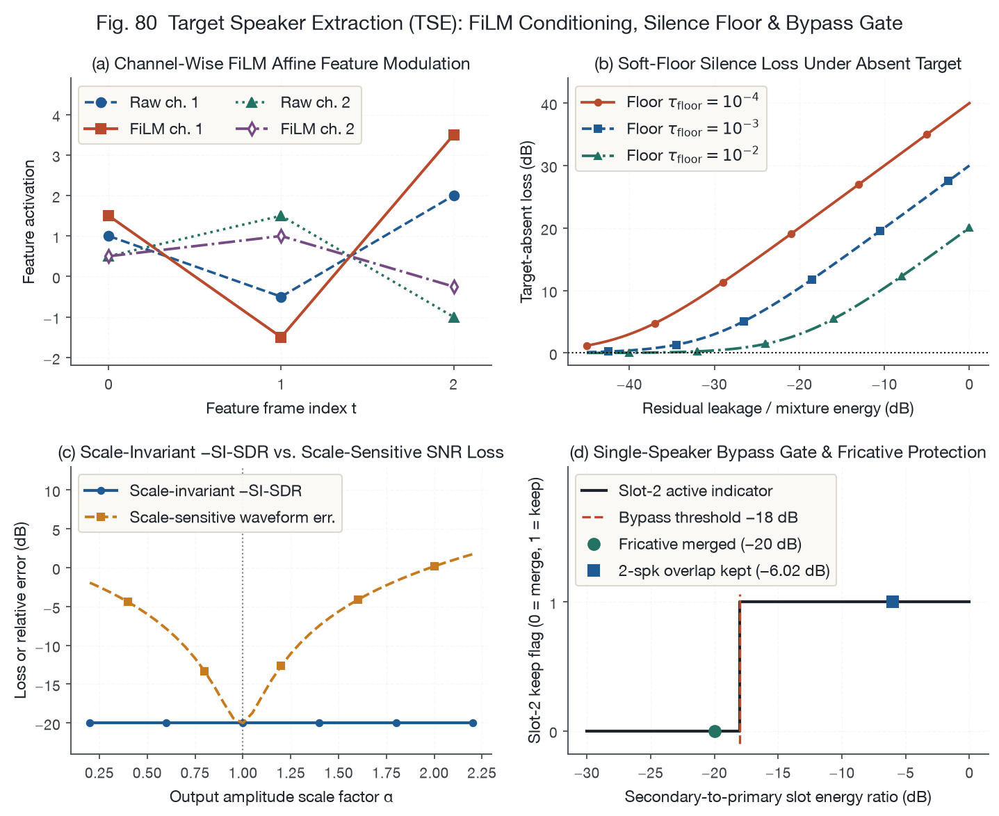
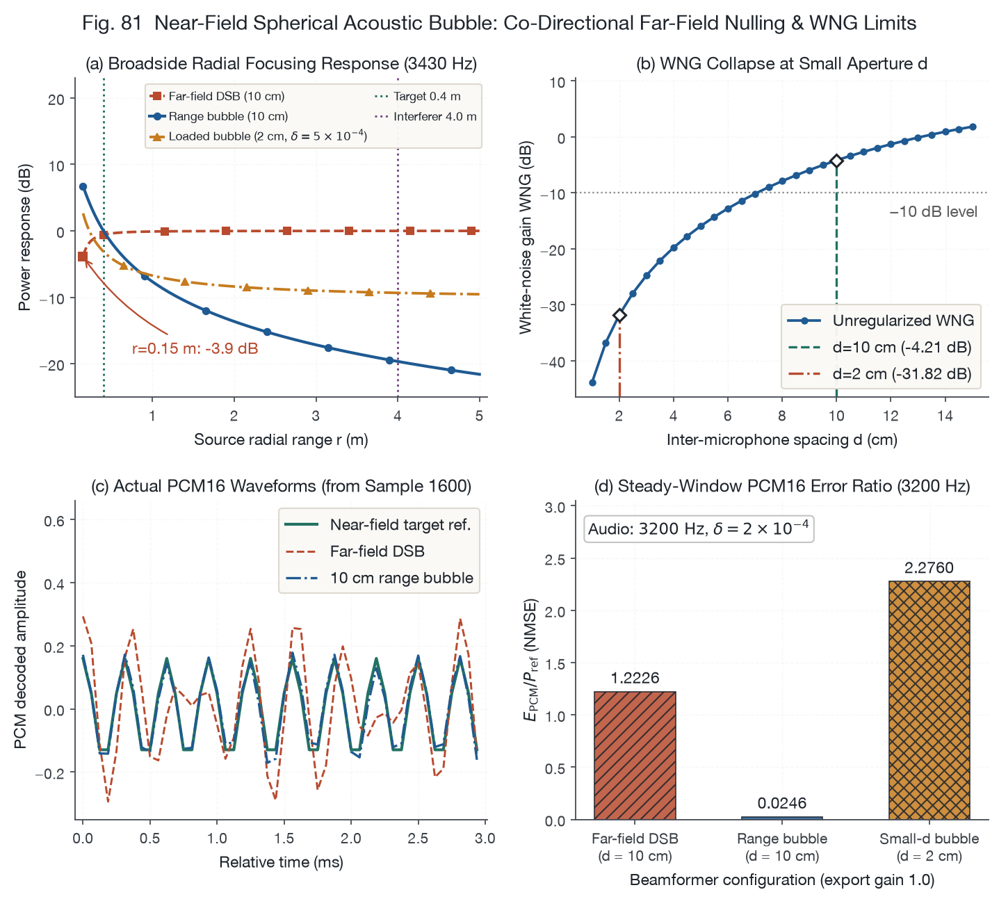
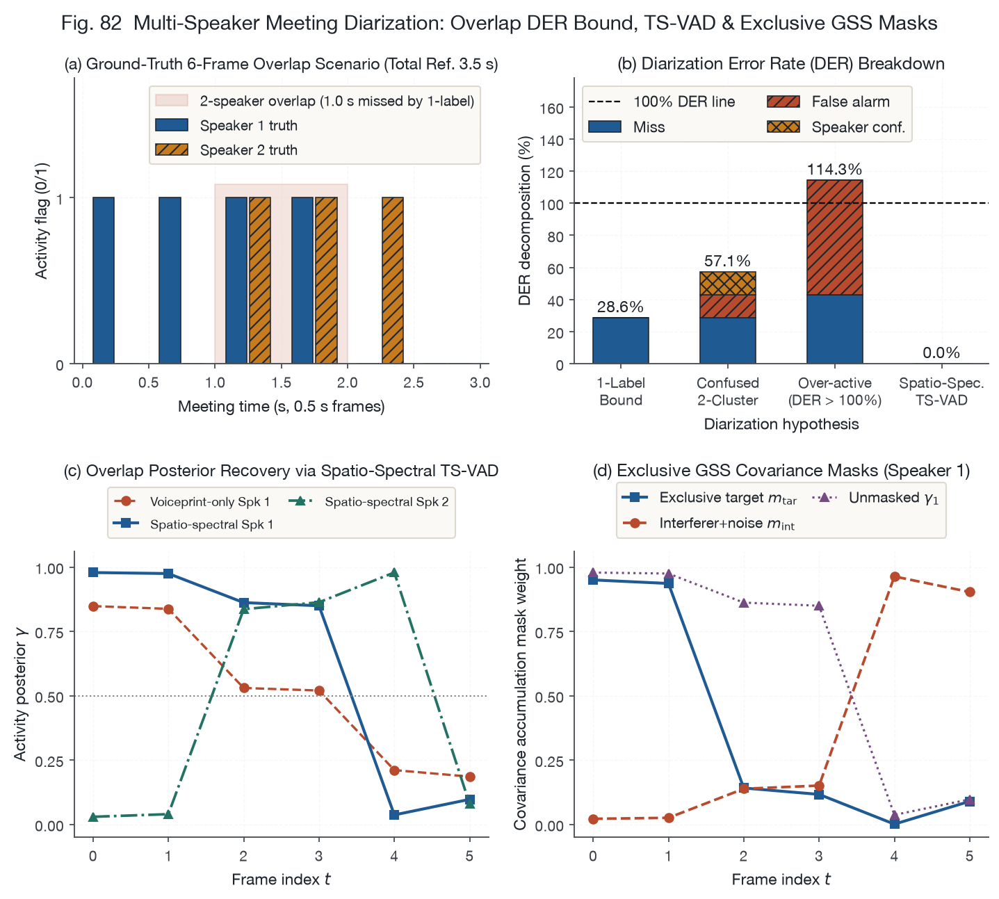
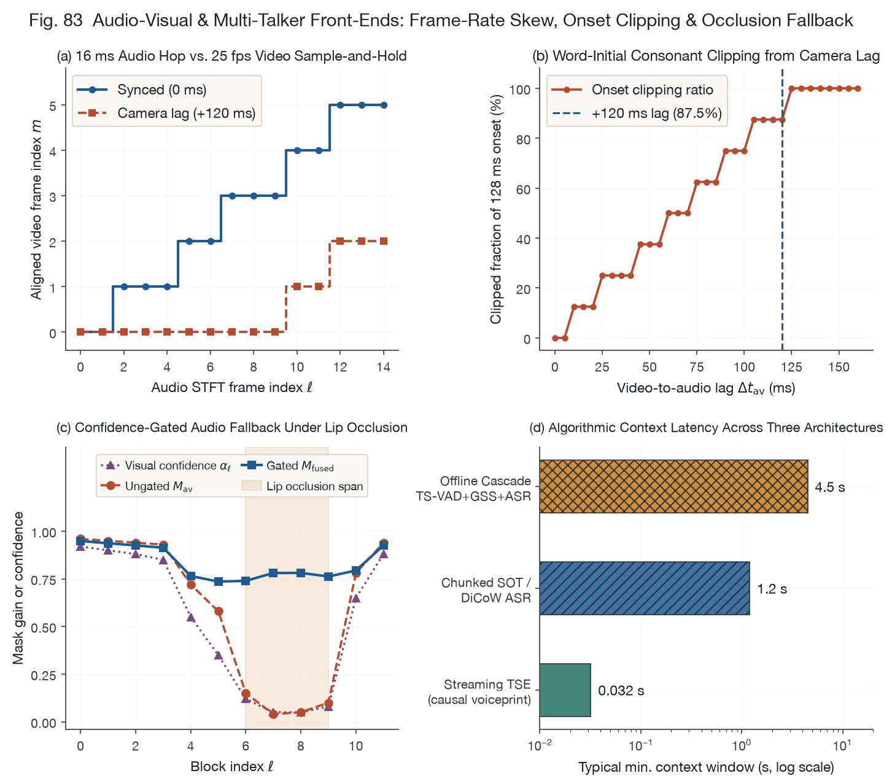

🌐 [简体中文](../chapters/15_target-extraction-diarization.md) ｜ **English**

> ⚠️ This chapter is Chapter 15 of the main text (Extended Topic IV; the main text comprises 16 chapters, Chapters 0–15, of which Chapters 12–15 are four extended special topics, followed by Appendices A and B). Picking up from [Chapter 14: Spatial Sound Field Capture, Parametric Coding, and Wearable Arrays](14_spatial-wearable-arrays.md), it examines how an acoustic capture front-end combines speaker embeddings, near-field distance, speaker diarization, and visual lip-motion cues to perform target speaker extraction and multi-speaker activity detection when multiple talkers, co-directional far-end interferers, or overlapping conversations coexist in the sound field. Derivations of the Fresnel spherical-wave approximation, constrained Lagrange multipliers, and optimal Hungarian assignment can be reviewed in [Chapter 0 §0.1](00_math-foundations.md#sec-0-1), [§0.5](00_math-foundations.md#sec-0-5), and [§0.6](00_math-foundations.md#sec-0-6); global notation and terminology quick references are provided in [Chapter 16 Appendix A §16.1](16_appendix-symbols-math.md#sec-16-1).
>
> Overview: [00_overview.md](00_overview.md) | Previous: [14_spatial-wearable-arrays.md](14_spatial-wearable-arrays.md) | Next: [16_appendix-symbols-math.md](16_appendix-symbols-math.md)

---

## Chapter 15: Conditional Target Extraction, Multi-Channel Diarization, and Far-Field Multimodal Front-Ends

### 15.1 From Blind Separation to Clue-Driven Extraction: What Do We Actually Know About the Target?

#### Slot Ambiguity in Blind Separation and the Paradigm Shift to Conditional Extraction

Recalling [Chapter 8 §8.1](08_speech-separation.md#sec-8-1), Blind Source Separation (BSS) and Permutation Invariant Training (PIT) attempt to decompose a mixed recording into $K$ mutually independent single-speaker speech streams without specifying in advance "who the target is." Yet when deployed on real smart glasses, automotive cabins, open-plan office desks, or multi-party conferencing endpoints, unconditional blind separation immediately confronts three structural limitations:

1. **Output slots lack a global identity anchor**: A two-second block-processing separator might place Speaker A into Slot 1 and Speaker B into Slot 2 in the current block, only to flip their order in the next block; even if the acoustic mixtures are cleanly separated, the system still does not know which stream belongs to the user who woke the device.
2. **The true number of active talkers $K$ varies dynamically and is unknown**: A meeting room may feature a single talker speaking uninterruptedly for five minutes, followed abruptly by three participants talking over one another. A network with a fixed output cardinality ($K=2$ or $K=3$) tends to erroneously split unvoiced consonants into idle slots during single-speaker segments, while inevitably dropping excess talkers whenever four people speak simultaneously.
3. **Non-target speech wastes compute and bandwidth**: A smartwatch or directional hearing aid only needs to extract the voice of the conversation partner facing the wearer; reconstructing five separate streams of diners chatting at neighboring restaurant tables in the background is pure wasted overhead.

**Target Speaker Extraction (TSE; also referred to in the literature as Target Speech Extraction—for a comprehensive overview, see [Žmolíková et al., *IEEE Signal Processing Magazine* 2023](https://doi.org/10.1109/MSP.2023.3240008))** reformulates the problem from "separating everyone" to "given a prior clue $\mathcal C$ characterizing the target, directly extracting from the multi-channel mixture observation only the single target speech stream matching $\mathcal C$." Whenever the target is actively speaking during the current interval, the system outputs an undistorted target waveform; whenever the target remains silent while only bystanders are speaking, the system should output a quiet zero signal.

#### Physical Modalities of Five Target Clues and Summary of Abbreviations

In engineering design, the "prior clue $\mathcal C$" is by no means restricted to a pre-recorded enrollment utterance. Any physical observable or modality capable of distinguishing the target talker from surrounding interferers can be encoded into a conditioning vector to drive the extractor. The table below contrasts the five most widely used target clue modalities in far-field and wearable devices together with their failure boundaries:

| Clue Modality | Physical Observable | Typical Application Scenarios | Core Failure Conditions |
|---|---|---|---|
| **Enrolled Voiceprint Clue** | Speaker embedding vector extracted from 3–10 s of enrollment speech | Personal mobile speakerphone, personalized voice assistant | Twins or similar vocal timbres, voice change due to a cold, whispered speech |
| **Spatial Angular Cone Clue** | Target azimuth and elevation interval $(\theta_0 \pm \Delta\theta)$ | Smart TV forward pickup, automotive driver/passenger zone separation | Interferer standing directly behind the target along the exact same line of sight |
| **Near-Field Distance Bubble Clue** | Radial range $r \le r_{\mathrm{bubble}}$ bounded by spherical wavefront curvature | Open-plan desk microphone, binaural smart glasses | Array aperture too small ($r \gg 2D^2/\lambda$) or low-frequency bands |
| **Visual Lip-Motion Clue** | Lip opening/closing and viseme temporal features inside a detected face bounding box | Video conferencing terminal, smart display with camera | Cup occluding the mouth, profile head turn, camera pipeline latency |
| **Semantic / Concept Prompt Clue** | Text label or acoustic event class embedding (e.g., [Semantic Hearing, UIST 2023](https://doi.org/10.1145/3586183.3606779)) | On-demand auditory scene pickup, binaural assistive listening devices | Multiple talkers belonging to the same broad category (e.g., two adult males) |

The selection principle emerging from this comparison is unmistakable: no single modality can cover every interference geometry across all physical environments. Voiceprints are immune to co-directional occlusion yet vulnerable to similar vocal timbres and brief backchannel words; spatial angles require no prior enrollment for strangers yet cannot separate near and far talkers along the same ray; near-field distance bubbles suppress co-directional far-end crosstalk yet are bounded by physical aperture and acoustic wavelength; visual lip motion is impervious to severe room reverberation yet degrades when a user lifts a cup in front of the mouth or turns their head away.

Modern far-field and wearable capture front-ends therefore universally adopt **multimodal clue synergy with confidence-gated fallback**, allowing complementary modalities to hand over smoothly across degraded operating regimes.

The technical abbreviations used intensively throughout this chapter are summarized below for direct reference during subsequent derivations:

| Abbreviation | Full Term | Role in This Chapter |
|---|---|---|
| TSE | Target Speaker Extraction (also Target Speech Extraction) | Conditional extraction task recovering solely the target speech from a mixture given a target clue $\mathcal C$ |
| FiLM | Feature-wise Linear Modulation | Channel-wise affine modulation of backbone network features using clue-generated scaling and bias vectors |
| SI-SDR | Scale-Invariant Signal-to-Distortion Ratio | Energy ratio metric after orthogonal projection of the estimated waveform onto the ground-truth target direction, removing overall gain sensitivity |
| DER | Diarization Error Rate | Ratio of summed missed speech, false alarm, and speaker confusion durations to total reference speaker duration |
| TS-VAD | Target-Speaker Voice Activity Detection | Conditioning on candidate speaker representations to output independent frame-level activity posteriors for each speaker in parallel |
| GSS | Guided Source Separation | Using speaker activity timestamps to constrain spatial mixture models and mask estimation, driving beamforming extraction |
| EEND | End-to-End Neural Diarization | Formulating multi-speaker diarization directly as multi-label frame classification trained with permutation-invariant loss |
| SOT | Serialized Output Training | Concatenating overlapping multi-speaker transcripts ordered by speech onset via special speaker-change tokens for single-decoder output |
| DiCoW | Diarization-Conditioned Whisper | Conditional transcription architecture injecting frame-level speaker activity masks directly into pretrained foundation encoder layers |

### 15.2 Conditional Feature Modulation and Singular Losses When the Target Is Absent

#### Injecting Clue Vectors into the Feature Backbone: FiLM Affine Modulation and Cross-Attention

Suppose a backbone extraction network produces at its $\ell$-th layer a real-valued intermediate feature map $\mathbf H \in \mathbb{R}^{C \times T}$ with $C$ channels and $T$ frames (if $\mathbf H \in \mathbb{R}^{C \times F \times T}$ is a 2D time–frequency convolutional feature tensor, modulation likewise acts along axis 0, the feature-channel dimension), while a clue encoder maps enrollment audio, directional angle encodings, or lip-motion sequences into a fixed-dimensional conditioning embedding vector $\vec e = g_{\mathrm{clue}}(\mathcal C)$ (belonging to $\mathbb{R}^D$). How can a single shared set of backbone weights switch its filtering behavior dynamically as $\vec e$ varies?

**Feature-wise Linear Modulation (FiLM)**, introduced by Perez et al. in 2018 ([AAAI 2018 paper](https://arxiv.org/abs/1709.07871)), is a useful general conditioning model. The target extractors VoiceFilter ([Wang et al., Interspeech 2019](https://arxiv.org/abs/1810.04826)) and SpeakerBeam ([Žmolíková et al., IEEE JSTSP 2019](https://doi.org/10.1109/JSTSP.2019.2922820)) use different conditioning interfaces: VoiceFilter concatenates speaker and acoustic features, while SpeakerBeam uses multiplicative adaptation. The independent FiLM teaching model below employs two lightweight linear layers to project the conditioning vector $\vec e$ into a $C$-dimensional channel scaling vector $\vec\gamma \in \mathbb{R}^C$ and a channel bias vector $\vec\beta \in \mathbb{R}^C$:

$$\begin{aligned}
\vec\gamma&=\mathbf W_\gamma\vec e+\vec b_\gamma,\\
\vec\beta&=\mathbf W_\beta\vec e+\vec b_\beta.
\end{aligned}\tag{15-1}$$

Here $\mathbf W_\gamma \in \mathbb{R}^{C \times D}$ and $\mathbf W_\beta \in \mathbb{R}^{C \times D}$ are projection matrices, while $\vec b_\gamma, \vec b_\beta \in \mathbb{R}^C$ are bias vectors. A channel-wise affine transformation is then applied to the $c$-th channel ($c = 1, \ldots, C$) at the $t$-th frame of the feature map $\mathbf H$, yielding the modulated feature map $\mathbf Z \in \mathbb{R}^{C \times T}$:

$$\begin{gathered}
Z_{c,t}=\gamma_c H_{c,t}+\beta_c,\\
\mathbf Z=\vec\gamma\odot\mathbf H+\vec\beta.
\end{gathered}\tag{15-2}$$

Here the operator $\odot$ denotes broadcasting the column vector $\vec\gamma$ across the temporal frame dimension followed by element-wise multiplication. The physical and geometric division of labor in Eq. (15-2) is highly transparent:

1. **Selective amplification and gated shut-off ($\gamma_c$)**: Whenever a feature channel $c$ responds specifically to the target talker's fundamental-frequency harmonic cluster or target-direction phase difference, $\gamma_c > 1$ amplifies that channel's response; whenever the channel responds to interferer traits, $\gamma_c \approx 0$ shuts off transmission directly, or even inverts polarity via $\gamma_c < 0$ prior to a subsequent rectified linear unit $\operatorname{ReLU}(Z_{c,t}) = \max(0, Z_{c,t})$.
2. **Activation threshold shifting ($\beta_c$)**: A negative bias $\beta_c < 0$ raises the threshold required to enter the next nonlinear activation function, suppressing weak residual interference; if initialized at $\vec\gamma = \vec 1_C$ and $\vec\beta = \vec 0_C$, Eq. (15-2) degenerates exactly to the identity mapping $\mathbf Z = \mathbf H$, guaranteeing that the conditioning layer does not disrupt a pretrained acoustic backbone at the onset of training.

When the target clue itself is a rapidly time-varying sequence—for instance, a $T_{\mathrm{v}}$-frame lip-motion feature matrix $\mathbf E_{\mathrm{lip}}$ of shape $D \times T_{\mathrm{v}}$, rather than a single static voiceprint vector $\vec e$—time-invariant global vectors $\vec\gamma, \vec\beta$ cannot express frame-by-frame mouth opening and closing. In that case, engineering implementations switch to **cross-modal Cross-Attention** modulation: audio features generate the query matrix $\mathbf Q = \mathbf W_Q\mathbf H$ (shape $d_k \times T$), while the clue sequence generates the key matrix $\mathbf K = \mathbf W_K\mathbf E_{\mathrm{lip}}$ (shape $d_k \times T_{\mathrm{v}}$) and value matrix $\mathbf V = \mathbf W_V\mathbf E_{\mathrm{lip}}$ (shape $C \times T_{\mathrm{v}}$), aligning and fusing them via scaled dot-product attention weights:

$$\mathbf Z_{\mathrm{attn}}=\mathbf H
+\mathbf V\,\operatorname{softmax}\!\left(
\frac{\mathbf K^\top\mathbf Q}{\sqrt{d_k}}\right).\tag{15-3}$$

Here $\operatorname{softmax}(\cdot)$ normalizes along the key-frame dimension (column-wise), enabling each audio frame $t$ to automatically aggregate the visual viseme features most closely aligned with it in time. Its computational complexity is $\mathcal O\bigl(T T_{\mathrm{v}} (d_k + C)\bigr)$, substantially higher than the $\mathcal O(C T)$ element-wise cost of FiLM modulation in Eq. (15-2). Consequently, static voiceprints or fixed directional cones predominantly adopt lightweight FiLM, whereas frame-synchronous lip motion or dynamic tracking trajectories favor cross-attention or frame-wise time-varying FiLM.

#### Speaker Embedding Backbones (x-vector / ECAPA-TDNN / WavLM) and Spatial Angle-Feature Conditioning

The discriminative strength of a static voiceprint vector $\vec e = g_{\mathrm{clue}}(\mathcal C)$ directly bounds the ceiling of a conditional extractor. Modern speaker embedding encoders have evolved across three representative generations:

1. **x-vector (Time-Delay Neural Network with Statistics Pooling)**: [Snyder et al. (ICASSP 2018)](https://doi.org/10.1109/ICASSP.2018.8461375) extract frame-level acoustic representations through stacked TDNN layers and concatenate the mean and standard deviation across the entire enrollment utterance (Statistics Pooling), collapsing variable-length speech into a fixed-dimensional voiceprint vector.
2. **ECAPA-TDNN (Channel Attention and Multi-Scale Aggregation)**: [Desplanques et al. (Interspeech 2020)](https://arxiv.org/abs/2005.07143) augment 1D residual blocks with multi-scale Res2Net branches, Squeeze-and-Excitation (SE) channel recalibration, and channel-dependent attentive statistics pooling, concentrating weight on active voiced frames that carry vocal-tract formants and pitch individuality; it remains the workhorse compact speaker backbone for open-environment deployment.
3. **Self-Supervised Speech Foundation Models (e.g., WavLM)**: [Chen et al. (IEEE JSTSP 2022)](https://doi.org/10.1109/JSTSP.2022.3188113) inject multi-speaker overlap and noise-mixing tasks during masked-prediction pretraining; weighted multi-layer WavLM features exhibit strong noise and overlap resilience under low-SNR enrollment compared with traditional mel-spectrogram front-ends.

**What matters when enrollment speech is short?** When a clip covers only a few phonetic sounds, pooled features may depend on its spoken content; the amount of active speech and the match between enrollment and test recordings also matter. Duration should be compared under a specified model and dataset. In [SpeakerBeam 2019, §VIII-C and Fig. 10](https://doi.org/10.1109/JSTSP.2019.2922820), each WSJ0-2mix test mixture was assigned an enrollment utterance longer than $8.5\,\mathrm{s}$. After removing its first $0.5\,\mathrm{s}$, the authors compared crops of $0.5$–$8\,\mathrm{s}$. About $1\,\mathrm{s}$ already gave results close to longer enrollment, and $0.5\,\mathrm{s}$ still improved average SDR over the mixture. The authors note that this trend depends on the training data. Similar voice characteristics can still lead to extraction of an interfering speaker, so target–interferer confusion should also be evaluated separately.

To mitigate representation mismatch between the speaker encoder and extraction backbone, canonical time-domain architectures—**Time-Domain SpeakerBeam** ([Delcroix et al., ICASSP 2020](https://doi.org/10.1109/ICASSP40776.2020.9054683)) and **SpEx+** ([Ge et al., Interspeech 2020](https://arxiv.org/abs/2005.04686))—use distinct designs: Time-Domain SpeakerBeam uses time-domain encoding and multiplicative speaker adaptation; SpEx+ shares multi-scale encoders across mixture and enrollment and adds speaker classification loss. The latter design must not be attributed to both. Conversely, when confronting an **unregistered stranger** whose target azimuth $\theta_0$ is known, a multi-microphone front-end can construct a **Spatial Angle Feature (AF)** directly as the conditioning clue: under the broadside far-field sign convention of [Chapter 3, §3.1](03_array-geometry.md#sec-3-1) and Eqs. (15-10)–(15-11) below, the theoretical inter-channel phase difference is $\Delta\phi_{pq}(\theta_0, f) = +\frac{2\pi f}{c}(x_p - x_q)\sin\theta_0$, and averaging the cosine match across a selected set of microphone pairs $\mathcal P$ yields $AF(f, t) = \frac{1}{|\mathcal P|}\sum_{(p,q)\in\mathcal P}\cos\bigl(\angle(X_p X_q^*) - \Delta\phi_{pq}(\theta_0, f)\bigr)$. Feeding $AF(f, t)$ alongside multi-channel spectral features or speaker embeddings locks onto the target directional cone without enrollment, pairing with voiceprints to form a complementary defense ("direction resists similar timbres; voiceprint resists co-directional interferers").

Recent target extraction research has progressed along three complementary axes—**programmable spatial zones, semantic prompting, and embedding-free conditioning**: on the spatial and binaural front, **Cone of Silence** ([Jenrungrot et al., NeurIPS 2020](https://arxiv.org/abs/2010.06007)) isolates sources via binary-search angular windowing, **Semantic Hearing** ([Veluri et al., ACM UIST 2023](https://doi.org/10.1145/3586183.3606779)) achieves $\sim 6.6\ \mathrm{ms}$ causal binaural semantic sound extraction while preserving ITD/ILD cues, **ReZero** ([Gu & Luo, *IEEE/ACM TASLP* 2024](https://doi.org/10.1109/TASLP.2024.3393713)) enables region-customizable 3D spatial zone extraction, and **SpatialNet** ([Quan & Li, *IEEE/ACM TASLP* 2024](https://doi.org/10.1109/TASLP.2024.3357036)) interleaves narrow-band and cross-band multi-channel spatial attention for strong multi-microphone cue modeling; on the speaker-conditioning front, **USEF-TSE** ([Zeng & Li, *IEEE TASLP* 2025](https://arxiv.org/abs/2409.02615)) replaces pooled fixed-length embeddings with frame-level cross-attention directly between mixture and enrollment spectra, while personalized band-split RNNs (pBSRNN) deliver low-complexity continuous streaming extraction.

#### Why Standard SI-SDR Suffers a 0/0 Singularity When the Target Is Silent

Target speaker extraction differs fundamentally from blind separation in a training-objective subtlety that is all too easily overlooked: within $2\ \mathrm{s}$–$4\ \mathrm{s}$ training chunks sliced out of long conversational recordings, **the target speaker may remain completely silent throughout the entire chunk** (so the ground-truth reference waveform is identically the zero vector $\vec s_{\mathrm{ref}} = \vec 0 \in \mathbb{R}^N$), while background interfering talkers are actively speaking (mixture input $\vec x \ne \vec 0$). Recalling the standard Scale-Invariant Signal-to-Distortion Ratio (SI-SDR, [Le Roux et al., ICASSP 2019](https://arxiv.org/abs/1811.02508)) used in single-speaker enhancement and blind separation in [Chapter 8 §8.5](08_speech-separation.md#sec-8-5), what algebraic degeneration occurs if we directly reuse its negative as a loss? Let us write out the orthogonal projection decomposition to pinpoint the singularity explicitly:

$$\begin{aligned}
\alpha&=\frac{\hat{\vec s}^\top\vec s_{\mathrm{ref}}}
{\|\vec s_{\mathrm{ref}}\|_2^2},\\
\vec s_{\mathrm{proj}}&=\alpha\vec s_{\mathrm{ref}},\\
\vec e_{\mathrm{noise}}&=\hat{\vec s}-\vec s_{\mathrm{proj}},
\end{aligned}\tag{15-4}$$

$$\mathrm{SI\text{-}SDR}(\hat{\vec s},\vec s_{\mathrm{ref}})
=10\log_{10}\!\left(
\frac{\|\vec s_{\mathrm{proj}}\|_2^2}
{\|\vec e_{\mathrm{noise}}\|_2^2}
\right).\tag{15-5}$$

Here $\hat{\vec s}, \vec s_{\mathrm{ref}} \in \mathbb{R}^N$ denote the extractor output waveform and the clean target reference waveform, respectively, with real vector inner product written $\hat{\vec s}^\top\vec s_{\mathrm{ref}}$. Substituting the target-silent condition $\vec s_{\mathrm{ref}} = \vec 0$ into Eqs. (15-4) and (15-5) immediately exposes a dual structural failure:

1. **Zero projection denominator ($0/0$ algebraic singularity)**: In Eq. (15-4), $\|\vec s_{\mathrm{ref}}\|_2^2 = 0$ and $\hat{\vec s}^\top\vec 0 = 0$, turning the projection scalar $\alpha$ into an undefined $0/0$ (in floating-point arithmetic, directly generating `NaN` and corrupting gradients across the entire mini-batch).
2. **Direct conflict between scale invariance and silence fidelity**: Even if a tiny constant $\varepsilon > 0$ is artificially added to the denominator so that $\vec s_{\mathrm{proj}} = \vec 0$, the numerator of Eq. (15-5) remains identically zero, yielding $\log_{10}(0 / \|\hat{\vec s}\|_2^2) = -\infty$; if $\varepsilon$ is further added to both numerator and denominator inside the logarithm, the penalty depth becomes an artifact of the dimensionless numerical patch $\varepsilon$. Even more importantly, while overall waveform rescaling is tolerable when the target is present (scale invariance), **leaking interfering speech through when the target is silent is completely unacceptable**—errors during target-absent intervals must inherently be anchored against the mixture input energy scale as a relative energy suppression metric.

#### Dual-State Energy-Floor Loss and Single-Speaker Over-Splitting Bypass Protection

To reconcile "waveform fidelity during target-active segments" with "interference suppression during target-silent segments" under a unified training criterion, conditional extractors employ a **Dual-State TSE Loss** switched by a reference-energy threshold $\varepsilon_s \ge 0$ (on target-absent silence constraints and false-alarm evaluation, see [Borsdorf et al., Interspeech 2021](https://doi.org/10.21437/Interspeech.2021-1939) and [Delcroix et al., Interspeech 2022](https://doi.org/10.21437/Interspeech.2022-11252)). Let $\varepsilon_s$ be the active reference energy threshold, and let $\tau_{\mathrm{floor}} > 0$ be the silent-state relative mixture energy floor factor (typically $10^{-3}$, corresponding to a silence noise-floor target $-30\ \mathrm{dB}$ below the mixture power). Denoting the mixture energy floor by $E_{\mathrm{floor}}=\tau_{\mathrm{floor}}\|\vec x\|_2^2$, the dual-state loss $\mathcal L_{\mathrm{dual}}$ is defined as:

$$\mathcal L_{\mathrm{dual}}=
\begin{cases}
-\mathrm{SI\text{-}SDR}(\hat{\vec s},\vec s_{\mathrm{ref}}),
& \|\vec s_{\mathrm{ref}}\|_2^2>\varepsilon_s,\\
10\log_{10}\!\left(1+\dfrac{\|\hat{\vec s}\|_2^2}
{E_{\mathrm{floor}}}\right),
& \|\vec s_{\mathrm{ref}}\|_2^2\le\varepsilon_s.
\end{cases}\tag{15-6}$$

Substituting $E_{\mathrm{floor}}=\tau_{\mathrm{floor}}\|\vec x\|_2^2$ back into the silent branch ($\|\vec s_{\mathrm{ref}}\|_2^2 \le \varepsilon_s$ with $\|\vec x\|_2^2 > 0$), the target-absent penalty function reads explicitly:

$$\mathcal L_{\mathrm{absent}}(\hat{\vec s},\vec x)
=10\log_{10}\!\left(
1+\frac{\|\hat{\vec s}\|_2^2}{\tau_{\mathrm{floor}}\|\vec x\|_2^2}
\right)\ge 0.\tag{15-7}$$

Let us inspect the boundary behavior and gradient properties of Eq. (15-7) term by term:

- **Smooth global minimum and bounded gradient at ideal silence**: When the extractor accurately outputs the zero waveform $\hat{\vec s} = \vec 0$, $\mathcal L_{\mathrm{absent}} = 0\ \mathrm{dB}$ (i.e., $10\log_{10} 1$), attaining its exact global lower bound. Differentiating with respect to $\hat{\vec s}$ yields:

    $$\nabla_{\hat{\vec s}}\mathcal L_{\mathrm{absent}}
    =\frac{20}{\ln 10}\frac{\hat{\vec s}}
    {E_{\mathrm{floor}}+\|\hat{\vec s}\|_2^2}.$$

    The gradient vanishes smoothly at $\hat{\vec s} = \vec 0$ and, by the AM–GM inequality $E_{\mathrm{floor}} + \|\hat{\vec s}\|_2^2 \ge 2\sqrt{E_{\mathrm{floor}}}\,\|\hat{\vec s}\|_2$, remains globally bounded in norm ($\|\nabla_{\hat{\vec s}}\mathcal L_{\mathrm{absent}}\|_2 \le \frac{10}{\ln 10\sqrt{E_{\mathrm{floor}}}}$), avoiding the unbounded gradient divergence near zero caused by an unfloored $\log_{10}(\|\hat{\vec s}\|_2^2)$ that triggers weight oscillation.
- **Mixture-scale adaptivity**: Using $E_{\mathrm{floor}}=\tau_{\mathrm{floor}}\|\vec x\|_2^2$ rather than a fixed absolute constant in the denominator means that whether the overall digital recording level is raised by $10\ \mathrm{dB}$ or lowered by $10\ \mathrm{dB}$, as long as the extractor achieves the same relative interference energy suppression ratio $\|\hat{\vec s}\|_2^2 / \|\vec x\|_2^2$, it incurs the exact same dB penalty. Once residual leakage substantially exceeds the mixture floor ($\|\hat{\vec s}\|_2^2 \gg E_{\mathrm{floor}}$), the penalty rises linearly by $10\ \mathrm{dB}$ per tenfold increase in residual power.

When deploying two-slot or multi-slot front-ends, a frequent engineering pathology dual to "target silence" is **unvoiced consonant Over-Splitting during single-speaker speech**. When only a single talker is actually speaking in the room, a two-output separator often places the voiced vowel core into the primary slot $\vec y_1$ while misclassifying high-frequency unvoiced fricatives (such as `/s/`, `/f/`, `/ɕ/`) or word-final aspiration as a "second speaker" and routing them into the secondary slot $\vec y_2$, leaving the primary slot sounding muffled and missing syllables. To prevent this, a **zero-overlap energy-ratio bypass decision** is placed in post-processing: we compute the secondary-to-primary slot energy ratio $R_{21,\mathrm{dB}}$ and compare it against a threshold $\eta_{\mathrm{dB}}$ (commonly set between $-18\ \mathrm{dB}$ and $-15\ \mathrm{dB}$):

$$\begin{gathered}
R_{21,\mathrm{dB}}=10\log_{10}\!\left(
\frac{\|\vec y_2\|_2^2}{\|\vec y_1\|_2^2}\right),\\
\vec y_{\mathrm{out}}=\begin{cases}
\vec y_1+\vec y_2, & R_{21,\mathrm{dB}}<\eta_{\mathrm{dB}},\\
\vec y_1, & R_{21,\mathrm{dB}}\ge\eta_{\mathrm{dB}}.
\end{cases}
\end{gathered}\tag{15-8}$$

Whenever $R_{21,\mathrm{dB}} < \eta_{\mathrm{dB}}$, the system judges that the secondary slot does not represent an independent concurrent second talker and directly sums $\vec y_1 + \vec y_2$ back together (or, at the system-architecture level, bypasses the two-speaker separator in favor of single-stream denoising/beamforming output), losslessly recovering the mis-split high-frequency unvoiced consonant energy.

#### Worked Example 15-1: Hand Calculation of FiLM Modulation, Silent-Segment Singularity, and Dual-State Loss

Using tiny arrays amenable to mental arithmetic, let us walk through Eqs. (15-2) and (15-5)–(15-8) end to end (corresponding to the code functions `film_conditioning`, `tse_dual_state_loss`, and `zero_overlap_bypass_decision`).

**1. Input setup and FiLM channel modulation check.** Let a two-channel, three-frame feature map $\mathbf H$ have Row 1 equal to $[1.0, -0.5, 2.0]$ and Row 2 equal to $[0.5, 1.5, -1.0]$, with voiceprint-generated modulation parameters $\vec\gamma = [2.0, 0.5]^\top$ and $\vec\beta = [-0.5, 0.25]^\top$. Evaluating Eq. (15-2) row by row: multiplying Row 1 by $2.0$ and subtracting $0.5$ yields $[1.5, -1.5, 3.5]$; multiplying Row 2 by $0.5$ and adding $0.25$ yields $[0.5, 1.0, -0.25]$, assembling the modulated feature matrix $\mathbf Z$.

**2. Dual-state loss comparison between target-active and target-silent segments.** Take four-sample orthogonal basis vectors: clean target $\vec s_{\mathrm{ref}} = [1, 1, -1, -1]^\top$ (energy $\|\vec s_{\mathrm{ref}}\|_2^2 = 4$) and orthogonal interferer $\vec v = [1, -1, 1, -1]^\top$ (satisfying $\vec s_{\mathrm{ref}}^\top\vec v = 0$, $\|\vec v\|_2^2 = 4$), with floor coefficient $\tau_{\mathrm{floor}} = 10^{-3}$ and threshold $\varepsilon_s = 10^{-8}$:

- **Case A (Target present)**: Let the mixture be $\vec x = \vec s_{\mathrm{ref}} + \vec v = [2, 0, 0, -2]^\top$ ($\|\vec x\|_2^2 = 8$), and suppose the extractor outputs the target attenuated by half alongside weak residual interference $\hat{\vec s} = 0.5\vec s_{\mathrm{ref}} + 0.05\vec v = [0.55, 0.45, -0.45, -0.55]^\top$. Since $\|\vec s_{\mathrm{ref}}\|_2^2 = 4 > 10^{-8}$, the active branch is selected: inner product $\hat{\vec s}^\top\vec s_{\mathrm{ref}} = 2.0$, projection scalar $\alpha = 2.0 / 4 = 0.5$, target projection $\vec s_{\mathrm{proj}} = 0.5\vec s_{\mathrm{ref}}$ (energy $1.0$), and residual distortion $\vec e_{\mathrm{noise}} = 0.05\vec v$ (energy $0.01$). Substituting into Eq. (15-5) gives $10\log_{10}(1.0 / 0.01) = +20.0\ \mathrm{dB}$, so $\mathcal L_{\mathrm{dual}} = -20.0\ \mathrm{dB}$. Even though the output amplitude is halved, scale-invariant projection accurately awards a $20\ \mathrm{dB}$ separation score.
- **Case B (Target silent)**: Set $\vec s_{\mathrm{ref}} = [0, 0, 0, 0]^\top$, with the mixture containing only interference $\vec x = \vec v$ ($\|\vec x\|_2^2 = 4$). Standard SI-SDR hits the $0/0$ singularity in Eq. (15-4), whereas the dual-state loss enters the silent branch Eq. (15-7) with mixture energy floor $E_{\mathrm{floor}} = 0.004$ (computed from $\tau_{\mathrm{floor}}\|\vec x\|_2^2$). Comparing three levels of residual output energy:

    - If the extractor accurately outputs silence $\hat{\vec s} = \vec 0$, then $\|\hat{\vec s}\|_2^2 = 0$ and $\mathcal L_{\mathrm{dual}} = 0.0\ \mathrm{dB}$;
    - If the extractor leaks interference of energy $\|\hat{\vec s}\|_2^2 = 0.396$ (i.e., $\hat{\vec s} = \sqrt{0.099}\,\vec v$, roughly one-tenth of the mixture energy), the logarithm argument is $1 + 0.396 / 0.004 = 100$, yielding $\mathcal L_{\mathrm{dual}} = +20.0\ \mathrm{dB}$;
    - If the extractor fails completely and passes the mixture straight through, $\hat{\vec s} = \vec x$ ($\|\hat{\vec s}\|_2^2 = 4$), the penalty climbs to $10\log_{10}(1001) \approx +30.00\ \mathrm{dB}$.

**3. Takeaway and validity boundary.** This example demonstrates how the dual-state loss eliminates division-by-zero singularities on silent segments while penalizing interference pass-through in consistent decibel units. Note, however, its failure boundary: if a faint whispered target in real recordings is mislabeled as a zero reference (or if crosstalk from an adjacent talker bleeds into the close-talk reference channel such that $\|\vec s_{\mathrm{ref}}\|_2^2 > \varepsilon_s$), the dual-state switch flips into the wrong branch. Training-data preparation pipelines must therefore clean reference labels via cross-channel close-talk gating.



Figure 80 illustrates the quantitative behavior of four core mechanisms in conditional target speaker extraction (generated by `scripts/make_tse_figures.py`):

- **Subplot (a) Features before and after FiLM channel affine modulation**: Horizontal axis shows feature frame index $t \in \{0, 1, 2\}$; vertical axis shows feature activation (dimensionless). The solid red line with squares (modulated Channel 1) doubles the dynamic range and shifts it downward by $0.5$ relative to the dashed blue line with circles (raw Channel 1), whereas the dash-dotted purple line with diamonds (modulated Channel 2) compresses the dynamic range by half and shifts it upward by $0.25$ relative to the dotted green line with triangles (raw Channel 2), showing how a conditioning vector reshapes inter-channel contrast.
- **Subplot (b) Dual-state energy-floor penalty during target silence**: The horizontal axis is leakage-to-mixture energy ratio in dB; the vertical axis is target-absent loss in dB. Curves correspond to $\tau_{\mathrm{floor}}=10^{-4},10^{-3},10^{-2}$. With $r=\|\hat{\vec s}\|_2^2/(\tau_{\mathrm{floor}}\|\vec x\|_2^2)$, the loss is $10\log_{10}(1+r)$ and its slope against the dB horizontal axis is $r/(1+r)$. It approaches zero at low leakage, equals $1/2$ at the floor ($r=1$), and approaches $1\ \mathrm{dB/dB}$ only far above it, rather than becoming exactly linear immediately after crossing the floor.
- **Subplot (c) Amplitude scale invariance during target-active segments**: Horizontal axis shows the output amplitude scaling factor $\alpha \in [0.2, 2.2]$ (dimensionless); vertical axis shows loss or relative error (dB). The solid blue line ($-\mathrm{SI\text{-}SDR}$) stays flat at $-20.0\ \mathrm{dB}$ across the entire interval, whereas for $\hat{\vec s} = \alpha(\vec s_{\mathrm{ref}} + 0.1\vec v)$ ($\vec s_{\mathrm{ref}} \perp \vec v$, equal norms), the dashed orange curve (sample-wise waveform relative MSE $10\log_{10}(\|\hat{\vec s}-\vec s_{\mathrm{ref}}\|_2^2 / \|\vec s_{\mathrm{ref}}\|_2^2) = 10\log_{10}(1.01\alpha^2 - 2\alpha + 1)$) reaches its minimum of $-20.0\ \mathrm{dB}$ on the displayed $0.05$ grid at $\alpha = 1.0$, climbing steeply on either side—solving $1.01\alpha^2 - 2\alpha + 1 < 1$ shows it remains below $0\ \mathrm{dB}$ only on $\alpha \in (0, 2/1.01) \approx (0, 1.9802)$ (degrading to $-1.94\ \mathrm{dB}$ at $\alpha = 0.2$), crosses $0\ \mathrm{dB}$ at $\alpha = 2/1.01 \approx 1.98$ (reaching $+0.17\ \mathrm{dB}$ at $\alpha = 2.0$ on the $0.05$-step plotting grid), and rises to $+1.73\ \mathrm{dB}$ at $\alpha = 2.2$—visually explaining why uncalibrated-gain extraction networks require orthogonal projection to decouple amplitude.
- **Subplot (d) Zero-overlap bypass threshold and fricative preservation**: Horizontal axis shows the secondary-to-primary slot energy ratio $R_{21,\mathrm{dB}}$ (dB); vertical axis shows secondary-slot activation state ($0$ for merged bypass, $1$ for independent separation). The vertical dashed red line marks the $-18\ \mathrm{dB}$ threshold; the single-speaker unvoiced fricative leakage point ($-20\ \mathrm{dB}$, green circle) falls to the left of the threshold and triggers merge recovery, whereas the genuine two-speaker overlap point ($-6.02\ \mathrm{dB}$, blue square) falls to the right and maintains dual-stream separation.

The continuous NMSE minimum is at $\alpha=100/101$, where NMSE is $1/101$ ($-20.0432\ \mathrm{dB}$); the displayed $0.05$ grid instead selects $\alpha=1$ ($-20\ \mathrm{dB}$).

### 15.3 When Far-Field Angles Fail: Near-Field Spherical Waves and Acoustic Distance Bubbles

#### Spherical-Wave Steering Vectors and the Fresnel Near-Field Range Criterion

Imagine an open-plan office workstation or a noisy café where a user wearing smart glasses or facing a desktop array speaks at a distance of only $r_1 = 0.40\ \mathrm{m}$ from the array center, while directly behind the user along the exact same line of sight at $r_2 = 4.00\ \mathrm{m}$, a colleague is talking loudly on the phone. Here the target and the interferer share the exact same azimuth angle (both at broadside $\theta = 0^\circ$). Recalling [Chapter 5 §5.1](05_beamforming.md#sec-5-1), any beamformer built upon the **far-field plane-wave assumption** distinguishes only the arrival angle $\theta$: because both sources sit at $0^\circ$, their plane-wave steering vectors coincide identically, and no choice of conventional angular beamformer weights can preserve the nearby talker while selectively suppressing the distant co-directional interferer.

The physical key to breaking this degeneracy lies in **Wavefront Curvature**: sound arriving from $0.40\ \mathrm{m}$ hits the array as a noticeably curved spherical wave, whereas the wavefront arriving from $4.00\ \mathrm{m}$ has flattened almost into a plane wave. Exploiting spherical wavefront curvature to enclose a spatial zone in front of the array that admits sound only within $r \le r_{\mathrm{bubble}}$ while rejecting more distant sound from the exact same direction is known as an **Acoustic Distance Bubble** (such as [Chen et al., Sound Bubbles, Nature Electronics 2024](https://doi.org/10.1038/s41928-024-01276-z), demonstrating programmable spherical-wave distance bubbles on wearable arrays; for a related wirelessly synchronized binaural own-voice near-field neural enhancement system, see [Chatterjee et al., ClearBuds, MobiSys 2022](https://doi.org/10.1145/3498361.3538933)).

Let us establish strict planar Cartesian coordinates to compute the curvature phase explicitly. Consider an $M$-element Uniform Linear Array (ULA) arranged symmetrically along the $x$-axis, with the $m$-th microphone at $(x_m, 0)$, the array center at the origin $(0, 0)$, and total physical aperture $D = \max_m x_m - \min_m x_m$. Measuring the azimuth angle $\theta \in [-\pi/2, \pi/2]$ from the broadside $+y$ normal toward the $+x$-axis, a point source at range $r$ and azimuth $\theta$ has coordinates $(r\sin\theta, r\cos\theta)$, and its exact Euclidean propagation distance $r_m(r, \theta)$ to the $m$-th microphone is:

$$\begin{aligned}
r_m(r,\theta)&=\sqrt{(r\sin\theta-x_m)^2+(r\cos\theta)^2}\\
&=\sqrt{r^2+x_m^2-2rx_m\sin\theta}.
\end{aligned}\tag{15-9}$$

To clarify its relationship with the far-field plane-wave formula, factor $r$ out of the square root and apply the second-order Taylor expansion $\sqrt{1 + u} = 1 + \frac{1}{2}u - \frac{1}{8}u^2$ under $r \gg |x_m|$ (omitting $\mathcal O(u^3)$, where $u = -\frac{2x_m\sin\theta}{r} + \frac{x_m^2}{r^2}$), collecting terms step by step through order $r^{-1}$:

$$\begin{aligned}
r_m(r,\theta)-r
&=r\Biggl[1+\frac{1}{2}\!\left(
-\frac{2x_m\sin\theta}{r}+\frac{x_m^2}{r^2}\right)\\
&\quad-\frac{1}{8}\!\left(-\frac{2x_m\sin\theta}{r}\right)^2
+\mathcal O\!\left(\frac{|x_m|^3}{r^3}\right)\Biggr]-r\\
&=-x_m\sin\theta+\frac{x_m^2\cos^2\theta}{2r}
+\mathcal O\!\left(\frac{|x_m|^3}{r^2}\right).
\end{aligned}\tag{15-10}$$

Compare the two leading terms on the right-hand side of Eq. (15-10) carefully: the first term $-x_m\sin\theta$ is completely independent of range $r$ and is precisely the directional linear path difference of a far-field plane wave; when the source lies at broadside $\theta = 0^\circ$, this first term vanishes identically. **By contrast, the second term $+\frac{x_m^2\cos^2\theta}{2r}$ attains its maximum value $\frac{x_m^2}{2r}$ right at $\theta = 0^\circ$**—proportional to the squared sensor coordinate $x_m^2$ and inversely proportional to range $r$, this is the **quadratic spherical-wave curvature path difference** that empowers an array to discriminate sources at different distances along the exact same direction.

Following the unified forward Fourier kernel $e^{-\mathrm{j}2\pi f t}$ used throughout this book, let $\kappa = 2\pi f / c = 2\pi / \lambda$ be the wavenumber ($\lambda = c / f$ is the acoustic wavelength). Taking the array-origin range $r$ as both phase and amplitude reference, engineering modeling must explicitly distinguish between two spherical-wave steering vector definitions—the **phase-only curvature steering vector** $\vec a_{\mathrm{ph}}(r, \theta)$ and the **steering vector with relative spherical-spreading attenuation** $\vec a_{\mathrm{att}}(r, \theta)$:

$$\begin{aligned}
\bigl[\vec a_{\mathrm{ph}}(r,\theta)\bigr]_m
&=\exp\bigl(-\mathrm{j}\kappa\,[r_m(r,\theta)-r]\bigr),\\
\bigl[\vec a_{\mathrm{att}}(r,\theta)\bigr]_m
&=\frac{r}{r_m(r,\theta)}\,
\exp\bigl(-\mathrm{j}\kappa\,[r_m(r,\theta)-r]\bigr).
\end{aligned}\tag{15-11}$$

Up to what distance can an array still resolve spherical wavefront curvature, and beyond what range does a spherical wave degenerate into an indistinguishable plane wave? Acoustics and antenna theory set the dividing line where the quadratic curvature phase difference at the outer edges of the array ($\lvert x_m\rvert = D/2$) in the broadside direction equals $\pi/8$ (corresponding to a path difference $\Delta r = \lambda / 16$): setting $\frac{(D/2)^2}{2 r_F} = \frac{\lambda}{16}$ solves for the **Fraunhofer far-field boundary (Fresnel quadratic phase-curvature criterion)** $r_F = 2D^2/\lambda$:

$$r_F=\frac{2D^2}{\lambda}=\frac{2D^2 f}{c}.\tag{15-12}$$

Equation (15-12) reveals the tight coupling between hardware form factor and operating frequency: the resolvable near-field radius scales with the **square of the total array aperture $D$** and linearly with frequency $f$. Shrinking the aperture to one-fifth of its original width collapses the effective near-field radius $r_F$ to **one twenty-fifth**.

#### Co-Directional Far-Field Nulling: Closed-Form Second-Order Spatial Difference Solution for a Three-Mic Distance Bubble

On a symmetric three-microphone ULA at broadside $\theta = 0^\circ$ (sensor coordinates $x_{-1} = -d, x_0 = 0, x_{+1} = +d$, total aperture $D = 2d$), let us now derive the closed-form Linearly Constrained Minimum Variance (LCMV) beamformer that passes a near-field target at $(r_1, 0^\circ)$ without distortion while placing an exact null on a co-directional far-field plane wave.

To isolate the core role of wavefront phase curvature, we first adopt the phase-only model of Eq. (15-11) (the quantitative impact of the $r / r_m$ amplitude correction is analyzed in [E15-04](#e15-04)). At broadside $\theta = 0^\circ$, the center element lies at distance $r_0 = r$ and both outer symmetric elements lie at $\sqrt{r^2 + d^2}$, giving an extra propagation path difference and phase lag relative to the center microphone of:

$$\begin{aligned}
\Delta r(r)&=\sqrt{r^2+d^2}-r,\\
\phi(r)&=-\kappa\,\Delta r(r)
=-\frac{2\pi}{\lambda}\!\left(\sqrt{r^2+d^2}-r\right)<0.
\end{aligned}\tag{15-13}$$

Denoting the unit-modulus complex phasor by $u_1 = e^{\mathrm{j}\phi_1}$ (where $\phi_1 = \phi(r_1)$), the near-field target steering vector is $\vec a_1 = [u_1, 1, u_1]^\top$, whereas the steering vector of a co-directional plane wave at infinity ($\Delta r \to 0$ and $\phi \to 0$ as $r \to \infty$) is the all-ones column vector $\vec a_\infty = [1, 1, 1]^\top$. Under spatially white sensor noise ($\mathbf R_{nn} = \mathbf I_3$), the dual-constraint optimization problem minimizing sensor self-noise power amplification $\|\vec w\|_2^2$ reads:

$$\begin{gathered}
\min_{\vec w\in\mathbb{C}^3}\;\|\vec w\|_2^2\\
\text{s.t.}\quad\vec w^H\vec a_1=1,\quad\vec w^H\vec a_\infty=0.
\end{gathered}\tag{15-14}$$

Writing the $3 \times 2$ constraint matrix $\mathbf C = [\vec a_1, \vec a_\infty]$ and desired response vector $\vec f = [1, 0]^\top$, the minimum-norm solution to $\mathbf C^H\vec w = \vec f$ is $\vec w = \mathbf C(\mathbf C^H\mathbf C)^{-1}\vec f$. Rather than inverting the matrix directly, left–right array symmetry yields the closed-form solution for $\vec w = [w_{-1}, w_0, w_{+1}]^\top$ in three elementary algebraic steps:

1. By symmetry ($\vec w$ lies in $\operatorname{span}\{\vec a_1, \vec a_\infty\}$), the two outer weights must be equal: write $w_{-1} = w_{+1} = w_{\mathrm{out}}$.
2. Substituting into the second far-field null constraint $\vec w^H [1, 1, 1]^\top = 0$ gives $2w_{\mathrm{out}}^* + w_0^* = 0$; taking complex conjugates of both sides immediately yields $w_0 = -2w_{\mathrm{out}}$. In other words, **the spatial profile of the weight vector is necessarily proportional to the second-order central spatial difference stencil $[1, -2, 1]^\top$**: any plane wave arrives with flat phase across the array axis ($1 - 2 + 1 = 0$) and produces identically zero output; only a curved spherical wave can pass through this second-order curvature high-pass filter.
3. Substituting into the first distortionless near-field constraint $\vec w^H [u_1, 1, u_1]^\top = 1$ gives $w_{\mathrm{out}}^*(2u_1 - 2) = 1$, solving to $w_{\mathrm{out}}^* = \frac{1}{2(u_1 - 1)}$. Taking complex conjugates (noting $u_1^* = e^{-\mathrm{j}\phi_1}$) yields the optimal closed-form weight vector:

$$\vec w_{\mathrm{bubble}}
=\frac{1}{2\bigl(e^{-\mathrm{j}\phi_1}-1\bigr)}
\begin{bmatrix}1\\-2\\1\end{bmatrix}.\tag{15-15}$$

Applying Eq. (15-15) to a spherical wave at arbitrary broadside distance $r$, $\vec a(r, 0^\circ) = [e^{\mathrm{j}\phi(r)}, 1, e^{\mathrm{j}\phi(r)}]^\top$, and invoking Euler's half-angle identity $|e^{\mathrm{j}\phi} - 1|^2 = 4\sin^2(\phi / 2)$ (simplified from $2 - 2\cos\phi$), we obtain in a single step both the **radial range power response** $|B(r, 0^\circ)|^2$ and the **White Noise Gain (WNG)**:

$$\begin{aligned}
|B(r,0^\circ)|^2&=|\vec w_{\mathrm{bubble}}^H\vec a(r,0^\circ)|^2\\
&=\left|\frac{e^{\mathrm{j}\phi(r)}-1}
{e^{\mathrm{j}\phi_1}-1}\right|^2
=\frac{\sin^2\!\bigl(\phi(r)/2\bigr)}{\sin^2(\phi_1/2)},
\end{aligned}\tag{15-16}$$

$$\begin{aligned}
\|\vec w_{\mathrm{bubble}}\|_2^2
&=\frac{1^2+(-2)^2+1^2}{4\,|e^{-\mathrm{j}\phi_1}-1|^2}
=\frac{3}{8\sin^2(\phi_1/2)},\\
\mathrm{WNG}&=\frac{1}{\|\vec w_{\mathrm{bubble}}\|_2^2}
=\frac{8}{3}\sin^2\!\left(\frac{\phi_1}{2}\right).
\end{aligned}\tag{15-17}$$

Equations (15-16) and (15-17) cleanly characterize both the radial selectivity and the noise penalty of a distance bubble: when interferer range $r_2 \gg d$ and target range $r_1 \gg d$, $\phi(r) \approx -\pi d^2 / (\lambda r)$ scales inversely with $r$; in the small-angle regime $\sin(\phi/2) \approx \phi/2$, so the far-end interferer power response rolls off as $|B(r_2, 0^\circ)|^2 \approx (r_1 / r_2)^2$—**a co-directional interferer ten times farther away than the target ($r_2 = 10 r_1$) is naturally attenuated in power by roughly $(1/10)^2 = 1/100$, or about $20\ \mathrm{dB}$**.

#### Aperture Shrinkage and White Noise Gain Collapse: Physical Red Lines for Miniature Wearable Arrays

Now examine the flip side of Eq. (15-17): an ordinary three-microphone far-field delay-and-sum beamformer $\vec w_{\mathrm{DSB}} = [1/3, 1/3, 1/3]^\top$ achieves a white noise gain of $\mathrm{WNG}_{\mathrm{DSB}} = 3$ ($+4.77\ \mathrm{dB}$, suppressing microphone self-noise); by contrast, because the distance bubble must execute second-order spatial subtraction $[1, -2, 1]^\top$ to cancel co-directional plane waves, whenever inter-element spacing $d$ is too small or frequency $f$ is too low so that $|\phi_1| \ll 1$, $\mathrm{WNG} \approx \frac{2}{3}\phi_1^2 \propto \frac{d^4 f^2}{r_1^2 c^2}$—**plummeting with the fourth power of inter-element spacing**. If Eq. (15-14) is solved without regularization in this regime, the vanishing denominator $e^{-\mathrm{j}\phi_1} - 1 \to 0$ amplifies each microphone's thermal noise power by tens or thousands of times; if instead we solve a damped Gram system with regularization parameter $\delta > 0$,

$$\vec w_{\mathrm{reg}}
=\mathbf C\bigl(\mathbf C^H\mathbf C+\delta\mathbf I_2\bigr)^{-1}
\vec f,\tag{15-18}$$

the weight-norm growth is curbed, yet because $\vec a_1$ and $\vec a_\infty$ are nearly collinear, regularization inevitably sacrifices both near-field target gain ($\lvert B(r_1, 0^\circ)\rvert^2 < 1$) and far-field null depth simultaneously. Note why Eq. (15-18) damps the **constraint-space Gram matrix** via $\delta\mathbf I_2$ rather than applying sensor-space diagonal loading $\mathbf I_3 + \epsilon\mathbf I_3$ to $\mathbf R_{nn} = \mathbf I_3$: scalar loading $(1 + \epsilon)\mathbf I_3$ cancels identically in $\mathbf R_{nn}^{-1}\mathbf C(\mathbf C^H\mathbf R_{nn}^{-1}\mathbf C)^{-1}\vec f$ and leaves the unregularized LCMV solution unchanged, whereas Eq. (15-18) equals $(\mathbf C\mathbf C^H + \delta\mathbf I_3)^{-1}\mathbf C\vec f$—solving the soft-constrained quadratic $\min_{\vec w}\|\mathbf C^H\vec w - \vec f\|_2^2 + \delta\|\vec w\|_2^2$ to cap $\|\vec w\|_2$ at the cost of relaxing both constraints.

#### Worked Example 15-2: Distance-Bubble Calculation Comparing a 10 cm Desktop ULA Against a 2 cm Miniature ULA

Let the speed of sound be $c = 343\ \mathrm{m/s}$ and operating frequency be $f = 3430\ \mathrm{Hz}$ (so the wavelength is exactly $\lambda = c / f = 0.10\ \mathrm{m}$), with a broadside near-field target at $r_1 = 0.40\ \mathrm{m}$ and a co-directional far-end interferer at $r_2 = 4.00\ \mathrm{m}$. Let us compute side by side a desktop-scale inter-element spacing $d = 0.10\ \mathrm{m}$ (total aperture $D = 0.20\ \mathrm{m}$) versus a single earbud-stem miniature spacing $d = 0.02\ \mathrm{m}$ (total aperture $D = 0.04\ \mathrm{m}$) (corresponding to `broadside_distance_bubble_weights`):

1. **Desktop ULA ($d = 0.10\ \mathrm{m}$, $D = 0.20\ \mathrm{m}$)**:

    - Fresnel boundary from Eq. (15-12): $r_F = 2 \times 0.20^2 / 0.10 = 0.80\ \mathrm{m} > r_1 = 0.40\ \mathrm{m}$, placing the target squarely inside the Fresnel near-field zone.
    - Near-field target path difference and curvature phase from Eq. (15-13): $\Delta r_1 = (\sqrt{0.17} - 0.40)\ \mathrm{m} \approx 12.311\ \mathrm{mm}$, giving phase lag $\phi_1 \approx -44.32^\circ$ (from $-360^\circ \times 0.12311$, or $-0.7735\ \mathrm{rad}$).
    - White noise gain from Eq. (15-17): $\sin(\phi_1/2) \approx -0.37718$ (half-angle $-22.159^\circ$), yielding $\mathrm{WNG} = \frac{8}{3}\sin^2(\phi_1/2) \approx 0.3794$, or $10\log_{10}(0.37937) \approx -4.21\ \mathrm{dB}$—paying only a mild $\sim 4.2\ \mathrm{dB}$ self-noise penalty well within the SNR headroom of quality digital MEMS microphones.
    - Co-directional interferer suppression at $r_2 = 4.00\ \mathrm{m}$ from Eq. (15-16): $\Delta r_2 = (\sqrt{16.01} - 4.00)\ \mathrm{m} \approx 1.2498\ \mathrm{mm}$, $\phi_2 \approx -4.499^\circ$, $\sin^2(\phi_2 / 2) \approx 0.001541$, giving power ratio $|B(r_2, 0^\circ)|^2 \approx 0.01083$ (from $0.001541 / 0.14226$)—achieving **$19.65\ \mathrm{dB}$ of purely physical spatial suppression** against a $4\ \mathrm{m}$ interferer at the **exact same horizontal azimuth**.

2. **Miniature ULA ($d = 0.02\ \mathrm{m}$, $D = 0.04\ \mathrm{m}$)**:

    - The Fresnel boundary shrinks 25-fold to $r_F = 2 \times 0.04^2 / 0.10 = 0.032\ \mathrm{m}$ (just $3.2\ \mathrm{cm}$, far below $r_1 = 0.40\ \mathrm{m}$); to this miniature array, a talker at $0.40\ \mathrm{m}$ is already in the far field.
    - Near-field path difference shrinks to $\Delta r_1 = (\sqrt{0.1604} - 0.40)\ \mathrm{m} \approx 0.500\ \mathrm{mm}$, leaving a tiny curvature phase of $\phi_1 \approx -1.80^\circ$.
    - Equation (15-17) gives $\mathrm{WNG} = \frac{8}{3}\sin^2(-0.8994^\circ) \approx 6.571 \times 10^{-4}$, i.e., **$\mathrm{WNG} = -31.82\ \mathrm{dB}$** (weight norm $\|\vec w\|_2 \approx 39.01$, amplifying sensor thermal noise power by $1522\times$).

**Takeaway and engineering selection guidance**: A single earbud stem with a $2\ \mathrm{cm}$ aperture cannot form a usable distance bubble at $0.4\ \mathrm{m}$–$1.0\ \mathrm{m}$ via linear spherical-wave curvature alone. For wearable hardware to unlock genuine near-field bubble capability, it must exploit a **binaural cross-head wirelessly synchronized array** (incorporating the inter-ear span $D \approx 0.16\ \mathrm{m}$–$0.18\ \mathrm{m}$ or full eyeglass frame width into the aperture) while automatically falling back to neural masking or interaural coherence filtering at low frequencies ($f < 800\ \mathrm{Hz}$).



Figure 81 presents the analytical radial response curves alongside measured waveforms and errors from the synthetic PCM16 audio assets of this chapter:

- **Subplot (a) Broadside radial power response ($3430\ \mathrm{Hz}$)**: Horizontal axis shows source radial range $r \in [0.15, 5.0]\ \mathrm{m}$; vertical axis shows power gain (dB). The dashed red line (conventional far-field DSB) stays nearly flat ($0\ \mathrm{dB}$) across $r \gtrsim 0.5\ \mathrm{m}$—dipping only slightly to $-3.86\ \mathrm{dB}$ in the extreme near field at $r = 0.15\ \mathrm{m}$ due to spherical-wave curvature mismatch—with zero suppression of the $4.0\ \mathrm{m}$ co-directional interferer; the solid blue curve ($d = 10\ \mathrm{cm}$ distance bubble) crosses $0\ \mathrm{dB}$ precisely at the dotted green target line $r_1 = 0.40\ \mathrm{m}$ and rolls off monotonically with range to $-19.65\ \mathrm{dB}$ at the dotted purple interferer line $r_2 = 4.00\ \mathrm{m}$; the dash-dotted orange curve ($d = 2\ \mathrm{cm}$ regularized bubble, $\delta = 5\times 10^{-4}$) loses both near-field gain and far-field roll-off slope due to insufficient aperture.
- **Subplot (b) Inter-element spacing vs. WNG collapse**: Horizontal axis shows adjacent sensor spacing $d$ (cm); vertical axis shows unregularized white noise gain $\mathrm{WNG}$ (dB). The solid blue curve with circles illustrates the steep $d^4$ roll-off, with vertical dashed green and dash-dotted red lines marking $d = 10\ \mathrm{cm}$ ($-4.21\ \mathrm{dB}$ viable operating zone) and $d = 2\ \mathrm{cm}$ ($-31.82\ \mathrm{dB}$ noise-amplification forbidden zone).
- **Subplot (c) Actual PCM waveform comparison (from sample $1600$)**: Horizontal axis shows relative time from the steady-window start ($0$–$3.0\ \mathrm{ms}$, $48$ samples); vertical axis shows decoded PCM16 amplitude (dimensionless). The dashed red trace (far-field DSB) suffers severe beat modulation from the $2500\ \mathrm{Hz}$ co-directional interferer, whereas the dash-dotted blue trace ($10\ \mathrm{cm}$ distance bubble) closely follows the solid green trace ($3200\ \mathrm{Hz}$ near-field target reference), with small deviations still visible.
- **Subplot (d) Steady-window actual PCM16 normalized error ratio**: Horizontal axis lists the three beamforming schemes (common export gain $1.0$); vertical axis shows the steady-window integer error energy ratio $E_{\mathrm{PCM}} / P_{\mathrm{ref}}$ (dimensionless). Far-field DSB incurs an error ratio of $1.2226$, the $10\ \mathrm{cm}$ distance bubble drops sharply to $0.0246$, and the $d=2\ \mathrm{cm}$ spacing regularized bubble (audio case $\delta = 2\times 10^{-4}$) rises to $2.2760$ due to target attenuation plus self-noise amplification.

### 15.4 Speaker Diarization Metrics and the Overlap Blind Spot of Hard Single-Label Clustering

#### Three-Component Decomposition of Diarization Error Rate (DER) and Optimal Permutation Matching

When the acoustic capture scenario expands from "a known single target" to "a meeting room with an unknown number of participants in free-flowing discussion," the front-end must first answer **"Who Spoke When"**—namely **Speaker Diarization**. Suppose a meeting recording is partitioned uniformly into $T$ evaluation frames (each of duration $\Delta T$ seconds, for a physical recording duration $T_{\mathrm{rec}} = T\Delta T$), with $K_{\mathrm{ref}}$ ground-truth speakers present and $K_{\mathrm{hyp}}$ system-predicted speaker tracks. Setting $K = \max(K_{\mathrm{ref}}, K_{\mathrm{hyp}})$ (zero-padding the smaller side with all-zero inactive tracks), denote the binary reference activity matrix by $\mathbf R \in \{0, 1\}^{K \times T}$ and the system hypothesis activity matrix by $\mathbf H \in \{0, 1\}^{K \times T}$, where $r_{k,t} = 1$ indicates that ground-truth speaker $k$ is active at frame $t$.

Because cluster indices emitted by a diarization system (e.g., "Speaker A," "Speaker B") carry no intrinsic ordering, international evaluation standards ([Fiscus et al., NIST RT-06 Evaluation Plan](https://www.nist.gov/itl/iad/mig/rich-transcription-evaluation)) first search over all bijective permutations $\pi \in \mathcal S_K$ to find an optimal one-to-one mapping $\pi^\star$ maximizing total matched speech duration, and then tally three mutually exclusive physical error counts per frame:

1. **Total reference speaker time denominator $T_{\mathrm{ref}}$**: Sum the individual active durations of all ground-truth talkers (**note carefully**: $1\ \mathrm{s}$ of two-speaker simultaneous overlap contributes $2\ \mathrm{s}$ to reference speaker time, so $T_{\mathrm{ref}}$ can legitimately exceed physical recording duration $T_{\mathrm{rec}}$ when overlap is present):

    $$\begin{aligned}
    N_{\mathrm{ref}}(t)&=\sum_{k=1}^{K}r_{k,t},\\
    T_{\mathrm{ref}}&=\Delta T\sum_{t=0}^{T-1}N_{\mathrm{ref}}(t).
    \end{aligned}\tag{15-19}$$

2. **Frame-level Miss, False Alarm (FA), and Speaker Confusion counts**: Fixing a permutation $\pi$, let the total predicted active speaker count at frame $t$ be $N_{\mathrm{hyp}}(t) = \sum_{k=1}^K h_{\pi(k),t}$ and the count of active speakers whose identities are correctly matched be $N_{\mathrm{cor}}^{(\pi)}(t) = \sum_{k=1}^K r_{k,t} h_{\pi(k),t}$. The three speaker-count errors at frame $t$ are defined as:

    $$\begin{aligned}
    E_{\mathrm{miss}}(t)&=\max\bigl(0,\;
    N_{\mathrm{ref}}(t)-N_{\mathrm{hyp}}(t)\bigr),\\
    E_{\mathrm{FA}}(t)&=\max\bigl(0,\;
    N_{\mathrm{hyp}}(t)-N_{\mathrm{ref}}(t)\bigr),\\
    E_{\mathrm{conf}}^{(\pi)}(t)&=\min\bigl(
    N_{\mathrm{ref}}(t),N_{\mathrm{hyp}}(t)\bigr)
    -N_{\mathrm{cor}}^{(\pi)}(t).
    \end{aligned}\tag{15-20}$$

Summing the three equations in Eq. (15-20) provides a crucial algebraic check: whether $N_{\mathrm{ref}}(t) \ge N_{\mathrm{hyp}}(t)$ or $N_{\mathrm{hyp}}(t) > N_{\mathrm{ref}}(t)$, the identity $\max(0, a - b) + \max(0, b - a) + \min(a, b) \equiv \max(a, b)$ holds identically. Hence the sum of the three error terms at frame $t$ always equals $\max(N_{\mathrm{ref}}, N_{\mathrm{hyp}}) - N_{\mathrm{cor}}^{(\pi)}(t)$. Because the first two terms $E_{\mathrm{miss}}(t)$ and $E_{\mathrm{FA}}(t)$ do not depend on the permutation $\pi$ at all, minimizing total error is equivalent to solving a **maximum-weight bipartite matching problem** on the $K \times K$ integer co-occurrence matrix $M_{k,j} = \sum_{t=0}^{T-1} r_{k,t} h_{j,t}$ (solvable exactly in $\mathcal O(K^3)$ time via the integer Hungarian algorithm to obtain $\pi^\star$):

$$\begin{aligned}
\pi^\star&=\arg\max_{\pi\in\mathcal S_K}
\sum_{k=1}^{K}\sum_{t=0}^{T-1}r_{k,t}\,h_{\pi(k),t},\\
\mathrm{DER}&=\frac{\sum_{t=0}^{T-1}\bigl[
E_{\mathrm{miss}}(t)+E_{\mathrm{FA}}(t)
+E_{\mathrm{conf}}^{(\pi^\star)}(t)\bigr]}
{\sum_{t=0}^{T-1}N_{\mathrm{ref}}(t)}.
\end{aligned}\tag{15-21}$$

Two widespread evaluation pitfalls must be clarified explicitly here:

1. **$\mathrm{DER}$ can legitimately exceed $100\%$ (i.e., $\mathrm{DER} > 1.0$), and evaluation scripts must not clamp $\mathrm{DER}$ via $\min(1.0, \cdot)$**: The reason lies directly in the false-alarm term $E_{\mathrm{FA}}(t)$ of Eq. (15-20): on a recording with substantial silence or brief single-speaker speech, if noise false-triggers the front-end into spawning multiple spurious speaker tracks, cumulative false-alarm plus confusion duration can exceed total reference speaker time $T_{\mathrm{ref}}$.
2. **Always declare the forgiveness collar and whether overlapped speech is scored**: Traditional NIST RT and some AMI protocols exclude a $\pm 0.25\ \mathrm{s}$ forgiveness collar on each side of every reference segment boundary (and some early evaluations omitted overlapped speech altogether), whereas modern challenging benchmarks (such as DIHARD and CHiME-6/7/8) mandate a **zero forgiveness collar ($0\ \mathrm{s}$ collar) scoring all overlapped speech**. Toggling a $\pm 0.25\ \mathrm{s}$ collar alone masks brief backchannels (e.g., `"yeah"`, `"mm-hmm"`) and fast turn-taking edges, shifting the absolute $\mathrm{DER}$ of the exact same system by $5\%$–$10\%$; always confirm identical scoring protocols before cross-paper or cross-product comparisons.

#### Proof of the Lower Error Bound for Hard Single-Label Clustering on Overlapped Speech Frames

Early cascaded meeting pipelines universally followed the sequence "Voice Activity Detection (VAD) segmentation $\to$ extract one speaker embedding (x-vector / d-vector) per segment $\to$ spectral or agglomerative clustering assigning **at most one** speaker label per frame." Why does this pipeline consistently hit a performance ceiling in natural multi-party discussions (where overlapped speech routinely accounts for $15\%$–$30\%$ of active time)?

Two lines of inequalities establish a strict lower bound: any hard single-label clusterer can activate at most one predicted track at frame $t$, enforcing the hard constraint $N_{\mathrm{hyp}}(t) \le 1$. Consequently, on every overlap frame where $m_t = N_{\mathrm{ref}}(t) \ge 2$ talkers speak simultaneously, the first line of Eq. (15-20) forces $E_{\mathrm{miss}}(t) \ge m_t - 1$ (since $N_{\mathrm{hyp}}(t) \le 1$). Even if this system possessed an **oracle VAD** (zero false alarms on silence, $E_{\mathrm{FA}}(t) = 0$) and achieved **$100\%$ perfect speaker classification** on every single-speaker frame ($E_{\mathrm{conf}}(t) = 0$), its theoretical minimum $\mathrm{DER}$ across the recording remains locked above the strictly positive bound:

$$\mathrm{DER}_{\mathrm{single}}
\ge\mathrm{DER}_{\min}^{\mathrm{single}}
=\frac{\sum_{t=0}^{T-1}\max\!\bigl(0,\;N_{\mathrm{ref}}(t)-1\bigr)}
{\sum_{t=0}^{T-1}N_{\mathrm{ref}}(t)}.\tag{15-22}$$

Equation (15-22) delivers a sobering architectural lesson: as long as the modeling assumption of "at most one label per frame" is retained, scaling up the segment-level voiceprint encoder or tuning the clustering affinity matrix cannot shave even a fraction of a percent off the overlap miss floor $\max(0, m_t - 1)$. Handling overlapping conversation requires allowing multiple speaker tracks to be active in the same frame. Approaches that directly estimate per-track activity include End-to-End Neural Diarization (EEND, [Fujita et al., Interspeech 2019](https://arxiv.org/abs/1909.06247)) and Target-Speaker Voice Activity Detection (TS-VAD, [Medennikov et al., Interspeech 2020](https://arxiv.org/abs/2005.07272)).

Even when multiple tracks may be active in the same frame, if the number of distinct output tracks for the full recording remains fixed at a constant $K_{\mathrm{fixed}} = 2$ (fixed two-slot PIT), whenever a third speaker joins the meeting, at least one ground-truth speaker's entire set of active frames cannot be assigned an independent track under optimal bipartite matching, creating a total DER floor proportional to the unallocated talkers' speaking duration; these errors can be misses or identity confusions, rather than necessarily the same amount of missed speech. The End-to-End Encoder–Decoder Attractor network (EEND-EDA, Horiguchi et al., [IEEE/ACM TASLP 2022](https://doi.org/10.1109/TASLP.2022.3162080)) eliminates this fixed-slot truncation bound when speaker count is unknown by sequentially decoding candidate speaker attractors and halting expansion automatically via an existence-probability threshold (attractor stopping rules and two-slot bound calculations are verified in [E15-13](#e15-13)).

**Streaming online diarization and 2023–2025 neural advances**: Vanilla EEND-EDA must read an entire multi-minute recording before decoding attractors, failing live-captioning latency budgets. Bringing neural multi-label diarization into chunked streaming operation follows two primary routes: first, the **Speaker-Tracing Buffer (STB)** ([Xue et al., IEEE SLT 2021](https://doi.org/10.1109/SLT48900.2021.9383523)), which prepends a compact buffer of historical representative frames with already-established identities before each incoming $1$–$2\ \mathrm{s}$ chunk so self-attention preserves consistent slot numbering across chunks and prevents inter-chunk permutation jumps; second, **Global and Local Attractors (EEND-GLA)** ([Horiguchi et al., IEEE/ACM TASLP 2023](https://doi.org/10.1109/TASLP.2022.3233237)), which detects overlap inside short chunks via local attractors and incrementally merges chunk attractors into an unbounded global speaker inventory via unsupervised online clustering. More recently, multi-label diarization has advanced through powerset classification and arrival-order objectives: Plaquet & Bredin ([Interspeech 2023](https://doi.org/10.21437/Interspeech.2023-205)) proposed **powerset multi-class diarization**, evaluated with a `pyannote.audio` 2.1.1 pipeline: at most three speakers per local chunk are encoded as seven mutually exclusive classes—silence, three single-speaker states, and three two-speaker overlap states—eliminating per-class binary detection threshold tuning. The approach was later used in the [segmentation model](https://huggingface.co/pyannote/segmentation-3.0) released with `pyannote.audio` 3.0; **Sortformer** ([Park et al., ICML 2025](https://arxiv.org/abs/2409.06656)) replaces permutation-invariant training with arrival-order Sort Loss, while its follow-up **Streaming Sortformer** ([Medennikov, Park et al., Interspeech 2025](https://arxiv.org/abs/2507.18446)) adds an Arrival-Order Speaker Cache (AOSC) for online streaming inference; and **DiariZen** ([Han et al., ICASSP 2025](https://arxiv.org/abs/2409.09408)) integrates weighted WavLM layer representations, Conformer powerset local diarization, and agglomerative hierarchical clustering with cannot-link constraints into a high-accuracy hybrid meeting pipeline.

### 15.5 Multi-Channel Target-Speaker Voice Activity Detection (TS-VAD) and the GSS Closed Loop

#### Log-Odds Bayesian Fusion of Spatial Phase Difference and Voiceprint Similarity

In multi-microphone meeting rooms (such as the CHiME-6 / CHiME-7 kitchen and living-room multi-party conversation scenarios), relying solely on single-channel voiceprints for TS-VAD still falters on strongly overlapped two-speaker frames: once two voices superimpose, the frame-level embedding vector extracted from the mixed spectrum lands midway between the two talkers' voiceprint centroids, causing both cosine similarities to sag to around $0.45$. At this juncture, the microphone array's **spatial Inter-channel Phase Difference (IPD)** supplies an orthogonal second dimension of evidence complementing vocal timbre—even when two people speak within the exact same time frame, they expose distinct direction-of-arrival phases across different frequency bins of the time–frequency plane.

Let us formulate a transparent, reproducible Log-Odds Bayesian fusion model demonstrating how multi-channel TS-VAD independently emits a binary activity posterior probability $\gamma_{k,t} = P(z_{k,t} = 1 \mid \mathcal O_t) \in (0, 1)$ for each candidate speaker $k$ at time block $t$ (**crucial note**: the posteriors $\gamma_{k,t}$ across speakers $k$ parameterize independent Bernoulli distributions and are **never constrained to sum to unity** $\sum_{k=1}^K \gamma_{k,t} = 1$; a two-speaker overlap frame can therefore legitimately output $\gamma_{1,t} = 0.90$ and $\gamma_{2,t} = 0.88$ simultaneously).

Let $\pi_k \in (0, 1)$ be speaker $k$'s prior speaking probability, $c_{k,t}^{\mathrm{sp}} = \cos(\Delta\psi_t - \Delta\phi_k) \in [-1, 1]$ be the spatial phase-alignment cosine metric observed at frame $t$ (where $\Delta\psi_t$ is the measured inter-microphone phase difference at frame $t$ and $\Delta\phi_k$ is speaker $k$'s prior directional phase difference), and $c_{k,t}^{\mathrm{emb}} \in [-1, 1]$ be the frame-level speaker-embedding cosine similarity. Under conditionally independent exponential-family likelihoods, the spatial log-likelihood ratio and voiceprint log-likelihood ratio add directly in the log-odds domain ($\kappa_{\mathrm{sp}}, \kappa_{\mathrm{emb}} \ge 0$ denote discriminative sharpnesses and $\tau_{\mathrm{sp}}, \tau_{\mathrm{emb}}$ denote equal-likelihood neutral thresholds):

$$\begin{aligned}
\eta_{k,t}&=\ln\!\left(\frac{\pi_k}{1-\pi_k}\right)
+\kappa_{\mathrm{sp}}\bigl(
c_{k,t}^{\mathrm{sp}}-\tau_{\mathrm{sp}}\bigr)\\
&\quad+\kappa_{\mathrm{emb}}\bigl(
c_{k,t}^{\mathrm{emb}}-\tau_{\mathrm{emb}}\bigr),
\end{aligned}\tag{15-23}$$

$$\gamma_{k,t}=\sigma(\eta_{k,t})
=\frac{1}{1+\exp(-\eta_{k,t})}.\tag{15-24}$$

In numerical implementation (see `tsvad_spatial_spectral_posterior`), rewriting the $\eta_{k,t} < 0$ branch in the algebraically equivalent form $\frac{\exp(\eta_{k,t})}{1 + \exp(\eta_{k,t})}$ strictly prevents double-precision floating-point overflow of $\exp(-\eta_{k,t})$ at large negative log-odds.

#### From TS-VAD Soft Posteriors to Guided Source Separation (GSS) and MVDR Covariance Gating

Once frame-level multi-speaker activity posteriors $\gamma_{k,t}$ are in hand, how do they drive the microphone array to separate the overlapping voices? **Guided Source Separation (GSS)**, proposed by Boeddeker et al. during the CHiME-5 challenge ([CHiME-5 Workshop 2018 paper](https://www.isca-archive.org/chime_2018/boeddecker18_chime.pdf); its full complex angular central Gaussian mixture model, cACGMM, is covered in [Chapter 8 §8.4](08_speech-separation.md#sec-8-4)), bridges the statistical interface from "speaker diarization" to "spatial beamforming."

Clarify first the boundary between full GSS and the **frequency-independent frame-level pedagogical gating formulation** below: Boeddeker's original GSS iteratively estimates cACGMM spatial mixture posteriors at every time–frequency bin $(f, t)$ subject to diarization activity constraints, so even if an interferer overlaps the target throughout the entire utterance, spectral sparsity can support separate TF-bin covariance estimates, subject to model mismatch and estimation error; by contrast, the simplified closed-form gating below constructed directly from global frame-level posteriors $\gamma_{k,t}$ clearly illustrates the two core statistical requirements—"target exclusivity" and "background noise subtraction"—under the assumption that the conversational window contains solo target frames and all-silent background frames (an interferer active *only* during overlap frames will not be captured by a pure frame-level weight $1 - \gamma_{k,t}$).

Two distinct statistical biases must be avoided simultaneously during frame-level covariance estimation:

1. **Target-Exclusive Gating**: If we naively accumulate the target covariance using raw $\gamma_{k,t}$, double-talk overlap frames ($\gamma_{1,t} \approx 0.9, \gamma_{2,t} \approx 0.9$) bleed strong interfering speech energy into the target estimate with high weight, skewing the mainlobe and inducing target self-cancellation. Instead, accumulate the solo observation covariance $\hat{\mathbf R}_{xx,\mathrm{solo}}^{(k)}$ using the product probability $m_{k,t}^{\mathrm{tar}}$ that "only target $k$ is speaking," accumulate interference-plus-noise covariance via $m_{k,t}^{\mathrm{int}}$, and estimate ambient background noise covariance $\hat{\mathbf R}_{nn}$ via the all-silent probability $m_t^{\mathrm{sil}}$:

$$\begin{aligned}
m_{k,t}^{\mathrm{tar}}&=\gamma_{k,t}
\prod_{j\ne k}\bigl(1-\gamma_{j,t}\bigr),\\
m_{k,t}^{\mathrm{int}}&=1-\gamma_{k,t},\\
m_t^{\mathrm{sil}}&=\prod_{j=1}^{K}\bigl(1-\gamma_{j,t}\bigr),
\end{aligned}\tag{15-25}$$

2. **Background noise subtraction from solo observation covariance (eliminating low-SNR Souden MVDR distortion bias)**: Never equate the solo observation covariance $\hat{\mathbf R}_{xx,\mathrm{solo}}^{(k)}$ directly to the clean target speech covariance $\hat{\mathbf R}_{ss}^{(k)}$. Even during solo target frames, the array captures "target speech plus ambient background noise" ($\vec x_t = \vec a_k s_{k,t} + \vec n_t$), whose expectation equals $\mathbf R_{ss}^{(k)} + \mathbf R_{nn}$. Substituting unsubtracted $\hat{\mathbf R}_{xx,\mathrm{solo}}^{(k)}$ directly into Souden MVDR under isotropic white noise $\mathbf R_{vv} = \sigma_n^2\mathbf I_M$ and per-microphone SNR $\rho = \phi_s / \sigma_n^2$ (with unit-modulus steering vector $|a_{k,m}| = 1$ and reference-microphone normalization $a_{k,r} = 1$, or normalized passband ratio $\vec w_k^H\vec a_k / a_{k,r}$ in general) yields in three lines:

    $$\begin{aligned}
    \mathbf R_{vv}^{-1}\hat{\mathbf R}_{xx,\mathrm{solo}}^{(k)}
    &=\rho\,\vec a_k\vec a_k^H+\mathbf I_M,\\
    \operatorname{tr}\!\bigl(\mathbf R_{vv}^{-1}
    \hat{\mathbf R}_{xx,\mathrm{solo}}^{(k)}\bigr)
    &=M\rho+M,\\
    \frac{\vec w_k^H\vec a_k}{a_{k,r}}
    &=\frac{\vec e_r^H(\rho\,\vec a_k\vec a_k^H+\mathbf I_M)\vec a_k}
    {(M\rho+M)a_{k,r}}
    =\frac{M\rho+1}{M\rho+M}<1.
    \end{aligned}$$

    Under reference normalization $a_{k,r} = 1$, at $M = 4$ and $0\ \mathrm{dB}$ background noise ($\rho = 1$), target amplitude shrinks to $5/8$ ($-4.08\ \mathrm{dB}$); adding a strong orthogonal interferer $\phi_i\vec b\vec b^H$ ($\vec b\ne\vec 0, \vec b \perp \vec a_k, \phi_i \to \infty$) causes $\mathbf R_{vv}^{-1} \to \sigma_n^{-2}(\mathbf I_M - \frac{\vec b\vec b^H}{\vec b^H\vec b})$ to project out one noise dimension, reducing the denominator trace to $M\rho + M - 1$ so amplitude still shrinks to $\frac{M\rho + 1}{M\rho + M - 1} = 5/7$ ($-2.92\ \mathrm{dB}$, violating the distortionless constraint by $\sim 3$–$4\ \mathrm{dB}$). One must therefore subtract the silent-frame background noise covariance and project back onto the positive semidefinite cone $(\cdot)_+$ (an equivalent and often more robust engineering formulation extracts the rank-one principal generalized eigenvector of the matrix pencil $(\hat{\mathbf R}_{xx,\mathrm{solo}}^{(k)}, \hat{\mathbf R}_{nn})$ with recoloring by that same background covariance $\hat{\mathbf R}_{nn}$; the two matrices must share the same background, so interference-bearing $\hat{\mathbf R}_{vv}^{(k)}$ is not an equivalent substitute; see [Chapter 5 §5.9](05_beamforming.md#sec-5-9) and [Chapter 13 §13.12](13_distributed-enhancement.md#sec-13-12)):

$$\begin{aligned}
\hat{\mathbf R}_{xx,\mathrm{solo}}^{(k)}
&=\frac{\sum_{t=0}^{T-1}m_{k,t}^{\mathrm{tar}}\,\vec x_t\vec x_t^H}
{\sum_{t=0}^{T-1}m_{k,t}^{\mathrm{tar}}},
\qquad
\hat{\mathbf R}_{nn}
=\frac{\sum_{t=0}^{T-1}m_t^{\mathrm{sil}}\,\vec x_t\vec x_t^H}
{\sum_{t=0}^{T-1}m_t^{\mathrm{sil}}},\\
\hat{\mathbf R}_{ss}^{(k)}
&=\bigl(\hat{\mathbf R}_{xx,\mathrm{solo}}^{(k)}-\hat{\mathbf R}_{nn}\bigr)_+,\\
\hat{\mathbf R}_{vv,0}^{(k)}
&=\frac{\sum_{t=0}^{T-1}m_{k,t}^{\mathrm{int}}\,\vec x_t\vec x_t^H}
{\sum_{t=0}^{T-1}m_{k,t}^{\mathrm{int}}},
\qquad
\hat{\mathbf R}_{vv}^{(k)}
=\hat{\mathbf R}_{vv,0}^{(k)}
+\frac{\delta\,\operatorname{tr}(\hat{\mathbf R}_{vv,0}^{(k)})}{M}
\mathbf I_M.
\end{aligned}\tag{15-26}$$

Here the Hermitian PSD projection operator $(\mathbf M)_+ = \mathbf Q\operatorname{diag}\bigl(\max(\lambda_m, 0)\bigr)\mathbf Q^H$ acts on the eigendecomposition $\mathbf M = \mathbf Q\operatorname{diag}(\lambda_1, \ldots, \lambda_M)\mathbf Q^H$ by clipping any negative eigenvalues induced by finite-sample subtraction to zero. $\hat{\mathbf R}_{vv,0}^{(k)}$ denotes the raw interference-plus-noise covariance prior to diagonal loading (subscript $vv$ collectively denotes all overlapping interfering talkers other than target $k$ plus ambient background noise, corresponding to $\hat{\mathbf R}_{nn}^{(k)}$ in [Chapter 5 §5.9](05_beamforming.md#sec-5-9) and [Chapter 8 §8.4](08_speech-separation.md#sec-8-4)), and $\delta \ge 0$ is the relative trace-loading factor; only at high ambient SNR ($\rho \gg 1$, such as close-talk or high-SNR synthetic demonstrations) does $\hat{\mathbf R}_{xx,\mathrm{solo}}^{(k)} \approx \hat{\mathbf R}_{ss}^{(k)}$ justify omitting the noise-subtraction step. We then solve for the Souden reference-channel distortionless MVDR weights derived in [Chapter 5 E05-11](05_beamforming.md#e05-11) (selecting microphone $r$ via unit coordinate column vector $\vec e_r$):

$$\begin{aligned}
\vec w_k&=\frac{\bigl(\hat{\mathbf R}_{vv}^{(k)}\bigr)^{-1}
\hat{\mathbf R}_{ss}^{(k)}\vec e_r}
{\operatorname{tr}\bigl[\bigl(\hat{\mathbf R}_{vv}^{(k)}\bigr)^{-1}
\hat{\mathbf R}_{ss}^{(k)}\bigr]},\\
\hat s_{k,r}[t]&=\vec w_k^H\vec x_t,
\end{aligned}\tag{15-27}$$

applying this fixed spatial weight vector $\vec w_k$ **back across all time frames—including the double-talk overlap intervals**—to steer spatial nulls onto the interfering talkers right through the overlap.

#### Worked Example 15-3: Six-Frame Overlapping Meeting—DER Lower Bound, Over-100% Counterexample, and Spatial–Spectral TS-VAD Recovery

Consider a six-frame ($T = 6$) two-speaker meeting excerpt with frame step $\Delta T = 0.5\ \mathrm{s}$ (total physical recording duration $3.0\ \mathrm{s}$; corresponding to `compute_der_components`, `single_label_overlap_der_bound`, and `tsvad_spatial_spectral_posterior`):

- **Ground-truth activity schedule**: Frames $0, 1$ ($0.0$–$1.0\ \mathrm{s}$) have Speaker 1 solo; Frames $2, 3$ ($1.0$–$2.0\ \mathrm{s}$) have Speaker 1 and Speaker 2 overlapping simultaneously; Frame $4$ ($2.0$–$2.5\ \mathrm{s}$) has Speaker 2 solo; Frame $5$ ($2.5$–$3.0\ \mathrm{s}$) is complete silence. Written as a $2 \times 6$ binary reference matrix $\mathbf R$, Row 1 is $[1, 1, 1, 1, 0, 0]$ and Row 2 is $[0, 0, 1, 1, 1, 0]$.

1. **Reference speaker duration denominator**: Speaker 1 is active for $4 \times 0.5 = 2.0\ \mathrm{s}$ and Speaker 2 for $3 \times 0.5 = 1.5\ \mathrm{s}$, so the Eq. (15-19) reference denominator is $T_{\mathrm{ref}} = 2.0 + 1.5 = 3.5\ \mathrm{s}$ (exceeding the $3.0\ \mathrm{s}$ physical recording duration by $0.5\ \mathrm{s}$ due to $1.0\ \mathrm{s}$ of two-speaker overlap).
2. **Hard single-label clustering lower-bound check**: Overlap occurs at frames $t = 2, 3$ ($N_{\mathrm{ref}}(t) = 2$ each). By Eq. (15-22), any hard single-label system misses at least $(2 - 1) + (2 - 1) = 2$ speaker-frames ($1.0\ \mathrm{s}$), locking its theoretical minimum error rate at $\mathrm{DER}_{\min}^{\mathrm{single}} = 1.0 / 3.5 = 2/7 \approx 28.57\%$. If the clusterer additionally misassigns Speaker 2 into Cluster 1 at Frame $4$ and triggers one false alarm on silence at Frame $5$ (hypothesis matrix $\mathbf H$ with Row 1 $[1, 1, 1, 0, 1, 0]$ and Row 2 $[0, 0, 0, 1, 0, 1]$), under optimal permutation $\pi^\star = (0, 1)$ missed speech remains $1.0\ \mathrm{s}$, joined by $0.5\ \mathrm{s}$ of false alarm at Frame $5$ and $0.5\ \mathrm{s}$ of speaker confusion at Frame $4$, raising total DER to $\mathrm{DER} = 2.0 / 3.5 = 4/7 \approx 57.14\%$.
3. **Constructive verification of a legitimate $\mathrm{DER} > 100\%$**: Suppose high background noise causes the front-end to split out three over-triggered hypothesis tracks $\mathbf H_{\mathrm{over}}$ with rows $[0, 0, 0, 0, 1, 1]$, $[0, 0, 1, 0, 1, 1]$, and $[1, 1, 0, 0, 1, 1]$. Zero-padding $\mathbf R$ to $3 \times 6$ yields optimal matching of Ref 1 to Track 3 (hitting Frames $0, 1$) and Ref 2 to Track 2 (hitting Frames $2, 4$), for $4$ total matched speaker-frames. Frame-by-frame accounting gives $3$ missed frames across Frames $2, 3$ ($1.5\ \mathrm{s}$), $2$ false-alarm frames from the two extra tracks at Frame $4$ plus $3$ false-alarm frames from all three tracks on silence at Frame $5$ ($5$ FA frames $= 2.5\ \mathrm{s}$ total), and $0\ \mathrm{s}$ confusion. Total error duration reaches $1.5 + 2.5 = 4.0\ \mathrm{s} > 3.5\ \mathrm{s}$, producing a genuine $\mathrm{DER} = 4.0 / 3.5 = 8/7 \approx 114.29\%$ (strictly exceeding $100\%$).
4. **Spatial–spectral TS-VAD recovery on overlap frames**: Take prior $\pi_k = 0.5$ (prior log-odds $\ln 1 = 0$), spatial parameters $\kappa_{\mathrm{sp}} = 3.0, \tau_{\mathrm{sp}} = 0.25$, and voiceprint parameters $\kappa_{\mathrm{emb}} = 4.0, \tau_{\mathrm{emb}} = 0.45$. At double-talk Frame $2$, Speaker 1's voiceprint similarity drops to $c_{1,2}^{\mathrm{emb}} = 0.48$ due to spectral superposition: using voiceprint alone ($\kappa_{\mathrm{sp}} = 0$), log-odds is only $4.0 \times (0.48 - 0.45) = 0.12$, leaving posterior $\sigma(0.12) \approx 0.530$ hovering precariously near the decision boundary; fusing spatial phase alignment $c_{1,2}^{\mathrm{sp}} = 0.82$ boosts log-odds to $3.0 \times (0.82 - 0.25) + 0.12 = 1.83$ and drives the posterior up to $\gamma_{1,2} = \sigma(1.83) \approx 0.862$ (similarly for Speaker 2 at the same frame, $c_{2,2}^{\mathrm{emb}} = 0.46$ and $c_{2,2}^{\mathrm{sp}} = 0.78$ give $\eta_{2,2} = 1.63$ and $\gamma_{2,2} \approx 0.836$), reducing six-frame DER after $0.5$ thresholding to $0.00\%$. Simultaneously, Eq. (15-25) automatically suppresses that overlap frame's target-exclusive weight to $m_{1,2}^{\mathrm{tar}} \approx 0.141$ ($0.862 \times 0.164$) while preserving high-purity weight $m_{1,0}^{\mathrm{tar}} \approx 0.950$ ($0.979 \times 0.971$) on solo Frame $t = 0$, reducing overlap contamination of the MVDR target covariance; the overlap weight remains nonzero.



Figure 82 traces the complete data chain for this six-frame overlapping meeting from diarization error diagnosis to beamformer gating:

- **Subplot (a) Ground-truth activity in the six-frame overlapping meeting**: Horizontal axis shows meeting time ($0.0$–$3.0\ \mathrm{s}$, $0.5\ \mathrm{s}$ per frame); vertical axis shows binary speech activity ($0/1$). Blue and orange bars mark the active intervals of Speakers 1 and 2, with pale-red shading highlighting the $1.0$–$2.0\ \mathrm{s}$ double-talk region (where every single-label clusterer inevitably misses $1.0\ \mathrm{s}$).
- **Subplot (b) Three-component DER breakdown across four hypothesis outputs**: Horizontal axis lists four diarization hypotheses; vertical axis shows error duration as a percentage ($\%$) of total reference speaker time ($3.5\ \mathrm{s}$). Stacked bars decompose Missed Speech (blue), False Alarm (red), and Speaker Confusion (orange), comparing the single-label theoretical bound ($28.6\%$), two-cluster hypothesis with confusion ($57.1\%$), legitimate $>100\%$ over-triggered case crossing the dashed black $100\%$ line ($114.3\%$), and spatial–spectral TS-VAD ($0.0\%$).
- **Subplot (c) TS-VAD posterior recovery on overlap frames**: Horizontal axis shows frame index $t \in \{0, \ldots, 5\}$; vertical axis shows activity posterior $\gamma_{k,t}$ (dimensionless). The dashed red curve shows Speaker 1's voiceprint-only posterior sagging toward the dotted gray $0.5$ threshold on Frames $2, 3$; incorporating two-mic IPD keeps both Speaker 1 (solid blue) and Speaker 2 (dash-dotted green) above $0.83$ right through the overlap.
- **Subplot (d) GSS covariance gating weights**: Horizontal axis shows frame index $t \in \{0, \ldots, 5\}$; vertical axis shows covariance accumulation frame weight (dimensionless). Comparing dotted purple (non-exclusive raw $\gamma_{1,t}$) against solid blue (target-exclusive product mask $m_{1,t}^{\mathrm{tar}}$) shows overlap Frames $t = 2, 3$ strongly attenuated so clean solo Frames $t = 0, 1$ dominate target covariance estimation, while dashed red $m_{1,t}^{\mathrm{int}}$ cleanly spans Speaker 2's solo Frame $t = 4$ and silence Frame $t = 5$.

### 15.6 Far-Field Audio–Visual Multimodal Front-Ends: Heterogeneous Frame Rates, Pipeline Lag, and Lip Occlusion

#### Physical Timeline Mapping Between Audio STFT Frames and Video Exposure Frames

When smart displays, automotive cabin perception suites, or video conferencing terminals include a camera, visual Lip Motion furnishes an auxiliary clue for target speaker extraction that is completely immune to room reverberation and acoustic crosstalk (early baselines include [Ephrat et al., Looking to Listen, SIGGRAPH 2018](https://arxiv.org/abs/1804.03619) and [Afouras et al., The Conversation, Interspeech 2018](https://arxiv.org/abs/1804.04121), followed by **MuSE**, which uses a pretrained lipreading ResNet18/V-TCN, iterative A-TCNs, and audio–visual self-enrollment, [Pan et al., ICASSP 2021](https://arxiv.org/abs/2010.07775) and the cross-attention **AV-SepFormer** [Lin et al., ICASSP 2023](https://doi.org/10.1109/ICASSP49357.2023.10094306)). When deploying on physical hardware, however, engineers must first align **heterogeneous sampling rates and asynchronous hardware pipeline latencies**:

1. **Non-integer frame-rate ratios**: Far-field speech STFTs typically operate at $f_s = 16\ \mathrm{kHz}$ with hop size $H = 256$ samples (time step $H_{\mathrm{a}} = 16\ \mathrm{ms}$, or $62.5$ frames per second), whereas conferencing cameras commonly run at $f_{\mathrm{v}} = 25\ \mathrm{fps}$ (exposure period $T_{\mathrm{v}} = 40\ \mathrm{ms}$) or $30\ \mathrm{fps}$ ($T_{\mathrm{v}} \approx 33.33\ \mathrm{ms}$). Taking $16\ \mathrm{ms}$ and $40\ \mathrm{ms}$ as an example, the period ratio is $T_{\mathrm{v}} / H_{\mathrm{a}} = 40 / 16 = 2.5$—every $2$ video frames ($80\ \mathrm{ms}$) correspond to exactly $5$ audio STFT frames, producing a non-uniform rational cadence of alternating `[2 frames, 3 frames, 2 frames, 3 frames, ...]` reuse.
2. **Image Signal Processor (ISP) and transport lag**: Microphone acoustic samples traverse an I2S/TDM bus into the DSP within a few milliseconds, whereas CMOS image sensor full-frame exposure readout, ISP denoising and wide-dynamic-range tone mapping, USB/MIPI transport, and face detection/cropping routinely arrive at the host **$\Delta t_{\mathrm{av}} = +60\ \mathrm{ms}$ to $+150\ \mathrm{ms}$** later than sound emitted at the exact same physical instant.

Let us write out both timeline relations explicitly (corresponding to `map_video_to_audio_frames`). Let the $\ell$-th audio STFT hop interval $[\ell H_{\mathrm{a}}, (\ell+1)H_{\mathrm{a}})$ have center physical timestamp $t_{\mathrm{a}}[\ell] = (\ell + 0.5)H_{\mathrm{a}}$; let the $m$-th video frame span physical exposure interval $[m T_{\mathrm{v}}, (m+1)T_{\mathrm{v}})$ with true lip-exposure midpoint $t_{\mathrm{v}}[m] = (m + 0.5)T_{\mathrm{v}}$. Due to camera pipeline lag $\Delta t_{\mathrm{av}} \ge 0$, its host arrival timestamp becomes $t_{\mathrm{v}}[m] + \Delta t_{\mathrm{av}}$. If a streaming pipeline matches host arrival timestamps directly against audio time $t_{\mathrm{a}}[\ell]$ without calibrated delay compensation, the physical lip instant it actually reads shifts backward to $t_{\mathrm{a}}[\ell] - \Delta t_{\mathrm{av}}$, mapping to video exposure frame index $m[\ell]$:

$$\begin{gathered}
t_{\mathrm{a}}[\ell]=\bigl(\ell+0.5\bigr)H_{\mathrm{a}},\\
m[\ell]=\left\lfloor\frac{t_{\mathrm{a}}[\ell]-\Delta t_{\mathrm{av}}}
{T_{\mathrm{v}}}-\frac{1}{2}\right\rfloor,\qquad
\mathrm{valid}[\ell]=\mathbf{1}\{m[\ell]\ge0\}.
\end{gathered}\tag{15-28}$$

This is a teaching model of exposure-center arrival plus pipeline lag; real full-frame completion and inference availability must be measured separately. A negative index means no video is available and the validity mask is false. Offline nearest-exposure association is legitimate, but does not establish zero-wait online availability.

#### Word-Initial Plosive and Fricative Clipping Induced by Positive Camera Lag

Never underestimate the $-\Delta t_{\mathrm{av}}$ temporal misalignment in Eq. (15-28). During sustained vowels, the mouth stays open so a lag of a few frames is relatively benign; **at word-initial plosives or unvoiced fricatives immediately following a pause** (such as the $80$–$130\ \mathrm{ms}$ consonant onset of English `"stop"` or `"six"`, or Mandarin `"si"`, `"shi"`, `"kai"`), an uncompensated positive lag $\Delta t_{\mathrm{av}} > 0$ directly clips off word-initial consonants (colloquially known as "syllable swallowing").

Trace the physical causal chain: suppose a speaker parts their lips after a pause at physical instant $t_{\mathrm{onset}} = \ell_0 H_{\mathrm{a}}$ to utter a word-initial consonant lasting $L_{\mathrm{cons}}$ audio frames (duration $T_{\mathrm{cons}} = L_{\mathrm{cons}} H_{\mathrm{a}}$), prior to which their lips were closed. Throughout $\ell \in [\ell_0, \ell_0 + L_{\mathrm{cons}})$, the audio channel already captures crisp high-frequency consonant energy; yet because the camera pipeline lags by $\Delta t_{\mathrm{av}}$, the visual frame reaching the fusion network at that moment still has its lip-exposure midpoint $(m[\ell] + 0.5)T_{\mathrm{v}}$ parked prior to $t_{\mathrm{onset}}$ in a **closed-mouth silent state**. Observing closed lips, an audio–visual masking network heavily reliant on visual mouth-opening gating emits a near-zero suppression mask and chops off the word-initial consonant. Denoting the fraction of word-initial consonant frames whose associated exposure midpoint precedes speech onset $t_{\mathrm{onset}}$ as the clipping ratio $R_{\mathrm{clip}}$:

$$R_{\mathrm{clip}}=\frac{1}{L_{\mathrm{cons}}}
\sum_{\ell=\ell_0}^{\ell_0+L_{\mathrm{cons}}-1}
\mathbf{1}\!\Bigl\{m[\ell]<0\ \mathrm{or}\ \bigl(m[\ell]+0.5\bigr)T_{\mathrm{v}}
<t_{\mathrm{onset}}\Bigr\}.\tag{15-29}$$

Here $\mathbf{1}\{\cdot\}$ is the indicator function equal to $1$ when the condition holds and $0$ otherwise. From a human perceptual synchrony standpoint, **ITU-R Recommendation BT.1359-1** defines the **detectability** window as $+45\ \mathrm{ms}$ (audio leading video) to $-125\ \mathrm{ms}$ (audio lagging video) and the **acceptability** window as $+90\ \mathrm{ms}$ (audio lead) to $-185\ \mathrm{ms}$ (audio lag). Because camera pipeline lag $\Delta t_{\mathrm{av}} > 0$ means audio leads video, uncompensated hundred-millisecond camera lag both clips word-initial consonants in the front-end and breaches human perceptual acceptability. Calibrate $\Delta t_{\mathrm{av}}$ at the driver layer using a synchronized flash-and-clap signal, then an equal audio buffer can compensate that additional pipeline offset. It adds output waiting but does not guarantee removal of baseline clipping from video sampling and exposure availability. Even at zero offset in the discrete model below, the first audio decision after onset can still have only a pre-onset visual frame. If a product has a short local budget, such as a chosen $15\ \mathrm{ms}$, and cannot wait for more camera frames, let audio drive onset transients rather than hard-gating high-frequency bins with vision; visual features can instead update a slower spatial tracking prior.

#### Visual Confidence Gating and Smooth Audio-Only Fallback Under Lip Occlusion

Another frequent degradation mode for audio–visual multimodal front-ends in real meeting rooms is **visual degradation and occlusion**: a talker lifts a coffee mug blocking the lower face, looks down at a laptop, turns around to write on a whiteboard, or suffers severe backlighting that causes lip landmarks to drop out. If a fusion network trained exclusively on clean studio video over-trusts its visual branch, the moment a cup hides lip motion the audio–visual mask $M_{\mathrm{av}}[k, \ell] \in [0, 1]$ at frequency bin $k$ and frame $\ell$ plunges toward $0$, cutting off ongoing speech.

A resilient system architecture must emit in parallel at the tail of the facial-landmark detector or visual encoder a frame-level **visual visibility confidence** $\alpha_\ell \in [0, 1]$ ($\alpha_\ell \to 1$ for a sharp frontal face, dropping to intermediate values on steep profile turns, and rapidly approaching $0$ upon lip occlusion or frame drop), using convex-combination gating to interpolate smoothly between an audio-only extraction mask $M_{\mathrm{audio}}[k, \ell]$ (driven solely by voiceprint or spatial beamforming) and the joint audio–visual mask $M_{\mathrm{av}}[k, \ell]$ (see `av_confidence_gated_mask`):

$$\begin{aligned}
M_{\mathrm{fused}}[k,\ell]
&=\bigl(1-\alpha_\ell\bigr)M_{\mathrm{audio}}[k,\ell]\\
&\quad+\alpha_\ell\,M_{\mathrm{av}}[k,\ell].
\end{aligned}\tag{15-30}$$

Because $0\le\alpha_\ell\le1$ and both masks lie in $[0,1]$, their mixture remains in that interval. Higher visual confidence can give the joint mask more weight, while occlusion reduces it; at $\alpha_\ell=0$, the result equals the audio-only mask sample for sample. A nonzero visual contribution can still attenuate target bins, so interpolation alone does not guarantee uninterrupted speech or performance at least as good as audio-only. Validate the gating policy using onset preservation and the downstream task.

#### Worked Example 15-4: Heterogeneous Frame Alignment, +120 ms Lag Onset Clipping, and Occlusion Gating Check

Fix audio sampling rate $f_s = 16\ \mathrm{kHz}$ with hop $H_{\mathrm{a}} = 16\ \mathrm{ms}$ ($256$ samples), and video frame rate $f_{\mathrm{v}} = 25\ \mathrm{fps}$ (period $T_{\mathrm{v}} = 40\ \mathrm{ms}$):

1. **Zero-lag online arrival check**: Video centers arrive at $20,60,100,140,180,\ldots\ \mathrm{ms}$. The first five audio centers are $8,24,40,56,72\ \mathrm{ms}$, giving “unavailable, 0, 0, 0, 1.” The first audio frame cannot borrow a future video frame. Steady-state reuse alternates between two and three audio hops. Explicit `offline_nearest_exposure` mode separately retains the old nearest-exposure association.
2. **Online onset clipping with $+120\ \mathrm{ms}$ lag**: The eight audio centers are $168,184,200,216,232,248,264,280\ \mathrm{ms}$. Latest arrived video indices are $0,1,1,1,2,2,3,3$, with exposure centers $20,60,60,60,100,100,140,140\ \mathrm{ms}$, all before the $160\ \mathrm{ms}$ onset. This hard-gate teaching model therefore clips all eight frames ($128\ \mathrm{ms}$, $100\%$). Frame 4, centered at $180\ \mathrm{ms}$, arrives only at $300\ \mathrm{ms}$.
3. **Three-stage occlusion confidence gating check**: During active target speech (ideal mask $1.0$), suppose the audio-only branch steadily outputs $M_{\mathrm{audio}} = 0.82$. Evaluating clear frontal face ($\alpha = 0.90, M_{\mathrm{av}} = 0.96$), profile head turn ($\alpha = 0.40, M_{\mathrm{av}} = 0.65$), and full cup occlusion ($\alpha = 0.05, M_{\mathrm{av}} = 0.05$) via Eq. (15-30) yields fused masks of $0.10 \times 0.82 + 0.90 \times 0.96 = 0.946$, $0.60 \times 0.82 + 0.40 \times 0.65 = 0.752$, and $0.95 \times 0.82 + 0.05 \times 0.05 = 0.7815$. At the instant the cup blocks the mouth, the ungated audio–visual mask collapses from $0.96$ to $0.05$ (amplitude loss $0.95$), whereas confidence gating sustains $0.7815$ (error just $0.2185$).



Figure 83 places audio–visual synchronization, lag-induced onset clipping, and multi-speaker architectural lookahead windows on a unified comparative canvas:

- **Subplot (a) Online video association**: Audio frame index versus latest arrived video frame, leaving unavailable observations blank. The first zero-lag audio frame and the first nine frames at $+120\ \mathrm{ms}$ lag cannot use future exposures.
- **Subplot (b) Hard-gate onset loss**: Under the declared center-arrival model, lags $0,40,80,120\ \mathrm{ms}$ clip $1,4,6,8$ frames, or $12.5\%,50\%,75\%,100\%$. Zero lag still incurs cadence waiting; these counts are not inevitable recognition losses of a trained model.
- **Subplot (c) Smooth confidence-gated fallback under lip occlusion**: Horizontal axis shows block index $\ell \in \{0, \ldots, 11\}$; vertical axis shows mask gain or confidence (dimensionless). Orange shading ($\ell = 6$–$9$) simulates a hand-over-mouth occlusion event: the dashed red curve (ungated $M_{\mathrm{av}}$) plunges to $0.04$, whereas the solid blue curve (gated $M_{\mathrm{fused}}$) tracks the downward adjustment of dotted purple confidence $\alpha_\ell$ to fall back smoothly into the $0.74$–$0.78$ band (maintaining $\approx 0.781$ on full-occlusion frames $\ell = 7, 8$).
- **Subplot (d) Illustrative architecture waiting budgets**: Horizontal axis shows assumed context waiting (s): streaming conditional extraction $0.032$, a constructed chunked joint recognizer $1.2$, and an offline global-diarization/GSS chain $4.5$. These are architecture examples, not measured or published latency claims for the original SOT or DiCoW models.

### 15.7 Multi-Party Meeting Transcription Architecture Selection: Cascaded Modular Pipelines vs. End-to-End Joint Modeling

#### Cascaded Pipelines (Diarization → GSS → ASR) vs. Joint Architectures (SOT / DiCoW)

When an engineering team is tasked with building a far-field multi-party meeting transcription system capable of handling overlapping cross-talk, architecture reviews invariably center on choosing between two technical paradigms: on one side stands the well-established **modular cascaded pipeline** proven across CHiME-6 / CHiME-7 / CHiME-8 DASR and real office-meeting benchmarks such as **NOTSOFAR-1** ([Vinnikov et al., Interspeech 2024](https://doi.org/10.21437/Interspeech.2024-1788)) (multi-channel TS-VAD diarization $\to$ WPE dereverberation + GSS spatial-mask beamforming $\to$ single-speaker large ASR model); on the other side stand rapidly advancing **end-to-end or conditioned foundation-model joint architectures**, epitomized by Serialized Output Training (SOT, [Kanda et al., Interspeech 2020](https://arxiv.org/abs/2003.12687)) and Diarization-Conditioned Whisper (DiCoW, [Polok et al., *Computer Speech & Language*, Vol. 95, 2026](https://doi.org/10.1016/j.csl.2025.101841)).

Let us examine the internal mechanisms of both joint paradigms first: SOT outputs no separated audio waveforms at all, instead inserting a special speaker-change token `<sc>` inside a single attention decoder's token stream to transcribe overlapping utterances one speaker after another in First-In, First-Out onset order; DiCoW retains the frame-level activity matrix emitted by an external multi-label diarization module, encoding it into four-state conditioning masks (silence / target solo / target overlap / non-target) injected directly into every pretrained Whisper encoder layer (Frame-Level Diarization-Dependent Transformations, FDDT), thereby bypassing waveform separation/reconstruction to decode text directly per target speaker. The table below contrasts all three paradigms across six core engineering dimensions:

| Evaluation Dimension | Cascaded Pipeline (TS-VAD → GSS → ASR) | Serialized Joint Recognition (SOT) | Diarization-Conditioned Foundation Model (DiCoW) |
|---|---|---|---|
| **Outputs listenable isolated audio?** | **Yes** (produces estimated per-speaker waveforms for review, with leakage and distortion still requiring checks) | **No** (outputs only a `<sc>`-delimited multi-speaker token stream) | **No** (decodes target-speaker text directly from conditioned encoder representations) |
| **Physical multi-mic phase exploitation** | Uses complex spatial covariance; minimizes interference-plus-noise power subject to a steering constraint that specifies the desired target response | Depends on front-end multi-channel encoder layers; lacks explicit linear nulling guarantees | Relies on external diarization quality; encoder suppresses non-target speech in feature space |
| **End-to-end system lookahead latency** | High (global clustering and GSS statistics typically require several seconds of context buffering) | Version-dependent (original SOT 2020 uses full bidirectional encoding and FIFO output, not a stated streaming latency) | Moderate to high (bounded by front-end diarization window and Whisper chunk length) |
| **Per-module debugging and upgradeability** | **Excellent** (auditing GSS waveforms immediately isolates diarization misses from ASR word errors) | Difficult (separation and language decoding are entangled inside a single black-box decoder) | Moderate (diarization frame masks are inspectable and tunable; recognition reuses pretrained backbone) |
| **Scalability to simultaneous overlap count** | Scales linearly with diarization track count (each talker beamformed independently over their active window) | No fixed structural speaker-count cap; the serialized sequence grows with total tokens (original experiments: $1$–$3$ speakers) | Executes one conditioned forward pass per detected active talker |
| **Few-shot domain hotword adaptation** | Swap back-end ASR language model or hotword list directly without retraining the front-end | Check support for hotword biasing; if fine-tuning is used, re-evaluate `<sc>` handling and WER | Original DiCoW warms up its new components before full-parameter fine-tuning; a frozen lightweight variant needs separate evidence |

If a product requires **retaining an estimated waveform for each participant to support listening and review** (such as courtroom records, clinical consultation QA, or remote video-conferencing audio routing), or already has a geometrically calibrated $4$–$8$-microphone meeting array, **`TS-VAD + WPE + GSS + single-speaker ASR`** is a candidate that supports per-module diagnosis; its performance requires evaluation under the actual diarization, reverberation, and recognition conditions. If only text output is needed, `SOT` or `DiCoW` can also be compared: they decode text directly and remove the separate waveform-separation stage. On-device latency, memory use, and WER still require measurement on the target hardware and data.

Single-target recognition likewise calls for comparing **cascaded `TSE + ASR`** with **Target-Speaker ASR (`TS-ASR`)**. A cascade produces listenable waveforms and allows the ASR back end to be selected or updated independently, but improved front-end SI-SDR does not guarantee lower WER, so actual recognition results remain necessary. `TS-ASR` uses target cues during recognition to output the target speaker's text without first reconstructing a separated waveform. For example, [Kanda et al., Interspeech 2019, §2.1 and Fig. 1](https://www.isca-archive.org/interspeech_2019/kanda19_interspeech.pdf#page=2) feed FBANK acoustic features and an enrollment i-vector into a CNN/TDNN/LSTM hybrid acoustic model trained with LF-MMI and an auxiliary interference-speaker recognition loss; decoding uses a separate four-gram language model. The `DiCoW` framework above instead conditions Whisper on diarization. Selection depends on whether standalone audio is required, which target cues are available, and WER, latency, and computational cost under the same task conditions.

To evaluate end-to-end meeting transcription quality fairly across all three heterogeneous paradigms on a common ruler, we first define the generic metric below; official CHiME tracks must be checked against their frozen protocols, including tcpWER and its collar, rather than universally labeling every score **Concatenated Minimum-Permutation Word Error Rate (`cpWER`; see the unified multi-speaker WER definitions in [Chapter 11, §11.2](11_selection-guide.md#sec-11-2) Eq. (11-1))**. For each ground-truth speaker $k$ and each system-predicted speaker track $j$ across an entire session, all utterances attributed to that speaker are concatenated chronologically into full word sequences $\mathcal{W}_k^{\mathrm{ref}}$ and $\mathcal{W}_j^{\mathrm{hyp}}$ (if predicted and reference speaker counts differ, the smaller set is padded with empty word sequences $\varnothing$ to match cardinality), and the global edit distance is minimized over all bijective permutations $\pi \in \mathcal{P}$ (solved exactly in polynomial time via the Hungarian algorithm of [Chapter 0 §0.6.4](00_math-foundations.md#sec-0-6-4)):

$$\mathrm{cpWER}
=\min_{\pi\in\mathcal{P}}
\frac{\sum_k \mathrm{EditDist}\bigl(\mathcal{W}_k^{\mathrm{ref}},
\mathcal{W}_{\pi(k)}^{\mathrm{hyp}}\bigr)}
{\sum_k |\mathcal{W}_k^{\mathrm{ref}}|}.$$

Speaker-attribution errors can incur both deletions and insertions, but distinguish a fixed mapping from global permutation minimization. With **speaker mapping fixed and the remaining word alignment unchanged**, assigning an otherwise correct $M_w$-word utterance to another track removes $M_w$ words from the true speaker's track and adds them to the other, producing $2M_w$ edits. `cpWER` also reselects the best session-wide permutation, so its minimum total need not increase by $2M_w$; the rest of the tracks affect both mapping and edit alignment. Streaming evaluations further enforce **Time-Constrained Minimum-Permutation WER (`tcpWER`; implemented in the standard MeetEval toolkit, [von Neumann et al., CHiME-7 Workshop 2023](https://doi.org/10.21437/CHiME.2023-6))**, which extends each hypothesis word interval outward by the prescribed collar at both ends (e.g., $5\ \mathrm{s}$ at each end) and permits a correct match or substitution only when the expanded interval overlaps the reference word interval, preventing offline systems from masking timestamp drift across distant conversational turns (for continuous-separation chunk stitching, evaluation protocols, and selection acceptance specifications, see [Chapter 8 §8.6](08_speech-separation.md#sec-8-6), [Chapter 10 §10.5](10_engineering-practice.md#sec-10-5), and [Chapter 11 §11.5.2](11_selection-guide.md#sec-11-5-2)). For emerging front-end implications placed on multi-channel barge-in detection, low-latency echo cancellation, and spatial target retention by native Audio-LLMs and full-duplex speech-to-speech systems, see Direction 9 in [Appendix B, §17.3](17_appendix-guide.md#sec-17-3).

#### Enrolled Voiceprint Drift, Twin Timbre Collisions, and Cold-Start Engineering Countermeasures

When deploying Target Speaker Extraction (TSE) in commercial products, never mistake high scores on clean studio enrollment sets for unconditional field reliability. Pure voiceprint clues exhibit four classic degradation boundaries in real-world operation, each requiring dedicated engineering safeguards:

1. **Lombard effect and physiological voiceprint drift**: A user who records a $5\ \mathrm{s}$ enrollment utterance softly in a quiet bedroom will instinctively raise vocal effort, elevate fundamental frequency, and tilt spectral formant slopes upon entering a $75\ \mathrm{dB(A)}$ subway station or highway cabin (the Lombard effect); nasal congestion from a cold or morning hoarseness similarly drops enrollment cosine similarity by $0.15$–$0.25$. Production systems should apply slow exponential moving-average template adaptation exclusively during high-confidence single-speaker wake segments (high SNR plus stable spatial DOA), strictly freezing updates during double-talk overlap lest bystander voiceprints contaminate the owner's template.
2. **Same-gender close relatives or similar vocal timbres**: When an interferer happens to be a same-gender family member with closely matched timbre, relying solely on a global d-vector easily pulls the interferer's sentences in during target pauses (target confusion switching). The extractor must bind a **spatial directional anchor** or **wake-word transient location lock**, locking onto the angular/range zone $(\hat\theta_0, \hat r_0)$ established during the wake phrase and enforcing joint spatial-plus-voiceprint gating.
3. **Short backchannel cold-start**: Brief replies such as `"yes"`, `"right"`, or `"hmm"` (for example, backchannels under $300\ \mathrm{ms}$) may provide limited phonetic coverage; voiceprint decisions also depend on the model and actual acoustic conditions. Prior tracking state (see the track-hold mechanisms in [Chapter 9 §9.3](09_source-tracking.md#sec-9-3)) can help maintain existing beam steering instead of switching direction solely because of a single-frame confidence fluctuation. Short-word retention needs validation with the selected model and actual short replies.
4. **Enrollment crosstalk contamination and target-exclusive gated pooling**: During hands-free enrollment, trailing pauses after the user finishes reading the prompt sentence frequently pick up high-SNR interjections from an adjacent colleague; if frames are pooled solely via an energy VAD threshold, the interferer's embedding blends linearly into the enrolled template and opens dual extraction passbands for both talkers simultaneously. Enrollment pooling should reuse the multi-speaker target-exclusive mask of Eq. (15-25) to reject bystander crosstalk frames prior to L2 normalization (closed-form cosine-drift analysis and gated recovery calculations are verified in [E15-14](#e15-14)).

### 15.8 Synthetic Distance-Bubble Audio Experiments and Three-Tier Objective Scoring

#### Six 16 kHz Mathematically Synthesized Waveforms and Orthogonal Second-Moment Window Design

To carry the near-field spherical-wave distance bubble of §15.3 from single-frequency complex algebra all the way to real time-domain waveforms that readers can audition by ear and verify sample by sample, this chapter constructs 6 deterministic mathematically synthesized PCM16 WAV files at $f_s = 16\ \mathrm{kHz}$, duration $2.0\ \mathrm{s}$ ($32000$ samples), and common export gain strictly fixed at $1.0$ inside `codes/chapters/ch15/tse_audio/` (generation core in [`codes/chapters/ch15/core/tse_audio.py`](../codes/chapters/ch15/core/tse_audio.py)).

A key time-domain implementation question arises immediately: the broadside distance-bubble weight vector $\vec w_{\mathrm{bubble}} \in \mathbb{C}^3$ derived in Eq. (15-15) is **complex-valued**. How can we convert it into a causal real-valued time-domain filter operating directly on real sample streams $x_m[n]$—without full-block FFT circular-convolution boundary artifacts—while simultaneously achieving zero phase distortion at the target frequency $f_{\mathrm{tar}} = 3200\ \mathrm{Hz}$ and maintaining an exact broadband null on co-directional plane waves across all frequencies?

The answer is to construct a **2-Tap Causal Real FIR filter** per channel (see `broadside_two_tap_real_fir`; the code in this section and Eq. (15-32) adopt zero-based channel indices $m \in \{0, 1, 2\}$ corresponding to the left, center, and right elements $\{-1, 0, +1\}$ of the symmetric ULA in §15.3). For any digital angular frequency $\Omega_{\mathrm{tar}} = 2\pi f_{\mathrm{tar}} / f_s$ strictly inside $(0, \pi)$ (at $f_{\mathrm{tar}} = 3200\ \mathrm{Hz}$ and $f_s = 16000\ \mathrm{Hz}$, $\Omega_{\mathrm{tar}} = 2\pi / 5 = 72^\circ$ with $\sin\Omega_{\mathrm{tar}} > 0$), the two-tap real filter $h_m[0] + h_m[1]z^{-1}$ on channel $m$ has complex frequency response real part $h_m[0] + h_m[1]\cos\Omega_{\mathrm{tar}}$ and imaginary part $-h_m[1]\sin\Omega_{\mathrm{tar}}$ at $\Omega_{\mathrm{tar}}$. Equating this response exactly to the conjugate weight $w_m^* = \operatorname{Re} w_m - \mathrm{j}\operatorname{Im} w_m$ required by the inner-product beamformer $y = \vec w^H\vec x$ uniquely determines the two real tap coefficients:

$$\begin{aligned}
h_m[1]&=\frac{\operatorname{Im}(w_m)}
{\sin\Omega_{\mathrm{tar}}},\\
h_m[0]&=\operatorname{Re}(w_m)
-h_m[1]\cos\Omega_{\mathrm{tar}},
\end{aligned}\tag{15-31}$$

$$y[n]=\sum_{m=0}^{M-1}\bigl(
h_m[0]\,x_m[n]+h_m[1]\,x_m[n-1]\bigr).\tag{15-32}$$

Equations (15-31)–(15-32) enjoy two crucial exact properties simultaneously: first, at the target frequency $f_{\mathrm{tar}} = 3200\ \mathrm{Hz}$, both magnitude and phase match the narrowband complex beamformer $\vec w^H\vec x$ **identically**, so the steady-state output waveform requires zero post-hoc gain fitting or delay alignment before subtracting the clean array-center target reference `tse_near_target_ref.wav` sample by sample to compute MSE; second, because the broadside bubble weights satisfy $\sum_{m=0}^2 w_m = 0$ (i.e., $w_{-1} + w_0 + w_{+1} = 0$ in §15.3), linearity of Eq. (15-31) guarantees both $\sum_{m=0}^2 h_m[0] = 0$ and $\sum_{m=0}^2 h_m[1] = 0$—meaning that **for any far-field plane wave arriving from broadside at any frequency whatsoever (including our far-end interferer operating at a distinct frequency $f_{\mathrm{int}} = 2500\ \mathrm{Hz}$), both taps cancel identically across the entire spectrum**.

The acoustic parameters of the numerical experiment are configured as follows: the near-field target sits at $(r_1 = 0.40\ \mathrm{m}, 0^\circ)$ at $3200\ \mathrm{Hz}$ with peak amplitude $0.16$ (steady-state mean-square power $P_{\mathrm{tar}} = 0.0128$); the co-directional far-end interferer sits at $(r_2 = 4.00\ \mathrm{m}, 0^\circ)$ using exact $4.00\ \mathrm{m}$ spherical-wave propagation (rather than an idealized plane wave at infinity) at $2500\ \mathrm{Hz}$ with the same peak amplitude $0.16$ ($0\ \mathrm{dB}$ input SIR); the three microphones additionally carry independent sinusoidal self-noise floors of peak amplitude $0.012$ (power $7.2 \times 10^{-5}$, $+22.5\ \mathrm{dB}$ input SNR) at distinct frequencies $1100 / 1300 / 1700\ \mathrm{Hz}$. Guarded by $800$-sample linear ramp tapers at both ends, the central steady evaluation window is $\mathcal I = [1600, 30400)$ ($28800$ samples $= 1.8\ \mathrm{s}$): all five frequencies complete exact integer cycle counts ($5760, 4500, 1980, 2340, 3060$ cycles) over $1.8\ \mathrm{s}$, making their discrete time-domain inner products strictly orthogonal.

#### Three-Tier Verification Across Analytical, Float64, and PCM16 Integer Layers

Following the three-tier verification protocol used throughout this book, the generator separates scoring into an analytical expectation tier, a double-precision floating-point tier, and a 16-bit integer tier re-read from disk WAV files (decoded against full scale $32768$, using the integer sum of squares $P_{\mathrm{ref}}$ of the near-field target reference over the exact same steady window $\mathcal I$ as the common denominator). Run the commands below from the repository root to generate or read-only verify all assets:

```bash
.venv/bin/python -m codes.chapters.ch15.examples.generate_tse_audio
.venv/bin/python -m codes.chapters.ch15.examples.generate_tse_audio --check
```

Channel layouts and steady-window objective metrics for the six synthetic audio files are summarized below (please lower playback volume before listening; full parameters and exact integer accumulators are recorded in [`MANIFEST.json`](../codes/chapters/ch15/tse_audio/MANIFEST.json)):

| Audio Sample (Listen & Download) | Channels, Signal Composition, and Steady-Window Metrics |
|---|---|
| [Near-field target reference](../codes/chapters/ch15/tse_audio/tse_near_target_ref.wav) | Mono; clean $3200\ \mathrm{Hz}$ target at $r_1 = 0.40\ \mathrm{m}$, steady mean-square power $0.0128$, unified evaluation reference |
| [Co-directional far interferer reference](../codes/chapters/ch15/tse_audio/tse_far_interferer_ref.wav) | Mono; equal-amplitude $2500\ \mathrm{Hz}$ co-directional interferer at $r_2 = 4.00\ \mathrm{m}$, steady mean-square power $0.0128$ |
| [3-mic near-field mixture observation](../codes/chapters/ch15/tse_audio/tse_array_3ch.wav) | 3-channel; raw pickup on the $d = 10\ \mathrm{cm}$ ULA (including self-noise), per-channel steady mean-square power $0.025672$ |
| [Conventional far-field delay-and-sum](../codes/chapters/ch15/tse_audio/tse_farfield_dsb.wav) | Mono; equal weights $[1/3, 1/3, 1/3]$, analytical/float64 NMSE $1.2227$, PCM16 integer NMSE $1.2226$ ($+0.87\ \mathrm{dB}$); co-directional interferer passes through virtually unattenuated |
| [Distance bubble with 10 cm spacing](../codes/chapters/ch15/tse_audio/tse_bubble_d10cm.wav) | Mono; unregularized 2-tap real FIR output, analytical/float64 and PCM16 integer NMSE all drop to **$0.0246$ ($-16.10\ \mathrm{dB}$)**, suppressing the co-directional $4\ \mathrm{m}$ interferer by $21.72\ \mathrm{dB}$ |
| [Regularized bubble with 2 cm spacing](../codes/chapters/ch15/tse_audio/tse_bubble_d2cm_illcond.wav) | Mono; $d = 2\ \mathrm{cm}$ with damping $\delta = 2\times 10^{-4}$, analytical/float64 NMSE $2.2762$, PCM16 integer NMSE **$2.2760$ ($+3.57\ \mathrm{dB}$)**; target attenuated while sensor self-noise is severely amplified |

We recommend a three-step comparative listening sequence: first, play `tse_near_target_ref.wav` (the higher $3200\ \mathrm{Hz}$ pure tone) followed by `tse_far_interferer_ref.wav` (the lower $2500\ \mathrm{Hz}$ pure tone) to lock onto their distinct pitches (note that playing the 3-channel file `tse_array_3ch.wav` directly in a web browser may automatically downmix channels; inspect individual channels in an audio editor or Python); second, toggle between `tse_farfield_dsb.wav` and `tse_bubble_d10cm.wav` to hear how conventional far-field DSB leaves both high and low tones interwoven at equal loudness whereas the $10\ \mathrm{cm}$ distance bubble wipes out the $2500\ \mathrm{Hz}$ lower tone, leaving only the clean $3200\ \mathrm{Hz}$ target; third, play `tse_bubble_d2cm_illcond.wav` to hear firsthand the physical price of shrinking the aperture below the Fresnel boundary—the $1100 / 1300 / 1700\ \mathrm{Hz}$ three-tone sensor self-noise chord overwhelms the attenuated target.

### 15.9 Engineering Troubleshooting Checklist and Selection Decision Tree

#### Common Field Failure Symptoms, Physical Root Causes, and Diagnostic Steps

When transitioning conditional extraction, multi-speaker diarization, and audio–visual front-ends into shipping hardware, use the six-row diagnostic table below to pinpoint root causes rapidly whenever metrics or perceptual quality degrade:

| Field Failure Symptom | High-Probability Physical or Algorithmic Root Cause | Quantitative Check and Engineering Fix |
|---|---|---|
| Bystander speech fragments or breathing frequently pop through while the target is silent | Training corpus contains only target-always-active clips, or scale-invariant SI-SDR alone imposes zero amplitude penalty on silent chunks | Audit target-silent slice ratio in training data (aim for $15\%$–$25\%$); enable the Eq. (15-6) dual-state floor loss and verify $\tau_{\mathrm{floor}}$ |
| During solo speech in a quiet room, `/s/`, `/sh/`, `/f/` unvoiced fricatives sound muffled or hollow | Two-slot separation network suffers single-speaker over-splitting, routing aperiodic high-frequency fricatives into the secondary slot | Inspect dual-slot energy-ratio histogram; deploy the Eq. (15-8) zero-overlap bypass threshold (e.g., $-18\ \mathrm{dB}$) to merge weak secondary slots back |
| Enabling near-field distance bubble quiets distant talkers but triggers loud background hiss | Array aperture too small at operating frequency ($r_1 \gg 2D^2/\lambda$); second-order spatial differencing causes $\mathrm{WNG}$ to collapse as $d^4$ | Plot full-band $\mathrm{WNG}(f)$ via Eq. (15-17); apply frequency-dependent regularization $\delta(f)$ or revert to first-order beamforming in low bands where $r_F(f) < r_1$ |
| Meeting VAD is accurate, yet $\mathrm{DER}$ plateaus stubbornly around $25\%$ during group discussion | Diarization back-end still uses single-label-per-frame spectral clustering, trapped above the Eq. (15-22) theoretical overlap miss bound | Measure ground-truth overlap duration divided by $T_{\mathrm{ref}}$; upgrade to EEND or multi-channel spatial–spectral TS-VAD multi-label outputs |
| Audio–visual front-end rejects noise well, except the first consonant after every pause gets swallowed | Camera ISP and USB transport introduce $+80$ to $+150\ \mathrm{ms}$ positive lag, feeding stale closed-mouth frames at speech onset | Record a flash-and-clap sync test clip to measure $\Delta t_{\mathrm{av}}$; insert a matched FIFO delay buffer on the audio path prior to multimodal fusion |
| Clear full sentences from one specific adjacent colleague leak through during target pauses | Colleague's interjection bled into the tail of enrollment audio; energy-only VAD pooling created a dual-passband enrollment vector | Inspect per-frame speaker posteriors across the enrollment buffer; apply [E15-14](#e15-14) target-exclusive probability gating to reject crosstalk frames or prompt re-enrollment |

#### Far-Field Target Extraction and Multi-Speaker Front-End Selection Checklist

Before locking down a system software/hardware stack at project kickoff, work sequentially through four engineering selection questions:

1. **Is the interaction goal "lock onto one person" or "transcribe everyone"?** Personal speakerphone calls, directional hearing assistance, and post-wake-word command recognition should deploy lightweight conditional Target Speaker Extraction (TSE) directly, avoiding global diarization clustering latency; meeting minutes, courtroom logging, and multi-party interviews require multi-label diarization.
2. **Does the available physical aperture $D$ cover the target range $r_1$?** Substitute $D$ into Eq. (15-12) at $1\ \mathrm{kHz}$ and $3\ \mathrm{kHz}$ to check $r_F = 2D^2/\lambda$: linear spherical-wave distance bubbles serve as a primary workhorse only when hardware provides a desktop bar array, wide laptop bezel array, or cross-head binaural synchronized span ($D \ge 16\ \mathrm{cm}$) with the user inside $0.8\ \mathrm{m}$; single-earbud micro-apertures should rely on bone-conduction vibration sensors or voiceprint-conditioned neural networks to separate the wearer from bystanders.
3. **Are cross-modal clocking and occlusion fallbacks guaranteed?** Before adding visual lip motion, confirm whether the product latency budget tolerates waiting for the camera pipeline, and require the Eq. (15-30) visual-visibility confidence fallback path. When visibility fails and confidence is zero, it returns exactly to the audio-only branch; partial confidence must be evaluated separately and does not guarantee an improvement over audio-only processing.
4. **Does the downstream consumer expect "listenable waveforms" or "text only"?** Whenever human audio review is required or a frozen commercial black-box ASR API sits downstream, favor the linear spatial beamforming pipeline `TS-VAD + GSS` for inspectable waveforms and spatial statistics; linear beamforming still does not guarantee zero artifacts; when compute is tight and only final text transcripts are needed, evaluate chunked `SOT` or `DiCoW` conditioned transcription.

### 15.10 Chapter Exercises (E15-01–E15-15)

The 15 exercises below span dual-state losses, single-speaker bypass protection, near-field distance bubbles, overlapped diarization bounds, spatial–spectral TS-VAD/GSS, audio–visual lag clipping, variable-speaker attractors, crosstalk-resilient enrollment, and FiLM affine modulation with lip-occlusion visual confidence gating. Run all exercises or verify an individual problem (e.g., `--exercise E15-02`) via:

```bash
.venv/bin/python -m codes.chapters.ch15.chapter15_exercises
.venv/bin/python -m codes.chapters.ch15.chapter15_exercises --exercise E15-02
```

<a id="e15-01"></a>

#### E15-01: Standard SI-SDR Singularity on Target-Silent Segments and Dual-State Floor Loss Calculation

**Problem**: Let orthogonal 4D vectors be $\vec s_{\mathrm{ref}} = [1, 1, -1, -1]^\top$ and interferer $\vec v = [1, -1, 1, -1]^\top$. (1) When the target is active with mixture $\vec x = \vec s_{\mathrm{ref}} + \vec v$ and extracted output $\hat{\vec s} = 0.5\vec s_{\mathrm{ref}} + 0.05\vec v$, evaluate the dual-state loss Eq. (15-6); (2) when the target is silent ($\vec s_{\mathrm{ref}} = \vec 0$, mixture $\vec x = \vec v$, $\tau_{\mathrm{floor}} = 10^{-3}$), identify the exact step where standard SI-SDR fails, and evaluate the dual-state loss for $\hat{\vec s} = \vec 0$, $\hat{\vec s} = \sqrt{0.099}\,\vec v$, and $\hat{\vec s} = \vec v$.

**Solution**: Matching Worked Example 15-1: (1) with the target active ($\|\vec s_{\mathrm{ref}}\|_2^2 = 4 > 10^{-8}$), orthogonal projection yields $\alpha = 0.5$, $\|\vec s_{\mathrm{proj}}\|_2^2 = 1.0$, and $\|\vec e_{\mathrm{noise}}\|_2^2 = 0.01$, so $\mathrm{SI\text{-}SDR} = 20.0\ \mathrm{dB}$ and $\mathcal L_{\mathrm{dual}} = -20.0\ \mathrm{dB}$; (2) at $\vec s_{\mathrm{ref}} = \vec 0$, Eq. (15-4) hits a $0/0$ singularity, whereas Eq. (15-7) with $E_{\mathrm{floor}} = 0.004$ maps the three outputs (energies $0, 0.396, 4.0$) to $0.0\ \mathrm{dB}$, $+20.0\ \mathrm{dB}$, and $10\log_{10}(1001) \approx +30.004\ \mathrm{dB}$, respectively.

<a id="e15-02"></a>

#### E15-02: Single-Speaker Zero-Overlap Bypass Threshold and Unvoiced Fricative Over-Splitting Recovery

**Problem**: Complementing the streaming CSS compute-and-bypass budget in [Chapter 8, E08-26](08_speech-separation.md#e08-26), this exercise isolates the single-speaker unvoiced-fricative bypass threshold specifically within the Chapter 15 two-slot TSE context: a two-slot front-end produces primary-slot output $\vec y_1 = [1.0, 0.0, -1.0, 0.0]^\top$ with bypass threshold $\eta_{\mathrm{dB}} = -18.0\ \mathrm{dB}$. For (a) single-speaker unvoiced fricative leakage $\vec y_2^{(a)} = [0.0, 0.1, 0.0, -0.1]^\top$ and (b) genuine two-speaker overlap $\vec y_2^{(b)} = [0.0, 0.5, 0.0, -0.5]^\top$, compute the energy ratio $R_{21,\mathrm{dB}}$, bypass decision, and final output energy.

**Solution**: Primary-slot energy is $\|\vec y_1\|_2^2 = 2.0$. In Case (a), secondary energy is $0.02$, so $R_{21,\mathrm{dB}} = 10\log_{10}(0.02 / 2.0) = -20.0\ \mathrm{dB} < -18.0\ \mathrm{dB}$, triggering bypass merge $\vec y_{\mathrm{out}} = \vec y_1 + \vec y_2^{(a)} = [1.0, 0.1, -1.0, -0.1]^\top$ and restoring total output energy to $2.02$.

In Case (b), secondary energy is $0.5$, giving $R_{21,\mathrm{dB}} = 10\log_{10}(0.25) \approx -6.02\ \mathrm{dB} \ge -18.0\ \mathrm{dB}$; dual-stream separation is retained and $\vec y_{\mathrm{out}} = \vec y_1$ (energy $2.0$).

<a id="e15-03"></a>

#### E15-03: Closed-Form Weights, WNG, and Co-Directional Far-Field Suppression of a Three-Mic Broadside Distance Bubble

**Problem**: Continuing with the parameters of Worked Example 15-2 in §15.3 ($c = 343\ \mathrm{m/s}$, $f = 3430\ \mathrm{Hz}$, $r_1 = 0.40\ \mathrm{m}$), use Eqs. (15-15)–(15-17) to compute by hand the outer-element phase lag $\phi_1$, white noise gain $\mathrm{WNG}$ (dB), and power suppression ratio against a co-directional interferer at $r_2 = 4.00\ \mathrm{m}$ for both $d = 0.10\ \mathrm{m}$ and $d = 0.02\ \mathrm{m}$.

**Solution**: Following Worked Example 15-2, at $d = 0.10\ \mathrm{m}$ we obtain $\phi_1 \approx -44.32^\circ$, $\mathrm{WNG} \approx 0.37937$ ($-4.21\ \mathrm{dB}$), and $r_2 = 4.00\ \mathrm{m}$ ($\phi_2 \approx -4.499^\circ$) power ratio $0.01083$ ($19.65\ \mathrm{dB}$ suppression). Shrinking spacing to $d = 0.02\ \mathrm{m}$ reduces $\phi_1 \approx -1.799^\circ$ and collapses $\mathrm{WNG} \approx 6.571 \times 10^{-4}$ ($-31.82\ \mathrm{dB}$, a $27.61\ \mathrm{dB}$ drop relative to the desktop array); although ideal noise-free suppression at $4\ \mathrm{m}$ reaches $19.99\ \mathrm{dB}$, amplifying sensor thermal noise $1522\times$ renders it unusable in practice.

<a id="e15-04"></a>

#### E15-04: Distance-Bubble Mismatch Analysis Between Phase-Only and Spherical-Spreading Attenuation Steering Models

**Problem**: At $d = 0.10\ \mathrm{m}$, $r_1 = 0.40\ \mathrm{m}$, and $f = 3430\ \mathrm{Hz}$, a physical free-field spherical wave experiences at the outer sensors not only phase lag but also the Eq. (15-11) amplitude spreading factor $\rho = r_1 / \sqrt{r_1^2 + d^2}$. (1) Compute $\rho$; (2) if the beamformer applies the phase-only weights of Eq. (15-15) to receive a physical near-field wave carrying attenuation $\rho$, by how many dB does target power gain deviate from $0\ \mathrm{dB}$, and is the plane-wave null at infinity affected?

**Solution**: (1) The outer-to-center amplitude ratio is $\rho = 4 / \sqrt{17} \approx 0.97014$ (just $0.26\ \mathrm{dB}$ below the center element).

(2) Applying the phase-only weights of Eq. (15-15) to the true attenuated target steering vector $[\rho u_1, 1, \rho u_1]^\top$ ($u_1 = e^{\mathrm{j}\phi_1}$) produces complex response $(\rho u_1 - 1) / (u_1 - 1)$, whose squared magnitude is $0.9717$ (deviating by only $-0.125\ \mathrm{dB}$). Because the phase-only weights still satisfy $w_{-1} + w_0 + w_{+1} = 0$, the null against a plane wave $[1, 1, 1]^\top$ at infinity remains identically $0$; re-solving Eq. (15-14) directly with the attenuated model yields matched $\mathrm{WNG} = -4.33\ \mathrm{dB}$ and $4\ \mathrm{m}$ suppression of $19.53\ \mathrm{dB}$.

<a id="e15-05"></a>

#### E15-05: Tikhonov Regularization Trade-Offs for an Ill-Conditioned Small-Aperture Distance Bubble

**Problem**: For the ill-conditioned distance bubble at $d = 0.02\ \mathrm{m}$, $r_1 = 0.40\ \mathrm{m}$, and $f = 3430\ \mathrm{Hz}$, evaluate Eq. (15-18) across regularization parameters $\delta \in \{0, 10^{-4}, 5\times 10^{-4}\}$ and $\delta = 2\times 10^{-3}$, tracking weight norm $\|\vec w\|_2$, near-field target power gain $|B(r_1)|^2$, and $4.0\ \mathrm{m}$ interferer residual power $|B(r_2)|^2$, and summarize the governing physical trade-off.

**Solution**: At $\delta = 0$, $\|\vec w\|_2 \approx 39.01$, $|B(r_1)|^2 = 1.000$, and $|B(r_2)|^2 \approx 0.0100$; increasing $\delta$ through $10^{-4}, 5\times 10^{-4}, 2\times 10^{-3}$ pulls the weight norm rapidly down to $29.91, 15.47, 5.51$, but near-field target power gain drops concurrently to $0.780, 0.488, 0.325$ while $4.0\ \mathrm{m}$ residual interferer power climbs from $0.010$ to $0.037, 0.117, 0.197$.

When the outer-element curvature phase lag is barely $\sim 1.80^\circ$—shrinking the Hermitian angle $\theta_H = \arccos(|\vec a_\infty^H\vec a_1|/3) = \arcsin\!\bigl(\frac{2\sqrt{2}}{3}|\sin(\phi_1/2)|\bigr)$ between the two constraint columns $\vec a_1$ and $\vec a_\infty$ to just $\sim 0.85^\circ$ (exact $0.8480^\circ$)—linear regularization can only trade off "self-noise amplification" against "target attenuation plus interferer leakage," unable to bypass the lack of physical spatial degrees of freedom in a miniature aperture.

<a id="e15-06"></a>

#### E15-06: DER Decomposition and Label-Permutation Invariance Check on a Six-Frame Overlapping Meeting

**Problem**: For the six-frame reference matrix $\mathbf R$ of Worked Example 15-3 in §15.5 (rows $[1, 1, 1, 1, 0, 0]$ and $[0, 0, 1, 1, 1, 0]$, $\Delta T = 0.5\ \mathrm{s}$) and two-cluster hypothesis $\mathbf H$ (rows $[1, 1, 1, 0, 1, 0]$ and $[0, 0, 0, 1, 0, 1]$), compute by hand the $2 \times 2$ co-occurrence matrix $\mathbf M = \mathbf R\mathbf H^\top$, optimal permutation, miss duration, false-alarm duration, speaker-confusion duration, and total $\mathrm{DER}$; then swap the two rows of $\mathbf H$ and verify complete invariance.

**Solution**: Matrix multiplication yields co-occurrence matrix $\mathbf M = \mathbf R\mathbf H^\top$ with Row 1 $[3, 1]$ and Row 2 $[2, 1]$ (entry $M_{2,1} = 2$ comes from co-occurrences at frames $t = 2$ and $t = 4$): identity permutation $\pi = (0, 1)$ matches $3 + 1 = 4$ frames whereas swap permutation $\pi = (1, 0)$ matches $1 + 2 = 3$ frames, selecting $\pi^\star = (0, 1)$.

Checking frames $t = 0\ldots 5$: Frames $2, 3$ each miss $1$ speaker ($2$ frames $= 1.0\ \mathrm{s}$), Frame $5$ incurs $1$ false alarm on silence ($0.5\ \mathrm{s}$), and Frame $4$ predicts Cluster 1 when Speaker 2 is active ($1$ confusion frame $= 0.5\ \mathrm{s}$). With denominator $T_{\mathrm{ref}} = 7 \times 0.5 = 3.5\ \mathrm{s}$, $\mathrm{DER} = 2.0 / 3.5 = 4/7 \approx 57.14\%$; swapping the two rows of $\mathbf H$ flips $\pi^\star$ automatically to $(1, 0)$ while leaving all four output metrics identical.

<a id="e15-07"></a>

#### E15-07: Minimum DER Lower Bound of Hard Single-Label Clustering on Multi-Speaker Overlapped Speech

**Problem**: If a $10\ \mathrm{s}$ meeting recording consists of $5\ \mathrm{s}$ of single-speaker speech, $3\ \mathrm{s}$ of simultaneous two-speaker overlap, and $2\ \mathrm{s}$ of simultaneous three-speaker overlap, calculate total reference speaker duration $T_{\mathrm{ref}}$ and the theoretical minimum $\mathrm{DER}_{\min}^{\mathrm{single}}$ achievable by any hard single-label clustering system, and verify the bound on the six-frame meeting example of §15.5 in code.

**Solution**: Total reference speaker duration is $T_{\mathrm{ref}} = 5 + 6 + 6 = 17\ \mathrm{s}$. Because a hard single-label system outputs at most $1$ label at every instant, it must miss at least $3 \times (2 - 1) = 3\ \mathrm{s}$ across the $3\ \mathrm{s}$ double-talk interval and $2 \times (3 - 1) = 4\ \mathrm{s}$ across the $2\ \mathrm{s}$ triple-talk interval, totaling at least $7\ \mathrm{s}$ of missed speech and locking $\mathrm{DER}_{\min}^{\mathrm{single}} = 7 / 17 \approx 41.18\%$.

On the six-frame example of §15.5, code verification confirms $2$ overlap frames, minimum miss $1.0\ \mathrm{s}$, and lower bound $2/7 \approx 28.57\%$, matching an oracle single-label assignment.

<a id="e15-08"></a>

#### E15-08: Constructive Example of Combined False Alarms and Misses Producing a Legitimate DER Above 100%

**Problem**: Against the six-frame reference matrix $\mathbf R$ of [E15-06](#e15-06) ($T_{\mathrm{ref}} = 3.5\ \mathrm{s}$), consider a three-track hypothesis matrix $\mathbf H$ with rows $[0, 0, 0, 0, 1, 1]$, $[0, 0, 1, 0, 1, 1]$, and $[1, 1, 0, 0, 1, 1]$. Hand-calculate the zero-padded $3 \times 3$ optimal permutation, the three error durations in seconds, and exact $\mathrm{DER}$, explaining why evaluation scripts must never clamp $\mathrm{DER}$ at $100\%$.

**Solution**: Zero-padding $\mathbf R$ with a third all-zero row produces the $3 \times 3$ co-occurrence matrix $\mathbf M_3 = \mathbf R_3\mathbf H_3^\top$ (Row 1 $[0, 1, 2]$, Row 2 $[1, 2, 1]$ where $M_{2,3} = r_{2,4}h_{3,4} = 1$, and Row 3 $[0, 0, 0]$), whose optimal permutation $\pi^\star = (2, 1, 0)$ matches $2 + 2 + 0 = 4$ frames. Comparing $N_{\mathrm{ref}}(t) = [1, 1, 2, 2, 1, 0]$ against $N_{\mathrm{hyp}}(t) = [1, 1, 1, 0, 3, 3]$ frame by frame yields $3$ missed frames across Frames $2, 3$ ($1.5\ \mathrm{s}$), $5$ false-alarm frames across Frames $4, 5$ ($2.5\ \mathrm{s}$), and $0\ \mathrm{s}$ confusion since $\min(N_{\mathrm{ref}}, N_{\mathrm{hyp}})$ equals matched counts everywhere.

Total error duration is $4.0\ \mathrm{s}$, so $\mathrm{DER} = 4.0 / 3.5 = 8/7 \approx 114.29\%$. Clamping at $100\%$ would mask the real error difference between hallucinating one spurious all-silence false-alarm track versus hallucinating two or three.

<a id="e15-09"></a>

#### E15-09: TS-VAD Log-Odds Bayesian Fusion of Spatial Phase Difference and Voiceprint Similarity

**Problem**: Let prior $\pi_k = 0.5$ and fusion parameters $\kappa_{\mathrm{sp}} = 3.0, \tau_{\mathrm{sp}} = 0.25, \kappa_{\mathrm{emb}} = 4.0, \tau_{\mathrm{emb}} = 0.45$. On double-talk Frame $3$, measured spatial and voiceprint cosines are $(0.80, 0.47)$ for Speaker 1 and $(0.81, 0.49)$ for Speaker 2. Hand-compute the posteriors under voiceprint-only ($\kappa_{\mathrm{sp}} = 0$) versus joint spatial–spectral fusion, and explain why the two talkers' posteriors can sum to more than $1$.

**Solution**: The prior log-odds term is $\ln(0.5 / 0.5) = 0$. Using voiceprint alone: $\eta_1 = 4.0 \times (0.47 - 0.45) = 0.08$ ($\gamma_1 \approx 0.520$) and $\eta_2 = 4.0 \times (0.49 - 0.45) = 0.16$ ($\gamma_2 \approx 0.540$), both hovering near random guessing.

Incorporating spatial phase alignment gives $\eta_1 = 3.0 \times 0.55 + 0.08 = 1.73 \Rightarrow \gamma_1 = (1 + e^{-1.73})^{-1} \approx 0.849$, and $\eta_2 = 3.0 \times 0.56 + 0.16 = 1.84 \Rightarrow \gamma_2 = (1 + e^{-1.84})^{-1} \approx 0.863$. Because TS-VAD models each speaker's activity as an independent Bernoulli random variable rather than a mutually exclusive softmax class, $\gamma_1 + \gamma_2 \approx 1.712 > 1$ faithfully reflects both talkers speaking simultaneously.

<a id="e15-10"></a>

#### E15-10: Constructing GSS Target-Exclusive Masks from TS-VAD Soft Posteriors to Drive MVDR Beamforming

**Problem**: Using the overlap-frame posteriors $(\gamma_1, \gamma_2) = (0.849, 0.863)$ obtained in [E15-09](#e15-09), contrast the physical behavior of estimating target covariance directly with raw $\gamma_1$ versus the Eq. (15-25) target-exclusive mask $m_1^{\mathrm{tar}} = \gamma_1(1 - \gamma_2)$, check the resulting interferer-direction residual gain difference in the companion two-mic MVDR simulation, and explain why omitting explicit $\hat{\mathbf R}_{nn}$ subtraction incurs negligible passband bias in this high-SNR numerical experiment yet cannot be ignored in low-SNR real recordings.

**Solution**: On that double-talk frame, raw $\gamma_1 = 0.849$ blends concurrent Speaker 2 energy into $\hat{\mathbf R}_{ss}^{(1)}$ with weight $0.849$, causing Souden MVDR to protect the interferer's spatial direction inside the target subspace; Eq. (15-25) suppresses the overlap weight to $m_1^{\mathrm{tar}} = 0.849 \times 0.137 \approx 0.116$, sharply curtailing overlap contamination.

In the companion 60-subframe two-microphone narrowband simulation, GSS-MVDR with target-exclusive masking suppresses power gain toward Speaker 2 down to $\approx -30.5\ \mathrm{dB}$ compared with $\approx -19.2\ \mathrm{dB}$ under naive non-exclusive masking—an extra $\sim 11.3\ \mathrm{dB}$ of spatial interference rejection. Mind the SNR boundary as well: the 60-subframe simulation uses a background noise amplitude of $0.05$ relative to unit target amplitude ($+26\ \mathrm{dB}$ ambient SNR, $\rho = 400$), so the unsubtracted-noise shrinkage factor $(M\rho + 1)/(M\rho + M) = 801/802 \approx 0.9988$ (only $-0.01\ \mathrm{dB}$) is virtually invisible; in a $0\ \mathrm{dB}$ noisy real room, however, silent-frame noise covariance $\hat{\mathbf R}_{nn}$ must be subtracted with PSD projection as in Eq. (15-26) (or purified via rank-one GEVD) to avoid roughly $-3$ to $-4\ \mathrm{dB}$ target passband attenuation.

<a id="e15-11"></a>

#### E15-11: Quantitative Onset-Consonant Energy Clipping Under Positive Camera Pipeline Lag

**Problem**: Under the frame rates of Worked Example 15-4 in §15.6 ($H_{\mathrm{a}} = 16\ \mathrm{ms}$, $f_{\mathrm{v}} = 25\ \mathrm{fps}$, $T_{\mathrm{v}} = 40\ \mathrm{ms}$), a talker begins uttering an $L_{\mathrm{cons}} = 8$-frame ($128\ \mathrm{ms}$) word-initial unvoiced fricative at frame $\ell_0 = 10$ ($t_{\mathrm{onset}} = 160\ \mathrm{ms}$). Using Eqs. (15-28)–(15-29), hand-calculate the number of clipped audio frames and percentage loss for camera lags $\Delta t_{\mathrm{av}} \in \{0, 40, 80, 120\}\ \mathrm{ms}$.

**Solution**: The word-initial consonant spans $\ell = 10, \ldots, 17$ with midpoints $168, 184, 200, 216, 232, 248, 264, 280\ \mathrm{ms}$. Pre-onset closed-mouth video frames are $m \le 3$ (exposure midpoints $\le 140\ \mathrm{ms}$), meaning the first post-onset video center is $180\ \mathrm{ms}$, so an audio frame is clipped while $t_{\mathrm{a}}[\ell] < 180\ \mathrm{ms}+\Delta t_{\mathrm{av}}$ under last-arrived selection.

Enumerating only arrived video frames gives $1,4,6,8$ clipped frames ($12.5\%,50\%,75\%,100\%$) for lags $0,40,80,120\ \mathrm{ms}$. Before the first arrival, `valid_video_mask=False`; index $-1$ must never read the final array element.

<a id="e15-12"></a>

#### E15-12: Two-Tap Causal Real FIR Implementation of a Broadside Distance Bubble and Three-Tier Error Verification

**Problem**: For the synthetic audio parameters of §15.8 ($f_s = 16\ \mathrm{kHz}$, $f_{\mathrm{tar}} = 3200\ \mathrm{Hz}$, $f_{\mathrm{int}} = 2500\ \mathrm{Hz}$, $r_1 = 0.40\ \mathrm{m}$, $r_2 = 4.00\ \mathrm{m}$, zero-based channel index $m \in \{0, 1, 2\}$): (1) prove that the three-channel two-tap real coefficients constructed by Eq. (15-31) satisfy $\sum_{m=0}^2 h_m[0] = 0$ and $\sum_{m=0}^2 h_m[1] = 0$; (2) inspect the steady-window normalized MSEs of far-field DSB, the $10\ \mathrm{cm}$ distance bubble, and the $2\ \mathrm{cm}$ small-aperture bubble across the analytical, float64, and PCM16 integer tiers and explain how the three tiers relate.

**Solution**: (1) The broadside plane-wave null constraint $\vec w^H [1, 1, 1]^\top = 0$ implies $\sum_{m=0}^2 w_m = 0$ (matching $w_{-1} + w_0 + w_{+1} = 0$ in §15.3), meaning $\sum_{m=0}^2 \operatorname{Re}(w_m) = 0$ and $\sum_{m=0}^2 \operatorname{Im}(w_m) = 0$. Summing the first equation of Eq. (15-31) over $m$ gives $\sum_{m=0}^2 h_m[1] = 0$, and summing the second equation then gives $\sum_{m=0}^2 h_m[0] = 0$; hence any broadside plane wave $x_0[n] = x_1[n] = x_2[n] = p[n]$ of arbitrary frequency fed into Eq. (15-32) yields $y[n] \equiv 0$ identically.

(2) Steady-window NMSEs agree closely across all three tiers: far-field DSB scores $1.2227$ (analytical/float64) and $1.2226$ (PCM16 integer) due to unattenuated co-directional interference; the $10\ \mathrm{cm}$ distance bubble drops to $0.0246$ across all three tiers (reducing total residual error energy—combining interferer leakage and amplified sensor self-noise—to $2.46\%$ of target power, with $99.33\%$ or $21.72\ \mathrm{dB}$ of co-directional $4\ \mathrm{m}$ interferer energy eliminated and the remaining error dominated by sensor noise); the $2\ \mathrm{cm}$ regularized small-aperture bubble rises to $2.2762$ (analytical/float64) and $2.2760$ (PCM16 integer) due to target attenuation plus amplified self-noise, with the tiny $1\text{–}2 \times 10^{-4}$ discrepancy between float64 and PCM16 arising from 16-bit fixed-point quantization rounding.

<a id="e15-13"></a>

#### E15-13: EEND-EDA Attractor Existence Gating and Fixed-Slot Error Lower Bounds

**Problem**: Given a $D = 3$-dimensional frame feature matrix $\mathbf E \in \mathbb{R}^{3 \times T}$, a sequential attractor module decodes candidate speaker vectors $\vec a_s \in \mathbb{R}^3$ ($s = 1, 2, \ldots$) and evaluates existence probabilities $p_s$ via linear existence head $\vec w_{\mathrm{exist}} = [1, 1, 1]^\top$, bias $b = -1.0$, and threshold $\tau_{\mathrm{exist}} = 0.5$, retaining the $\hat S$ attractors preceding the first drop below $0.5$ to form $\mathbf A = [\vec a_1, \ldots, \vec a_{\hat S}]$ and emit multi-label activity posteriors:

$$\begin{aligned}
p_s&=\sigma\bigl(\vec w_{\mathrm{exist}}^\top\vec a_s+b\bigr),\\
\hat{\mathbf Y}
&=\sigma\bigl(\mathbf A^\top\mathbf E\bigr)
\in(0,1)^{\hat S\times T}.
\end{aligned}\tag{15-33}$$

Compute: (1) in a two-speaker scene emitting candidate attractors $\vec a_1 = [2, 0, 0]^\top$, $\vec a_2 = [0, 2, 0]^\top$, $\vec a_3 = [0.1, 0.1, 0]^\top$, verify $p_1, p_2, p_3$ and stopping count $\hat S$; (2) when the meeting transitions to a three-speaker scene ($T = 4$ frames at $0.5\ \mathrm{s}$ each) with ground-truth matrix $\mathbf R_{\mathrm{3spk}}$ having rows $[1, 1, 1, 0]$, $[0, 1, 1, 0]$, $[0, 0, 1, 1]$, frame embedding matrix $\mathbf E$ having rows $[2, 2, 2, -2]$, $[-2, 2, 2, -2]$, $[-2, -2, 2, 2]$, and candidate attractors $\vec a_1 = [2, 0, 0]^\top$, $\vec a_2 = [0, 2, 0]^\top$, $\vec a_3 = [0, 0, 2]^\top$, $\vec a_4 = [0.1, 0.1, 0.1]^\top$, compare the $\mathrm{DER}$ of EEND-EDA against the theoretical minimum $\mathrm{DER}$ lower bound of any fixed two-slot ($K_{\mathrm{fixed}} = 2$) PIT model.

**Solution**: (1) In the two-speaker scene, existence log-odds for the three candidates are $2 - 1 = +1.0$, $2 - 1 = +1.0$, and $0.2 - 1 = -0.8$, yielding $p_1 = p_2 = \sigma(1.0) \approx 0.731059 \ge 0.5$ while the third candidate drops to $p_3 = \sigma(-0.8) \approx 0.310026 < 0.5$, halting the decoder accurately at $\hat S = 2$.

(2) In the three-speaker scene, total reference speaker-frames equal $3 + 2 + 2 = 7$ ($T_{\mathrm{ref}} = 3.5\ \mathrm{s}$, with triple overlap at Frame $2$). EEND-EDA yields $p_{1,2,3} \approx 0.731059 \ge 0.5$ on the first three orthogonal attractors and log-odds $0.3 - 1.0 = -0.7$ ($p_4 = \sigma(-0.7) \approx 0.331812 < 0.5$) on the fourth, halting automatically at $\hat S = 3$; the inner-product matrix $\mathbf A^\top\mathbf E$ equals $+4$ at every active cell ($\sigma(4) \approx 0.982014$) and $-4$ at every inactive cell ($\sigma(-4) \approx 0.017986$), matching $\mathbf R_{\mathrm{3spk}}$ identically after $0.5$ binarization for $\mathrm{DER}_{\mathrm{EDA}} = 0 / 7 = 0.00\%$. Conversely, any fixed two-slot ($K_{\mathrm{fixed}} = 2$) model can match at most two active talkers under one-to-one assignment, incurring at least $2$ error frames ($1.0\ \mathrm{s}$), which may be misses or confusions. The oracle construction drops a least-active talker, attaining a minimum error rate at $2 / 7 \approx 28.57\%$ even with oracle two-slot masks (see `eend_enrollment_robustness.py`).

<a id="e15-14"></a>

#### E15-14: Enrollment Crosstalk Contamination and Target-Exclusive Gating in Conditional Target Extraction

**Problem**: Let unit-norm clean voiceprint embeddings of a target talker and an interfering talker satisfy $\|\vec e_1\|_2 = 1$, $\|\vec e_2\|_2 = 1$ with inner-product cosine $\rho_{12} = \vec e_1^\top\vec e_2 \in (-1, 1)$. If bystander crosstalk blends a linear proportion $\alpha > 0$ of the interferer's embedding into the enrollment clip, L2 normalization produces the contaminated template:

$$\begin{aligned}
\vec e_{\mathrm{cont}}
&=\frac{\vec e_1+\alpha\vec e_2}
{\|\vec e_1+\alpha\vec e_2\|_2},\\
\vec e_{\mathrm{cont}}^\top\vec e_1
&=\frac{1+\alpha\rho_{12}}
{\sqrt{1+2\alpha\rho_{12}+\alpha^2}}.
\end{aligned}\tag{15-34}$$

Compute: (1) at $\alpha = 0.5$ ($-6.02\ \mathrm{dB}$ crosstalk bleed), for both orthogonal voiceprints ($\rho_{12} = 0$) and similar same-gender voiceprints ($\rho_{12} = 0.3$), hand-calculate target cosine retention $\vec e_{\mathrm{cont}}^\top\vec e_1$, interferer false-match cosine $\vec e_{\mathrm{cont}}^\top\vec e_2$, and the inflation factor of orthogonal interferer gate opening under cosine gate $g_k = \sigma(8(\vec e^\top\vec e_k - 0.40))$; (2) given a $6$-frame enrollment buffer where the first $4$ frames are target solo ($\vec e_1 = [1, 0, 0]^\top$, $\mathrm{SNR}_t = 20\ \mathrm{dB}$, posteriors $\gamma_{1,t} = 0.95, \gamma_{2,t} = 0.04$) and the final $2$ frames are interferer interjections during a target pause ($\vec e_2 = [0, 1, 0]^\top$, $\mathrm{SNR}_t = 15\ \mathrm{dB}$, $\gamma_{1,t} = 0.05, \gamma_{2,t} = 0.92$), compare template accuracy under energy-only VAD pooling ($\mathrm{SNR}_t \ge 10\ \mathrm{dB}$) versus adding Eq. (15-25) target-exclusive gating ($m_{1,t}^{\mathrm{tar}} \ge 0.60$).

**Solution**: (1) Writing the unnormalized norm $Z = \sqrt{1 + 2\alpha\rho_{12} + \alpha^2}$, taking the inner product of $\vec e_{\mathrm{cont}}$ with $\vec e_2$ similarly yields interferer cosine $(\rho_{12} + \alpha) / Z$. At $\alpha = 0.5$ and $\rho_{12} = 0$, $Z = \sqrt{5}/2$, target cosine drops from $1.0$ to $2/\sqrt{5} \approx 0.894427$ ($26.57^\circ$ angular drift), and interferer cosine jumps from $0$ to $1/\sqrt{5} \approx 0.447214$; substituting into the gate function shows clean-template interferer gating is just $\sigma(-3.2) \approx 0.039166$, whereas the contaminated template inflates interferer gating to $\sigma(8(1/\sqrt{5} - 0.40)) \approx 0.593320$—a $\sim 15.15\times$ increase in interferer leakage. When same-gender voiceprints carry baseline correlation $\rho_{12} = 0.3$, $Z = \sqrt{1.55}$, target cosine stays at $1.15 / \sqrt{1.55} \approx 0.923702$ while interferer cosine surges to $0.80 / \sqrt{1.55} \approx 0.642575$, readily passing bystander speech during target silence.

(2) Across the $6$-frame enrollment buffer, all $6$ frames satisfy $\mathrm{SNR}_t \ge 10\ \mathrm{dB}$, so energy-only VAD pooling retains all $6$ frames and normalizes $\frac{1}{6}(4\vec e_1 + 2\vec e_2)$ to $[2/\sqrt{5}, 1/\sqrt{5}, 0]^\top$ (reproducing the $\alpha = 0.5$ crosstalk contamination). Adding the Eq. (15-25) target-exclusive probability $m_{1,t}^{\mathrm{tar}} = \gamma_{1,t}(1 - \gamma_{2,t})$ gives $0.95 \times 0.96 = 0.912 \ge 0.60$ on the first $4$ frames and $0.05 \times 0.08 = 0.004 < 0.60$ on the final $2$ crosstalk frames, rejecting them automatically so pooled normalization recovers the exact uncorrupted target template $\hat{\vec e} = [1, 0, 0]^\top$ (target cosine $1.000000$, interferer cosine $0.000000$; see `gated_enrollment_pooling`).

<a id="e15-15"></a>

#### E15-15: FiLM Affine Modulation Conditioning and Lip-Occlusion Visual Confidence Gating Fallback

**Problem**: (1) **FiLM affine conditioning contrast and dynamic-range robustness (§15.2)**: Let a backbone network emit a 2-channel TF-bin feature vector $\vec h = [2.0, -1.0]^\top$ representing mixed target and interferer feature channels (raw channel energy ratio $h_1^2 / h_2^2 = 4.0$, i.e., $+6.02\ \mathrm{dB}$). Via Eq. (15-1), two candidate enrollment embeddings $\vec e_A = [1, 0]^\top$ and $\vec e_B = [0, 1]^\top$ map to modulation parameters $\vec\gamma_A = [1.5, 0.2]^\top, \vec\beta_A = [0.1, 0.0]^\top$ and $\vec\gamma_B = [0.2, 1.5]^\top, \vec\beta_B = [0.0, 0.1]^\top$, respectively. Compute the exact FiLM outputs $\vec h'_k = \vec\gamma_k \odot \vec h + \vec\beta_k$ of Eq. (15-2), their channel energy ratios $h'_{k,1}{}^2 / h'_{k,2}{}^2$ (linear and dB), and the total contrast swing between selecting A versus B; then contrast against pure additive bias conditioning $\vec h^{\mathrm{add}}_k = \vec h + \vec\beta_k$, including when input mixture energy fluctuates by $+20\ \mathrm{dB}$ ($10\times$ amplitude to $10\vec h$).

(2) **Lip-occlusion visual confidence gating fallback in log-odds fusion (§15.6)**: Complementing the mask-domain convex interpolation of Eq. (15-30), consider log-odds audio–visual speech-presence fusion

$$\ell_{\mathrm{AV}}=\ell_A+w_v(c_v)\,\ell_V,\qquad p_{\mathrm{AV}}=\sigma(\ell_{\mathrm{AV}})=\frac{1}{1+e^{-\ell_{\mathrm{AV}}}},\qquad w_v(c_v)=\operatorname{clip}\!\left(\frac{c_v-c_{\min}}{c_{\max}-c_{\min}},\,0,\,1\right),$$

with confidence ramp limits $c_{\min} = 0.3$ and $c_{\max} = 0.8$. During active target speech, the audio branch reports log-odds $\ell_A = +2.0$ while an occluded camera reports false-negative lip-activity log-odds $\ell_V = -4.0$. Compute $p_A, p_V$, and the fused log-odds $\ell_{\mathrm{AV}}$ and posterior $p_{\mathrm{AV}}$ under: (a) ungated fixed fusion ($w_v = 1.0$); (b) severe lip occlusion dropping detector confidence to $c_v = 0.25$; (c) partial occlusion at $c_v = 0.45$. Also find the critical visual confidence $c_v^\star$ where the decision flips ($p_{\mathrm{AV}} = 0.5$).

**Solution**: (1) Applying Eq. (15-2) element-wise (`E15-15` in `chapter15_exercises`, calling `film_conditioning`):

- **Target A ($\vec\gamma_A = [1.5, 0.2]^\top, \vec\beta_A = [0.1, 0.0]^\top$)**: $\vec h'_A = [1.5 \times 2.0 + 0.1,\ 0.2 \times (-1.0) + 0.0]^\top = [3.1, -0.2]^\top$, with channel energy ratio $3.1^2 / (-0.2)^2 = 9.61 / 0.04 = 240.25$ ($10\log_{10}(240.25) \approx +23.81\ \mathrm{dB}$);
- **Target B ($\vec\gamma_B = [0.2, 1.5]^\top, \vec\beta_B = [0.0, 0.1]^\top$)**: $\vec h'_B = [0.2 \times 2.0 + 0.0,\ 1.5 \times (-1.0) + 0.1]^\top = [0.4, -1.4]^\top$, with channel energy ratio $0.4^2 / (-1.4)^2 = 0.16 / 1.96 = 4/49 \approx 0.081633$ ($10\log_{10}(4/49) \approx -10.88\ \mathrm{dB}$).

Switching the conditioning cue from A to B yields a $23.81 - (-10.88) = 34.69\ \mathrm{dB}$ (exact $34.688\ \mathrm{dB}$) multiplicative contrast swing. By contrast, pure additive bias conditioning $\vec h + \vec\beta_k$ produces $[2.1, -1.0]^\top$ ($+6.44\ \mathrm{dB}$) vs. $[2.0, -0.9]^\top$ ($+6.94\ \mathrm{dB}$)—a $-0.49\ \mathrm{dB}$ shift that cannot even reverse channel dominance. When mixture energy rises by $+20\ \mathrm{dB}$ ($10\vec h = [20.0, -10.0]^\top$), FiLM emits $[30.1, -2.0]^\top$ ($+23.55\ \mathrm{dB}$) vs. $[4.0, -14.9]^\top$ ($-11.42\ \mathrm{dB}$), preserving a $34.97\ \mathrm{dB}$ contrast swing (approaching the scale-invariant multiplicative limit $40\log_{10}(1.5/0.2) \approx 35.00\ \mathrm{dB}$), whereas additive bias is swamped by the larger feature scale ($[20.1, -10.0]^\top$ at $+6.06\ \mathrm{dB}$ vs. $[20.0, -9.9]^\top$ at $+6.11\ \mathrm{dB}$, shrinking to $-0.04\ \mathrm{dB}$). Multiplicative channel scaling $\vec\gamma$ is therefore indispensable whenever target and interferer energies fluctuate over wide dynamic ranges.

(2) Single-modality posteriors are $p_A = \sigma(2.0) = (1 + e^{-2})^{-1} \approx 0.880797$ (strong audio detection) and $p_V = \sigma(-4.0) = (1 + e^{4})^{-1} \approx 0.017986$ (severe false-negative visual silence from occlusion). Evaluating all three gating cases:

| Gating Regime | Visual Confidence $c_v$ | Visual Weight $w_v$ | Fused Log-Odds $\ell_{\mathrm{AV}}$ | Fused Posterior $p_{\mathrm{AV}}$ | Decision ($p_{\mathrm{AV}} \ge 0.5$) |
|---|---:|---:|---:|---:|---|
| Ungated fixed fusion | — | $1.00$ | $-2.00$ | $0.119203$ | False silence (target dropout) |
| Severe occlusion fallback | $0.25$ | $0.00$ | $+2.00$ | $0.880797$ | Active (clean audio-only fallback) |
| Partial occlusion down-weighting | $0.45$ | $0.30$ | $+0.80$ | $0.689974$ | Active (false-negative damped) |

Setting $\ell_{\mathrm{AV}} = 2.0 - 4.0\,w_v = 0$ yields critical weight $w_v^\star = 0.50$, corresponding to critical confidence $c_v^\star = 0.3 + 0.50 \times (0.8 - 0.3) = 0.55$. Without confidence gating, a single strongly negative occluded visual log-odds drags target speech posterior from $0.880797$ down to $0.119203$ (causing target dropout); with confidence gating, severe occlusion ($c_v = 0.25 < 0.3$) sets $w_v = 0.0$ for exact audio-only fallback ($0.880797$), while partial occlusion ($c_v = 0.45$) attenuates the visual term to $w_v = 0.30$ and holds $p_{\mathrm{AV}} \approx 0.689974 > 0.5$, preserving the positive activity decision in this example. The posterior remains below the audio-only $0.880797$; this is not a general non-degradation guarantee.

### 15.11 Primary References and Further Reading

#### Core Literature on Conditional Extraction, Near-Field Bubbles, Multi-Speaker Diarization, and Audio–Visual Front-Ends

1. **Conditional modulation and speaker embedding backbones**: Perez, E., Strub, F., de Vries, H., Dumoulin, V., & Courville, A. (2018), *FiLM: Visual Reasoning with a General Conditioning Layer*, AAAI 2018 ([arXiv:1709.07871](https://arxiv.org/abs/1709.07871)); Snyder, D., Garcia-Romero, D., Sell, G., Povey, D., & Khudanpur, S. (2018), *X-Vectors: Robust DNN Embeddings for Speaker Recognition*, ICASSP 2018, pp. 5329–5333 ([DOI](https://doi.org/10.1109/ICASSP.2018.8461375)); Desplanques, B., Thienpondt, J., & Demuynck, K. (2020), *ECAPA-TDNN: Emphasized Channel Attention, Propagation and Aggregation in TDNN Based Speaker Verification*, Interspeech 2020 ([arXiv:2005.07143](https://arxiv.org/abs/2005.07143)); Chen, S., et al. (2022), *WavLM: Large-Scale Self-Supervised Pre-Training for Full Stack Speech Processing*, *IEEE JSTSP*, 16(6), 1505–1518 ([DOI](https://doi.org/10.1109/JSTSP.2022.3188113)).
2. **Target speaker extraction, spatial/semantic clues, and silence false-alarm control**: Žmolíková, K., Delcroix, M., Ochiai, T., Kinoshita, K., Černocký, J., & Yu, D. (2023), *Neural Target Speech Extraction: An Overview*, *IEEE Signal Processing Magazine*, 40(3), 8–29 ([DOI](https://doi.org/10.1109/MSP.2023.3240008)); Žmolíková, K., et al. (2019), *SpeakerBeam: Speaker Aware Neural Network for Target Speaker Extraction in Speech Mixtures*, *IEEE JSTSP*, 13(4), 800–814 ([DOI](https://doi.org/10.1109/JSTSP.2019.2922820)); Wang, Q., et al. (2019), *VoiceFilter: Targeted Voice Separation by Speaker-Conditioned Spectrogram Masking*, Interspeech 2019 ([arXiv:1810.04826](https://arxiv.org/abs/1810.04826)); Delcroix, M., et al. (2020), *Improving Speaker Discrimination of Target Speech Extraction With Time-Domain SpeakerBeam*, ICASSP 2020 ([DOI](https://doi.org/10.1109/ICASSP40776.2020.9054683)); Ge, M., Xu, C., Wang, L., Chng, E. S., Dang, J., & Li, H. (2020), *SpEx+: A Complete Time Domain Speaker Extraction Network*, Interspeech 2020 ([arXiv:2005.04686](https://arxiv.org/abs/2005.04686)); Jenrungrot, T., Jayaram, V., Seitz, S. M., & Kemelmacher-Shlizerman, I. (2020), *The Cone of Silence: Speech Separation by Localization*, NeurIPS 2020 ([arXiv:2010.06007](https://arxiv.org/abs/2010.06007)); Borsdorf, M., Xu, C., Li, H., & Schultz, T. (2021), *Universal Speaker Extraction in the Presence and Absence of Target Speakers for Speech of One and Two Talkers*, Interspeech 2021, pp. 1469–1473 ([DOI](https://doi.org/10.21437/Interspeech.2021-1939)); Delcroix, M., et al. (2022), *Listen only to me! How well can target speech extraction handle false alarms?*, Interspeech 2022, pp. 216–220 ([DOI](https://doi.org/10.21437/Interspeech.2022-11252)); Veluri, B., Itani, M., Chan, J., Yoshioka, T., & Gollakota, S. (2023), *Semantic Hearing: Programming Acoustic Scenes with Binaural Hearables*, ACM UIST 2023 ([DOI](https://doi.org/10.1145/3586183.3606779)); Gu, R., & Luo, Y. (2024), *ReZero: Region-Customizable Sound Extraction*, *IEEE/ACM TASLP*, 32, 2576–2589 ([DOI](https://doi.org/10.1109/TASLP.2024.3393713)); Quan, C., & Li, X. (2024), *SpatialNet: Extensively Learning Spatial Information for Multichannel Joint Speech Separation, Denoising and Dereverberation*, *IEEE/ACM TASLP*, 32, 1310–1323 ([DOI](https://doi.org/10.1109/TASLP.2024.3357036)); Zeng, B., & Li, M. (2025), *USEF-TSE: Universal Speaker Embedding Free Target Speaker Extraction*, *IEEE TASLP*, 33, 2110–2124 ([arXiv:2409.02615](https://arxiv.org/abs/2409.02615)).
3. **Near-field acoustic distance bubbles and wearable near-field enhancement**: Chen, T., et al. (2024), *Hearable devices with sound bubbles*, *Nature Electronics*, 7, 1047–1058 ([DOI](https://doi.org/10.1038/s41928-024-01276-z)); Chatterjee, I., et al. (2022), *ClearBuds: Wireless Binaural Earbuds for Learning-Based Speech Enhancement*, ACM MobiSys 2022 ([DOI](https://doi.org/10.1145/3498361.3538933)).
4. **Multi-label speaker diarization, streaming extensions, and GSS**: Fujita, Y., et al. (2019), *End-to-End Neural Speaker Diarization with Self-Attention*, Interspeech 2019 ([arXiv:1909.06247](https://arxiv.org/abs/1909.06247)); Medennikov, I., et al. (2020), *Target-Speaker Voice Activity Detection: A Novel Approach for Multi-Speaker Diarization in a Dinner Party Scenario*, Interspeech 2020 ([arXiv:2005.07272](https://arxiv.org/abs/2005.07272)); Horiguchi, S., et al. (2022), *Encoder-Decoder Based Attractors for End-to-End Neural Diarization*, *IEEE/ACM TASLP*, 30, 1493–1507 ([DOI](https://doi.org/10.1109/TASLP.2022.3162080)); Xue, Y., et al. (2021), *Online End-to-End Neural Diarization with Speaker-Tracing Buffer*, IEEE SLT 2021 ([DOI](https://doi.org/10.1109/SLT48900.2021.9383523)); Horiguchi, S., et al. (2023), *Online Neural Diarization of Unlimited Numbers of Speakers Using Global and Local Attractors*, *IEEE/ACM TASLP*, 31, 706–720 ([DOI](https://doi.org/10.1109/TASLP.2022.3233237)); Plaquet, A., & Bredin, H. (2023), *Powerset Multi-Class Cross Entropy Loss for Neural Speaker Diarization*, Interspeech 2023 ([DOI](https://doi.org/10.21437/Interspeech.2023-205)); Park, T. J., et al. (2025), *Sortformer: A Novel Approach for Permutation-Resolved Speaker Supervision in Speech-to-Text Systems*, ICML 2025 ([arXiv:2409.06656](https://arxiv.org/abs/2409.06656)); Medennikov, I., Park, T. J., et al. (2025), *Streaming Sortformer: Speaker Cache-Based Online Speaker Diarization with Arrival-Time Ordering*, Interspeech 2025 ([arXiv:2507.18446](https://arxiv.org/abs/2507.18446)); Han, J., et al. (2025), *Leveraging Self-Supervised Learning for Speaker Diarization* (DiariZen), ICASSP 2025 ([arXiv:2409.09408](https://arxiv.org/abs/2409.09408)); Boeddeker, C., et al. (2018), *Front-end Processing for the CHiME-5 Dinner Party Scenario*, CHiME-5 Workshop 2018 ([ISCA Archive](https://www.isca-archive.org/chime_2018/boeddecker18_chime.pdf)).
5. **Far-field audio–visual fusion, meeting benchmarks, and joint multi-speaker transcription**: Ephrat, A., et al. (2018), *Looking to Listen at the Cocktail Party*, ACM SIGGRAPH 2018 ([arXiv:1804.03619](https://arxiv.org/abs/1804.03619)); Afouras, T., Chung, J. S., & Zisserman, A. (2018), *The Conversation: Deep Audio-Visual Speech Enhancement*, Interspeech 2018 ([arXiv:1804.04121](https://arxiv.org/abs/1804.04121)); Pan, Z., Tao, R., Xu, C., & Li, H. (2021), *MuSE: Multi-Modal Target Speaker Extraction with Visual Cues*, ICASSP 2021 ([arXiv:2010.07775](https://arxiv.org/abs/2010.07775)); Lin, J., et al. (2023), *AV-SepFormer: Cross-Attention SepFormer for Audio-Visual Target Speaker Extraction*, ICASSP 2023 ([DOI](https://doi.org/10.1109/ICASSP49357.2023.10094306)); ITU-R Recommendation BT.1359-1 (1998), *Relative Timing of Sound and Vision for Broadcasting*; Kanda, N., et al. (2019), *Auxiliary Interference Speaker Loss for Target-Speaker Speech Recognition*, Interspeech 2019, pp. 236–240 ([DOI](https://doi.org/10.21437/Interspeech.2019-1126); [paper PDF](https://www.isca-archive.org/interspeech_2019/kanda19_interspeech.pdf)); Kanda, N., et al. (2020), *Serialized Output Training for End-to-End Overlapped Speech Recognition*, Interspeech 2020 ([arXiv:2003.12687](https://arxiv.org/abs/2003.12687)); von Neumann, T., Boeddeker, C., Delcroix, M., & Haeb-Umbach, R. (2023), *MeetEval: A Toolkit for Computation of Word Error Rates for Meeting Transcription Systems*, CHiME-7 Workshop 2023 ([DOI](https://doi.org/10.21437/CHiME.2023-6)); Vinnikov, A., et al. (2024), *NOTSOFAR-1 Challenge: New Datasets, Baseline, and Tasks for Distant Meeting Transcription*, Interspeech 2024 ([DOI](https://doi.org/10.21437/Interspeech.2024-1788)); Polok, A., et al. (2026), *DiCoW: Diarization-Conditioned Whisper for Target Speaker Automatic Speech Recognition*, *Computer Speech & Language*, Vol. 95, 101841 ([DOI](https://doi.org/10.1016/j.csl.2025.101841)).

---

> 📄 Page Info: 4 figures | [Back to Overview](00_overview.md)
