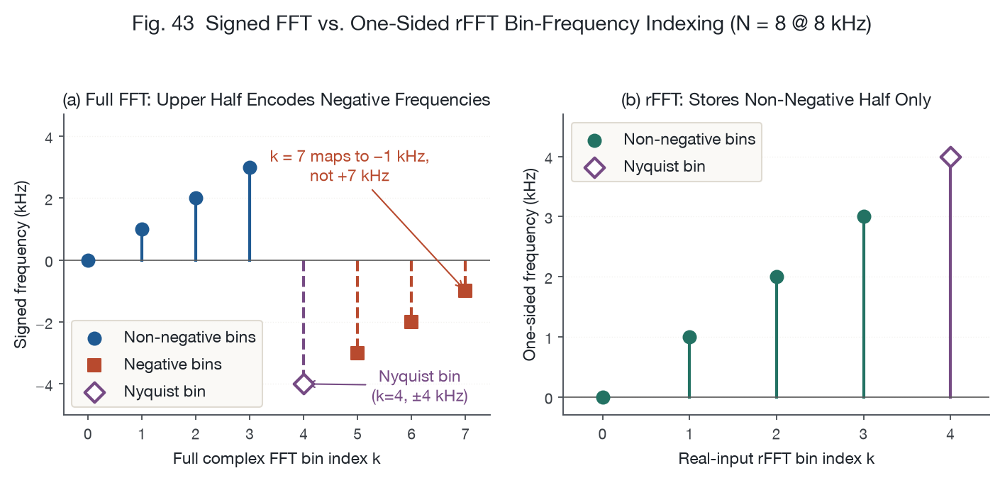
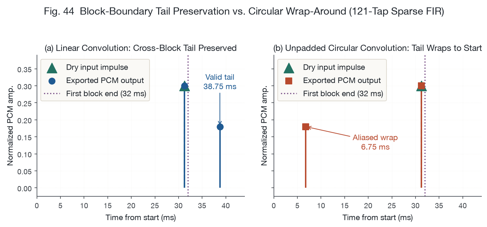
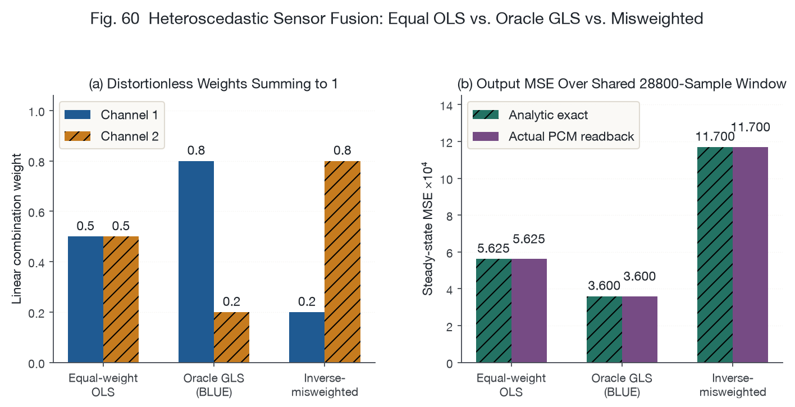

🌐 [简体中文](../chapters/16_appendix-symbols-math.md) ｜ **English**

> ⚠️ This chapter is Chapter 16, i.e., Appendix A (the main text comprises 16 chapters, Chapters 0–15, of which Chapters 12–15 are four extended special topics, followed by Appendices A and B). It may be consulted independently; see the navigation links below for adjacent chapters.
>
> Overview: [`00_overview.md`](00_overview.md) | Previous: [15_target-extraction-diarization.md](15_target-extraction-diarization.md) | Next: [17_appendix-guide.md](17_appendix-guide.md)

---

## Chapter 16 · Appendix A: Symbols, Glossary, and Mathematical Reference

This appendix works in tandem with [Chapter 0: Mathematical Foundations and Signal Analysis Preliminaries](00_math-foundations.md), with a clear division of responsibilities: [Chapter 0](00_math-foundations.md) is structured for systematic study, offering complete step-by-step derivations and 16 foundational exercises (`E00-01`–`E00-16`) across trigonometry and 3D rotational geometry, Fourier/STFT analysis, subspace projections and SVD, Gauss–Markov generalized least squares, Rayleigh quotients and tensor products, Wirtinger variational optimization, circularly symmetric complex Gaussians and Kalman recursion, and acoustic special functions; this appendix serves as a desk-side **global notation standard, comprehensive technical glossary, and four high-frequency quick-reference cards**, supplemented in §16.4 by 15 verification exercises (`E16-01`–`E16-15`) targeting frequency-bin indexing, complex conjugation signs, numerical library traps, and fixed-point quantization readback boundaries, followed by Appendix B. Whenever an unfamiliar symbol or term appears in the main text, check §16.1–§16.3 first to align conventions rapidly; when full theorem proofs are needed, jump directly via [Chapter 0 §0.8](00_math-foundations.md#sec-0-8).

### 16.1 Table of Symbols

The typographic conventions throughout this monograph match §2.3: **italics denote scalars, overhead arrows denote column vectors, and bold uppercase letters denote matrices**; superscript $^H$ denotes conjugate transpose (Hermitian transpose), superscript $^\top$ denotes ordinary transpose without conjugation, and a circumflex $\hat{\ }$ denotes an estimator. Following standard speech signal processing convention, uppercase italic letters carrying a frequency index or time–frequency argument—such as $X(f)$, $X(f_k,\ell)$, or discrete bracketed notation $X_m[k,\ell]$—represent complex **scalars** at an individual frequency bin or time–frequency cell.

This monograph adopts the forward Fourier kernel $e^{-\mathrm{j}2\pi ft}$ uniformly, where $\mathrm{j}=\sqrt{-1}$ is the imaginary unit.

The planar array geometric reference frame is defined as follows: Microphone 1 sits at the origin $x=0$, and Microphone 2 lies along the $+x$ semi-axis; the broadside direction ($+y$-axis) is labeled $0^\circ$, with positive azimuth measured clockwise toward Microphone 2 ($+x$-axis); the unit direction vector $\vec{u}$ points from the array reference origin toward the sound source, so the acoustic wave propagation vector is $-\vec{u}$.

Spherical-harmonic-domain formulas conventionally switch to azimuth $\alpha$ measured counterclockwise from the $+x$-axis and polar angle (colatitude) $\vartheta$ measured downward from the $+z$-axis. Before interfacing with our source azimuth $\theta$ (measured clockwise from $+y$ toward $+x$) and elevation $\phi_{\mathrm{el}}$ (measured upward from the horizontal plane toward $+z$), apply the coordinate conversion $\alpha=\pi/2-\theta$ (wrapped modulo $2\pi$) and $\vartheta=\pi/2-\phi_{\mathrm{el}}$ prior to evaluating spherical harmonic basis functions or calling third-party library APIs; see [§5.8](05_beamforming.md#sec-5-8). Likewise, international standard AmbiX and First-Order Ambisonics (FOA) adopt a 3D right-handed coordinate frame with $+x$ pointing due front, $+y$ due left, and $+z$ due up, measuring horizontal azimuth counterclockwise from $+x$ toward $+y$ and elevation upward toward $+z$; for a complete conversion table against the planar array frame above ($+y$ front, clockwise azimuth), see [Extended Topic III §14.2](14_spatial-wearable-arrays.md#sec-14-2).

**Symbol and operator overloading** (consistent with §2.3): Because array processing, adaptive filtering, dereverberation, and multi-target tracking grew out of distinct research communities, a single letter or operator may serve different roles across chapters. For example, this table writes wavenumber as $\kappa=2\pi f/c$ to distinguish it from discrete frequency-bin index $k$, whereas portions of the literature and local derivations still write $k$ for wavenumber, Chapter 6 §6.2 uses $\kappa\in[-1,1]$ for the IPNLMS proportionate mixing factor, and Chapter 7 locally uses $k$ for the WPE lag frame index; $D$ may denote array aperture or the PHD intensity function; $\lambda$ may denote acoustic wavelength, RLS exponential forgetting factor, WPE time-varying speech variance, or matrix eigenvalue; $K$ may denote source count or WPE prediction order; $s$ may denote a source waveform or tracking state; and $\varepsilon$ denotes absolute diagonal loading in Chapter 5 versus relative Sampling Rate Offset (SRO) in Chapters 10 and 13. The operator $\odot$ similarly follows dual domain conventions: in subspace and vectorized covariance dictionaries ([§0.4.3](00_math-foundations.md#sec-0-4-3), §3.3, §12.7, §16.3.2) it denotes the column-wise Khatri–Rao product, whereas in frequency-domain filtering, time–frequency masking, BSM phase projection, and FiLM feature modulation (§5, §6, §8, [§14.5–§14.6](14_spatial-wearable-arrays.md#sec-14-5), [§15.1](15_target-extraction-diarization.md#sec-15-1)) it denotes the same-shape or broadcast Hadamard element-wise product. Always follow the explicit definition at the equation in question.

When indexing an STFT grid in this table, by default $k$ is the frequency-bin index, $\ell$ is the frame index, $n$ is the discrete time-sample index, and $t$ is continuous time. Individual chapters preserving classic sub-field notation declare their index ordering locally; when cross-referencing equations across chapters, align the physical meaning of each axis using the mapping below rather than assuming identical letters represent the same coordinate:

| STFT Notation | Axis Order | Scope |
|---|---|---|
| $X_m[k,\ell]$, $X(f_k,\ell)$ | (bin $k$, frame $\ell$) | Monograph default (§0, §2, §16; Ch. 5 locally writes $\vec{x}(k,n)$) |
| $X_m(f,k)$, $\vec{x}_{ft}$ | (bin $f$, frame $k$ or $t$) | Ch. 8 separation & mask beamforming (frequency first, frame second) |
| $X(n,f)$ | (frame $n$, discrete bin $f$) | Ch. 7 WPE & Appendix B card (frame first, frequency second) |

The **one-sided spectrum** of a real-valued signal spans $0\leq k\leq\lfloor N/2\rfloor$, corresponding to non-negative physical frequencies $f_k=kf_s/N$ (in Hz). When a full $N$-point DFT is stored in memory, the upper half of the index range represents negative frequencies: $k>N/2$ for even $N$ or $k>(N-1)/2$ for odd $N$ maps to $(k-N)f_s/N$. For even $N$, the Nyquist bin $k=N/2$ of a real signal is self-conjugate and is conventionally labeled $+f_s/2$ in a one-sided spectrum; never misread the trailing bins of a full DFT as new high-frequency components approaching $+f_s$. Exercise [E16-06](#e16-06) works through an eight-point sequence bin by bin.

Whenever a unique signed representative frequency must be assigned to every bin of a **full two-sided spectrum**, this monograph follows the exact convention of NumPy's `fftfreq`:

$$f_k^{\mathrm{full}}=
\begin{cases}
kf_s/N,&0\leq k<\lceil N/2\rceil,\\
(k-N)f_s/N,&\lceil N/2\rceil\leq k<N.
\end{cases}\tag{16-1}$$

For even $N$, the Nyquist bin is labeled $-f_s/2$ under the two-sided convention of Eq. (16-1) and $+f_s/2$ under the real-signal one-sided convention; because $e^{-\mathrm{j}\pi n}=e^{+\mathrm{j}\pi n}=(-1)^n$ takes identical values at every integer sample $n$, both labels refer to the exact same discrete bin rather than two independent observations. The [NumPy `fftfreq` documentation](https://numpy.org/doc/stable/reference/generated/numpy.fft.fftfreq.html) and [NumPy `rfftfreq` documentation](https://numpy.org/doc/stable/reference/generated/numpy.fft.rfftfreq.html) specify these two index mappings respectively (verified against NumPy 2.5 online docs, 2026-09-28).

| Symbol | Meaning |
|---|---|
| $M$, $d$, $D$ | Number of microphones, inter-element spacing between adjacent sensors, total physical array aperture |
| $f_s$, $N$, $N_w$, $H$ | Sampling rate (Hz), DFT/FFT length $N$, STFT real analysis window length $N_w$ (samples, satisfying $N\geq N_w$; defaults to $N=N_w$ without intra-frame zero-padding, see §2.5 Eq. (2-5)), and hop size $H$ (sample advance between consecutive frame starts) |
| $N_{\mathrm{tar}}$ (Chapter 8 OverIVA) | Number of individually extracted target sources; satisfies $N_{\mathrm{tar}}<M$, distinct from $N$ counting all physical sources in Chapter 8 Eq. (8-1), while remaining background channels absorb mixed interference |
| $c$, $\lambda$, $f$, $f_k$ | Speed of sound (numerical examples typically use $343\ \mathrm{m/s}$), wavelength, continuous physical frequency (Hz), non-negative physical frequency $f_k=kf_s/N$ at bin $k$ of a one-sided DFT/STFT; negative-frequency indices of a full two-sided DFT convert via Eq. (16-1) |
| $\kappa=2\pi f/c$ | Wavenumber in $\mathrm{rad/m}$, rendering spatial propagation phase $\kappa d$ dimensionless and avoiding confusion with frequency-bin index $k$. The IPNLMS uniform/proportionate mixing factor $\kappa\in[-1,1]$ (§6.2), 2-norm matrix condition number $\kappa_2(\mathbf{A})$, and spherical vMF concentration $\kappa_{\mathrm{vMF}}$ are distinct local symbols in their respective contexts |
| $\theta$, $\theta_0$ | Source azimuth angle and beamformer look direction measured from broadside; endfire directions lie at $\pm90^\circ$ |
| $\vec{u}(\theta)$ | Unit vector pointing from the array reference origin toward the sound source; acoustic wave propagation vector is $-\vec{u}$ |
| $\phi_{\mathrm{el}}$, $\vec{u}(\theta,\phi_{\mathrm{el}})$ (Chapters 3 & 9, 3D direction) | Elevation angle positive upward from the horizontal plane toward $+z$, spanning $[-90^\circ,90^\circ]$; azimuth remains positive from $+y$ toward $+x$. Azimuth is undefined at the zenith and nadir poles, and the spherical surface-area element factor in radians carries $\cos\phi_{\mathrm{el}}$ (E09-20) |
| $\mathrm{SO}(3)$, $\mathbf{R}_{\mathrm{WA}}$ (Chapters 0 & 9, 3D pose) | 3D special orthogonal rotation group $\mathrm{SO}(3)=\{\mathbf{R}\in\mathbb{R}^{3\times 3}:\mathbf{R}^\top\mathbf{R}=\mathbf{I},\ \det\mathbf{R}=+1\}$ ([§0.1.3](00_math-foundations.md#sec-0-1-3)); $\mathbf{R}_{\mathrm{WA}}\in\mathrm{SO}(3)$ maps source-pointing unit vectors from the local array frame to the world frame with inverse $\mathbf{R}_{\mathrm{WA}}^\top$; do not confuse with a spatial covariance matrix |
| $\mathbf{P}_{\mathcal{R}(\mathbf{A})}$, $\mathbf{P}_{\mathcal{R}(\mathbf{A})}^\perp$ (Chapters 0 & 4, subspaces) | Orthogonal projection matrix $\mathbf{A}(\mathbf{A}^H\mathbf{A})^{-1}\mathbf{A}^H$ onto the column space of full-column-rank $\mathbf{A}$, together with its orthogonal complement projector $\mathbf{I}-\mathbf{P}_{\mathcal{R}(\mathbf{A})}$; both are idempotent and Hermitian ([§0.3.2](00_math-foundations.md#sec-0-3-2)) |
| $\mathbf{U}, \boldsymbol{\Sigma}, \mathbf{V}, \sigma_i$ (Singular Value Decomposition, SVD) | Unitary left singular-vector matrix $\mathbf{U}$, unitary right singular-vector matrix $\mathbf{V}$, and descending non-negative singular values $\sigma_1\ge\sigma_2\ge\cdots\ge 0$ in $\mathbf{A}=\mathbf{U}\boldsymbol{\Sigma}\mathbf{V}^H$ ([§0.3.4](00_math-foundations.md#sec-0-3-4)) |
| $\partial/\partial\vec{w}^*$, $\partial/\partial z^*$ (Wirtinger operator) | Complex conjugate partial derivative operator for real-valued cost functions (formally treating $\vec{w}$ as constant while differentiating solely with respect to $\vec{w}^*$); setting $\partial J/\partial\vec{w}^*=\vec{0}$ is equivalent to zeroing both real-part and imaginary-part gradients simultaneously ([§0.5.1](00_math-foundations.md#sec-0-5-1), §16.3.2) |
| $\vec{r}_m$, $\vec{p}$ | 3D position vector of the $m$-th microphone, near-field point-source position vector |
| $t$, $n$, $k$, $\ell$, $L$, $L_{\mathrm{snap}}$ | Continuous time, discrete sample index, frequency-bin index, frame index, and number of snapshots used for statistical averaging; Chapter 2 Eqs. (2-6)–(2-7) use $L$, Eq. (2-14) CRLB uses $L_{\mathrm{snap}}$ (distinct from filter length $L$), and Chapter 8 locally uses $T$ for frame count |
| $v_m[n]$, $\vec{v}(f_k,\ell)$ | Time-domain additive sensor noise at microphone $m$ and frequency-domain multi-channel noise column vector (primary notation in §2.3); written $n_m[n]$ or $\vec{n}$ in chapters free of sample-index ambiguity |
| $\psi$ | Residual inter-element spatial phase difference after look-direction phase compensation (§2.6, §5.2); E09-20 locally uses $\psi$ for right-handed yaw angle about $+z$, and [Extended Topic III §14.4](14_spatial-wearable-arrays.md#sec-14-4) Eq. (14-12) uses $\psi\in[0,1]$ for sound-field diffuseness |
| $\vec{a}(\theta)$, $\vec{w}$ | Array steering vector, narrowband complex beamformer weight vector |
| $\mathbf{R}_{xx}$, $\hat{\mathbf{R}}_{xx}$ (shorthand $\mathbf{R}$, $\hat{\mathbf{R}}$), $\mathbf{R}_{vv}$, $\mathbf{R}_{nn}$, $\mathbf{R}_{ss}$ | Population and sample observation spatial covariance matrices (abbreviated $\mathbf{R}$, $\hat{\mathbf{R}}$ when unambiguous, see §2.5), additive noise (or total non-target interference-plus-noise) spatial covariance $\mathbf{R}_{vv}$ / $\mathbf{R}_{nn}$, target speech spatial covariance $\mathbf{R}_{ss}$ |
| $\mathbf{\Gamma}$ | Spatial coherence matrix of a 3D spherically isotropic diffuse noise field; see §5.1 for the 2D cylindrically (horizontally) isotropic incidence model |
| $\mathbf{E}_n$, $\mathbf{E}_s$, $\boldsymbol{\Psi}$ (Chapter 4 subspaces) | Noise-subspace eigenvector basis, signal-subspace eigenvector basis, and the ESPRIT rotational invariance operator $\boldsymbol{\Psi}$ linking shift-invariant doublet signal subspaces (§4.6) |
| $\sigma^2$ | Noise variance (average power); spatially white sensor noise with equal uncorrelated power across channels has covariance $\sigma^2\mathbf{I}$ |
| $\mathbf{C}$, $\vec{f}$ | Linear constraint matrix and desired response vector of an LCMV beamformer satisfying $\mathbf{C}^H\vec{w}=\vec{f}$ (§5.5) |
| $\vec{e}_r$ | Reference-microphone selection vector (standard basis vector with $1$ at entry $r$ and $0$ elsewhere, specifying the reference channel in MWF and SDW-MWF; see [Chapter 5 §5.5.1 MWF Special Section](05_beamforming.md#sec-5-5-1)) |
| $U, u$ (Extended Topic II) | Total number of nodes and node index in a Wireless Acoustic Sensor Network (WASN); node $u$ carries $M_u$ local microphones for network total $M=\sum_{u=1}^U M_u$ |
| $S, Q$ (Extended Topic II) | Dimension of latent common target signals and dimension of compressed signals broadcast per node to neighbors; classical DANSE optimality theorems typically require $Q=S$. Distinguish from room-acoustics source directivity factor $Q$ |
| $z_u, \vec{z}_u, \vec{z}_{-u}, \mathbf{F}_u$ (Extended Topic II DANSE) | Locally compressed broadcast signal of node $u$ (scalar $z_u=\vec{f}_u^H\vec{x}_u$ for $Q=1$, general $Q$-dimensional vector $\vec{z}_u=\mathbf{F}_u^H\vec{x}_u$ with compression matrix $\mathbf{F}_u\in\mathbb{C}^{M_u\times Q}$); $\vec{z}_{-u}$ stacks broadcasts received from the other $U-1$ remote nodes ([§13.5](13_distributed-enhancement.md#sec-13-5), [§13.9](13_distributed-enhancement.md#sec-13-9)) |
| $\mathbf{T}_u, \vec{h}_u, \vec{f}_u, \vec{g}_u$ (Extended Topic II) | $\mathbf{T}_u^H$ maps network-wide observations to the local-plus-neighbor compressed observations available at node $u$; $\vec{h}_u=[\vec{f}_u^\top,\vec{g}_u^\top]^\top$ is node $u$'s receive combination vector, with $\vec{f}_u$ weighting local microphones and $\vec{g}_u$ weighting received neighbor broadcasts |
| $\mathbf{B}$ | Blocking matrix of a Generalized Sidelobe Canceller (GSC), satisfying orthogonal blocking $\mathbf{B}^H\vec{a}(\theta_0)=\vec{0}$ (§5.6) |
| $\Phi(f)$ | Frequency-domain weighting function of Generalized Cross-Correlation (GCC) in §4.2; power spectral density of signal or noise in §5.7—distinguish by chapter context |
| $\mathbf{P}$, $\mathbf{K}$, $\mathbf{Q}$, $\mathbf{F}$, $\mathbf{H}$ | Core Kalman filter matrices: state estimation error covariance, Kalman gain, process noise covariance, state transition matrix, observation matrix (§9.2) |
| $\vec{\nu}_t$, $\mathbf{S}_t$, $N_{\mathrm{eff}}$ (Chapter 9 tracking) | Kalman innovation vector (measurement minus prediction) and innovation covariance at step $t$, plus particle-filter effective sample size $N_{\mathrm{eff}}=1/\sum_i (w_t^{(i)})^2$ measuring weight degeneracy (§9.2) |
| $\mu_j$, $c_j$, $L_j$ (Chapter 9 IMM) | Interacting Multiple Model (IMM) mode posterior probability, Markov-mixed mode prior probability, and mode-conditional measurement likelihood density. A scalar angular likelihood density $L_j$ expressed per degree has physical units $\mathrm{deg}^{-1}$ rather than being a dimensionless probability; missed-detection frames emit no new $L_j$ (E09-18) |
| $\kappa_{\mathrm{vMF}}$, $\vec{\mu}_{\mathrm{vMF}}$, $A(\kappa)$ (Chapter 9 directional stats) | Dimensionless concentration parameter, unit mean direction vector, and mean resultant length function of the von Mises–Fisher (vMF) spherical distribution (abbreviated $k$ and $\vec{m}$ locally in E09-20); mean direction is undefined under uniform $\kappa_{\mathrm{vMF}}=0$. Distinguish from IMM mode probability $\mu_j$ and PHD clutter intensity $\kappa_t(\vec{z})$ |
| $V$, $A$, $S$, $\bar{\alpha}$ | Room volume, equivalent absorption area, total interior surface area, average absorption coefficient (§2.4) |
| $\mu_{\mathrm{NLMS}}$ | Step size of Normalized Least Mean Squares (NLMS, §6.1); Chapter 6 derives the ideal noiseless single-step error contraction range $0<\mu<2$, while practical choices are further bounded by denominator regularization, near-end speech/noise, and path nonstationarity |
| $\mu_{\mathrm{SDW}}$ | Speech-distortion-versus-noise trade-off weight in the Speech-Distortion-Weighted Multichannel Wiener Filter (SDW-MWF, [Chapter 5 §5.5.1](05_beamforming.md#sec-5-5-1)); physically unrelated to NLMS step size |
| $\varepsilon_{\mathrm{NLMS}}$ | Strictly positive denominator safeguard constant in NLMS updates, carrying the same units as input signal energy to prevent division by zero on silence and suppress weight jumps on ultra-low-energy frames (§6.1) |
| $\varepsilon$, $\alpha$, $\delta$, $\eta$ (diagonal loading & robustness bounds) | Chapter 5 writes absolute diagonal loading as $\mathbf{R}+\varepsilon\mathbf{I}$ (also written $\delta$ in parts of the literature and this appendix), carrying the same units as $\mathbf{R}$; relative diagonal loading is written $\mathbf R + \alpha\bar{\sigma}^2\mathbf I$ with $\bar{\sigma}^2=\operatorname{tr}(\mathbf R)/M$ (also written $\eta$ in the literature and [E16-09](#e16-09)), which is dimensionless; norm-bounded steering-vector uncertainty radius is written $\|\vec{\Delta}\|_2\leq\delta$ (§5.4) |
| $\tau_{ij}$, TDOA | $\tau_{ij}=t_i-t_j$, Time Difference of Arrival (TDOA); under a far-field plane wave, TDOA relative to Mic 1 is $\tau_{m1}=-(\vec{r}_m-\vec{r}_1)^\top\vec{u}/c$ |
| $T_{60}$, DRR, $d_c$, $C_{50}$ | Reverberation time, Direct-to-Reverberant Ratio (DRR, usually reported in dB), critical distance, and speech clarity index $C_{50}$ (decibel ratio of direct plus early-reflection energy within the first $50\ \mathrm{ms}$ to late reverberation energy beyond $50\ \mathrm{ms}$) |
| WNG, DI, HPBW, SLL | White Noise Gain (WNG), Directivity Index (DI), Half-Power Beamwidth (HPBW), Side-Lobe Level (SLL) |
| RTF | In beamforming and spatial modeling: Relative Transfer Function; in system benchmarking and hardware sizing: Real-Time Factor, i.e., cumulative processing wall-clock time divided by newly advanced audio duration over the measurement window (inter-frame overlap samples must never be double-counted in the denominator; Chapter 10 telemetry separately logs `frame_service_rtf` per frame) |
| $x[n], d[n], y[n], \hat{y}[n], e[n]$, $h[n], \hat{\vec{w}}, \lambda$, $E_y, E_e$, ERLE, SER | AEC far-end playback reference, microphone signal, **true echo**, **linear estimated echo**, and residual signal; true echo path, adaptive filter tap vector, RLS exponential forgetting factor ($0<\lambda\leq 1$), plus same-window pure echo energy $E_y$, residual echo energy $E_e$, Echo Return Loss Enhancement (ERLE), and Signal-to-Echo Ratio (SER; §6.1, §6.2, §6.8) |
| $G(k,f)$, $\lambda_{ft}$, $\Delta$, $K$ | WPE linear prediction filter taps, time-varying variance (power spectral density) $\lambda_{ft}$ of target early speech, prediction delay in frames, and prediction order. Chapter 7 locally uses $k$ for lag frame index and $f$ for **dimensionless discrete frequency-bin index** (also writing $\lambda(f,t)$), distinct from continuous frequency $f$ in Hz (§7.1) |
| $\mathbf{W}_f$, $\pi$ (Chapter 8 separation) | Blind source separation demixing matrix at frequency bin $f$ ($\hat{\vec{s}}_{ft}=\mathbf{W}_f\vec{x}_{ft}$) and source permutation mapping $\pi$ aligning output channel identities (§8.1, §8.3) |
| $\mathrm{SI\text{-}SDR}$, $\mathrm{CI\text{-}SDR}$ | Scale-Invariant Signal-to-Distortion Ratio (zeroth-order scalar orthogonal projection, §8.5, §10.5) and Convolutive-Transfer-Function Invariant Signal-to-Distortion Ratio (short causal FIR Toeplitz subspace orthogonal projection permitting benign short linear filtering, §8.5) |
| $\mathrm{cpWER}, \mathrm{tcpWER}, \mathrm{ORC\text{-}WER}, \mathrm{sa\text{-}WER}$ | Four multi-speaker meeting transcription WER metrics: Concatenated Minimum-Permutation WER (`cpWER`), Time-Constrained Minimum-Permutation WER (`tcpWER`), Optimal Reference Combination WER (`ORC-WER`), and Speaker-Attributed WER (`sa-WER`; §10.5, §11.2, §15.7) |
| $\varepsilon, f_d$ (SRO clock drift) | Relative Sampling Rate Offset $\varepsilon=(f_d-f_s)/f_s$ between asynchronous devices (typically in ppm; actual device rate $f_d=f_s(1+\varepsilon)$ inducing cumulative drift $\Delta t(T)\approx\varepsilon T$; shared across Chapter 10 §10.2 and Chapter 13 §13.15, distinct from Chapter 5 diagonal loading $\varepsilon$) |
| $L_{\mathrm{e2e}}, L_p$ (Chapter 10 latency) | Critical-path end-to-end latency $L_{\mathrm{e2e}}=\max_p L_p$ of a directed data-dependency graph, where each path $L_p$ sums lookahead, buffering, compute, scheduling, and decoding delays (§10.1 Eq. (10-2)) |
| $\mathbf{A}$, $\mathbf{P}$, $\vec{q}$, $\vec{b}$ (Extended Topic I) | Acoustic imaging propagation dictionary, Point Spread Function (PSF) matrix, candidate source mean-square strength vector on the focal surface, and delay-and-sum dirty map vector; satisfies $P_{ij}=|\vec{w}_i^H\vec{a}_j|^2$ (rows index scan grid points, columns index true source grid points)—do not confuse with Kalman error covariance $\mathbf{P}$ in Chapter 9 (§12.4) |
| CSM, $\mathbf{R}$, $p_{\mathrm{ref}}$ (Extended Topic I) | Cross-Spectral Matrix and airborne acoustics reference RMS sound pressure $p_{\mathrm{ref}}=20\ \mu\mathrm{Pa}$; unnormalized FFT outer products, per-Hz PSDs, and single-bin mean-square amplitudes have distinct scaling factors, and uncalibrated digital sample levels must never be labeled $\mathrm{Pa}^2$ or dB SPL (§12.3) |
| $W, X, Y, Z$, $\vec{b}_{\mathrm{WXYZ}}$, $\vec{b}_{\mathrm{ACN}}$ (Extended Topic III) | First-Order Ambisonics (FOA) zeroth-order omnidirectional and three first-order dipole channels under SN3D normalization, in intuitive order $[W,X,Y,Z]^\top$ versus standard ACN order $[W,Y,Z,X]^\top$ ([§14.2](14_spatial-wearable-arrays.md#sec-14-2)) |
| $J_n, j_l, y_l, h_l^{(2)}, P_l^m, Y_{l,m}$ | $n$-th order cylindrical Bessel function of the first kind $J_n$, $l$-th order spherical Bessel functions $j_l, y_l$ and spherical Hankel function of the second kind $h_l^{(2)}=j_l-\mathrm{j}y_l$ (outgoing scattered wave under time factor $e^{+\mathrm{j}\omega t}$), associated Legendre function $P_l^m$, and spherical harmonic $Y_{l,m}$ (also written $Y_n^m$; [§0.7](00_math-foundations.md#sec-0-7), [§5.8](05_beamforming.md#sec-5-8), [§14.2](14_spatial-wearable-arrays.md#sec-14-2)). Note the normalization conversion $Y_{l,m}^{\mathrm{N3D}}=\sqrt{2l+1}\,Y_{l,m}^{\mathrm{SN3D}}=\sqrt{4\pi}\,Y_{l,m}^{\mathrm{ortho}}$, so the spherical-mean radial modal weight $b_l(\kappa R)$ in Chapter 14 differs by a constant factor $4\pi$ from the orthonormal-basis convention $4\pi\mathrm{j}^l j_l(\kappa R)$ in Chapters 0 and 5 |
| $b_l(\kappa R)$ (Extended Topic III) | $l$-th order radial modal strength of a radius-$R$ spherical array under the spherical-mean (SN3D) convention; an open sphere hits a radial null $b_0^{\mathrm{open}}(\pi)=0$ at $\kappa R=\pi$, whereas a rigid sphere eliminates positive real zeros via $h_l^{(2)\prime}(\kappa R)$ ([§14.2](14_spatial-wearable-arrays.md#sec-14-2)) |
| $\vec{I}_a, \vec{I}_r$, $E, \psi$ (Extended Topic III) | Time-averaged active acoustic intensity, reactive intensity, total acoustic energy density, and sound-field diffuseness $\psi=1-\|\bar{\vec{I}}_a\|_2/(c\bar{E})$ (with $\bar{\vec{I}}_a=\mathbb{E}[\vec{I}_a]$, $\bar{E}=\mathbb{E}[E]$, $\psi\in[0,1]$; [§14.4](14_spatial-wearable-arrays.md#sec-14-4)) |
| $\mathbf{H}, \vec{p}_e, \vec{\phi}$; $\mathrm{IC}, \beta$ (Extended Topic III) | Wearable-array $Q$-direction manifold matrix, target-ear HRTF vector, and MagLS auxiliary free-phase vector (fitting conjugate target $\vec{p}_e^*$ via $\mathbf{H}^H\vec{w}_e$; [§14.5](14_spatial-wearable-arrays.md#sec-14-5)–[§14.6](14_spatial-wearable-arrays.md#sec-14-6)); Interaural Coherence and reference-microphone mixing factor $\beta\in[0,1]$ ([§14.7](14_spatial-wearable-arrays.md#sec-14-7)) |
| $U_c, \gamma_{\mathrm{wind}}(f)$; $H_{\mathrm{occ}}(f)$; $\tau_{\mathrm{proc}}$ (Extended Topic III) | Corcos turbulent wind-noise convection velocity and spatial coherence ([§14.8](14_spatial-wearable-arrays.md#sec-14-8)); occluded ear-canal inner-mic / bone-conduction cross-modal own-voice transfer function relative to outer mic ([§14.9](14_spatial-wearable-arrays.md#sec-14-9)); active hear-through end-to-end processing latency ([§14.10](14_spatial-wearable-arrays.md#sec-14-10)) |
| $\mathcal{C}, \vec{e}, \vec{\gamma}, \vec{\beta}$; $\mathcal{L}_{\mathrm{dual}}$, $\tau_{\mathrm{floor}}$ (Extended Topic IV) | Prior target clue, conditioning embedding vector, and FiLM channel scaling/bias vectors; dual-state loss uniting active-speech negative SI-SDR with silent-state relative mixture-energy floor factor ([§15.2](15_target-extraction-diarization.md#sec-15-2)) |
| $r_F=2D^2/\lambda$, $\phi(r), \phi_1$, $\vec{w}_{\mathrm{bubble}}$ (Extended Topic IV) | Fresnel near-field curvature boundary, spherical-wave curvature phase lag $\phi(r)=-\frac{2\pi}{\lambda}(\sqrt{r^2+d^2}-r)$ at outer elements relative to center mic at broadside range $r$ (written $\phi_1=\phi(r_1)$ at target range $r_1$), and closed-form three-microphone broadside acoustic distance-bubble second-order spatial difference weights ([§15.3](15_target-extraction-diarization.md#sec-15-3)) |
| $\mathrm{DER}$, $E_{\mathrm{miss}}$, $E_{\mathrm{FA}}$, $E_{\mathrm{conf}}$ (Extended Topic IV) | Diarization Error Rate and frame-level missed speech, false alarm, and speaker confusion counts; legitimate $\mathrm{DER}$ can exceed $100\%$ under heavy false alarms ([§15.4](15_target-extraction-diarization.md#sec-15-4)) |
| $\gamma_{k,t}$, $m_{k,t}^{\mathrm{tar}}$, $m_{k,t}^{\mathrm{int}}$; $\Delta t_{\mathrm{av}}, \alpha_\ell$ (Extended Topic IV) | TS-VAD independent Bernoulli activity posteriors and GSS target-exclusive / interference masks ([§15.5](15_target-extraction-diarization.md#sec-15-5)); audio–visual camera pipeline positive lag and frame-level visual visibility confidence gate ([§15.6](15_target-extraction-diarization.md#sec-15-6)) |
| $\otimes$, $\odot$, $\operatorname{vec}(\cdot)$ | $\otimes$ denotes Kronecker product and $\operatorname{vec}(\cdot)$ denotes column-major matrix vectorization; $\odot$ carries context-dependent dual conventions: column-wise Khatri–Rao product in subspace and covariance dictionaries ([§0.4.3](00_math-foundations.md#sec-0-4-3), §3.3, §12.7, §16.3.2; obeying $(\mathbf B\odot\mathbf A)\vec q$), versus same-shape or broadcast Hadamard element-wise product in frequency-domain filtering, time–frequency masking, BSM phase projection, and FiLM modulation (§5, §6, §8, [§14.5–§14.6](14_spatial-wearable-arrays.md#sec-14-5), [§15.1](15_target-extraction-diarization.md#sec-15-1)) |
| PHD / RFS | Probability Hypothesis Density (PHD) and Random Finite Set (RFS) |

The qualifier "residual" in residual phase $\psi$ in the table above is defined relative to the beamformer look angle $\theta_0$: when a plane wave arrives from azimuth $\theta$, a uniform linear array first applies compensating delays steered toward $\theta_0$, leaving an uncompensated inter-element phase difference between adjacent sensors equal to

$$\psi=\frac{2\pi d}{\lambda}(\sin\theta-\sin\theta_0).$$

Because both $d/\lambda$ and the sine difference are dimensionless ratios, $\psi$ has units of radians (rad). When the arrival angle matches the look direction ($\theta=\theta_0$), $\psi=0$ and all channels sum in phase to form the mainlobe peak; as $\theta$ departs from $\theta_0$, the angular mapping of $\psi$ directly governs mainlobe width, null locations, and sidelobe heights (§5.2).

Under a 3D spherically isotropic diffuse noise field model, the spatial coherence coefficient between microphones $i$ and $j$ at frequency $f$ is

$$\begin{gathered}
[\mathbf{\Gamma}]_{ij}=\operatorname{sinc}(2fd_{ij}/c),\\
\operatorname{sinc}(x)=\frac{\sin(\pi x)}{\pi x}.
\end{gathered}$$

Here $d_{ij}=\|\vec{r}_i-\vec{r}_j\|_2$ is the inter-microphone distance, $f$ is physical frequency (Hz), and $c$ is the speed of sound; when $i=j$ or $f=0$, the continuous limit gives $[\mathbf{\Gamma}]_{ij}=1$. This $\operatorname{sinc}$ law rests specifically on uniform acoustic power arrival over the full 3D sphere; if noise arrives isotropically only within the 2D horizontal plane, spatial coherence becomes the zeroth-order cylindrical Bessel function of the first kind $J_0(2\pi fd_{ij}/c)$—the two diffuse-field models must never be conflated (§5.1).

Worked Check (16.1): Suppose an $M=6$-element array is distortionlessly normalized along the target direction ($\vec{w}^H\vec{a}=1$), with mutually independent equal-power sensor self-noise across channels. Find the White Noise Gain (WNG, in dB) of an equal-weight delay-and-sum beamformer (DSB); then write down the two eigenvalues of the $2\times 2$ diagonal spatial covariance matrix $\operatorname{diag}(4, 1)$ and explain the physical meaning of its eigenvectors.

Setup and Substitution: Under ideal unit-modulus target steering $|\vec{a}|=[1,\ldots,1]^\top$, the equal-weight DSB vector satisfying $\vec{w}^H\vec{a}=1$ is $\vec{w}=\vec{a}/M$, with squared Euclidean norm $\|\vec{w}\|_2^2=M\times(1/M)^2=1/M$. Hence linear white noise gain is $\mathrm{WNG}=1/\|\vec{w}\|_2^2=6$, which converts to $10\log_{10}6\approx7.78\ \mathrm{dB}$ ($\sim 7.8\ \mathrm{dB}$). For the diagonal matrix $\operatorname{diag}(4, 1)$, all off-diagonal entries vanish, so the characteristic equation $(4-\lambda)(1-\lambda)=0$ immediately yields eigenvalues $4$ and $1$ with orthonormal eigenvectors $[1,0]^\top$ and $[0,1]^\top$. Note carefully that eigenvectors of a spatial covariance matrix span orthogonal principal energy axes in sensor observation space and do not, in general, map one-to-one onto individual physical source arrival directions.

### 16.2 Glossary of Terms

The tables below organize recurring core terms from the main text by technical module, clarifying their physical definitions and validity boundaries.

#### Signal Processing and Mathematical Foundations

| Term | Explanation |
|---|---|
| Short-Time Fourier Transform (STFT) | Slices a continuous long waveform at fixed hop intervals into overlapping short frames, applies a window function, and computes a frame-by-frame DFT to produce a 2D complex time–frequency representation. Window length and hop size trade off frequency resolution, short-time speech stationarity, and algorithmic latency; under the narrowband approximation, wideband time-domain convolution decomposes into bin-wise complex multiply-accumulate operations (§2.5) |
| COLA / WOLA (Constant Overlap-Add / Weighted Overlap-Add) | COLA requires that shifted products of analysis and synthesis windows sum to a non-zero constant across the steady time axis ($\sum_\ell w_{\mathrm{syn}}[n-\ell H]w_{\mathrm{ana}}[n-\ell H]=C$), providing the necessary and sufficient condition for distortionless STFT perfect reconstruction; WOLA applies windows on both analysis and synthesis sides (e.g., dual square-root Hann windows) to suppress block-boundary discontinuities induced by spectral modification ([§0.2.4](00_math-foundations.md#sec-0-2-4), §2.5) |
| Snapshot | At a single frame and single frequency bin, the $M$-dimensional complex column vector formed by stacking the complex spectral values of all $M$ microphones in channel order—representing one spatial sample captured by the array at that time–frequency cell (§2.5) |
| Spatial Covariance Matrix $\mathbf{R}_{xx}$, $\hat{\mathbf{R}}_{xx}$ (shorthand $\mathbf{R}$, $\hat{\mathbf{R}}$) | Array processing literature commonly refers to both the population second-moment matrix $\mathbf{R}_{xx}=\mathbb{E}[\vec{x}\vec{x}^H]$ and the temporal average of snapshot outer products $\hat{\mathbf{R}}_{xx}=\frac{1}{L}\sum_\ell \vec{x}_\ell\vec{x}_\ell^H$ (abbreviated $\mathbf{R}$, $\hat{\mathbf{R}}$ when unambiguous; additive noise covariance written $\mathbf{R}_{vv}$ or $\mathbf{R}_{nn}$) as spatial covariance matrices. Without subtracting the sample mean first, $\hat{\mathbf{R}}_{xx}$ is strictly an uncentered sample second-moment matrix, coinciding with the same-denominator centered sample covariance **if and only if the sample mean of that specific finite batch of snapshots happens to be the exact zero vector**; zero population mean does not imply zero finite-sample mean. Serves as the core input to Capon, MVDR, and MUSIC; see Chapter 2 Eqs. (2-6)–(2-7) |
| Eigendecomposition / Subspaces | Decomposes a Hermitian matrix into real eigenvalues and orthonormal eigenvectors. Interpreting the eigenvectors of the $K$ largest eigenvalues as the $K$-dimensional signal subspace requires simultaneously a full-rank source covariance, full-column-rank steering matrix, source count $K<M$, spatially white isotropic noise, zero source–noise cross-second-moments, and an exact manifold model; the remaining eigenvectors associated with the noise floor span the noise subspace (Fig. 6d, §4.6) |
| Overdetermined System | A linear system having strictly more independent equations than unknowns. Admits an exact solution when the right-hand observation vector lies inside the column space of the coefficient matrix, and otherwise seeks a minimum-residual-norm approximate solution via least squares. In TDOA localization, pairwise time differences across microphone pairs often share a common reference arrival time, so adding extra pair equations does not add an equal number of independent geometric constraints (§4.4) |
| Hyperbolic Localization | In 2D planar geometry, a non-degenerate range difference measured between a pair of microphones traces one branch of a hyperbola with those two sensors as foci; in 3D space it traces one sheet of a two-sheeted hyperboloid. Intersecting multiple independent baselines localizes a near-field source, though collinear or endfire degenerate geometries may fail to yield a unique intersection (§4.4) |
| Conventional Beamwidth / Super-Resolution | Conventional delay-and-sum mainlobe angular width is bounded on the order of the Rayleigh limit $\lambda/D$; subspace methods (such as MUSIC and ESPRIT) can resolve multiple sources separated by less than $\lambda/D$ provided the manifold is calibrated, SNR and snapshot counts are adequate, and sources are not fully coherent—hence the term super-resolution (§2.6, §4.6) |
| Beampattern | With beamformer weights held fixed, the magnitude (or power gain) of the complex spatial response to unit plane waves plotted as a function of incidence angle, used to read off mainlobe width, sidelobe height, and interferer null locations visually (Fig. 7a) |
| Degrees of Freedom (DOF) | Number of independently adjustable parameter dimensions in an optimization problem. Narrowband $M$-microphone beamformer weights possess $M$ complex DOFs; each **linearly independent complex equality constraint** consumes $1$ complex DOF, redundant constraints consume no extra DOFs, and mutually inconsistent constraints render the feasible set empty (§5.5). Sparse arrays expand virtual sensor count in second-order statistics via the difference coarray, but virtual lags cannot be equated directly to physical microphone channels (§3.3) |
| Tap | A single multiply-accumulate coefficient of a Finite Impulse Response (FIR) filter. A "128-tap filter" has 128 impulse-response coefficients corresponding to a polynomial in $z^{-1}$ of maximum degree (order) 127—always check the off-by-one convention between "filter length/taps" and "filter order" across papers and library APIs (§6.1) |
| Precedence Effect (Law of the First Wavefront) | When direct sound and short-delay early reflections with similar spectral characteristics arrive sequentially at the two ears from different directions, human directional perception is dominated primarily by the first-arriving direct wavefront; this does not mean reflection energy or coloration is ignored entirely. [Chapter 1](01_problem-definition.md)'s comparison of binaural cues and machine arrays states the definition and cites Wallach et al. (1949), while §2.4 covers room impulse response modeling |
| Method of Lagrange Multipliers | Classical analytical technique for equality-constrained extremum problems: incorporates linear constraints into the objective via Lagrange multipliers to construct a real-valued Lagrangian, then sets the complex conjugate Wirtinger gradient to zero to derive closed-form MVDR and LCMV weights ([§0.5.2](00_math-foundations.md#sec-0-5-2), §5.4, §16.3.2) |
| GCC-PHAT Spectral Phase Weighting | At every non-zero cross-spectrum bin, divides the cross-power spectrum $G_{12}(f)$ by its magnitude $|G_{12}(f)|$ so all frequency bins carry unit magnitude and retain phase difference alone (zero-magnitude bins require denominator regularization or skipping). Equalizes the **frequency-domain magnitude spectral envelope** of a single channel pair—it does NOT spatially whiten multi-channel correlated noise (§4.2; see [Knapp & Carter, 1976](https://doi.org/10.1109/TASSP.1976.1162830)) |
| Spatial Noise Whitening | Given a known Hermitian positive-definite noise covariance $\mathbf{R}_{nn}$ at a fixed frequency bin, left-multiplies snapshots by a whitening matrix $\mathbf{W}$ satisfying $\mathbf{W}\mathbf{R}_{nn}\mathbf{W}^H=\mathbf{I}$, while **simultaneously transforming** the target steering vector to $\mathbf{W}\vec{a}$. Eliminates inter-channel noise correlation and variance imbalance—never confuse with bin-wise scalar GCC-PHAT normalization ([E16-04](#e16-04)) |
| Normalized sinc Function | Defined uniformly throughout this monograph as $\operatorname{sinc}(x)=\sin(\pi x)/(\pi x)$. Governs two-microphone spatial coherence in a 3D spherically isotropic diffuse field, whereas a 2D horizontally isotropic field obeys $J_0(2\pi fd/c)$ (§5.1). Parts of the mathematics literature write $\operatorname{sinc}(x)$ for unnormalized $\sin x/x$; verify the factor $\pi$ before substituting |
| Signal-to-Noise Ratio (SNR) | Ratio of target signal power to noise power, usually expressed in dB via $10\log_{10}$; subtracting reference-channel input SNR from array-processed output SNR gives array SNR gain. Acoustic Echo Cancellation (AEC) separately uses Signal-to-Echo Ratio (SER) for near-end speech power over far-end echo power; always document the reference measurement point and averaging interval (§5.1, §6.1) |
| Decibel (dB) | Logarithmic scale expressing a physical ratio relative to a reference: power or energy ratios take $10\log_{10}$, whereas amplitude quantities such as sound pressure or voltage take $20\log_{10}$. The two formulas yield identical decibel numbers if and only if numerator and denominator share the same impedance proportionality where power scales with squared amplitude ([§0.2.2](00_math-foundations.md#sec-0-2-2), §16.3.1) |
| Fast Fourier Transform (FFT) | Divide-and-conquer fast algorithm computing the Discrete Fourier Transform (DFT) of an $N$-sample time frame across $N$ discrete frequency bins, reducing arithmetic complexity from $O(N^2)$ to $O(N\log N)$; STFT applies FFTs across sliding windowed frames (§2.5) |
| Deep Neural Network (DNN) | Parametric model composed of stacked linear projections and nonlinear activations trained on large-scale labeled or self-supervised audio corpora. Commonly deployed in array front-ends to predict time–frequency masks, DOA posterior distributions, or direct complex spectral mappings (§4.7, §5.9) |
| Far Field / Near Field | The far-field model assumes source range far exceeds array aperture so wavefronts approximate plane waves and steering vectors depend solely on arrival angle; the near-field model requires spherical wavefronts accounting for exact sensor-to-source path differences and $1/r$ spreading attenuation. The Fraunhofer distance $2D^2/\lambda$ serves as a standard gauge of quadratic phase curvature, supplemented in practice by $r\gg D$, allowable phase error budgets, and inter-channel amplitude ratios (§2.2) |

#### Room Acoustics

| Term | Explanation |
|---|---|
| Room Impulse Response (RIR) | Under stationary source/microphone positions and linear time-invariant acoustic propagation, the complete time-domain signal received at a microphone in response to a unit impulse emitted at the source (comprising direct sound, early reflections, and late reverberation); linearly convolving a dry source signal with the RIR synthesizes the reverberant microphone observation (§2.4) |
| Reverberation Time ($T_{60}$) | Time in seconds required for indoor acoustic energy density to decay by $60\ \mathrm{dB}$ after a steady-state sound source is switched off; varies with room volume, boundary absorption materials, and measurement frequency band |
| Direct-to-Reverberant Ratio (DRR) | Energy ratio between the direct-path component of an RIR and the sum of all reflected/reverberant components; positive dB values indicate direct-path dominance, whereas negative dB values indicate reverberant energy exceeds direct sound |
| Speech Clarity Index ($C_{50}$) | Decibel ratio of impulse-response energy in the first $50\ \mathrm{ms}$ (direct sound plus beneficial early reflections) to late reverberation energy beyond $50\ \mathrm{ms}$; widely used alongside spatial-covariance principal eigenvalues for channel-quality selection in far-field multi-channel meeting ASR (§2.4, §17.3) |
| Critical Distance ($d_c$) | Source-to-receiver distance at which direct-path energy equals steady-state diffuse reverberant energy ($\mathrm{DRR}=0\ \mathrm{dB}$) for a given source directivity; under Sabine's approximation, $d_c\approx0.057\sqrt{QV/T_{60}}$ where $Q$ is the source directivity factor, reducing to $0.057\sqrt{V/T_{60}}$ only for an omnidirectional source $Q=1$ (§2.4) |
| Image-Source Method (ISM) | Geometric room-acoustics simulation method replacing specular reflections off rigid or partially absorbing planar walls with free-space radiation from virtual mirror-image sources behind the walls (Allen & Berkley, 1979); forms the core shoebox engine of `pyroomacoustics` |
| Diffuse Noise Field | Idealized statistical sound-field model in which acoustic energy arrives with uniform average power and random phase from all spatial directions without a dominant propagation vector. Late room reverberation tails are well approximated as spherically diffuse, whereas localized turbulent wind noise across a microphone windscreen has an extremely short correlation length and does NOT obey acoustic diffuse-field coherence |

#### Adaptive Filtering, Enhancement, and Separation

| Term | Explanation |
|---|---|
| LMS / NLMS / RLS | Least Mean Squares (LMS) has the simplest update; Normalized LMS (NLMS) dynamically normalizes the step size by current input-frame energy; Recursive Least Squares (RLS) whitens colored excitations via recursive inversion of the input correlation matrix, typically converging much faster at the price of higher per-step compute and memory footprint. Practical trade-offs depend on excitation spectral flatness, filter length, and regularization ([GSC §5.6](05_beamforming.md#sec-5-6), [NLMS §6.1](06_aec.md#sec-6-1), [RLS §6.2](06_aec.md#sec-6-2)) |
| FDKF / APA (Frequency-Domain Kalman Filter / Affine Projection Algorithm) | FDKF embeds a state-space model inside partitioned-block frequency-domain adaptive filtering to regulate step sizes dynamically, unifying double-talk robustness with fast path tracking; APA projects onto the affine subspace spanned by the most recent $K$ time-domain sample observations (projection order $K$, distinct from PBFDAF partition count $P$) to accelerate decorrelation convergence on colored speech excitation relative to single-step NLMS ([§6.2](06_aec.md#sec-6-2)) |
| Musical Noise | Isolated random narrowband spectral peaks left behind by classical spectral subtraction or overly aggressive real masking under fluctuating noise-power estimates, perceived after inverse STFT as twinkling water-droplet or metallic tonal artifacts (§5.7) |
| ICA / IVA | Independent Component Analysis (ICA) estimates a demixing matrix $\mathbf{W}_f$ per frequency bin using non-Gaussian source independence; Independent Vector Analysis (IVA) bundles all frequency-bin complex components of each source into a single spherical joint distribution vector, suppressing inter-frequency permutation misalignment directly within the source prior (§8.3) |
| Non-negative Matrix Factorization (NMF) | Approximates a non-negative magnitude or power spectrogram as the product of a low-rank spectral basis dictionary matrix and a temporal activation matrix; single-channel NMF carries no spatial phase information and does not by itself yield a multi-channel spatial demixing filter ([§8.3](08_speech-separation.md#sec-8-3)) |
| AuxIVA | Auxiliary-function-based (Majorization–Minimization) tuning-free iterative solver for Independent Vector Analysis; after outputting separated complex spectra, projection-back rescaling is still required to restore physical reference-microphone units ([§8.3](08_speech-separation.md#sec-8-3)) |
| Independent Low-Rank Matrix Analysis (ILRMA) | Unifies a determined linear spatial demixing model (AuxIVA) with per-source low-rank NMF power spectral models under a single joint negative log-likelihood objective optimized via alternating updates ([§8.3](08_speech-separation.md#sec-8-3)) |
| Multichannel NMF (MNMF) | Fits both an NMF time–frequency power spectrogram and a full-rank spatial covariance matrix per source, reconstructing spatial source images via multichannel Wiener filtering. Note that writing down an underdetermined mixture likelihood does not guarantee practical parameter identifiability from finite observations ([§8.3](08_speech-separation.md#sec-8-3)) |
| FastMNMF | Accelerates MNMF dramatically by constraining all sources' spatial covariance matrices at each frequency bin to be jointly diagonalizable by a shared nonsingular transformation matrix, reducing matrix inversions to scalar divisions; optimizing that diagonalizer must retain the log-determinant Jacobian term in the likelihood ([§8.3](08_speech-separation.md#sec-8-3) and E08-18–E08-19) |
| Complex Angular Central Gaussian Mixture Model (cACGMM) | Models unit-norm-normalized multi-channel complex directional vectors via a mixture distribution, using the EM algorithm to estimate per-source time–frequency posterior masks; directional normalization strips away absolute acoustic power scaling ([§8.4.2](08_speech-separation.md#sec-8-4-2)) |
| Continuous Speech Separation (CSS) | Segments long streaming audio into overlapping sliding windows, separates each window independently, and aligns output permutation $\pi$ across consecutive windows before stitching; requires coordinating overlap-region identity matching, amplitude scaling, and phase continuity ([§8.6](08_speech-separation.md#sec-8-6)) |
| Target Speaker Extraction (TSE) and FiLM | Target Speaker Extraction (TSE) conditions on an enrolled voiceprint embedding, spatial angular/near-field range zone, or visual lip-motion clue to extract solely the designated talker's speech; Feature-wise Linear Modulation (FiLM) projects the conditioning embedding into channel-wise affine scale $\vec{\gamma}$ and bias $\vec{\beta}$ vectors modulating backbone features ([§8.6](08_speech-separation.md#sec-8-6), [Extended Topic IV §15.1–§15.2](15_target-extraction-diarization.md#sec-15-1)) |
| Transform-Average-Concatenate (TAC) | Core cross-channel interaction building block for array-geometry-agnostic and variable-microphone-count front-ends: each channel passes through a shared transform, averages permutation-invariantly across active channels, and concatenates back onto each channel for permutation-equivariant outputs; variable-length batch zero-padding requires valid-channel masking ([§17.3](17_appendix-guide.md#sec-17-3), [E17-09](17_appendix-guide.md#e17-09)) |
| Permutation Invariant Training (PIT) | Supervised training objective for separation networks: evaluates utterance-level loss across all output channel permutations $\pi$ and backpropagates gradients through the minimum-error assignment; single-window PIT alone does not maintain consistent speaker-to-slot assignment across long multi-window streams (§8.1) |
| Convolutive-Transfer-Function Invariant SDR (CI-SDR) | Extends SI-SDR's single-scalar projection to orthogonal projection onto a short causal FIR Toeplitz subspace, tolerating benign fractional delays and short linear equalization without penalizing them as distortion; widely used in multi-channel and reverberant speech separation benchmarks ([§8.5](08_speech-separation.md#sec-8-5)) |
| Distributed Adaptive Node-Specific Signal Estimation (DANSE) | Distributed array algorithm in which each node broadcasts only low-dimensional linearly compressed local signals to neighbors while iteratively updating its receive combination weights $\vec{h}_u$. Algorithmic parameter-update asynchrony and hardware crystal sampling-clock asynchrony are two completely distinct physical phenomena requiring separate remedies ([Extended Topic II](13_distributed-enhancement.md)) |
| Generalized Eigenvalue Decomposition (GEVD) | Jointly diagonalizes mixture and noise spatial covariances in the metric of the noise covariance. GEVD-MWF performs low-rank target covariance reconstruction from dominant generalized eigenvectors to robustify Wiener filtering—distinct from the GEV beamformer that directly maximizes output SNR ([Extended Topic II §13.12](13_distributed-enhancement.md#sec-13-12)) |
| Speaker Diarization and DER | Answers "who spoke when" across a multi-party recording; Diarization Error Rate (DER) sums missed speech, false alarm, and speaker confusion durations divided by total reference speaker duration, with hard single-label clustering bounded below by a strict positive floor on overlapped speech ([Extended Topic IV §15.4](15_target-extraction-diarization.md#sec-15-4)) |
| EEND / TS-VAD / SOT / DiCoW | End-to-End Neural Diarization (EEND, including dynamic-attractor EEND-EDA) frames diarization as multi-label frame-wise binary classification to break single-label overlap bounds; Target-Speaker Voice Activity Detection (TS-VAD) emits parallel multi-speaker overlap posteriors from voiceprint and spatial–spectral cues; Serialized Output Training (SOT) and Diarization-Conditioned Whisper (DiCoW) represent single-stream multi-speaker transcription and conditioned target-speaker transcription, respectively ([Extended Topic IV §15.4–§15.7](15_target-extraction-diarization.md#sec-15-4)) |

#### Beamforming and Array Metrics

| Term | Explanation |
|---|---|
| Steering Vector $\vec{a}(\theta)$ | At a given frequency and source direction (or near-field coordinate), the $M$-dimensional column vector of complex transfer responses across microphones relative to the reference point; contains pure propagation phase shifts for an ideal unbaffled far-field omnidirectional array, and both inter-channel amplitude ratios and phase differences for near-field spherical waves or baffled measured manifolds (§2.3) |
| Beam Steering | Compensating inter-microphone propagation delays or phase shifts according to a candidate look direction's steering vector so that the mainlobe points toward the desired spatial direction |
| Mainlobe / Sidelobe / Null | Respectively, the high-gain central lobe containing the look direction on a beampattern, secondary local peaks outside the mainlobe, and deep spatial notches where response magnitude approaches zero (Fig. 7a) |
| Grating Lobe | Spatial aliasing lobe equal in height to the mainlobe caused by inter-element spacing violating the spatial Nyquist criterion; occurs in ULAs at high frequencies or wide steering angles, rendering true and aliased directions indistinguishable by linear spatial filtering (§2.6, Fig. 7b) |
| White Noise Gain (WNG) | Ratio of output SNR to single-channel input SNR under spatially uncorrelated equal-variance white sensor noise; subject to $\vec{w}^H\vec{a}=1$ under unit-modulus steering, equal-weight DSB attains the maximum possible WNG of $10\log_{10}M\ \mathrm{dB}$ (§2.6) |
| Directivity Index (DI) | Decibel ratio of beamformer power response in the look direction to its average power response over an isotropic diffuse noise field; always state whether the 3D spherical or 2D horizontal diffuse-field convention is used (§2.6) |
| Half-Power Beamwidth (HPBW) / Side-Lobe Level (SLL) | HPBW is the angular span between the $-3\ \mathrm{dB}$ (half-power) crossings flanking the mainlobe peak; SLL is the decibel height of the highest secondary peak relative to the mainlobe peak. Whenever one side of the mainlobe never drops below $-3\ \mathrm{dB}$ or no secondary local peak exists over the scanned angular domain, report explicitly that HPBW is unclosed or sidelobes are absent (§2.6, §5.2) |
| Cramér–Rao Lower Bound (CRLB / CRB) | Under a specified observation probability model and standard regularity conditions, the theoretical matrix lower bound on the error covariance of any unbiased parameter estimator; altering noise statistics, nuisance-parameter structure, or estimator bias assumptions changes the bound itself (§2.6) |
| Minimum Variance Distortionless Response (MVDR) | Adaptive beamformer minimizing output noise (or interference-plus-noise) variance subject to the linear distortionless constraint $\vec{w}^H\vec{a}=1$; in reverberant rooms, free-field steering vectors are commonly replaced by target early Relative Transfer Functions (§5.4) |
| Multichannel Wiener Filter (MWF) | Minimizes mean-square error between beamformer output and the target speech image at a designated reference microphone, trading slight speech attenuation for deeper noise suppression; SDW-MWF introduces an explicit distortion weight to tune this balance (see the dedicated subsection below and [Chapter 5 §5.5.1](05_beamforming.md#sec-5-5-1)) |
| Relative Transfer Function (RTF) | Complex ratio of each microphone channel's target acoustic transfer function to that of a designated reference microphone; depending on estimation window length, an RTF captures both direct sound and early reflections, matching physical room images more faithfully than an anechoic plane-wave vector (§5.4) |
| Diagonal Loading | Adding positive constants to the main diagonal of a sample covariance matrix prior to inversion to curb condition number and improve robustness against steering mismatch and finite-snapshot estimation error. Chapter 5 writes absolute loading as $\mathbf{R}+\varepsilon\mathbf{I}$ (also $\delta$) and relative loading as $\mathbf R + \alpha\bar{\sigma}^2\mathbf I$ with $\bar{\sigma}^2=\operatorname{tr}(\mathbf R)/M$ (also $\eta$): the former shares physical units with $\mathbf{R}$, while the latter is dimensionless and preserves condition number under overall input scaling (§5.4, §16.3.3) |
| Coherent Sources | Multiple wave arrivals at the same frequency that are deterministic complex scalar multiples of one another (e.g., direct sound plus a strong specular wall reflection), causing rank deficiency in the source covariance matrix and breaking standard MUSIC's full-rank signal-subspace premise; rank can be restored on ULAs of sufficient size via spatial smoothing (§4.6) |
| Spatial Smoothing | In Chapter 4, partitioning a ULA into overlapping subarrays and averaging their second-order covariances to decorrelate coherent arrivals at the cost of reduced effective aperture (entries scale as squared amplitude); in Chapter 3 difference-coarray smoothing, forming outer-product matrices from fourth-order virtual-lag statistics (entries scale as fourth power of amplitude)—never conflate their input statistics or physical premises ([§4.6](04_doa-estimation.md#sec-4-6), [§3.3](03_array-geometry.md#sec-3-3)) |
| Difference Coarray | Set of all signed spatial vector differences $\vec{r}_m-\vec{r}_{m'}$ between physical sensor coordinates. Under mutually uncorrelated quasi-stationary sources and matched sensor gains, rearranging second-order cross-correlations synthesizes a higher-dimensional virtual ULA covariance, though symmetric positive/negative lag span must never be misread as doubling physical aperture (§3.3) |
| Generalized Eigenvalue (GEV) Beamformer | Maximizes the output target-to-noise generalized Rayleigh quotient (output SNR) directly by solving for the principal generalized eigenvector, typically paired with Blind Analytic Normalization (BAN) post-filtering behind neural mask estimators (§5.9) |
| Guided Source Separation (GSS) | Classical meeting separation framework (§8.4): uses external speaker diarization activity intervals to clamp active states of cACGMM mixture components (eliminating cross-frequency permutation ambiguity), then accumulates target and interference spatial covariances from estimated masks to drive beamforming; see [Extended Topic IV §15.5](15_target-extraction-diarization.md#sec-15-5) for the closed loop constructing target-exclusive masks $m_{k,t}^{\mathrm{tar}}$ from TS-VAD soft posteriors |
| W-Disjoint Orthogonality (WDO) | Approximate assumption that high-energy STFT supports of distinct speech sources rarely overlap, leaving each time–frequency cell dominated by at most one talker; strictly stronger than statistical uncorrelation or inner-product orthogonality (for example, $[1,1]$ and $[1,-1]$ have zero inner product yet non-disjoint support at both coordinates). Weakened by heavy reverberation tails and dense multi-speaker overlap (§8.6; see [Yılmaz & Rickard, 2004](https://doi.org/10.1109/TSP.2004.828896)) |
| FOA / Ambisonics and DirAC | First-Order Ambisonics (FOA) represents a local 3D sound field via omnidirectional pressure $W$ and three orthogonal figure-of-eight dipoles $X,Y,Z$; Directional Audio Coding (DirAC) estimates instantaneous DOA and diffuseness $\psi$ from active intensity and total energy density ([Extended Topic III §14.2](14_spatial-wearable-arrays.md#sec-14-2), [§14.4](14_spatial-wearable-arrays.md#sec-14-4)) |
| BSM / MagLS and Interaural Coherence (IC) | Binaural Signal Matching (BSM) linearly approximates target-ear HRTFs from irregular wearable arrays, switching to Magnitude Least Squares (MagLS) at high frequencies to relax absolute phase and prevent magnitude notches; Interaural Coherence (IC) measures background cross-correlation magnitude between left and right ears and guides reference-mic mixing to preserve spaciousness ([Extended Topic III §14.5–§14.7](14_spatial-wearable-arrays.md#sec-14-5)) |
| Acoustic Distance Bubble | Second-order spatial difference beamformer exploiting spherical wavefront curvature inside the Fresnel boundary $r_F=2D^2/\lambda$ to null co-directional far-field plane waves while passing a nearby talker; requires guarding against $d^4$ WNG collapse on miniature apertures at low frequencies ([Extended Topic IV §15.3](15_target-extraction-diarization.md#sec-15-3)) |

#### Acoustic Imaging and Spatial Analysis

| Term | Explanation |
|---|---|
| Cross-Spectral Matrix (CSM) | Hermitian matrix $\hat{\mathbf{R}}$ formed in acoustic imaging by averaging multi-channel complex snapshot outer products over a fixed frequency band; Diagonal Removal (DR) is commonly applied to suppress uncorrelated wind and sensor self-noise, though zeroing the diagonal can break positive semidefiniteness ([§12.3](12_acoustic-imaging.md#sec-12-3)) |
| Point Spread Function (PSF) | Spatial power response matrix $P_{ij}=|\vec{w}_i^H\vec{a}_j|^2$ produced across all scan grid points $i$ by an isolated unit-strength point source at grid point $j$ under fixed scanning weights, governing mainlobe broadening and sidelobe leakage in a conventional dirty map ([§12.4](12_acoustic-imaging.md#sec-12-4)) |
| DAMAS (Deconvolution Approach for the Mapping of Acoustic Sources) | Solves the non-negative linear system $\mathbf{P}\vec{q}\approx\vec{b}$ ($\vec{q}\ge\vec{0}$) via non-negative Gauss–Seidel iterations, deconvolving PSF sidelobes out of the dirty map $\vec{b}$ to recover uncorrelated source mean-square strength distributions ([§12.5](12_acoustic-imaging.md#sec-12-5)) |
| CLEAN-SC (CLEAN based on Spatial Source Coherence) | Iteratively locates the peak of the current dirty map and strips away the peak together with its **empirically measured spatially coherent sidelobes** directly from the measured CSM, improving tolerance to modest manifold mismatch over ideal-PSF methods while remaining bounded by spatial resolution and coherent-source cancellation ([§12.6](12_acoustic-imaging.md#sec-12-6)) |
| Covariance Matrix Fitting (CMF) | Bypasses dirty-map projection to invert source powers directly by minimizing $\|\hat{\mathbf{R}}-\mathbf{A}\operatorname{diag}(\vec{q})\mathbf{A}^H\|_F^2$—equivalently $\|\operatorname{vec}(\hat{\mathbf{R}})-(\mathbf{A}^*\odot\mathbf{A})\vec{q}\|_2^2$ via the Khatri–Rao dictionary—subject to $\vec{q}\ge\vec{0}$ ([§12.7](12_acoustic-imaging.md#sec-12-7)) |
| Non-Negative Least Squares (NNLS) | Minimizes quadratic error $\|\mathbf{H}\vec{q}-\vec{y}\|_2^2$ subject to $\vec{q}\ge\vec{0}$; its optimum obeys KKT complementarity conditions ensuring physically non-negative inverted powers, serving as the core convex subproblem across DAMAS, CMF, and spectral decompositions ([§0.5.3](00_math-foundations.md#sec-0-5-3), [§12.5](12_acoustic-imaging.md#sec-12-5)) |

#### Reference Target, Rank-1 Reduction, and Large-Noise-Weight Limit of MWF

A Multichannel Wiener Filter (MWF) estimates the reverberant target speech image $s_r=\vec{e}_r^H\vec{s}$ received at a designated reference microphone $r$—not the dry source waveform at the talker's lips. The Speech-Distortion-Weighted Multichannel Wiener Filter (SDW-MWF) minimizes a joint cost equal to "mean-square target speech distortion plus $\mu$ times mean-square residual noise." Denoting $\mathbf M_\mu=\mathbf R_{ss}+\mu\mathbf R_{nn}$, Chapter 5 Eq. (5-13) writes the closed-form solution $\vec w_{\mathrm{SDW}}=\mathbf M_\mu^{-1}\mathbf R_{ss}\vec e_r$; when target speech and additive noise have zero cross-second-moment $\mathbb{E}[\vec{s}\vec{n}^H]=\mathbf{0}$ (e.g., zero-mean and uncorrelated; if means are non-zero, zero covariance alone does not annihilate the cross-second-moment), setting $\mu=1$ recovers standard MWF on mixture observations, while increasing $\mu>1$ trades greater speech attenuation for deeper residual noise suppression ([Chapter 5 §5.5.1](05_beamforming.md#sec-5-5-1)).

Under a single-point-source rank-1 target model $\mathbf{R}_{ss}=\phi_s\vec{a}\vec{a}^H$ ($\phi_s>0$), positive noise weight $\mu>0$, Hermitian positive-definite $\mathbf{R}_{nn}$, and reference-normalized steering $a_r=\vec{e}_r^H\vec{a}=1$, defining the output SNR scalar $q=\vec{a}^H\mathbf{R}_{nn}^{-1}\vec{a}>0$ and applying the Woodbury identity factors SDW-MWF exactly into "distortionless MVDR weight vector $\times$ scalar Wiener post-filter gain $G_\mu=\phi_s q/(\mu+\phi_s q)$." Here $\mu>0$ and $\mathbf{R}_{nn}\succ\mathbf{0}$ jointly guarantee invertibility of $\mathbf M_\mu$; taking $\mu\to0^+$ under the rank-1 model converges smoothly to distortionless MVDR, whereas plugging $\mu=0$ into general expressions involving a nonexistent $\mathbf{R}_{ss}^{-1}$ is invalid.

Without reference-channel normalization ($a_r\neq 1$), the factored expression retains the conjugate scalar $a_r^*$, confirming that the filter always reconstructs the reference-microphone image (for a complex reference-channel example see [Chapter 5 E05-11](05_beamforming.md#e05-11); for full derivations see [Wang et al., 2017 preprint, §§2, 3.1–3.2](https://arxiv.org/pdf/1707.00201)).

Examining the asymptotic limit $\mu\to\infty$: for any fixed positive semidefinite $\mathbf{R}_{ss}$, provided $\mathbf{R}_{nn}$ is **strictly positive definite**, factoring $(\mathbf R_{ss}+\mu\mathbf R_{nn})^{-1}=\mu^{-1}(\mathbf R_{nn}+\mathbf R_{ss}/\mu)^{-1}$ bounds the minimum eigenvalue inside the parentheses below by $\lambda_{\min}(\mathbf{R}_{nn})>0$, keeping the inverse norm uniformly bounded so multiplication by $1/\mu$ drives the weights strictly to $\vec{0}$ as $\mu\to\infty$. Conversely, if $\mathbf{R}_{nn}$ possesses a non-trivial null space, even when $\mathbf{R}_{ss}+\mu\mathbf{R}_{nn}$ happens to be invertible at every finite $\mu>0$, target components residing inside the noise null space incur zero penalty from $\mu$, so the limiting weight vector no longer vanishes—Exercise [E16-08](#e16-08) contrasts both regimes by hand on $2\times 2$ diagonal matrices.

#### Localization and Tracking

| Term | Explanation |
|---|---|
| Time Difference of Arrival (TDOA) | Defined throughout this monograph as $\tau_{ij}=t_i-t_j$, the signed arrival-time difference of a wavefront between microphones $i$ and $j$; forms the fundamental observable for far-field bearing estimation and near-field hyperbolic localization (§2.1) |
| Direction of Arrival (DOA) | Incidence angle of a sound source relative to the array coordinate frame (1D azimuth or 2D azimuth–elevation). Two-microphone TDOAs on compact consumer arrays typically span tens to hundreds of microseconds, mapping under the far-field plane-wave model to arrival angle via sensor spacing and sound speed (§4.1, §4.4) |
| Inter-channel Phase Difference (IPD) | Phase-angle difference $\angle(X_i X_j^*)$ between two microphones at a single time–frequency cell, commonly encoded via $(\cos\mathrm{IPD}, \sin\mathrm{IPD})$ when feeding neural separation, multi-channel TS-VAD, or VarArray front-ends to avoid phase-wrapping discontinuities (§4.2, §8.6, §15.5) |
| Interaural Time / Level Difference (ITD / ILD) | Throughout this monograph, ITD is defined as left-ear arrival time minus right-ear arrival time, and ILD as right-ear level minus left-ear level ([Chapter 1](01_problem-definition.md), binaural localization cues). Rayleigh's duplex theory notes that low-frequency fine-structure phase supplies primarily ITD while high-frequency head shadowing supplies primarily ILD, though near-field sources produce substantial low-frequency ILD and amplitude-modulated high-frequency carriers provide envelope ITD |
| Head-Related Transfer Function (HRTF) | Direction-dependent frequency-domain filtering imparted by the head, pinnae, and torso; directional spectral notches sculpted by the pinna provide crucial monaural cues for elevation perception and front–back disambiguation ([Chapter 1](01_problem-definition.md), HRTF subsection) |
| Cocktail Party Effect | Remarkable ability of human auditory perception to focus selective attention on a single talker amid competing conversations and ambient noise; corresponding machine array tasks span directional beamforming, blind source separation, and conditional target speaker extraction ([Chapter 1](01_problem-definition.md), §8.1) |
| GCC-PHAT | Generalized Cross-Correlation with Phase Transform weighting: normalizes non-zero cross-spectral bins to unit magnitude prior to inverse DFT and searches for the dominant peak over physically feasible delays. Strong room reflections, low SNR, harmonic periodicity, or zero-cross-spectrum bins can induce competing spurious peaks (§4.2, [E16-12](#e16-12)) |
| Steered Response Power with Phase Transform (SRP-PHAT) | Robust localization baseline accumulating pairwise GCC-PHAT values across all microphone pairs over a candidate directional or 3D spatial grid to locate the global energy maximum (§4.3) |
| Capon / MUSIC / ESPRIT | Three classical high-resolution spatial-spectrum and parametric DOA estimators: Capon evaluates adaptive minimum-variance output power per candidate look direction; MUSIC exploits orthogonality between true steering vectors and the noise subspace to form sharp pseudospectrum peaks; ESPRIT solves algebraically for roots of the rotational invariance operator $\boldsymbol{\Psi}$ across shift-invariant subarrays. Differ in their requirements on covariance rank, known source count, and geometric shift symmetry (§4.5, §4.6) |
| SELD / ACCDOA | Sound Event Localization and Detection (SELD) jointly outputs acoustic event class labels and spatial direction/distance; Activity-Coupled Cartesian Direction of Arrival (ACCDOA) encodes class activity probability as the norm of a 3D unit direction vector for unified single-branch regression (core representation in DCASE benchmarks, §17.2) |
| Geometric Dilution of Precision (GDOP) | Factor quantifying how sensor geometry magnifies timing measurement jitter into position or angular error; small effective apertures, nearly collinear baselines, or endfire incidence inflate tiny TDOA perturbations into large localization errors (§4.4) |
| Voice Activity Detection (VAD) | Frame-level detector determining whether human speech is present, widely used to gate DOA outputs and control when noise versus target spatial covariance matrices are updated |
| Time–Frequency Mask | Soft membership weight or complex gain defined across cells of an STFT grid. May take real values in $[0,1]$ to weight snapshot outer-product accumulation for spatial covariance estimation, or multiply complex STFT spectra directly (with complex masks adjusting phase as well); implementations must state domain bounds and target operator explicitly (§5.9, §8.1, §8.4) |
| Innovation | Residual $\vec{\nu}_t$ in a Kalman filter formed by subtracting the predicted measurement (projected from the one-step-ahead state prediction) from the actual measurement received at step $t$; carries new observational information weighted by the Kalman gain to update the state estimate (§9.2) |
| Extended / Unscented Kalman Filter (EKF / UKF) | Two nonlinear Kalman variants: EKF linearizes nonlinear state-transition or measurement equations locally around the current estimate via first-order Jacobian matrices; UKF propagates mean and covariance directly through the nonlinear mapping using deterministically chosen sigma points. UKF typically reduces higher-order truncation bias under strong nonlinearity, though practical stability still hinges on noise-covariance tuning and positive-definiteness maintenance (§9.2) |
| JPDA / MHT / LMB / TBD | Four multi-target data-association and track-filtering frameworks: Joint Probabilistic Data Association (JPDA) updates tracks via soft marginal-probability weights over gated measurements; Multiple Hypothesis Tracking (MHT) maintains and prunes a multi-scan hypothesis tree; Labeled Multi-Bernoulli (LMB) filtering directly tracks labeled existence probabilities and spatial densities inside Random Finite Sets; Track-Before-Detect (TBD) skips hard detection thresholding to accumulate low-SNR tracks directly across continuous spatial-spectrum likelihood surfaces (§9.3) |
| Cone of Confusion | A 1D uniform linear array senses only the projection cosine of wave propagation along the array axis, so identical inter-element delays sweep out a 3D cone of revolution around that axis; a 2D planar array exhibits mirror-image ambiguity between upper and lower hemispheres across the array plane—two distinct geometric ambiguities (§3.1) |
| Finite Impulse Response (FIR) Filter | Discrete-time linear filter whose current output is a finite weighted sum of recent input samples and whose impulse response vanishes identically beyond a finite number of taps (§5.1, §6.1) |
| Particle Resampling | Whenever effective particle count $N_{\mathrm{eff}}$ drops too low as a few particles monopolize weight, draws a new particle set randomly with replacement according to normalized weights and resets weights to $1/N_p$; high-weight particles have higher expected replication counts, via stochastic sampling rather than hard thresholding ([§9.2.4 Worked Example 9-2](09_source-tracking.md#sec-9-2-4)) |
| Probability Hypothesis Density (PHD) Filter | Propagates the first-order intensity function $D(\vec{x})$ of a multi-target point process within the Random Finite Set (RFS) framework. Integrating $D(\vec{x})$ over any spatial region gives the expected number of targets inside that region; practical trackers extract state estimates from intensity peaks or Gaussian-mixture components, though local peak count does not identically equal true target cardinality (§9.3) |
| Optimal Sub-Pattern Assignment (OSPA) | Unified multi-target tracking metric jointly penalizing spatial localization error and cardinality (missed-target or false-track) mismatches (§10.5) |

#### Systems and Hardware

| Term | Explanation |
|---|---|
| Acoustic Echo Cancellation (AEC) | Feeds the known loudspeaker playback reference signal $x[n]$ into an adaptive filter to identify the loudspeaker-to-microphone acoustic echo path online and subtract the linear echo estimate $\hat{y}[n]$ from microphone capture $d[n]$ (§6.1) |
| Double-Talk Detection (DTD) | Real-time detector identifying simultaneous far-end loudspeaker playback and near-end user speech, freezing or throttling linear adaptive filter updates during double-talk so strong near-end speech does not corrupt converged echo weights ([§6.4](06_aec.md#sec-6-4)) |
| Echo Return Loss Enhancement (ERLE) | Decibel attenuation of pure acoustic echo power achieved by linear or full-chain AEC over a common evaluation window; measured on hardware recordings during far-end single-talk with a silent near end. During double-talk where pure echo and near-end speech cannot be isolated, never misreport total mixture-to-residual power ratio as ERLE ([§6.8](06_aec.md#sec-6-8)) |
| Weighted Prediction Error (WPE) Dereverberation | Skips an early-reflection protection delay $\Delta$ in the STFT domain to linearly predict and subtract late reverberation tails from past multi-channel frames, alternating filter updates with time-varying early-speech variance estimation $\lambda_{ft}$ (§7.1) |
| SI-SDR / STOI / PESQ / WER | Four standard objective evaluation metrics for speech enhancement and separation: Scale-Invariant Signal-to-Distortion Ratio, Short-Time Objective Intelligibility, Perceptual Evaluation of Speech Quality, and Automatic Speech Recognition Word Error Rate. Differ in alignment rules, units, and distortion sensitivities; PESQ is an intrusive signal-level perceptual model rather than human subjective listening—see §10.5 for ITU-T P.862 history and current P.863 (POLQA) |
| cpWER / tcpWER / ORC-WER / sa-WER | Four standard WER protocols for multi-speaker meeting ASR: `cpWER` concatenates all utterances per speaker and takes the minimum WER over speaker permutations; `tcpWER` adds a timestamp-overlap collar to `cpWER` (core CHiME-8 metric); `ORC-WER` finds the optimal assignment of reference utterances to output streams to evaluate pure content separation; `sa-WER` scores per-speaker attribution directly against reference speaker identities (§10.5, §11.2, §15.7) |
| SDR / SIR / SAR | Classical three-way BSS Eval metrics: Signal-to-Distortion Ratio, Signal-to-Interference Ratio, and Signal-to-Artifacts Ratio. Legacy `bss_eval_sources` permits short FIR time-invariant projection filters on reference sources; filter-tap conventions and scale-invariance flags vary across toolkits and versions, so always report exact package versions and never mix directly with scale-invariant SI-SDR (§10.5) |
| Sampling Rate Offset (SRO) | Relative sampling-rate mismatch $\varepsilon=(f_d-f_s)/f_s$ (usually in ppm) across devices driven by independent crystal oscillators, causing linearly accumulating time drift and frequency-domain phase rotation that destroys cross-device coherence and beam nulls; eliminated via hardware clock sync or continuous fractional-delay resampling (§10.2, §13.15) |
| Automatic Gain Control (AGC) | Dynamically adjusts output gain during active speech to stabilize loudness and prevent digital clipping; requires silence noise-floor gating and peak limiting, and must NEVER be placed unlocked ahead of LTI-dependent AEC or linear beamforming stages (§10.1, §10.4) |
| MEMS Microphone | Miniature condenser or electret microphone fabricated on silicon dies via Micro-Electro-Mechanical Systems semiconductor processes, prized for compact footprint and tight reflow-soldering phase/gain matching across consumer and automotive arrays |
| PDM / I2S / TDM | Standard board-level digital audio serial buses: Pulse Density Modulation (PDM), Inter-IC Sound (I2S), and Time-Division Multiplexing (TDM). Maximum channel count per data line, bit depth, and clock-edge latching depend on host SoC peripheral specs; all microphones within one coherent array must lock onto a single shared master clock domain (§10.2) |
| A-Weighted Decibels (dBA) | Sound pressure level filtered through the IEC standard A-weighting curve approximating human ear low-frequency insensitivity; never compare datasheet self-noise figures in dBA directly against unweighted linear dB SPL |
| Acoustic Overload Point (AOP) | Maximum input sound pressure level (typically specified at $1\ \mathrm{kHz}$ under rated supply voltage) at which microphone output Total Harmonic Distortion (THD) reaches a datasheet threshold such as $10\%$ (§10.2) |
| Array Aperture | Maximum physical span $D$ across the outer geometry of an array. Conventional beamwidth scales with $\lambda/D$ (up to geometry, steering angle, and taper factors), though aperture alone does not uniquely dictate ultimate DOA precision under subspace or nonlinear estimators ([§3.1](03_array-geometry.md#sec-3-1), [§2.6](02_basics-signal-model.md#sec-2-6)) |
| Array Manifold | Complete locus of steering vectors swept across all candidate directions (or near-field positions) at a fixed frequency, characterizing the full complex spatial response of an array; see §2.3 for free-field geometric manifolds and §3.4, §10.2 for anechoic-chamber measured manifolds incorporating enclosure diffraction |
| Audio Front-End (AFE) | Signal processing pipeline situated between physical microphone capture and downstream ASR, voice codecs, or acoustic event detection—typically cascading AEC, WPE dereverberation, beamforming, post-filtering, and automatic gain control (§10.1) |
| Double-Talk | Operating regime in which far-end loudspeaker playback and near-end user speech arrive at the microphones simultaneously. Because residual $e[n]$ contains strong near-end speech rather than pure echo-path modeling error, unthrottled adaptive updates cause weight divergence and distort near-end voice quality ([§6.4](06_aec.md#sec-6-4)) |
| Mean Opinion Score (MOS) | Arithmetic mean of human listener quality ratings collected under controlled protocols (such as ITU-T P.800 / P.808); non-intrusive neural MOS predictors provide approximate proxies valid only inside their training distributions (§10.5) |
| CHiME Challenge Series | Flagship international public benchmark series for far-field multi-channel speech recognition, separation, and diarization; task setups, array geometries, and baseline pipelines across editions are detailed in Appendix B §17.2 |
| Keyword Spotting (KWS) | Lightweight always-on recognition module listening for predefined wake words; tap-point selection and false-wake suppression across low-power standby versus loud playback states are covered in §10.3 and §10.9 |
| Bill of Materials (BOM) | Complete parts list and component quantities required to manufacture hardware at scale; BOM cost must be priced at target volume tiers, while tooling molds, production-line acoustic calibration tact time, and software licensing fees must be budgeted separately in total engineering cost (§11.1) |
| Head and Torso Simulator (HATS) | Electroacoustic measurement manikin equipped with standardized acoustic-impedance ear simulators, pinnae, and torso diffraction geometry; internal measurement microphones sit at reference planes representing eardrum pressure per [ITU-T P.58 (03/2023, §§3.1.3–3.1.5, 9.2)](https://www.itu.int/rec/T-REC-P.58/en) and [ITU-T P.57 (06/2021)](https://www.itu.int/rec/T-REC-P.57/en) (verified 2026-09-28) |
| Non-Linear Processing / Residual Echo Suppression (NLP / RES) | Frequency-domain gain or neural mask suppression stage cascaded behind linear AEC to attenuate residual echo left by micro-speaker harmonic distortion, enclosure vibration, or abrupt path changes; see [§6.5](06_aec.md#sec-6-5) for suppression-versus-double-talk trade-offs and [§6.7](06_aec.md#sec-6-7) for system architecture (distinguish NLP by context from Natural Language Processing) |
| Partitioned-Block Frequency-Domain Adaptive Filter (PBFDAF) | Slices a long acoustic echo impulse response into equal-length short partitions and executes block convolution and gradient updates via overlap-save FFTs, covering long room echo tails while maintaining low algorithmic block latency (§6.2) |
| Improved Proportionate NLMS (IPNLMS) | Distributes adaptive step sizes across taps in proportion to current tap magnitudes to accelerate convergence on sparse echo paths. Whereas original papers denote the mixing factor by $\alpha$, Chapter 6 writes $\kappa\in[-1,1]$: $\kappa=-1$ (with matched denominator $\varepsilon_{\mathrm{NLMS}}=L\delta_{\mathrm{IPNLMS}}$) reduces to uniform NLMS, $\kappa=1$ is pure proportionate updating (stalling from an all-zero initialization), and $\kappa=0$ balances uniform floor with sparse dominant taps (§6.2) |
| Comfort Noise Generation (CNG) | Injects low-level stationary noise shaped to match the ambient spectral envelope whenever post-filtering or AEC NLP suppresses silent intervals to near-digital-zero, preventing jarring "dead-air gating" pumping artifacts ([§6.5](06_aec.md#sec-6-5)) |
| Personalized AEC (pAEC) | Joint neural front-end conditioned on an enrolled user's speaker embedding to cancel far-end echo while simultaneously suppressing non-target bystander speech in the room; enrollment workflows and on-device biometric privacy safeguards are discussed in [§6.5](06_aec.md#sec-6-5) |
| Barge-In | Interactive scenario in which a near-end user speaks a wake word or voice command while a smart speaker or automotive head unit is playing loud TTS prompts or music; demands that AEC preserve utterance-initial syllables cleanly under negative SER so VAD and KWS trigger reliably (§6.5) |
| Weighted Terminal Coupling Loss (TCLw) | Core telecommunication certification metric quantifying full-path loudspeaker-to-microphone echo attenuation in hands-free terminals; pass thresholds, test stimuli, and convergence conditioning times must follow the specific standard governing the target market ([§6.8](06_aec.md#sec-6-8)) |
| Occlusion Effect (OE) and Active Hear-Through | Sealing the ear canal boosts bone-conducted own-voice low frequencies inside the canal while shielding against external wind turbulence, enabling cross-modal fusion with outer mics; active hear-through replays outer-mic sound into the canal in real time and must keep end-to-end latency within hundreds of microseconds to avoid speech-band comb cancellation against passive acoustic leakage ([Extended Topic III §14.9–§14.10](14_spatial-wearable-arrays.md#sec-14-9)) |

### 16.3 Frequently Used Mathematical and Numerical Quick-Reference Cards

This section distills the acoustic-unit conversions, complex-matrix and Wirtinger identities, regularization-parameter boundaries, and NumPy/SciPy API traps invoked most frequently across the main text into four compact quick-reference cards; complete step-by-step proofs, geometric figures, and worked derivations are consolidated in [Chapter 0: Mathematical Foundations](00_math-foundations.md) (jump directly to [§0.2](00_math-foundations.md#sec-0-2)–[§0.6](00_math-foundations.md#sec-0-6)).

#### 16.3.1 Decibels and Acoustic Units Quick-Reference Card

This monograph uses forward Fourier kernel $e^{-\mathrm{j}2\pi ft}$ uniformly: a time delay $x(t-\tau)$ produces frequency-domain phase shift $e^{-\mathrm{j}2\pi f\tau}$, and the far-field plane-wave steering component is $a_m=e^{-\mathrm{j}2\pi f\tau_{m1}}=e^{+\mathrm{j}2\pi f(\vec r_m-\vec r_1)^\top\vec u/c}$ (full derivation in [§0.2.1](00_math-foundations.md#sec-0-2-1), §2.3). Across identical load impedance, power/energy ratios use $10\log_{10}(P_2/P_1)$, whereas pressure/voltage/amplitude ratios use $20\log_{10}(|A_2|/|A_1|)$ ([§0.2.2](00_math-foundations.md#sec-0-2-2)):

| Decibel Level | Linear Amplitude Ratio $\|A_2\|/\|A_1\|$ | Linear Power Ratio $P_2/P_1$ | Canonical Engineering Interpretation |
|---|---:|---:|---|
| $+6.02\ \mathrm{dB}$ | $\times 2$ | $\times 4$ | Ideal 4-mic DSB white noise gain ceiling ($10\log_{10}4$) |
| $+3.01\ \mathrm{dB}$ | $\times\sqrt{2}\approx 1.414$ | $\times 2$ | Ideal power SNR gain from doubling sensor count (independent white noise) |
| $0\ \mathrm{dB}$ | $\times 1$ | $\times 1$ | Equal direct and reverberant energy at the critical distance ($\mathrm{DRR}=0\ \mathrm{dB}$) |
| $-3.01\ \mathrm{dB}$ | $\times 1/\sqrt{2}\approx 0.707$ | **$\times 1/2$** | Beam mainlobe **$-3\ \mathrm{dB}$ half-power point** (defining HPBW) |
| $-6.02\ \mathrm{dB}$ | **$\times 1/2$** | $\times 1/4$ | Halved waveform amplitude (distinct from the $-3\ \mathrm{dB}$ half-power point) |
| $-20\ \mathrm{dB}$ | $\times 0.1$ | $\times 0.01$ | $20\ \mathrm{dB}$ linear echo suppression reduces residual echo power to $1\%$ |

Referenced logarithmic scales must carry explicit units and never be mixed: $\mathrm{dB\ SPL}$ references airborne pressure $p_{\mathrm{ref}}=20\ \mu\mathrm{Pa}$, $\mathrm{dBFS}$ references digital full scale (signed PCM16 full scale $32768$), and $\mathrm{dBA}$ applies IEC A-weighting (never subtract directly from unweighted linear SPL).

#### 16.3.2 Complex Matrix and Wirtinger Identities Quick-Reference Card

| Category | Core Identity / Closed-Form Solution | Preconditions & Full Derivation |
|---|---|---|
| Complex inner product & sample second moment | $\|\vec x\|_2^2=\vec x^H\vec x$; $\hat{\mathbf R}_{xx}=\frac{1}{L}\sum_{\ell=1}^L\vec x_\ell\vec x_\ell^H=\hat{\mathbf C}_L+\bar{\vec x}\bar{\vec x}^H$ | Complex squared norm requires conjugation; $\hat{\mathbf R}_{xx}=\hat{\mathbf C}_L$ iff batch sample mean $\bar{\vec x}=\vec 0$ ([§0.3.1](00_math-foundations.md#sec-0-3-1), [§0.6.1](00_math-foundations.md#sec-0-6-1)) |
| Circularly symmetric complex Gaussian exceptions | Proper (circularly symmetric) iff pseudo-covariance $\mathbb{E}[\vec z\vec z^\top]=\mathbf 0$ | Real-signal DFT DC ($k=0$) and even-length Nyquist ($k=N/2$) bins are strictly real with non-zero pseudo-covariance ([§0.6.1](00_math-foundations.md#sec-0-6-1), §7.1) |
| Three Wirtinger gradient rules | $\frac{\partial(\vec w^H\vec a)}{\partial\vec w^*}=\vec a$, $\frac{\partial(\vec a^H\vec w)}{\partial\vec w^*}=\vec 0$, $\frac{\partial(\vec w^H\mathbf R\vec w)}{\partial\vec w^*}=\mathbf R\vec w$ | $\mathbf R=\mathbf R^H$; write real constraint term $2\operatorname{Re}\{\lambda^*(\vec w^H\vec a-1)\}$ so factor $2$ cancels upon conjugate differentiation ([§0.5.1](00_math-foundations.md#sec-0-5-1)) |
| Orthogonal projection & OLS / GLS | $\mathbf P_{\mathcal R(\mathbf A)}=\mathbf A(\mathbf A^H\mathbf A)^{-1}\mathbf A^H$; $\hat{\vec x}_{\mathrm{WLS}}=(\mathbf A^H\mathbf C^{-1}\mathbf A)^{-1}\mathbf A^H\mathbf C^{-1}\vec b$ | Full-column-rank $\mathbf A$, noise covariance $\mathbf C=\mathbf L\mathbf L^H\succ\mathbf 0$; Cholesky whitening $\mathbf W=\mathbf L^{-1}$ must left-multiply BOTH $\mathbf A$ and $\vec b$ ([§0.3.2](00_math-foundations.md#sec-0-3-2), [§0.6.3](00_math-foundations.md#sec-0-6-3), [E16-15](#e16-15)) |
| MVDR / LCMV closed forms | $\vec w_{\mathrm{MVDR}}=\frac{\mathbf R^{-1}\vec a}{\vec a^H\mathbf R^{-1}\vec a}$; $\vec w_{\mathrm{LCMV}}=\mathbf R^{-1}\mathbf C(\mathbf C^H\mathbf R^{-1}\mathbf C)^{-1}\vec f$ | $\mathbf R\succ\mathbf 0$, full-column-rank $\mathbf C$; in $\mathbf C^H\vec w=\vec f$, target complex response $g_k=\vec w^H\vec c_k$ requires conjugation $f_k=g_k^*$ ([§0.5.2](00_math-foundations.md#sec-0-5-2), §5.4–§5.5) |
| Woodbury / Sherman–Morrison | $(\mathbf M+\mathbf U\mathbf C\mathbf V)^{-1}=\mathbf M^{-1}-\mathbf M^{-1}\mathbf U(\mathbf C^{-1}+\mathbf V\mathbf M^{-1}\mathbf U)^{-1}\mathbf V\mathbf M^{-1}$; rank-1 $(\mathbf M+\vec u\vec v^H)^{-1}=\mathbf M^{-1}-\frac{\mathbf M^{-1}\vec u\vec v^H\mathbf M^{-1}}{1+\vec v^H\mathbf M^{-1}\vec u}$ | Cuts online forgetting-covariance inversion from $O(M^3)$ to $O(M^2)$; periodically re-symmetrize $\frac{1}{2}(\mathbf P+\mathbf P^H)$ in finite precision ([§0.3.5](00_math-foundations.md#sec-0-3-5)) |
| Column-major $\operatorname{vec}$ / Kronecker / Khatri–Rao | $(\mathbf B_1\otimes\mathbf A_1)(\mathbf B_2\otimes\mathbf A_2)=(\mathbf B_1\mathbf B_2)\otimes(\mathbf A_1\mathbf A_2)$; $\operatorname{vec}(\mathbf A\mathbf X\mathbf B^\top)=(\mathbf B\otimes\mathbf A)\operatorname{vec}(\mathbf X)$; $\operatorname{vec}(\mathbf A\operatorname{diag}(\vec q)\mathbf A^H)=(\mathbf A^*\odot\mathbf A)\vec q$ | Unifies difference coarrays (§3.3), separable planar arrays (§5.8), and CMF imaging (§12.7); keep left-factor conjugation $\mathbf A^*$ ([§0.4.3](00_math-foundations.md#sec-0-4-3)) |

In addition, for zero-padded finite-length complex sequences, this monograph uniformly defines discrete cross-correlation by conjugating the second sequence (matching `scipy.signal.correlate`, obeying conjugate anti-symmetry $R_{21}[q]=R_{12}^*[-q]$, and peaking at positive lag $q>0$ whenever Channel 1 arrives $q$ samples later; see [E16-12](#e16-12)):

$$R_{12}[q]=\sum_{n\in\mathbb{Z}}x_1[n]x_2^*[n-q].\tag{16-2}$$

#### 16.3.3 Regularization, Pseudoinverse, and Condition-Number Scaling Quick-Reference Card

In least squares $\min_{\vec x}\|\mathbf A\vec x-\vec b\|_2^2$ (thin SVD $\mathbf A=\sum_i \sigma_i\vec u_i\vec v_i^H$) and adaptive covariance inversion, different regularizers and truncation operators exhibit fundamentally distinct filter factors and physical units (complete SVD decoupling derivation in [§0.3.4](00_math-foundations.md#sec-0-3-4)):

$$\begin{aligned}
\hat{\vec x}_{\mathrm{TSVD}}
&=\sum_{\sigma_i>\rho\sigma_{\max}}\frac{\vec u_i^H\vec b}{\sigma_i}\vec v_i,\\
(\mathbf A^H\mathbf A+\delta\mathbf I)\hat{\vec x}_\delta
&=\mathbf A^H\vec b
\;\Longleftrightarrow\;
\hat{\vec x}_\delta=\sum_i\frac{\sigma_i}{\sigma_i^2+\delta}(\vec u_i^H\vec b)\vec v_i.
\end{aligned}\tag{16-3}$$

| Operator / Strategy | Parameter Units | Weak-Direction Mechanism | Typical Failure Boundary & Exercise |
|---|---|---|---|
| Absolute diagonal loading $\mathbf R+\varepsilon\mathbf I$ (also $\delta$) | Same units as $\mathbf R$ | Uniform eigenvalue shift $+\varepsilon$ | Effective regularization strength shifts under overall input level scaling ([E16-09](#e16-09)) |
| Trace-relative loading $\mathbf R+\alpha\bar\sigma^2\mathbf I$ (also $\eta$) | Dimensionless ($\bar\sigma^2=\operatorname{tr}\mathbf R/M$) | Scales loading proportionally with mean channel power | Keeps weights and $\kappa_2$ scale-invariant; fails on all-zero silent frames $\operatorname{tr}\mathbf R=0$ without a positive floor ([E16-09](#e16-09)) |
| Truncated SVD (TSVD / `lstsq(rcond=ρ)`) | Relative cutoff $\rho$ dimensionless | Hard-zeroes $\sigma_i\le\rho\sigma_{\max}$ via a step filter factor | Never treat dimensionless `rcond` as an additive Ridge parameter $\delta$ ([E16-11](#e16-11)) |
| Ridge (zeroth-order Tikhonov) | $\delta$ has units of $\mathbf A^H\mathbf A$ | Smooth soft shrinkage $\sigma_i^2/(\sigma_i^2+\delta)$ | Attenuates weak axes continuously rather than hard-zeroing; residual satisfies $\mathbf A^H\hat{\vec r}_\delta=-\delta\hat{\vec x}_\delta$ ([E16-11](#e16-11)) |
| Moore–Penrose pseudoinverse $\mathbf R^+$ | Depends on rank cutoff | Annihilates $\operatorname{null}(\mathbf R)$ directly | For singular $\mathbf R$ when target steering projects onto $\operatorname{null}(\mathbf R)$, $\mathbf R^+$ contradicts the true $\delta\to 0^+$ MVDR limit ([E16-05](#e16-05)) |
| Explicit normal equations $\mathbf A^H\mathbf A$ vs. QR / SVD | — | Explicit squaring inflates condition number to $\kappa_2(\mathbf A^H\mathbf A)=\kappa_2(\mathbf A)^2$ | For $\kappa_2(\mathbf A)\gtrsim 10^8$, `float64` normal equations lose weak axes in roundoff; call QR/SVD directly ([§0.3.4](00_math-foundations.md#sec-0-3-4)) |

#### 16.3.4 NumPy / SciPy Numerical Pitfalls Quick-Reference Card

| Common API / Operation | Implicit Default Behavior & Classic Pitfall | Correct Engineering Verification | Companion Exercise |
|---|---|---|---|
| `np.fft.fftfreq` vs. `rfftfreq` | Upper half of a full two-sided DFT stores negative frequencies (last bin $k=N-1$ is $-f_s/N$); even-$N$ Nyquist bin $k=N/2$ is labeled $-f_s/2$ two-sided vs. $+f_s/2$ one-sided | Map signed frequencies via Eq. (16-1); never treat trailing indices as $> f_s/2$; in one-sided Parseval sums multiply interior bins by $2$ and endpoints by $1$ | [E16-06](#e16-06) |
| `np.linalg.eigh(A, UPLO='L'\|'U')` | Reads only one triangle by default and **silently discards imaginary parts on the main diagonal**; finite output never proves the input is a valid Hermitian covariance | Assert $\|\hat{\mathbf R}-\hat{\mathbf R}^H\|_F$ within floating-point tolerance and check non-negative minimum eigenvalue beforehand | [E16-13](#e16-13) |
| `np.linalg.lstsq(A, b, rcond=...)` | Returns an empty `residuals` array `[]` whenever $m\le p$ or the matrix is numerically rank-deficient (even when true residual is non-zero) | Never interpret `residuals == []` as zero error; always recompute $\|\mathbf A\hat{\vec x}-\vec b\|_2$ explicitly | [E16-11](#e16-11) |
| `R.ravel()` vs. `R.ravel(order='F')` | NumPy flattens row-major (C order) by default, swapping off-diagonal complex conjugates on Hermitian matrices and breaking Roth's lemma and Khatri–Rao dictionaries | Always pass column-major `order='F'` for $\operatorname{vec}(\cdot)$, and retain left-factor conjugation in $\mathbf A^*\odot\mathbf A$ | [§0.4.3](00_math-foundations.md#sec-0-4-3) |
| `scipy.signal.correlate(x1, x2)` | Conjugates the second argument per Eq. (16-2); omitting conjugation in custom complex cross-correlation can make real and imaginary parts self-cancel the true alignment peak to zero | Verify lag sign and conjugation on shifted complex unit impulses; swapping inputs satisfies $R_{21}[q]=R_{12}^*[-q]$ | [E16-12](#e16-12) |
| Block FFT convolution & Cholesky whitening | Multiplying blocks of length $B$ and $L_h$-tap filters without padding to $N\ge B+L_h-1$ or accumulating tails triggers circular wrap-around; whitening $\vec b$ without whitening $\mathbf A$ silently cuts target gain | Zero-pad every block and apply Overlap-Add/Overlap-Save; apply Cholesky whitening $\mathbf W=\mathbf L^{-1}$ **simultaneously** to $\mathbf A$ and $\vec b$ | [E16-01](#e16-01), [E16-07](#e16-07), [E16-15](#e16-15) |

### 16.4 Computational Exercises

This section provides 15 hand-worked and comparative computational exercises: work each short sequence or small matrix through on paper first, then run the companion scripts to verify every number. Exercises E16-01–E16-04 run via the cross-chapter engineering entry point:

```bash
.venv/bin/python -m codes.chapters.ch00.cross_chapter.exercises_engineering
```

Exercise E16-05's singular positive-semidefinite covariance counterexample runs via the spatial-model exercise entry point:

```bash
.venv/bin/python -m codes.chapters.ch00.cross_chapter.spatial_model_exercises
```

Exercises E16-06–E16-15 run via the dedicated Appendix A experiment runner (grouping outputs by exercise ID and performing read-only SHA digest verification on both the main-manifest audio of E16-07 and the five standalone WAVs of E16-14):

```bash
.venv/bin/python -m codes.chapters.appendix_a.appendix_a_experiments
```

<a id="e16-01"></a>

#### E16-01: Why FFT Multiplication Requires Zero-Padding

Given two zero-indexed short sequences $x=[1,2]$ and $h=[1,0.5]$, hand-calculate their full linear convolution sample by sample, then compare frequency-domain multiplication and inverse FFT using length $N=2$ directly versus zero-padding to $N=3$.

**Solution**: Evaluating the discrete linear convolution sum $y[n]=\sum_k h[k]x[n-k]$ sample by sample gives $y[0]=1\times1=1$, $y[1]=1\times0.5+2\times1=2.5$, and $y[2]=2\times0.5=1$, for a full linear convolution length of $2+2-1=3$ samples: $[1,2.5,1]$.

Using FFT length $N=2$ directly multiplies bin-wise and inverts to produce 2-point circular convolution: the tail sample $1$ belonging at $n=2$ wraps modulo $2$ back onto $n=0$, yielding $[1+1,2.5]=[2,2.5]$ and corrupting the leading sample via time-domain aliasing. Only after zero-padding both sequences to $N\geq 3$ does frequency-domain multiplication reproduce finite-length linear convolution identically (mathematically, FFT length need not be a power of two; composite lengths affect only radix butterfly speed). When processing continuous long audio streams, intra-block zero-padding must further be paired with Overlap-Add or Overlap-Save to carry cross-block filter tails forward—see [E16-07](#e16-07).

<a id="e16-02"></a>

#### E16-02: Why Uncentered Second Moments Do Not Always Equal Covariance

At a fixed frequency bin, two snapshots ($L=2$) are observed across two microphones: $\vec{x}_1=[1,\mathrm{j}]^\top$ and $\vec{x}_2=[1,-\mathrm{j}]^\top$. Dividing both estimators by snapshot count $L=2$ (rather than unbiased $L-1$), compute the uncentered sample second-moment matrix $\hat{\mathbf{R}}$ and the sample-mean-subtracted centered sample covariance $\hat{\mathbf{C}}_2$, and state the rank upper bound imposed by subtracting the sample mean across $L$ snapshots in general.

**Solution**: Forming the two outer products step by step (conjugate-transposing the right factor):

$$\begin{aligned}
\vec x_1\vec x_1^H&=\begin{bmatrix}
1&-\mathrm{j}\\\mathrm{j}&1
\end{bmatrix},\\
\vec x_2\vec x_2^H&=\begin{bmatrix}
1&\mathrm{j}\\-\mathrm{j}&1
\end{bmatrix}.
\end{aligned}$$

Summing the two outer products and dividing by $2$ cancels the off-diagonal imaginary entries, yielding $\hat{\mathbf{R}}=\mathbf{I}$ of full rank $2$. Next, compute the sample mean $\bar{\vec x}=(\vec x_1+\vec x_2)/2=[1,0]^\top$; subtracting $\bar{\vec x}$ gives zero-mean residuals $[0,\mathrm{j}]^\top$ and $[0,-\mathrm{j}]^\top$, whose averaged outer products yield centered covariance $\hat{\mathbf{C}}_2=\operatorname{diag}(0,1)$ of rank $1$, obeying the exact rank-1 identity $\hat{\mathbf{R}}-\hat{\mathbf{C}}_2=\bar{\vec x}\bar{\vec x}^H$.

The physical reason is transparent: Channel 1 stays constant at $1$ across both frames, carrying non-zero average power yet zero fluctuation around its sample mean, so mean subtraction wipes out that constant component and drops matrix rank by $1$. More generally, for any channel count $M$ and snapshot count $L$, because the $L$ centered residual vectors always sum identically to $\vec{0}$, they span at most an $(L-1)$-dimensional subspace, capping the rank of centered sample covariance at $\min(M, L-1)$ (for instance, centering $L=2$ snapshots forces rank $\le 1$—never misinterpret this algebraic finite-sample degree-of-freedom drop as physical evidence of a single acoustic source). Notice also the conjugation check on Channel 2: energy comes from $\mathrm{j}\cdot\mathrm{j}^*=1$, whereas mistakenly using ordinary transpose gives $\mathrm{j}^2=-1$, turning positive power into an unphysical negative value.

<a id="e16-03"></a>

#### E16-03: Does Zero Residual Imply Unique Parameters?

Consider the rank-deficient linear system with coefficient matrix and observation vector:

$$\mathbf{A}=\begin{bmatrix}1&1\\2&2\end{bmatrix},\qquad
\vec{b}=\begin{bmatrix}2\\4\end{bmatrix}.$$

Write out the general complex solution to $\mathbf{A}\vec{x}=\vec{b}$, find the unique solution of minimum Euclidean norm, and state the effective rank reported by `numpy.linalg.lstsq`.

**Solution**: Because Row 2 equals twice Row 1, both equations collapse to the single scalar constraint $x_1+x_2=2$, parameterizing the general complex solution as $\vec{x}(t)=[t,2-t]^\top$ ($t\in\mathbb{C}$). Evaluating the squared complex Euclidean norm requires taking the squared modulus of every entry (for instance, at $t=\mathrm{j}$, true squared norm is $|\mathrm{j}|^2+|2-\mathrm{j}|^2=1+5=6$, whereas omitting conjugation via $t^2+(2-t)^2$ gives the complex number $2-4\mathrm{j}$):

$$\left\|\begin{bmatrix}t\\2-t\end{bmatrix}\right\|_2^2
=|t|^2+|2-t|^2
=2|t-1|^2+2.$$

Since $|t-1|^2\geq 0$ vanishes uniquely at $t=1$, the minimum-norm solution is $\hat{\vec{x}}_{\min}=[1,1]^\top$, with matrix rank $1$ (exact singular values $\sqrt{10}$ and $0$; float64 SVD may compute a tiny $\sim 10^{-16}$ second singular value truncated cleanly to rank $1$ via `rcond`).

This problem underscores a vital lesson: "exact zero residual" indicates only that $\vec{b}$ happens to lie inside $\operatorname{col}(\mathbf{A})$—it says nothing whatsoever about individual parameter identifiability. Even repeating row observation $[1,1]$ a hundred times (with independent measurement noise each time) leaves $\operatorname{rank}(\mathbf{A})=1$ and the parameter null space untouched; only adding a linearly independent measurement direction (such as $[1,-1]$ raising rank to $2$) decouples the two unknowns from data alone.

<a id="e16-04"></a>

#### E16-04: Does Spectral Phase Weighting Spatially Whiten Noise?

At a fixed frequency bin, let two-channel zero-mean noise have spatial covariance $\mathbf{R}_{nn}=\operatorname{diag}(4,1)$ (in identical channel units). Construct a diagonal spatial whitening matrix $\mathbf{W}$ transforming the noise covariance into the identity matrix; if the original target steering vector is $\vec{a}=[1,1]^\top$, what steering vector must be used after whitening? Finally, determine whether GCC-PHAT phase weighting of the cross-spectrum can substitute for spatial whitening.

**Solution**: Because Channel 1 has $4\times$ the noise variance ($2\times$ the standard deviation) of Channel 2, scaling Channel 1's complex amplitude by $1/2$ and Channel 2 by $1$ equalizes noise power:

$$\mathbf{W}=\begin{bmatrix}1/2&0\\0&1\end{bmatrix},\qquad
\mathbf{W}\mathbf{R}_{nn}\mathbf{W}^H
=\begin{bmatrix}(1/2)^2\!\times4&0\\0&1^2\!\times1\end{bmatrix}
=\mathbf{I},\qquad
\mathbf{W}\vec{a}=\begin{bmatrix}1/2\\1\end{bmatrix}.$$

Equalizing noise eigenvalues from $(4,1)$ to $(1,1)$ simultaneously alters the inter-channel target amplitude ratio to $\tilde{\vec{a}}=\mathbf{W}\vec{a}=[1/2,1]^\top$; applying $\mathbf{W}$ to snapshots while continuing to steer or scan DOA with the untransformed vector $[1,1]^\top$ injects self-inflicted model mismatch (Chapter 4 E04-11 showed on an off-diagonal correlated-noise scan that omitting steering-vector transformation shifts the spectral peak from ground truth $0^\circ$ to $-4.8^\circ$, snapping back to $0^\circ$ once $\mathbf{W}\vec{a}$ is used).

Now inspect GCC-PHAT's operation $G_{12}(f)/|G_{12}(f)|$: it acts on the **scalar cross-power spectrum of a single channel pair at one frequency bin**. Whenever $G_{12}(f)\neq 0$, dividing by its modulus merely projects that complex scalar onto the unit circle (e.g., deterministic spectra $X_1=2, X_2=1$ have cross-spectrum $2$, normalized by PHAT to scalar $1$), applying no asymmetric channel gain matrix $\mathbf{W}$ to the snapshot vector; worse still, because the two noise channels here are uncorrelated, theoretical noise-only cross-spectrum $G_{n_1 n_2}(f)=0$, from which recovering the $4:1$ channel variance ratio is impossible. GCC-PHAT flattens broadband **frequency-domain spectral coloration** to sharpen cross-correlation peaks—it must never be confused with **spatial noise whitening** across channels (verified in `E16-04` of [`exercises_engineering.py`](../codes/chapters/ch00/cross_chapter/exercises_engineering.py)).

<a id="e16-05"></a>

#### E16-05: In a Singular Covariance Matrix, Does Replacing the Inverse with the Pseudoinverse Always Yield MVDR?

Examine the MVDR optimization problem under a singular positive-semidefinite noise covariance:

$$\mathbf{R}=\begin{bmatrix}0&0\\0&1\end{bmatrix},\qquad
\vec{a}=\begin{bmatrix}1\\1\end{bmatrix},\qquad
\min_{\vec{w}}\ \vec{w}^H\mathbf{R}\vec{w}
\quad\text{s.t. }\vec{w}^H\vec{a}=1.$$

Physically, Channel 1 is noiseless ($0$ noise power) in this idealized model while Channel 2 has noise power $1$, and the target arrives with unit gain on both channels. Because $\mathbf{R}$ is positive semidefinite singular rather than strictly positive definite, Chapter 5 Eq. (5-9)'s invertibility premise fails. Solve respectively for the exact constrained optimum, the mechanical Moore–Penrose pseudoinverse substitution, and the positive diagonal-loading limit $\delta\to 0^+$, and state when the pseudoinverse happens to work.

**Solution**:

**Step 1: Solve the constrained optimization problem directly.** Writing $\vec{w}=[w_1,w_2]^\top$, the distortionless constraint reads $w_1^*+w_2^*=1$ and output noise power reads $\vec{w}^H\mathbf{R}\vec{w}=|w_2|^2\geq 0$. Choosing $w_2=0, w_1=1$ satisfies the constraint while attaining the exact lower bound $0$, so the unique global optimum relies exclusively on noiseless Channel 1: $\vec{w}_*=[1,0]^\top$, achieving minimum output noise power $0$.

**Step 2: Check what happens when $\mathbf{R}^{-1}$ is mechanically replaced by the Moore–Penrose pseudoinverse $\mathbf{R}^+$.** For diagonal $\mathbf{R}$, $\mathbf{R}^+=\operatorname{diag}(0,1)$. Plugging $\mathbf{R}^+$ blindly into Eq. (5-9) without checking the null space yields

$$\vec{w}_+=\frac{\mathbf{R}^+\vec{a}}{\vec{a}^H\mathbf{R}^+\vec{a}}
=\begin{bmatrix}0\\1\end{bmatrix}.$$

Look closely at what happened: the denominator equals $1$, code execution raises no division-by-zero exception and produces no `NaN`, and even $\vec{w}_+^H\vec{a}=1$ holds—yet output noise power in the true sound field is $|1|^2=1$. The culprit is that $\mathbf{R}^+$ annihilates the zero-eigenvalue null space, which is **precisely the noiseless Channel 1 direction capable of carrying the target at zero noise cost**.

**Step 3: Compare against the continuous positive diagonal-loading limit $\delta\to 0^+$.** Adding positive loading $\delta>0$ (absolute loading $\varepsilon>0$ in Chapter 5) makes $\mathbf R_\delta=\mathbf R+\delta\mathbf I=\operatorname{diag}(\delta,1+\delta)$ strictly positive definite, so Eq. (5-9) gives

$$\begin{aligned}
\vec{w}_\delta
&=\frac{[1/\delta,\ 1/(1+\delta)]^\top}{1/\delta+1/(1+\delta)}\\
&=\frac{1}{1+2\delta}\begin{bmatrix}1+\delta\\\delta\end{bmatrix}.
\end{aligned}$$

Evaluating true output noise power $\vec w_\delta^H\mathbf R\vec w_\delta = \delta^2/(1+2\delta)^2$ against the original noise covariance $\mathbf R$ across schemes gives:

| Method or Loading | Weight 1 | Weight 2 | True Output Noise Power |
|---|---:|---:|---:|
| Mechanical pseudoinverse | 0.000000 | 1.000000 | 1.000000 |
| $\delta=1$ | 0.666667 | 0.333333 | 0.111111 |
| $\delta=0.1$ | 0.916667 | 0.083333 | 0.006944 |
| $\delta=0.01$ | 0.990196 | 0.009804 | 0.000096 |
| Direct constrained optimum | 1.000000 | 0.000000 | 0.000000 |

Reading down the table: every row sums to $1$ (distortionless), and as positive loading $\delta$ shrinks from $1$ toward $0.01$, weight concentrates smoothly onto Channel 1, converging continuously as $\delta\to 0^+$ to the true optimum $[1,0]^\top$ (zero noise)—diametrically opposite the pseudoinverse solution $[0,1]^\top$ in Row 1, proving that pseudoinverse truncation and positive regularization limits are fundamentally distinct algebraic operations.

**When does the pseudoinverse happen to work?** Keeping $\mathbf{R}=\operatorname{diag}(0,1)$ while changing target steering to $\vec{a}=[0,1]^\top$ (residing entirely inside $\operatorname{col}(\mathbf{R})$ with zero projection onto $\operatorname{null}(\mathbf{R})$) forces $w_2=1$ regardless of $w_1$ for constant noise power $1$, making $[0,1]^\top$ optimal. In general, under rank-deficient or snapshot-starved singular covariances: whenever the orthogonal projection $\vec{a}_0$ of $\vec{a}$ onto $\operatorname{null}(\mathbf{R})$ is non-zero, $\vec{a}_0/\|\vec{a}_0\|_2^2$ achieves zero noise distortionlessly; only when $\vec{a}_0=\vec{0}$ ($\vec{a}\in\operatorname{col}(\mathbf{R})$) does the normalized pseudoinverse solve MVDR (real microphones always carry positive thermal self-noise, so practical designs apply diagonal loading matched to physical noise floors; verified in `E16-05` of [`spatial_model_exercises.py`](../codes/chapters/ch00/cross_chapter/spatial_model_exercises.py)).

<a id="e16-06"></a>

#### E16-06: Is the Last Bin of a Full FFT a Positive Frequency Near the Sampling Rate?

Let DFT length be $N=8$ and sampling rate be $f_s=8\ \mathrm{kHz}$ (unscaled forward DFT, $1/N$-scaled inverse DFT). List the signed representative frequencies of the full two-sided DFT across $k=0,\ldots,7$ alongside the non-negative frequencies retained by a real one-sided FFT; then find the non-zero spectral bins and Parseval energies of $x[n]=\cos(2\pi n/8)$ and alternating sequence $z[n]=(-1)^n$ ($n=0,\ldots,7$).

**Solution**:

**Frequency-grid check.** Bin spacing is $f_s/N=1\ \mathrm{kHz}$. Under Eq. (16-1)'s two-sided `fftfreq` convention, $k=0,\ldots,7$ map to $[0,1,2,3,-4,-3,-2,-1]\ \mathrm{kHz}$; under one-sided `rfftfreq`, $k=0,\ldots,4$ map to $[0,1,2,3,4]\ \mathrm{kHz}$. Hence the trailing bin $k=7$ represents signed physical frequency $-1\ \mathrm{kHz}$: because $e^{+\mathrm{j}2\pi(7)n/8}=e^{-\mathrm{j}2\pi n/8}$ at all integer $n$, never misread $k=7$ as a $+7\ \mathrm{kHz}$ high-frequency tone. Likewise, $k=4$ is labeled $-4\ \mathrm{kHz}$ in two-sided spectra and $+4\ \mathrm{kHz}$ in one-sided spectra, denoting the exact same Nyquist bin.

**Spectrum and Parseval check.** Expanding $\cos(2\pi n/8)=0.5(e^{+\mathrm{j}\pi n/4}+e^{-\mathrm{j}\pi n/4})$ gives non-zero 8-point unscaled DFT values solely at conjugate-symmetric bins $X[1]=X[7]=8/2=4$ (when evaluating steering vectors on a full two-sided DFT, $k=1$ must plug in $+1\ \mathrm{kHz}$ whereas $k=7$ must plug in $-1\ \mathrm{kHz}$). Meanwhile $(-1)^n=e^{\mathrm{j}\pi n}=e^{-\mathrm{j}\pi n}$ is non-zero solely at the Nyquist bin $Z[4]=8$.

Checking Parseval's theorem $\sum_{n=0}^7|x[n]|^2=\frac{1}{8}\sum_{k=0}^7|X[k]|^2$: the cosine sequence accumulates $4^2/8=2$ from each of $k=1$ and $k=7$, totaling $4$; the alternating sequence has only a single Nyquist bin contributing $8^2/8=8$. Consequently, when computing energy or inverse transforms from a one-sided real spectrum, interior bins ($1\leq k\leq N/2-1$) must double their energy to account for omitted negative-frequency conjugates, whereas the self-conjugate DC ($k=0$) and even-length Nyquist ($k=N/2$) endpoints are counted **once** and must stay purely real.



Figure 43 visualizes both mappings side by side: horizontal axes show DFT bin index $k$ and vertical axes show physical frequency (kHz). Subplot (a) plots the full 8-point `fftfreq` layout rising linearly across $k=0$–$3$ to $+3\ \mathrm{kHz}$, jumping to $-4\ \mathrm{kHz}$ at $k=4$, and climbing back to $-1\ \mathrm{kHz}$ at $k=7$; Subplot (b) plots the real `rfftfreq` one-sided layout retaining only the 5 bins $k=0$–$4$ with $k=4$ labeled $+4\ \mathrm{kHz}$. Both subplots mark the Nyquist bin at $k=4$ with a purple hollow diamond ($-4\ \mathrm{kHz}\equiv +4\ \mathrm{kHz}$, denoting the exact same discrete frequency; verified in [`appendix_a_experiments.py`](../codes/chapters/appendix_a/appendix_a_experiments.py)).

<a id="e16-07"></a>

#### E16-07: When Processing Continuous Signals in Blocks, Can Filter Tails Be Discarded?

Given discrete input $x=[1,2,3,4]$ and two-tap causal FIR filter $h=[1,0.5]$ processed in streaming blocks of $B=2$ new samples per block, compute the full linear convolution first, then contrast valid Overlap-Add against naive block-wise 2-point FFT multiplication and concatenation.

**Solution**: Direct linear convolution over the whole sequence yields $[1,2.5,4,5.5,2]$ (length $4+2-1=5$). Slicing into blocks of $B=2$ convolved with length $L_h=2$ produces $B+L_h-1=3$ output samples per block, requiring block FFT length $\ge 3$ plus cross-block tail accumulation as tabulated below:

| Input Block | Length-3 Block Linear Convolution | Placement on Global Timeline |
|---|---|---|
| $[1,2]$, starting at $n=0$ | $[1,2.5,1]$ | Placed at $n=0,1,2$ |
| $[3,4]$, starting at $n=2$ | $[3,5.5,2]$ | Placed at $n=2,3,4$ |

Inspect the overlap at global index $n=2$: Block 1's trailing sample ($1$ at $n=2$) and Block 2's leading sample ($3$ at $n=2$) land on the exact same global timestamp, summing to $1+3=4$ and reconstructing $[1,2.5,4,5.5,2]$ identically.

Now contrast two classic implementation bugs: Bug 1 skips zero-padding and executes 2-point circular convolutions, producing $[2,2.5]$ and $[5,5.5]$ concatenated into $[2,2.5,5,5.5]$—Block 1's tail $1$ wraps onto $n=0$, Block 2's tail $2$ wraps onto $n=2$, and trailing sample $n=4$ vanishes; Bug 2 zero-pads each block to compute length-3 linear convolution, yet discards sample 3 beyond block length $B=2$ to concatenate $[1,2.5,3,5.5]$—avoiding intra-block wrap-around, yet dropping Block 1's carry-over tail $1$ at $n=2$ as well as $n=4$. Intra-block zero-padding and cross-block tail accumulation are both indispensable.



Figure 44 demonstrates this block boundary behavior on $16\ \mathrm{kHz}$ impulse audio: horizontal axes show time (aligned with sample $n$, dashed vertical line marking the first block's right boundary at $n=512$, $32\ \mathrm{ms}$), and vertical axes show normalized PCM16 readback amplitude. Both subplots share block size $B=512$, a sparse 121-tap FIR filter (with only two non-zero taps $h[0]=1, h[120]=0.6$), and a dry impulse at $n=500$ ($31.25\ \mathrm{ms}$). Subplot (a) shows valid overlap-add linear convolution: the main pulse sits at $n=500$ while the $120$-sample delayed echo crosses the block boundary cleanly to $n=620$ ($38.75\ \mathrm{ms}$); Subplot (b) shows unpadded 512-point block circular convolution: because $500+120=620 > 512$, the echo wraps modulo $512$ backward to $620-512=108$ ($6.75\ \mathrm{ms}$), fabricating an acausal "pre-echo ghost pulse" arriving **before** the direct impulse.

Audition the three companion [mathematically synthesized audio files](../codes/chapters/ch00/research_en/05_exercises_and_audio.md) ($16\ \mathrm{kHz}$, $2\ \mathrm{s}$ mono PCM16, common export gain $1$, $10$ impulses of amplitude $0.3$ at $n=500+3072i$; lower playback volume first):

- [Dry impulse train](../codes/chapters/appendix_a/audio/math_block_dry.wav)
- [Valid linear FIR](../codes/chapters/appendix_a/audio/math_block_linear.wav)
- [Erroneous block circular](../codes/chapters/appendix_a/audio/math_block_circular.wav)

The experiment runner first verifies main-manifest and source SHA digests read-only, then inspects exact PCM16 integer readback: main pulse $9830/32768\approx 0.299988$, valid secondary pulse at $n=620$ and circularly wrapped ghost pulse at $n=108$ both equal to $5898/32768\approx 0.179993$ (with the erroneous circular file reading $0$ at true echo index $n=620$).

<a id="e16-08"></a>

#### E16-08: Do SDW-MWF Weights Always Vanish as the Noise Weight Goes to Infinity?

Fix target speech spatial covariance $\mathbf{R}_{ss}=\operatorname{diag}(1,0)$ and reference-channel selector $\vec{e}_r=[1,0]^\top$. Compare singular positive-semidefinite noise covariance $\mathbf{R}_{nn}=\operatorname{diag}(0,1)$ against strictly positive-definite $\mathbf{R}_{nn}=\mathbf{I}$: setting $\mathbf M_\mu=\mathbf R_{ss}+\mu\mathbf R_{nn}$ in Chapter 5 Eq. (5-13), $\vec w_\mu=\mathbf M_\mu^{-1}\mathbf R_{ss}\vec e_r$, evaluate $\vec w_\mu$ at $\mu=1,10,10^6$ and determine the limit as $\mu\to\infty$.

**Solution**:

**Case 1: Noise covariance has a non-trivial null space ($\mathbf{R}_{nn}=\operatorname{diag}(0,1)$).** For every finite $\mu>0$, $\mathbf R_{ss}+\mu\mathbf R_{nn}=\operatorname{diag}(1,\mu)$ is strictly invertible. Multiplying $\mathbf{R}_{ss}\vec{e}_r=[1,0]^\top$ by $\operatorname{diag}(1,1/\mu)$ yields $\vec{w}_\mu=[1,0]^\top$ identically at $\mu=1, 10, 10^6$, so the limit as $\mu\to\infty$ remains $[1,0]^\top$ rather than $\vec{0}$. Physically, Channel 1 sits inside the noise null space, so increasing the noise penalty $\mu$ exerts zero force on a noiseless channel.

**Case 2: Strictly positive-definite noise covariance ($\mathbf{R}_{nn}=\mathbf{I}$).** Now $\mathbf M_\mu=\operatorname{diag}(1+\mu,\mu)$, giving $\vec{w}_\mu=[1/(1+\mu),0]^\top$: across $\mu=1,10,10^6$ the first weight decays through $0.5$, $\approx 0.090909$, and $\approx 9.99999\times10^{-7}$, converging strictly to $\vec{0}$ as $\mu\to\infty$. Sharing the exact same target covariance and reference channel, these two cases confirm the conclusion of §16.2: $\mathbf{R}_{nn}\succ\mathbf{0}$ is required to guarantee $\vec{w}_\mu\to\vec{0}$ as $\mu\to\infty$; invertibility of $\mathbf{R}_{ss}+\mu\mathbf{R}_{nn}$ at every finite $\mu>0$ is insufficient (verified in [`appendix_a_experiments.py`](../codes/chapters/appendix_a/appendix_a_experiments.py)).

<a id="e16-09"></a>

#### E16-09: How Absolute vs. Relative Diagonal Loading Behave Under Overall Input Scaling

Let a two-microphone array ($M=2$) at a fixed frequency bin have spatial covariance $\mathbf{R}=\operatorname{diag}(4,1)$ and target steering vector $\vec{a}=[1,1]^\top$. Using absolute loading $\delta=1$ (Chapter 5 $\varepsilon=1$) versus relative loading $\eta=0.4$ (Chapter 5 $\alpha=0.4$), compute MVDR weights via Chapter 5 Eq. (5-9) and loaded condition numbers; then scale input level so covariance becomes $10\mathbf{R}=\operatorname{diag}(40,10)$, keeping $\delta=1$ and $\eta=0.4$ fixed, and re-evaluate.

**Solution**:

**Step 1: Initial covariance.** Average diagonal power is $\operatorname{tr}(\mathbf{R})/M=(4+1)/2=2.5$, so relative loading adds $\eta\,\operatorname{tr}(\mathbf{R})/M=0.4\times 2.5=1$, matching absolute $\delta=1$ numerically to produce $\mathbf{D}=\operatorname{diag}(5,2)$ ($\delta$ shares units with $\mathbf{R}$ while $\eta$ is dimensionless). For any positive $2\times 2$ diagonal matrix $\operatorname{diag}(d_1,d_2)$, Eq. (5-9) simplifies via $\mathbf{D}^{-1}\vec{a}=[1/d_1,1/d_2]^\top$ divided by $1/d_1+1/d_2$ to $\vec{w}=[d_2/(d_1+d_2),\ d_1/(d_1+d_2)]^\top = [2/7,5/7]^\top$ ($\vec{w}^H\vec{a}=1$), with $\kappa_2(\mathbf{D})=5/2=2.5$.

**Step 2: Divergence after scaling covariance by $10\times$.** For $10\mathbf{R}=\operatorname{diag}(40,10)$, average diagonal power rises to $25$: fixed absolute loading $\delta=1$ adds only $1$ to give $\operatorname{diag}(41,11)$, whereas dimensionless relative loading $\eta=0.4$ scales proportionally to add $0.4\times 25=10$, giving $\operatorname{diag}(50,20)$:

| Regime | Loaded Matrix $\mathbf{D}$ | MVDR Weights $\vec{w}$ | $\kappa_2(\mathbf{D})$ |
|---|---|---|---:|
| Initial, both schemes | $\operatorname{diag}(5,2)$ | $[2/7,5/7]^\top$ | $2.5$ |
| $10\mathbf{R}$, absolute $\delta=1$ | $\operatorname{diag}(41,11)$ | $[11/52,41/52]^\top$ | $41/11\approx3.7273$ |
| $10\mathbf{R}$, relative $\eta=0.4$ | $\operatorname{diag}(50,20)$ | $[2/7,5/7]^\top$ | $2.5$ |

Compare Rows 2 and 3: when digital gain or FFT scaling multiplies $\mathbf{R}$ by $10$, the relative-loaded matrix scales uniformly by $10$, canceling out of numerator and denominator in Eq. (5-9) to leave $\vec{w}=[2/7,5/7]^\top$ and $\kappa_2=2.5$ completely invariant; fixed absolute loading gets diluted by the stronger signal, raising $\kappa_2$ to $\approx 3.7273$ and shifting weights to $[11/52,41/52]^\top$. Choose unit-matched absolute loading on SPL-calibrated hardware anchored to known sensor thermal self-noise, and choose dimensionless relative loading (plus a tiny positive floor guarding against all-zero frames $\mathbf{R}=\mathbf{0}$) on uncalibrated streams with wide talker-distance volume swings.

<a id="e16-10"></a>

#### E16-10: What Is a Complex Least-Squares Residual Orthogonal To?

Given single-column complex design matrix $\mathbf{A}=[1,\mathrm{j}]^\top$ and observation $\vec{b}=[1,1]^\top$ with scalar unknown $x\in\mathbb{C}$ and residual $\vec{r}=\mathbf{A}x-\vec{b}$, find the OLS estimate $\hat{x}$, squared residual norm $\|\hat{\vec{r}}\|_2^2$, and inner product $\mathbf{A}^H\hat{\vec{r}}$; then check what happens if $\mathbf{A}^H$ is mistakenly coded as ordinary transpose $\mathbf{A}^\top$.

**Solution**: Taking $\mathbf{A}^H=[1,-\mathrm{j}]$ gives left-hand scalar $\mathbf{A}^H\mathbf{A}=1+(-\mathrm{j})\mathrm{j}=2$ and right-hand projection $\mathbf{A}^H\vec{b}=1-\mathrm{j}$, solving to $\hat{x}=(1-\mathrm{j})/2$. Subtracting $\vec b=[1,1]^\top$ from $\mathbf A\hat x=0.5[1-\mathrm{j},1+\mathrm{j}]^\top$ gives the optimal residual and squared norm:

$$\begin{gathered}
\hat{\vec r}=\frac{1}{2}\begin{bmatrix}
-1-\mathrm{j}\\-1+\mathrm{j}
\end{bmatrix},\\
\|\hat{\vec r}\|_2^2=\frac{1}{2}+\frac{1}{2}=1.
\end{gathered}$$

Checking the complex Euclidean inner product $\mathbf A^H\hat{\vec r}$: $(-1-\mathrm{j})/2 + (-\mathrm{j})(-1+\mathrm{j})/2 = (-1-\mathrm{j}+1+\mathrm{j})/2 = 0$, confirming strict orthogonality. Conversely, coding ordinary transpose $\mathbf{A}^\top$ omits conjugation and evaluates the normal-equation denominator to $\mathbf{A}^\top\mathbf{A}=1^2+\mathrm{j}^2=0$—crashing with division by zero on a perfectly valid full-column-rank vector (`E16-10` in [`appendix_a_experiments.py`](../codes/chapters/appendix_a/appendix_a_experiments.py)).

<a id="e16-11"></a>

#### E16-11: Are Numerical Rank-Cutoff Truncation and Ridge Regularization the Same Operation?

Given ill-conditioned diagonal matrix $\mathbf{A}=\operatorname{diag}(1,10^{-8})$ and observation $\vec{b}=[1,10^{-8}]^\top$ (exact solution $[1,1]^\top$), call `numpy.linalg.lstsq` with `rcond=1e-10` versus `rcond=1e-6` to record numerical rank and true residual norm; then compute the Ridge analytical solution of Eq. (16-3) at $\delta=10^{-16}$ and contrast them.

**Solution**:

**Step 1: Hard truncation across `rcond` cutoffs.** The singular values of $\mathbf{A}$ are $\sigma_1=1$ and $\sigma_2=10^{-8}$. At `rcond=1e-10`, both exceed $10^{-10}$, reporting rank $2$, full solution $[1,1]^\top$, and zero true residual; at `rcond=1e-6`, $\sigma_2=10^{-8}<10^{-6}$ is hard-zeroed, dropping reported rank to $1$ and returning truncated minimum-norm solution $[1,0]^\top$ with true residual $[0,-10^{-8}]^\top$ (2-norm $10^{-8}$). Note the API trap: because $m=2\le p=2$, `lstsq` returns an **empty** `residuals` array on **both** calls—even when the second call has a non-zero $10^{-8}$ residual—so code must always evaluate $\|\mathbf{A}\hat{\vec{x}}-\vec{b}\|_2$ explicitly.

**Step 2: Soft shrinkage under Ridge at $\delta=10^{-16}$.** Substituting $\delta=10^{-16}$ into the decoupled scalar equations $(1+\delta)x_1=1$ and $(10^{-16}+\delta)x_2=10^{-8}$ of Eq. (16-3) gives exact solution $\hat{\vec{x}}_\delta=[1/(1+10^{-16}),\ 1/2]^\top$ (rounding to $1.0$ in float64 on entry 1): because $\delta=\sigma_2^2=10^{-16}$ along the weak axis, soft shrinkage $\frac{\sigma_2^2}{\sigma_2^2+\delta}=\frac{1}{2}$ halves component 2 smoothly—neither passing it untouched nor chopping it abruptly to $0$—with residual inner product $\mathbf A^H\hat{\vec r}_\delta = -\delta\hat{\vec x}_\delta$, confirming that dimensionless `rcond` and unit-bearing $\delta$ solve distinct mathematical problems.

<a id="e16-12"></a>

#### E16-12: Does Omitting Conjugation in Complex Cross-Correlation Cancel the True Delay Peak?

For zero-padded complex sequences starting at $n=0$, $x_2=[1,\mathrm{j},0]$ and $x_1=[0,1,\mathrm{j}]$ (Channel 1 equals Channel 2 delayed by exactly $1$ sample), evaluate $R_{12}[q]$ and $R_{21}[q]$ via Eq. (16-2) across $q=-2,-1,0,1,2$, then check what happens if conjugation on the second argument is omitted.

**Solution**: Evaluating $R_{12}[q]=\sum_n x_1[n]x_2^*[n-q]$: lags $q=-2,-1$ have zero overlap ($0$); $q=0$ has $1\times\mathrm{j}^*=-\mathrm{j}$ at $n=1$; $q=1$ aligns both non-zero samples for $1\times 1^*+\mathrm{j}\times\mathrm{j}^*=1+1=2$; and $q=2$ has $\mathrm{j}\times 1^*=\mathrm{j}$ at $n=2$. The five lags read $[0,0,-\mathrm{j},2,\mathrm{j}]$ with a clean magnitude peak at true delay $q=+1$ (consistent with the real-impulse rule that Channel 1 arriving $1$ sample later peaks at $q=+1$ and swapping inputs moves the peak to $q=-1$). Substituting $m=n-q$ proves conjugate anti-symmetry $R_{21}[q]=R_{12}^*[-q]$, giving $[-\mathrm{j},2,\mathrm{j},0,0]$ peaking at $q=-1$ (carrying complex conjugation on top of lag reversal).

If a bug omits conjugation and computes $\sum_n x_1[n]x_2[n-q]$, at true alignment $q=1$ the sum becomes $1\times 1+\mathrm{j}\times\mathrm{j}=1-1=0$, collapsing the five lags to $[0,0,\mathrm{j},0,\mathrm{j}]$—even though the two complex waveforms are identical up to a 1-sample shift, the true alignment peak self-cancels completely to zero.

<a id="e16-13"></a>

#### E16-13: Does `eigh` Returning Finite Eigenvalues Prove the Input Is a Valid Covariance Matrix?

Pass into `numpy.linalg.eigh` first the $2\times 2$ non-symmetric upper-triangular real matrix $\mathbf A$ (Row 1 $[1,100]$, Row 2 $[0,2]$, testing both `UPLO='L'` and `UPLO='U'`), and second the complex-diagonal matrix $\mathbf D=\operatorname{diag}(1+5\mathrm{j}, 2-3\mathrm{j})$. Using the returned $\boldsymbol\Lambda$ and $\mathbf E$, evaluate the eigen-residual $\|\mathbf A\mathbf E-\mathbf E\boldsymbol\Lambda\|_F$ against the **actual input matrix**.

**Solution**: With default `UPLO='L'`, `eigh` ignores the upper-triangular $100$ completely, treating $\mathbf{A}$ as $\operatorname{diag}(1,2)$ to return eigenvalues $(1,2)$ and $\mathbf{E}=\mathbf{I}$; checking against true $\mathbf A$ gives $\|\mathbf A-\operatorname{diag}(1,2)\|_F=100$ ($\mathbf I$ is not an eigenvector basis of $\mathbf A$). Switching to `UPLO='U'` mirrors $100$ into the lower-left entry and solves $(1-\lambda)(2-\lambda)-10000=0$ to return $1.5\pm\sqrt{10000.25}$ ($\approx -98.50125$ and $101.50125$), whose Frobenius eigen-residual against true $\mathbf A$ is still $100$ by unitary invariance.

On complex-diagonal $\mathbf D$, `eigh` strips the imaginary parts off the diagonal silently and returns $(1,2)$, leaving true eigen-residual $\sqrt{5^2+(-3)^2}=\sqrt{34}\approx 5.831$.

This is documented contract behavior rather than a library bug ([NumPy `eigh` docs](https://numpy.org/doc/stable/reference/generated/numpy.linalg.eigh.html)): callers bear full responsibility for guaranteeing Hermitian symmetry beforehand. Always check $\|\hat{\mathbf{R}}-\hat{\mathbf{R}}^H\|_F$ against floating-point tolerance and verify non-negative minimum eigenvalues before passing estimated cross-spectral matrices downstream.

<a id="e16-14"></a>

#### E16-14: How Known Diagonal Noise Covariance Changes Least Squares and Two-Channel Audio Output

(1) **Single-snapshot analytical diagonal-weighting model**: In $\vec{b}=\mathbf{A}x_*+\vec{n}$ with single-column design matrix $\mathbf{A}=[1,1]^\top$ and zero-mean noise of known diagonal covariance $\mathbf{C}=\operatorname{diag}(1,4)$, compare OLS and WLS/GLS estimates and residual orthogonality metrics on the single reading $\vec{b}=[0,2]^\top$, then prove by completing the square that weights $(4/5,1/5)$ achieve minimum ensemble variance among all linear unbiased estimators.

(2) **Two-channel synthetic audio verification**: Construct a two-channel observation sharing a common target source, $x_1[n]=s[n]+n_1[n]$ and $x_2[n]=s[n]+n_2[n]$ ($f_s=16000\ \mathrm{Hz}$, $32000$ samples $=2.0\ \mathrm{s}$, linear ramp taper $e[n]=\min(1,n/640,(31999-n)/640)$):

$$\begin{aligned}
s[n]&=0.2e[n]\cos(2\pi\cdot 700n/16000),\\
n_1[n]&=0.03e[n]\cos(2\pi\cdot 3500n/16000),\\
n_2[n]&=0.06e[n]\cos(2\pi\cdot 4000n/16000).
\end{aligned}$$

Over the steady interior window $\mathcal{W}=\{1600,\ldots,30399\}$ (length $N_{\mathcal{W}}=28800$ samples $=1.8\ \mathrm{s}$), compare analytical MSEs against actual exported PCM16 readback errors for OLS $(1/2,1/2)$, GLS $(4/5,1/5)$, and Reversed weights $(1/5,4/5)$.

**Solution**:

**Step 1: Analytical WLS orthogonality and Gauss–Markov minimum-variance proof.** On $\vec{b}=[0,2]^\top$, equal-weight OLS gives $\hat{x}_{\mathrm{OLS}}=1$; WLS plugs $\mathbf{C}^{-1}=\operatorname{diag}(1,1/4)$ into $(\mathbf{A}^H\mathbf{C}^{-1}\mathbf{A})^{-1}\mathbf{A}^H\mathbf{C}^{-1}\vec{b}$ to obtain $\hat{x}_{\mathrm{WLS}}=(1/2)/(5/4)=2/5$, weighting $(4/5)b_1+(1/5)b_2$ heavily toward quieter Channel 1. The WLS residual $\hat{\vec r}_{\mathrm{WLS}}=[2/5,-8/5]^\top$ is strictly orthogonal in the weighted inner product ($\mathbf{A}^H\mathbf{C}^{-1}\hat{\vec r}_{\mathrm{WLS}}=0$, weighted cost $4/5$) while Euclidean $\mathbf{A}^H\hat{\vec r}_{\mathrm{WLS}}=-6/5\neq 0$; conversely, OLS residual $[1,-1]^\top$ incurs higher weighted cost $5/4$.

Any complex linear unbiased estimator (weights summing to $1$) takes the form $\hat{x}(t)=t b_1+(1-t)b_2$ ($t\in\mathbb{C}$), whose ensemble variance completes the square to $|t|^2\cdot 1+|1-t|^2\cdot 4=5|t-4/5|^2+4/5$. Non-negativity proves $t=4/5$ (WLS) uniquely attains minimum variance $4/5$, compared with $5/4$ for OLS ($t=1/2$).

**Step 2: Two-channel steady-window analytical errors versus PCM16 readback.** Over the $N_{\mathcal{W}}=28800$-sample steady interior window, $700\ \mathrm{Hz}$, $3500\ \mathrm{Hz}$, and $4000\ \mathrm{Hz}$ complete exact integer cycle counts with strictly zero discrete cross-products: target mean-square power is $P_s=0.2^2/2=0.02$, and interferer powers are $P_{n_1}=0.03^2/2=0.00045$ and $P_{n_2}=0.06^2/2=0.0018$ (an exact $1:4$ ratio). Under distortionless linear combination $y[n]=w_1 x_1[n]+w_2 x_2[n]$ ($w_1+w_2=1$), define fixed-timeline, unit-gain window MSE and dimensionless NMSE:

$$\begin{aligned}
\mathrm{MSE}_{\mathcal{W}}
&=\frac{1}{N_{\mathcal{W}}}\sum_{n\in\mathcal{W}}|y[n]-s[n]|^2,\\
\mathrm{NMSE}_{\mathcal{W}}
&=\frac{\sum_{n\in\mathcal{W}}|y[n]-s[n]|^2}
{\sum_{n\in\mathcal{W}}|s[n]|^2}.
\end{aligned}\tag{16-4}$$

Because $s[n]$ cancels out and the two interference frequencies are orthogonal, analytical MSE equals $w_1^2 P_{n_1}+w_2^2 P_{n_2}$ identically. Across the five $16\ \mathrm{kHz}$, $32000$-sample PCM16 synthetic WAVs (common export gain $1$, decoded by dividing by $32768$; exact big-integer squared sums and SHA digests logged in [`MANIFEST.json`](../codes/chapters/appendix_a/weighted_audio/MANIFEST.json)), analytical and measured readback metrics compare as follows:

| Weighting Scheme | Term-by-Term Error Mean Square | Analytical MSE | Actual PCM MSE | Analytical NMSE | Actual PCM NMSE |
|---|---|---:|---:|---:|---:|
| OLS $(1/2,1/2)$ | $0.25(0.00045)+0.25(0.0018)$ | $5.6250\times 10^{-4}$ | $5.6250\times 10^{-4}$ | 0.028125 | 0.028125 |
| GLS $(4/5,1/5)$ | $0.64(0.00045)+0.04(0.0018)$ | $3.6000\times 10^{-4}$ | $3.5997\times 10^{-4}$ | 0.018000 | 0.017998 |
| Reversed $(1/5,4/5)$ | $0.04(0.00045)+0.64(0.0018)$ | $1.1700\times 10^{-3}$ | $1.1700\times 10^{-3}$ | 0.058500 | 0.058497 |

GLS suppresses the squared weight on noisy Channel 2 down to $0.04$, cutting NMSE from OLS's $0.028125$ to $0.018000$; Reversed places heavy weight on the noisy channel and degrades NMSE to $0.058500$—proving that gain comes specifically from **matching weights to the true noise covariance** rather than unequal weighting per se. Tiny trailing-digit differences in actual PCM16 readback stem solely from 16-bit fixed-point quantization rounding without altering the ordering $\text{GLS}<\text{OLS}<\text{Reversed}$.



Figure 60 juxtaposes these analytical values against actual PCM16 WAV readback errors: left Subplot (a) plots dimensionless channel weights across the three combiners (each pair summing to $1$); right Subplot (b) plots **steady-window $\mathrm{MSE}\times 10^4$** (squared normalized amplitude, analytical bars $5.625$, $3.600$, $11.700$; since $P_s=0.02=1/50$, absolute $\mathrm{MSE}$ equals $1/50$ of dimensionless $\mathrm{NMSE}$), showing tight agreement between exact analytical bars and quantized PCM16 readback bars. Audition the five companion WAVs below (stereo input carries $x_1$ on Left and $x_2$ on Right; lower playback volume first):

- [Target reference](../codes/chapters/appendix_a/weighted_audio/weighted_target.wav)
- [2-channel input](../codes/chapters/appendix_a/weighted_audio/weighted_array.wav)
- [OLS output](../codes/chapters/appendix_a/weighted_audio/weighted_ols.wav)
- [GLS output](../codes/chapters/appendix_a/weighted_audio/weighted_gls.wav)
- [Reversed-weight output](../codes/chapters/appendix_a/weighted_audio/weighted_reversed.wav)

Run `.venv/bin/python -m codes.chapters.appendix_a.appendix_a_experiments` for recomputation and `.venv/bin/python -m codes.chapters.appendix_a.examples.generate_weighted_audio --check` for read-only asset verification (synthesis core in [`weighted_audio.py`](../codes/chapters/appendix_a/core/weighted_audio.py)); when real recordings exhibit correlated inter-channel noise, transition to the general matrix whitening framework in the next exercise.

<a id="e16-15"></a>

#### E16-15: Why Correlated Noise Produces Negative Weights, and What Else Must Change After Whitening

Suppose two channels observe a shared unknown deterministic scalar $x_*$ via $\vec{b}=\vec{a}x_*+\vec{n}$ with $\mathbf{A}=\vec{a}=[1,1]^\top$ and zero-mean noise $\vec{n}$ of known spatial covariance

$$\mathbf{C}=\begin{bmatrix}1&3/2\\3/2&4\end{bmatrix}.$$

Inter-channel noise correlation is $(3/2)/\sqrt{1\times 4}=3/4$; leading principal minors $1>0$ and $\det(\mathbf{C})=4-9/4=7/4>0$ confirm $\mathbf{C}$ is strictly positive definite with an invertible Cholesky factor (no Gaussian assumption required). Find the minimum-variance linear unbiased combiner $\hat{x}=\vec{h}^H\vec{b}$, compare it against OLS and diagonal-only weighting, recompute independently via explicit Cholesky whitening, and quantify the target scaling bias caused by omitting design-vector whitening.

**Solution**:

**Step 1: Hand-calculate full GLS weights retaining off-diagonal correlation.** Unbiasedness requires $\vec{h}^H\vec{a}=1$. Writing $q_c=\vec a^H\mathbf C^{-1}\vec a$, the §16.3.2 GLS closed form gives $\vec h=\mathbf C^{-1}\vec a/q_c$. Inverting the $2\times 2$ matrix via adjugate formula:

$$\mathbf{C}^{-1}=\frac{4}{7}
\begin{bmatrix}4&-3/2\\-3/2&1\end{bmatrix}.\tag{16-5}$$

Multiplying $\vec{a}=[1,1]^\top$ gives $\mathbf{C}^{-1}\vec{a}=[10/7,-2/7]^\top$ and denominator $\vec{a}^H\mathbf{C}^{-1}\vec{a}=10/7-2/7=8/7$, dividing to $\vec{h}=[5/4,-1/4]^\top$. Notice that Channel 2 receives a **negative weight** $-1/4$, while $5/4+(-1/4)=1$ preserves unit target response without distortion.

Why does a negative weight reduce noise? Decomposing $n_2=(3/2)n_1+\xi$ orthogonally gives $\mathbb{E}[n_1\xi^*]=0$ with residual variance $\mathbb{E}[|\xi|^2]=4-9/4=7/4$; substituting into output noise $(5/4)n_1-(1/4)n_2=(7/8)n_1-(1/4)\xi$ partially cancels common-mode noise $n_1$, leaving orthogonal power sum $(7/8)^2(1)+(1/4)^2(7/4)=49/64+7/64=7/8$ (linear spatial filter weights can legitimately be negative or exceed $1$—never project $[0,1]$ time–frequency mask intuition onto beamformer weights).

**Step 2: Evaluate ensemble variances under the same true covariance $\mathbf{C}$.** Every unbiased combiner $\vec{h}$ incurs error $\hat{x}-x_*=\vec{h}^H\vec{n}$ whose true variance must be evaluated against full $\vec{h}^H\mathbf{C}\vec{h}$ (including diagonal-only weights $[4/5,1/5]^\top$):

| Scheme | Effective Weights on Raw $\vec{b}$ | Target Response | True Error Variance |
|---|---|---:|---:|
| OLS | $[1/2,1/2]^\top$ | 1 | $2$ |
| Diagonal variances only | $[4/5,1/5]^\top$ | 1 | $32/25=1.28$ |
| Full-covariance GLS | $[5/4,-1/4]^\top$ | 1 | $7/8=0.875$ |

Checking quadratic forms: OLS gives $0.25(1)+0.25(4)+2(0.25)(1.5)=2$; diagonal-only gives $(16+4+12)/25=32/25=1.28$; full GLS raises self-power terms to $\frac{25}{16}+\frac{4}{16}=\frac{29}{16}$ yet reaps negative cross-power $2(5/4)(-1/4)(3/2)=-15/16$ to drop total variance to $\frac{14}{16}=\frac{7}{8}=0.875$.

**Step 3: Complex completion of the square for global uniqueness.** Parameterizing any complex unbiased weight as $\vec{h}=[t,1-t]^\top$ ($t\in\mathbb{C}$) and expanding $V(t)=|t|^2+4|1-t|^2+3\operatorname{Re}\{t^*(1-t)\}$ via $|1-t|^2=1-2\operatorname{Re}t+|t|^2$ and $\operatorname{Re}\{t^*(1-t)\}=\operatorname{Re}t-|t|^2$ completes the square:

$$\begin{aligned}
V(t)&=2|t|^2-5\operatorname{Re}t+4,\\
&=2|t-5/4|^2+7/8.
\end{aligned}\tag{16-6}$$

Since $2|t-5/4|^2\geq 0$ vanishes uniquely at $t=5/4$, $[5/4,-1/4]^\top$ uniquely achieves the global minimum variance $7/8$ over all complex linear unbiased estimators.

**Step 4: Recompute via Cholesky whitening.** Direct multiplication verifies $\mathbf{C}=\mathbf{L}\mathbf{L}^H$ and $\mathbf{W}=\mathbf{L}^{-1}$:

$$\begin{aligned}
\mathbf{L}&=\begin{bmatrix}1&0\\3/2&\sqrt{7}/2\end{bmatrix},\\
\mathbf W&=\frac{1}{\sqrt{7}}\begin{bmatrix}
\sqrt{7}&0\\-3&2
\end{bmatrix}.
\end{aligned}\tag{16-7}$$

Although lower-triangular $\mathbf{W}$ is not Hermitian, $\mathbf{W}\mathbf{C}\mathbf{W}^H=\mathbf{I}$ holds identically. Left-multiplying both design vector and observation by $\mathbf{W}$ gives whitened model $\vec{b}'=\vec{a}'x_*+\vec{n}'$ with $\vec{a}'=\mathbf{W}\vec{a}=[1,-1/\sqrt{7}]^\top$, $\vec{b}'=\mathbf{W}\vec{b}$, and $\mathbb{E}[\vec{n}'\vec{n}'^H]=\mathbf{I}$ (matching [LAPACK Users' Guide](https://netlib.org/lapack/lug/node28.html)). Solving OLS in whitened space uses $\vec{a}'^H\vec{a}'=1+1/7=8/7$ to form whitened combiner $\vec h'=\vec a'/(8/7)=[7/8,-\sqrt{7}/8]^\top$; mapping back via $(\mathbf W^H\vec h')^H\vec b$ recovers raw-coordinate weights $\mathbf{W}^H\vec{h}'=[5/4,-1/4]^\top$ identically.

**Step 5: Quantify the attenuation bias from "whitening data while forgetting to whiten the design vector."** If code replaces $\vec{b}$ with $\mathbf{W}\vec{b}$ yet leaves the old steering vector $[1,1]^\top$ untouched to apply $\vec{h}'_{\mathrm{wrong}}=[1/2,1/2]^\top$, effective raw weights become $\vec h_{\mathrm{wrong}}=\mathbf W^H[1/2,1/2]^\top=[(1-3/\sqrt{7})/2,\ 1/\sqrt{7}]^\top$, collapsing target response to

$$\begin{aligned}
H_{\mathrm{wrong}}&=\vec{h}_{\mathrm{wrong}}^H\vec{a},\\
&=\frac{1-1/\sqrt{7}}{2},\\
&\approx0.3110177635.
\end{aligned}\tag{16-8}$$

Execution raises zero runtime warnings and noise is indeed whitened, yet nearly $70\%$ of target amplitude is silently attenuated, destroying unbiasedness. On the single draw $\vec{b}=[0,2]^\top$, OLS, diagonal-only, and full GLS output $1$, $2/5$, and $-1/2$ respectively ($-1/2$ is a noisy scalar parameter estimate, not a negative variance), whereas the mismatched pipeline outputs $2/\sqrt{7}\approx 0.7559$ (full check in `correlated_gls_demo()` inside [`appendix_a_experiments.py`](../codes/chapters/appendix_a/appendix_a_experiments.py); when real-world covariance estimates carry error or sensor gain mismatch, large opposing weights amplify mismatch—motivating diagonal-loading WNG constraints in Chapter 5).

---

> 📄 Page Info: 3 figures (Figures 43, 44, 60) | [Back to Overview](00_overview.md)
