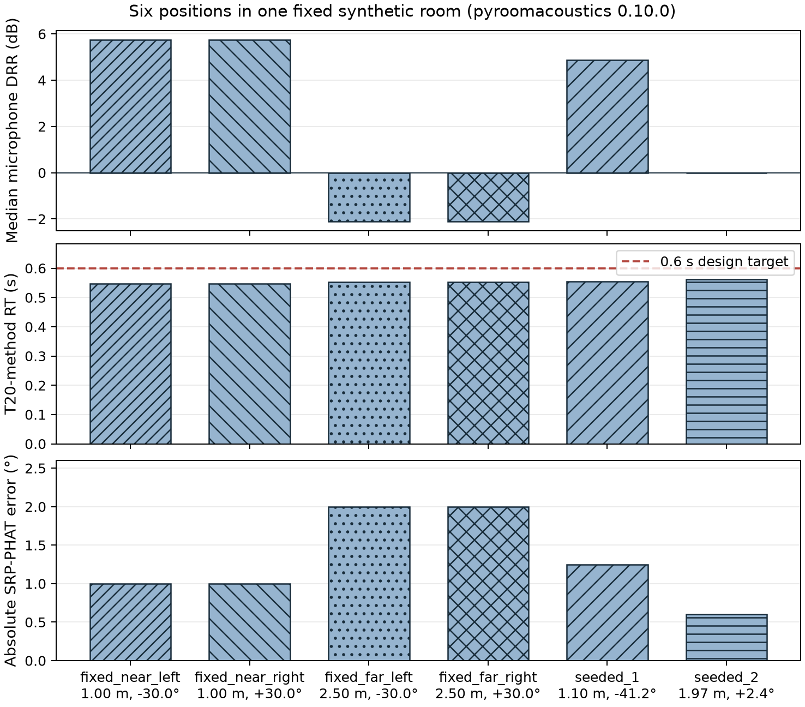
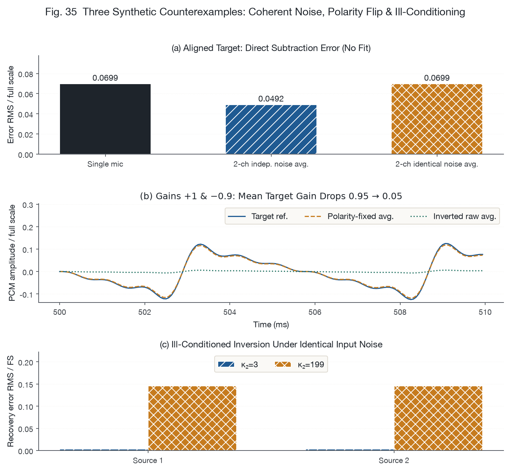
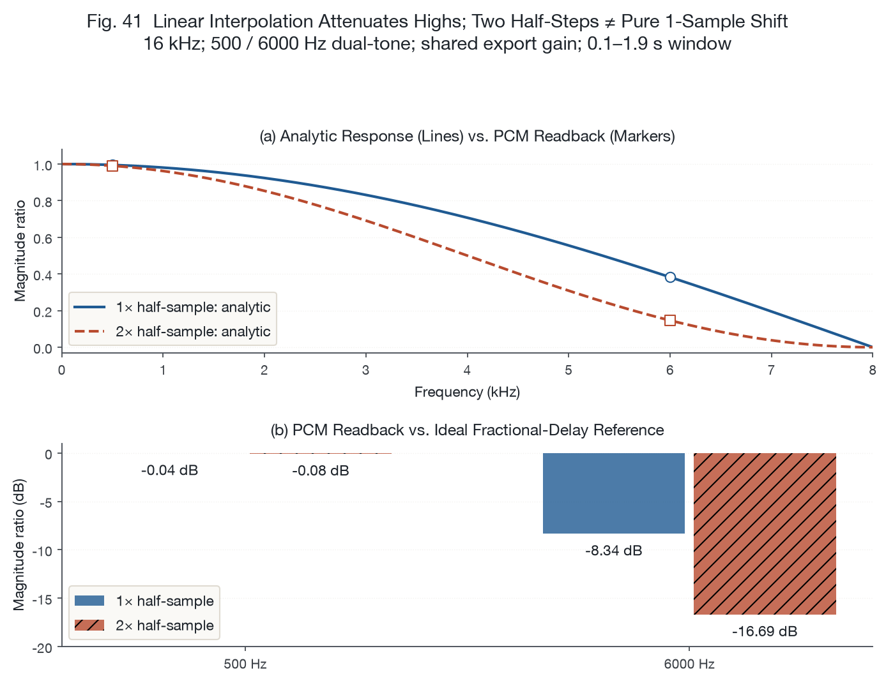
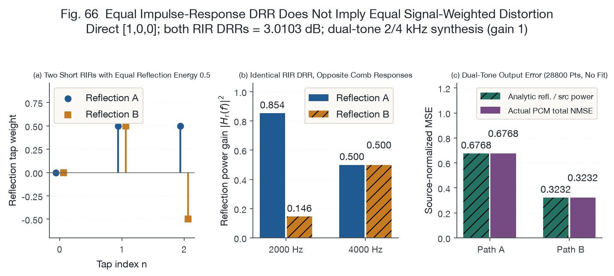

🌐 [简体中文](../chapters/17_appendix-guide.md) ｜ **English**

> ⚠️ This chapter is Chapter 17, i.e., Appendix B (the main text comprises 16 chapters, Chapters 0–15, of which Chapters 12–15 are four extended special topics, followed by Appendices A and B). It may be consulted independently; see the navigation links below for adjacent chapters.
>
> Overview: [`00_overview.md`](00_overview.md) | Previous: [16_appendix-symbols-math.md](16_appendix-symbols-math.md) | Next: (None)

---

## Chapter 17 · Appendix B: Learning Roadmap, Field Map, Debugging, Exercises, and Reproducibility

### 17.1 Graduate Study Roadmap

If you are preparing to undertake systematic research or engineering R&D in microphone array signal processing, we recommend first mastering the classical physical and statistical array models alongside [Chapter 0: Mathematical Foundations](00_math-foundations.md), and then progressing methodically toward open-source baselines, public benchmarks, and real multi-channel hardware experiments.

1. **Foundational tutorials**: Van Veen & Buckley, [*Beamforming: A Versatile Approach to Spatial Filtering*](https://doi.org/10.1109/53.665) (*IEEE ASSP Magazine*, 1988); Krim & Viberg, [*Two Decades of Array Signal Processing Research: The Parametric Approach*](https://doi.org/10.1109/79.526899) (*IEEE Signal Processing Magazine*, 1996).
2. **Speech-focused surveys**: Kumatani, McDonough & Raj, [*Microphone Array Processing for Distant Speech Recognition: From Close-Talking Microphones to Far-Field Sensors*](https://doi.org/10.1109/MSP.2012.2205285) (*IEEE Signal Processing Magazine* 29(6):127–140, 2012); Gannot et al., *A Consolidated Perspective on Multimicrophone Speech Enhancement and Source Separation* (*IEEE/ACM TASLP*, 2017). Note that Kumatani et al. published a separate article sharing the same main title with the subtitle *Towards Real-World Deployment*—always verify the subtitle when retrieving citations.
3. **Seminal papers**: Capon (1969), [Griffiths & Jim's GSC](https://doi.org/10.1109/TAP.1982.1142739) (1982, *An Alternative Approach to Linearly Constrained Adaptive Beamforming*), [Schmidt's MUSIC](https://doi.org/10.1109/TAP.1986.1143830) (1986), Roy & Kailath's ESPRIT (1989), Allen & Berkley's Image-Source Method (1979), [Nakatani et al.'s WPE](https://doi.org/10.1109/TASL.2010.2052251) (2010), and [Pal & Vaidyanathan's Nested Arrays](https://doi.org/10.1109/TSP.2010.2049264) (2010). When reading primary papers, cross-check their Fourier kernel signs, steering-vector conjugation, and normalization conventions against the corresponding chapters of this monograph.
4. **Acoustic echo cancellation**: Hänsler & Schmidt, *Acoustic Echo and Noise Control* (Wiley, 2004); for recent industrial and academic advances, pair this text with the ICASSP AEC Challenge overview papers.
5. **Deep learning approaches**: Chakrabarty & Habets, [*Multi-Speaker DOA Estimation Using Deep Convolutional Networks Trained With Noise Signals*](https://doi.org/10.1109/JSTSP.2019.2901664) (*IEEE JSTSP* 13(1):8–21, 2019); Gu et al., survey on all-neural beamforming (*IEEE/ACM TASLP*, vol. 31, pp. 849–862, DOI 10.1109/TASLP.2022.3229261).
6. **Progressive experimental sequence**: Introduce only one new physical or algorithmic factor at a time, retaining the deterministic output of each step as the control reference for the next.

    1. Run the NumPy-only pedagogical implementations under `codes/` (including the mathematical foundation checks `E00-01`–`E00-16` in [Chapter 0 §0.9](00_math-foundations.md#sec-0-9)), verifying hand-worked examples, tensor shapes, and degenerate boundary cases item by item.
    2. Validate DSB, MVDR, MUSIC, and SRP-PHAT baselines using `pyroomacoustics` inside an isolated virtual environment, logging room dimensions, sensor coordinates, and random seeds in full.
    3. Generate all synthetic audio fixtures and tracking manifests per §17.7, execute the 12 plotting scripts under `scripts/` to reproduce all 92 numbered figures at pinned parameters, and check every figure's validity conditions against the main text.
    4. Select a public corpus and version-pinned reference baseline for your target task, auditing source-code licenses, model-checkpoint licenses, dataset terms, and scoring protocols separately.
    5. Measure processing latency, clock synchronization, and gain/phase calibration directly on multi-channel capture hardware; simulation metrics never substitute for physical hardware measurements.

After completing Chapters 2, 3, and 5, readers interested in source strength inversion and spatial sound-field diagnostics may proceed to [Extended Topic I: Acoustic Imaging and Noise Source Diagnostics](12_acoustic-imaging.md); after completing Chapters 2, 5, and 10, readers interested in bandwidth-constrained, clock-asynchronous multi-device processing may proceed to [Extended Topic II: Distributed Microphone Collaborative Enhancement](13_distributed-enhancement.md).

After completing Chapters 1, 2, and 5, readers focusing on spherical-harmonic Ambisonics capture, binaural signal matching, and wearable cross-modal denoising may proceed to [Extended Topic III: Spatial Sound Field Capture, Parametric Coding, and Wearable Arrays](14_spatial-wearable-arrays.md); after completing Chapters 5, 8, 9, and 10, readers focusing on voiceprint-, near-field-, or audio–visual-guided extraction and overlapping multi-party diarization may proceed to [Extended Topic IV: Conditional Target Extraction, Multi-Channel Diarization, and Far-Field Multimodal Front-Ends](15_target-extraction-diarization.md). These four special topics can be studied selectively on demand rather than as prerequisites for foundational entry.

### 17.2 Field Map: Textbooks, Conferences, Journals, and Challenges

This section surveys core textbooks, flagship conferences, archival journals, public benchmark challenges, and key historical milestones across the field for rapid reference.

**Textbooks and monographs** (ordered from accessible entry to advanced mathematical rigor):

| Title and Authors | Scope and Reading Guidance |
|---|---|
| Benesty, Chen & Huang, *Microphone Array Signal Processing* (Springer, 2008) | Concise monograph systematically covering array signal models, DOA estimation, beamforming, and multi-channel speech enhancement |
| Brandstein & Ward (eds.), *Microphone Arrays: Signal Processing Techniques and Applications* (Springer, 2001) | Classic edited volume with chapters authored by foundational researchers across each sub-topic |
| Tashev, *Sound Capture and Processing: Practical Approaches* (Wiley, 2009) | Engineering-oriented treatment of acoustic capture chains, transducer non-idealities, and real-time implementation trade-offs |
| Johnson & Dudgeon, *Array Signal Processing: Concepts and Techniques* (Prentice Hall, 1993) | Classic general array processing textbook unifying radar, sonar, and acoustic array fundamentals |
| Van Trees, *Optimum Array Processing* (Wiley, 2002) | Exhaustive statistical derivation of optimum array processing and performance bounds; ideal for deep mathematical reference |
| Vincent, Virtanen & Gannot (eds.), *Audio Source Separation and Speech Enhancement* (Wiley, 2018) | Comprehensive modern synthesis of audio source separation and multi-channel speech enhancement |
| Rafaely, *Fundamentals of Spherical Array Processing* (Springer, 1st ed. 2015, DOI 10.1007/978-3-662-45664-4; 2nd ed. online 2018 / copyright 2019, DOI 10.1007/978-3-319-99561-8) | Definitive text on spherical arrays and spherical-harmonic beamforming; pairs directly with §5.8 and [Extended Topic III §14.2](14_spatial-wearable-arrays.md#sec-14-2) |
| Zotter & Frank, *Ambisonics: A Practical 3D Audio Theory for Recording, Studio Production, Sound Reinforcement, and Virtual Reality* (Springer, 2019, Open Access, DOI 10.1007/978-3-030-17207-7) | Thorough coverage of ACN/SN3D encoding, $\max\text{-}r_E$ energy-vector loudspeaker decoding, 3D rotations, and binaural rendering; pairs with [Extended Topic III](14_spatial-wearable-arrays.md) |
| Park et al., *A Review of Speaker Diarization: Recent Advances with Deep Learning* (*Computer Speech & Language* 72:101317, 2022, DOI 10.1016/j.csl.2021.101317); Zmolikova et al., *Neural Target Speech Extraction: An Overview* (*IEEE Signal Processing Magazine* 40(3):8–29, 2023, DOI 10.1109/MSP.2023.3240008) | Authoritative surveys on speaker diarization (clustering, EEND, TS-VAD, DER scoring) and neural target speaker extraction (voiceprint, spatial, and audio–visual conditioning); pair with [Chapter 8 §8.6](08_speech-separation.md#sec-8-6) and [Extended Topic IV](15_target-extraction-diarization.md) |

**Core conferences**: ICASSP (flagship annual IEEE Signal Processing conference), Interspeech (flagship annual speech science conference), WASPAA (biennial IEEE Workshop on Applications of Signal Processing to Audio and Acoustics), IWAENC (International Workshop on Acoustic Signal Enhancement), HSCMA (Hands-free Speech Communications and Microphone Arrays), and DCASE Workshop (Detection and Classification of Acoustic Scenes and Events).

**Archival journals**: [IEEE Transactions on Audio, Speech and Language Processing](https://signalprocessingsociety.org/publications-resources/ieee-transactions-audio-speech-and-language-processing) (now abbreviated TASLPRO, the core journal of our discipline), *IEEE JSTSP* (special issues in signal processing), *JASA* (Journal of the Acoustical Society of America), and *Speech Communication*.

**Public benchmark challenges** offer an indispensable window into real-world acoustic edge cases and standardized evaluation protocols.

The CHiME series has long anchored far-field, multi-speaker, multi-channel speech research. [CHiME-9](https://www.chimechallenge.org/challenges/chime9/) featured two tracks: MCoRec (multi-conversation transcription and conversation clustering) and ECHI (low-latency conversational hearing-aid enhancement); the [CHiME-10 official task page](https://www.chimechallenge.org/challenges/chime10/index) announced three tracks—ECHI-2, URGENT, and SG-TSE—with the [official schedule page](https://www.chimechallenge.org/challenges/chime10/dates) targeting February 4, 2027 for data/baseline release and August–September 2027 for submissions (verified November 11, 2026; check official announcements before entering).

DCASE 2026 closed submissions on June 15, 2026 and published results on July 1, 2026; Task 3 pivoted to Semantic Acoustic Imaging SELD, distinct from the 3D source distance estimation setup of DCASE 2024 Task 3 (verified October 5, 2026; see the [DCASE 2026 homepage](https://dcase.community/challenge2026/), [submission rules](https://dcase.community/challenge2026/submission), and [results announcement](https://dcase.community/articles/dcase2026-challenge-results-published)).

Note specifically that [DCASE 2026 Task 3](https://dcase.community/challenge2026/task-semantic-acoustic-imaging-for-sound-event-localization-and-detection-from-spatial-audio-and-audiovisual-scenes) requires jointly predicting sound-event class labels and spatial power maps scored by official image-matching and correlation metrics. Although DAS, DAMAS, and CMF in Chapter 12 produce spatial power maps under a specified propagation model, they include neither an acoustic event classifier nor challenge output formatting; if used as a front-end comparison baseline, report physical imaging residuals separately from downstream semantic challenge scores rather than equating a spatial power map or Chapter 12 internal residual to official leaderboard metrics.

Other landmark evaluations include the REVERB Dereverberation Challenge, the ICASSP DNS and AEC Challenges, and the concluded [SPEAR Challenge 2023](https://signalprocessingsociety.org/publications-resources/data-challenges/speech-enhancement-augmented-reality-spear-challenge-2023). SPEAR utilized a 6-microphone head-worn array to study speech enhancement in Augmented Reality (AR) scenes (see [Extended Topic III §14.5–§14.7](14_spatial-wearable-arrays.md#sec-14-5) for head-worn BSM/MagLS and interaural coherence preservation); cite its specific edition year, mounting geometry, and evaluation rules rather than treating it as an ongoing general leaderboard.

**Historical timeline** (microphone array processing largely traces the migration of narrowband radar, sonar, and seismic array theory into wideband reverberant rooms, progressively fusing with statistical learning):

| Era | Representative Milestone |
|---|---|
| 1940s–1960s | Foundations of radar and sonar array processing (Bartlett conventional beam scanning) |
| 1969 | Capon introduces Minimum Variance Distortionless spectral estimation (originally for seismic arrays) |
| 1972 | Frost formulates time-domain linearly constrained adaptive beamforming |
| 1979–1982 | Allen & Berkley introduce the rectangular room Image-Source Method; Griffiths & Jim formulate the Generalized Sidelobe Canceller (GSC) |
| 1985 | Flanagan et al. build digitally steerable large-aperture auditorium/teleconferencing microphone arrays |
| 1986–1989 | MUSIC (1986) and ESPRIT (1989) exploit subspace orthogonality for DOA estimation; practical resolution remains bounded by aperture, SNR, snapshots, and manifold mismatch |
| 1990s | Elko systematizes differential microphone arrays, entering directional hearing aids and desktop speakerphones |
| 2001–2008 | Monographs by Brandstein & Ward and Benesty et al. consolidate speech microphone array signal processing as a unified discipline |
| 2010 | Nakatani et al. introduce WPE blind dereverberation; Pal & Vaidyanathan formulate Nested Arrays |
| 2011 | First CHiME Challenge establishes open benchmarks for distant speech recognition and enhancement |
| 2014 | Smart speakers such as Amazon Echo popularize consumer far-field multi-microphone voice interaction (array counts and geometries evolve across hardware generations) |
| 2015–2018 | CHiME-3/4/5 establish TF-mask-guided statistical beamforming and Guided Source Separation (GSS) as dominant baselines |
| 2019–2024 | Deep DOA/SELD tracking (e.g., Shimada et al. ICASSP 2021 ACCDOA joint activity-direction vectors) and all-neural multi-channel front-ends flourish; CHiME-7/8 adopt foundation ASR back-ends; DCASE 2024 Task 3 benchmarks source distance estimation on STARSS23 |
| 2025–2026 | CHiME-9 tackles multi-session MCoRec and low-latency hearing-aid ECHI, followed in July 2026 by CHiME-10's three tasks; DCASE 2026 Task 3 pivots to semantic acoustic imaging and publishes results |

When searching literature, note that the [DCASE 2024 Task 3 specification](https://dcase.community/challenge2024/task-audio-and-audiovisual-sound-event-localization-and-detection-with-source-distance-estimation) retains the dataset name STARSS23—the corpus year suffix does not increment with the challenge edition year.

### 17.3 Snapshot of Research Frontiers (2024–)

This section connects the classical array models developed in earlier chapters to representative research directions from 2024 onward. For full auditability, every citation links to both the primary publication and a commit-pinned public code entry point; for these external neural systems, this monograph audits algorithmic assumptions and static API contracts only, without downloading model checkpoints or executing deep neural inference locally. Reported benchmark scores remain conditioned on each paper's exact corpus, implementation details, and scoring scripts, while challenge schedules follow official updates.

#### Direction 1: Pretrained Foundation Models as Distant ASR Back-Ends

Across the CHiME-7/8 (2023/2024) distant multi-speaker ASR evaluations, numerous participating teams paired large pretrained foundation back-ends such as Whisper and WavLM with classical GSS (§8.4) and analytical statistical beamforming in the front-end. These top-performing systems demonstrate effective synergy between pretrained back-ends and physics-based spatial front-ends under those evaluation conditions—not that distant speech processing has collapsed into a single monolithic model (see the [CHiME-7/8 overview preprint, arXiv:2507.18161](https://arxiv.org/abs/2507.18161)).

#### Direction 2: Array-Agnostic Systems

Cornell et al.'s [CHiME-8 DASR task paper](https://www.isca-archive.org/chime_2024/cornell24_chime.pdf) defines distant multi-speaker transcription across heterogeneous recording devices and provides official ESPnet and NeMo baselines. Rather than proposing a single channel-aggregation layer, §§5–6 of that report detail distinct diarization, multi-channel enhancement, and ASR configurations across the two baselines, whose cross-device generalization remains bounded by the task's training corpora, test hardware, and scoring protocol.

#### Direction 3: Target Speaker Extraction

Target Speaker Extraction (TSE) characterizes a designated speaker via pre-enrolled utterances, visual lip motion, or spatial directional prompts to isolate a single target voice stream out of multi-talker mixtures. Head-worn AR eyeglass arrays and passive smartphone acoustic microstructures further broaden spatial conditioning modalities; complete derivations of Feature-wise Linear Modulation (FiLM), dual-state target-silent energy-floor losses, and near-field spherical-wave distance bubbles appear in [Extended Topic IV §15.1–§15.3](15_target-extraction-diarization.md#sec-15-1).

Track model version evolution carefully when surveying papers: the original ICASSP 2022 [TEA-PSE architecture](https://doi.org/10.1109/ICASSP43922.2022.9747765) and later challenge iteration [TEA-PSE 3.0](https://arxiv.org/abs/2303.07704) differ in network topology and training recipes and must not be conflated. ICASSP 2024's [CIENet](https://cmsworkshops.com/ICASSP2024/view_paper.php?PaperNum=3147) (see also [author preprint](https://arxiv.org/abs/2402.17146)) feeds time–frequency representations of both enrollment speech and mixture speech into cross-attention interaction blocks to compute frame-varying target relevance weights, rather than pooling the entire enrollment clip into one static vector concatenated onto mixture spectra.

SonicSieve (CHI 2026; see [project page](https://www.witechlab.com/sonicsieve.html) and [author preprint v3](https://arxiv.org/abs/2504.10793v3), verified 2026-09-22) illustrates a complementary physical-assist paradigm: attaching passive 3D-printed acoustic microstructures onto a smartphone enclosure sculpts direction-dependent spectral transfer functions, enabling a neural network to extract target speech via directional spectral coloration rather than an enrolled voiceprint. That capability relies intrinsically on the physical microstructure attachment plus matched training data and cannot be replicated via software alone on an unmodified phone. Likewise, personalized AEC (§6.5) incorporates speaker conditioning alongside a far-end loudspeaker reference branch and double-talk preservation objectives, requiring dedicated loss and interface design.

#### Direction 4: Generative Speech Enhancement and Sampling Acceleration

Generative enhancement frameworks epitomized by SGMSE+ (Richter et al., *IEEE/ACM TASLP* 2023; [code & paper](https://github.com/sp-uhh/sgmse)) and StoRM (Lemercier et al., *IEEE/ACM TASLP* 2023; [code & paper](https://github.org/sp-uhh/storm)) construct Stochastic Differential Equation (SDE) diffusion priors in the complex STFT domain; StoRM prepends a discriminative predictor for a coarse initial estimate refined by fewer diffusion steps. Flow Matching, distribution distillation, and consistency models continue to compress reverse-sampling latency.

Compared with discriminative masks, generative models often improve perceptual naturalness at low SNR yet carry a **hallucination risk**—synthesizing plausible phonetic details absent from the ground-truth utterance at severe noise levels—so evaluations must jointly audit perceptual quality, phonetic faithfulness, and downstream ASR Word Error Rate (WER). FlowSep (ICASSP 2025; [paper](https://doi.org/10.1109/ICASSP49660.2025.10890129) and [pinned commit](https://github.com/Audio-AGI/FlowSep/tree/d8164db58bd461ef5bb6df8ffd372b536ee6afb4)), for example, applies Rectified Flow inside a VAE latent space for text-queried general audio separation; neither its single-channel latent synthesis mechanism nor its licensing posture (no explicit redistribution license at repo root, plus external pretrained checkpoints) extrapolates directly to phase-preserving multi-channel speech front-ends.

Extending generative priors to multi-channel arrays against §5.9's "TF mask + analytical beamformer" requires matching lookahead frames, reverse step budgets, and compute while checking inter-channel phase and spatial covariance consistency. Watch out for entry-point quirks during minimal code audits: in pinned SGMSE source, `ScoreModel.enhance()` dispatches samplers via `self.sde.sampler_type` under OUVE and normalizes directly by `y.abs().max()` without a zero-silence guard—passing an all-zero array divides by zero (static contract audit in [Generative Implementation Research](../codes/chapters/ch00/research_en/04_source_reproduction.md#appendix-b-reproduction)).

#### Direction 5: TF-GridNet and Complex Spectral Mapping Backbones

Whereas analytical blind separation in Chapter 8 relies on statistical independence and linear convolutive mixing, TF-GridNet ([journal preprint](https://arxiv.org/abs/2211.12433)) performs end-to-end complex spectral mapping directly in the STFT domain—stacking real and imaginary mixture components as input features to regress real and imaginary target components prior to inverse STFT. Each grid block alternates context modeling across an intra-frame full-band frequency module, a subband temporal module, and a cross-frame full-band self-attention module, giving rise to the name "Time–Frequency Grid."

Distinguish its two published editions carefully: Wang et al.'s [ICASSP 2023 conference paper](https://doi.org/10.1109/ICASSP49357.2023.10094992) targeted anechoic monaural speaker separation, whereas the [*IEEE/ACM TASLP* 2023 journal article](https://doi.org/10.1109/TASLP.2023.3304482) expanded to noisy reverberant multi-channel joint separation and enhancement. Always pin the exact edition, input channel count, target source count, STFT window/hop, and corpus split; in pinned ESPnet [`TFGridNet` source](https://github.com/espnet/espnet/blob/be79590bb2ff26ffb01bc825c5f68cb9418b7f0d/espnet2/enh/separator/tfgridnet_separator.py), verify mixture and reference variance-normalization flags so SI-SDRi numbers under different scaling conventions are never mixed.

#### Direction 6: Journal Studies on Geometry-Agnostic Front-Ends

Kamo et al. (*Computer Speech & Language* 95:101820, 2026; [journal page](https://www.sciencedirect.com/science/article/pii/S0885230825000452) and [author v2 full text](https://arxiv.org/html/2502.09859v2)) present a comprehensive geometry-agnostic multi-speaker distant ASR pipeline for real meeting recordings. Inspecting §2 and §§4.1–4.3.6 of v2 reveals that the system is far from a monolithic end-to-end separator: local diarization feeds preliminary GSS outputs into speaker embedding extraction, cross-block global clustering estimates total speaker count, and Target-Speaker VAD (TS-VAD; multi-channel spatial–spectral extension and exclusive-mask loop in [§15.5](15_target-extraction-diarization.md#sec-15-5)) refines per-speaker activity boundaries—assigning activity detection, cardinality estimation, and identity attribution to modular cascaded stages.

During multi-channel enhancement, active channels are first pruned via maximum spatial covariance eigenvalue (EV) and early-to-late reverberation ratio ($C_{50}$), followed by cascaded WPE dereverberation, GSS separation, and Spatially Pre-processed MWF (SP-MWF), before SNR-based reference-channel selection and Blind Analytic Normalization (BAN) feed the ASR back-end (beamforming, WPE, and GSS derivations appear in Chapters 5, 7, and 8). Here "geometry-agnostic" means the pipeline requires no hardcoded 3D sensor coordinates—it still assumes sample-level clock synchronization across fused channels and does not automatically cure cross-device clock drift or severe acoustic domain shift.

#### Direction 7: CHiME-9 and Conditioned Foundation Back-Ends

The [CHiME-9 task specification](https://www.chimechallenge.org/challenges/chime9/index) defines two tracks with sharply divergent modalities and latency budgets: MCoRec uses a central 360° panoramic audio–visual rig to transcribe multi-party chatter and cluster conversational groups, whereas ECHI targets causal wearable hearing-aid enhancement under a strict [$\le 20\ \mathrm{ms}$ total algorithmic latency cap](https://www.chimechallenge.org/challenges/chime9/task2/rules). Scores across the two tracks can never be merged into a single "CHiME-9 speech enhancement" table.

For transcribing a designated speaker directly out of overlapping speech, DiCoW (Polok et al., *Computer Speech & Language* 95:101841, 2026, [DOI 10.1016/j.csl.2025.101841](https://doi.org/10.1016/j.csl.2025.101841)) injects frame-level diarization activity masks directly into Whisper encoder blocks to emit target-speaker text end-to-end, bypassing intermediate waveform separation (architectural trade-offs against cascaded GSS and SOT appear in [§15.7](15_target-extraction-diarization.md#sec-15-7)).

When inspecting its public repositories, separate entry points and model revisions carefully: at the [pinned demo commit](https://github.com/BUTSpeechFIT/DiCoW/tree/e9326bd536bf632e823357438b210102903ba620), [`example.py`](https://github.com/BUTSpeechFIT/DiCoW/blob/e9326bd536bf632e823357438b210102903ba620/example.py#L8-L14) invokes DiCoW v1 with Pyannote 3.1 whereas [`app.py`](https://github.com/BUTSpeechFIT/DiCoW/blob/e9326bd536bf632e823357438b210102903ba620/app.py#L31-L39) invokes DiCoW v2 with Pyannote 3.1—sharing a commit SHA does not imply identical model weights—while the companion [training/inference codebase](https://github.com/BUTSpeechFIT/TS-ASR-Whisper/tree/0ea6679d44405f5ff39188030123524686c198e9) is maintained separately (later main-branch DiariZen additions are not prerequisites of that pinned commit). Audit code and checkpoint licenses separately as well: source code is Apache-2.0, [DiCoW v1](https://huggingface.co/BUT-FIT/DiCoW_v1) and [DiCoW v2](https://huggingface.co/BUT-FIT/DiCoW_v2) weights are CC BY 4.0, later [DiariZen weights](https://github.com/BUTSpeechFIT/DiariZen/blob/main/MODEL_LICENSE) are non-commercial CC BY-NC 4.0, and [Pyannote 3.1](https://huggingface.co/pyannote/speaker-diarization-3.1) requires gated access approval. Fix diarization mask sources, chunking, and text normalizers during comparisons, and note that this offline transcription model cannot serve as a $20\ \mathrm{ms}$ ECHI hearing-aid waveform enhancer.

#### Direction 8: Diffusion Priors for Unsupervised Blind Source Separation

ArrayDPS (Xu et al., ICML 2025; [PMLR 267 paper](https://proceedings.mlr.press/v267/xu25f.html)) investigates multi-channel blind source separation given neither array geometry / RIR priors nor paired clean separation targets. Unlike AuxIVA in Chapter 8 relying solely on inter-source statistical independence, ArrayDPS performs posterior sampling under a pretrained single-speaker diffusion prior while jointly estimating Relative RIRs at each reverse denoising step to evaluate mixture reconstruction likelihood gradients. This formulation still requires a known speaker count, synchronous multi-channel sampling, linear convolutive mixing, and acoustic domain coverage by the single-speaker prior.

Check the target definition in §2 of the paper carefully: ArrayDPS reconstructs each talker's **reverberant source image** at the reference microphone rather than anechoic dry speech, so evaluation references must be aligned to that exact reference sensor. A minimal reproduction against the [pinned author commit](https://github.com/ArrayDPS/ArrayDPS/tree/750ac2b7c75458f4ca5bad203dafda528f575e55) aligns with the SMS-WSJ 2-speaker, 3-channel, $8\ \mathrm{kHz}$ recipe (`num_speakers=2`, `n_channels=3`, `num_steps=400`), comparing against IVA initialization under identical scoring while logging runtime, random seeds, and peak VRAM (documented at $>7\ \mathrm{GB}$ with 400 reverse steps embedding inner Relative-RIR optimization—targeted at offline research rather than low-latency streaming).

Also note a paper-versus-code parameter discrepancy: the paper text describes Forward Convolutive Projection (FCP) with a 512-point FFT and 64-sample hop, whereas public source and README defaults use a 512-sample window and 128-sample hop.

Auditing its evaluation script reveals two further subtleties: first, although the inner `Sampler` likelihood guidance never reads ground-truth sources, outer wrapper `separate.py` reads `sources[:,0,:]` at line 161 to compute SDR and uses that oracle metric at lines 180–186 for early stopping / restarts—an offline diagnostic mechanism unusable in blind deployment.

Second, §4.2 of the paper distinguishes Mean/SD across five independent sampling runs (averaging scalar scores, NOT averaging five waveforms), oracle Max selection using ground truth, and unsupervised Maximum-Likelihood (ML) trial selection using mixture reconstruction loss—cite the exact column protocol when quoting numbers (parameter hierarchy and contract audit in [ArrayDPS Implementation Research](../codes/chapters/ch00/research_en/02_aec_wpe_separation.md#sec-u-3b78d29bc2)).

#### Special Focus: Generalization Mismatch in Neural Front-Ends and Four Engineering Countermeasures

Neural front-ends tuned on a fixed laboratory array and simulated shoebox rooms frequently suffer steep performance drops when deployed onto unfamiliar array geometries, real reverberant enclosures, or new downstream consumers—a phenomenon collectively termed **generalization mismatch**. Below we decompose mismatch into three root sources and pair them with four engineering countermeasures aligned with array-agnostic and geometry-agnostic design.

**Three primary sources of mismatch**:

1. **Physical array mismatch**: Sensor layout, channel count, inter-microphone gain/phase tolerances, or clock synchronization on the target device differ from training assumptions. Whenever an input layer implicitly memorizes a fixed channel ordering and baseline phase-difference distribution, changing enclosure diffraction or inter-element spacing breaks learned spatial filters—direct weight-regressing all-neural beamformers are especially vulnerable (see §5.9 Item 2).
2. **Acoustic environment mismatch**: Room reverberation time, nonstationary noise structure, or talker distance exceeds the training distribution. Missed detections and false alarms in TF mask estimation directly contaminate target and interference spatial covariance matrices, eroding downstream MVDR spatial nulling.
3. **Task and domain mismatch**: Synthetic training data omits sensor coordinate tolerances, baffle scattering, and transducer frequency-response ripples; test language or accent shifts; or a perceptual-quality-optimized speech enhancer is placed unadapted in front of an ASR decoder—with generative enhancers further risking low-SNR phonetic hallucination (Direction 4 above).

**Four engineering countermeasures**:

1. **Diverse physical data augmentation and domain fine-tuning**: Randomize array topologies, room dimensions, $T_{60}$, and real noise recordings during training, followed by lightweight adaptation on small in-domain hardware captures. Augmentation aims to broaden exposure across cross-channel gain–phase manifolds rather than enumerating every conceivable device.
2. **Decoupling intermediate neural estimation from analytical spatial filtering**: Task neural networks with estimating coordinate-insensitive intermediate quantities (such as TF masks, spatial covariances, or speaker activity posteriors) while handing spatial filtering back to mathematically transparent analytical solvers. MVDR enforces an exact unit distortionless constraint along a specified steering vector or RTF; GSS stabilizes spatial mixture clustering via diarization activity priors before extracting speech via beamforming (note that the end-to-end GSS pipeline itself is broader than a single linear constraint; see §5.9 Item 1 and §8.4). Cross-array generalization of the neural masks themselves must still be verified empirically.
3. **Symmetry-preserving architectures and training regularization**: Apply random channel dropout, random channel permutation, and sensor coordinate jitter during training to simulate dead microphones, variable channel counts, and assembly tolerances, while enforcing strict channel permutation invariance or equivariance in network layers.
4. **In-field calibration and confidence-gated fallback**: Calibrate bulk gain/phase offsets before deployment and monitor runtime SNR, mask entropy, or covariance condition numbers online—falling back smoothly to a robust analytical beamformer whenever neural confidence drops or compute budgets tighten. End-to-end net gains of hybrid switching must always be validated on target hardware.

**Universal building blocks for array-agnostic front-ends: TAC and VarArray**. Cross-device architectures typically apply shared-weight per-channel encoders followed by permutation-invariant cross-channel pooling or self-attention. The canonical building block is Transform–Average–Concatenate (TAC; [original paper §2.1 Eqs. (1)–(4)](https://arxiv.org/html/1910.14104v3)): shared per-channel nonlinear projections are averaged arithmetically across all active channels and concatenated back onto each individual channel's representation. Because arithmetic averaging is **permutation-invariant** to channel order, concatenating it back makes per-channel outputs permute identically with input channels—achieving **permutation equivariance**.

Keep a sharp distinction in mind: "architecturally accepting an arbitrary number of channels" does NOT mean "numerical outputs remain invariant when microphones are added or duplicated"—merely duplicating Channel 1's signal verbatim shifts its weight in the cross-channel mean from $1/M$ to $2/(M+1)$, altering every channel's output (worked out by hand in [E17-11](#e17-11) below).

VarArray ([ICASSP 2022](https://doi.org/10.1109/ICASSP43922.2022.9746876)) combines TAC cross-channel blocks, Conformer sequence modeling, and Inter-channel Phase Difference (IPD) features for geometry-agnostic continuous speech separation, validating speaker-attributed WER (sa-WER) on real AMI meetings and laying the architectural foundation for both the CHiME-8 DASR baselines and Kamo et al.'s meeting system above. When reproducing such composite pipelines, sketch the complete dataflow block diagram first—marking explicitly which stages depend on learned distributions, which aggregate across channels, and which enforce analytical physical constraints.

### 17.4 Common Pitfalls and Debugging Guide

During hardware bring-up and algorithm reproduction, engineers routinely encounter "the code runs without crashing, yet metrics or audio quality look wrong." Below we first list the eight most common foundational symptoms in "Observed Symptom → Priority Diagnostic Order," followed by an extended troubleshooting table covering dereverberation, separation, tracking, acoustic imaging, distributed arrays, spatial/wearable audio, and conditional target extraction / diarization.

1. **MUSIC shows no peak or unstable peak locations** → Check sample covariance rank and 2-norm condition number first. Forming an uncentered second-moment matrix from $T$ snapshots in $\mathbb{C}^M$ caps rank at $T$ (singular whenever $T<M$); subtracting the sample mean imposes a zero-sum constraint across the $T$ centered vectors, capping rank at $\min(M,T-1)$ (singular whenever $T\le M$). Even past this algebraic threshold, snapshot starvation causes severe subspace jitter.

    Next verify configured source count $K$ against eigenvalue gap separation, and check whether strong specular wall reflections are coherent with the direct path. Remember that forward–backward or subarray spatial smoothing applies only to shift-invariant regular geometries (such as ULAs) at the cost of reduced effective aperture—it is not a universal cure for arbitrary reverberant arrays (§2.5, §4.6).

2. **GCC-PHAT peak jumps between discrete sample lags** → Typically caused by omitting fractional-sample peak refinement or using too coarse a correlation grid; another frequent culprit is a strong room reflection outvoting the direct path (Fig. 13). Figure 12 uses $16\times$ frequency-domain zero-padded cross-spectrum interpolation (rather than 3-point parabolic fitting); production systems may choose time-domain sinc/parabolic interpolation or frequency-domain weighted phase-slope fitting per compute budget (§4.2).

3. **Target speech sounds distorted or muffled after beamforming** → Audit target DOA, Relative Transfer Function (RTF), and inter-channel gain/phase calibration consistency first, then check whether target speech leaked into the noise covariance matrix (**target signal cancellation**).

    Noise covariance may be accumulated over confirmed target-absent frames or weighted via TF masks, balancing sufficient snapshot support against target leakage. In reverberant rooms, check whether the distortionless constraint should switch from an anechoic plane-wave vector to an early-reflection RTF (§5.4, §5.9).

4. **Superdirective beamformer outputs loud hiss** → Inspect White Noise Gain (WNG), diffuse coherence matrix condition number, sensor gain/phase matching, and manifold tolerances. No universal "allowable mismatch dB constant" exists across all hardware; derive tolerances backward from your minimum WNG target, highest operating frequency, and measured beampatterns, applying diagonal loading or explicit WNG norm constraints at low frequencies (§5.3, §5.4).

5. **High residual echo after AEC** → Trace the signal chain sequentially: check whether the digital loopback reference missed OS audio effects or post-EQ, whether fixed bulk delay between playback and capture is aligned, whether the micro-speaker is clipping nonlinearly, and whether adaptive filter tap length covers the dominant early echo path. Bulk delay mismatch is common, though never assume without checking that every residual echo stems from delay offset.

    If the linear path has converged yet audible harmonics or intermodulation correlated with far-end playback persist, tune the [Non-Linear Processing (NLP) operating point](06_aec.md#sec-6-12) or evaluate [neural-assisted / hybrid AEC](06_aec.md#sec-6-5); see [§6.8](06_aec.md#sec-6-8) for WebRTC AEC3 suppression architecture diagnostics.

6. **Symmetric ghost peaks in SRP-PHAT** → Separate three distinct physical causes before blaming sensor spacing:

    - Geometric unidentifiability: ULAs exhibit intrinsic front–back / 3D cone-of-confusion TDOA symmetry, while planar arrays exhibit upper/lower hemisphere mirror symmetry; widening signal bandwidth cannot break geometrically identical TDOAs (§3.1).
    - Spatial aliasing: Jointly check upper analysis frequency, sensor spacing, and scan range; exceeding $\lambda/2$ forfeits full-FOV alias-free guarantees, though whether a specific look angle spawns a visible grating lobe requires explicit calculation (§2.6 and Problem 2 below).
    - Specular multipath: Strong wall reflections create virtual image-source peaks; evaluate alongside line-of-sight occlusion, room geometry, and mounting boundaries. Restricting angular scan sectors requires genuine mounting priors (e.g., flush wall mounting)—never crop scan grids merely to hide inconvenient peaks.

7. **Multi-channel recordings drift out of alignment over time** → Distinguish a constant initial trigger offset, sporadic driver buffer drops, and cross-crystal Sampling Rate Offset (SRO). Single-enclosure arrays should lock all ADCs/PDM mics onto a single hardware master clock; separate wireless devices lacking a shared clock require continuous online SRO estimation plus fractional-delay resampling. Remember that PDM and TDM are board-level serial bus protocols—they do not synchronize independent oscillators across separate devices (§10.2).

8. **Great in simulation, poor on real hardware** → Inject controlled non-idealities one at a time into simulation—sensor position tolerances, gain/phase mismatch, enclosure diffraction, transducer frequency-response ripple, SRO clock drift, and speaker nonlinearity—to isolate the dominant degradation factor.

    Convert allowable phase error budgets (e.g., $\pi/12$ or $\pi/8$ at maximum frequency) into physical millimeter tolerances rather than applying one fixed millimeter rule across all bands and beamformers, and cross-validate calibrated hardware across tolerance envelopes and multiple range/azimuth test points.

For dereverberation, multi-source separation, dynamic tracking, and the four extended special topics in the second half of this monograph, consult the extended diagnostic table below column by column:

| Module & Task | Typical Failure Symptom | Priority Checks & Physical Boundaries | Reference Sections |
|---|---|---|---|
| WPE Blind Dereverberation | Direct speech sounds dull/clipped on consonants, or noise floor surges during pauses | Check whether prediction delay $\Delta$ is too small (e.g., $\Delta=1$ predicts away early reflections needed for intelligibility; Fig. 75 & Problem 9); check variance floor $\varepsilon$ on silence frames against ill-conditioned inversion; match frame size, taps $K$, and iterations to $T_{60}$ | §7.2, §7.3 |
| Speech Separation (GSS / CSS / IVA) | Clean intra-chunk separation, but speaker swaps, polarity flips, or level jumps at chunk seams | In Continuous Speech Separation (CSS), verify inter-chunk permutation alignment, overlap polarity sign, and gain scaling sequentially (correct permutation alone does not fix sign or gain; Fig. 76); check inter-frequency alignment in AuxIVA and target leakage in mask beamforming | §8.3–§8.5 |
| Multi-Source Tracking | Tracks lag walking talkers, brief pauses cause track fragmentation/ID switches, or particle collapse | Separate overly tight gating thresholds from overly small process noise; check whether track lifecycle conflates "measurement-arrival age" with "physical state-clock age" (Fig. 77); inspect particle $N_{\mathrm{eff}}$ resampling rate and bounded-sector boundary reflections | §9.2–§9.4 |
| Acoustic Imaging (DAS / DAMAS / CMF) | Fat mainlobes, dense sidelobe ghosts, or deconvolved source sum mismatching SPL | Plot array Point Spread Function (PSF) over the active band/grid first; check whether coherent reflections violate uncorrelated-source CSM premises; check whether diagonal removal breaks PSD structure, and distinguish peak vs. integrated zone power (Figs. 67–69, 80) | §12.1–§12.4 |
| Distributed Array Enhancement | Multi-node fusion SNR worse than single-node local beam, or progressive comb filtering | Check inter-node SRO and block-start offsets destroying cross-device coherence first; check whether packet-drop gap windows inject zeros or stale statistics into covariances; in DANSE, verify cached receive weights reassemble immediately upon broadcast updates (Figs. 70–72) | §13.2–§13.4 |
| Spatial Capture & Wearable Arrays (FOA / BSM / Cross-Modal / Hear-Through) | High-frequency omnidirectional sphere notches, hollow eyeglass treble, in-head background localization, outdoor wind roar, or metallic hear-through coloration | Check open-sphere $\kappa R=\pi$ nulls and spatial aliasing; switch to BSM-MagLS at high frequencies; tune BMVDR reference mix $\beta$ to restore IC; detect wind via low-frequency coherence drop and fuse occluded inner mic via MVDR (avoid unregularized high-frequency bone-mic inverse EQ); keep hear-through latency $\tau_{\mathrm{proc}}\le 100\,\mu\mathrm{s}$ | [§14.2–§14.10](14_spatial-wearable-arrays.md#sec-14-2) |
| Conditional Target Extraction & Diarization (TSE / Distance Bubble / TS-VAD / AV) | Bystander bleed during target silence, muffled solo fricatives, small-aperture bubble roar, meeting DER stuck $>25\%$, or AV front-end swallowing utterance-initial consonants | Enable Eq. (15-6) dual-state floor loss with target-silent training clips; enable Eq. (15-8) zero-overlap bypass; check Fresnel $r_F=2D^2/\lambda$ against $\mathrm{WNG}\propto d^4$ collapse; upgrade single-label clustering to multi-label spatial–spectral TS-VAD + Eq. (15-25) exclusive GSS masks; calibrate camera lag $\Delta t_{\mathrm{av}}$ and lip-occlusion fallback | [§15.2–§15.6](15_target-extraction-diarization.md#sec-15-2) |

### 17.5 Core Formula Quick-Reference Card

The table below consolidates core equations and validity boundaries across all main chapters and four extended special topics in chapter order for rapid review; consult each linked chapter for complete regularity assumptions.

| Formula | Physical Meaning & Key Validity Boundaries | Section |
|---|---|---|
| $\mathbf P_{\mathcal R(\mathbf A)}=\mathbf A(\mathbf A^H\mathbf A)^{-1}\mathbf A^H$; $\dfrac{\partial(\vec w^H\mathbf R\vec w)}{\partial\vec w^*}=\mathbf R\vec w$ | Full-column-rank orthogonal subspace projector (idempotent and Hermitian) and Wirtinger conjugate gradient of a Hermitian quadratic form—the algebraic bedrock of subspace DOA and constrained optimum beamforming | [§0.3](00_math-foundations.md#sec-0-3), [§0.5](00_math-foundations.md#sec-0-5) |
| $10\log_{10}M$ | White Noise Gain (WNG, in dB) of an $M$-element DSB under unit-modulus steering, distortionless normalization, and i.i.d. equal-power white sensor noise; invalid under unequal channel gains | §1, §5.2 |
| $r_F=2D^2/\lambda$ | Fraunhofer spherical-wave quadratic phase curvature gauge (not a hard binary cutoff); plane-wave steering additionally requires checking $r\gg D$, inter-sensor $1/r$ amplitude spread, and phase error budgets | §2.2, [§15.3](15_target-extraction-diarization.md#sec-15-3) |
| $T_{60} = 0.161V/A$ | Sabine empirical reverberation-time formula (weakly absorbing, approximately diffuse room) | §2.4 |
| $d_c = 0.057\sqrt{QV/T_{60}}$ | Critical distance where direct and reverberant energies match; $Q$ is source directivity factor ($Q=1$ for omnidirectional source) | §2.4 |
| $\vec{x} = \vec{a}(\theta)s + \vec{v}$ | Narrowband far-field single-source array observation model | §2.3 |
| $\hat{\mathbf{R}}_{xx} = \frac{1}{L}\sum_{\ell=1}^L \vec{x}_\ell\vec{x}_\ell^H$ | Uncentered sample spatial second-moment matrix (commonly termed sample spatial covariance) | §2.5 |
| $d < \lambda/2$ | Sufficient condition on a ULA to eliminate endfire periodic grating-lobe ambiguity across the entire closed FOV $[-90^\circ,+90^\circ]$; at $d=\lambda/2$, $\pm 90^\circ$ endfire phases alias identically (restricted scan sectors analyzed separately) | §2.6 |
| HPBW, DI, WNG | Half-power beamwidth, spatially averaged directivity index, and white noise gain definitions, Eqs. (2-11)–(2-13) | §2.6 |
| CRLB / CRB | Theoretical variance lower bound for any unbiased DOA estimator under regular statistical assumptions, Eq. (2-14) | §2.6 |
| $\hat\theta = \arcsin(c\hat\tau_{12}/d)$ | Far-field two-mic TDOA-to-front-hemisphere principal azimuth mapping; $\tau_{12}=t_1-t_2$ estimated from $X_1X_2^*$ peak, requiring non-collinear baselines to resolve front–back ambiguity | §2.1, §4.2 |
| $R(\tau)$: $\int\Phi G_{12}e^{\mathrm{j}2\pi f\tau}\mathrm{d}f$ | Generalized Cross-Correlation (GCC) delay function ($G_{12}=X_1 X_2^*$); $\Phi=1/|G_{12}|$ gives PHAT weighting | §4.2 |
| $\hat{\vec p}=\arg\max_{\vec r}\sum R^{\mathrm{PHAT}}$ | Steered Response Power (SRP-PHAT) multi-pair spatial grid voting localization | §4.3 |
| $P_C(\theta)=1/\bigl(\vec{a}^H(\theta)\hat{\mathbf{R}}_{xx}^{-1}\vec{a}(\theta)\bigr)$ | Capon minimum-variance spatial spectrum | §4.5 |
| $P_{\mathrm{MU}}(\theta)=\|\mathbf E_n^H\vec a\|_2^{-2}$ | MUSIC noise-subspace orthogonality pseudospectrum | §4.6 |
| $\vec{w}_{\mathrm{DSB}} = \vec{a}/M$ | Delay-and-sum weights under unit-modulus steering ($\vec a^H\vec a=M$); general distortionless matched-filter weight is $\vec a/(\vec a^H\vec a)$ | §5.2 |
| $|B(\theta)|=|\sin(M\psi/2)/[M\sin(\psi/2)]|$ | Normalized equal-weight ULA array factor, residual spatial phase $\psi=2\pi d(\sin\theta-\sin\theta_0)/\lambda$ | §5.2 |
| $\vec w_{\mathrm{SD}}$: $\mathbf{\Gamma}^{-1}\vec a/q_{\Gamma}$ | Superdirective weights ($q_{\Gamma}=\vec a^H\mathbf{\Gamma}^{-1}\vec a$) minimizing isotropic diffuse noise power under distortionless constraint | §5.3 |
| $\vec w_{\mathrm{MVDR}}=\mathbf R_{nn}^{-1}\vec a/q$ ($q=\vec a^H\mathbf R_{nn}^{-1}\vec a$) | Minimum Variance Distortionless Response (MVDR) beamformer weights | §5.4 |
| LCMV weights, Eq. (5-11) | Linearly Constrained Minimum Variance solution; full matrix form and conjugation convention expanded below | §5.5 |
| SDW-MWF weights, Eq. (5-13) | Speech-Distortion-Weighted Multichannel Wiener Filter; full matrix form expanded below | [Chapter 5 §5.5.1](05_beamforming.md#sec-5-5-1) |
| $e=d-y$ | Generalized Sidelobe Canceller (GSC) subtracting blocking adaptive branch $y$ from fixed target branch $d$; matches LCMV under ideal orthogonal blocking, sufficient DOFs, and convergence | §5.6 |
| NLMS update | Normalized Least Mean Squares adaptive echo update with low-energy denominator safeguard / freeze | §6.1 |
| $\mathrm{ERLE}=10\log_{10}(P_y/P_{e,\mathrm{echo}})$ | Echo Return Loss Enhancement over far-end single-talk; $P_y=\sum_n|y[n]|^2$ is pure echo energy and $P_{e,\mathrm{echo}}=\sum_n|e_{\mathrm{echo}}[n]|^2$ is residual echo energy | [§6.7, Eq. (6-29)](06_aec.md#sec-6-7) |
| WPE prediction model, Eq. (7-1) | Linearly predicts late reverberation from past STFT frames beyond protection delay $\Delta$; expanded below | §7.1 |
| $L_{\mathrm{PIT}}$: $\min_{\pi}\sum_k \ell(\hat s_k,s_{\pi(k)})$ | Permutation Invariant Training (PIT) loss minimizing summed source loss $\ell$ over $K!$ permutations $\pi\in\mathcal P_K$; mask beamforming accumulates $\hat{\mathbf R}_\nu$ via frame weights $\gamma_\nu$ | §8.2, §8.4 |
| 5-step Kalman recursion | State/covariance prediction → Kalman gain → state/covariance update; circular azimuth innovations require angle wrapping, and finite precision favors symmetric PSD-preserving Joseph form | §9.2 |
| PHD intensity recursion, Eqs. (9-22)–(9-23) | Probability Hypothesis Density (PHD) multi-target intensity prediction and Bayesian update; integral equations expanded below | §9.3 |
| $\varepsilon=(f_{s,m}-f_{s,0})/f_{s,0}$, $T_{\mathrm{alg}}=T_{\mathrm{win}}+T_{\mathrm{la}}$ | Relative Sampling Rate Offset (SRO, causing cumulative drift $\varepsilon t$ and phase rotation $2\pi f\varepsilon t$) and streaming algorithmic buffering lower bound; full latency adds DMA, compute, and scheduling | §10.1, §10.2 |
| $\mathrm{SI\text{-}SDR}$: $10\log_{10}(\|\alpha s\|^2/\|e_{\perp}\|^2)$; $\max_i J_i$ | Scale-Invariant SDR ($\alpha=\langle\hat s,s\rangle/\|s\|^2$, $e_{\perp}=\hat s-\alpha s$, undefined at zero reference energy) and multi-scenario worst-case risk $\max_i J_i$ (audited alongside weighted mean $\sum_i q_i J_i$) | §11.1, §11.2 |
| $b_i=\vec{w}_i^H\hat{\mathbf{R}}\vec{w}_i$, $\vec{b}=\mathbf{P}\vec{q}+\vec{b}_n$ ($\vec{q}\ge\vec{0}$) | CSM delay-and-sum dirty map and uncorrelated-source PSF forward model underlying DAMAS / CMF deconvolution (spatial power maps are not enhanced audio waveforms) | §12.3–§12.5 |
| $\hat d_u=\vec f_u^H\vec x_u+\vec g_u^H\vec z_{-u}$, $\vec z_u=\mathbf F_u^H\vec x_u$ | Distributed node local-plus-neighbor fusion and DANSE compressed broadcast; converging to centralized MWF requires synchronous clocks, gap-free links, and connected topology | §13.5, §13.9 |
| $\psi=1-\dfrac{\|\bar{\vec I}_a\|_2}{c\bar E}$, $\psi\in[0,1]$ | DirAC diffuseness from FOA time-averaged active intensity $\bar{\vec I}_a=\mathbb{E}[\vec I_a]$ and energy density $\bar E=\mathbb{E}[E]$; coherent opposing waves trigger $\psi\to 1$ phantom diffuseness | [§14.4](14_spatial-wearable-arrays.md#sec-14-4) |
| BSM-MagLS alternating projection, Eq. (14-18); $f_m=\dfrac{2m+1}{2\tau_{\mathrm{proc}}}$ | High-frequency target-ear phase relaxation eliminating magnitude notches (preserving low-frequency ITD phase); active hear-through comb-cancellation notch frequencies | [§14.6](14_spatial-wearable-arrays.md#sec-14-6), [§14.10](14_spatial-wearable-arrays.md#sec-14-10) |
| $\mathcal{L}_{\mathrm{dual}}$ dual-state loss, Eq. (15-6); bubble $\mathrm{WNG}=\dfrac{8}{3}\sin^2(\phi_1/2)$ | Resolves $0/0$ SI-SDR singularity on target-silent chunks $\vec{s}_{\mathrm{ref}}=\vec{0}$; three-mic broadside distance-bubble WNG collapses as $d^4$ on miniature apertures | [§15.2](15_target-extraction-diarization.md#sec-15-2), [§15.3](15_target-extraction-diarization.md#sec-15-3) |
| $\mathrm{DER}$ bound, Eqs. (15-21)–(15-22); exclusive mask $m_{k,t}^{\mathrm{tar}}$, Eq. (15-25) | Summed miss, false alarm, and confusion over total reference speaker time (legitimately $>100\%$ under heavy FA); GSS target-exclusive mask prevents overlap contamination | [§15.4](15_target-extraction-diarization.md#sec-15-4), [§15.5](15_target-extraction-diarization.md#sec-15-5) |

Four multi-indexed or integral expressions from the table above are expanded below so conjugations and integration variables remain crystal clear on narrow screens and in print, retaining original chapter notation without duplicate appendix equation numbers.

**LCMV weights, Eq. (5-11)**: Let $\mathbf{R}$ be the spatial covariance matrix whose output power is minimized, $\mathbf{C}$ stack linear constraint steering vectors as columns, and $\vec{f}$ be the right-hand constraint vector in $\mathbf{C}^H\vec{w}=\vec{f}$. Because actual beam response across constraint columns is $\vec{w}^H\mathbf{C}=\vec{f}^H$, specifying desired complex responses $g_k=\vec{w}^H\vec{c}_k$ requires passing conjugated entries $f_k=g_k^*$ (testing purely real $0/1$ responses will never catch missing conjugation bugs; rank preconditions and diagonal loading appear in §5.5):

$$
\vec{w}_{\mathrm{LCMV}}
=\mathbf{R}^{-1}\mathbf{C}
\left(\mathbf{C}^H\mathbf{R}^{-1}\mathbf{C}\right)^{-1}\vec{f}.
$$

**SDW-MWF weights, Eq. (5-13)**: Let $\mathbf{R}_{ss}$ and $\mathbf{R}_{nn}$ denote uncentered spatial second-moment matrices of target speech and additive interference-plus-noise (covariances under zero mean), unit basis vector $\vec{e}_r$ select reference microphone $r$'s target image, and hyperparameter $\mu>0$ trade residual noise suppression against speech distortion (distinct from distortionless MVDR under general rank; objective derivation and rank-1 factorization appear in [Chapter 5 §5.5.1](05_beamforming.md#sec-5-5-1)):

$$\vec w_{\mathrm{SDW}}
=(\mathbf R_{ss}+\mu\mathbf R_{nn})^{-1}\mathbf R_{ss}\vec e_r.$$

**WPE prediction model, Eq. (7-1)**: Retaining Chapter 7's local frequency notation where $f$ denotes discrete STFT bin index (distinct from continuous frequency $f$ in Hz in Chapter 2) and $X(n,f)$ is the observed complex spectrum at frame $n$, bin $f$: the sum linearly predicts late reverberation from $K$ past frames preceding protection delay $\Delta$, leaving residual $E(n,f)$ to preserve direct speech plus early reflections (the linear model alone does not guarantee $E(n,f)$ equals exact ground-truth early speech; vectorized MIMO prediction appears in [§7.3](07_wpe-dereverberation.md#sec-7-3)):

$$
X(n,f)=E(n,f)+\sum_{k=\Delta}^{\Delta+K-1}G^*(k,f)X(n-k,f).
$$

**PHD prediction and update, Eqs. (9-22)–(9-23)**: Random Finite Set multi-target tracking propagates a non-negative intensity function (first-moment density) across state space rather than enumerating target-to-track permutations. Prediction sums newborn target intensity with surviving prior intensity propagated through Markov transition; Bayesian update combines a missed-detection survival term with measurement-updated terms normalized by target likelihood plus clutter intensity:

$$\begin{aligned}
D_t^-(x)&=D_{t\vert t-1}(x)\\
&=\gamma_t(x)+\int p_{S,t}(\xi)
f_{t\vert t-1}(x\mid\xi)D_{t-1}(\xi)\,\mathrm{d}\xi,
\end{aligned}$$

$$\begin{aligned}
D_{\mathrm{den}}(z)&=\kappa_t(z)
+\int p_{D,t}(\xi)g_t(z\mid\xi)D_t^-(\xi)\,\mathrm{d}\xi,\\
D_t(x)&=[1-p_{D,t}(x)]D_t^-(x)\\
&\quad+\sum_{z\in Z_t}
\frac{p_{D,t}(x)g_t(z\mid x)D_t^-(x)}{D_{\mathrm{den}}(z)}.
\end{aligned}$$

Here state $x$ and dummy integration variable $\xi$ may be scalar azimuths or kinematic vectors stacking azimuth and angular velocity, integrated over full state space. In prediction, $D_{t-1}(\xi)$ is prior-frame posterior intensity, $p_{S,t}(\xi)$ is state-dependent survival probability, $f_{t\vert t-1}(x\mid\xi)$ is Markov transition density, and $\gamma_t(x)$ is birth intensity; in update, $D_{t\vert t-1}(x)$ (written $D_t^-(x)$ in code) incorporates measurement set $Z_t$ via detection probability $p_{D,t}(x)$, single-target likelihood $g_t(z\mid x)$, and clutter intensity $\kappa_t(z)$. Note $p_{D,t}(\xi)$ sits inside the denominator integral and factors out only when constant across state space; integrating intensity over a region yields the **expected number of targets** in that region rather than a single-target existence probability (§9.3).

**Single-cell mental-arithmetic check**. Collapsing state space to a single discrete cell: let prior posterior intensity be $0.6$, survival probability $p_{S,t}=0.9$ staying wholly in-cell, and birth intensity $\gamma_t=0.26$, giving predicted intensity $D_{t\vert t-1}=0.26+0.9\times0.6=0.8$.

Suppose measurement set $Z_t=\{z_1\}$ arrives with cell detection probability $p_{D,t}=0.75$, likelihood $g_t(z_1\mid x)=0.5$, and unit-matched clutter intensity $\kappa_t(z_1)=0.1$. Missed-detection retention equals $(1-0.75)\times0.8=0.2$; measurement numerator is $0.75\times 0.5\times 0.8=0.3$ over denominator $0.1+0.3=0.4$, contributing $0.3/0.4=0.75$; summing gives posterior intensity $D_t=0.2+0.75=0.95$. This figure represents $0.95$ expected targets in the cell—neither "$95\%$ probability that $z_1$ is a true target" nor a substitute for multi-cell spatial integration.

### 17.6 Conceptual Questions and Exercises

This section organizes 17 comprehensive conceptual and experimental problems by module (Problem 9 uses the dereverberation figure to explore room decay tails before Problems 10–11 return to AEC), followed from §17.6.7 onward by 16 quantitative verification exercises (`E17-01`–`E17-16`). Closed-form problems include full reference solutions, while open-ended design and experimental problems provide structured analytical guidance.

When modifying plotting functions under `scripts/` for parameter-sensitivity experiments, copy the script into a scratch directory first and write newly generated figures and JSON logs to separate paths so repository publication figures and baseline reports under `codes/chapters/*/reports/` remain untouched. Because publication plotting functions hardcode titles, axis limits, and caption notes to fixed baseline parameters, remember to update titles, annotations, and JSON metadata in your scratch copy whenever you sweep parameters. The table below maps hands-on problems to their plotting entry functions:

| Function Name | Plot Content | Problem # |
|---|---|---|
| `fig_geometries` | Standard array geometric topologies | Problem 4 |
| `fig_gcc_phat` | GCC-PHAT cross-correlation delay estimation | Problem 5 |
| `fig_doa_spectrum` | Bartlett, Capon, and MUSIC spatial spectra | Problem 6 |
| `fig_wng_di` | Superdirective WNG–DI trade-off across frequency | Problem 8 |
| `fig_wpe` | WPE linear-prediction dereverberation comparison | Problem 9 |
| `fig_tracking` | Particle-filter dynamic azimuth tracking | Problem 13 |

Problem 16 involves image-source room simulation requiring `pyroomacoustics==0.10.0` installed inside an isolated virtual environment (commands detailed in Problem 16 and root `README_EN.md`).

In addition, every main chapter embeds stably numbered computational exercises of the form `E01-01` indexed in the [Exercises and Audio Experiments Manual](../codes/chapters/ch00/research_en/05_exercises_and_audio.md), maintained separately from Problems 1–17 here. In code, `codes/chapters/ch00/cross_chapter/exercises_engineering.py` hosts cross-chapter engineering budgets, selection trade-offs, and math checks, while spectral-subtraction mismatch, dual-clock state age, and real-time scheduling edge cases reside in dedicated module entry points; solve each problem on paper first before verifying intermediate quantities against its stable ID.

#### 17.6.1 Fundamentals and Geometry: Problems 1–4 (Chapters 1–3)

**Chapter 1 (Problem Formulation)**

1. Conceptual question: Why does "binaural listening + voluntary head rotation" typically resolve front–back confusion much more reliably than holding the head motionless?

    **Hint**: Even with a stationary head, the two ears receive far more than two scalar numbers—Interaural Time Difference (ITD), Interaural Level Difference (ILD), and pinna-induced Head-Related Transfer Function (HRTF) spectral notches all vary across frequency; along front–back mirror directions, however, static cues can still look ambiguous. The moment the listener rotates their head slightly, interaural time delays of a source in front versus a source behind shift continuously in **opposite** directions, breaking static geometric symmetry when coupled with vestibular/proprioceptive head-pose feedback (connect [Chapter 1 Binaural Cues](01_problem-definition.md#sec-u-1d5f9c4fa9) with §3.1 geometric identifiability).

**Chapter 2 (Fundamentals)**

2. Hand calculation: Consider a 3-element ULA with spacing $d=3$ cm receiving a far-field narrowband plane wave from $\theta_0=45^\circ$ at $f=2$ kHz. Write down the steering vector and determine whether the full-FOV alias-free criterion holds at $2$ kHz; what changes when frequency rises to $6$ kHz?

    **Reference solution**: Using $c=343$ m/s, at $f=2$ kHz the wavelength is $\lambda=c/f=17.15$ cm and adjacent phase shift is $\psi=\frac{2\pi d}{\lambda}\sin 45^\circ\approx0.777$ rad, giving steering vector $\vec a = [1,e^{\mathrm{j}0.777},e^{\mathrm{j}1.554}]^\top$ (under our coordinate and Fourier conventions, a positive-azimuth wave hits $+x$ elements earlier, imparting positive phase lead). Since $d=3\ \mathrm{cm}<\lambda/2=8.575\ \mathrm{cm}$, full-FOV alias-free operation holds strictly.

    At $6$ kHz, wavelength shrinks to $\lambda\approx5.72$ cm so $d>\lambda/2$, forfeiting full-FOV alias-free guarantees. Yet for this specific look direction $\theta_0=45^\circ$, checking the grating-lobe periodicity condition $\sin\theta=\sin 45^\circ\pm\lambda/d \approx 0.707\pm 1.906$ shows both non-zero grating orders fall outside the visible physical domain $[-1,1]$, so no equal-height grating lobe enters real space at $\theta_0=45^\circ$—demonstrating why "violating the half-wavelength sufficient condition" and "spawning a visible grating lobe at a specific steering angle" must be checked separately.

3. Use Sabine's formula to estimate reverberation time $T_{60}$ and critical distance $d_c$ of your room, and determine whether a $3$ m pickup distance sits in the direct-sound-dominated or reverberation-dominated zone.

    **Reference example**: For an ordinary living room of length $5$ m, width $4$ m, and height $2.8$ m, volume is $V=5\times4\times2.8=56\ \mathrm{m^3}$ and six-surface area is $S=2(5\times4+5\times2.8+4\times2.8)=90.4\ \mathrm{m^2}$. Approximating uniform average absorption $\bar\alpha=0.2$ gives equivalent absorption area $A=\bar\alpha S=18.08\ \mathrm{m^2}$ and Sabine $T_{60}=0.161V/A=0.161\times56/18.08\approx0.499$ s.

    Approximating an omnidirectional talker ($Q=1$), $d_c=0.057\sqrt{QV/T_{60}}=0.057\sqrt{56/0.499}\approx0.604$ m. A $3$ m pickup range sits well beyond $d_c$ deep inside the reverberation-dominated zone under diffuse assumptions (high-frequency mouth directivity $Q>1$ scales $d_c$ outward by $\sqrt{Q}$). Real rooms exhibit localized furniture absorption and line-of-sight occlusion, so hand estimates provide order-of-magnitude guidance rather than replacing acoustic measurements.

**Chapter 3 (Array Geometry)**

4. In a scratch copy of `fig_geometries` generating Fig. 8(e) (6-mic ring plus 1 center mic, 7 mics total), hold the center mic and outer radius $r$ fixed while changing the outer ring to 7 uniformly spaced mics (8 mics total), updating scratch titles/captions to `"7+1"`. What new information does the center microphone contribute?

    **Hint**: The center element supplies both an azimuth-invariant phase/amplitude reference and 7 radial short baselines in the difference coarray. Note that "equal geometric distance $r$ from center to every outer sensor" does NOT mean an arbitrary plane wave arrives in phase between center and outer ring. Moreover, holding radius $r$ fixed, the 6-element even ring contains antipodal diameters of maximum physical aperture $2r$; switching to an odd 7-element ring spans at most three chords of length $2r\sin(3\pi/7)\approx1.950r < 2r$, and adding the center mic at distance $r$ does not widen outer aperture ([Chapter 3 Array Geometry](03_array-geometry.md#sec-3-1)).

#### 17.6.2 Localization and Beamforming: Problems 5–8 (Chapters 4–5)

**Chapter 4 (DOA Estimation)**

5. `fig_gcc_phat` (Fig. 12) currently plots PHAT-weighted cross-correlation without overlaying unweighted cross-correlation. In a scratch copy holding observation pair $x_1, x_2$ fixed, compute unweighted cross-correlation per Fig. 33 / §4.2 and compare peak locations over the identical physical delay window; then sweep additive noise variance upward while logging random seeds, source spectral tilt, noise variance, FFT size, subsample interpolation scheme, and TDOA error (Fig. 12 is anechoic; log RIR parameters separately if adding multipath). Match interpolation oversampling factors fairly—never pit integer-grid cross-correlation against $16\times$ zero-padded PHAT—and avoid assuming a universal SNR breakdown threshold.

    **Hint**: PHAT flattens spectral magnitude coloration to sharpen wideband peaks at high SNR, yet boosts noise-only subbands to unit weight alongside speech formants at low SNR; which wins depends on source spectral flatness, noise coloration, and early reflections.

6. In a scratch copy of `fig_doa_spectrum()`, narrow the angular separation of two equal-power uncorrelated sources from $50^\circ$ ($-20^\circ$ and $+30^\circ$) down to $15^\circ$ and $8^\circ$, tracking Bartlett, Capon, and MUSIC peaks from resolved twin peaks to coalescence. Specify exact source bearings and center steering angle beforehand, update scratch titles/ground-truth markers/filenames, and log per-channel SNR ($20$ dB baseline), snapshots ($400$), assumed source count ($K=2$), and peak-resolution criterion.

    **Comparison benchmark**: For an 8-element half-wavelength ULA at broadside ($\theta_0=0^\circ$), conventional HPBW is $\approx 0.886\lambda/(Md)\ \mathrm{rad} \approx 12.7^\circ$, while Rayleigh scale $\lambda/D$ over $D=(M-1)d=3.5\lambda$ is $\approx 16.4^\circ$. Off broadside, uniform mainlobe width in $u=\sin\theta$ stretches in angle $\theta$ by $1/\cos\theta_0$, so broadside $12.7^\circ$ is not constant across azimuth.

    Resolvability hinges jointly on snapshots, SNR, source coherence, diagonal loading, and peak-picking rules; MUSIC surpasses the Rayleigh limit under uncorrelated sources and exact manifolds, yet merges or biases peaks under coherent multipath or gain/phase errors.

**Chapter 5 (Beamforming)**

7. Starting from the real-valued Lagrangian, derive the closed-form MVDR weight vector from scratch and cross-check conjugation conventions step by step against §5.4.

    **Hint**: Form $L(\vec w,\lambda) = \vec w^H\mathbf R_{nn}\vec w + 2\operatorname{Re}\{\lambda^*(\vec w^H\vec a-1)\}$, set the complex Wirtinger derivative with respect to $\vec{w}^*$ to $\vec{0}$ to establish $\vec{w}\propto\mathbf{R}_{nn}^{-1}\vec{a}$, and substitute into $\vec{w}^H\vec{a}=1$ to pin down normalization.

8. `fig_wng_di()` (Fig. 15) plots diagonally loaded WNG and DI on a 6-mic uniform circular array without showing unloaded solutions or coherence condition numbers. In a scratch copy holding 6-mic UCA topology fixed, change circumradius (equal to adjacent chord length) from $4$ cm to $2$ cm and $8$ cm, compute 2-norm condition numbers of spherically isotropic coherence $\mathbf{\Gamma}$ across the identical frequency grid, and overlay unloaded superdirective curves wherever $\mathbf{\Gamma}$ is numerically invertible (update scratch radius notes and log loading factor, singular frequencies, and WNG/DI—report genuine singularity cleanly rather than substituting pseudoinverses).

    **Key physical insight**: With wavenumber $\kappa=2\pi f/c$ (rad/m) and spacing $d$, at low frequencies $\kappa d\ll 1$ all sensors receive nearly identical phase so $\mathbf{\Gamma}$ approaches the rank-1 all-ones matrix and condition number explodes; unloaded superdirective weights assign huge opposing gains across adjacent mics to squeeze out directivity, driving WNG into deep negative-dB valleys (magnifying thermal self-noise and calibration errors). Enlarging aperture improves low-frequency conditioning while pulling high-frequency spatial aliasing downward, demanding full-band co-design.

#### 17.6.3 Enhancement, Separation, and Tracking: Problems 9–13 (Chapters 6–9)

**Chapter 7 (Dereverberation)**

9. Using a scratch copy of `fig_wpe`'s synthetic model, sweep the **nominal RIR exponential envelope decay parameter** from $0.6$ s to $0.3$ s and $1.0$ s, and change `prediction_delay` from $6$ to $1$ while holding `prediction_order=10` and `iters=3` fixed. Note carefully that this parameter is NOT an empirically re-measured $T_{60}$—the baseline script truncates generated RIRs at $0.8$ s and crops convolved signals to $1.4$ s of clean speech, subjecting a nominal $1.0$ s tail to double-sided truncation. Log decay parameters, crop intervals, seeds, input/output DRR, pause residual energy ratios, and active spectral distortion strictly within this truncated synthetic setup (updating scratch captions/tables from the $0.6$ s, $\Delta=6$ baseline).

    **Hint**: `wpe_past_frames` enforces `delay>=1` (passing `delay=0` raises `ValueError`). At an $8$ ms hop, `delay=6` predicts late reverb from frames $\ge 48$ ms old, whereas `delay=1` begins whitening linear correlation just $8$ ms back—eroding direct-speech formants and early reflections vital to intelligibility.

**Chapter 6 (AEC)**

10. Hand calculation (continuing Worked Example 6-1): Let true 3-tap echo path be $\vec{h}=[0.8,\ 0.3,\ 0.1]^\top$ excited by unit impulse $x[0]=1$ ($x[n]=0$ for $n\ne 0$); run 3-tap NLMS initialized at $\hat{\vec{w}}[0]=\vec{0}$ with step size $\mu=0.5$, setting $\varepsilon=0$ whenever $\|\vec{x}[n]\|^2>0$ and skipping updates on zero-energy frames per §6.1.2. Hand-calculate echo $d[n]$, a priori error $e[n]$, and updated weights $\hat{\vec{w}}[n+1]$ across $n=0,1,2,3$, explaining geometrically why weights halt at exactly $0.5\vec{h}$ after 3 steps.

    **Reference solution**: Convolving $x[n]=\delta[n]$ with $\vec{h}$ gives $d=[0.8,\ 0.3,\ 0.1,\ 0]$ across $n=0$–$3$:

    - $n=0$: $\vec{x}[0]=[1,0,0]^\top$, $\hat{y}[0]=0$, $e[0]=0.8$, $\|\vec{x}[0]\|^2=1 \Rightarrow \hat{\vec{w}}[1]=[0.4,\ 0,\ 0]^\top$;
    - $n=1$: $\vec{x}[1]=[0,1,0]^\top$, $\hat{y}[1]=0$, $e[1]=0.3$, $\|\vec{x}[1]\|^2=1 \Rightarrow \hat{\vec{w}}[2]=[0.4,\ 0.15,\ 0]^\top$;
    - $n=2$: $\vec{x}[2]=[0,0,1]^\top$, $\hat{y}[2]=0$, $e[2]=0.1$, $\|\vec{x}[2]\|^2=1 \Rightarrow \hat{\vec{w}}[3]=[0.4,\ 0.15,\ 0.05]^\top$;
    - $n=3$: The impulse exits the tap delay line, $\vec{x}[3]=\vec{0}$, triggering zero-energy freeze $\hat{\vec{w}}[4]=[0.4,\ 0.15,\ 0.05]^\top=0.5\vec{h}$.

    Geometrically, as a single unit impulse traverses the 3-tap window, it visits the three standard orthonormal basis axes $[1,0,0]^\top$, $[0,1,0]^\top$, and $[0,0,1]^\top$ **once each**; with $\mu=0.5$, each axis cancels half its projection error before excitation vanishes, halting at $0.5\vec{h}$. Converging to $\vec{h}$ requires persistent excitation spanning all subspace axes (such as broadband noise or continuous speech).

11. Essay question: Why do most multi-microphone front-ends with dynamic speaker tracking place per-microphone AEC ahead of adaptive beamforming (`AEC-first`) rather than behind it (`BF-first`)? When can `BF-first` be justified?

    **Key reasoning**: Whenever adaptive beamformer weights $\vec{w}(t)$ slew dynamically to track walking talkers or shifting noise, a single post-beamformer AEC faces a rapidly time-varying composite echo path $h_{\mathrm{eff}}(t)=\vec{w}^H(t)\vec{h}(t)$, causing chronic reconvergence lag. Conversely, behind time-invariant fixed beams or inside a joint multi-channel space–echo state-space filter, `BF-first` remains mathematically viable on tight compute budgets provided path-switch handling, double-talk detection, and multi-beam scaling are co-designed.

**Chapter 8 (Speech Separation)**

12. Hand calculation and system architecture:

    1. A two-output separation network produces pairwise utterance loss matrix $\begin{bmatrix}1.2&0.3\\0.4&1.5\end{bmatrix}$ against two clean references. Find the optimal output-to-reference permutation selected by PIT and minimum total loss.
    2. Given two two-channel snapshots $\vec{x}_1=[1,1]^\top$ and $\vec{x}_2=[1,-1]^\top$ at a fixed frequency bin with target mask sequence $\gamma=[0.75,0.25]$, compute the normalized mask-weighted target covariance and complementary-mask covariance.
    3. Deploying this short-window separator onto tens-of-minutes continuous multi-party meetings requires adding at least what three system-level mechanisms?

    **Reference solution**:

    1. Identity assignment $(1\to 1, 2\to 2)$ sums to $1.2+1.5=2.7$; swap assignment $(1\to 2, 2\to 1)$ sums to $0.3+0.4=0.7$, so PIT selects the swap permutation with minimum total loss $0.7$.
    2. Both $\gamma$ ($0.75+0.25=1$) and $1-\gamma=[0.25,0.75]$ sum to $1$. Weighted outer products give $\mathbf R_{\mathrm{tar}} = 0.75\vec x_1\vec x_1^H+0.25\vec x_2\vec x_2^H$ ($2\times 2$ matrix with diagonal $1$ and off-diagonal $+0.5$) and $\mathbf R_{\mathrm{int}} = 0.25\vec x_1\vec x_1^H+0.75\vec x_2\vec x_2^H$ (diagonal $1$, off-diagonal $-0.5$). Note: when competing talkers and ambient noise coexist, complementary mask $1-\gamma$ aggregates **all non-target talkers plus ambient background** rather than pure stationary noise alone.
    3. Long-form meeting deployment requires at least: (i) sliding window length, hop stride, and bilateral lookahead/history buffering; (ii) inter-chunk permutation stitching, sign/polarity alignment, and overlap-add gain reconciliation (CSS); and (iii) dynamic idle-slot recycling plus global speaker embedding clustering when speaker-attributed transcripts are needed downstream.

**Chapter 9 (Source Tracking)**

13. In a scratch copy of `fig_tracking`, evaluate particle filtering under heavy measurement noise:

    - **Published baseline**: $N=200$ particles, measurement noise SD $7^\circ$, Gaussian-target + uniform-clutter mixture likelihood (clutter weight $0.1$), consecutive missed detections across Frames 48–57, specular boundary reflection on $[0^\circ, 120^\circ]$, and systematic resampling whenever $N_{\mathrm{eff}} < N/2$;
    - **Experimental sweep**: Increase **both** the synthetic measurement generator SD and filter argument `particle_filter_doa(..., observation_std=...)` synchronously from $7^\circ$ to $20^\circ$, running across $N=200, 500, 1000$;
    - **Controlled invariants**: Keep clutter weight, dropout interval, sector reflection rules, and $N/2$ resampling threshold identical to baseline;
    - **Logged metrics**: Full-trajectory RMSE, min/median pre-resampling `n_eff`, total resampled frames (`resampled == True`), max/median `reflection_fraction` and count of frames $\ge 5\%$, plus isolated dropout-window (Frames 48–57) RMSE.

    **Hint**: Fig. 22(b) plots post-likelihood, pre-resampling `n_eff` with orange vertical lines marking resampling steps and purple crosses marking $\ge 5\%$ boundary reflection. Always update generator and filter SDs together (changing only one tests model mismatch instead), and test across independent RNG seeds on a fixed measurement trace to quantify variance reduction with $N$.

#### 17.6.4 Engineering Budgets and Architecture Selection: Problems 14–15

**Chapter 10 (Engineering Practice)**

14. Design problem: A 6-microphone smart speaker product spec mandates `< 300 ms` end-to-end latency from the end of the user's wake word to audible chime onset. Allocate millisecond budgets across stages using §10.1's latency ledger and critical-path equations, identifying the top three bottlenecks to compress first.

    **Hint**: Account explicitly for algorithmic lookahead, DMA/hop block buffering, worst-case frame compute, thread scheduling queue wait, and wake-word back-end verification / playback trigger latency. Halving STFT window length from $32$ ms to $16$ ms trims only frame-fill wait rather than halving the entire $300$ ms chain; online WPE history overhead and two-stage cascade wake arbitration must be profiled on target silicon.

    Hands-on check: Run `.venv/bin/python -m codes.chapters.ch10.examples.ch10_engineering_baselines` and progressively inflate the two $18$ ms burst-load frames in the single-worker queue simulator, logging `deadline_misses`, `queue_high_water` (including the in-service frame), and buffer-overflow drops. This deterministic single-thread model clarifies queueing causality rather than replacing RTOS kernel jitter profiling.

**Chapter 11 (Selection Guide)**

15. Design problem: Draft an audio front-end architecture proposal for a "passenger-car 4-zone distributed 4-mic cabin + heavy low-frequency engine/road rumble at idle and highway speeds + wake-word-free full-duplex continuous conversation," justifying array placement, zone localization, spatial beamforming, and multi-channel AEC choices.

    **Hint**: Walk through §11.1's six requirement questions first: check cross-bus/ECU SRO risks (§10.2); evaluate whether pushing differential superdirectivity under heavy low-frequency cabin rumble collapses WNG and amplifies structure-borne vibration; verify multi-channel AEC loopback tap points downstream of head-unit EQ, upmixing, and power-amp limiters; and specify multi-tier always-on power gating (§10.4, §10.9).

Furthermore, all four extended special topics include self-contained deterministic numerical and synthetic-audio exercise suites: [Extended Topic I](12_acoustic-imaging.md#sec-12-13) (`E12-01`–`E12-20`, `codes.chapters.ch12.chapter12_exercises`), [Extended Topic II](13_distributed-enhancement.md#sec-13-16) (`E13-01`–`E13-27`, `codes.chapters.ch13.chapter13_exercises`), [Extended Topic III](14_spatial-wearable-arrays.md#sec-14-11) (`E14-01`–`E14-18`, `codes.chapters.ch14.chapter14_exercises`), and [Extended Topic IV](15_target-extraction-diarization.md#sec-15-10) (`E15-01`–`E15-18`, `codes.chapters.ch15.chapter15_exercises`).

#### 17.6.5 Room Simulation: Inputs, Measurements, and Results for Problem 16

16. **Deterministic room simulation: Source distance, Direct-to-Reverberant Ratio (DRR), and DOA error comparison**. Using version-pinned `pyroomacoustics==0.10.0` to synthesize shoebox Room Impulse Responses (RIRs) targeting $T_{60}=0.6$ s, estimate single-source azimuth via our pedagogical SRP-PHAT core. Before running simulations, execute `.venv/bin/python -m codes.chapters.appendix_b.examples.room_srp_exercise --check` inside the main repo `.venv`—this read-only mode verifies preset geometry and all 21 archived asset digests without requiring `pyroomacoustics` or re-running image-source synthesis.

**Problem 16: Geometric inputs and image-source acoustic model**

The simulated enclosure is a closed $12\ \mathrm{m}\times 10\ \mathrm{m}\times 6\ \mathrm{m}$ shoebox room. The array geometric center sits at the room midpoint $(6,5,3)$ m, with four omnidirectional microphones arranged horizontally at $z=3$ m at offsets $(\pm0.03,\pm0.03)$ m ($6$ cm square 4-mic array). Sound speed is $c=343$ m/s and sampling rate is $f_s=16$ kHz; horizontal azimuth takes $+y$ as $0^\circ$ and increases clockwise toward $+x$.

All six test sources sit coplanar with the array ($z=3$ m): the first four are symmetric fixed positions at radial distances $1$ m and $2.5$ m along $-30^\circ$ and $+30^\circ$; the final two are drawn uniformly over $[1, 2.5]$ m and $[-60^\circ, +60^\circ]$ via `PCG64` (fixed seed `20260924`). Each position uses an independently seeded $1$ s zero-mean white Gaussian noise dry excitation with zero added sensor noise; note all six points inhabit a single idealized uniform-absorption shoebox rather than six independent physical rooms.

Wall energy absorption follows `inverse_sabine` in `pyroomacoustics` 0.10.0: from volume $V=12\times10\times6=720\ \mathrm{m^3}$ and surface area $S=2(12\cdot10+12\cdot6+10\cdot6)=504\ \mathrm{m^2}$ at $c=343\ \mathrm{m/s}$ and target $T_{60}=0.6\ \mathrm{s}$, uniform energy absorption $\alpha$ solves to:

$$
\alpha=\frac{24\ln(10)V}{cST_{60}}
=\frac{24\ln(10)\cdot720}{343\cdot504\cdot0.6}
\approx0.38360.\tag{17-1}
$$

Maximum reflection order follows that release's image-radius coverage rule: evaluating pairwise face-altitude scales $ab/\sqrt{a^2+b^2}$ across room dimensions yields minimum $10\cdot6/\sqrt{10^2+6^2}=60/\sqrt{136}\approx5.145$ m; substituting the unrounded value into the ceiling formula ($\lceil\cdot\rceil$ denotes ceiling—never pre-round intermediate decimals near integer thresholds) gives `max_order` $= \lceil343\cdot0.6/(60/\sqrt{136})-1\rceil=40$. Random phase jitter, hybrid ray tracing, and air absorption are disabled throughout, with `max_order` recorded explicitly in `RESULTS.json`. Crucially, $\alpha$ in Eq. (17-1) and nominal `"0.6 s"` are merely image-source **input parameters**—actual decay time must be re-measured from synthesized RIR waveforms (compare `pyroomacoustics/acoustics.py` in [`SOURCES.lock.json`](../codes/chapters/ch00/SOURCES.lock.json)).

**Problem 16: Execution command and three physical metric protocols**

To re-run room synthesis from scratch, create an isolated virtual environment installing `pyroomacoustics==0.10.0` and `matplotlib`, then invoke its interpreter from the repo root: `python -m codes.chapters.appendix_b.examples.room_srp_exercise --run --plot /tmp/room_srp_exercise.png` (leaving repo `.venv` untouched). `--run` prints full JSON metrics across all six positions to stdout, while `--plot` renders a three-panel chart of 4-mic median DRR, $T_{20}$-extrapolated median $T_{60}$, and SRP-PHAT absolute azimuth error labeled by range and true bearing so symmetric left/right pairs never overlap on a scatter axis.

Window cropping during localization evaluation is pivotal: after linearly convolving the $1$ s dry noise with full 4-mic RIRs, the script **passes only the leading half-open interval $[0,16000)$ samples per channel** into SRP-PHAT (rather than feeding the entire multi-second WAV including decaying reverb tails—the sharp divergence between the two windows is quantified in E17-09 below). STFT uses a 512-sample periodic Hann window, 128-sample hop, and `center=True` ($256$-zero bilateral padding), accumulating discrete bins across $300$–$2000$ Hz over a $1^\circ$ far-field grid spanning $[-80^\circ,+80^\circ]$ to report $|\hat\theta-\theta|$ (naturally encompassing $1^\circ$ grid quantization plus near-field curvature departure from far-field steering). Maximum diagonal aperture of the $6$ cm square is $0.06\sqrt{2}\approx0.0849$ m, strictly below half-wavelength $343/(2\cdot2000)=0.08575$ m at $2$ kHz, ruling out in-band spatial aliasing.

Direct-to-Reverberant Ratio (DRR) measures direct-path energy over total reflected energy at a given sensor. To eliminate fractional-delay filter and high-pass boundary mismatches, for each source and microphone the script synthesizes two equal-length RIRs under identical geometry, sampling rate, total length, and default $10$ Hz zero-phase high-pass filter: full response $h_{\mathrm{full}}[n]$ at wall absorption $\alpha$, and direct-only response $h_{\mathrm{direct}}[n]$ keeping the 40th-order image framework intact while setting wall energy absorption to $1$ (zeroing all higher-order reflections identically). Subtracting $h_{\mathrm{reverb}}[n] = h_{\mathrm{full}}[n] - h_{\mathrm{direct}}[n]$ and summing $E_{\mathrm{direct}}=\sum_n h_{\mathrm{direct}}[n]^2$ and $E_{\mathrm{reverb}}=\sum_n h_{\mathrm{reverb}}[n]^2$ defines single-microphone DRR:

$$\begin{aligned}
\mathrm{DRR}&=10\log_{10}\!\left(
\frac{E_{\mathrm{direct}}}{E_{\mathrm{reverb}}}\right).
\end{aligned}\tag{17-2}$$

Because time-domain RIRs are real-valued, squaring requires no modulus bars; equal direct and reflected energy gives $\mathrm{DRR}=0$ dB, with weaker reflections yielding larger positive dB (note DRR characterizes channel energy partitioning rather than localization accuracy). Generating a short order-0 RIR and zero-padding afterward would create mismatched $10$ Hz zero-phase high-pass boundary ringing upon subtraction (see RIR assembly in pinned [`room.py`](https://github.com/LCAV/pyroomacoustics/blob/0dd39f2614b7fc44b2cc63dbe7d60f4641068890/pyroomacoustics/room.py#L2348-L2432) and defaults in [`parameters.py`](https://github.com/LCAV/pyroomacoustics/blob/0dd39f2614b7fc44b2cc63dbe7d60f4641068890/pyroomacoustics/parameters.py#L185-L195)). Array-level summary takes the **median across the four per-mic dB values**—never confuse with pooling raw energies before taking $10\log_{10}$ (see E17-04).

**$T_{20}$-extrapolated $T_{60}$ protocol**. On each microphone's full RIR, compute the normalized Schroeder backward energy integration curve ($0$ dB at $t=0$), fit an ordinary least-squares line of dB level versus time from the first sample $\le -5$ dB through the first sample $\le -25$ dB with slope $\beta<0$ (dB/s), and extrapolate $60$ dB decay time as $-60/\beta$—explicitly termed "$T_{20}$-extrapolated $T_{60}$" throughout this monograph (raising an error if dynamic range fails to cross $-25$ dB; noisy/truncated failure modes analyzed in E17-15).

Checking Mic 1 at `"fixed_near_left"` ($1$ m, $-30^\circ$): $E_{\mathrm{direct}}\approx0.96774$ and $E_{\mathrm{reverb}}\approx0.24448$ give $\mathrm{DRR}=10\log_{10}(0.96774/0.24448)\approx5.975$ dB, with 4-mic median $5.755\ \mathrm{dB}$; fitting $[-5,-25]$ dB gives slope $\beta\approx-109.682$ dB/s and extrapolated $-60/(-109.682)\approx0.547$ s (all internal calculations run in unrounded `float64`).

**Problem 16: Six-position summary table and figure walkthrough**

Baseline assets were generated in an isolated environment on September 24, 2026 (`pyroomacoustics==0.10.0`, Python 3.13.12, NumPy 2.5.3, SciPy 1.18.1, order 40, `PRA_NUM_THREADS=2`) and re-verified identically on October 2, 2026; [`RESULTS.json`](../codes/chapters/appendix_b/room_audio/RESULTS.json) records exact library versions/threads under `environment` and source hashes under `source_sha256` (SRP grid outputs across the six positions are $[-29,29,-32,32,-40,3]^\circ$). The table below reports 4-mic median $T_{60}$ and DRR rounded to three decimal places (read unrounded `float64` values directly from `RESULTS.json` when differencing):

| Source Position | Distance (m) | True Azimuth (°) | $T_{20}$-Extrap. $T_{60}$ (s) | DRR (dB) | SRP Azimuth (°) | Abs. Error (°) |
|---|---:|---:|---:|---:|---:|---:|
| Fixed Near Left | 1.000 | −30.000 | 0.546 | 5.755 | −29 | 1.000 |
| Fixed Near Right | 1.000 | +30.000 | 0.546 | 5.755 | +29 | 1.000 |
| Fixed Far Left | 2.500 | −30.000 | 0.553 | −2.113 | −32 | 2.000 |
| Fixed Far Right | 2.500 | +30.000 | 0.553 | −2.113 | +32 | 2.000 |
| Seeded Position 1 | 1.099 | −41.244 | 0.555 | 4.866 | −40 | 1.244 |
| Seeded Position 2 | 1.973 | +2.396 | 0.563 | −0.003 | +3 | 0.604 |



Reading across the six positions from left to right on this three-panel chart: the top panel plots 4-mic median DRR (dB), where `"Seeded Position 2"` ($1.973$ m) sits at unrounded $-0.00304$ dB right on the $0$ dB critical-distance boundary; the middle panel plots $T_{20}$-extrapolated median $T_{60}$ (s) against the dashed $0.6$ s Sabine input line, landing across $0.546$–$0.563$ s and proving visually why inverse-Sabine input targets never substitute for measured RIR decay; the bottom panel plots $1^\circ$-grid SRP-PHAT absolute azimuth error (°).

**Problem 16: Image-order convergence spot-check, companion audio, and interpretation boundaries**

On `"Fixed Near Left"`, comparing order 32 against order 40 alters 4-mic median $T_{60}$ by just $\approx 2.08\times10^{-6}$ s and median DRR by $\approx 7.55\times10^{-7}$ dB—orders of magnitude inside the $0.02$ s and $0.5$ dB tolerances (to audit order 48 across all six positions, run `python -m codes.chapters.appendix_b.examples.room_srp_exercise --run --max-order 48` in an isolated environment against `RESULTS.json`).

Companion audio ("6 mono dry sources + 6 four-channel full room outputs + 6 four-channel direct-only outputs" = 18 PCM16 WAVs) is archived in `codes/chapters/appendix_b/room_audio/` (metadata, common gain, and SHA256 hashes in [`MANIFEST.json`](../codes/chapters/appendix_b/room_audio/MANIFEST.json), separate from the main 109-file manifest; listening guide in [Exercises & Audio Manual §17](../codes/chapters/ch00/research_en/05_exercises_and_audio.md#sec-u-a1ffe26f4e); custom exports require a fresh target path via `--audio-dir /tmp/room-srp-audio-new`). All 18 WAVs share one common export gain preserving true distance attenuation and propagation delay, saved at full linear-convolution length ($>1$ s, whereas the SRP table above scores only the leading $16000$ samples; lower volume before playing white-noise stimuli).

Do not over-extrapolate these six rows: moving from $1$ m to $2.5$ m along $\pm30^\circ$ lowers DRR while raising error from $1^\circ$ to $2^\circ$, yet simultaneously alters wall-reflection geometry and independent noise realizations—neither isolating pure range causality across rooms nor implying a sharp phase transition at critical distance; gain/phase mismatch, ambient noise, and 3D elevation are excluded.

#### 17.6.6 Open-Source System Audit: Problem 17

17. **(Research extension)** Select one CHiME-8 distant multi-speaker ASR system technical report (from the §17.3 references), draw its complete deployed front-end dataflow diagram, and map it module by module against Chapter 8 Fig. 23.

    Verify the presence and exact ordering of DOA localization, diarization, GSS/statistical beamforming, single-channel post-filtering, and pretrained ASR back-end (never assume all top systems share a single template), identifying whether cross-array generalization stems from multi-geometry training data or analytical spatial clustering at inference.

#### 17.6.7 Supplementary Calculation: Peak Normalization in Listening Tests

**E17-01: What physical quantity does per-file peak normalization erase?** Consider two 4-sample sequences $a=[0,0.4,-0.4,0]$ and $b=[0,0.2,-0.2,0]$ (arithmetic fixture, not speech). Compute their level difference in dB, and contrast exporting with "common fixed gain $2$" versus "independent per-file peak normalization."

**Step-by-step calculation and conclusion**: Sequence $b$ has half the amplitude of $a$, sitting $20\log_{10}2\approx6.0206$ dB lower. Multiplying both by common gain $2$ yields peaks $0.8$ and $0.4$, preserving the exact $6.0206$ dB physical attenuation; dividing each independently by its own peak turns **both** into $[0,1,-1,0]$ with zero difference—erasing physical attenuation completely!

Run `E17-01` in `.venv/bin/python -m codes.chapters.ch00.cross_chapter.exercises_engineering` to verify (listening fixtures in the [Exercises & Audio Manual](../codes/chapters/ch00/research_en/05_exercises_and_audio.md)). When evaluating AEC residual echo or AGC steady-state gain, never peak-normalize before/after clips independently and claim "level was unchanged"; if loudness-matched blind listening is needed for timbre comparison, archive unnormalized scoring WAVs separately.



Figure 35 uses $16$ kHz, $2$ s PCM16 synthetic fixtures (shared intra-group export gain, fixed seed `20260923`; 13 WAVs in [Audio Manual §§9–11](../codes/chapters/ch00/research_en/05_exercises_and_audio.md)) to illustrate three classic physical and numerical pitfalls from left to right:

- **Subplot (a) Noise correlation limiting averaging gain**: With delay-aligned target speech and additive noise SD $0.07$ per mic, equal-weight two-mic averaging reduces output noise RMS as expected when channel noises are independent, yet yields zero noise reduction when both channels carry an identical correlated noise copy.
- **Subplot (b) Target cancellation from inverted microphone polarity**: With target gains $+1$ and $-0.9$ ($500$–$510$ ms zoom), naive averaging without noticing Mic 2's inverted polarity cancels target amplitude down to $0.05\times$, whereas flipping Mic 2's sign restores $0.95\times$ immediately.
- **Subplot (c) Noise blow-up from direct inversion of an ill-conditioned mixing matrix**: Directly inverting two known $2\times 2$ mixing matrices of condition numbers $3$ (well-conditioned) versus $199$ (ill-conditioned) under identical input sensor noise SD $0.003$ magnifies weak input noise dramatically in the ill-conditioned case (bars show fixed-seed realizations rather than Monte Carlo expectations, and distinct physical setups are not ranked across subplots).

#### 17.6.8 Fractional Delay: Why Amplitude Changes Even When Delay Is Exact

<a id="e17-02"></a>

**E17-02: Can two cascaded half-sample linear interpolators replace an exact one-sample integer delay?** At $f_s=16$ kHz, an input sums a $500$ Hz tone and a $6000$ Hz tone each of amplitude $0.18$. Implement "single half-sample delay" and "two cascaded half-sample delays" via 2-tap causal linear interpolation, derive and compute output amplitude ratios and dB losses at both frequencies, and determine whether cascading two half-sample linear interpolators reproduces a pure one-sample delay (focusing strictly on fixed fractional-delay FIR frequency response rather than SRO estimation).

**Step 1: Discrete-time frequency response of 2-tap linear interpolation**. For fractional delay $\alpha\in[0,1]$ samples, 2-tap causal linear interpolation takes the convex combination $y[n]=(1-\alpha)x[n]+\alpha x[n-1]$ (e.g., $\alpha=0.5$ outputs midpoint $0.4$ between $0.2$ and $0.6$, drawing a straight chord blind to true bandlimited curvature; compare Julius O. Smith III, *Physical Audio Signal Processing*, 2010, [Fractional Delay Filtering by Linear Interpolation Figs. 4.1–4.2](https://ccrma.stanford.edu/~jos/pasp/Fractional_Delay_Filtering_Linear.html), verified 2026-09-26; two-tone numerical values below derived independently).

Substituting $x[n]=e^{\mathrm{j}\Omega_{\mathrm{d}} n}$ ($\Omega_{\mathrm{d}}=2\pi f/f_s$ rad/sample) yields the discrete-time frequency response:

$$\begin{aligned}
H_\alpha(e^{\mathrm{j}\Omega_{\mathrm{d}}})
&=(1-\alpha)+\alpha e^{-\mathrm{j}\Omega_{\mathrm{d}}},\\
y[n]&=H_\alpha(e^{\mathrm{j}\Omega_{\mathrm{d}}})e^{\mathrm{j}\Omega_{\mathrm{d}} n}.
\end{aligned}\tag{17-3}$$

Multiplying $H_\alpha(e^{\mathrm{j}\Omega_{\mathrm{d}}})$ by its conjugate and applying $\cos\Omega_{\mathrm{d}}=1-2\sin^2(\Omega_{\mathrm{d}}/2)$ to $2\alpha(1-\alpha)\cos\Omega_{\mathrm{d}}$ gives exact power gain:

$$
\lvert H_\alpha(e^{\mathrm{j}\Omega_{\mathrm{d}}})\rvert^2
=1-4\alpha(1-\alpha)\sin^2(\Omega_{\mathrm{d}}/2).\tag{17-4}
$$

Equation (17-4) equals $1$ solely at integer endpoints $\alpha\in\{0,1\}$ or DC $\Omega_{\mathrm{d}}=0$; for every $0<\alpha<1$ and $\Omega_{\mathrm{d}}\in(0,\pi]$, $\lvert H_\alpha\rvert^2<1$, imparting low-pass high-frequency roll-off (note Eq. (17-4) is the exact discrete 2-tap filter response—do not confuse with continuous-time tent-kernel $\mathrm{sinc}^2$).

**Non-symmetric fractional delays additionally introduce phase (group-delay) error**. Take $\alpha=1/4$ at $f=f_s/4$ ($\Omega_{\mathrm{d}}=\pi/2$): Eq. (17-3) gives $H_{1/4}(e^{\mathrm{j}\pi/2})=(3-\mathrm{j})/4$ with magnitude $\sqrt{10}/4\approx0.7906$ and phase $-\arctan(1/3)\approx-0.3218$ rad, deviating from ideal $-\Omega_{\mathrm{d}}/4=-\pi/8\approx-0.3927$ rad. Zero phase error at $\alpha=1/2$ below is a special symmetry property of $[1/2,1/2]$ that does NOT hold for general $\alpha\ne 1/2$.

**Step 2: Half-sample delay $\alpha=1/2$ and two-stage cascade**. Setting $\alpha=1/2$ in Eq. (17-3) and factoring out $e^{-\mathrm{j}\Omega_{\mathrm{d}}/2}$ collapses the sum into a real cosine, squared upon cascading twice:

$$\begin{aligned}
H_{1/2}(e^{\mathrm{j}\Omega_{\mathrm{d}}})
&=e^{-\mathrm{j}\Omega_{\mathrm{d}}/2}\cos(\Omega_{\mathrm{d}}/2),\\
H_{1/2}^2(e^{\mathrm{j}\Omega_{\mathrm{d}}})
&=e^{-\mathrm{j}\Omega_{\mathrm{d}}}\cos^2(\Omega_{\mathrm{d}}/2).
\end{aligned}\tag{17-5}$$

Over $0\le f<f_s/2$, $\cos(\Omega_{\mathrm{d}}/2)>0$, so single-stage phase matches $0.5$ samples and two-stage phase matches $1$ sample; yet whereas pure delay $z^{-1}$ has unit magnitude $|e^{-\mathrm{j}\Omega_{\mathrm{d}}}|=1$ everywhere, cascading two half-sample interpolators multiplies magnitude by $\cos^2(\Omega_{\mathrm{d}}/2)$ (vanishing completely at Nyquist $\Omega_{\mathrm{d}}=\pi$). Evaluating Eq. (17-5) at $500$ Hz and $6000$ Hz ($20\log_{10}|H|$ doubles upon cascading):

| Tone Frequency $f$ | Half-Angle $\Omega_{\mathrm{d}}/2=\pi f/f_s$ | 1-Stage Ratio $\cos(\Omega_{\mathrm{d}}/2)$ | 2-Stage Ratio $\cos^2(\Omega_{\mathrm{d}}/2)$ | 1-Stage Gain | 2-Stage Gain |
|---|---|---|---|---|---|
| 500 Hz | $\pi/32$ | 0.995185 | 0.990393 | −0.04 dB | −0.08 dB |
| 6000 Hz | $3\pi/8$ | 0.382683 | 0.146447 | −8.34 dB | −16.69 dB |

Multiplying initial amplitude $0.18$ shows the $6000$ Hz tone shrinks to $0.18\times0.382683\approx0.068883$ after one stage and $0.026360$ ($-16.69$ dB!) after two stages—proving that $-0.08$ dB accuracy at $500$ Hz never certifies wideband treble transparency. In the time domain, convolving $[1/2,1/2]*[1/2,1/2]=[1/4,1/2,1/4]$ smears energy across three taps rather than reproducing pure unit delay $[0,1,0]$.



Figure 41 compares analytical curves from Eq. (17-5) against archived PCM16 readback: Subplot (a) overlays open circles and filled squares measured directly from PCM16 WAVs onto exact cosine curves; Subplot (b) plots corresponding dB attenuations ($2$ s two-tone fixture with $20\ \mathrm{ms}$ linear fades, common export gain $1$).

**Audio readback verification and filter selection lesson**. Checking the [four interpolation WAV files](../codes/chapters/ch00/research_en/05_exercises_and_audio.md#sec-u-369370d8f3) over the steady interior window $[1600,30400)$ ($0.1$–$1.9$ s, $N=28800$ samples = $900$ cycles at $500$ Hz and $10800$ cycles at $6000$ Hz) extracts exact tone amplitudes via $\frac{2}{N}|\sum_n x[n]e^{-\mathrm{j}2\pi fn/f_s}|$ divided by ideal continuous-time shifted references.

Run `.venv/bin/python -m codes.chapters.appendix_b.interpolation_exercise` to verify analytical versus PCM16 readback agreement. Time-domain beamformers and asynchronous resamplers must audit passband droop, group-delay flatness, and filter state continuity up to the highest operating frequency (windowed-sinc FIR and all-pass Thiran interpolators offer distinct compute trade-offs; for C++ STK `DelayL` API and state-reset audits, see [Industrial Deployment I29](../codes/chapters/ch00/research_en/03_industrial_deployment.md#i29stkdelayl)).

#### E17-03: Across the Six Positions, Does Greater Distance Always Mean Larger DOA Error?

**Inputs and audit protocol**. Reading Problem 16's archived six-row summary and unrounded [`RESULTS.json`](../codes/chapters/appendix_b/room_audio/RESULTS.json) without re-running synthesis, compare $1$ m near versus $2.5$ m far pairs along $\pm30^\circ$ first, then inspect the two seeded positions to test whether localization error increases monotonically with distance.

Along symmetric $\pm30^\circ$, displayed DRR drops from $5.755$ dB to $-2.113$ dB ($-7.868$ dB from 3-decimal rounded entries, or $\Delta\mathrm{DRR}=-7.869$ dB on both sides when differencing unrounded `float64` JSON values first) while SRP error rises from $1.000^\circ$ to $2.000^\circ$ ($+1.000^\circ$). Note two coupled confounders: left and right halves inhabit one mirror-symmetric shoebox rather than two independent rooms, and all six positions draw independent white-noise realizations rather than reusing one dry waveform—mixing stimulus realization variance with wall-proximity reflection geometry.

Now inspect the two seeded positions: `"Seeded Position 1"` at $1.099$ m has $1.244^\circ$ error, whereas `"Seeded Position 2"` nearly twice as far away at $1.973$ m ($\mathrm{DRR}\approx 0$ dB) has **smaller** error $0.604^\circ$ (sitting at $+2.396^\circ$ near broadside with smaller $1^\circ$-grid rounding offset to $+3^\circ$). Six positions refute naive monotonic error-versus-range assumptions without implying greater distance helps localization either—bearing, grid alignment, and mirror reflections all co-vary (`E17-03` in [`appendix_b_experiments.py`](../codes/chapters/appendix_b/appendix_b_experiments.py)).

#### E17-04: Can Pooled 4-Mic Energy Replace the Median of Per-Mic DRRs?

**Step 1: Per-microphone median versus pooled-energy ratio**. For four microphones with direct/reverberant RIR energy pairs $(E_{\mathrm d},E_{\mathrm r})$ equal to $(1,1)$, $(4,1)$, $(1,4)$, and $(4,1)$, evaluate Eq. (17-2) per sensor:

| Mic # | Direct Energy $E_{\mathrm d}$ | Reverb Energy $E_{\mathrm r}$ | Per-Mic DRR (dB) |
|---|---:|---:|---:|
| 1 | 1 | 1 | $0$ |
| 2 | 4 | 1 | $10\log_{10}4\approx6.0206$ |
| 3 | 1 | 4 | $10\log_{10}(1/4)\approx-6.0206$ |
| 4 | 4 | 1 | $10\log_{10}4\approx6.0206$ |

Sorting $[-6.0206,\ 0,\ 6.0206,\ 6.0206]$ gives 4-mic median DRR $(0+6.0206)/2\approx3.0103$ dB; pooling $\sum E_{\mathrm d}=10$ over $\sum E_{\mathrm r}=7$ first gives $10\log_{10}(10/7)\approx1.5490$ dB. The median summarizes typical single-channel conditions robustly against outlier sensors, whereas pooled energy is dominated by high-gain channels—never swap one definition under the other's label.

**Step 2: Impulse-response energy sum versus convolved output waveform energy**. Convolving $h_{\mathrm d}=[1,0]$ and $h_{\mathrm r}=[0,1/2]$ with source $x=[1,1]$ produces $y_{\mathrm d}=[1,1,0]$ ($\|y_{\mathrm d}\|^2=2$) and $y_{\mathrm r}=[0,1/2,1/2]$ ($\|y_{\mathrm r}\|^2=1/2$), whose sum $y_{\mathrm d}+y_{\mathrm r}=[1,3/2,1/2]$ has total energy:

$$
\|y_{\mathrm d}+y_{\mathrm r}\|^2
=\|y_{\mathrm d}\|^2+\|y_{\mathrm r}\|^2
+2\langle y_{\mathrm d},y_{\mathrm r}\rangle
=2+\tfrac12+1=\tfrac72.
$$

Constructive overlap at $n=1$ adds cross-term $2\langle y_{\mathrm d},y_{\mathrm r}\rangle=1$, showing total output energy under colored/finite inputs generally differs from $\|y_{\mathrm d}\|^2+\|y_{\mathrm r}\|^2$ (`E17-04` in [`appendix_b_experiments.py`](../codes/chapters/appendix_b/appendix_b_experiments.py)).

#### E17-05: Extrapolating T60 from the T20 Slope

**Three-point linear fit**. Suppose a normalized Schroeder backward integration curve passes through $[-5,\ -15,\ -25]$ dB at $t=[0.05,\ 0.15,\ 0.25]$ s (collinear synthetic check). Endpoint slope is $\beta=[-25-(-5)]/(0.25-0.05)=-100\ \mathrm{dB/s}$, and since $(0.15,-15)$ lies right on that line, OLS slope over $[-5,-25]$ dB is identically $-100\ \mathrm{dB/s}$.

**Extrapolation and validity boundary**. Decaying $20$ dB takes $T_{20}=0.25-0.05=0.20$ s, extrapolating $60$ dB decay to $T_{60}=-60/\beta=-60/(-100)=0.60\ \mathrm{s}=3T_{20}$ (invariant to shifting all timestamps by $+0.10$ s). Reporting $0.60$ s neither proves the curve reaches $-60$ dB above the noise floor nor guarantees mono-exponential late decay; high noise floors, short records failing to cross $-25$ dB, or coupled-room double slopes must be flagged explicitly rather than silently extrapolated (`E17-05` in [`appendix_b_experiments.py`](../codes/chapters/appendix_b/appendix_b_experiments.py)).

#### E17-06: How One Microphone Pair and One Frequency Bin Score an SRP Candidate Direction

**Sign conventions and geometry**. Following §4.2's cross-spectrum $X_1(f)X_2^*(f)$ and TDOA $\tau_{12}=t_1-t_2$: place two omnidirectional microphones $d=0.04$ m apart along the $x$-axis at $c=343$ m/s, with positive azimuth clockwise from $+y$ toward $+x$ (Mic 2 side). A far-field plane wave arriving from $\theta_{\mathrm{true}}=+30^\circ$ hits Mic 2 before Mic 1 ($t_1>t_2$), giving positive TDOA $\tau_{12}=d\sin 30^\circ/c = 0.020/343\ \mathrm{s} \approx 58.3090\ \mu\mathrm{s}$.

**Single-bin phase-compensated scoring**. At $f=1000$ Hz, ideal noiseless PHAT-normalized cross-spectrum phase is $-\phi$ where $\phi=2\pi f\tau_{12}\approx0.366366$ rad. With candidate steering phase $\psi(\theta)=2\pi fd\sin\theta/c$, the single-pair single-bin real SRP contribution $s(\theta)=\cos[\psi(\theta)-\phi] = \operatorname{Re}\{e^{\mathrm{j}[\psi(\theta)-\phi]}\}$ (§4.3) evaluates across three symmetric candidates to:

| Candidate Bearing $\theta$ | Candidate Delay $\tau(\theta)$ | Residual Phase | Single-Bin Real Score $s(\theta)$ |
|---|---|---|---:|
| $-30^\circ$ | $-\tau_{12}$ | $-2\phi$ | $\cos(2\phi)\approx0.743349$ |
| $0^\circ$ | $0$ | $-\phi$ | $\cos\phi\approx0.933635$ |
| $+30^\circ$ | $+\tau_{12}$ | $0$ | $1$ |

At true bearing $+30^\circ$, compensating shift $+\phi$ cancels $-\phi$ to reach the theoretical ceiling $1$ (swapping Mic 1 and Mic 2 indices requires negating both cross-spectrum phase and candidate delay together lest bearings mirror left-to-right). Because a single high-frequency bin suffers $2\pi$ wrapping and a single linear baseline suffers cone-of-confusion ambiguity, Problem 16 pools all 6 pairs of the 4-mic square across all discrete bins in $300$–$2000$ Hz (`E17-06` in [`appendix_b_experiments.py`](../codes/chapters/appendix_b/appendix_b_experiments.py)).

#### E17-07: What Shared Export Gain and Peak Correlation Lag Reveal in the Room WAVs

**Read-only audit target**. Parse [`MANIFEST.json`](../codes/chapters/appendix_b/room_audio/MANIFEST.json) and the three $16$ kHz PCM16 WAVs for `"Fixed Near Left"` (mono $16000$-sample dry source, 4-channel $38497$-frame full room output, 4-channel $38497$-frame direct-only output) without re-running synthesis.

**Question 1: Why do the three files have different peaks despite sharing one export gain?** Pre-quantization `float64` peak amplitudes are $\approx 4.11995$ (dry source), $5.15997$ (full room), and $4.05164$ (direct-only); to fit all 18 room WAVs inside $[-1,1)$ without clipping, the exporter multiplies all 18 files by a single shared scalar $g\approx0.151697$, scaling those peaks to $\approx 0.624984$, $0.782752$, and $0.614621$ (up to $1/32768$ PCM16 rounding). Distinct file peaks confirm that **true room multipath superposition and $1/r$ attenuation ratios are preserved** rather than erased by per-file normalization (though instantaneous peak ratios never substitute for integrated squared-energy DRR).

**Question 2: Can the source-to-microphone cross-correlation peak lag be multiplied directly by sound speed to recover room range?** From manifest coordinates, Euclidean distance from `"Fixed Near Left"` to Mic 1 is $\approx 1.011811$ m, or $1.011811\times16000/343\approx47.198$ acoustic propagation samples; yet cross-correlating the published dry PCM against the 4-channel direct-only PCM peaks at lags $+87, +89, +85, +86$ samples—Mic 1's $87$ samples exceed pure acoustic flight by **$40$ samples**! The extra offset comes from `pyroomacoustics`'s default $81$-tap symmetric windowed fractional-delay filter, whose causal group delay adds $(81-1)/2=40$ samples to every channel (canceling out in pairwise TDOAs across microphones, whereas multiplying raw lag $87$ by $c/f_s$ hallucinates an absurd $1.86$ m range; `E17-07` in [`appendix_b_experiments.py`](../codes/chapters/appendix_b/appendix_b_experiments.py)).

#### E17-08: Does Seeing Public Source Code Mean Reproducing a Paper?

**Three-tier reproduction evidence boundary**. Engineering reviews and benchmark reports must separate three distinct levels of verification evidence: **Package A** verifies the official repository URL, full Git commit SHA, and license text without cloning or running code; **Package B** checks out the pinned commit, builds dependencies, and executes a single forward entry point on a short synthetic tensor without paper test sets or official scorers; **Package C** lawfully acquires model weights and evaluation corpora, aligns preprocessing, splits, hyperparameters, and official scoring scripts, and archives per-utterance metrics, failure counts, hardware specs, and matched baseline runs:

| Evidence Tier | Pinned Source & License | Local Build & Toy Forward Run | Matched Weights, Test Set, Scorer & Baselines | Strongest Permissible Claim in Technical Reports |
|---|---|---|---|---|
| Package A | Yes | No | No | Located and audited commit-pinned upstream source entry; zero build or runtime evidence |
| Package B | Yes | Yes | No | Verified target entry point executes under logged software/hardware; zero paper-score reproduction evidence |
| Package C | Yes | Yes | Yes | Quantifies exact delta against published tables; claims reproduction only if delta falls within pre-declared tolerance |

Public readability, toy execution, and leaderboard reproduction sit on three separate rungs—and an open-source code license (such as Apache-2.0) never automatically grants commercial rights over model checkpoints or evaluation corpora (`E17-08` in [`appendix_b_experiments.py`](../codes/chapters/appendix_b/appendix_b_experiments.py)).

#### E17-09: Why Scoring the Leading 1 Second vs. the Full Room WAV Yields Different SRP Bearings

**Dual-window comparison setup**. Across all six archived 4-channel `*_full.wav` files from Problem 16, verify SHA256 digests, channel ordering, and $16$ kHz PCM16 format against [`MANIFEST.json`](../codes/chapters/appendix_b/room_audio/MANIFEST.json), decoding signed 16-bit integers via $/ 32768$. Execute two otherwise identical SRP-PHAT passes per file (512-sample periodic Hann window, 128-sample hop, `center=True` $256$-zero padding, discrete bins $k=10,\ldots,64$ spanning $312.5$–$2000$ Hz, $1^\circ$ grid over $[-80^\circ,+80^\circ]$): Pass 1 crops `[0, 16000)` (the active $1$ s stimulus), whereas Pass 2 feeds all frames of the full WAV (including the post-$1$ s reverb decay tail and silence).

**Readback results and physical diagnosis**. Because both passes read the **exact same quantized PCM file**, geometry, sampling rate, and quantization noise are identical—only the temporal averaging window changes. On `"Fixed Near Left"`, cropping `[0, 16000)` peaks at $-29^\circ$ (normalized score $\approx 0.843335$), whereas scanning all $38497$ samples drifts to $-35^\circ$ (normalized score drops to $\approx 0.460251$—a mean cosine alignment score, not a target posterior probability), shifting by $-6^\circ$:

| Source Position | Full WAV Frames | Leading 1 s SRP Bearing | Full-File SRP Bearing | Full Minus 1 s |
|---|---:|---:|---:|---:|
| Fixed Near Left | 38497 | $-29^\circ$ | $-35^\circ$ | $-6^\circ$ |
| Fixed Near Right | 38497 | $+29^\circ$ | $+35^\circ$ | $+6^\circ$ |
| Fixed Far Left | 38532 | $-32^\circ$ | $-41^\circ$ | $-9^\circ$ |
| Fixed Far Right | 38532 | $+32^\circ$ | $+39^\circ$ | $+7^\circ$ |
| Seeded Position 1 | 38507 | $-40^\circ$ | $-47^\circ$ | $-7^\circ$ |
| Seeded Position 2 | 38478 | $+3^\circ$ | $+3^\circ$ | $0^\circ$ |

Recomputed independently from **quantized PCM** by [`E17-09` in `appendix_b_experiments.py`](../codes/chapters/appendix_b/appendix_b_experiments.py) (matching Problem 16's pre-quantization `float64` leading-16000-sample peaks on the $1^\circ$ grid despite tiny float spectrum differences—always state data provenance), five out of six positions shift by $6^\circ$–$9^\circ$ over the full file because dry excitation stops at $1$ s: across the trailing $1.4$ s of late wall reflections and quantization floor, PHAT normalization grants every direct-path-free tail frame the exact same unit-magnitude voting weight as active speech frames, diluting and biasing the direct-wave peak—vividly demonstrating why production localizers gate spatial-spectrum accumulation strictly via Voice Activity Detection (VAD).

#### E17-10: Does Equal DRR Guarantee Identical Reflection Spectra?

**Short RIR construction**. Take two causal length-3 discrete RIRs sharing direct path $h_{\mathrm d}=[1,0,0]$ with same-sign reflections $h_{\mathrm r}^{(A)}=[0,\tfrac12,\tfrac12]$ versus opposite-sign reflections $h_{\mathrm r}^{(B)}=[0,\tfrac12,-\tfrac12]$, forming $h^{(i)}=h_{\mathrm d}+h_{\mathrm r}^{(i)}$ ($i\in\{A,B\}$). Evaluate DRR via Eq. (17-2) and compare 3-point DTFT responses $H(e^{\mathrm{j}\Omega_{\mathrm{d}}})=\sum_{n=0}^2 h[n]e^{-\mathrm{j}\Omega_{\mathrm{d}} n}$ at DC ($\Omega_{\mathrm{d}}=0$) and Nyquist ($\Omega_{\mathrm{d}}=\pi$).

**Step 1: Identical time-domain energy ratios**. Both reflection sequences have energy $(1/2)^2+(1/2)^2=1/2$ against unit direct energy $1$, yielding identical $\mathrm{DRR}=10\log_{10}2\approx 3.0103$ dB—inverting the second reflection tap leaves time-domain sum of squares untouched, rendering scalar DRR blind to the difference between Channels A and B.

**Step 2: Opposite spectral behavior at DC and Nyquist**. With $H_{\mathrm r}^{(A)}=0.5(e^{-\mathrm{j}\Omega_{\mathrm{d}}}+e^{-\mathrm{j}2\Omega_{\mathrm{d}}})$, $H_{\mathrm r}^{(B)}=0.5(e^{-\mathrm{j}\Omega_{\mathrm{d}}}-e^{-\mathrm{j}2\Omega_{\mathrm{d}}})$, and $H_{\mathrm d}=1$, substituting $e^{-\mathrm{j}0}=1$, $e^{-\mathrm{j}\pi}=-1$, and $e^{-\mathrm{j}2\pi}=1$ gives signed real responses:

| Short RIR | $H_{\mathrm r}(e^{\mathrm{j}0})$ | $H_{\mathrm r}(e^{\mathrm{j}\pi})$ | Full $H(e^{\mathrm{j}0})$ | Full $H(e^{\mathrm{j}\pi})$ |
|---|---:|---:|---:|---:|
| A: Same-sign reflections | $1$ | $0$ | $2$ | $1$ |
| B: Opposite-sign second tap | $0$ | $-1$ | $1$ | $0$ |

By Parseval's theorem, fixing total reflection energy pins only the full-band integral of $|H_{\mathrm r}(e^{\mathrm{j}\Omega_{\mathrm{d}}})|^2$ over $[-\pi,\pi]$ without constraining low-versus-high-frequency distribution: Channel A concentrates reflection power at low frequencies (doubling DC to $2$), whereas Channel B pushes reflection power to high frequencies (canceling Nyquist completely to $0$). Equal room DRRs never guarantee equal comb coloration, beamforming, or TDOA behavior on colored speech (`E17-10` in [`appendix_b_experiments.py`](../codes/chapters/appendix_b/appendix_b_experiments.py); audible two-tone PCM errors follow in `E17-14`).

#### E17-11: Why TAC's Pooled Mean Is Permutation-Invariant While Per-Channel Outputs Are Only Equivariant

<a id="e17-11"></a>

**Single-frame scalar model and forward equations**. For $M$-channel scalar features $x_m\ (m=1,\ldots,M)$ inside one frame, Transform–Average–Concatenate (TAC; [original paper §2.1 Eqs. (1)–(4)](https://arxiv.org/html/1910.14104v3)) applies shared per-channel mapping $P$, pools the cross-channel arithmetic mean through shared global mapping $R$, concatenates per-channel and global representations into shared fusion mapping $S$, and adds residual $x_m$:

$$
 u_m=P(x_m),\quad \bar u=\frac1M\sum_{m=1}^M u_m,\quad
 o_m=x_m+S\bigl([u_m,R(\bar u)]\bigr).\tag{17-6}
$$

Fixing deterministic linear maps $P(x)=2x$, $R(z)=z$, and $S([u,v])=u+v$ to expose symmetry cleanly on paper, evaluate baseline $x=[1,3]$ across "original order," "swapped channels," "duplicating Channel 1 only ($M=3$)," and "balanced duplication of both channels ($M=4$)."

**Step-by-step comparison**. On $x=[1,3]$, $u=[2,6]$ and $\bar u=(2+6)/2=4$, giving $o_1=1+2+4=7$ and $o_2=3+6+4=13$:

| Input Channel Vector | Pooled Global Mean $\bar u$ | Per-Channel Output $o$ |
|---|---|---|
| Baseline 2-ch $[1,3]$ | $4$ | $[7,13]$ |
| Permuted order $[3,1]$ | $4$ | $[13,7]$ |
| Unbalanced duplicate $[1,1,3]$ | $10/3$ | $[19/3,19/3,37/3]$ |
| Balanced duplicate $[1,3,1,3]$ | $4$ | $[7,13,7,13]$ |

Three structural properties stand out: (1) permuting channel order leaves $\bar u=4$ **permutation-invariant**, while per-channel residuals and $P,S$ permute outputs synchronously to $[13,7]$ (**permutation-equivariant**); (2) duplicating Channel 1 alone into $[1,1,3]$ inflates its mean weight from $1/2$ to $2/3$, altering **every** channel's output; (3) only balanced replication $[1,3,1,3]$ scales numerator and denominator equally by $2$ to preserve $\bar u=4$ (injecting fixed positional encodings, cross-channel flatten layers, or unshared weights breaks invariance/equivariance; `E17-11` in [`appendix_b_experiments.py`](../codes/chapters/appendix_b/appendix_b_experiments.py)).

**Variable-microphone zero-padding and upstream contract traps**. Padding 2-mic sample $[1,3]$ to 3-channel batch tensor $[1,3,0]$ requires a valid-channel mask averaging only the first two active channels ($\bar u=4$); averaging unmasked zeros drags the mean down to $(2+6+0)/3=8/3$ (and nonzero layer biases map $0$ to nonzero constants!). Even subtler: permuting a padded tensor to $[0,3,1]$ requires permuting the validity mask alongside it rather than hardcoding a prefix slice `[:num_mic]`.

Auditing pinned FaSNet source in [`tac_contracts_current.json`](../codes/chapters/appendix_b/reports/tac_contracts_current.json) confirms that its variable-mic branch slices prefixes `[:num_mic]` (disallowing arbitrary interior zero-padded slots) while its outer wrapper hardcodes Channel 0 as the output waveform reference—proving that local block equivariance does not automatically render an entire end-to-end network immune to arbitrary channel reordering or padding placement.

#### E17-12: Common Scaling Leaves DRR Invariant—Why Does Naive Squaring Fail?

<a id="e17-12"></a>

**IEEE-754 overflow/underflow and log-scale decomposition**. Mathematically, multiplying both $h_{\mathrm d}[n]$ and $h_{\mathrm r}[n]$ by any non-zero constant $c\ne 0$ multiplies numerator and denominator energies by $c^2$, leaving Eq. (17-2) DRR invariant. In IEEE-754 `float64` (max finite $\approx 1.8\times 10^{308}$, min positive subnormal $\approx 5\times 10^{-324}$), however, naive $\sum h[n]^2$ overflows to `inf` at large scales and underflows to `0.0` (`0.0 / 0.0 = nan`) at tiny scales—purely an intermediate exponent-range artifact rather than vanished acoustic energy.

Extracting per-component peak magnitudes $s_{\mathrm d}=\max_n\lvert h_{\mathrm d}[n]\rvert>0$ and $s_{\mathrm r}=\max_n\lvert h_{\mathrm r}[n]\rvert>0$ first, then accumulating bounded $[0,1]$ normalized sums $q_{\mathrm d}=\sum_n(h_{\mathrm d}[n]/s_{\mathrm d})^2 \ge 1$ and $q_{\mathrm r}=\sum_n(h_{\mathrm r}[n]/s_{\mathrm r})^2 \ge 1$, rewrites Eq. (17-2) without intermediate overflow:

$$\begin{aligned}
\mathrm{DRR}&=20(\log_{10}s_{\mathrm d}-\log_{10}s_{\mathrm r})\\
&\quad+10(\log_{10}q_{\mathrm d}-\log_{10}q_{\mathrm r}).
\end{aligned}\tag{17-7}$$

Equation (17-7) shifts order-of-magnitude spans into linear $20\log_{10}s$ subtraction (if either component is identically zero, [`room_metrics.py`](../codes/chapters/appendix_b/core/room_metrics.py) raises an explicit zero-energy exception rather than returning a fabricated sentinel).

**Three numerical boundary checks**:

- **Extreme common scaling**: On $h_{\mathrm d}=[1,0], h_{\mathrm r}=[0,1/2]$ (exact $\mathrm{DRR}=10\log_{10}4\approx6.0206\ \mathrm{dB}$), multiplying both by $10^{200}$ (naive square `inf`) or $10^{-200}$ (naive square `0.0`) keeps $\log_{10}s_{\mathrm d}-\log_{10}s_{\mathrm r}=\log_{10}2$, outputting $6.0206\ \mathrm{dB}$ cleanly.
- **Cross-scale extremes**: With single-sample direct $10^{160}$ and reflection $10^{-160}$ ($q_{\mathrm d}=q_{\mathrm r}=1$), energy ratio $10^{640}$ (or $10^{320}$ at $10^{\pm 80}$) overflows `float64`, yet Eq. (17-7) evaluates $20\times[160-(-160)]=6400\ \mathrm{dB}$ (and $3200\ \mathrm{dB}$) effortlessly (numerical stress fixture, not physical SPL).
- **Scale invariance of Schroeder backward integration**: Dividing RIRs by $\max_n\lvert h[n]\rvert$ prior to accumulating $10\log_{10}(E[n]/E[0])$ makes $32000$-sample ($2$ s at $16$ kHz) exponential $h[n]=\exp(-3\ln(10)n/(0.6f_s))$ scaled by $1$, $10^{-200}$, or $10^{200}$ produce identical EDC curves and $T_{20}$ extrapolations to machine precision (peak scaling prevents squaring overflow/underflow, though it cannot restore truncated tails or quantized zeros).

Distinguish post-hoc squaring overflow from **irreversible catastrophic absorption during addition**: adding reflection $10^{-20}$ onto direct $1.0$ at the same sample rounds $1+10^{-20}$ to exact `1.0` in `float64` (`15–17` decimal digits) upon storage, so subsequent $h_{\mathrm{full}}-h_{\mathrm{direct}}$ yields exact `0.0` that no log formula can resurrect (`room_metrics.py` explicitly rejects vanished difference energy).

#### E17-13: Why Time Origin and Time Units Must Not Alter T20 Extrapolation

<a id="e17-13"></a>

**Ill-conditioned timestamps and dimensionless conditioning**. Continuous recording daemons often attach huge epoch timestamps $t_0\gg \Delta t$ (e.g., Unix seconds or hardware tick counters). Feeding raw $t_i$ into uncentered normal equations makes columns $[1,\ t_i]$ nearly collinear, triggering catastrophic cancellation. Shifting the origin to $t_0=t_{\min}$ and normalizing by window span $\Delta t=t_{\max}-t_{\min}>0$ cures conditioning completely:

$$
\begin{aligned}
 t_0&=t_{\min},\qquad \Delta t=t_{\max}-t_{\min}>0,\\
 z_i&=\frac{t_i-t_0}{\Delta t},\qquad d_i=\alpha+\beta_z z_i,\\
 \beta&=\beta_z/\Delta t,\qquad T_{60}=-60\Delta t/\beta_z.
\end{aligned}\tag{17-8}
$$

Here $z_i\in[0,1]$, $\beta_z$ is total dB drop across the fit window, and intercept $\alpha$ is the level right at $t_0$ rather than billions of seconds earlier.

**Large-offset hand check and unit contract**:

- **Huge epoch offset**: At $t=[10^{16},\ 10^{16}+2,\ 10^{16}+4]\ \mathrm{s}$ with $d=[-5,-15,-25]\ \mathrm{dB}$, raw normal equations collapse under $(10^{16})^2=10^{32}$, whereas Eq. (17-8) maps $t$ to $z=[0,1/2,1]$, giving $\alpha=-5, \beta_z=-20 \Rightarrow \beta=-20/4=-5\ \mathrm{dB/s}$, $T_{20}=4\ \mathrm{s}$, and $T_{60}=12\ \mathrm{s}$.
- **Extreme spans and API units**: Passing $t=[0,\ 10^{-200},\ 2\times 10^{-200}]\ \mathrm{s}$ or $[0,\ 10^{200},\ 2\times 10^{200}]\ \mathrm{s}$ with $[-5,-15,-25]\ \mathrm{dB}$ likewise normalizes to $z=[0,1/2,1]$ and $\beta_z=-20$, recovering $T_{60}=6\times 10^{-200}\ \mathrm{s}$ and $6\times 10^{200}\ \mathrm{s}$ cleanly. Note that while algebraic Eq. (17-8) inherits the units of $\Delta t$, our repository API names the parameter `times_s` and returns **seconds**—convert millisecond logs via $/ 1000$ before calling.

Post-hoc conditioning cannot, of course, recover timestamps already rounded together at input ($10^{20}+1 == 10^{20}$ in `float64` gives $\Delta t=0$, rejected cleanly as non-monotonic; see [E17-05](#sec-u-69adc71a3e) and Problem 16 for acoustic fit-window rules).

#### E17-14: Do Two Short RIRs with Identical DRR Produce the Same PCM Output?

<a id="e17-14"></a>

**Audible two-tone stimulus and asset contract**. Convolve the two equal-DRR short RIRs of `E17-10` with an audible $16$ kHz two-tone dry source: $32000$ samples ($2$ s) summing $2000$ Hz and $4000$ Hz cosines each of amplitude $0.1$, tapered at both ends by $320$-sample ($20$ ms) ramps $\min\bigl(1,\ n/320,\ (31999-n)/320\bigr)$. Both channels share $h_{\mathrm d}=[1,0,0]$, paired with $h_{\mathrm r}^{(A)}=[0,1/2,1/2]$ versus $h_{\mathrm r}^{(B)}=[0,1/2,-1/2]$. Full linear convolution length is $32000+3-1=32002$ samples (dry reference zero-padded by 2 trailing samples), exported at common gain $1$ in [`response_audio/MANIFEST.json`](../codes/chapters/appendix_b/response_audio/MANIFEST.json) (verify read-only via `.venv/bin/python -m codes.chapters.appendix_b.examples.generate_response_audio --check`).

Although both reflection kernels have energy $1/2$ ($\mathrm{DRR}\approx3.0103$ dB), the source concentrates power at two discrete tones. By Parseval's relation, reflected output energy integrates source PSD weighted by $|H_{\mathrm r}(e^{\mathrm{j}\Omega_{\mathrm{d}}})|^2$:

$$\begin{aligned}
E_{y_{\mathrm r}}&=\frac{1}{2\pi}\int_{-\pi}^{\pi}
|X(e^{\mathrm{j}\Omega_{\mathrm{d}}})|^2\\
&\quad\cdot|H_{\mathrm r}(e^{\mathrm{j}\Omega_{\mathrm{d}}})|^2
\,\mathrm{d}\Omega_{\mathrm{d}}.
\end{aligned}\tag{17-9}$$

Equation (17-9) proves that **stimulus-independent RIR DRR cannot be equated to actual reflected output power under colored speech or tonal excitations**.

**Step 1: Two-tone analytical calculation over the steady window**. Over unit-taper window $[1600,30400)$ ($N=28800$ samples = $3600$ cycles at $2000$ Hz and $7200$ cycles at $4000$ Hz, strictly orthogonal), $\Omega_{\mathrm{d},1}=\pi/4$ ($2000$ Hz) and $\Omega_{\mathrm{d},2}=\pi/2$ ($4000$ Hz), while $|H_{\mathrm r}^{(A)}|^2=\cos^2(\Omega_{\mathrm{d}}/2)$ and $|H_{\mathrm r}^{(B)}|^2=\sin^2(\Omega_{\mathrm{d}}/2)$. Each $0.1$-amplitude cosine carries power $0.1^2/2=0.005$ (total dry power $0.01$):

| Reflection Channel | $2000$ Hz Power Gain ($\Omega_{\mathrm{d},1}=\pi/4$) | $4000$ Hz Power Gain ($\Omega_{\mathrm{d},2}=\pi/2$) | Steady-Window Analytical Error Power |
|---|---|---|---|
| A: Same-sign taps | $\cos^2(\pi/8)=(2+\sqrt2)/4$ | $\cos^2(\pi/4)=1/2$ | $0.005(1+\sqrt2/4)$ ($\approx0.006767767$) |
| B: Opposite-sign tap | $\sin^2(\pi/8)=(2-\sqrt2)/4$ | $\sin^2(\pi/4)=1/2$ | $0.005(1-\sqrt2/4)$ ($\approx0.003232233$) |

Defining error as full output minus dry reference (equal to reflected output in float64) and dividing by $0.01$ yields analytical NMSEs of $\approx 0.6767767$ (A) versus $0.3232233$ (B)—identical channel DRRs yet **over a $2\times$ difference** in actual output reflection distortion!

**Step 2: Exact PCM16 integer readback check**. Decoding published signed 16-bit PCM WAVs via $/ 32768$ (note full-output WAV minus dry-source WAV incorporates two independent 16-bit quantizations, differing slightly sample-by-sample from standalone reflection WAVs): over $N=28800$, dry-reference integer sum of squares is $D=309262788000$, MSE scale denominator is $N\cdot 32768^2=30923764531200$, and $\mathrm{NMSE}=E/D$ (`E17-14` in [`appendix_b_experiments.py`](../codes/chapters/appendix_b/appendix_b_experiments.py)):

| Full Output | Integer Error Sum of Squares $E$ | Actual PCM MSE | Actual PCM NMSE |
|---|---:|---:|---:|
| A | 209299622400 | 0.00676824525 | 0.676769500 |
| B | 99939578400 | 0.00323180505 | 0.323154231 |



Figure 66 contrasts (a) tap polarities of short FIRs A and B, (b) reflection power gains $|H_{\mathrm r}|^2$ ($0.500$ for both at $4000\ \mathrm{Hz}$, versus $0.854$ for A and $0.146$ for B at $2000\ \mathrm{Hz}$), and (c) analytical versus PCM16 NMSEs. Lower playback volume and audition the five WAVs at fixed volume to hear opposite spectral coloration at identical DRR:

- [Common two-tone source reference](../codes/chapters/appendix_b/response_audio/response_source.wav)
- [Channel A reflection-only component](../codes/chapters/appendix_b/response_audio/response_reflection_a.wav)
- [Channel B reflection-only component](../codes/chapters/appendix_b/response_audio/response_reflection_b.wav)
- [Channel A full output](../codes/chapters/appendix_b/response_audio/response_full_a.wav)
- [Channel B full output](../codes/chapters/appendix_b/response_audio/response_full_b.wav)

#### E17-15: Why Saving Only Part of an Exponential Tail Biases T20 Extrapolation Downward

<a id="e17-15"></a>

**Truncation setup**. Consider a noiseless mono-exponential discrete impulse response at $f_s=16000\ \mathrm{Hz}$ with infinite-record decay time $T_\infty=0.6\ \mathrm{s}$. Keeping leading samples identical, truncate saved record length at $N=3200$ ($0.2$ s), $N=9600$ ($0.6$ s), and $N=32000$ ($2.0$ s), discarding $n\ge N$. Derive the exact truncated Schroeder curve and $[-5,-25]$ dB extrapolated $T_{60}$, checking whether scalar gain rescaling cures truncation bias.

**Step 1: Per-sample energy ratio**. Decaying to amplitude $10^{-3}$ (energy $10^{-6}$, $-60$ dB) in $T_\infty f_s$ samples defines per-sample energy ratio $q$:

$$
\begin{aligned}
 h_\infty[n]&=10^{-3n/(T_\infty f_s)},\qquad n\ge0,\\
 q&=10^{-6/(T_\infty f_s)},\\
 \lvert h_\infty[n]\rvert^2&=q^n.
\end{aligned}\tag{17-10}
$$

At $T_\infty=0.6\ \mathrm{s}$ and $f_s=16000\ \mathrm{Hz}$ ($T_\infty f_s=9600$), $q=10^{-1/1600}\approx0.9985619193472844$. Exponential tails remain strictly positive for all finite $n$—"$60$ dB decay at $0.6$ s" never means tail energy vanishes past $0.6$ s.

**Step 2: Closed-form finite-record Schroeder curve**. Summing $q^k$ from $n$ through $N-1$ as a finite geometric series yields:

$$
\begin{aligned}
 E_N[n]&=\sum_{k=n}^{N-1}q^k
         =\frac{q^n-q^N}{1-q},\\
 R_N[n]&=\frac{E_N[n]}{E_N[0]}
         =\frac{q^n-q^N}{1-q^N},\\
 d_N[n]&=10\log_{10}R_N[n],\qquad 0\le n<N.
\end{aligned}\tag{17-11}
$$

Whereas infinite-record $R_\infty[n]=q^n$ traces an exact straight dB line through the origin, finite Eq. (17-11) subtracts missing tail $q^N$ from both numerator and denominator—bending $d_N[n]$ progressively steeper toward $-\infty$ dB as $n\to N$.

**Step 3: Midpoint hand check**. At $N=3200$ ($0.2$ s) and midpoint $n=1600$ ($0.1$ s), $q^{1600}=0.1$ and $q^{3200}=0.01$ give:

$$
\begin{aligned}
 R_{3200}[1600]&=\frac{0.1-0.01}{1-0.01}
                  =\frac{0.09}{0.99}=\frac1{11},\\
 d_{3200}[1600]&=-10\log_{10}11\\
              &\approx-10.41392685\ \mathrm{dB}.
\end{aligned}\tag{17-12}
$$

Compared against exact $d_\infty[1600]=-10\ \mathrm{dB}$, losing the post-$0.2$ s tail pulls the curve down by $\approx 0.414$ dB already at $0.1$ s, curving ever steeper rightward.

**Step 4: Threshold indices and OLS slope**. Following `measured_t60_from_t20` in [`room_metrics.py`](../codes/chapters/appendix_b/core/room_metrics.py) (direct Eq. (17-10) `float64` evaluation, inclusive integer crossings of $-5$ dB and $-25$ dB without subsample interpolation; last sample at $(N-1)/f_s$):

| Saved Samples $N$ | Nominal $N/f_s$ (s) | Last Sample $(N-1)/f_s$ (s) | Fitted Integer Index Span |
|---|---:|---:|---|
| 3200 | 0.2 | 0.1999375 | 786–3011 |
| 9600 | 0.6 | 0.5999375 | 800–4000 |
| 32000 | 2.0 | 1.9999375 | 800–4000 |

Downward bowing at $N=3200$ pulls crossings earlier to $786$ ($\approx -5.00557845$ dB) and $3011$ ($\approx -25.00677294$ dB); $N=9600$ hits $800$ ($\approx -5.00000939$ dB) and $4000$ ($\approx -25.00136923$ dB); $N=32000$ hits exact $800$ and $4000$ (iterative multiplication by $q$ can shift boundary indices by 1 sample due to rounding; direct exponentiation is pinned).

Centering $(t_i, d_i)$ ($t_i=n_i/f_s$) across all interior points gives OLS slope:

$$
 \beta=\frac{\sum_i(t_i-\bar t)(d_i-\bar d)}
              {\sum_i(t_i-\bar t)^2}.\tag{17-13}
$$

Evaluating $T_{20}=-20/\beta$ and $T_{60}=-60/\beta=3T_{20}$:

| Saved Samples $N$ | OLS Slope $\beta$ (dB/s) | Fitted $T_{20}$ (s) | Extrapolated $T_{60}$ (s) |
|---|---:|---:|---:|
| 3200 | −130.1055686025 | 0.15372132196 | 0.46116396588 |
| 9600 | −100.0051915461 | 0.19998961745 | 0.59996885234 |
| 32000 | −100.0000000000 | 0.20000000000 | 0.60000000000 |

Saving only $0.2$ s steepens $\beta$ to $-130.11\ \mathrm{dB/s}$ and underestimates $T_{60}$ severely at $0.4612$ s; saving one full $0.6$ s shrinks bias across $[-5,-25]$ dB to $5\times 10^{-4}$; saving $2.0$ s converges to $0.60000000000$ s to 11 decimal places. Scaling the truncated $0.2$ s sequence by any $a\ne 0$ ($10^{\pm 200}$) cancels $|a|^2$ out of $E_N[n]/E_N[0]$, leaving $0.4612$ s unchanged—confirming amplitude rescaling cannot recover discarded $n\ge N$ tails (verify five tail lengths via):

```bash
.venv/bin/python -m codes.chapters.appendix_b.appendix_b_experiments
```

**Opposite bias under additive measurement noise**. Whereas noiseless truncation bows EDC curves downward, stationary background noise $v[n]$ (variance $\sigma^2$) lifts $\mathbb{E}[\tilde E_N[n]] = E_N[n]+(N-n)\sigma^2$ upward into a flat plateau. At $N=32000$, even when total expected noise energy $N\sigma^2$ is just $1\%$ of $E_N[0]$, at $n=4000$ (noiseless $-25$ dB) the log ratio of expected energies lifts from $-25$ dB to:

$$
10\log_{10}\frac{10^{-2.5}+0.01(1-4000/32000)}{1+0.01}
\approx -19.28\ \mathrm{dB}.
$$

Near $n\to N$, remaining $(N-n)\sigma^2\to 0$ eventually forces the noisy EDC below $-25$ dB, yet its slope is dictated by record length $N$ and noise floor $\sigma^2$ rather than room acoustics! Always verify SNR margin so $[-5,-25]$ dB sits well above the noise knee (for joint noise-subtraction and truncation compensation see [JASA noisy-RIR estimation Table II](https://doi.org/10.1121/1.4943547); our pedagogical core performs no blind noise subtraction).

<a id="e17-16"></a>

#### E17-16: Full-Chain Cascaded Fault Attribution and Upstream-First Triage Accounting

**System context and cascaded power ledger**. Production automotive hands-free, conferencing, and smart-headset audio front-ends cascade five stages: "hardware clock & wind-protected capture $\to$ linear AEC $\to$ multi-channel dereverberation (MIMO-WPE) $\to$ spatial beamforming (MVDR) $\to$ multi-speaker diarization & separation (TS-VAD / GSS)." Whenever end-to-end ASR or call quality degrades, the costliest rookie mistake is **tuning downstream beamformers or separators while an upstream stage is unlocked**.

Normalize target near-end speech power at the reference mic to $P_{\mathrm{tar}} = 1.0$ amid three uncorrelated disturbances: strong linear loudspeaker echo $P_{\mathrm{echo}}^{(0)} = 10.0$ ($\mathrm{SER} = -10.00\ \mathrm{dB}$), late room reverberation $P_{\mathrm{rev}}^{(0)} = 0.50$ ($\mathrm{DRR} = +3.01\ \mathrm{dB}$), and thermal sensor noise $P_v^{(0)} = 0.01$ ($\mathrm{SNR} = +20.00\ \mathrm{dB}$). After stage $s$, total residual disturbance and output SINR are:

$$\begin{aligned}
P_{\mathrm{dist}}^{(s)}
&=P_{\mathrm{echo}}^{(s)}+P_{\mathrm{rev}}^{(s)}
+P_{v}^{(s)},\\
\mathrm{SINR}_{\mathrm{dB}}^{(s)}
&=10\log_{10}\!\left(
\frac{P_{\mathrm{tar}}}{P_{\mathrm{dist}}^{(s)}}\right).
\end{aligned}\tag{17-14}$$

Compute: (1) compare stage-by-stage $\mathrm{SINR}_{\mathrm{dB}}$ between "wrongly tuning downstream WPE ($0.20$ reverb retention) + 2-mic MVDR ($0.50$ diffuse/noise factor) while upstream AEC delay is unlocked ($\mathrm{ERLE} = 0\ \mathrm{dB}$) on a speaker near the target bearing" versus "fixing upstream linear AEC first ($\mathrm{ERLE} = 20\ \mathrm{dB}$), followed by MIMO-WPE ($0.20$ retention) + 4-mic MVDR ($0.25$ factor across disturbances)"; (2) when telemetry simultaneously flags `sro_ppm = 80` and `der_percent = 32`, determine which module must be repaired first.

**Step 1: Stage-by-stage power ledger comparison**. Raw input disturbance is $P_{\mathrm{dist}}^{(0)} = 10.0 + 0.50 + 0.01 = 10.51$ ($95.15\%$ echo), giving baseline $\mathrm{SINR} = 10\log_{10}(1 / 10.51) \approx -10.22\ \mathrm{dB}$ ([`diagnostic_roadmap.py`](../codes/chapters/appendix_b/core/diagnostic_roadmap.py) and `E17-16`):

| Triage Stage | Residual Echo $P_{\mathrm{echo}}$ | Residual Reverb $P_{\mathrm{rev}}$ | Sensor Noise $P_v$ | Total $P_{\mathrm{dist}}$ | Output SINR (dB) |
|---|---:|---:|---:|---:|---:|
| Raw single-mic input | 10.0000 | 0.5000 | 0.0100 | 10.5100 | −10.22 |
| Wrong path: tune downstream WPE + 2-mic BF only | 10.0000 | 0.0500 | 0.0050 | 10.0550 | −10.02 |
| Correct Stage 1: fix linear AEC (20 dB) | 0.1000 | 0.5000 | 0.0100 | 0.6100 | +2.15 |
| Correct Stage 2: cascade MIMO-WPE | 0.1000 | 0.1000 | 0.0100 | 0.2100 | +6.78 |
| Correct Stage 3: cascade 4-mic MVDR | 0.0250 | 0.0250 | 0.0025 | 0.0525 | +12.80 |

Amdahl's bottleneck law is unmistakable: while $>95\%$ co-directional echo sits uncancelled upstream, slashing reverb and sensor noise by $90\%$ nudges total disturbance from $10.51$ to $10.055$—an imperceptible $+0.19\ \mathrm{dB}$ SINR gain! Aligning the AEC loopback tap first for $20\ \mathrm{dB}$ ERLE vaults SINR by $+12.36\ \mathrm{dB}$ to $+2.15\ \mathrm{dB}$, shifting the bottleneck to late reverb ($0.50 / 0.61 \approx 82.0\%$) where WPE and 4-mic MVDR then drive final SINR to $10\log_{10}(400 / 21) \approx +12.80\ \mathrm{dB}$—beating downstream-only tuning by $10\log_{10}(4022 / 21) \approx 22.82\ \mathrm{dB}$.

**Step 2: Six-tier upstream-first arbitration hierarchy across the monograph**. When `sro_ppm = 80 > 5` and `der_percent = 32` fire simultaneously, triage strictly top-down along physical causality:

1. **Hardware clock & bus synchronization (§10.2, §13.15)**: $|\varepsilon| > 5\ \mathrm{ppm}$ continuously rotates cross-node inter-channel phase, invalidating every downstream spatial covariance, IPD feature, and GSS null—fix `clock_sro_drift` first via shared master clock or continuous resampling;
2. **Active hear-through electroacoustic latency (§14.10)**: $\tau_{\mathrm{proc}} > 100\ \mu\mathrm{s}$ (e.g., $2000\ \mu\mathrm{s}$ carving its first notch at $250\ \mathrm{Hz}$) cannot be flattened by spectral EQ; switch to ultra-low-latency time-domain filtering;
3. **Micro-aperture turbulent wind overload (§14.8, §14.9)**: Low-frequency coherence collapse with high rumble demands diagonal loading plus occluded inner-mic MVDR fusion;
4. **Linear AEC loopback & bulk delay alignment (§6.1, §6.8)**: Far-end active $\mathrm{ERLE} < 10\ \mathrm{dB}$ or bulk delay offset $> 2\ \mathrm{ms}$ requires fixing loopback taps/delays rather than cranking up NLP aggressiveness;
5. **MIMO-WPE protection delay & tap length (§7.2, §7.6)**: $\Delta < 2$ frames erodes early speech reflections; restore $\Delta$ before judging downstream beamformers;
6. **Overlapped diarization & target-exclusive gating (§8.4, §15.5)**: Only once Tiers 1–5 are healthy can high overlap $\mathrm{DER}$ be attributed to single-label clustering, where upgrading to multi-label spatial–spectral TS-VAD + Eq. (15-25) exclusive GSS masks delivers clean gains.

### 17.7 Reproducibility Notes

After cloning this repository and setting up your Python `.venv`, run the core unit-test suite and cross-chapter deterministic runners first to verify bit-consistent baseline agreement:

```bash
.venv/bin/python -m unittest tests.test_codes_engineering -v
.venv/bin/python -m codes.chapters.ch00.chapter00_exercises
.venv/bin/python -m codes.chapters.ch10.examples.ch10_engineering_baselines
.venv/bin/python -m codes.chapters.ch00.cross_chapter.exercises_engineering
.venv/bin/python -m codes.chapters.appendix_b.appendix_b_experiments
.venv/bin/python -m codes.chapters.ch00.cross_chapter.tracking_time_exercises
.venv/bin/python -m codes.chapters.ch00.cross_chapter.engineering_boundary_exercises
```

Each runner verifies a distinct deterministic contract:

- **Chapter 10 engineering baselines (`ch10_engineering_baselines`)**: Covers SRO line fitting and linear resampling, hysteresis/hangover VAD, peak-protected AGC, fixed-capacity ring buffers, non-preemptive frame queue simulation, and `Q1.15` saturating fixed-point quantization (pure NumPy/Python teaching models exposing state-machine accounting; production firmware substitutes polyphase anti-aliased resamplers, lock-free ring buffers, and on-chip profiling).
- **Appendix B step-by-step experiments (`appendix_b_experiments`)**: Verifies all intermediate hand-calculated quantities and read-only PCM SHA digests across `E17-03`–`E17-16` (`E17-09` verifies room WAV hashes before comparing 1 s vs. full-file SRP scans; it does not re-run Problem 16's `pyroomacoustics` synthesis, which runs separately against [`RESULTS.json`](../codes/chapters/appendix_b/room_audio/RESULTS.json)).
- **State-clock and engineering boundary runners**: [`tracking_time_exercises.py`](../codes/chapters/ch00/cross_chapter/tracking_time_exercises.py) (paired with [`test_codes_time_state_exercises.py`](../tests/test_codes_time_state_exercises.py)) verifies `E09-07` prior-weight recursion, `E09-08` measurement-to-consumption state extrapolation, `E10-15` wake pre-roll/hangover events, and `E11-08` zero-failure statistical risk bounds; [`engineering_boundary_exercises.py`](../codes/chapters/ch00/cross_chapter/engineering_boundary_exercises.py) verifies `E10-16` exact-deadline completion vs. true misses, `E10-17` physical/ISR/playback triple timelines, and `E11-09` mean improvement vs. paired sign-test significance.

For real-hardware bring-up or upstream benchmark audits, select capture routing, continuous resampling, fixed-point DSP firmware, or edge neural runtime studies `I01`–`I32` in [Industrial Deployment Research](../codes/chapters/ch00/research_en/03_industrial_deployment.md), strictly separating "source fetched," "locally compiled," and "measured on target silicon." When reproducing distant meeting transcription (such as CHiME-8), pin data-prep and text-normalizer commits: official [`chime-utils`](https://github.com/chimechallenge/chime-utils/tree/152882404f572d40769ef02bf91c5a9a9cfc9c78) defines SegLST formatting and `cpWER`/`tcpWER` collars (toggling missing-session flags alters denominator sets—validate scorer behavior on tiny synthetic swap/deletion/collar fixtures first).

**Dependency map and reproduction guide for all 92 numbered figures**. Every plotting script resides under `scripts/`, writing 92 numbered figures (plus `ROOM_RESULTS.png` in Problem 16) from either closed-form analytical models or SHA256-verified synthetic PCM16 WAV fixtures (additionally, Chapter 5 `E05-27`'s four binaural WAVs verify read-only via `.venv/bin/python -m codes.chapters.ch05.examples.binaural_beamforming_demo --check`; see [Binaural Beamforming Exercise](05_beamforming.md#e05-27)):

| Figure Span | Prerequisite Audio / Manifests & Scripts | Core Verification Scope & Interpretation Boundaries |
|---|---|---|
| Figs. 1–39 | Main audio manifest (`generate_audio_samples.py`, read on demand by Figs. 33–38) + deterministic models; plotted by `make_figures.py` & `make_aec_figures.py` (Figs. 26–32, 37–39) | Acoustic propagation, spatial-spectrum DOA, classical/adaptive beamforming, AEC double-talk & NLP, WPE, separation, and particle-filter baselines (Fig. 39 is a state-machine diagram) |
| Figs. 40–49 | Main-manifest SRO drift (Fig. 40), linear interpolation (Fig. 41), CSS overlap (Fig. 43), block AGC (Fig. 45), FIR trade-off (Fig. 47), block boundary (Fig. 49), Ch09 tracking manifest (Fig. 44, `chapter09_tracking_audio`), plus analytical/diagrammatic Figs. 42, 46, 48 | Cross-channel clock drift, fractional-delay treble droop, GSS dataflow, CSS stitching, GCC-gating-to-Kalman frame tracking, multi-scenario sizing, and DFT/OLA boundaries |
| Figs. 50–56 | Pure deterministic analytical computation (zero extra WAV prerequisites), plotted by `make_figures.py` | 6-point discrepancy between finite-window STFT multiplication and linear convolution (Fig. 50), near-coplanar sensitivity & 6-mic UCA manifold (Figs. 51–52), non-unitary focusing noise coloration & two-bin coherent rank (Figs. 53–54), derivative-constrained expected cost (Fig. 55, analytical expectation), and Bayesian fusion (Fig. 56) |
| Figs. 57–60 | Fig. 57 analytical geometry; Figs. 58–60 read standalone 6-WAV manifests for Ch06 APA, Ch07 known sparse inverse (MINT), and Ch08 mask representation | Order-2 APA projection & frozen hold-out float/PCM decomposition (Figs. 57–58); MINT noise amplification & 27200-sample error (Fig. 59); $500$ Hz clipping vs. $1250$ Hz phase-rotation mask bounds (Fig. 60) |
| Figs. 61–66 | Figs. 61 (`ch09/reports/figure61_tracking_information.json`) & 62 analytical; Figs. 63–66 read [Ch10 6-WAV noise manifest](../codes/chapters/ch10/noise_audio/MANIFEST.json), Ch11 8-WAV, Appendix A 5-WAV weighted noise, and Appendix B 5-WAV equal-DRR fixtures | Correlated-measurement non-additivity & bearing-only range–velocity unobservability (Fig. 61); soft noise-variance tracking, finite tail integration & target leakage (Figs. 62–63); mean vs. worst-case risk (Fig. 64); matched noise weights & equal-DRR spectral divergence (Figs. 65–66) |
| Figs. 67–72, 80 | Extended Topics I & II: Figs. 67–69, 80 for [Acoustic Imaging](12_acoustic-imaging.md) (5 snapshot WAVs); Figs. 70–72 for [Distributed Enhancement](13_distributed-enhancement.md) (17 known-statistics WAVs) | PSF, coherent reflections, CSM diagonal removal & integrated zone power (Figs. 67–69) plus dirty-map vs. Frobenius CMF objectives (Fig. 80, `E12-17` $\mathbf{G}=\boldsymbol\Lambda_a\mathbf{P}, \vec{h}=\boldsymbol\Lambda_a\vec{b}$ & `E12-18` collinearity); DANSE broadcast updates, SRO, and packet-gap errors (Figs. 70–72) |
| Figs. 73–79 | 7 dedicated scripts (`make_beamforming_figures.py`, etc.) reading Ch05–Ch10 synthetic PCM manifests or Ch11 `E11-27` 3-mic analytical model (Fig. 79) | Bin-wise phase distortion vs. steady power (Fig. 73), playback gain step & post-stop echo tail `near_only` (Fig. 74), WPE delay history alignment (Fig. 75), CSS polarity/gain inversion under valid permutation (Fig. 76), 197-frame dual-age track lifecycle (Fig. 77), dead-mic cancellation vs. weight recomputation (Fig. 78), and hard physical constraints preceding unmeasured device specs (Fig. 79) |
| Figs. 81–84 | `make_wearable_figures.py`; Figs. 81–82 analytical/iterative, Figs. 83–84 read Ch14 6-WAV wearable manifest (`generate_wearable_audio.py`) | FOA two-wave phantom diffuseness & $\kappa R=\pi$ open-sphere null (Fig. 81), high-frequency BSM-LS notches vs. MagLS & binaural IC mixing (Fig. 82), Corcos wind & air/occluded-inner-mic fusion (Fig. 83), and $2\,\mathrm{ms}$ hear-through comb cancellation (Fig. 84) |
| Figs. 85–88 | `make_tse_figures.py`; Figs. 85, 87, 88 analytical, Fig. 86 reads Ch15 6-WAV distance-bubble manifest (`generate_tse_audio.py`) | FiLM modulation, silent dual-state floor loss & fricative bypass (Fig. 85), $10\,\mathrm{cm}$ vs. $2\,\mathrm{cm}$ distance-bubble radial suppression & WNG collapse (Fig. 86), 6-frame overlap DER bound / $>100\%$ FA & TS-VAD+GSS exclusive masks (Fig. 87), and AV frame-rate cadence, `+120 ms` onset clipping & occlusion fallback (Fig. 88) |
| Figs. 89–92 | `make_math_figures.py` (deterministic math core writing `ch00/reports/figure89..92_*.json`) | [Chapter 0](00_math-foundations.md) complex phasor rotation & COLA reconstruction (Fig. 89), subspace projection/SVD/Tikhonov & Woodbury rank-1 update (Fig. 90), Hermitian Rayleigh bounds & GEV/Khatri–Rao coarray (Fig. 91), and Wirtinger gradients, proper complex Gaussians & Wiener–Kalman recursion (Fig. 92) |

Generate all synthetic audio manifests (the main manifest plus 29 standalone audio fixtures) and execute the 12 plotting scripts in sequence to reproduce all 92 numbered figures:

```bash
.venv/bin/python codes/chapters/ch00/examples/generate_audio_samples.py
.venv/bin/python -m codes.chapters.ch01.examples.generate_binaural_cues
.venv/bin/python -m codes.chapters.ch01.examples.generate_spectral_cues
.venv/bin/python -m codes.chapters.ch02.examples.generate_stft_convolution
.venv/bin/python -m codes.chapters.ch02.examples.generate_sweep_audio
.venv/bin/python -m codes.chapters.ch03.examples.generate_geometry_audio
.venv/bin/python -m codes.chapters.ch03.examples.generate_baseline_audio
.venv/bin/python -m codes.chapters.ch04.examples.generate_reflection_audio
.venv/bin/python -m codes.chapters.ch04.examples.generate_focus_audio
.venv/bin/python -m codes.chapters.ch05.examples.generate_derivative_audio
.venv/bin/python -m codes.chapters.ch05.examples.generate_phase_audio
.venv/bin/python -m codes.chapters.ch05.examples.binaural_beamforming_demo --write
.venv/bin/python -m codes.chapters.ch06.examples.generate_apa_audio
.venv/bin/python -m codes.chapters.ch06.examples.generate_reference_audio  # 6 known playback-gain/tail WAVs; --check is strictly read-only
.venv/bin/python -m codes.chapters.ch07.examples.mint_teaching_demo
.venv/bin/python -m codes.chapters.ch07.examples.generate_delay_audio
.venv/bin/python -m codes.chapters.ch08.examples.mask_representation_demo
.venv/bin/python -m codes.chapters.ch08.examples.generate_css_audio  # 4 standalone slot-stitching WAVs
.venv/bin/python -m codes.chapters.ch08.examples.gss_teaching_demo
.venv/bin/python -m codes.chapters.ch09.examples.moving_source_audio
.venv/bin/python -m codes.chapters.ch09.examples.chapter09_tracking_audio
.venv/bin/python -m codes.chapters.ch10.examples.generate_noise_mismatch
.venv/bin/python -m codes.chapters.ch10.examples.generate_channel_audio  # 6 standalone known-dead-mic WAVs & manifest
.venv/bin/python -m codes.chapters.ch11.examples.generate_selection_audio
.venv/bin/python -m codes.chapters.appendix_a.examples.generate_weighted_audio
.venv/bin/python -m codes.chapters.appendix_b.examples.generate_response_audio
.venv/bin/python -m codes.chapters.ch12.examples.generate_imaging_audio  # companion imaging WAVs; Figs. 67-69 use analytical models
.venv/bin/python -m codes.chapters.ch13.examples.generate_distributed_audio
.venv/bin/python -m codes.chapters.ch14.examples.generate_wearable_audio
.venv/bin/python -m codes.chapters.ch15.examples.generate_tse_audio
.venv/bin/python scripts/make_figures.py      # Figs. 1-25, 33-36, 40-72, 80
.venv/bin/python scripts/make_aec_figures.py  # Figs. 26-32, 37-39 (AEC special suite)
.venv/bin/python scripts/make_beamforming_figures.py  # Fig. 73: two-tone actual PCM vs. analytical phase
.venv/bin/python scripts/make_reference_figures.py  # Fig. 74: actual PCM playback gain step & echo tail
.venv/bin/python scripts/make_delay_figures.py  # Fig. 75: known arrival & history PCM fixture
.venv/bin/python scripts/make_css_figures.py  # Fig. 76: known slot polarity/gain & actual PCM
.venv/bin/python scripts/make_tracking_figures.py  # Fig. 77: actual PCM track lifecycle & dual age clocks
.venv/bin/python scripts/make_channel_figures.py  # Fig. 78: known dead mic, re-constrained weights & actual PCM
.venv/bin/python scripts/make_selection_figures.py  # Fig. 79: hard physical constraints vs. device evidence
.venv/bin/python scripts/make_wearable_figures.py  # Figs. 81-84: spatial sound-field coding & wearable arrays
.venv/bin/python scripts/make_tse_figures.py  # Figs. 85-88: conditional target extraction & multi-channel diarization
.venv/bin/python scripts/make_math_figures.py  # Figs. 89-92: phasor/STFT, subspace/SVD, Rayleigh/GEV & Wirtinger/Bayes
.venv/bin/python -m codes.chapters.ch10.examples.generate_channel_audio --check  # read-only check of 6 standalone WAVs
```

On Windows shells, replace `.venv/bin/python` with `.venv\Scripts\python`, keeping all module flags identical. Wall-clock runtimes vary with CPU clock, Python/NumPy builds, and background OS load—always report hardware specs, trial counts, and quantiles alongside timing figures.

All core pedagogical modules across this repository depend solely on `numpy`, while plotting scripts depend solely on `numpy` and `matplotlib` with pinned random seeds, guaranteeing deterministic reproducibility under identical library versions and inputs. Per-figure script responsibilities and optional isolated dependencies are documented in `scripts/README_EN.md`; per-chapter code layouts, commit-pinned upstream reference repositories, and open-source license boundaries are cataloged in `codes/chapters/README_EN.md`, `codes/chapters/ch00/COVERAGE_EN.md`, and `codes/chapters/ch00/SOURCES.lock.json`.

---

> 📄 Page Info: 3 numbered figures (Figures 35, 41, 66), plus the room-simulation figure | [Back to Overview](00_overview.md)
