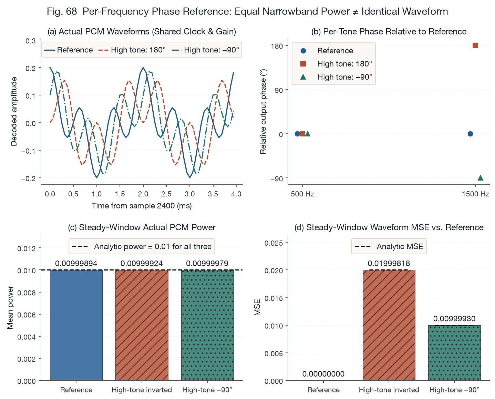

# Chapter Code Exercises and Audio Experiments

🌐 [简体中文](../research/05_exercises_and_audio.md) ｜ **English**

Work through the hand calculations for each chapter first, execute the corresponding Python script second, and finally audition the WAV clips generated by the exact same mathematical model. Script outputs are never pre-filled lookup tables: every runner recomputes numerical answers directly from inputs, while independent regression tests verify them against hand calculations, analytical limiting cases, or known reference models.

This manual indexes all **360 stably numbered code exercises** (`E00-01`–`E17-13`), alongside the standalone real-array recording exercise `R01`. Here `E00-01` denotes Exercise 1 of Chapter 0's mathematical foundations, and `E01-01` denotes Exercise 1 of Chapter 1; Appendix B (Chapter 17) additionally includes 17 capstone review problems numbered `1`–`17`, kept distinct from the `E17-*` code IDs.

Exercises `E06-07`–`E06-10` verify AEC arithmetic and boundary cases on dimensionless echo models (with `E06-08`–`E06-10` backed by exact closed-form check scripts); Sections 15 and 16 provide companion synthetic WAVs under separate audio-domain parameters, so those listening files themselves are not ground-truth fixtures for the dimensionless hand exercises.

Sections 3–11, 13–16, 18, 21–30, and 32–34 correspond to the **109 mathematically synthesized WAV clips** in the main manifest; the remaining sections accompany **31 standalone topical audio manifests** (**174 WAVs** in total—yielding **32 manifests and 283 published WAV files** across the textbook), spanning Section 12's separately licensed real synchronized environmental recordings (4 WAVs), Section 17's isolated-environment room white-noise simulation (18 WAVs), and 29 primary-environment controlled synthetic suites across Chapters 1–15 and Appendices A/B (binaural & spectral cues, finite-window STFT convolution & digital sweep deconvolution, multi-frequency planar geometry & 3D baseline calibration, coherent reflection false peaks & known unitary focusing, derivative constraints / per-bin phase / binaural beamforming, colored-reference APA & playback-gain tail history, sparse MINT inversion & WPE guard delays, oracle T-F masks / CSS stitching / controlled GSS, free-field moving sources & dual-clock track lifecycle, noise PSD mismatch & dead-microphone excision, dual-scenario FIR selection, acoustic camera snapshots, distributed wireless DANSE controls, Section 61's 6 wearable spatial-array WAVs for Chapter 14, and Section 62's 6 near-field acoustic distance-bubble WAVs for Chapter 15). Because provenance and valid comparisons differ across suites, review each section's experimental conditions before listening.

Main-manifest audio is partitioned by chapter and governed jointly by [`generate_audio_samples.py`](../examples/generate_audio_samples.py) and [`MANIFEST.json`](../audio/MANIFEST.json). The manifest records each group's signal equations, PRNG seed, shared group export gain, sample rate, channel count, frame count, quantization error bounds, Python/NumPy environment, generator SHA-256 digests, and per-WAV SHA-256 digests—never applying one group's default harmonic template blindly to another group. Signed 16-bit PCM (`PCM16`) encoding uses round-to-nearest-even without dithering or automatic peak limiting, computing overall RMS across all channels and samples jointly. Passing `--check` to any generator recomputes waveforms in memory and verifies existing disk assets read-only without rewriting files (strict byte verification also logs Python, NumPy, and OS platform strings; a cross-platform float ULP difference is not an algorithmic bug). If an interrupted run leaves a manifest out of sync with WAV files, preserve the interrupted directory for inspection, generate into a fresh empty directory to verify, and then update affected assets and rebuild figures and site pages—never hand-edit an individual generated file. Synthetic clips contain zero human speech recordings or neural checkpoints, and programmatic PCM readback or browser loadability never substitutes for formal human listening tests.

[`io_contracts.py`](../io_contracts.py) enforces pre-write regular parent-chain checks, exact directory membership, and strict finite JSON parsing across generators while leaving signal models, manifest schemas, and scoring logic inside each chapter module. Any non-empty target directory must match that suite's exact expected member set, rejecting duplicate JSON keys, `NaN`/`Infinity` floats, or `bool` values passed where numeric scalars are required (these checks guard local single-user workflows and do not claim immunity against concurrent filesystem races).

## 1. Running Exercises by Chapter

Execute all commands from the repository root using `.venv` (Chapter 4 helper `nyquist_interpolation` imports a peak-interpolation helper from the plotting module and therefore uses `matplotlib` already installed in `.venv` without rendering plots or writing files):

```bash
.venv/bin/python -m codes.chapters.ch00.chapter00_exercises
.venv/bin/python -m codes.chapters.ch09.chapter09_experiments
.venv/bin/python -m codes.chapters.ch10.chapter10_experiments
.venv/bin/python -m codes.chapters.ch11.chapter11_experiments
.venv/bin/python -m codes.chapters.ch12.chapter12_exercises
.venv/bin/python -m codes.chapters.ch13.chapter13_exercises
.venv/bin/python -m codes.chapters.ch14.chapter14_exercises
.venv/bin/python -m codes.chapters.ch15.chapter15_exercises
.venv/bin/python -m codes.chapters.appendix_a.appendix_a_experiments
.venv/bin/python -m codes.chapters.appendix_b.appendix_b_experiments
.venv/bin/python -m codes.chapters.appendix_b.examples.generate_response_audio --check
.venv/bin/python -m codes.chapters.ch09.examples.chapter09_tracking_audio --check
.venv/bin/python -m codes.chapters.ch08.chapter08_experiments
.venv/bin/python -m codes.chapters.ch07.chapter07_experiments
.venv/bin/python -m codes.chapters.ch06.chapter06_experiments
.venv/bin/python -m codes.chapters.ch01.chapter01_experiments
.venv/bin/python -m codes.chapters.ch02.chapter02_experiments
.venv/bin/python -m codes.chapters.ch03.chapter03_experiments
.venv/bin/python -m codes.chapters.ch05.chapter05_experiments
.venv/bin/python -m codes.chapters.ch04.chapter04_experiments
.venv/bin/python -m codes.chapters.ch00.cross_chapter.exercises_spatial
.venv/bin/python -m codes.chapters.ch00.cross_chapter.spatial_model_exercises
.venv/bin/python -m codes.chapters.ch00.cross_chapter.enhancement_structure_exercises
.venv/bin/python -m codes.chapters.ch00.cross_chapter.engineering_boundary_exercises
.venv/bin/python -m codes.chapters.appendix_b.interpolation_exercise
.venv/bin/python -m codes.chapters.ch00.cross_chapter.spatial_precision_exercises
.venv/bin/python -m codes.chapters.ch00.cross_chapter.enhancement_step_exercises
.venv/bin/python -m codes.chapters.ch00.cross_chapter.tracking_time_exercises
.venv/bin/python -m codes.chapters.ch00.cross_chapter.exercises_enhancement
.venv/bin/python -m codes.chapters.ch06.aec_algorithm_minicases
.venv/bin/python -m codes.chapters.ch06.aec_advanced_exercises
.venv/bin/python -m codes.chapters.ch06.aec_ipnlms_subband_demo
.venv/bin/python -m codes.chapters.ch06.aec_crossband_demo
.venv/bin/python -m codes.chapters.ch06.aec_rls_kalman_comparison
.venv/bin/python -m codes.chapters.ch00.cross_chapter.exercises_engineering
.venv/bin/python -m codes.chapters.ch09.tracking_crossing_dropout_demo
.venv/bin/python -m codes.chapters.ch10.spectral_subtraction_demo
.venv/bin/python -m codes.chapters.ch03.coarray_covariance_exercise
.venv/bin/python -m codes.chapters.ch04.doa_resolution_trials
.venv/bin/python -m codes.chapters.ch14.examples.generate_wearable_audio --check
.venv/bin/python -m codes.chapters.ch15.examples.generate_tse_audio --check
.venv/bin/python codes/chapters/ch00/examples/generate_audio_samples.py --check
.venv/bin/python -m unittest discover -s tests -p 'test_codes*.py' -v
```

| Chapter & Exercise IDs | Core Topics Verified | Code Entrypoints |
|---|---|---|
| Ch 0 `E00-01`–`16` | Spherical/AES69 coordinates & Fresnel near-field approximation, $\mathrm{SO}(3)$ rotation composition, complex phasors & decibels, DFT Parseval & zero-padded linear convolution, STFT COLA reconstruction, subspace orthogonal projections, SVD condition numbers & diagonal loading, Woodbury & Schur complement, Rayleigh quotient & GEV, `vec`/Kronecker/Khatri–Rao, Wirtinger Lagrange MVDR/LCMV, NNLS KKT & MM surrogates, circular complex Gaussians & CRLB, Wiener orthogonality & Joseph Kalman update, Hungarian optimal assignment, and Bessel/Legendre/spherical harmonics | [Ch 0 runner](../chapter00_exercises.py), [Math kernels](../core/chapter00_math.py); full breakdown in §63 |
| Ch 1 `E01-01`–`11` | Correlated noise, amplitude vs. power dB, unequal noise variances, finite-record cross-terms, 1-sample misalignment, rigid-sphere Woodworth ITD, mixture power decomposition, ILD/WNG, frequency-dependent responses, and MEMS dBA SNR traps & differential low-frequency self-noise budget | [Spatial exercises](../cross_chapter/exercises_spatial.py) (`01`–`03`); [Ch 1 runner](../../ch01/chapter01_experiments.py) (`04`–`11`) |
| Ch 2 `E02-01`–`06` | STFT frame counts, Hermitian spatial covariance, boundary reconstruction with a positive WOLA denominator (NOLA), effective snapshot count $N_{\mathrm{eff}}$, recursive covariance warmup & global weight scaling | [Spatial exercises](../cross_chapter/exercises_spatial.py) |
| Ch 2 `E02-09`–`20` | Spherical vs. planar propagation, 3D isotropic DI, Schroeder EDC & time origin, 4-point STFT, single reflection & full finite-window convolution, spatially white noise cross-terms, Hann amplitude/power gain calibration, digital sweep deconvolution, 3-frame STFT consistency, 3D $\mathrm{sinc}(kd)$ vs. 2D $J_0(kd)$ diffuse nulls & windowed-sinc fractional-delay FIR vs. linear interpolation | [Ch 2 runner](../../ch02/chapter02_experiments.py) |
| Ch 3 `E03-01`–`07` | Difference-coarray lag multiplicities, endfire DOA sensitivity, 3D spherical steering, near- vs. far-field boundary, complex gain calibration & physical-to-virtual Toeplitz coarray | [Spatial exercises](../cross_chapter/exercises_spatial.py) (`01`–`06`); [Coarray `E03-07`](../../ch03/coarray_covariance_exercise.py) |
| Ch 3 `E03-08`–`18` | Full directional phase ambiguity, mutual-coupling noise amplification, LS complex gain fitting, coprime coarray holes, 2-mic DMA gain mismatch, noisy calibration reference, coplanar mirror symmetry & near-coplanar full-rank conditioning, multi-frequency disambiguation, known-direction 3D baseline, rigid-sphere diffraction aperture bias & MEMS gasket-leak high-pass phase mismatch | [Ch 3 runner](../../ch03/chapter03_experiments.py) |
| Ch 4 `E04-01`–`09` | Delay sign convention, coherent-source rank collapse, grating-lobe spatial aliasing, forward spatial smoothing, MDL enumeration, 200-trial dual-source resolution & LS-ESPRIT | [Spatial exercises](../cross_chapter/exercises_spatial.py) (`01`–`07`, `09`); [Resolution `E04-08`](../../ch04/doa_resolution_trials.py) |
| Ch 4 `E04-12`–`24` | Direct-sum SRP-PHAT & near-field grid, ESPRIT subarray basis & principal branch, 1-step GN & correlated-TDOA GLS, local delay CRLB, pure-tone vs. broadband phase ambiguity, non-unitary focusing noise, 2-freq unitary focusing rank, analytic root-MUSIC polynomial, coherent-reflection false peak, 2-tap CTF cross-relation, UCA Bessel phase-mode ESPRIT, 2-mic blind CDR screening & off-grid $\ell_1$ sparse DOA basis mismatch / SELD location-dependent $F_{20^\circ}$ coupling | [Ch 4 runner](../../ch04/chapter04_experiments.py) |
| Ch 5 `E05-01`–`02` | LCMV complex response constraints & finite interferer suppression | [Spatial exercises](../cross_chapter/exercises_spatial.py) |
| Ch 5 `E05-05`–`20` | GSC nullspace & single-snapshot/coherent cancellation, Frost projection, Zelinski non-negativity & McCowan coherence boundary, MPDR mismatch self-cancellation, 4-mic SH modal rank, gated GSC leakage audio, GEV/Souden/MWF reference image & full-rank boundary, mask & per-channel pre-filtering rank jump, worst-case norm-ball constraint, derivative-constraint complex response & dual-tone PCM, per-bin phase rotation, 1st-order DMA & URA Kronecker separable beamforming, and binaural MVDR/LCMV cue preservation (`18`–`20`) | [Ch 5 runner](../../ch05/chapter05_experiments.py) (`05`–`17`); [Binaural demo](../../ch05/examples/binaural_beamforming_demo.py) (`18`–`20`) |
| Ch 6 `E06-01`–`10` | NLMS, double-talk freeze, error polarity, noise floor, cubic nonlinearity, negative-polarity delay peak, IPNLMS regularization startup, RLS memory length & 2-band delayed taps | [Enhancement exercises](../cross_chapter/exercises_enhancement.py) (`01`–`06`); [AEC minicases](../../ch06/aec_algorithm_minicases.py) (`07`); [Advanced AEC](../../ch06/aec_advanced_exercises.py) (`08`–`10`) |
| Ch 6 `E06-12`–`20` | Stereo shared-denominator step & non-identifiability, causal bulk delay alignment, SRO phase drift, reference dropout & history tail, *a posteriori* scoring, block-ERLE dB mean, NLMS normalization bias & injected near-end distortion decomposition | [Ch 6 runner](../../ch06/chapter06_experiments.py) |
| Ch 6 `E06-21`–`25` | 2D parameter-space affine projection geometry, window recomputation, collinear Gram rank deficiency & $\delta\mathbf{I}$ damping, stereo path-prior holdout verification & 6-WAV colored-reference frozen holdout scoring | [APA minicases](../../ch06/aec_affine_projection_demo.py) (`21`–`24`); [APA audio](../../ch06/examples/generate_apa_audio.py) (`25`); detailed in §40 |
| Ch 6 `E06-26`–`32` | Time-varying playback gain vs. RIR convolution non-commutativity, post-stop echo tail & 3 PCM windows, odd-power vs. orthogonal Legendre Hammerstein nonlinear AEC, stereo time-varying allpass decorrelation, causal loop deadline & main/shadow dual-filter switching, PBFDKF double-talk variance inflation & forgetting-factor steady-state trade-off, and RES Wiener gain floor & CNG level matching | [Reference timing kernel](../../ch06/core/reference_timing.py), [Nonlinear/stereo kernel](../../ch06/core/nonlinear_and_stereo.py), [Ch 6 runner](../../ch06/chapter06_experiments.py) (`26`–`27`, `29`–`32`), [6-WAV generator](../../ch06/examples/generate_reference_audio.py) (`28`); detailed in §56 |
| Ch 7 `E07-01`–`05` | Valid causal history frames, complex linear prediction, rank-deficient loading, offline non-causality & joint WPD | [Enhancement exercises](../cross_chapter/exercises_enhancement.py) |
| Ch 7 `E07-08`–`17` | Complex LS fitting, power floor clipping, tap-history ordering, recursive *a priori* residual, block loading, predictable-target & oracle-inverse audio, real cepstral phase loss, ill-conditioned normal equations, near-common-zero MINT noise amplification & constrained regularized inverse, and 6-WAV PCM controls | [Ch 7 runner](../../ch07/chapter07_experiments.py) |
| Ch 7 `E07-18`–`21` | $T_{60}$ power-decay units, distributed propagation offsets & 6-WAV PCM waveform controls, online RLS-WPE long-silence inverse-covariance blowup & convex diagonal pullback gating, and `AEC + WPE` cascade ordering identifiability & frequency-banded tap budgets | [Prediction delay kernel](../../ch07/core/prediction_delays.py), [Online/cascade kernel](../../ch07/core/online_and_cascade.py), [Ch 7 runner](../../ch07/chapter07_experiments.py), [6-WAV generator](../../ch07/examples/generate_delay_audio.py); detailed in §57 |
| Ch 8 `E08-01`–`06` | Zero-mean SI-SDR, PIT permutation search, known-matrix unmixing, minimal-distortion projection-back, T-F mask floor & cross-block slot permutation | [Enhancement exercises](../cross_chapter/exercises_enhancement.py) |
| Ch 8 `E08-10`–`27` | Complex row-wise IP update, joint projection-back, activity-gating prior trap, ILRMA multiplicative update, underdetermined MNMF identifiability, joint congruence diagonalization, overlap-association CSS audio, whitening counterexample, 3-matrix joint diagonalization limit, FastMNMF Jacobian, weighted mixture consistency, bounded/unbounded real & complex mask representations, two consistency projection orderings, PCA vs. OverIVA background constraint, post-permutation polarity & gain-jump CSS audio, convolutive-invariant CI-SDR overfitting trap, streaming subband GMAC/s budget & single-talker bypass, and AuxIVA inversion-free rank-1 ISS vs. IP convergence | [Ch 8 runner](../../ch08/chapter08_experiments.py) |
| Ch 9 `E09-01`–`06` | Coasting covariance growth, $\pm 180^\circ$ circular innovation, particle weight update, discrete vs. continuous-white-acceleration $\mathbf{Q}$, Mahalanobis gating & crossing-track ID switch vs. OSPA | [Enhancement exercises](../cross_chapter/exercises_enhancement.py) (`01`–`05`); [Crossing/slew demo](../../ch09/tracking_crossing_dropout_demo.py) (`06`) |
| Ch 9 `E09-10`–`23` | 1-step EKF, UT moments, bimodal circular-mean ambiguity & zero-prior support, PHD cardinality variance & Bernoulli empty-measurement update, OSPA/GOSPA bounds, fixed-lag RTS smoothing & OOSM retrodiction, readback 2-mic PCM tracking chain, correlated observations & bearing-only scale ambiguity, full-log-likelihood IMM dropout recursion, 2-mic PCM lifecycle, 3D rig attitude & spherical vMF, loudspeaker echo clutter gating, audio-visual OOSM + FoV missed detection & symmetric crossing-track JPDA marginal association vs. hard GNN | [Ch 9 runner](../../ch09/chapter09_experiments.py); audio in §§31 & 59 |
| Ch 10 `E10-01`–`14` | SRO ppm drift, hysteresis/hangover VAD, ring buffer, callback deadlines, Q1.15 quantization, peak AGC, frame/byte math, block-size adaptation, power spectral subtraction & full-pipeline compute/memory/power budget | [Engineering exercises](../cross_chapter/exercises_engineering.py) (`01`–`12`, `14`); [Spectral subtraction](../../ch10/spectral_subtraction_demo.py) (`13`) |
| Ch 10 `E10-18`–`28` | Spectral-subtraction truncation bias, exact decimation aliasing, block-AGC audio, MCRA soft-update lag / finite-tail backward integral / non-preemptive blocking / external clock scale / 6 noise-mismatch WAVs / 6 dead-mic excision WAVs (`21`–`26`), digital PDM CIC bit-growth/droop/edge skew & ITU-T P.340 duplex class + P.808 crowd screening | [Ch 10 runner](../../ch10/chapter10_experiments.py); dedicated audio in §§43 & 60 |
| Ch 11 `E11-01`–`07` | Hard resource screening, Wilson failure bounds, utterance-pooled WER, latency quantiles & three scenario selection decisions | [Engineering exercises](../cross_chapter/exercises_engineering.py) |
| Ch 11 `E11-10`–`22` | Hard-constrained Pareto frontier, joint risk bounds, module interaction non-additivity, FIR noise vs. total error trade-off, interval dominance & 3-state threshold gating, 2-hour zero-FA Poisson upper bound, ORC utterance segmentation sensitivity, time-windowed edit error, dual-scenario FIR selection, missing-session coverage, same-array acceptance evidence, automotive multi-zone A²B/BT drift & headrest DTD, and ICC howling margin, 3QUEST standard examples & supplied teaching acceptance budgets | [Ch 11 runner](../../ch11/chapter11_experiments.py); audio in §§33 & 44 |
| Ch 12 `E12-01`–`18` | Complex amplitude vs. mean-square CSM, forward vs. bidirectional DAMAS sweeps, orthogonal phase-coded snapshots, coherent-source false map, duplicate columns / off-grid & 441-grid sidelobe leakage, diagonal removal (`DR`), amplitude calibration, single-bin ROI integration, full-CSM CLEAN-SC, CMF Frobenius objective, real-DFT DC/Nyquist scaling, reference-point shift, multi-bin band integration, 1-mic source/noise unidentifiability, Gram vs. scan-residual objectives, 4-column unidentifiability & Dougherty Functional Beamforming fractional-power sidelobe compression + integral non-conservation | [Ch 12 runner](../../ch12/chapter12_exercises.py); 5 snapshot WAVs & full breakdown in §47 |
| Ch 13 `E13-01`–`21` | Complex reference conjugation, broadcast scaling invariance, sequential/simultaneous/relaxed DANSE updates & stale receiver snapshots, multi-target compression rank deficiency, zero-broadcast local fallback, loaded objective shift, kbps bandwidth & SCM memory, `100 ppm` linear SRC, 50 ms packet-drop gap, PCM16 transport quantization bound & 3-tier steady-window scoring, Jacobi spectral radius & Robbins–Monro schedules, 3-node tree in-network sum, rank-1 GEVD whitening, broadcast coordinate remapping, AES67/PTPv2 vs. SRO phase budget, unified DASF LCMV subspace lockup & DWACD-inspired two-window cross-spectrum slope control with activity gating | [Ch 13 runner](../../ch13/chapter13_exercises.py); 17 WAVs & full breakdown in §48 |
| Ch 14 `E14-01`–`16` | Tetrahedral FOA `A→B` encoding, open-sphere $j_n(kr)$ nulls, $\mathrm{SO}(3)$ Euler FOA rotation, active-intensity DirAC, BSM-MagLS / directional weighting, BMVDR reference mixing, Corcos cross-modal anti-wind fusion, 2 ms hear-through comb filter, ultra-low-power budget & 6-WAV 3-tier reconciliation, FOA `max-rE` loudspeaker energy-vector decoding, SOFA coordinate audit, head-tracking motion-to-sound lag budget & rigid-sphere 2nd-order HOA radial mode boost vs. low-frequency WNG amplification | [Ch 14 runner](../../ch14/chapter14_exercises.py); 6 WAVs in §61 |
| Ch 15 `E15-01`–`15` | Dual-state silence-floor TSE loss, zero-overlap fricative bypass, spherical-wave $0^\circ$ acoustic distance bubble & small-aperture conditioning, single-label overlap DER lower bound & valid `> 100%` construction, spatial-spectral TS-VAD + GSS gating, camera positive-lag word-onset truncation, 2-tap distance-bubble PCM, EEND-EDA variable-speaker attractor gating, exclusive-mask enrollment voiceprint purification & FiLM affine modulation conditioning with lip-occlusion visual confidence gating fallback | [Ch 15 runner](../../ch15/chapter15_exercises.py); 6 WAVs in §62 |
| App. A `E16-01`–`04` | Linear vs. circular convolution, complex Hermitian outer product, rank-deficient minimum-norm LS & spatial covariance whitening vs. scalar PHAT | [Engineering exercises](../cross_chapter/exercises_engineering.py) |
| App. A `E16-06`–`15` | Signed FFT frequency bins, block-convolution tails, SDW-MWF noise-nullspace limit, absolute vs. trace-relative loading scale, complex LS orthogonality, SVD numerical-rank truncation vs. ridge, conjugate-reverse `(AB)^H = B^H A^H`, `eigh` Hermitian prerequisite, known diagonal-noise WLS & 2-channel audio, and full off-diagonal correlated negative GLS weights & joint whitening | [Appendix A runner](../../appendix_a/appendix_a_experiments.py); audio in §§34 & 45 |
| App. B `E17-01` | Shared group export gain vs. per-file peak normalization distortion | [Engineering exercises](../cross_chapter/exercises_engineering.py) |
| App. B `E17-03`–`13` | 6-position near/far pairs, 4-mic median DRR, SRP phase scoring, readback room PCM shared gain & peak delay, A/B/C evidence tiers, 1 s vs. full-tail SRP window, TAC channel equivariance, common scaling & safe DRR/EDC log floors, equal-DRR frequency response & 5-WAV output, $T_{20}$ slope extrapolation / time-origin conditioning / truncated tail length & 6-tier end-to-end cascade fault attribution | [Appendix B runner](../../appendix_b/appendix_b_experiments.py); room assets in §17, detailed walkthrough & 5 WAVs in §46 |

Eleven cross-chapter step-by-step precision/state exercises retain their canonical chapter IDs:

| Exercise IDs | Step-by-Step Derivation Verified | Runner Module |
|---|---|---|
| `E02-07`, `E04-10`, `E05-03` | Converting exponential forgetting $\alpha$ to physical time constant $\tau$; 3-mic TDOA zero-sum closure & shared-reference error covariance; worst-case norm-ball response lower bound from WNG | [Spatial precision](../cross_chapter/spatial_precision_exercises.py) |
| `E06-11`, `E07-06`, `E08-07`–`08` | Batch unbiased LS vs. online NLMS disturbance floor; multichannel WPE shared spatial power $\lambda_t$; 1-step AuxIVA Iterative Projection (`IP`); ILRMA non-negative spectral model | [Enhancement steps](../cross_chapter/enhancement_step_exercises.py) |
| `E09-07`–`08`, `E10-15`, `E11-08` | Two-frame particle prior propagation; extrapolating lagged DOA measurement to beam-control time; half-open sample intervals for VAD preroll + hangover; exact Clopper–Pearson one-sided risk bound at zero observed failures | [Tracking time & state](../cross_chapter/tracking_time_exercises.py) |

And subsequent cross-chapter model/boundary modules append cleanly to each chapter's ID sequence:

| Exercise IDs | Modeling / Boundary Question | Runner Module |
|---|---|---|
| `E02-08`, `E04-11`, `E05-04`, `E16-05` | Single-sided `rfft` Parseval bin weights; pre-whitened MUSIC under colored noise; solving loading $\varepsilon$ for a target WNG; singular covariance Moore–Penrose pseudoinverse trap | [Spatial models](../cross_chapter/spatial_model_exercises.py) |
| `E07-07`, `E08-09`, `E09-09` | Joint WPD rank-1 factorization into WPE + MVDR; cACG angular central Gaussian fixed-point shape update; 2-mode IMM interaction mixing & between-mode variance spread | [Enhancement structures](../cross_chapter/enhancement_structure_exercises.py) |
| `E10-16`–`17`, `E11-09` | Exact tie boundary when completion equals next callback arrival; variable-callback ADC-to-DAC sample timestamp pairing & unknown dropout gaps; exact two-sided paired sign test | [Engineering boundaries](../cross_chapter/engineering_boundary_exercises.py) |
| `E17-02` | Per-frequency $\cos(\pi f/f_s)$ attenuation of 2-tap linear half-sample delay & readback PCM verification | [Interpolation exercise](../../appendix_b/interpolation_exercise.py) |

Full problem statements, substitutions, intermediate quantities, final answers, and scope boundaries appear in the corresponding chapters (adding exercises never inflates the 388-row algorithm coverage count or substitutes deterministic math checks for perceptual speech evaluation).

Selected cross-chapter exercise highlights:
- **`E03-06` & Chapter 8 §8.4 silence-gating example**: `E03-06` solves fixed relative channel complex gains from two known calibration directions and demonstrates single-direction unidentifiability when DOA is unknown ([Chapter 3](../../../../chapters_en/03_array-geometry.md#e03-06)); the silence-gating hand calculation in [Chapter 8 §8.4](../../../../chapters_en/08_speech-separation.md#sec-8-4) evaluates the posterior probability of an always-active noise/background class during all-speaker silence given fixed mixture weights and spatial densities. Both operate on deterministic mathematical inputs outside the main 109 WAVs.
- **`E03-07`**: Starting from a 3-element sparse linear array at $\{0, 1, 3\}d$ and a given $3\times 3$ physical covariance, averages redundant signed lags to construct a $4\times 4$ virtual Toeplitz coarray matrix—and uses a single-snapshot counterexample to prove that a positive-semidefinite physical covariance does **not** guarantee positive-semidefiniteness of the direct-augmented (`DA`) virtual Toeplitz matrix ([Chapter 3](../../../../chapters_en/03_array-geometry.md#e03-07), [`coarray_covariance_exercise.py`](../../ch03/coarray_covariance_exercise.py)).
- **`E04-09` & `E04-08`**: `E04-09` ([Chapter 4 §4.6](../../../../chapters_en/04_doa-estimation.md#sec-4-6)) writes out the 2-row subarray LS-ESPRIT normal equation for a single source: an ideal Vandermonde subspace vector yields `30°` with `0` residual, whereas perturbing the third entry yields `~28.90°` with residual norm `0.1`. `E04-08` ([Chapter 4](../../../../chapters_en/04_doa-estimation.md#e04-08), [`doa_resolution_trials.py`](../../ch04/doa_resolution_trials.py)) runs 200 independent dual-source complex Gaussian trials on a fixed 8-mic narrowband ULA, logging resolved/merged/spurious counts and Wilson confidence intervals across Bartlett, Capon, and MUSIC.
- **`E16-04`**: Contrasts cross-channel spatial covariance whitening against scalar GCC-PHAT phase weighting in [Appendix A §16.4](../../../../chapters_en/16_appendix-symbols-math.md#sec-16-4): for $\mathbf{R}_{nn} = \operatorname{diag}(4, 1)$, $\mathbf{W} = \operatorname{diag}(0.5, 1)$ yields $\mathbf{W}\mathbf{R}_{nn}\mathbf{W}^H = \mathbf{I}$ while simultaneously mapping steering vector $[1, 1]^\top \mapsto [0.5, 1]^\top$—a cross-channel matrix transformation unattainable by dividing a scalar cross-spectrum by its magnitude ([`exercises_engineering.py`](../cross_chapter/exercises_engineering.py)).
- **`E09-06`**: Feeds deterministic crossing observations (`39°` from Track B listed before `41°` from Track A when both tracks predict `40°`): both one-to-one assignments tie at squared residual sum $2\,\mathrm{deg}^2$, where tie-breaking induces two track ID switches even though unlabeled set error (`OSPA`) on raw detections is `0`; two consecutive coasting predictions from $\mathbf{P}_0 = \mathbf{I}$, $\mathbf{Q} = \operatorname{diag}(0.1, 0.01)$ grow angular variance to `2.10` and `5.21 deg²`, while a `5°/s` slew-rate limit clamps beam steering to `25°` and `30°` ([`test_codes_tracking_crossing_dropout.py`](../../../../tests/test_codes_tracking_crossing_dropout.py), [Chapter 9 §9.6](../../../../chapters_en/09_source-tracking.md#sec-9-6)).
- **`E10-14` & `E11-05`–`07`**: `E10-14` combines 6-frame service times, FIFO queue depth, SRAM footprint (`667.5 KiB` peak), and illustrative power (`0.95 W` mean): despite an average `RTF = 0.75 < 1`, burst clustering causes 3 of 6 frames to miss the `10 ms` deadline. `E11-05`–`07` apply hard-constraint-first screening before soft scoring across circular-array spacing, meeting single-pass latency, and automotive clock drift ([Chapter 10 §10.4.3](../../../../chapters_en/10_engineering-practice.md#sec-10-4-3), [Chapter 11 §11.6](../../../../chapters_en/11_selection-guide.md#sec-11-6), [`exercises_engineering.py`](../cross_chapter/exercises_engineering.py)).
- **`E10-17` & `E11-11`**: [`E10-17`](../../../../chapters_en/10_engineering-practice.md#e10-17) (`variable_callback_replay` in [`engineering_boundary_exercises.py`](../cross_chapter/engineering_boundary_exercises.py)) pairs input sample tags against DAC output slots across variable-length callbacks, recovering `33.75 ms` and `42.5 ms` latencies on the first two pulses while flagging the third as unpaired across an unknown xrun gap; `E11-11` (`deadline_acceptance` in [`chapter11_experiments.py`](../../ch11/chapter11_experiments.py)) counts undelivered scheduled responses as deadline violations rather than silently dropping them from the denominator.

## 2. Conventions Before Auditioning Synthetic Audio

All 109 clips across Sections 3–11, 13–16, 18, 21–30, and 32–34 are pure mathematical waveforms synthesized in-repo rather than human voice recordings or physical room captures. Audible changes in harmonic timbre, noise floor, and stereo lateralization serve to verify specific signal-processing operations—never to claim natural-speech intelligibility, ASR accuracy, MOS ratings, or commercial hardware benchmarks.

Every comparison group shares a single explicit export gain chosen so group peak amplitude stays at or below `~0.8`; because actual acoustic SPL depends on your headphone/speaker amplifier, **always lower your playback volume first** and resist turning up the volume aggressively on quiet cancellation residuals. Web players never autoplay and never apply per-file loudness normalization.

Programmatic scoring always decodes the published `PCM16` WAVs over fixed channels, reference signals, sample windows, and delay alignments. Remember what each group's oracle control represents: Section 4 freezes NLMS using the known synthetic double-talk interval (not a blind DTD); Section 6 inverts the known $2\times 2$ mixing matrix (not blind BSS); and Section 8 pans stereo amplitude via `cos`/`sin` gains (not physical array TDOA). Full per-file SHA-256 hashes, peak/RMS levels, quantization errors, and source digests reside in [`MANIFEST.json`](../audio/MANIFEST.json), reproducible offline via [`generate_audio_samples.py`](../examples/generate_audio_samples.py).

## 3. Delay Alignment and Equal-Weight Averaging

Two channels observe the same amplitude-modulated harmonic complex, with Channel 1 arriving `3` samples (`187.5 μs` at `16 kHz`) later than Channel 2, corrupted by independent zero-mean Gaussian sensor noise of standard deviation `0.07` per channel. Proper delay-and-sum delays Channel 2 by `3` samples before averaging, compared against the target reference likewise delayed by `3` samples.

Compare the single microphone, unaligned average, and aligned average sequentially—inspecting waveform MSE (excluding the first `3` boundary samples) alongside high-frequency comb attenuation in the unaligned sum (note that unaligned error relative to the delayed reference combines target phase-cancellation distortion with residual noise; no element directivity, spatially correlated noise, or HRTF is modeled here):

[Delayed target reference](../../ch01/audio/spatial_reference.wav)

[2-channel array input](../../ch01/audio/spatial_array.wav)

[Single-mic input (`Mic 1`)](../../ch01/audio/spatial_mic1.wav)

[Unaligned 2-channel average](../../ch01/audio/spatial_unaligned.wav)

[Delay-aligned 2-channel average](../../ch01/audio/spatial_aligned.wav)

Maps to `E01-01`, `E01-05`, and `E04-01`; see Section 9 below for what happens when the two independent noise streams are replaced by a shared common noise source.

## 4. Linear AEC and Oracle Double-Talk Freeze

The far-end playback reference combines fixed-seed noise with synthetic harmonics, convolved with a sparse 3-nonzero-tap echo path at lags `0`, `12`, and `24` samples (`0.7`, `−0.3`, `0.15`). A 32-tap NLMS filter ($\mu = 0.4$, initialized to zeros) adapts continuously from $t = 0$; during `1.2–1.8 s`, a synthetic near-end tone burst enters the microphone, where the frozen branch halts weight updates over `[1.2, 1.8) s` while continuing to subtract echo using its frozen taps.

Inspect far-end single-talk (`0.6–1.1 s`, where `ERLE` is defined) separately from double-talk (`1.2–1.8 s`, where near-end target preservation matters): a quieter residual during double-talk often indicates near-end target cancellation by a diverging unfrozen filter rather than better echo removal.

[Far-end playback reference](../../ch06/audio/aec_far.wav)

[Clean near-end reference](../../ch06/audio/aec_near.wav)

[Microphone mixture (`echo + near-end`)](../../ch06/audio/aec_microphone.wav)

[Residual with oracle double-talk freeze](../../ch06/audio/aec_frozen.wav)

[Residual without freeze (diverges during double-talk)](../../ch06/audio/aec_unfrozen.wav)

Maps to `E06-01`–`03`. Production AEC systems must additionally handle loopback tap placement, clock drift, and loudspeaker nonlinearity—see the [official SpeexDSP AEC documentation](https://www.speex.org/docs/manual/speex-manual/node7.html).

## 5. Offline WPE Dereverberation vs. Predictable-Target Distortion

The reverberant input adds two delayed copies at `40 ms` (gain `0.6`) and `80 ms` (gain `0.3`) to a clean harmonic complex, zero-padded by `0.25 s` at the end to retain the complete finite echo tail (a sparse synthetic tap model rather than a Sabine $T_{60}$ room RIR).

Using a `512`-point centered STFT (`128`-sample hop), offline WPE runs `3` iterations with `K = 4` prediction taps and guard delay $\Delta = 3$ frames (the first valid regression frame is 0-based frame `6`, leaving frames `0..5` equal to the input spectrum, followed by iSTFT trimmed to original length with zero bulk shift):

[Dry anechoic reference](../../ch07/audio/wpe_dry.wav)

[Sparse reverberant input](../../ch07/audio/wpe_reverberant.wav)

[Offline WPE output](../../ch07/audio/wpe_output.wav)

Maps to `E07-01`–`03`. Listen first to how the post-offset echo tail is suppressed, then check whether sustained harmonic amplitude during active segments is partially attenuated—whenever a periodic source remains predictable across $\Delta$ frames, linear prediction can over-cancel target energy (explored quantitatively in Section 29).

## 6. Instantaneous Unmixing with a Known Matrix

Two synthetic harmonic sources with distinct fundamental frequencies are mixed instantaneously via `A = [[1, 0.5], [0.2, 1]]` (rows = microphones, columns = sources) and recovered by exact linear inversion $\mathbf{A}^{-1}\vec{x}$ under zero noise and zero reverberation—serving as an algebraic sanity check on channel/source indexing and permutation conventions:

[Source 1](../../ch08/audio/separation_source1.wav)

[Source 2](../../ch08/audio/separation_source2.wav)

[2-channel instantaneous mixture](../../ch08/audio/separation_mixture.wav)

[Known-matrix recovered Source 1](../../ch08/audio/separation_recovered1.wav)

[Known-matrix recovered Source 2](../../ch08/audio/separation_recovered2.wav)

Maps to `E08-02`–`03`; Section 11 below perturbs Row 2 toward Row 1 under additive sensor noise to demonstrate ill-conditioned noise amplification.

## 7. Hard Clipping, Low-Level Quantization, and Packet Dropouts

- **Clipped control**: Multiplies the reference by `3`, hard-clips at `±0.3`, and divides by `3`—restoring nominal scale without recovering clipped waveform peaks.
- **Low-level quantization control**: Scales the reference by `0.02` prior to `PCM16` rounding.
- **Packet-dropout control**: Zeros out `[0.9, 1.0) s` (`100 ms`) with zero packet-loss concealment (`PLC`).

[Clean synthetic reference](../../ch10/audio/engineering_reference.wav)

[Hard-clipped then rescaled](../../ch10/audio/engineering_clipped.wav)

[Low-level `PCM16` quantized](../../ch10/audio/engineering_low_level.wav)

[100 ms zeroed packet dropout](../../ch10/audio/engineering_dropout.wav)

Maps to `E10-05` and `E17-01` (and serves as a distortion counterexample alongside `E10-06`, though not generated by `PeakProtectAGC`). Audition at a single shared volume first; if you boost playback gain separately to hear low-level quantization granularity, note that added gain explicitly rather than calling it a shared-gain comparison.

## 8. Constant-Power Stereo Panning vs. Physical Wavefront Direction

[Constant-power stereo amplitude pan](../../ch09/audio/tracking_pan.wav)

Left and right gains follow $\cos(\phi(t))$ and $\sin(\phi(t))$ as $\phi$ sweeps smoothly from `0` to $\pi/2$, preserving $x_L^2[n] + x_R^2[n] = s^2[n]$. Although headphones produce a left-to-right phantom image, both channels carry **zero inter-channel time delay (`ITD = 0`)**, zero HRTF pinna cues, and zero room reflections—so an ITD/GCC-PHAT DOA estimator sees $0\,\mu\mathrm{s}$ throughout. Physical free-field moving-source propagation delays are synthesized separately in Sections 20 and 31.

## 9. Identical Correlated Noise Is Not Halved by Multi-Mic Averaging

With target signals already aligned and weighted by `[0.5, 0.5]`, this group varies solely inter-channel noise correlation (`2 s` at `16 kHz`, seed `20260923`, per-channel noise std $\sigma = 0.07$): the **independent** control draws two independent Gaussian sequences, whereas the **common-noise** control copies Channel 1's exact noise sequence into Channel 2.

Under independent sensor noise, averaged noise variance halves to $(0.07^2 + 0.07^2)/4 = 0.00245$ (`+3.0103 dB` SNR gain); under identical correlated noise ($\rho = 1$), averaged noise variance stays at $0.07^2 = 0.0049$ (`0 dB` gain), making the 2-mic average sample-for-sample identical to `Mic 1`:

[Aligned clean target reference](../../ch05/audio/correlation_reference.wav)

[Single-mic noisy input](../../ch05/audio/correlation_single.wav)

[2-mic average under independent sensor noise](../../ch05/audio/correlation_independent.wav)

[2-mic average under identical common noise](../../ch05/audio/correlation_common.wav)

Maps to `E01-01` and `E01-03`. Subtracting `correlation_reference.wav` directly from readback PCM confirms that `correlation_common.wav` and `correlation_single.wav` are identical—do not turn up headphone volume hunting for a non-existent difference.

## 10. Inverted Channel Polarity and Target Self-Cancellation

Given noise-free zero-delay inputs $x_1 = s$ and $x_2 = -0.9s$ (Channel 2 wired with inverted polarity and `0.9` gain), naive averaging yields $(s - 0.9s)/2 = 0.05s$, whereas flipping Channel 2's sign first yields $(s + 0.9s)/2 = 0.95s$—a severe $20\log_{10}(0.05/0.95) \approx -25.58\,\mathrm{dB}$ target collapse under shared export gain:

[Polarity-experiment target reference](../../ch03/audio/polarity_reference.wav)

[2-channel input with Channel 2 inverted](../../ch03/audio/polarity_array.wav)

[Uncorrected average (target nearly canceled)](../../ch03/audio/polarity_uncorrected.wav)

[Polarity-corrected average](../../ch03/audio/polarity_corrected.wav)

Maps to `E10-09`. Compare the two mono averaged outputs (`polarity_uncorrected.wav` vs. `polarity_corrected.wav`) rather than listening to the stereo input `polarity_array.wav` directly over speakers/headphones.

## 11. Matrix Invertibility Alone Does Not Prevent Severe Noise Amplification

Two AM harmonic sources (`173 Hz` and `293 Hz` fundamentals) are mixed through well-conditioned $\mathbf{A}_1 = \begin{bmatrix}1 & 0.5\\0.5 & 1\end{bmatrix}$ vs. nearly collinear $\mathbf{A}_2 = \begin{bmatrix}1 & 0.99\\0.99 & 1\end{bmatrix}$, corrupted by identical additive two-channel Gaussian noise ($\sigma = 0.003$ per mic), and inverted via exact $\mathbf{A}_i^{-1}\vec{x}$ with fixed channel ordering and shared export gain.

For symmetric $\begin{bmatrix}1 & a\\a & 1\end{bmatrix}$, the eigenvalues are $1+a$ and $1-a$, giving 2-norm [condition numbers](https://numpy.org/doc/stable/reference/generated/numpy.linalg.cond.html) $\kappa_2(\mathbf{A}_1) = 3$ vs. $\kappa_2(\mathbf{A}_2) = 199$. Because output noise is $(v_1 - a v_2)/(1 - a^2)$ and $(v_2 - a v_1)/(1 - a^2)$, small sensor noise explodes as $a \to 1$:

[2-channel clean source reference](../../appendix_a/audio/conditioning_reference.wav)

[Noisy mixture (`cond = 3`)](../../appendix_a/audio/conditioning_well_input.wav)

[Noisy mixture (`cond = 199`)](../../appendix_a/audio/conditioning_ill_input.wav)

[Exact-inverse recovery (`cond = 3`)](../../appendix_a/audio/conditioning_well_output.wav)

[Exact-inverse recovery (`cond = 199`, severe noise boost)](../../appendix_a/audio/conditioning_ill_output.wav)

Maps to `E08-03` and `E16-03` (note that the large noisy peak in `conditioning_ill_output.wav` governs the shared group export gain logged in `MANIFEST.json`, and remember that `conditioning_reference.wav` holds clean sources whereas `*_input.wav` holds microphone mixtures).


## 12. R01: Spatial Cross-Terms in a Real 16-Mic River Recording

This section uses the `NRIVER` stream recording from [DEMAND v1.0](https://zenodo.org/records/1227121) by Joachim Thiemann, Nobutaka Ito, and Emmanuel Vincent. Official audio and documentation are licensed under [CC BY-SA 3.0](https://creativecommons.org/licenses/by-sa/3.0/), which likewise governs the 10-second excerpt and three averaged derivatives distributed here—see [`ATTRIBUTION.txt`](../../ch02/real_audio/ATTRIBUTION.txt), [`LICENSE.txt`](../../ch02/real_audio/LICENSE.txt), and [`MANIFEST.json`](../../ch02/real_audio/MANIFEST.json) (distinct from the MIT / CC BY-NC-SA 4.0 dual license of original code and prose in this repository).

Sixteen Sony ECM-C10 microphones were captured synchronously on one 16-channel interface in a 4-row staggered planar grid (`5 cm` nearest-neighbor spacing, `±2 mm` mounting tolerance, uncalibrated channel gains). Using the official `16 kHz` resampled files (each `4,800,064` frames = `300.004 s`—do not treat "~300 s" as an exact frame count; see [official documentation §§3–5](https://zenodo.org/records/1227121/files/DEMAND.pdf?download=1)), we deterministically extract `[0, 160000)` (`10 s`) across all channels.

**Problem**: Preserving raw channel ordering, gains, and DC offsets, form zero-delay equal-weight averages across Channels `1–2` ($M=2$) and Channels `1–16` ($M=16$), comparing actual digital power against the diagonal-only prediction that omits spatial cross-terms (no clean speech or source DOA ground truth exists, so SNR, SI-SDR, and DOA accuracy are undefined).

**Conventions**: Divide signed `PCM16` integers by `32768` to form $x_m[n]$ and uncentered second moments $R_{ij} = T^{-1}\sum_n x_i[n]x_j[n]$. Pre-quantization mean power is $P_{\mathrm{mean}} = M^{-2}\sum_{i,j} R_{ij}$, whereas the diagonal-only prediction is $P_{\mathrm{diag}} = M^{-2}\sum_i R_{ii}$ (retaining true per-channel powers without assuming equal mic gains; for non-zero-mean signals, statistical independence alone does not eliminate uncentered cross-terms). Exported at shared gain `1` with round-to-nearest-even `PCM16` (`≤ 0.5 LSB` error), all powers below are in $\mathrm{FS}^2$:

| Quantity | 2 Channels ($M=2$) | 16 Channels ($M=16$) |
|---|---:|---:|
| Diagonal prediction $P_{\mathrm{diag}}$ | $5.653225\times 10^{-6}$ | $6.857479\times 10^{-7}$ |
| Off-diagonal cross-term contribution | $1.030489\times 10^{-6}$ | $1.124068\times 10^{-6}$ |
| Pre-quantization mean power $P_{\mathrm{mean}}$ | $6.683714\times 10^{-6}$ | $1.809816\times 10^{-6}$ |
| Readback WAV power $P_{\mathrm{PCM}}$ | $6.683733\times 10^{-6}$ | $1.809875\times 10^{-6}$ |
| $10\log_{10}(P_{\mathrm{PCM}} / P_{\mathrm{diag}})$ (dB) | `0.7272` | `4.2148` |

**Interpretation**: At $M=2$, $(5.653225 + 1.030489)\times 10^{-6} = 6.683714\times 10^{-6}$ matches $P_{\mathrm{mean}}$ up to rounding, with tiny `PCM16` quantization shifts in $P_{\mathrm{PCM}}$. At both $M=2$ and $M=16$, ignoring off-diagonal cross-terms underestimates averaged output power (`+4.21 dB` above diagonal prediction at $M=16$). Relative to Channel 1, digital power changes by `−2.2566 dB` ($M=2$) and `−7.9303 dB` ($M=16$), while across ten consecutive `1 s` blocks $10\log_{10}(P_{\mathrm{PCM}} / P_{\mathrm{diag}})$ spans `0.2521–2.3554 dB` ($M=2$) and `2.2286–9.4000 dB` ($M=16$)—adjacent-block min-max ranges, not i.i.d. confidence intervals (pool linear power across the full excerpt before taking $10\log_{10}$).

[16-channel synchronized input (for download & programmatic analysis)](../../ch02/real_audio/demand_nriver_16ch_10s.wav)

[Channel 1 mono listening baseline](../../ch02/real_audio/demand_nriver_ch01_10s.wav)

[2-channel zero-delay equal-weight mean](../../ch02/real_audio/demand_nriver_mean02_10s.wav)

[16-channel zero-delay equal-weight mean](../../ch02/real_audio/demand_nriver_mean16_10s.wav)

**Reproduction**: Run `.venv/bin/python codes/chapters/ch02/examples/prepare_real_recordings.py --check` from the repository root for offline read-only verification (`6,080,176` B committed; raw `98.7 MB` archive stays in Git-ignored cache; verified 2026-09-22). Full per-block tables and extraction commands appear in the [Real-Array Recording Guide](../../README_EN.md#real-audio-r01) (Chinese source: [`../../ch02/real_audio/README.md`](../../ch02/real_audio/README.md)).

## 13. Memoryless Cubic Echo: Residual Harmonics Despite Optimal Linear Fit

A steady-state linear time-invariant (`LTI`) filter cannot synthesize frequencies absent from its input—as noted in both the [SpeexDSP AEC Troubleshooting guide](https://www.speex.org/docs/manual/speex-manual/node7.html) and [Interspeech 2021 AEC Challenge §2.2](https://www.microsoft.com/en-us/research/uploads/prod/2021/08/245_Full-Paper.pdf) (verified 2026-09-22). Here we verify that fundamental limit analytically on a deterministic cubic loudspeaker model (`16 kHz`, $N = 32000$ samples = `1,000` exact cycles of `500 Hz` over `[0, 32000)`):

- **Inputs**: Playback reference $x[n] = 0.4\sin(2\pi\cdot 500 n / 16000)$ and pure cubic echo $d[n] = x[n] + 2x^3[n]$ (zero near-end, zero noise, zero delay).
- **Exact harmonic decomposition**: Applying $\sin^3\omega = (3\sin\omega - \sin 3\omega)/4$ yields $d[n] = 0.496\sin\omega - 0.032\sin 3\omega$. Because `500 Hz` and `1500 Hz` are orthogonal over `1,000` integer periods, the optimal scalar LS linear estimate $\hat{d} = g x$ has $g = \sum x d / \sum x^2 = 1.24$, canceling the fundamental $\hat{d} = 0.496\sin\omega$ completely while leaving the orthogonal 3rd-harmonic residual $e = d - \hat{d} = -0.032\sin 3\omega$:

| Pre-Quantization Analytic Quantity | Value | Closed-Form Derivation |
|---|---:|---|
| Optimal linear gain $g$ | `1.24` | $0.496 / 0.4$ |
| Echo power ($\mathrm{FS}^2$) | `0.123520` | $(0.496^2 + 0.032^2)/2$ |
| Irreducible LTI residual power ($\mathrm{FS}^2$) | `0.000512` | $0.032^2 / 2$ |
| Single-talk linear ERLE ceiling | `23.8247 dB` | $10\log_{10}(0.123520 / 0.000512)$ |

All four WAVs share export gain `1` without fade-in/out so exact 1,000-cycle orthogonality holds (Figure 31 plots the first `8 ms` of readback PCM alongside single-sided `500 Hz` and `1500 Hz` DFT peak amplitudes):

[500 Hz playback reference](../../ch06/audio/nonlinear_reference.wav)

[Cubic nonlinear echo (`500 Hz + 1500 Hz`)](../../ch06/audio/nonlinear_echo.wav)

[Optimal linear estimate (`g = 1.24`)](../../ch06/audio/nonlinear_estimate.wav)

[Irreducible 1500 Hz 3rd-harmonic residual](../../ch06/audio/nonlinear_residual.wav)

Maps to `E06-06` (note that Hammerstein polynomial bases—such as the orthogonal Legendre basis in `E06-29`—can represent memoryless odd-harmonic distortion without requiring neural networks).

## 14. 4-Microphone Fractional-Sample Time-Delay Alignment

Accompanying Chapter 4's `E04-07`, a 4-mic ULA at $x \in [0, 0.04, 0.08, 0.12]\,\mathrm{m}$ ($0^\circ$ broadside, source at $+30^\circ$, $c = 343\,\mathrm{m/s}$, $f_s = 16\,\mathrm{kHz}$) experiences an adjacent-element arrival step of $-58.3090\,\mu\mathrm{s} \approx -0.932945$ samples (Mic 4 arrives `2.798834` samples ahead of Mic 1, shifted by a `2 ms` common causal bulk offset). The dry source combines a 6-harmonic `383 Hz` complex with fixed-seed (`20260924`) wideband noise ($\sigma = 0.04$), propagated via linear fractional-sample interpolation plus independent sensor noise ($\sigma = 0.02$ per mic), exported at shared gain `1`:

| File | Channels | Role |
|---|---:|---|
| [Noise-free Mic 1 reference](../../ch04/audio/fractional_reference.wav) | 1 | Includes common propagation delay without sensor noise |
| [4-channel ULA input](../../ch04/audio/fractional_array.wav) | 4 | Mics 1–4 ordered by increasing $x$ |
| [Unaligned 4-mic average](../../ch04/audio/fractional_unaligned.wav) | 1 | Averages directly without compensating fractional TDOAs |
| [Geometrically aligned 4-mic average](../../ch04/audio/fractional_aligned.wav) | 1 | Causally delays Mics 2–4 via linear interpolation to match latest Mic 1 before averaging |

- **Readback PCM MSE over `[320, 31680)` (`20–1980 ms`)**: Unaligned MSE against `fractional_reference.wav` is **`0.004222765`**, dropping to **`0.0000822202`** ($\mathrm{FS}^2$) after fractional alignment.
- **Standalone 6th-harmonic (`2298 Hz`) hand check**: With $\phi = 2\pi(2298)(0.04\sin 30^\circ / 343) \approx 0.841910\,\mathrm{rad}$, unaligned 4-mic array factor magnitude drops to $|\sin(2\phi)/(4\sin(\phi/2))| \approx 0.607893$ vs. `1.0` when aligned (run [`exercises_spatial.py`](../cross_chapter/exercises_spatial.py) and `generate_audio_samples.py --check`).

## 15. Linear *A Priori* Residuals Across Four Short-Path AEC Algorithms

This `aec_methods` group (`16 kHz`, `12,000` samples = `0.75 s`, seed `20260925`, shared gain `1`) feeds identical colored/tonal playback reference ($\sigma = 0.12$ Gaussian + `0.09` `310 Hz` sine) and noisy echo ($\sigma = 0.005$ background noise, zero near-end speech) into four causal 4-tap adaptive filters across an abrupt echo-path step at sample `6,000` from $[0.65, 0, -0.2, 0]$ to $[0.1, -0.45, 0, 0.5]$: NLMS ($\mu = 0.4$), IPNLMS ($\mu = 0.4, \kappa = 0$), RLS ($\lambda = 0.995, \delta = 1$), and real-matrix Kalman ($A = 1, \mathbf{Q} = 10^{-5}\mathbf{I}, \Psi = 0.0025, \mathbf{P}_0 = \mathbf{I}$):

| File | Role |
|---|---|
| [Shared playback reference](../../ch06/audio/aec_methods_reference.wav) | Identical input $x[n]$ fed to all four filters |
| [Oracle noise-free echo](../../ch06/audio/aec_methods_true_echo.wav) | Used strictly for clean echo-prediction MSE scoring |
| [Noisy microphone input](../../ch06/audio/aec_methods_microphone.wav) | True echo + $\sigma = 0.005$ additive background noise |
| [NLMS *a priori* residual](../../ch06/audio/aec_methods_nlms_residual.wav) | Sample-wise Eq. (6-3) |
| [IPNLMS *a priori* residual](../../ch06/audio/aec_methods_ipnlms_residual.wav) | Sample-wise Eq. (6-11) |
| [RLS *a priori* residual](../../ch06/audio/aec_methods_rls_residual.wav) | Sample-wise Eq. (6-18) |
| [Matrix Kalman *a priori* residual](../../ch06/audio/aec_methods_kalman_residual.wav) | Short real-FIR Eq. (6-22) (not full overlap-save FDKF) |

Evaluating clean echo-prediction MSE $\operatorname{mean}_{n\in I}(y[n] - \hat{y}_a[n])^2$ (where $\hat{y}_a = d - e_a$) on pre-quantization `float64` across pre-step `[3000, 6000)`, post-step transient `[6000, 6200)`, and re-converged `[9000, 12000)` windows yields:

| Algorithm | Pre-Step MSE `[3000, 6000)` | 200-Sample Step Transient `[6000, 6200)` | Re-Converged MSE `[9000, 12000)` |
|---|---:|---:|---:|
| NLMS | $1.15\times 10^{-5}$ | $4.84\times 10^{-4}$ | $1.15\times 10^{-5}$ |
| IPNLMS | $1.24\times 10^{-5}$ | $4.81\times 10^{-4}$ | $1.16\times 10^{-5}$ |
| RLS | $2.60\times 10^{-7}$ | $5.23\times 10^{-3}$ | $1.90\times 10^{-7}$ |
| Matrix Kalman | $4.50\times 10^{-7}$ | $3.75\times 10^{-3}$ | $3.50\times 10^{-7}$ |

Under these fixed parameters, RLS and Kalman achieve much lower steady-state misalignment than NLMS/IPNLMS while exhibiting higher initial transient error across the 200 samples immediately following an unannounced path jump.

## 16. 2-Band Haar Subband Cross-Band Aliasing Audio

Extending Figure 32 and §6.2.3's 4-point algebraic proof to `8,000` samples (`16 kHz`, `0.5 s`, seed `20260926`: $\sigma = 0.12$ Gaussian + `0.08` `2100 Hz` sine through exact 1-sample delay $\vec{h} = [0, 1]$, shared gain `1`), [`aec_subband.py`](../../ch06/core/aec_subband.py) computes the exact $2\times 2$ current/previous-block Haar polyphase transfer matrices and **zeros out off-diagonal cross-band terms directly** to isolate structural representation error (distinct from adaptive training in [`aec_crossband_demo.py`](../../ch06/aec_crossband_demo.py), where 1,500-block training on dimensionless inputs achieves `0` holdout MSE for full cross-band NLMS vs. `~0.489674` for diagonal subband NLMS):

| File | Structural Role |
|---|---|
| [Fullband playback reference](../../ch06/audio/aec_subband_reference.wav) | Time-domain input prior to 2-band Haar analysis |
| [Exact 1-sample echo](../../ch06/audio/aec_subband_true_echo.wav) | Full cross-band synthesis reproduces $x[n-1]$ identically |
| [Diagonal-only subband model output](../../ch06/audio/aec_subband_diagonal_model.wav) | Drops off-diagonal cross-band terms directly (non-adaptive algebraic check) |
| [Missing cross-band terms](../../ch06/audio/aec_subband_missing_cross_terms.wav) | Difference (`true_echo − diagonal_model`) |

Over `[0, 8000)` in `float64`, missing cross-band MSE is `~0.008929` against true echo mean square `~0.017749` ($\mathrm{FS}^2$): the ratio is about 50.3% for this fixed input; cross-band error power depends on the input and scoring window.

## 17. Six-Position Image-Source Room Simulation and SRP-PHAT Localization

Accompanying [Appendix B Capstone Exercise 16](../../../../chapters_en/17_appendix-guide.md) outside the main 109 WAVs, [`room_audio/MANIFEST.json`](../../appendix_b/room_audio/MANIFEST.json) and [`RESULTS.json`](../../appendix_b/room_audio/RESULTS.json) bind 18 `PCM16` white-noise WAVs (`16 kHz`, shared export gain `~0.15169690`) simulated in a $12\times 10\times 6\,\mathrm{m}$ shoebox room with a 4-mic square array via `pyroomacoustics==0.10.0` (image-source order `40`, `1 s` independent white Gaussian source per position, SRP-PHAT scored strictly over the first second `[0, 16000)` with `512`-pt Hann / `128`-pt hop centered STFT while exported 4-ch WAVs preserve full `38,497`-frame reverberant tails):

| Source Position | Dry Source (1 ch) | Direct-Path Only (4 ch) | Full Room RIR (4 ch) |
|---|---|---|---|
| Near-left (`1 m`, `−30°`) | [Source](../../appendix_b/room_audio/fixed_near_left_source.wav) | [Direct](../../appendix_b/room_audio/fixed_near_left_direct.wav) | [Full](../../appendix_b/room_audio/fixed_near_left_full.wav) |
| Near-right (`1 m`, `+30°`) | [Source](../../appendix_b/room_audio/fixed_near_right_source.wav) | [Direct](../../appendix_b/room_audio/fixed_near_right_direct.wav) | [Full](../../appendix_b/room_audio/fixed_near_right_full.wav) |
| Far-left (`2.5 m`, `−30°`) | [Source](../../appendix_b/room_audio/fixed_far_left_source.wav) | [Direct](../../appendix_b/room_audio/fixed_far_left_direct.wav) | [Full](../../appendix_b/room_audio/fixed_far_left_full.wav) |
| Far-right (`2.5 m`, `+30°`) | [Source](../../appendix_b/room_audio/fixed_far_right_source.wav) | [Direct](../../appendix_b/room_audio/fixed_far_right_direct.wav) | [Full](../../appendix_b/room_audio/fixed_far_right_full.wav) |
| Seeded 1 (`~1.10 m`, `−41.24°`) | [Source](../../appendix_b/room_audio/seeded_1_source.wav) | [Direct](../../appendix_b/room_audio/seeded_1_direct.wav) | [Full](../../appendix_b/room_audio/seeded_1_full.wav) |
| Seeded 2 (`~1.97 m`, `+2.40°`) | [Source](../../appendix_b/room_audio/seeded_2_source.wav) | [Direct](../../appendix_b/room_audio/seeded_2_direct.wav) | [Full](../../appendix_b/room_audio/seeded_2_full.wav) |

Inspect [`ROOM_RESULTS.png`](../../appendix_b/room_audio/ROOM_RESULTS.png) (4-mic median DRR, $T_{20}$-extrapolated $T_{60}$ median, and absolute DOA error—generated by [`room_srp_exercise.py`](../../appendix_b/examples/room_srp_exercise.py)) alongside `E17-03`–`08` in [`appendix_b_experiments.py`](../../appendix_b/appendix_b_experiments.py) ([`test_codes_appendix_b_experiments.py`](../../../../tests/test_codes_appendix_b_experiments.py)):
- **`E17-03`**: Across matched `±30°` near (`1 m`) vs. far (`2.5 m`) pairs, far DRR is lower by `7.868 dB` (3-decimal table) / `7.868634271` & `7.868634299 dB` (unrounded `RESULTS.json`) with `+1°` larger absolute DOA error, whereas seeded positions show smaller error at larger distance (refuting naive monotonic extrapolation from 6 points).
- **`E17-04`–`06`**: Contrast median per-mic DRR vs. pooled-energy DRR & 2-tap overlap cross-terms (`E17-04`), SRP phase-sign check (`E17-05`), and readback near-left PCM correlation peak at `87` samples = `~47.2` samples acoustic propagation + `40` samples from `pyroomacoustics`'s 81-tap fractional-delay filter (`E17-06`).
- **`E17-07`–`08`**: Audit A/B/C hypothetical evidence tiers (`E17-07`) and `1 s` vs. full-38,497-sample SRP window shifts (`E17-08`); see [§46](#sec-u-a6996550c6) for `E17-09`–`12` (channel aggregation, numerical scaling, equal-DRR frequency response & 5-WAV source-spectrum weighting, and $T_{20}$ slope extrapolation / time-origin conditioning / truncated tail length).

## 18. Power Spectral Subtraction, Spectral Floor, and Musical-Noise Residuals

Accompanying [Chapter 10 §10.3.2](../../../../chapters_en/10_engineering-practice.md#sec-10-3-2) and `E10-13` (`16 kHz`, `2 s`, shared gain `1`): a 6-harmonic `173 Hz` target stays silent for the first `0.4 s` (`20 ms` attack ramp) in additive white Gaussian noise ($\sigma = 0.07$, seed `20260927`). Using a `512`-pt periodic Hann / `128`-pt hop centered STFT, noise PSD is averaged over the 47 frames (`2..48`) strictly inside the `0.4 s` preamble, followed by over-subtraction $\alpha = 1$ with spectral floor $\beta = 0.04$ vs. $\beta = 0$ ([Boll 1979, IEEE TASSP Eqs. (2)–(5)](https://doi.org/10.1109/TASSP.1979.1163209)):

| File | Listening & Numerical Target |
|---|---|
| [Clean target (`0` for first `0.4 s`)](../../ch10/audio/spectral_clean.wav) | Mathematical ground-truth reference |
| [Oracle noise sequence](../../ch10/audio/spectral_noise.wav) | Fixed-seed noise realization (unseen by algorithm) |
| [Noisy mixture](../../ch10/audio/spectral_noisy.wav) | Preamble `[0, 0.4) s` supplies fixed noise PSD estimate |
| [4% spectral-floor output ($\beta = 0.04$)](../../ch10/audio/spectral_floor04.wav) | Retains $\ge 0.2$ amplitude gain floor, smoothing isolated tonal spikes |
| [Zero-floor output ($\beta = 0$)](../../ch10/audio/spectral_floor00.wav) | Punches isolated T-F holes, leaving granular "musical noise" |

Verify `E10-13`'s single-bin hand values ($D = 4$, subtracted powers `5` and `-3` clamped to `5` and `0.04` in [`spectral_subtraction_demo.py`](../../ch10/spectral_subtraction_demo.py)), then check preamble `[0, 6400)` readback RMS (`~0.06974` noisy, `~0.04037` at $\beta = 0.04$, `~0.03806` at $\beta = 0$—lower silence RMS at $\beta = 0$ hides harsher musical-noise modulation).

## 19. Activity-Guided GSS Teaching Chain: Five Standalone WAVs

Logged in [`gss_audio/MANIFEST.json`](../../ch08/gss_audio/MANIFEST.json) and [`STATE.npz`](../../ch08/gss_audio/STATE.npz) (`2 s`, `16 kHz`, 2 sources × 2 mics, shared gain, outside the main 109 WAVs), compare [Source 1](../../ch08/gss_audio/source_1.wav), [Source 2](../../ch08/gss_audio/source_2.wav), [2-mic mixture](../../ch08/gss_audio/mixture.wav), [Correct-activity GSS output](../../ch08/gss_audio/enhanced_correct.wav), and [Target-missed GSS fallback](../../ch08/gss_audio/enhanced_missed.wav). Zero-mean SI-SDR rises from **`1.28 dB`** at the reference mic to **`13.76 dB`** under accurate diarization activity, whereas missing target activity triggers our explicit safety bypass back to the reference mic (anechoic input bypasses WPE; see [Chapter 8 §8.4.5](../../../../chapters_en/08_speech-separation.md#sec-8-4-5) and [`gss_teaching_demo.py`](../../ch08/examples/gss_teaching_demo.py)).

## 20. Free-Field Moving Source: Three Standalone WAVs

Managed outside the main 109 WAVs with shared export gain, 10 ms emission-event ground-truth azimuths/TDOAs, and retarded-time equation residuals—see [§31.5](#sec-31-5) and [Chapter 9 §9.5](../../../../chapters_en/09_source-tracking.md#sec-9-5) for all three players and [`moving_audio/MANIFEST.json`](../../ch09/moving_audio/MANIFEST.json) (contrasting genuine $1/r$ + retarded-time Doppler/TDOA propagation against Section 8's zero-ITD gain pan [tracking_pan.wav](../../ch09/audio/tracking_pan.wav)).

## 21. Clock Synchronization Drift After Perfect Initial Alignment (`100 ppm` SRO)

Two ideal co-located microphones capture the exact same continuous two-tone signal (`500 Hz` + `1500 Hz` sines at amplitude `0.18` each, `8 s` duration, `20 ms` linear ramps, zero noise/propagation delay), starting at the exact same physical instant $t = 0$—except Mic 1 samples at $16,000\,\mathrm{Hz}$ while Mic 2 runs $+100\,\mathrm{ppm}$ fast at $16,001.6\,\mathrm{Hz}$.

Summing sample index $n$ directly pairs physical times $t_1 = n/16000$ and $t_2 = n/16001.6$, whose same-index time skew ($\epsilon = 10^{-4}$) is:

$$
t_1 - t_2 = \frac{\epsilon}{1 + \epsilon}\,t_1.
$$

At nominal $t_1 = 4\,\mathrm{s}$, the skew reaches `0.399960 ms` (`6.399360` nominal samples), growing to `12.798720` samples at the `8 s` endpoint (distinguish same-index physical time skew from same-physical-time sample-count drift $f_s\epsilon t$). By prosthaphaeresis, each steady-state tone averages to:

$$
\frac{\sin(2\pi f t_1) + \sin(2\pi f t_2)}{2}
= \sin\!\bigl(\pi f(t_1 + t_2)\bigr)\cos\!\bigl(\pi f(t_1 - t_2)\bigr).
$$

The `1500 Hz` component hits its first complete cancellation null when $t_1 - t_2 = 1/(2f) = 0.333333\,\mathrm{ms}$, occurring at nominal time **`3.333667 s`**, whereas `500 Hz` does not hit its first null until `10.001 s` (beyond the `8 s` clip)—producing audible time-varying comb coloration (Figure 35):

[Common-clock target reference](../../ch10/audio/clock_reference.wav)

[2-channel input with `100 ppm` clock skew](../../ch10/audio/clock_array.wav)

[Naive same-index 2-channel average](../../ch10/audio/clock_index_mean.wav)

[Oracle synchronized common-clock average](../../ch10/audio/clock_oracle_mean.wav)

Generated by `clock_drift_case` in [`audio_samples.py`](../core/audio_samples.py) (shared gain `1`, verified in [`test_codes_clock_audio.py`](../../../../tests/test_codes_clock_audio.py); stateful SRC compensation is covered in [Chapter 10 §10.2](../../../../chapters_en/10_engineering-practice.md#sec-10-2) and [Source Reproduction](04_source_reproduction.md)).

## 22. High-Frequency Roll-Off of 2-Tap Linear Fractional-Delay Interpolation

Four `16 kHz`, `2 s` equal-amplitude `500 / 6000 Hz` two-tone WAVs (`20 ms` ramps, shared gain `1`) compare exact continuous-time `0.5`- and `1.0`-sample shifts against causal `[0.5, 0.5]` linear interpolation applied once (`0.5` sample) or cascaded twice (`1.0` sample):

[Ideal `0.5`-sample delay](../../ch02/audio/interpolation_ideal_half.wav)

[Single `[0.5, 0.5]` linear half-sample interpolation](../../ch02/audio/interpolation_linear_half.wav)

[Ideal `1.0`-sample delay](../../ch02/audio/interpolation_ideal_one.wav)

[Cascaded twice `[0.5, 0.5] * [0.5, 0.5]` interpolation](../../ch02/audio/interpolation_linear_twice.wav)

Compare pair 1 (`0.5`-sample target) and pair 2 (`1.0`-sample target) separately: at `6000 Hz`, one and two passes attenuate amplitude to **`0.382683`** and **`0.146447`**, whereas `500 Hz` retains **`0.995185`** and **`0.990393`**—see [Appendix B `E17-02`](../../../../chapters_en/17_appendix-guide.md#e17-02), Figure 36, [`interpolation_exercise.py`](../../appendix_b/interpolation_exercise.py) (`[1600, 30400)` projection), and [`test_codes_interpolation.py`](../../../../tests/test_codes_interpolation.py) (contrasted with 8-tap windowed sinc in `E02-20`).

## 23. 1-Sample Inter-Channel Misalignment on a Clean Dual-Tone Target

Accompanying Chapter 1 `E01-05` (`alignment_error_case` in [`audio_samples.py`](../core/audio_samples.py), `16 kHz`, `2 s`, noise-free `1000 Hz` + `4000 Hz` tones at `0.18` amplitude each, `20 ms` ramps, shared gain `1`), Channel 2 arrives `1` sample (`62.5 μs`) after Channel 1:

[1-sample delayed target reference](../../ch02/audio/alignment_reference.wav)

[2-channel input (Channel 2 delayed by 1 sample)](../../ch02/audio/alignment_array.wav)

[Unaligned average](../../ch02/audio/alignment_unaligned.wav)

[Aligned average (Channel 1 delayed by 1 sample first)](../../ch02/audio/alignment_aligned.wav)

Over `[1600, 30400)`, unaligned averaging scales `1000 Hz` by $\cos(\pi/16) \approx 0.980785$ (`−0.169 dB`) and `4000 Hz` by $\cos(\pi/4) \approx 0.707107$ (`−3.010 dB`) while introducing a `0.5`-sample bulk group delay (vs. `1.0` sample when aligned; verified in [`chapter01_experiments.py`](../../ch01/chapter01_experiments.py) and [`test_codes_chapter01_experiments.py`](../../../../tests/test_codes_chapter01_experiments.py)).

## 24. Decoupling Reverberation Decay Time ($T$) from Direct-to-Reverberant Ratio (`DRR`)

Accompanying Chapter 2 `E02-11` (`room_decay_case` in [`audio_samples.py`](../core/audio_samples.py), four `16 kHz`, `2.5 s` = `40,000`-sample mono WAVs at shared gain `1`), a burst of Gaussian noise (`0.08` std, seed `2026092801`, active on `[2400, 8800)` with `160`-pt ramps) is convolved in full with three synthetic RIRs sharing unit direct impulse at `12 ms` (`192` samples) plus a `1.2 s` exponentially decaying Gaussian tail (`seed 2026092802`, starting at `32 ms`, envelope $\exp(-3\ln(10)n/(f_s T))$):

[Delay-aligned dry burst reference](../../ch07/audio/room_decay_dry.wav)

[Short decay (`T = 0.2 s`), RIR `DRR = 0 dB`](../../ch07/audio/room_decay_short_drr0.wav)

[Long decay (`T = 0.6 s`), RIR `DRR = 0 dB`](../../ch07/audio/room_decay_long_drr0.wav)

[Long decay (`T = 0.6 s`), RIR `DRR = 6 dB`](../../ch07/audio/room_decay_long_drr6.wav)

| Condition | Nominal $T$ (s) | Tail Energy | RIR DRR (dB) | Total EDC First `−60 dB`: Abs. / Post-Direct (ms) | Tail-Only EDC Post-Onset (ms) |
|---|---:|---:|---:|---:|---:|
| Short tail, `0 dB` | `0.2` | `1` | `0` | `221.7500 / 209.7500` | `199.6875` |
| Long tail, `0 dB` | `0.6` | `1` | `0` | `599.6250 / 587.6250` | `600.6250` |
| Long tail, `6 dB` | `0.6` | `0.251189` | `6` | `562.1875 / 550.1875` | `600.6250` |

Scaling down the exact same `0.6 s` tail shape in Row 3 raises RIR DRR by `6 dB` without changing the normalized tail-only decay rate (`600.6250 ms`), whereas Rows 1 and 2 have identical `0 dB` DRR yet dramatically different tail persistence (`chapter02_experiments.py`, [`test_codes_chapter02_experiments.py`](../../../../tests/test_codes_chapter02_experiments.py)).

## 25. First-Order Differential Microphone Array (`DMA`) Gain Mismatch and Calibration

Accompanying Chapter 3 `E03-12` (`dma_calibration_case` in [`audio_samples.py`](../core/audio_samples.py), `16 kHz`, `2 s`, shared gain `1`), two omnidirectional mics spaced by $d = 1\,\mathrm{cm}$ ($\tau = 0.01/343\,\mathrm{s} \approx 29.1545\,\mu\mathrm{s} \approx 0.466472$ samples, bulk offset $b = 2\,\mathrm{ms}$) observe a front `1000 Hz` tone $F(t)$ on `[0.1, 0.7) s` and a rear `1600 Hz` tone $Q(t)$ on `[0.9, 1.5) s` (amplitude `0.25` each, `10 ms` ramps), where rear Mic 2 suffers a `+1%` gain mismatch:

[2-channel input (`Mic 2` gain = `1.01`)](../../ch03/audio/dma_calibration_array.wav)

[Ideal cardioid differential target reference](../../ch03/audio/dma_calibration_target.wav)

[Uncalibrated cardioid output](../../ch03/audio/dma_calibration_mismatch.wav)

[Gain-calibrated cardioid output](../../ch03/audio/dma_calibration_corrected.wav)

$$
\begin{aligned}
x_1(t) &= F(t - b) + Q(t - b - \tau),\\
x_2(t) &= 1.01\,[F(t - b - \tau) + Q(t - b)].
\end{aligned}
$$

Forming $y_u(t) = x_1(t) - x_2(t - \tau)$ vs. ideal $y_{\mathrm{ref}}(t) = F(t - b) - F(t - b - 2\tau)$ (note that first-order differencing inherently scales front `1000 Hz` by $2\sin(2\pi\cdot 1000\tau) = 0.364321 \to 0.0910802$ vs. mismatched $|1 - 1.01 e^{-2\mathrm{j}p}| = 0.366275 \to 0.0915686$, while leaving rear residual $0.25\times |1 - 1.01| = 0.0025$, i.e., `−40 dB` relative to single-mic rear input instead of an exact null):

| Pre-Quantization Steady Window | Ideal Target Amplitude | Uncalibrated Amplitude | Calibrated Amplitude |
|---|---:|---:|---:|
| Front `1000 Hz`, `[2400, 10400)` | `0.0910802` | `0.0915686` | `0.0910802` |
| Rear `1600 Hz`, `[15200, 23200)` | `0` | `0.0025000` | `0` |

| Readback `PCM16` Steady Window | Ideal Target Amplitude | Uncalibrated Amplitude | Calibrated Amplitude |
|---|---:|---:|---:|
| Front `1000 Hz`, `[2400, 10400)` | `0.0910787` | `0.0915694` | `0.0910787` |
| Rear `1600 Hz`, `[15200, 23200)` | `0` | `0.0024974` | `0` |

Notice why a `1%` gain error sounds almost imperceptible on the front target (`0.0911` vs. `0.0916`) yet caps rear cardioid null depth at `−40 dB` ([`chapter03_experiments.py`](../../ch03/chapter03_experiments.py), [`test_codes_chapter03_experiments.py`](../../../../tests/test_codes_chapter03_experiments.py)).


## 26. Pure-Tone Phase Ambiguity vs. Broadband Multi-Frequency Disambiguation

Chapter 4 `E04-16` compares two stereo WAVs in the `doa_ambiguity` group (`2 s`, `16 kHz`, shared gain `1`, `320`-pt $\sin^2$ endpoint tapers): `doa_ambiguity_tone.wav` (`2000 Hz` pure tone, amplitude `0.2`) vs. `doa_ambiguity_broadband.wav` (365 unit-magnitude random-phase harmonics spanning `k = 20..384`, i.e., `312.5–6000 Hz` at `15.625 Hz` spacing on a `1,024`-pt real iFFT, seed `2026092804`). In both files, $x_1[n] = s[n-2]$ and $x_2[n] = s[n]$ ($\tau_{12} = +2$ samples = `125 μs`).

Across a $d = 0.2\,\mathrm{m}$ spacing ($c = 343\,\mathrm{m/s}$), physically feasible lags span $|\tau_{12} f_s| \le 9.329446$ samples. Because a `2000 Hz` tone repeats every `8` samples, both **`+2` samples (`+12.379°`)** and **`−6` samples (`−40.025°`)** lie inside the physical horizon and produce identical steady-state inter-channel phase. Scoring per-bin PHAT phase consistency over one steady `1,024`-pt rectangular FFT window `[8192, 9216)` yields:

| Candidate Lag | Pure-Tone Steady Score (`k = 128`) | Broadband Multi-Sine Score (`k = 20..384`) |
|---|---:|---:|
| `−6` samples | `1.000000` | `−0.044267` |
| `+2` samples | `1.000000` | `1.000000` |

Analytically, the broadband false-peak score equals $365^{-1}\sum_{k=20}^{384} \cos(\pi k / 64) \approx -0.0442767764$, breaking the single-frequency grating-lobe tie (note that onset/offset tapers in a finite clip carry transient envelope cues, which is why steady-state phase ambiguity must be evaluated strictly inside `[8192, 9216)`; verified on readback `PCM16` bytes in [`chapter04_experiments.py`](../../ch04/chapter04_experiments.py) and [`test_codes_chapter04_experiments.py`](../../../../tests/test_codes_chapter04_experiments.py); max quantization error `1.5181e-5` / `1.5254e-5`). Lower your playback volume first:

[Pure 2 kHz stereo input (`+2` and `−6` lags tie in steady state)](../../ch04/audio/doa_ambiguity_tone.wav)

[Broadband 365-tone stereo input (resolves `+2` lag uniquely)](../../ch04/audio/doa_ambiguity_broadband.wav)


## 27. Generalized Sidelobe Canceler (`GSC`) Target Leakage and Adaptation Freeze

(Section 39 covers `E05-11` and `E05-13`–`14`'s derivative/norm-ball constraints, Souden reference mic, and 4 standalone 3-mic PCM WAVs.)

Chapter 5 `E05-10` uses the 4-WAV `gsc_gate` group (`2 s`, `16 kHz`, shared gain `1`) to execute sample-by-sample adaptive GSC canceling when a `4%` sensor gain mismatch leaks target energy into the blocking branch:

[Target reference](../../ch05/audio/gsc_reference.wav)

[2-channel instantaneous mixture input](../../ch05/audio/gsc_array.wav)

[Always-adapting GSC output (cancels target)](../../ch05/audio/gsc_always_adapt.wav)

[Oracle time-gated frozen GSC output](../../ch05/audio/gsc_gate_frozen.wav)

### 27.1 Instantaneous Gain-Mismatch Mixture Model

Letting $s[n]$ be the target (`220/330/660 Hz` sines at amplitudes `0.16/0.10/0.07` active on `[9600, 32000)`) and $i[n]$ be the interferer (`440/880 Hz` sines at `0.18/0.12` active on `[0, 8000)`, separated by `[8000, 9600)` silence, `320`-pt linear ramps), the two channels observe $x_1 = s + i$ and $x_2 = 0.96 s + 0.5 i$. Nominal broadside fixed weights $[1/2, 1/2]^\top$ give $d = 0.98 s + 0.75 i$, while blocking vector $[1/2, -1/2]^\top$ leaks $u = 0.02 s + 0.25 i$.

### 27.2 *A Priori* Output Before NLMS Weight Update

[`ScalarGSCNLMS`](../../ch05/core/gsc.py) outputs $e[n] = d[n] - h^*[n] u[n]$ first, then updates $h[n+1]$ with $\mu = 0.1$, floor $10^{-8}$, and $h[0] = 0$. During interference-only `n < 8000` ($d = 0.75 i, u = 0.25 i$), $h$ converges to **`3`**. Once the target starts at `n = 9600` ($d = 0.98 s, u = 0.02 s$), continuing adaptation drives $h \to 49$, **wiping out the target completely**, whereas freezing updates at `n = 8000` holds $h \approx 3$ and preserves $(0.98 - 3\times 0.02)s = 0.92 s$.

### 27.3 Comparing Float Ground Truth Against Readback PCM

Over steady target window `[16000, 30000)` (`14,000` samples), projection gain $\sum r e / \sum r^2$ and normalized error $\sqrt{\sum(e - r)^2 / \sum r^2}$ are:

| Reference Domain | Update Mode | Projection Gain | Normalized Error |
|---|---|---:|---:|
| Unquantized float target | Always adapt | `~0` | `1.0000` |
| Unquantized float target | Frozen at `n = 8000` | `0.9200` | `0.0800` |
| Readback `PCM16` target WAV | Always adapt | `0.0000` | `1.0000` |
| Readback `PCM16` target WAV | Frozen at `n = 8000` | `0.9200` | `0.0800` |

On exact readback integer bytes (`published_audio.actual_pcm_measurements` in [`chapter05_experiments.py`](../../ch05/chapter05_experiments.py), [`test_codes_gsc.py`](../../../../tests/test_codes_gsc.py)), integer reference energy is `304,641,828,594`, always-adapt squared error is `304,641,828,594`, and frozen squared error is `1,949,544,302` (`0.92000339795` gain, `0.07999664761` error).

## 28. AEC Loopback Reference Dropout and FIR History Contamination Tail

Chapter 6 `E06-16` (`aec_dropout_case()` in [`audio_samples.py`](../core/audio_samples.py), four `2 s`, `16 kHz` mono `PCM16` WAVs at shared gain `1`) isolates what happens when physical loudspeaker playback continues uninterrupted while the software loopback reference drops to zero for `250 ms`:

[Synthetic near-end target](../../ch06/audio/aec_dropout_target.wav)

[Microphone mixture (`echo + near-end`)](../../ch06/audio/aec_dropout_microphone.wav)

[*A priori* residual with uninterrupted reference](../../ch06/audio/aec_dropout_complete_reference_residual.wav)

[*A priori* residual with `[0.75, 1.00) s` reference dropout](../../ch06/audio/aec_dropout_missing_reference_residual.wav)

### 28.1 Live Loudspeaker Echo vs. Missing Software Reference

Far-end playback (`PCG64` seed `20261028` uniform `[-0.18, 0.18]` noise + `0.08` `310 Hz` sine) passes through a 256-tap sparse echo path with non-zero taps `0.7`, `−0.3`, and `0.15` at lags `0`, `80` (`5 ms`), and `240` (`15 ms`) samples, summed with a near-end harmonic chord (`220/330/660 Hz` at `0.12/0.08/0.04`, `320`-pt $\sin^2$ tapers). While the microphone always receives the true echo, the dropout branch zeros out its reference input $x_a[n]$ on `[12000, 16000)` (`[0.75, 1.00) s`).

### 28.2 Exact True Weights Cannot Reconstruct Missing Reference History

Initializing `NLMSState` directly to the exact 256-tap true echo path with updates frozen throughout yields $e - s = h * (x - x_a)$. Even after the reference stream resumes cleanly at sample `16,000`, the missing sample at `15,999` continues echoing through tap `240` until sample `16,239`—so exact cancellation does not resume until sample **`16,240` (`1.015 s`)**, leaving a **240-sample (`15 ms`) contaminated history tail**.

### 28.3 Normalized Squared Error Across Three Windows

Evaluating $\sum(e - s)^2 / \sum s^2$ across the dropout window `[12000, 16000)`, contaminated history tail `[16000, 16240)`, and recovered window `[16240, 30000)` (where the uninterrupted control scores exact `0` on all three windows) gives:

| Evaluation Window | Readback `PCM16` vs. `PCM16` | Unquantized `float64` |
|---|---:|---:|
| Reference dropout `[12000, 16000)` | `0.773953` | `0.773953` |
| Contaminated history tail `[16000, 16240)` | `0.064831` | `0.064832` |
| Cleared history `[16240, 30000)` | `0` | `< 2e-32` |

Verified independently via delayed missing-reference superposition in [`test_codes_aec_dropout_audio.py`](../../../../tests/test_codes_aec_dropout_audio.py) and [`chapter06_experiments.py`](../../ch06/chapter06_experiments.py).

## 29. Over-Cancellation of a Predictable Periodic Target in Blind WPE

Chapter 7 `E07-13` (`wpe_predictable_case()` in [`audio_samples.py`](../core/audio_samples.py), four `2 s`, `16 kHz` mono `PCM16` WAVs at shared gain `1`) contrasts an oracle 2-tap exact inverse against blind 3-iteration `offline_wpe()` on a periodic sinusoidal target:

[Predictable `1000 Hz` target burst (`[0.25, 1.00) s`)](../../ch07/audio/wpe_predictable_target.wav)

[Comb-echo observation ($x[n] = s[n] + 0.65 x[n - 512]$)](../../ch07/audio/wpe_predictable_reverberant.wav)

[Oracle exact 2-tap inverse ($x[n] - 0.65 x[n - 512]$)](../../ch07/audio/wpe_predictable_oracle_inverse.wav)

[Blind offline WPE output (`K = 1`, $\Delta = 4$)](../../ch07/audio/wpe_predictable_output.wav)

### 29.1 Periodic Source and Exact 2-Tap Comb Inverse

Target $s[n]$ is a `0.12`-amplitude `1000 Hz` sine active on `[4000, 16000)` (`320`-pt $\sin^2$ tapers), observed through $x[n] = s[n] + 0.65 x[n - 512]$ (`32 ms` echo spacing = `32` exact target periods). While the oracle filter $x[n] - 0.65 x[n - 512]$ restores $s[n]$ identically (`< 3e-17` float diff, identical `PCM16` bytes), blind WPE faces a self-predictable target.

### 29.2 What Blind Offline WPE Estimates

Running `offline_wpe()` (`512`-pt Hann / `128`-pt hop `center=True` STFT = `257` bins × `251` frames, `K = 1` tap, guard delay $\Delta = 4$ frames = `32 ms`, `3` iterations, relative loading `1e-6`, power floor `1e-5`): because a `1000 Hz` sine `32 ms` ago correlates strongly with the current frame, blind variance-normalized prediction partially cancels the direct tone itself.

### 29.3 Scoring Steady-State Target Attenuation Separately from Tail Decay

Over steady active window `[6400, 14400)` (`[0.40, 0.90) s`), projection gain $g = \sum y s / \sum s^2$ and relative squared error $\sum(y - s)^2 / \sum s^2$ are:

| Reference Domain | Signal | Projection Gain $g$ | Relative Squared Error |
|---|---|---:|---:|
| Unquantized target | Reverberant observation | `2.804563` | `3.263101` |
| Unquantized target | Blind WPE output | `0.528143` | `0.223401` |
| Readback `PCM16` target | `PCM16` observation | `2.804637` | `3.263370` |
| Readback `PCM16` target | `PCM16` WPE output | `0.528155` | `0.223090` |
| Readback `PCM16` target | `PCM16` oracle inverse | `1` | `0` |

Over the post-offset tail `[16000, 32000)` (`[1.00, 2.00) s`), readback `PCM16` mean square drops from `0.001113609114` to `0.000076061501` (**`−11.66 dB`** tail suppression)—yet steady target amplitude simultaneously shrank to **`g ≈ 0.528`** ([`chapter07_experiments.py`](../../ch07/chapter07_experiments.py), [`test_codes_wpe_predictable_audio.py`](../../../../tests/test_codes_wpe_predictable_audio.py)).

## 30. Cross-Block Output-Slot Permutation Alignment in Continuous Speech Separation (`CSS`)

### 30.1 Input Setup and Overlap Correlation Matrix

Accompanying `E08-16` ([`chapter08_experiments.py`](../../ch08/chapter08_experiments.py), [`css.py`](../../ch08/core/css.py), four `2 s`, `16 kHz` `PCM16` WAVs at shared gain `1`), two clean tones ($s_1$ at `250 Hz`, $s_2$ at `625 Hz`, amplitude `0.12`, `320`-pt $\sin^2$ tapers) form synthetic leaky separator slots $v_1 = s_1 + 0.1 s_2$ and $v_2 = s_2 + 0.1 s_1$. Block 1 `[0, 19200)` outputs `(v_1, v_2)`, whereas Block 2 `[12800, 32000)` flips slot order to `(v_2, v_1)`. Over the `6,400`-sample (`[0.8, 1.2) s`) overlap, zero-mean normalized absolute correlation scores are:

| Candidate Permutation | Mean Absolute Overlap Correlation | Physical Meaning |
|---|---:|---|
| Identity (`keep order`) | $20/101 \approx 0.198020$ | Splices each slot onto the opposite talker's crosstalk |
| Swap (`flip slots`) | `1` | Matches identical continuous streams across the overlap |

### 30.2 Linear Crossfade Stitching and Whole-Clip SI-SDR

Reordering Block 2 according to the winning swap permutation and crossfading across `[12800, 19200)` via complementary `linspace(0, 1, 6400)` weights restores $(v_1, v_2)$ across all `32,000` samples:

[2-channel clean source reference](../../ch08/audio/css_overlap_reference.wav)

[Mono mixture ($s_1 + s_2$)](../../ch08/audio/css_overlap_mixture.wav)

[Unaligned naive block splice](../../ch08/audio/css_overlap_naive.wav)

[Overlap-aligned stitched output](../../ch08/audio/css_overlap_aligned.wav)

| Signal | Readback `PCM16` Slot 1 SI-SDR (dB) | Readback `PCM16` Slot 2 SI-SDR (dB) |
|---|---:|---:|
| Mono mixture vs. Reference 1 / 2 | `−0.000014` | `0.000017` |
| Unaligned naive splice | `−3.340759` | `−3.340535` |
| Overlap-aligned stitched output | `19.998888` | `19.999653` |

(Unquantized float scores: `−3.340710 / −3.340711 dB` naive vs. `20.000000 / 20.000000 dB` aligned.)

### 30.3 Explicit Abstention Under Ambiguous Overlaps

`match_two_source_overlap` requires centered RMS $> 10^{-8}$ on all four overlap traces, winning per-slot correlation $\ge 0.5$, and winning-vs-runner-up margin $> 0.05$—returning `None` with explicit status `low_energy_overlap`, `ambiguous_assignment`, or `weak_correlation` rather than silently guessing identity ([`test_codes_css_overlap.py`](../../../../tests/test_codes_css_overlap.py); polarity/gain jumps are handled separately in Section 58).

## 31. Broadband Moving Source: Retarded-Time TDOA, Dropout Gating, and Kalman Tracking

Generated into `codes/chapters/ch09/tracking_audio/` by [`chapter09_tracking_audio.py`](../../ch09/examples/chapter09_tracking_audio.py) alongside [`MANIFEST.json`](../../ch09/tracking_audio/MANIFEST.json) (`16 kHz`, `2 s`, outside the main 109 WAVs; lower volume first):

[Mono emission-clock source reference](../../ch09/tracking_audio/source.wav)

[Noisy 2-mic retarded-time array observation](../../ch09/tracking_audio/array_noisy.wav)

### 31.1 Continuous Multi-Sine Source, Emission Time vs. Receive Time

32 equal-amplitude sines (`300, 400, ..., 3400 Hz`, amplitude $1/\sqrt{32}$, `PCG64` seed `9001` phases + channel-major $\sigma = 0.01$ Gaussian sensor noise) carry an emission-clock silence gap (`0.80–0.82 s` fade-out, `0.82–1.08 s` zero emission, `1.08–1.10 s` fade-in) while moving at constant velocity $(0.8, 0)\,\mathrm{m/s}$ from $(-0.8, 1.5)\,\mathrm{m}$ past two mics at $(\pm 0.05, 0)\,\mathrm{m}$ ($c = 343\,\mathrm{m/s}$, exact retarded-time Eq. (9-44) + $1/r$ attenuation, shared export gain `0.7 / max_peak`).

### 31.2 Frame Center `state_time` vs. Frame-End Availability Time

Across `197` frames (`512`-pt window, `160`-pt hop = `10 ms`), a frame starting at $n_0$ has center timestamp `state_time = (n_0 + 255.5)/16000 s` but earliest causal availability `(n_0 + 512)/16000 s` (`16.03125 ms` later). Frames with unwindowed RMS $> 0.04$ (after dividing out `common_export_gain`) run symmetric-Hann `gcc_phat(ch1, ch0)` with 3-point parabolic interpolation and far-field mapping $\theta = \arcsin(-343\tau_{10}/0.1)$, feeding `ConstantVelocityKalman` ($\mathbf{P}_0 = \operatorname{diag}(4, 400)$, $R = 4\,\mathrm{deg}^2$, continuous white angular-acceleration PSD $q = 100\,\mathrm{deg}^2/\mathrm{s}^3$) while coasting on prediction during RMS dropouts.

### 31.3 Separating Unquantized Float vs. Readback PCM Tracking RMSE

Across `173` observed frames and `24` dropout frames (`state_time` `0.83596875–1.06596875 s`):

| Domain & Frame Subset | Raw GCC-PHAT Angle RMSE (deg) | Kalman Angle RMSE (deg) |
|---|---:|---:|
| Unquantized float, `173` observed frames | `2.806401` | `1.155576` |
| Readback `PCM16`, `173` observed frames | `2.822620` | `1.150540` |
| Unquantized float, `24` dropout frames | No observation (unscored) | `0.370061` |
| Readback `PCM16`, `24` dropout frames | No observation (unscored) | `0.352571` |

### 31.4 Reproduction Commands and Particle Support Guards

Run `.venv/bin/python -m codes.chapters.ch09.examples.chapter09_tracking_audio --check` and [`E09-16`](../../../../chapters_en/09_source-tracking.md#e09-16) in [`chapter09_experiments.py`](../../ch09/chapter09_experiments.py) ([`test_codes_tracking_audio.py`](../../../../tests/test_codes_tracking_audio.py), [`test_codes_tracking_boundaries.py`](../../../../tests/test_codes_tracking_boundaries.py); note how `CircularParticleFilter` tracks log-weights continuously while `set_prior_weights(...)` distinguishes exact mathematical zeros from float display underflow).

### 31.5 Static vs. Moving Propagation of the Same Continuous Source

Generated into `codes/chapters/ch09/moving_audio/` by [`moving_source_audio.py`](../../ch09/examples/moving_source_audio.py) (`16 kHz`, `2 s`, noise-free `220 + 320 Hz` tones, `20 ms` attack, shared gain `0.7 / max_peak`):

- [Emission-clock dry reference](../../ch09/moving_audio/source.wav)
- [Static-source 2-mic reception (`v = 0`)](../../ch09/moving_audio/static_array.wav)
- [Constant-velocity moving-source 2-mic reception](../../ch09/moving_audio/moving_array.wav)

[`moving_audio/MANIFEST.json`](../../ch09/moving_audio/MANIFEST.json) logs emission-event ground truth every `160` samples (`--check` verified by [`test_quality_tracking_audio.py`](../../../../tests/test_quality_tracking_audio.py)).

### 31.6 Four Information-Boundary and Out-of-Sequence Tracking Exercises

Computed analytically in [`chapter09_experiments.py`](../../ch09/chapter09_experiments.py) (consolidated under `E09-13`, `E09-15`, and `E09-17`, plotted in Figure 56 / [`figure56_tracking_information.json`](../../ch09/reports/figure56_tracking_information.json) and verified in [`test_codes_chapter09_experiments.py`](../../../../tests/test_codes_chapter09_experiments.py)):

| Exercise & Setup | Exact Analytical Result | Key Distinction |
|---|---|---|
| [`E09-17` (Part 1): Correlated observations](../../../../chapters_en/09_source-tracking.md#e09-17) ($\mathcal{N}(0,1)$ prior, $z_1=z_2=1$, $R_1=R_2=1$, $\rho=0.9$) | Joint gain `10/39` each → posterior mean `20/39`, var `19/39` (naive i.i.d. fusion gives `2/3`, `1/3`) | Overlapping STFT windows yield correlated DOA errors; naive fusion is overconfident |
| [`E09-17` (Part 2): Bearing-only scale nullspace](../../../../chapters_en/09_source-tracking.md#e09-17) ($\vec{p}_0=(1,2)\,\mathrm{m}, \vec{v}=(1,0)\,\mathrm{m/s}$ vs. $2\times$ scaled) | Identical bearings `26.565051°`, `45°`, `56.309932°` at $t=0,1,2\,\mathrm{s}$; $3\times 4$ Jacobian has rank `3` with radial scale nullspace | Instantaneous geometric bearing from a static point sensor cannot observe joint range/speed scale |
| [`E09-13`: Empty-measurement update](../../../../chapters_en/09_source-tracking.md#e09-13) (Bernoulli prior $r_0=4/5$, zero clutter, $P_D=0.9$ vs. $0.1$) | Bernoulli posterior `2/7` vs. `18/23`; matching-mean Poisson PHD intensity `2/25` vs. `18/25` | Missed detection during speech pause ($P_D=0.1$) barely lowers existence probability |
| [`E09-15`: Out-of-sequence measurement (`OOSM`)](../../../../chapters_en/09_source-tracking.md#e09-15) ($P_0=Q=R=1$, delayed $z_1=2$ arriving after $z_2=-1$) | Exact retrodiction/replay at $t_2$: mean `−1/8`, var `5/8` (dropping $z_1$: `−3/4`, `3/4`; naive current-time fusion: `3/7`, `3/7`) | Stamping a delayed visual/DOA measurement with current arrival time biases both mean and variance |

See also the [Upstream Tracking Contract Audit](01_spatial_and_tracking.md#tracking-contract-audit) (`ODAS`, `SAF`, `FilterPy`, `Stone Soup`).

## 32. Block-Based Peak AGC: Identical Time Constants Still Depend on Block Size

Accompanying [`E10-20`](../../../../chapters_en/10_engineering-practice.md#e10-20) (`agc_blocks_case` in [`audio_samples.py`](../core/audio_samples.py), `2 s`, `16 kHz` `500 Hz` sine stepping across amplitudes `0.1 → 0.9 → 0.03 → 0.25` at `0.525`, `0.8`, and `1.2 s`, `20 ms` ramps, shared export gain `0.7`):

- [Shared stepped-amplitude input](../../ch10/audio/agc_blocks_input.wav)
- [`10 ms` blocks (`H = 160`) with matched $\alpha(160)$](../../ch10/audio/agc_blocks_10ms.wav)
- [`100 ms` blocks (`H = 1600`) with matched $\alpha(1600)$](../../ch10/audio/agc_blocks_100ms.wav)
- [`100 ms` blocks erroneously reusing `10 ms` $\alpha(160)$](../../ch10/audio/agc_blocks_100ms_wrong_alpha.wav)

### 32.1 Algorithmic Block Buffering Latency and Pre-Step Gain Lookahead

[`PeakProtectAGC`](../../ch10/core/engineering.py) (target peak `0.8`, max gain `8`, initial gain `1`, attack `20 ms`, release `200 ms`, $\alpha = 1 - \exp(-H/(f_s\tau))$) inspects the entire block peak before applying one scalar gain to that block—so `100 ms` blocks incur `100 ms` buffering latency (`available_time_s`) and attenuate `[0.50, 0.525) s` **ahead** of the `0.525 s` burst.

### 32.2 Float vs. Readback PCM Output-to-Input RMS Ratios

| Processing Chain | `0.50–0.52 s` (`[8000, 8320)`), Float / PCM | `0.60–0.70 s` (`[9600, 11200)`), Float / PCM | `1.00–1.10 s` (`[16000, 17600)`), Float / PCM |
|---|---:|---:|---:|
| `10 ms` matched $\alpha$ | `7.466769 / 7.466753` | `0.889917 / 0.889926` | `5.999283 / 5.999099` |
| `100 ms` matched $\alpha$ | `0.932932 / 0.932921` | `0.889186 / 0.889193` | `6.413297 / 6.412901` |
| `100 ms` wrong `10 ms` $\alpha$ | `1.111111 / 1.111177` | `1.023677 / 1.023682` | `1.949774 / 1.950021` |

### 32.3 Chapter 10 Runner and Numerical Boundary Guards

Run `.venv/bin/python -m codes.chapters.ch10.chapter10_experiments` (`E10-18`–`28`, verified in [`test_codes_chapter10_experiments.py`](../../../../tests/test_codes_chapter10_experiments.py) and [`test_codes_engineering_ch10_boundaries.py`](../../../../tests/test_codes_engineering_ch10_boundaries.py), including the `10,000,000`-sample pre-allocation guard in `resample_sro_to_reference`).

## 33. System Selection Trade-Off: Stronger Interference Attenuation vs. Target High-Frequency Loss

Accompanying Chapter 11 `E11-13` (`selection_tradeoff_case` in [`audio_samples.py`](../core/audio_samples.py), four `2 s`, `16 kHz` mono `PCM16` WAVs at shared export gain `0.8`):

- [Dual-tone clean target (`500 Hz + 1500 Hz`)](../../ch11/audio/selection_clean.wav)
- [Shared input (`target + 3500 Hz interferer`)](../../ch11/audio/selection_mixture.wav)
- [3-tap FIR candidate output](../../ch11/audio/selection_fir3.wav)
- [9-tap FIR candidate output](../../ch11/audio/selection_fir9.wav)

### 33.1 Fixed Dual-Tone Target and Two 500-Hz-Normalized Moving-Average FIRs

Target cosines at `500 Hz` and `1500 Hz` (`0.2` amplitude each) plus a `3500 Hz` cosine interferer (`0.2` amplitude, `20 ms` ramps) pass causally through $L = 3$ and $L = 9$ equal-tap FIRs normalized to unit gain at `500 Hz` (`0.337658678` per tap for $L=3$, group delay `1` sample = `0.0625 ms`; `0.126799243` per tap for $L=9$, group delay `4` samples = `0.25 ms`).

### 33.2 Per-Frequency Retention vs. Delay-Aligned Overall NMSE

| Candidate | `1500 Hz` Target Retention, Float / PCM | `3500 Hz` Interferer Attenuation, Float / PCM (dB) |
|---|---:|---:|
| 3-tap FIR | `0.899165 / 0.899233` | `6.569017 / 6.569140` |
| 9-tap FIR | `0.205911 / 0.205934` | `34.158798 / 34.157961` |

Aligning group delays over `[1600, 30400)` (`[1601, 30401)` for 3-tap, `[1604, 30404)` for 9-tap):

| Candidate | Delay-Aligned Overall NMSE, Float (dB) | Delay-Aligned Overall NMSE, PCM (dB) |
|---|---:|---:|
| 3-tap FIR | `−9.383396` | `−9.383963` |
| 9-tap FIR | `−5.010272` | `−5.010609` |

While the 9-tap filter suppresses `3500 Hz` by `34.16 dB`, wiping out `~79%` of the `1500 Hz` target tone degrades overall target NMSE by `4.37 dB`.

### 33.3 Chapter 11 Selection Exercises and Bounded WER Enumeration

Run `.venv/bin/python -m codes.chapters.ch11.chapter11_experiments` (`E11-10`–`22`, [`selection.py`](../../ch11/core/selection.py) bounded 4-speaker/6-utterance/24-word enumerator, verified in [`test_codes_chapter11_experiments.py`](../../../../tests/test_codes_chapter11_experiments.py)).

## 34. Appendix A: Why Cross-Block Tails Cannot Be Dropped in Blockwise FFT Convolution

Accompanying [`E16-07`](../../../../chapters_en/16_appendix-symbols-math.md#e16-07) (`math_block_case` in [`audio_samples.py`](../core/audio_samples.py), three `2 s`, `16 kHz` mono `PCM16` WAVs at shared gain `1`):

- [Dry impulse train (`n = 500 + 3072 i`)](../../appendix_a/audio/math_block_dry.wav)
- [Overlap-add linear FFT convolution](../../appendix_a/audio/math_block_linear.wav)
- [Intentionally faulty unpadded blockwise circular FFT convolution](../../appendix_a/audio/math_block_circular.wav)

### 34.1 Exact Impulse Positions and Modulo-512 Wrap-Around

Ten impulses of amplitude `0.3` at $n = 500 + 3072 i$ ($i = 0, \dots, 9$) pass through a 121-tap FIR ($h[0] = 1, h[120] = 0.6$). [`fft_overlap_add`](../../appendix_a/core/math_foundations.py) zero-pads each `512`-sample block to $512 + 121 - 1 = 632$ points (cf. [SciPy FFT tutorial](https://docs.scipy.org/doc/scipy/tutorial/fft.html) and [`scipy.signal.oaconvolve`](https://docs.scipy.org/doc/scipy/reference/generated/scipy.signal.oaconvolve.html)) so the first echo lands accurately at $n = 500 + 120 = 620$ (`38.75 ms`). By contrast, unpadded `512`-point blockwise circular multiplication wraps $620 \bmod 512 = 108$, creating a non-causal wrap-around artifact at **`n = 108` (`6.75 ms`)** *ahead* of the `n = 500` direct impulse.

| Absolute Sample Index (1st Pulse) | Dry Float / `PCM16` | Exact Linear Float / `PCM16` | Faulty Circular Float / `PCM16` |
|---|---:|---:|---:|
| $n = 108$ (`6.75 ms`) | `0 / 0` | `0 / 0` | `0.18 / 0.179992676` |
| $n = 500$ (`31.25 ms`) | `0.3 / 0.299987793` | `0.3 / 0.299987793` | `0.3 / 0.299987793` |
| $n = 620$ (`38.75 ms`) | `0 / 0` | `0.18 / 0.179992676` | `0 / 0` |

(`0.3` and `0.18` quantize to `9830 / 32768` and `5898 / 32768`, differing at all `20` echo sample positions across the 10 impulses.)

### 34.2 Reproduction and Exponent-Span Numerical Guards

Run `.venv/bin/python -m codes.chapters.appendix_a.appendix_a_experiments` (`E16-06`–`15`, [`check_main_math_audio.py`](../../appendix_a/examples/check_main_math_audio.py), [`test_codes_appendix_a_boundaries.py`](../../../../tests/test_codes_appendix_a_boundaries.py), [`test_codes_appendix_a_experiments.py`](../../../../tests/test_codes_appendix_a_experiments.py), [`test_codes_spatial_model.py`](../../../../tests/test_codes_spatial_model.py)).

## 35. Binaural Interaural Time Difference (`ITD`), Level Difference (`ILD`), and Trading/Conflicting Cues

Accompanying Chapter 1 `E01-08` outside the main 109 WAVs (`16 kHz`, `32,008` frames = `2.0005 s`, stereo `[L, R]`, shared gain `1`, 4-tone `500/800/1300/2400 Hz` chord at `0.08` amplitude each with `20 ms` ramps; $\mathrm{ITD} = t_L - t_R$, $\mathrm{ILD} = 20\log_{10}(\mathrm{RMS}_R / \mathrm{RMS}_L)$ over content-aligned `28,800`-sample steady windows `[1600, 30400)` / `[1608, 30408)`):

| File | Left Delay | L, R Gains | Analytic ITD | Analytic ILD | Readback `PCM16` ITD / ILD |
|---|---|---|---|---|---|
| [Diotic reference](../../ch01/binaural_audio/reference.wav) | `0` samples | `1, 1` | `0 μs` | `0 dB` | `0 samples / 0.0000 dB` |
| [Pure ITD (`R` leads by `500 μs`)](../../ch01/binaural_audio/itd_only.wav) | `8` samples | `1, 1` | `+500 μs` | `0 dB` | `8 samples / 0.0000 dB` |
| [Pure ILD (`R` louder by `6.02 dB`)](../../ch01/binaural_audio/ild_only.wav) | `0` samples | `0.5, 1` | `0 μs` | `+6.02 dB` | `0 samples / +6.0207 dB` |
| [Consistent cues (both favor `R`)](../../ch01/binaural_audio/consistent.wav) | `8` samples | `0.5, 1` | `+500 μs` | `+6.02 dB` | `8 samples / +6.0207 dB` |
| [Conflicting cues (`R` leads, `L` louder)](../../ch01/binaural_audio/conflicting.wav) | `8` samples | `1, 0.5` | `+500 μs` | `−6.02 dB` | `8 samples / −6.0207 dB` |

Steady mean squares (`0.0128` full vs. `0.0032` half; `0.01280018` vs. `0.00319997` in `PCM16`) and normalized cross-correlation over lags `-16..+16` are logged in [`binaural_audio/MANIFEST.json`](../../ch01/binaural_audio/MANIFEST.json) ([`binaural_cues.py`](../../ch01/core/binaural_cues.py), [`generate_binaural_cues.py`](../../ch01/examples/generate_binaural_cues.py)):

```bash
.venv/bin/python -m codes.chapters.ch01.examples.generate_binaural_cues --check
.venv/bin/python -m codes.chapters.ch01.chapter01_experiments
```

See also `E01-07` (mixture power), `E01-09` (WNG), [Section 49](#sec-u-96c52ca660) (`E01-10` directional spectral cues), and [Chapter 1](../../../../chapters_en/01_problem-definition.md).


## 36. Chapter 2: Finite-Window STFT Convolution, Second-Order Cross-Terms, and Window Normalization

Accompanying Chapter 2 exercises `E02-14`–`E02-16` (preserving all earlier `E02-01`–`E02-13` IDs and conventions); implemented in [`chapter02_experiments.py`](../../ch02/chapter02_experiments.py) and [`stft_convolution.py`](../../ch02/core/stft_convolution.py).

### 36.1 E02-14: Why Windowing Before Per-Bin Multiplication Alters Linear Convolution

Consider input $\vec{u} = [1, 2, 3, 4]$, FIR filter $\vec{h} = [1, 0, 1/2]$, periodic 4-point Hann window $\vec{g} = [0, 1/2, 1, 1/2]$, and hop size $H = 2$ samples. The exact linear convolution has length $4 + 3 - 1 = 6$, so we zero-pad $\vec{u}$ by two trailing zeros onto the shared 6-sample output grid rather than truncating the filter tail prematurely. Centered frame starts at $-2, 0, 2, 4$ yield synthesis squared-window sum $[1, 1/2, 1, 1/2, 1, 1/2]$, giving a positive WOLA denominator (NOLA) on all 6 samples.

For the frame starting at $0$, the windowed input is $[0, 1, 3, 2]$, whose 4-point single-sided `rfft` is $[6, -3 + \mathrm{j}, 0]$; multiplying bin-wise by the 4-point filter spectrum $[3/2, 1/2, 3/2]$ gives $[9, -3/2 + \mathrm{j}/2, 0]$. Yet windowing the true linear convolution on that exact same frame gives $[0, 1, 7/2, 5/2]$, whose `rfft` is $[7, -7/2 + 3\mathrm{j}/2, 0]$—the discrepancy arises directly in the multiplicative transfer function (`MTF`) modeling approximation.

| Output Sample Index | `0` | `1` | `2` | `3` | `4` | `5` |
|---|---:|---:|---:|---:|---:|---:|
| Exact time-domain linear convolution | `1` | `2` | `3.5` | `5` | `1.5` | `2` |
| 4-point per-frame MTF + WOLA | `1` | `3` | `3` | `4.5` | `0` | `1` |
| 8-point zero-padded per-frame FFT, truncated to 4-pt window + WOLA | `1` | `2` | `3` | `4.5` | `0` | `1` |
| Unmodified STFT → iSTFT round-trip | `1` | `2` | `3` | `4` | `0` | `0` |

Zero-padding each frame to 8 points eliminates intra-frame circular wrap-around at $n = 1$ (`3 → 2`), yet truncating back to the 4-point synthesis window still drops the cross-frame filter tail while leaving window–shift non-commutativity intact—confirming that zero-padded MTF without cross-frame/cross-band terms is still an approximation rather than exact convolutive transfer function (`CTF`) filtering (plotted in [Figure 45](../../../../figures_en/fig45_stft_convolution.png) and [`figure45_stft_convolution.json`](../../ch02/reports/figure45_stft_convolution.json); see [Avargel & Cohen 2007, IEEE TASLP §II Eqs. (7)–(11)](https://webee.technion.ac.il/Sites/People/IsraelCohen/Publications/TASL_May2007.pdf)).

### 36.2 Three Shared-Source WAVs and Readback PCM Metrics on an Intermittent Burst Signal

Four sinusoids (`440, 997, 1733, 2819 Hz`, amplitude `0.06` each) pulse intermittently across `[3200, 6400)`, `[11200, 15200)`, `[19200, 23200)`, and `[26400, 29600)` (`320`-pt linear ramps) over a `2 s` (`16 kHz`) dry signal, convolved with sparse FIR $h[0] = 1, h[320] = 0.5$ (`20 ms` echo). Appending `320` trailing zeros preserves all `32,320` samples (`2.02 s`) at shared export gain `1`, processed via a `512`-pt periodic Hann / `128`-pt hop centered STFT (`254` frames, WOLA denominator spanning `1.25–1.5`):

| File | Exact Computation | Intended Comparison |
|---|---|---|
| [Unmodified STFT round-trip](../../ch02/stft_audio/stft_roundtrip.wav) | Dry padded source analyzed & synthesized without spectral modification | Verifies exact WOLA round-trip (`< 8.3e-17` float max error against dry source) |
| [Full time-domain linear convolution](../../ch02/stft_audio/full_convolution.wav) | Exact linear convolution of dry source with `321`-tap FIR | Ground-truth filtered reference |
| [Framewise MTF approximation](../../ch02/stft_audio/framewise_mtf.wav) | Multiplies each frame's `512`-pt spectrum by $H[k]$ before WOLA | Isolates MTF truncation error when echo delay (`320` pts) approaches window length (`512` pts) |

Logged in [`stft_audio/MANIFEST.json`](../../ch02/stft_audio/MANIFEST.json) (denominator `32,320` samples; reference full-convolution energy `113.6514737677` float / `113.6513846247` `PCM16`):

| Signal vs. Full Linear Convolution Reference | Float MSE | `PCM16` MSE | Float Rel. Error Energy | `PCM16` Rel. Error Energy |
|---|---:|---:|---:|---:|
| Unmodified round-trip (lacks echo) | `0.0007067123` | `0.0007067108` | `0.2009736` | `0.2009733` |
| Full linear convolution itself | `0` | `0` | `0` | `0` |
| Framewise 512-pt MTF approximation | `0.0006304544` | `0.0006304503` | `0.1792875` | `0.1792864` |

```bash
.venv/bin/python -m codes.chapters.ch02.examples.generate_stft_convolution
.venv/bin/python -m codes.chapters.ch02.examples.generate_stft_convolution --check
```

### 36.3 E02-15: Spatially White Noise Alone Does Not Guarantee Additive Covariance Decomposition

Let independent Rademacher variables $s, u, v \in \{\pm 1\}$ (equal probability $1/2$) drive steering vector $\vec{a} = [1, 1]^\top$ alongside constructed noise $v_1 = -s/2 + u/2 + v/\sqrt{2}$ and $v_2 = -s/2 + u/2 - v/\sqrt{2}$. Here $\mathbf{R}_{nn} = \mathbf{I}$ (diagonal $1/4 + 1/4 + 1/2 = 1$, off-diagonal $1/4 + 1/4 - 1/2 = 0$—spatially white), while $\vec{a}R_{ss}\vec{a}^H = \mathbf{J}$ (all-ones). Yet because $\mathbb{E}[s\vec{v}^H] = [-1/2, -1/2] \ne \vec{0}^\top$, the cross-covariance sum $\vec{a}\mathbf{C}_{sn} + \mathbf{C}_{ns}\vec{a}^H = -\mathbf{J}$ cancels the source rank-1 matrix completely, leaving $\mathbf{R}_{xx} = \mathbf{J} + \mathbf{I} - \mathbf{J} = \mathbf{I}$ (both eigenvalues equal `1`). Subspace eigengap methods therefore require **uncorrelatedness between source and noise ($\mathbb{E}[s\vec{v}^H] = \vec{0}^\top$)** in addition to $\mathbf{R}_{nn} = \sigma^2\mathbf{I}$ and $K < M$.

### 36.4 E02-16: Coherent Amplitude Gain ($G$) vs. Incoherent Power Gain ($U$)

For an 8-point periodic Hann window, $\sum g = 4$ and $\sum g^2 = 3$, giving coherent amplitude gain $G = 4/8 = 1/2$, incoherent power gain $U = 3/8$, and equivalent noise bandwidth $\mathrm{ENBW} = 8\times 3 / 4^2 = 1.5$ bins. A unit-amplitude bin-centered cosine at $k = 2$ has unnormalized FFT magnitude $|X[2]| = 2$: dividing $2|X[2]|$ by $N = 8$ gives `0.5`, whereas dividing by $\sum g = 4$ recovers exact amplitude `1.0`. For broadband power/PSD ([SciPy `periodogram` Notes](https://docs.scipy.org/doc/scipy/reference/generated/scipy.signal.periodogram.html)):

| Input Ensemble | Windowed Mean Square | Divided by Power Gain $U = 3/8$ | Erroneously Divided by $G^2 = 1/4$ |
|---|---:|---:|---:|
| Unit-amplitude bin-2 tone ($N=8$) | `0.1875` | `0.5` | `0.75` |
| Exact expectation over all $256$ Rademacher $\pm 1$ 8-vectors | `0.375` | `1` | `1.5` |

```bash
.venv/bin/python -m codes.chapters.ch02.chapter02_experiments
```


## 37. Chapter 3: Parameter Identifiability, Near-Coplanar Conditioning, and Multi-Frequency Disambiguation

Exercises `E03-13`–`E03-15` run via [`chapter03_experiments.py`](../../ch03/chapter03_experiments.py) (alongside [`self_calibration_demo.py`](../../ch03/examples/self_calibration_demo.py)).

### 37.1 E03-13: Errors-in-Variables Attenuation Bias When Reference Channel Carries Noise

Across four deterministic samples $\vec{s} = [1, 1, -1, -1]$, reference error $\vec{e} = [0.5, -0.5, 0.5, -0.5]$, noisy reference $\vec{z} = \vec{s} + \vec{e}$, and clean scaled channel $\vec{y} = 2\vec{s}$, ordinary least squares gives $\hat{g}_{\mathrm{OLS}} = (\vec{z}^H\vec{y})/(\vec{z}^H\vec{z}) = 8/5 = 1.6 \ne 2$: although $\sum s_i e_i = 0$, reference noise inflates the denominator by $\sum e_i^2 = 1$ ([Eq. (3-17)](../../../../chapters_en/03_array-geometry.md#e03-13) $g P_s / (P_s + P_e)$):

| Predictor Applied to Noisy Reference $\vec{z}$ | Gain | Prediction Error Vector $\vec{y} - g\vec{z}$ | Sum of Squares (`4` pts) | Residual MSE |
|---|---:|---|---:|---:|
| Biased OLS fit | `1.6` | `[-0.4, 1.2, -1.2, 0.4]` | `3.2` | `0.8` |
| True physical channel gain | `2` | `[-1, 1, -1, 1]` | `4` | `1` |

Smaller training residual on a noisy reference (`0.8 < 1.0`) reflects normal-equation orthogonality $\vec{z}^H\vec{r} = 0$, **not** accurate physical gain recovery.

### 37.2 E03-14: Near-Coplanar 3D Array Conditioning Without Strict Rank Collapse

Four mics sit at the origin, `(40 mm, 0, 0)`, `(0, 40 mm, 0)`, and `(0, 0, h)` ($\mathbf{G} = \operatorname{diag}(0.04, 0.04, h)\,\mathrm{m}$), observing true unit direction $(0.3, 0.4, \sqrt{0.75})$. Perturbing only the 3rd TDOA by $+1\,\mu\mathrm{s}$ shifts unconstrained linear $\Delta u_z = -343\times 10^{-6}/h$ ([Eq. (3-18)](../../../../chapters_en/03_array-geometry.md#e03-14), Figure 46):

| Out-of-Plane Height $h$ (mm) | Rank | $\kappa_2(\mathbf{G})$ | Unconstrained $\Delta u_z$ | Up/Down Mirror 3rd-TDOA Gap (μs) |
|---|---:|---:|---:|---:|
| `40` | `3` | `1` | `−0.008575` | `201.9884` |
| `4` | `3` | `10` | `−0.085750` | `20.1988` |
| `0.4` | `3` | `100` | `−0.857500` | `2.0199` |

At $h = 0.4\,\mathrm{mm}$, $\mathbf{G}$ still has full mathematical rank `3`, yet a `1 μs` TDOA jitter Perturbs $\hat{u}_z$ to `0.008525` ($\|\hat{\vec{u}}\|^2 \approx 0.250073 \ne 1$, violating the unit-sphere constraint).

### 37.3 E03-15: Eliminating Unknown Per-Frequency Source Amplitude Across a 6-Mic UCA

On a 6-mic uniform circular array ($r = 37.5\,\mathrm{mm}$, sensor angles $m\pi/3$, reference $m = 0$), two distinct horizontal directions $(a, \pm b)$ with $b = 343 / (8000\sqrt{3}\times 0.0375)$ (`48.69221°` and `131.30779°`) yield steering ratio `[1, 1, 1, 1, 1, 1]` at **`8 kHz`** (exact spatial aliasing ambiguity, normalized subspace residual `0` under [Eq. (3-19)](../../../../chapters_en/03_array-geometry.md#e03-15) $1 - |\vec{a}_c^H\vec{a}_t|^2 / (\|\vec{a}_c\|^2\|\vec{a}_t\|^2)$), whereas at **`4 kHz`** the ratio is `[1, -1, -1, 1, -1, -1]` ($\vec{a}_c^H\vec{a}_t = -2$, $\|\vec{a}\|^2 = 6$, coherent power $1/9$, residual **`8/9`**), resolving the ambiguity. (Note that adding frequencies blindly does not guarantee disambiguation: on a 4-mic $d = 0.1\,\mathrm{m}$ ULA at $\sin\theta = \pm 0.8575$, both `2 kHz` and `4 kHz` alias at integer wavelengths, requiring `1 kHz` to break the tie.)

### 37.4 Three Standalone `32 kHz` Multi-Frequency Geometry WAVs

[Array-center dual-tone dry reference (`4 kHz + 8 kHz`)](../../ch03/geometry_audio/geometry_reference.wav)

[6-channel observation from direction $\vec{u}$ (`48.69°`)](../../ch03/geometry_audio/geometry_u.wav)

[6-channel observation from direction $\vec{v}$ (`131.31°`)](../../ch03/geometry_audio/geometry_v.wav)

Synthesized at `32 kHz`, `64,000` samples (`2 s`, shared gain `1`, `0.08` amplitude per tone, `[0.1, 1.9) s` active with `20 ms` ramps, `2 ms` common propagation offset) by [`geometry_audio.py`](../../ch03/core/geometry_audio.py) and [`generate_geometry_audio.py`](../../ch03/examples/generate_geometry_audio.py) ([`geometry_audio/MANIFEST.json`](../../ch03/geometry_audio/MANIFEST.json), Figure 47). Over the steady `[4800, 59200)` (`54,400`-sample) window on readback `PCM16` of `geometry_u.wav`, `4 kHz` wrong-direction residual ratio is **`0.8888644`** (`0.0341280 / 0.0383951`, matching analytic `8/9 ≈ 0.8888889`) vs. `3.46e-9` on the true direction, while at `8 kHz` both directions tie near `3.91e-9`.


## 38. Chapter 4: Wideband Focusing Noise Coloring, AIC/MDL, GLS, and Analytic Root-MUSIC

Run [`chapter04_experiments.py`](../../ch04/chapter04_experiments.py) alongside [Chapter 4 §4.9](../../../../chapters_en/04_doa-estimation.md#sec-4-9) (Figures 48–49; for AIC vs. MDL penalty differences in source-count estimation, see [Chapter 4 §4.6.1](../../../../chapters_en/04_doa-estimation.md#sec-4-6-1)):

### 38.1 Four Distinct Subspace & TDOA Exercises (`E04-14`, `E04-17`–`E04-19`)

| ID | Prescribed Setup | Key Steps & Exact Result | Boundary / What Not to Extrapolate |
|---|---|---|---|
| `E04-17` | 2 bins, 2 mics, $\vec{a}=[1,1]^\top$, source power `1`, white noise $\mathbf{I}$; $\mathbf{T}_1=\mathbf{I}$, non-unitary $\mathbf{T}_2=\begin{bmatrix}2&-1\\-1&2\end{bmatrix}$ | Focused total SCM $\begin{bmatrix}4&-1\\-1&4\end{bmatrix}$, noise SCM $\begin{bmatrix}3&-2\\-2&3\end{bmatrix}$: raw eigen-axis flips noise to `5` (`> 3` target axis), whereas pre-whitening restores `3` vs. `1` | Non-unitary focusing $\mathbf{T}_k\vec{a}_k=\vec{a}_0$ colors spatially white noise; standard unwhitened MUSIC fails |
| `E04-14` | Unit-square 4-mic array linearized at `(0.5, 0.5) m`, $\sigma=0.01\,\mathrm{m}$, residual `[0.02, −0.01, 0.03] m` | Shared ref gives $\mathbf{C}=\sigma^2(\mathbf{I}+\mathbf{1}\mathbf{1}^\top)$: GLS step `(−0.0212132, 0) m` vs. OLS `(−0.0188562, 0.0023570) m`, local GLS cov $\sigma^2\mathbf{I}/2$ | Minimum ensemble variance (`BLUE`) does not guarantee smaller error on every single deterministic realization |
| `E04-18` | 4-mic ULA ($d=0.1715\,\mathrm{m}$), $\pm 30^\circ$, `1/3 kHz`, Source 2 delayed by `4` samples at `16 kHz` | Inter-source phasor ratio flips from $-\mathrm{j}$ (`1 kHz`) to $+\mathrm{j}$ (`3 kHz`): single-bin & unfocused pooled rank = `1`, unitary permutation `[0,3,2,1]` pooled rank = `2` | Oracle component permutation illustrates coherent rank recovery without solving blind CSSM or `3 kHz` aliasing |
| `E04-19` | 3-mic ULA, single broadside source, exact noise projector $\mathbf{Q}=\mathbf{I}-\mathbf{1}\mathbf{1}^\top/3$ | Polynomial $-(z-1)^2(z^2+4z+1)/3$ has double root $z=1$ and reciprocal pair $-2\pm\sqrt{3}$ | Root selection uses known $K=1$ inside/on unit circle; interior root $-2+\sqrt{3}$ is not a second source |

### 38.2 Four Standalone Unitary-Focusing WAVs

[Mono dry source $F$ (`1 kHz + 3 kHz`)](../../ch04/focus_audio/focus_reference.wav)

[4-sample delayed coherent Source 2](../../ch04/focus_audio/focus_delayed_source.wav)

[Unfocused 4-channel ULA observation (pooled rank `1`)](../../ch04/focus_audio/focus_array.wav)

[Oracle unitary-permuted 4-channel observation (pooled rank `2`)](../../ch04/focus_audio/focus_known_focused.wav)

Synthesized at `16 kHz`, `32,024` samples (`2.0015 s`, shared gain `1`, `0.08` amplitude per cosine, `320`-pt $\sin^2$ tapers, `12`-pt bulk offset + `24`-pt full tail: channel $m$ observes $D_{12+4m}F + D_{16-4m}F$). Over the steady `[2400, 29600)` (`27,200`-sample) window ([`focus_audio/MANIFEST.json`](../../ch04/focus_audio/MANIFEST.json)), analytic unfocused vs. focused pooled eigenvalues are `[0, 0, 0, 8]` vs. `[0, 0, 4, 4]`, matching readback `PCM16` (`~8.000268` unfocused vs. `~4.000134, 4.000284` focused, threshold `1e-10`).

### 38.3 Generation and Read-Only Verification

```bash
.venv/bin/python -m codes.chapters.ch04.examples.generate_focus_audio
.venv/bin/python -m codes.chapters.ch04.examples.generate_focus_audio --check
.venv/bin/python -m codes.chapters.ch04.chapter04_experiments
```

Implemented in [`focus_audio.py`](../../ch04/core/focus_audio.py) and [`generate_focus_audio.py`](../../ch04/examples/generate_focus_audio.py) (upstream DOA comparisons in [Spatial & Tracking Study](01_spatial_and_tracking.md)).

## 39. Chapter 5: Derivative Mainlobe Constraints, Norm-Ball Robustness, Souden Reference Mic, and OM-LSA Gain

Connecting Chapter 5 [`E05-11`](../../../../chapters_en/05_beamforming.md#e05-11), [`E05-13`](../../../../chapters_en/05_beamforming.md#e05-13), and [`E05-14`](../../../../chapters_en/05_beamforming.md#e05-14) (alongside Chapter 5 §5.7.2's speech-presence posterior and geometric gain control; [`chapter05_experiments.py`](../../ch05/chapter05_experiments.py)) and the [pinned `pb_bss` beamformer audit](01_spatial_and_tracking.md#beamformer-upstream-audit):

### 39.1 E05-14 (Part 1): First-Order Phase-Flat Derivative Constraint vs. Noise Amplification

On a symmetric 3-mic array with $\mathbf{R}_{nn} = \operatorname{diag}(1, 2, 4)$ and steering $\vec{a}(\varphi) = [e^{-\mathrm{j}\varphi}, 1, e^{\mathrm{j}\varphi}]^\top$ ($\vec{a}(0) = [1,1,1]^\top$, derivative $\dot{\vec{a}}(0) = [-\mathrm{j}, 0, \mathrm{j}]^\top$), enforcing $\vec{w}^H\vec{a}(0)=1$ and $\vec{w}^H\dot{\vec{a}}(0)=0$ requires $w_1 = w_3 = t, w_2 = 1 - 2t$, minimizing $5t^2 + 2(1-2t)^2$ at $t = 4/13 \implies \vec{w}_{\mathrm{deriv}} = [4, 5, 4]^\top / 13$ (noise `10/13`, WNG `169/57`), vs. single-point MVDR $\vec{w}_{\mathrm{single}} = [4, 2, 1]^\top / 7$ (noise `4/7`, WNG `7/3`, non-zero slope $-3\mathrm{j}/7$, giving off-axis $\varphi = 0.2$ response `0.985762 − 0.085144j` vs. real `0.987733`; Figure 50, [Chapter 5 `E05-14`](../../../../chapters_en/05_beamforming.md#e05-14)).

### 39.2 E05-13: Exact Norm-Ball Worst-Case Magnitude Constraint

For 2 mics in white noise ($\vec{a}_0 = [1, 1]^\top$, steering error $\|\vec{e}\|_2 \le \epsilon = 0.2$), requiring $|\vec{w}^H(\vec{a}_0 + \vec{e})| \ge 1$ for all $\|\vec{e}\|_2 \le 0.2$ reduces via triangle/Cauchy–Schwarz inequality to $|\vec{w}^H\vec{a}_0| - 0.2\|\vec{w}\|_2 \ge 1$, solved by $w_1 = w_2 = 1/(2 - 0.2\sqrt{2}) \approx 0.582357835$ (nominal response `1.164715670`, worst-case magnitude `1.0`, white-noise power `0.678281296`, full WNG $|\vec{w}^H\vec{a}_0|^2 / \|\vec{w}\|_2^2 = 2$; infeasible once $\epsilon \ge \sqrt{2}$; [Chapter 5 `E05-13`](../../../../chapters_en/05_beamforming.md#e05-13)).

### 39.3 E05-11: Which Reference-Mic Spatial Image Does Souden MVDR Preserve?

Given rank-1 target $\mathbf{R}_{ss} = 3\vec{b}\vec{b}^H$ with $\vec{b} = [2, 1+\mathrm{j}]^\top$ and $\mathbf{R}_{nn} = \operatorname{diag}(2, 1)$ ($q = \vec{b}^H\mathbf{R}_{nn}^{-1}\vec{b} = 4$), Souden's trace-normalized formula $\vec{w}_{S,r} = \mathbf{R}_{nn}^{-1}\mathbf{R}_{ss}\vec{e}_r / \operatorname{tr}(\mathbf{R}_{nn}^{-1}\mathbf{R}_{ss})$ preserves the **reference microphone's received target image $b_r s$** rather than dry $s$:

| Reference Channel $r$ | Souden Weight $\vec{w}_{S,r}$ | Complex Response $\vec{w}_{S,r}^H\vec{b}$ |
|---|---|---|
| `0` | `[0.5, 0.5 + 0.5j]` | `2` ($= b_0$) |
| `1` | `[0.25 − 0.25j, 0.5]` | `1 + j` ($= b_1$) |

(For $r = 1$, standard MWF scales $\vec{w}_{S,1}$ by $12/13$, yielding output noise `72/169` + target distortion `6/169` = total MSE `6/13`; under full-rank $\mathbf{R}_{ss} = \operatorname{diag}(2, 1), \mathbf{R}_{nn} = \mathbf{I}$, general MWF `[2/3, 0]` diverges from rank-1 trace-simplified WMWF `[1/2, 0]`—see [Chapter 5 `E05-11`](../../../../chapters_en/05_beamforming.md#e05-11) and [`upstream_beamformers.json`](../../ch05/reports/upstream_beamformers.json).)

### 39.4 Speech Post-Filtering: Speech-Absence Prior ($q$), Speech-Presence Posterior ($p_s$), and OM-LSA Geometric Gain

Under circular complex Gaussian hypotheses $H_0: \sigma_n^2 = 1$ vs. $H_1: \sigma_x^2 = 4$ ($\xi = 3, \gamma = 4$, likelihoods $\propto e^{-4}$ vs. $e^{-1}/4$), combining conditional speech-present gain $G_{H_1} = 0.8$ and floor $G_{\min} = 0.1$ geometrically via $G = G_{H_1}^{p_s} G_{\min}^{1 - p_s}$ (Cohen & Berdugo 2001 §2 Eqs. (6)–(16), Figure 51, [Chapter 5 §5.7.2](../../../../chapters_en/05_beamforming.md#sec-5-7-2)):

| Speech-Absence Prior $q$ | Speech-Presence Posterior $p_s$ | Geometric OM-LSA Gain $G$ |
|---|---:|---:|
| `0.5` | `0.8339252302` | `0.5663821077` |
| `0.2` | `0.9525741268` | `0.7248700496` |

### 39.5 E05-14 (Part 2): Four Standalone 3-Mic Derivative-Constraint WAVs and Readback PCM Breakdown

Synthesized at `16 kHz`, `32,002` samples/channel (`x = [−0.04, 0, +0.04] m`, $c = 343\,\mathrm{m/s}$, off-broadside $\theta = 7.8439416794^\circ$ giving $\varphi = 0.1 / 0.3\,\mathrm{rad}$ at `1000 / 3000 Hz`, amplitude `0.08` each, `20 ms` ramps, 1-sample causal bulk offset, per-mic Gaussian noise variance $0.02^2\times [1, 2, 4]$ with `PCG64` seed `20260522`, shared gain `1`):

[1-sample delayed array-center target reference](../../ch05/derivative_audio/derivative_reference.wav)

[Noisy 3-channel array observation](../../ch05/derivative_audio/derivative_array.wav)

[Single-point MVDR fixed-weight output (`[4, 2, 1]/7`)](../../ch05/derivative_audio/derivative_single.wav)

[Derivative-constrained fixed-weight output (`[4, 5, 4]/13`)](../../ch05/derivative_audio/derivative_constrained.wav)

Over `[2400, 29600)` ($N = 27200$, integer reference energy `186,923,231,400`):

| Readback `PCM16` Output | Integer Squared Error Sum | Total Reference MSE | Normalized Reference Error |
|---|---:|---:|---:|
| Single-point MVDR | `8,342,042,475` | `0.0002856298704` | `0.2112538139` |
| Derivative-constrained | `8,968,847,446` | `0.0003070915476` | `0.2190466816` |

| Unquantized Float Finite-Sample Output | Clean Target Distortion | Residual Noise Power | $2\times$ Cross-Term | Total Reference MSE |
|---|---:|---:|---:|---:|
| Single-point MVDR | `0.00006048553938` | `0.0002258701205` | `−0.00000073596250` | `0.0002856196974` |
| Derivative-constrained | `0.000002447647893` | `0.0003048796287` | `−0.00000024487081` | `0.0003070824058` |

Adding the derivative constraint slashes off-axis clean target distortion by **$25\times$** (`6.05e-5 → 2.45e-6`) at the cost of higher sensor noise (`2.26e-4 → 3.05e-4`; [`derivative_audio/MANIFEST.json`](../../ch05/derivative_audio/MANIFEST.json), [`derivative_audio.py`](../../ch05/core/derivative_audio.py), [`generate_derivative_audio.py`](../../ch05/examples/generate_derivative_audio.py), [`test_codes_ch05_derivative_audio.py`](../../../../tests/test_codes_ch05_derivative_audio.py)):

```bash
.venv/bin/python -m codes.chapters.ch05.examples.generate_derivative_audio
.venv/bin/python -m codes.chapters.ch05.examples.generate_derivative_audio --check
.venv/bin/python -m codes.chapters.ch05.chapter05_experiments
```

## 40. Chapter 6: Affine Projection Observation Windows, Freeze Semantics, and Colored Reference Audio

Exercises `E06-21`–`E06-24` run via [`aec_affine_projection_demo.py`](../../ch06/aec_affine_projection_demo.py) and [`aec_affine_projection.py`](../../ch06/core/aec_affine_projection.py), while `E06-25` runs via [`generate_apa_audio.py`](../../ch06/examples/generate_apa_audio.py) (Figures 52–53):

| Exercise | Problem Setup & Exact Result | Modeling Condition & Boundary |
|---|---|---|
| [`E06-21`](../../../../chapters_en/06_aec.md#e06-21) | Regressor cols `[2, 1], [1, 0]`, $\vec{d}=[5/4, 1/2]^\top$; $\mathbf{X}^\top\mathbf{X}+\mathbf{I}=\begin{bmatrix}6&2\\2&2\end{bmatrix} \implies \Delta\vec{w}=[7/16, 3/16]^\top$ | $\vec{w}_0=\vec{0}, \mu=1, \delta=1$ leaves non-zero *a posteriori* error `[3/16, 1/16]` ($\delta=0$ hits exact `[1/2, 1/4]`) |
| [`E06-22`](../../../../chapters_en/06_aec.md#e06-22) | After $\vec{w}_1=[1/4, 0]^\top$, recomputing past error under $\vec{w}_1$ gives `1/4` → $\vec{w}_2=[1/2, 1/8]^\top$ (reusing stale `1/2` gives wrong `[9/16, 1/16]`) | APA must re-evaluate the entire $P$-step error vector under the current pre-update weight $\vec{w}_n$ |
| [`E06-23`](../../../../chapters_en/06_aec.md#e06-23) | Collinear columns `[1, 1], [1, 1]`: $\delta=0$ singular (rejected); $\delta=1$ gives `[0.4, 0.4]`; scaling $x,d\times 10$ requires $\delta\times 100$ | $\delta\mathbf{I}$ restores numerical invertibility without creating missing excitation rank ($\delta$ has units of $x^2$) |
| [`E06-24`](../../../../chapters_en/06_aec.md#e06-24) | True stereo path `[1, 2]` vs. wrong prior `[2, 1]` both achieve `0` training error on collinear stereo input, yet holdout `[1, -1]` gives `0` vs. `-2` | Warm-starting from an acoustic prior selects one hyperplane solution without curing stereo collinearity |
| [`E06-25`](../../../../chapters_en/06_aec.md#e06-25) | Colored AR(1) reference trained on `[0, 24000)` & frozen on `[24000, 32000)` across $K=1, 2, 4$ | Higher $K$ accelerates noise-free decorrelation while amplifying observation noise at fixed $(\mu, \delta)$ |

Note also that upon resuming from a double-talk freeze, leaving a contaminated past observation (such as $d = 10$) unflushed inside the $P$-step APA projection buffer still corrupts subsequent updates unless the projection window is explicitly flushed while preserving the reference FIR history and filter weights (see Chapter 6 §6.2.5).

### Two Conditions on the Exact Same Colored Reference

At `16 kHz` (`32,000` excitation samples + `13`-sample tail = `32,013` pts, `PCG64` seed `20261001`), strongly colored AR(1) playback $x[n] = 0.98 x[n-1] + \eta[n]$ ($\sigma_\eta = 0.015$) traverses a 16-tap sparse path ($h[0]=0.6, h[3]=-0.2, h[7]=0.1, h[13]=0.05$) with $\sigma_v = 0.003$ observation noise ($\mu = 0.2, \delta = 0.001$, trained on `[0, 24000)`, frozen on `[24000, 32000)`):

| Filter ($K$) | Noise-Free Final Rel. Tap Error | Noisy Final Rel. Tap Error | Noisy Holdout Clean-Echo MSE | Noisy Holdout Total Residual MSE |
|---|---:|---:|---:|---:|
| NLMS ($K=1$) | $8.1369\times 10^{-7}$ | `0.0593313` | $1.84160\times 10^{-6}$ | $1.07079\times 10^{-5}$ |
| APA ($K=2$) | `~machine eps` | `0.130719` | $2.94649\times 10^{-6}$ | $1.16993\times 10^{-5}$ |
| APA ($K=4$) | `~machine eps` | `0.210347` | $6.13290\times 10^{-6}$ | $1.48440\times 10^{-5}$ |

(Shared holdout observation-noise MSE is $8.85524\times 10^{-6}$, plus finite-window cross-terms.)

### Six Standalone Colored-Reference `PCM16` WAVs

Shared export gain `1` ([`apa_audio/MANIFEST.json`](../../ch06/apa_audio/MANIFEST.json), [`apa_audio.py`](../../ch06/core/apa_audio.py); lower volume first):

| File | Role in Experiment |
|---|---|
| [Colored AR(1) playback reference](../../ch06/apa_audio/apa_reference.wav) | `0.98`-pole AR(1) input padded with `13` trailing zeros |
| [True linear echo](../../ch06/apa_audio/apa_true_echo.wav) | Exact 16-tap ground-truth echo |
| [Noisy microphone input](../../ch06/apa_audio/apa_microphone.wav) | True echo + $\sigma_v = 0.003$ noise (`8000`-pt holdout integer sum `14,743,087,038`) |
| [NLMS ($K=1$) *a priori* residual](../../ch06/apa_audio/apa_nlms_residual.wav) | Trained on `[0, 24000)`, frozen on `[24000, 32000)` |
| [APA2 ($K=2$) *a priori* residual](../../ch06/apa_audio/apa_apa2_residual.wav) | Identical $\mu = 0.2, \delta = 0.001$ |
| [APA4 ($K=4$) *a priori* residual](../../ch06/apa_audio/apa_apa4_residual.wav) | Identical $\mu = 0.2, \delta = 0.001$ |

| Readback `PCM16` Output | `8,000`-Sample Holdout Integer Sum | Total Residual MSE | Mic-to-Residual Power Ratio (dB) |
|---|---:|---:|---:|
| NLMS ($K=1$) | `91,975,291` | $1.07073331\times 10^{-5}$ | `22.0492` |
| APA2 ($K=2$) | `100,494,856` | $1.16991410\times 10^{-5}$ | `21.6644` |
| APA4 ($K=4$) | `127,508,700` | $1.48439663\times 10^{-5}$ | `20.6305` |

## 41. Chapter 7: Cepstral Phase Loss, Normal-Equation Conditioning, and Sparse MINT Noise Trade-Off

| Exercise | Setup & Key Calculation | Result & Boundary |
|---|---|---|
| [`E07-14`](../../../../chapters_en/07_wpe-dereverberation.md#e07-14) | Minimum-phase `[1, 0.5]` vs. maximum-phase `[0.5, 1]` on 8-pt DFT | Identical power $1.25 + \cos\omega$ & real cepstrum, yet opposite zeros (`−0.5` causal-stable vs. `−2` causal-unstable) |
| [`E07-15`](../../../../chapters_en/07_wpe-dereverberation.md#e07-15) | $\mathbf{A}=\begin{bmatrix}1&1\\0&10^{-9}\end{bmatrix}, \vec{b}=[0, -10^{-9}]^\top$ | Exact $\vec{x}=[1, -1]^\top$: squaring $\mathbf{A}^H\mathbf{A}$ loses $10^{-18}$ below `float64` `eps`, whereas direct thin SVD on $\mathbf{A}$ preserves it |
| [`E07-16`](../../../../chapters_en/07_wpe-dereverberation.md#e07-16) | Direct constraint $u_1 + u_2 = 1$, reflections `0.5` vs. `0.49`, $\lambda = 10^{-4}$ | Exact Bezout inverse `[−49, 50]` explodes noise by `4901×`; regularized `[−16, 17]` cuts noise gain to `545×` while leaving `0.33` residual reflection |
| [`E07-17`](../../../../chapters_en/07_wpe-dereverberation.md#e07-17) | 2 sparse FIR scenes (`δ+0.5δ_512` paired with `δ−0.5δ_512` vs. `δ+0.49δ_512`) + post-path noise | Scored across 6 `PCM16` WAVs over `[2400, 29600)` (`27,200` pts; Figure 54) |

### Shared 4-Tone Source, Two Sparse 2-Mic Scenes, and Three Inverse Weightings

A 4-cosine source (`200/500/900/1200 Hz` at `0.05` amplitude each, `16 kHz`, `32,000` pts + `512`-pt `32 ms` echo tail = `32,512` pts, `320`-pt $\sin^2$ tapers, steady power `0.005`) is observed with post-path Rademacher sensor noise ($\sigma = \sqrt{5\times 10^{-7}} \implies \lambda = \sigma^2 / 0.005 = 10^{-4}$, `PCG64` seed `20261001`), comparing well-separated paths (`[0.5, 0.5]` exact inverse) against nearly common-zero paths (`[−49, 50]` exact inverse vs. `[−16, 17]` regularized inverse).

### Six Standalone MINT `PCM16` WAVs and Shared `[2400, 29600)` Scoring Window

Shared export gain `1` ([`mint_audio/MANIFEST.json`](../../ch07/mint_audio/MANIFEST.json), [`mint_teaching.py`](../../ch07/core/mint_teaching.py), [`mint_teaching_demo.py`](../../ch07/examples/mint_teaching_demo.py)):

| Sample | Role |
|---|---|
| [Shared dry source reference](../../ch07/mint_audio/mint_reference.wav) | Padded with `512` trailing zeros |
| [Well-conditioned 2-mic observation (`+0.5 / −0.5`)](../../ch07/mint_audio/mint_well_array.wav) | Coprime reflections + post-path noise |
| [Near-common-zero 2-mic observation (`+0.5 / +0.49`)](../../ch07/mint_audio/mint_near_array.wav) | Near-identical reflections + identical noise |
| [Well-conditioned exact inverse (`[0.5, 0.5]`)](../../ch07/mint_audio/mint_well_exact.wav) | Cancels reflection while halving noise variance |
| [Near-common-zero exact inverse (`[−49, 50]`)](../../ch07/mint_audio/mint_near_exact.wav) | Cancels reflection but amplifies noise power by `4,901×` |
| [Near-common-zero regularized inverse (`[−16, 17]`)](../../ch07/mint_audio/mint_near_regularized.wav) | Trades `0.33` residual reflection for `9×` lower output noise |

```bash
.venv/bin/python -m codes.chapters.ch07.examples.mint_teaching_demo
.venv/bin/python -m codes.chapters.ch07.examples.mint_teaching_demo --check
.venv/bin/python -m codes.chapters.ch07.chapter07_experiments
```


## 42. Representational Capacity of Bounded Real Masks, Unbounded Real Masks, and Complex Masks

This group accompanies Chapter 8 `E08-21` and Figure 55. All six `16 kHz`, mono `PCM16` WAV files contain `32,000` samples at a shared export gain of `1`. The target is $0.1\cos(2\pi\cdot 500 t) - 0.1\sin(2\pi\cdot 1250 t)$, while the interfering source is $-0.08\cos(2\pi\cdot 500 t) + 0.1\cos(2\pi\cdot 1250 t)$. Their mixture undergoes partial destructive cancellation at `500 Hz` and a phase rotation at `1250 Hz`. Both signals are deterministic mathematical sinusoids rather than speech or real recordings.

We first take the real FFT of the unwindowed full 2-second periodic mixture, retaining only the two known bin indices `1000` and `2500` while zeroing numerical leakage in all other bins. At those two bins, the bounded real mask takes values `1` and `0.5`; the unbounded real mask takes `5` and `0.5`; and the complex oracle mask takes `5` and $(1 + \mathrm{j})/2$. Only *after* the inverse FFT do we apply the identical 320-sample $\sin^2$ fade-in and fade-out envelope (with zero endpoints) to all six signals. Because applying the time-domain fade envelope introduces spectral sidebands in the exported listening files, this experiment does **not** estimate STFT masks from the faded WAVs, nor does it claim to run blind separation or neural networks.

At `500 Hz`, the target complex amplitude is `0.1` whereas the mixture complex amplitude is `0.02`; exact recovery requires a gain of `5`, which no `[0, 1]`-bounded real mask can represent. At `1250 Hz`, the target complex amplitude is `0.1j` whereas the mixture is $0.1 + 0.1\mathrm{j}$; a real mask of `0.5` yields only $0.05 + 0.05\mathrm{j}$, whereas the complex mask $(1 + \mathrm{j})/2$ rotates and scales the mixture phasor back to the exact target phase. Full step-by-step derivations appear in Chapter 8 `E08-21`; for the original complex ratio mask (`cRM`) definition, see Williamson, Wang & Wang (2016) §III-A, Eqs. (7)–(18) ([open-access author PDF](https://the-aspire-group.github.io/publication_files/williamsonetal.cRM.2016.pdf)).

Scoring is fixed on the half-open sample interval `[2400, 29600)` (`27,200` samples), avoiding both fade ramps while spanning an integer number of periods of both tones. No time shift or scalar gain is fitted, and `PCM16` integers are decoded by dividing by `32768`. The integer target energy is `292,062,085,900`, and the MSE denominator is $27200 \times 32768^2 = 29,205,777,612,800$. Using the target WAV as the shared reference, smaller values indicate lower sample-wise error on this controlled example:

| Output | Analytic Steady MSE | Readback PCM Squared-Error Sum | Readback PCM MSE | Readback PCM Rel. Squared Error |
|---|---:|---:|---:|---:|
| Bounded real mask | `0.0057` | `166479798100` | `0.0057002351` | `0.57001510` |
| Unbounded real mask | `0.0025` | `73012418550` | `0.0024999306` | `0.24998938` |
| Complex oracle mask | `0` | `0` | `0` | `0` |

The complex oracle output is byte-for-byte identical to the target `PCM16` WAV—demonstrating strictly that a two-bin complex mask constructed from a known oracle reference can represent and recover this input, **not** that learned masks or noisy/reverberant mixtures achieve zero error. Phase diagnostics are computed separately via joint 4-column `cos`/`sin` least-squares projection on the absolute sample axis, logging complex amplitudes, phases, and residuals without applying any post-hoc compensation to the output audio.

| Audio Sample | Role |
|---|---|
| [Target source](../../ch08/mask_audio/mask_target.wav) | Shared scoring reference for all outputs |
| [Interfering source](../../ch08/mask_audio/mask_other.wav) | Cause of partial cancellation and phase rotation |
| [Mixture](../../ch08/mask_audio/mask_mixture.wav) | Sample-wise sum of both sources |
| [Bounded real mask](../../ch08/mask_audio/mask_bounded_real.wav) | Insufficient gain at cancelled `500 Hz` bin; cannot rotate `1250 Hz` phase |
| [Unbounded real mask](../../ch08/mask_audio/mask_unbounded_real.wav) | Restores `500 Hz` amplitude; retains `1250 Hz` phase error |
| [Complex oracle mask](../../ch08/mask_audio/mask_complex_oracle.wav) | Restores both amplitudes and phases given known oracle target |

Please lower playback volume before listening. The [standalone manifest](../../ch08/mask_audio/MANIFEST.json) binds five real source SHA-256 digests, per-WAV digests, analytic/float/readback-PCM scores, and integer denominators; passing `--check` to the [generator & read-only verifier](../../ch08/examples/mask_representation_demo.py) never repairs or rewrites assets. These six files are kept separate from the main 109-file manifest, and no subjective listening test is claimed.

## 43. Chapter 10: Noise-Statistics Mismatch and Engineering Computational Conditions

### 43.1 Four Independently Hand-Verifiable Counterexamples

The following four exercises evaluate explicitly specified mathematical and timing models without sound-card capture, neural inference, or subjective listening. Verify the intermediate quantities by hand first, then check them via the [Chapter 10 runner](../../ch10/chapter10_experiments.py) (Chapter 10 has 28 stable exercises in total; this runner computes the 11 exercises `E10-18`–`E10-28`, while `E10-01`–`E10-17` are covered by cross-chapter runners):

| Exercise | Prescribed Input & Hand-Verified Result | Scope & Boundary |
|---|---|---|
| [`E10-21`: Soft noise update](../../../../chapters_en/10_engineering-practice.md#e10-21) | Power held at `9`, speech-presence indicator `[1, 1, 0]`, presence smoothing `1/2`, initial noise `1`; soft updates equal `9/5`, `54/25`, `603/200` | Local minima and indicators are prescribed by the problem; implements only the MCRA soft-recursion sub-chain—not a full noise estimator, nor is the presence statistic an enhancement posterior |
| [`E10-22`: Finite EDC tail](../../../../chapters_en/10_engineering-practice.md#e10-22) | Squared impulse response $2^{-n}$ at `10 Hz`; 4-point backward integral `[15/8, 7/8, 3/8, 1/8]`; infinite-tail $T_{60} \approx 1.993157\,\mathrm{s}$ vs. 4-point endpoint extrapolation $\approx 1.530493\,\mathrm{s}$ | Spans only `11.760913 dB` of dynamic range (cannot be called $RT_{20}$); zero-padding never restores a truncated acoustic decay tail |
| [`E10-23`: Non-preemptive blocking](../../../../chapters_en/10_engineering-practice.md#e10-23) | Task A runs `2 ms` every `10 ms`, Task B runs `15 ms` every `100 ms` (total utilization `0.35`); B starts at `−1 ms`, A arrives at `0`, starts at `14 ms`, finishes at `16 ms` | Concrete response time on this schedule is `16 ms`, whereas `15 + 2 = 17 ms` is the worst-case blocking-plus-service upper bound—the two are not the same timeline |
| [`E10-24`: External clock scale](../../../../chapters_en/10_engineering-practice.md#e10-24) | `(device +100 ppm, timer 0 ppm)` and `(device +200.01 ppm, timer +100 ppm)` both yield measured ratio `10001 / 10000` | Single-device drift relative to nominal sample rate is unidentifiable when the external timer scale is unknown; sample-count ratio between two devices over a shared physical interval cancels the common timer scale |

For the distinction between zero-padded streaming RTF denominators and true utterance-duration RTF (`0.125` on `1280` padded samples vs. `0.16` on `1000` input samples at `512` window / `256` hop), see [Chapter 10 §10.4](../../../../chapters_en/10_engineering-practice.md#sec-10-4). Figure 57 is computed from the first three exercises by [`make_figures.py`](../../../../scripts/make_figures.py), with exact fractions, backward integrals, and task timestamps preserved in [`figure57_engineering_limits.json`](../../ch10/reports/figure57_engineering_limits.json). Figure 58 separately reads the readback PCM statistics of the next subsection—do not conflate the two evidence layers. The [Industrial Deployment Study](03_industrial_deployment.md) separates real execution, AST/fake doubles, and unexecuted boundaries across five pinned upstream contracts while preserving historical environment snapshots untouched.

### 43.2 Six Audio Files Sharing the Same Abrupt Noise Step

[`E10-25`](../../../../chapters_en/10_engineering-practice.md#e10-25) uses [`generate_noise_mismatch.py`](../../ch10/examples/generate_noise_mismatch.py) and the canonical core [`noise_mismatch.py`](../../ch10/core/noise_mismatch.py) to synthesize six `16 kHz`, `32,000`-sample mono `PCM16` WAV files. Their standalone [`MANIFEST.json`](../../ch10/noise_audio/MANIFEST.json) records parameters, real source digests, per-file digests, float component decompositions, and readback PCM scores outside the main 109-file manifest:

- [500 Hz + 1500 Hz clean target reference](../../ch10/noise_audio/noise_reference.wav)
- [Shared noise realization alone](../../ch10/noise_audio/noise_component.wav)
- [Shared noisy input (`target + noise`)](../../ch10/noise_audio/noise_mixture.wav)
- [Spectral subtraction using noise frozen on the noise-only prelude](../../ch10/noise_audio/noise_fixed.wav)
- [Spectral subtraction whose noise estimate is polluted by target-active frames](../../ch10/noise_audio/noise_polluted.wav)
- [Offline oracle control using known sample-wise noise variance](../../ch10/noise_audio/noise_known_variance.wav)

Lower playback volume first and keep a single volume setting across comparisons. All claims here rest strictly on objective computation and `PCM16` readback—no human listening test, ASR evaluation, or physical hardware benchmark was performed.

The target combines `500 Hz` (`0.12` amplitude) and `1500 Hz` (`0.08` amplitude) cosines after a `0.4 s` noise-only prelude, with `320`-sample fade-in/fade-out ramps at target onset and offset. Generated from fixed `PCG64` seed `20261001`, the noise standard deviation jumps from `0.03` before `1.2 s` to `0.12` from `1.2 s` onward—a **$16\times$** jump in expected noise power. All six files share export gain `1` without per-file peak or loudness normalization.

Spectral subtraction uses a `512`-point periodic Hann window, `128`-point hop, oversubtraction factor `1`, and spectral floor `0.04`. The fixed prelude estimate averages `47` pure-noise frames, whereas the target-polluted estimate averages `34` target-active frames; once estimated, both profiles stay frozen over the entire clip. By contrast, the known-variance oracle control evaluates $\sum_n \sigma^2[n] w^2[n]$ inside every analysis frame—explicitly weighting both sides whenever a frame straddles the `1.2 s` step rather than picking a single variance from the frame center. Because this oracle control consumes ground-truth synthesis variances, it must never be called blind noise tracking or adaptive denoising.

### 43.3 Separating Scoring Denominators from Error Components

Two half-open `6,400`-sample scoring windows—`[9600, 16000)` before the noise step and `[22400, 28800)` after the noise step—evaluate reference and processed signals at identical sample indices and shared export gain `1`, without fitting scalar gains or time shifts to reduce error. Total error therefore captures both STFT windowing effects and noise-estimation mismatch.

Readback `PCM16` scoring reads signed 16-bit integers from all six WAVs: integer reference energy sums squared reference integers, integer squared error sums squared sample-wise integer differences `(output − reference)`, normalized error divides the latter by the former, and linear MSE divides by $6400 \times 32768^2$. Preserving both integer sums and sample denominators prevents unquantized float references from leaking into `PCM16` scores.

Unquantized float diagnostics apply the exact same real spectral gain separately to the known clean target and known noise realization, decomposing total MSE into target distortion power + residual noise power + their finite-record cross-term (which can be negative and must not be assumed identically zero on finite windows). After `PCM16` quantization, only total reference error is reported rather than arbitrarily partitioning quantization error between target distortion and residual noise.

### 43.4 Regeneration and Read-Only Verification

From the repository root:

```bash
.venv/bin/python -m codes.chapters.ch10.examples.generate_noise_mismatch
.venv/bin/python -m codes.chapters.ch10.examples.generate_noise_mismatch --check
.venv/bin/python -m codes.chapters.ch10.chapter10_experiments
```

The first command generates the six standalone WAVs and manifest; `--check` strictly reads, replays in memory, and compares without repairing any file; and `chapter10_experiments` evaluates `E10-25` directly against the committed formal assets rather than regenerating temporary data on the fly. Before writing, the generator validates the entire parent directory chain and directory membership, rejecting symlinks, special files, unexpected subdirectories, extra members, duplicate JSON keys, non-finite/overflowing numbers, stale source SHA-256 digests, and `PCM16` byte mismatches (further verified by unit tests and `build_site.py` prior to publishing media copies).

## 44. Chapter 11: Candidate Boundaries and Two Target Scenarios

### 44.1 What Each of the Seven Decision Problems Establishes

Accompanying Chapter 11 `E11-14`–`E11-20`, every problem computes exact outputs from prescribed inputs (`E11-18` filters synthetic waveforms; `E11-20` evaluates four beamformer weight vectors on a shared acoustic model), without running ASR models, natural-speech listening tests, or hardware benchmarks:

| Exercise | Prescribed Input & Independent Calculation | Supported Conclusion & Explicit Boundary |
|---|---|---|
| [`E11-14`](../../../../chapters_en/11_selection-guide.md#e11-14) | Deterministic rectangular interval boxes: `A` strictly dominates `B` when every upper bound of `A` $\le$ the lower bound of `B` (at least one strict); overlapping `A` and `C` admit opposite point-pair dominance | Separates tri-state pass/fail/indeterminate gating against thresholds from inter-candidate box dominance; uncertainty intervals are **not** probability distributions |
| [`E11-15`](../../../../chapters_en/11_selection-guide.md#e11-15) | Fixed `2`-hour test, homogeneous Poisson false-trigger process, `0` observed triggers; one-sided 95% upper rate bound is $-\ln(0.05)/2 \approx 1.497866\,\text{triggers/h}$ | Zero observed triggers never proves zero underlying risk; distinct from per-utterance binomial bounds, and cooldown refractory dead-time or non-stationary scenes require separate modeling |
| [`E11-16`](../../../../chapters_en/11_selection-guide.md#e11-16) | Two-word utterance `a b` split across two output streams as `a` and `b`: whole-utterance ORC-WER scores `2/2` errors, whereas splitting the reference post-hoc into two utterances yields `0/2` | Changing reference segmentation changes the admissible stream assignment set—never re-segment references post-hoc to lower error; global speaker-attributed `cpWER` still counts `2` errors |
| [`E11-17`](../../../../chapters_en/11_selection-guide.md#e11-17) | Identical token `a` at `[0, 1]` vs. `[10, 11]`: standard WER is `0`, whereas zero-collar time-constrained matching forbids cross-time substitution and incurs `1` insertion + `1` deletion = `2` errors | Word error rate can exceed `100%`; separates time-constrained alignment kernel, outer speaker permutation, and real ASR—pinned touchpoint contracts do not extrapolate to other library versions |
| [`E11-18`](../../../../chapters_en/11_selection-guide.md#e11-18) | Executes 3-tap and 9-tap FIRs on two distinct target scenarios aligned by known group delay, then aggregates per-scenario NMSE under shared single-tone scene weight $q$ | Worst-case mixture risk over an interval $q \in [q_{\min}, q_{\max}]$ differs from worst single-scenario NMSE; target spectral composition and total target power differ across the two scenes |
| [`E11-19`](../../../../chapters_en/11_selection-guide.md#e11-19) | Five sessions (`10` reference words total) spanning normal output, valid empty output, missing file, malformed record, and live callback exception: `3` errors over `4` scored reference words | Scored-subset WER is `3/4` alongside session coverage `2/5` and reference-word coverage `4/10`; full-corpus WER is explicitly `undefined`—never impute `0` error or fabricate edit paths on failed sessions |
| [`E11-20`](../../../../chapters_en/11_selection-guide.md#e11-20) | 3-mic ULA (`4 cm` spacing, `1 kHz`), nominal `0°` / actual `5°` target, `20°` interferer; evaluates true $\mathbf{R} = \vec{b}\vec{b}^H + 0.01\mathbf{I}$ alongside diffuse design matrix $\mathbf{\Gamma}$ | Under $\mathrm{WNG} \ge 0\,\mathrm{dB}$ and off-axis complex response error $\le 0.03$, both DS and $\alpha = 1$ diagonally loaded MVDR pass acoustic gates (with lower total NMSE at $\alpha = 1$), yet overall device selection remains undecided because hardware latency is unmeasured |

[`chapter11_experiments.py`](../../ch11/chapter11_experiments.py) returns every problem's inputs, intermediates, counts, and verdicts, while [`selection.py`](../../ch11/core/selection.py) strictly requires pre-tokenized sequences (`Sequence[str]`, rejecting bare `str` so Chinese/subword tokenization is frozen explicitly beforehand) and preserves exact integer/`Fraction` ordering in paired sign tests rather than collapsing close floating-point numbers into false ties. For the geometric explanation of why non-convex Pareto points cannot be selected by linear scalarization alone, see [Chapter 11 §11.2](../../../../chapters_en/11_selection-guide.md#sec-11-2).

`E11-19` logs live success/failure session records via [`score_session_events`](../../ch11/core/selection.py); `E11-20` calls the canonical Chapter 5 beamformer core via [`selection_physics.py`](../../ch11/core/selection_physics.py), independently cross-checked via scalar Sherman–Morrison rank-1 elimination and explicit `sinc` summation in [`test_codes_selection_evidence.py`](../../../../tests/test_codes_selection_evidence.py). Figure 74 and [`figure74_selection_evidence.json`](../../ch11/reports/figure74_selection_evidence.json) bind eight real source files without generating WAVs (regenerate both figure and JSON whenever sources change—never hand-edit SHA strings).

For the scoped native C++ execution of the two pinned MeetEval alignment kernels, see [Industrial Deployment Study §Meeting Kernel Contracts](03_industrial_deployment.md#meeting-kernel-contracts) and [`meeting_kernel_contracts_current.json`](../../ch11/reports/meeting_kernel_contracts_current.json) (scoped kernel runs do not replace full package/utterance-assignment/diarization benchmarks, nor do they overwrite historical dependency-failure reports).

### 44.2 Shared Candidate Definitions and Export Gain Across Both Scenarios

Sampled at `16 kHz`, the dry excitation spans `32,000` samples (`2 s`) plus `8` trailing samples (`32,008` samples total). The **single-tone target scenario** uses a `500 Hz` cosine, whereas the **dual-tone target scenario** sums `500 Hz` and `1500 Hz` cosines; both scenarios add the exact same `3500 Hz` cosine interferer. Every tone has amplitude `0.2` multiplied by a shared `20 ms` linear fade-in/fade-out envelope. Steady-state target power is `0.02` (single-tone) vs. `0.04` (dual-tone) against `0.02` interferer power, giving input SNRs of `0 dB` and `~3.0103 dB` respectively (because target spectral composition and power change between the two tasks, do not describe them as equal-target-power label swaps).

Each candidate receives only its scenario's noisy mixture and applies the exact same 3-tap and 9-tap equal-weight FIRs normalized to unit magnitude gain at `500 Hz` as in `E11-13`. Causal full linear convolution preserves the `1`-sample and `4`-sample group delays; dry references, mixtures, and the shorter 3-tap output are zero-padded to the shared `32,008`-sample length of the 9-tap full convolution tail (zero-padding adds no extra acoustic observations).

All eight files share export gain `0.8` with round-to-nearest-even `PCM16` encoding and zero per-file normalization (the filter's `500 Hz` unity normalization and the shared `0.8` WAV export gain are distinct operations recorded separately in the manifest). Lower playback volume first and keep volume fixed when comparing:

Single-tone target scenario:

- [500 Hz clean target reference](../../ch11/scenario_audio/selection_single_target.wav)
- [Single-tone target + 3500 Hz interferer](../../ch11/scenario_audio/selection_single_mixture.wav)
- [Single-tone scenario 3-tap FIR output](../../ch11/scenario_audio/selection_single_fir3.wav)
- [Single-tone scenario 9-tap FIR output](../../ch11/scenario_audio/selection_single_fir9.wav)

Dual-tone target scenario:

- [500 / 1500 Hz clean target reference](../../ch11/scenario_audio/selection_dual_target.wav)
- [Dual-tone target + 3500 Hz interferer](../../ch11/scenario_audio/selection_dual_mixture.wav)
- [Dual-tone scenario 3-tap FIR output](../../ch11/scenario_audio/selection_dual_fir3.wav)
- [Dual-tone scenario 9-tap FIR output](../../ch11/scenario_audio/selection_dual_fir9.wav)

### 44.3 Inspect Per-Scenario Metrics First, Then Choose an Aggregation Objective

Source references are scored over `[1600, 30400)` (`28,800` samples), shifting each candidate's output window forward by its known integer group delay (`1` or `4` samples) without fitting extra scalar gains or folding the 8-sample tail into the steady-state denominator. Analytic errors follow from exact finite trigonometric sums and integer-period orthogonality; unquantized float results retain target distortion, residual interference, and cross-terms separately; and readback `PCM16` total error divides the integer squared-error sum by the same scenario's readback integer reference energy:

| Scenario | 3-Tap FIR Analytic NMSE | 9-Tap FIR Analytic NMSE |
|---|---:|---:|
| Single-tone target (`500 Hz`) | `0.22034251695` | `0.00038381348` |
| Dual-tone target (`500 + 1500 Hz`) | `0.11525515369` | `0.31548073752` |

When the target contains only `500 Hz`, both candidates preserve the steady target while the 9-tap filter suppresses far more `3500 Hz` interference (`0.000384` vs. `0.220343`). Once the target includes `1500 Hz`, however, the 9-tap filter severely attenuates the upper target tone, raising total NMSE above the 3-tap filter (`0.315481` vs. `0.115255`)—there is **no** task-independent universal winner. Readback `PCM16` integer sums and errors are stored separately in [`scenario_audio/MANIFEST.json`](../../ch11/scenario_audio/MANIFEST.json) without relabeling the analytic table above as PCM measurements.

Let $q \in [0, 1]$ denote the scene weight assigned to the single-tone scenario in the linear combination of per-scenario NMSEs (normalizing within each scenario *before* weighting by $q$—distinct from pooling raw energies across scenarios or averaging dB values). At $q = 0.25$, expected mixture NMSEs are `~0.141527` (3-tap) vs. `~0.236707` (9-tap), favoring the 3-tap FIR; at $q = 0.75$, they flip to `~0.194071` vs. `~0.079158`, favoring the 9-tap FIR, crossing over at $q^* \approx 0.476518$.

If only an uncertainty interval $q \in [0.25, 0.75]$ is known, each candidate's affine mixture risk attains its worst case at an interval endpoint: `~0.194071` (3-tap) vs. `~0.236707` (9-tap), selecting the 3-tap FIR under minimax interval mixture risk. Evaluating minimax worst-single-scenario NMSE instead yields `0.220343` vs. `0.315481`—which happens to pick the same candidate here, but uses a different objective and numerical value that must not be conflated (nor does a deterministic weight interval carry probabilistic confidence coverage). Figure 59 and [`figure59_selection_scenarios.json`](../../ch11/reports/figure59_selection_scenarios.json) plot both per-scenario errors, the affine $q$-sweep, and the interval worst-case bounds side by side.

### 44.4 Regeneration, Verification, and Actual Execution Scope

```bash
.venv/bin/python -m codes.chapters.ch11.examples.generate_selection_audio
.venv/bin/python -m codes.chapters.ch11.examples.generate_selection_audio --check
.venv/bin/python -m codes.chapters.ch11.chapter11_experiments
```

Implemented in [`selection_audio.py`](../../ch11/core/selection_audio.py) and [`generate_selection_audio.py`](../../ch11/examples/generate_selection_audio.py) atop shared PCM codec and [`io_contracts.py`](../io_contracts.py), the manifest binds four real source digests alongside all eight WAV digests, shared `0.8` gain, full `8`-sample tail, scoring windows, and integer denominators, enforcing an exact 9-regular-file directory (`--check` replays everything read-only in memory without repairing files; `E11-13` continues to verify its 4 main-manifest WAVs independently).

## 45. Appendix A: Known Noise Weights and Solver Preconditions

Accompanying [`E16-10`–`E16-15`](../../../../chapters_en/16_appendix-symbols-math.md#e16-10), we separate three foundational linear-algebra mechanisms—Hermitian conjugate transposition in complex normal equations, residual metric reweighting under known noise covariance, and singular-value truncation vs. Tikhonov ridge regularization—before testing fixed scalar weights on a shared 2-channel synthetic mixture (`E16-14`) and full correlated-noise whitening (`E16-15`, where optimal distortionless GLS weights can become negative, evaluated algebraically without treating the five orthogonal-tone WAVs below as correlated random noise).

### 45.1 Calculation Steps and Applicability Boundaries

| ID | Prescribed Input & Calculation | Supported Conclusion & Boundary |
|---|---|---|
| `E16-10` | $\mathbf{A} = [1, \mathrm{j}]^\top$, $\vec{b} = [1, 1]^\top \implies \hat{x} = (1 - \mathrm{j})/2$, residual norm squared `1` | Complex normal equations enforce $\mathbf{A}^H\vec{r} = \vec{0}$; substituting un-conjugated $\mathbf{A}^\top\mathbf{A} = 0$ breaks complex least squares |
| `E16-11` | $\mathbf{A} = \operatorname{diag}(1, 10^{-8})$ solved with explicit `rcond` $10^{-10}$ vs. $10^{-6}$ | Effective numerical rank switches from `2` to `1`; `lstsq` returns an empty `residuals` array on square full-rank systems even when actual residual is non-zero |
| `E16-12` | Lagged complex cross-correlation of two 3-point sequences before and after swapping order | Verifies $R_{21}[q] = R_{12}^*[-q]$; omitting conjugation misplaces or destroys correlation peaks |
| `E16-13` | Feeds non-Hermitian upper/lower triangles and complex-diagonal matrices into `np.linalg.eigh` | `eigh` reads only the specified triangle (`UPLO`) and real diagonal part—finite returned eigenvalues never prove the input matrix was Hermitian |
| `E16-14` | Two unbiased observations with noise variance ratio `1 : 4` (GLS weights `4/5, 1/5`, ensemble variance `4/5` vs. OLS `5/4`), plus three fixed weight pairs `(0.5, 0.5)`, `(0.8, 0.2)`, `(0.2, 0.8)` across 5 `PCM16` WAVs | Known inverse-variance weights minimize steady MSE in this model without guaranteeing smaller error on every noise draw; does not estimate unknown covariance or evaluate speech quality |
| `E16-15` | Known correlated noise $\mathbf{C} = \begin{bmatrix}1 & 3/2\\ 3/2 & 4\end{bmatrix}$ on unit design $[1, 1]^\top \implies \vec{w}_{\mathrm{GLS}} = [5/4, -1/4]^\top$, variance `7/8` | Strong positive noise correlation yields a **negative** optimal distortionless weight; pre-whitening must transform **both** data and design vector ($\mathbf{L}^{-1}\vec{x}$ and $\mathbf{L}^{-1}\mathbf{1}$) |

Compare [Netlib LAPACK Users' Guide: Linear Least Squares (Eq. 2.1 & Table 2.3)](https://www.netlib.org/lapack/lug/node27.html) on full-rank vs. rank-deficient minimum-norm solutions, [Generalized Linear Least Squares (Eq. 2.3)](https://www.netlib.org/lapack/lug/node28.html) on invertible noise-factor weighting, and [NumPy 2.5 `lstsq`](https://numpy.org/doc/2.5/reference/generated/numpy.linalg.lstsq.html) / [`eigh`](https://numpy.org/doc/2.5/reference/generated/numpy.linalg.eigh.html) on `rcond`, empty `residuals`, and `UPLO` triangle conventions (verified 2026-10-02 under NumPy `2.5.3`, without assuming a specific host BLAS/LAPACK binary).

### 45.2 Shared Target, Two Noise Components, and Three Weightings

All five `16 kHz`, `32,000`-sample `PCM16` WAVs share export gain `1` (channel 1 first in the stereo file). A `700 Hz` cosine target (`0.2` amplitude) is corrupted on Channels 1 and 2 by `3500 Hz` (`0.03` amplitude) and `4000 Hz` (`0.06` amplitude) cosines respectively, all shaped by the shared envelope `min(1, n/640, (31999 − n)/640)` with zero endpoints (instantaneous linear weighting with zero convolution tail or group delay):

- [Shared clean target reference](../../appendix_a/weighted_audio/weighted_target.wav)
- [Shared 2-channel noisy input](../../appendix_a/weighted_audio/weighted_array.wav)
- [Equal-weight OLS output `(0.5, 0.5)`](../../appendix_a/weighted_audio/weighted_ols.wav)
- [Inverse-variance GLS output `(0.8, 0.2)`](../../appendix_a/weighted_audio/weighted_gls.wav)
- [Reversed-weight output `(0.2, 0.8)`](../../appendix_a/weighted_audio/weighted_reversed.wav)

Keep playback volume fixed across files. All three weight pairs `(0.5, 0.5)`, `(0.8, 0.2)`, and `(0.2, 0.8)` sum to `1` and preserve the target identically. Over the steady `[1600, 30400)` (`28,800`-sample = `1.8 s`) window, all three frequencies complete exact integer periods so finite-window cross-products vanish identically (deterministic trigonometric orthogonality, not random statistical independence): target power is `0.02`, and channel noise powers are `0.00045` and `0.0018` (exact `1 : 4` ratio).

### 45.3 Analytic Expectations, Float Components, and Readback Integer PCM

Analytic residual MSE equals $0.00045 w_1^2 + 0.0018 w_2^2$ with zero target distortion and zero cross-term (unquantized float components and reconstruction residuals are logged separately rather than overwriting finite-precision numbers with exact zeros):

| Output | Analytic MSE | Readback PCM Integer Error Sum $E$ | Readback PCM MSE | Readback PCM NMSE |
|---|---:|---:|---:|---:|
| OLS `(0.5, 0.5)` | `0.0005625` | `17394760800` | `0.0005625046324` | `0.028124601454` |
| GLS `(0.8, 0.2)` | `0.00036` | `11131529760` | `0.0003599668387` | `0.017997938671` |
| Reversed `(0.2, 0.8)` | `0.00117` | `36180064800` | `0.0011699760798` | `0.058497493284` |

Against the shared readback integer reference energy $D = 618,489,148,320$, readback PCM MSE equals $E / (28800 \cdot 32768^2)$ and NMSE equals $E / D$ directly from standard-library `wave`/`struct` integer decoding without float-reference mixing or gain/delay fitting, matching [`weighted_audio/MANIFEST.json`](../../appendix_a/weighted_audio/MANIFEST.json) and Figure 60's [`figure60_weighted_noise.json`](../../appendix_a/reports/figure60_weighted_noise.json).

### 45.4 Regeneration, Read-Only Verification, and Upstream Solver Execution

```bash
.venv/bin/python -m codes.chapters.appendix_a.examples.generate_weighted_audio
.venv/bin/python -m codes.chapters.appendix_a.examples.generate_weighted_audio --check
.venv/bin/python -m codes.chapters.appendix_a.appendix_a_experiments
```

[`weighted_audio.py`](../../appendix_a/core/weighted_audio.py) and [`generate_weighted_audio.py`](../../appendix_a/examples/generate_weighted_audio.py) bind four real source digests and validate parameter types/values, full waveforms/components, endpoints, weights, analytic/float scores, and encoded `PCM16` integers *before* creating the directory or writing any of its 6 regular files (`--check` replays everything read-only in memory outside the main 109 WAVs).

Separately, [`upstream_solver_contracts_current.json`](../../appendix_a/reports/upstream_solver_contracts_current.json) binds `pb_bss` commit `10acc347fc9ea21e3d312806a0bd751d0d0af183` (`MIT`) and compiles/executes the verified upstream `solve.py` source bytes directly (bypassing `.pyc` caches and AST patching) across the four original cases (float rank-deficient, integer rank-deficient `TypeError`/truncation, non-singular integer control, PSD nullspace) plus four shape/complex-batch controls (vector RHS, rectangular matrix, single complex matrix, singular complex batch dropping imaginary part in fallback) and two standalone NumPy `rcond` controls, while preserving historical [`upstream_solver_contracts.json`](../../appendix_a/reports/upstream_solver_contracts.json) byte-for-byte (its 2026-10-05 115-entry lock snapshot is archived in [`source_snapshots/`](../source_snapshots/) alongside the current 129-entry [`SOURCES.lock.json`](../SOURCES.lock.json); see [Source Reproduction §Appendix Solver Contracts](04_source_reproduction.md#appendix-solver-contracts), [`test_codes_upstream_solver_contracts.py`](../../../../tests/test_codes_upstream_solver_contracts.py), and [`test_codes_appendix_a_source_guards.py`](../../../../tests/test_codes_appendix_a_source_guards.py)).

## 46. Appendix B: Channel Aggregation, Numerical Scaling, and Equal-DRR Outputs

This section provides the inputs, intermediate steps, exact answers, and standalone audio controls for [`E17-09`–`E17-12`](../../../../chapters_en/17_appendix-guide.md#e17-09). The four problems address structural permutation symmetry, amplitude scaling, source-spectrum weighting under equal DRR, and $T_{20}$ time-origin conditioning & finite EDC tail truncation—without introducing new blind separation algorithms or treating static AST checks or synthetic WAVs as neural-network inference, physical rooms, or listening-test benchmarks.

### 46.1 E17-09: Mean Invariance vs. Per-Channel Permutation Equivariance

**Inputs and objective.** Consider a single time frame of per-channel features. Applying the identical shared map across all channels, let $u_m = P(x_m)$ and form the global channel mean $\bar{u} = M^{-1}\sum_{m=1}^M u_m$; each channel's output is $o_m = x_m + S([u_m, R(\bar{u})])$, concatenating along the feature axis so residual summands match in dimension. This architecture comes from [Transform-Average-Concatenate (TAC) v3 §2.1, Eqs. (1)–(4)](https://arxiv.org/html/1910.14104v3); below we instantiate deterministic scalar maps $P(x) = 2x$, $R(z) = z$, and $S([u, v]) = u + v$ so structural symmetry is separated cleanly from learned weights.

Here $o_m = 3 x_m + \bar{u}$. For $\vec{x} = [1, 3]$, $\vec{u} = [2, 6]$ and $\bar{u} = (2 + 6)/2 = 4$, giving $\vec{o} = [3\times 1 + 4, 3\times 3 + 4] = [7, 13]$:

| Control Input $\vec{x}$ | Transformed $\vec{u}$ | Pooled Mean $\bar{u}$ | Output $\vec{o}$ |
|---|---|---|---|
| Base 2-channel `[1, 3]` | `[2, 6]` | `4` | `[7, 13]` |
| Permuted `[3, 1]` | `[6, 2]` | `4` | `[13, 7]` |
| Duplicate Ch 1 only `[1, 1, 3]` | `[2, 2, 6]` | `10/3` | `[19/3, 19/3, 37/3]` |
| Duplicate all channels `[1, 3, 1, 3]` | `[2, 6, 2, 6]` | `4` | `[7, 13, 7, 13]` |

**Why these properties differ.** Under any channel permutation, both the sum and channel count $M$ remain unchanged, making the pooled average $\bar{u}$ **permutation-invariant**. Because the shared map pairs each channel's local $x_m, u_m$ with $\bar{u}$, the output vector reorders identically with the input—**permutation-equivariant** (`[7, 13]` and `[13, 7]` are permuted index vectors, not identical vectors).

Duplicating only Channel 1 shifts its pooling weight from $1/2$ to $2/3$, altering even Channel 2's output (`13 → 37/3`), whereas duplicating every channel equally scales numerator and denominator together so $\bar{u} = 4$ holds. Accepting arbitrary $M$ proves variable-channel compatibility without guaranteeing invariance under unbalanced duplication or monotonic separation gains—and surrounding modules with fixed channel indices, unshared weights, or a fixed reference microphone (such as FaSNet's reference-channel path) must be audited separately rather than inferred from an internal TAC block.

[`appendix_b_experiments.py`](../../appendix_b/appendix_b_experiments.py) returns every control's input, transform, mean, pooled transform, and output, while [`tac_contracts_current.json`](../../appendix_b/reports/tac_contracts_current.json) records `passed_static_contracts` across ten AST invariants on the pinned author source with zero PyTorch imports, zero checkpoint loads, and zero native `forward` calls (see [Source Reproduction §TAC Contracts](04_source_reproduction.md#tac-contracts)).

### 46.2 E17-10: Common Amplitude Scale and Overflow/Underflow-Safe Log-Energy Ratios

**Prescribed model.** Let $\vec{h}_{\mathrm{d}} = [1, 0]$ and $\vec{h}_{\mathrm{r}} = [0, 1/2]$ (full RIR $[1, 1/2]$): direct energy is `1`, reflection energy is `1/4`, and $\mathrm{DRR} = 10\log_{10} 4 \approx 6.0205999133\,\mathrm{dB}$. Multiplying the entire RIR by any non-zero scalar $c$ multiplies both energies by $c^2$, leaving true DRR invariant.

In `float64`, squaring $c = 10^{200}$ overflows to `inf` while squaring $c = 10^{-200}$ underflows to `0.0`—neither of which means "infinite direct sound" or "zero reflections". Normalizing each component by its peak magnitude $s_{\mathrm{d}} = \|\vec{h}_{\mathrm{d}}\|_\infty$ and $s_{\mathrm{r}} = \|\vec{h}_{\mathrm{r}}\|_\infty$, with $q_{\mathrm{d}} = \sum_n (h_{\mathrm{d}}[n] / s_{\mathrm{d}})^2$ and $q_{\mathrm{r}} = \sum_n (h_{\mathrm{r}}[n] / s_{\mathrm{r}})^2$, rewrites DRR safely as:

$$
\mathrm{DRR} = 20(\log_{10} s_{\mathrm{d}} - \log_{10} s_{\mathrm{r}})
+ 10(\log_{10} q_{\mathrm{d}} - \log_{10} q_{\mathrm{r}}).
$$

Here $q_{\mathrm{d}} = q_{\mathrm{r}} = 1$, reducing immediately to $20\log_{10}(1 / (1/2))$ while canceling any common scale $c$ in log-domain without forming extreme energy ratios. Even when $s_{\mathrm{d}} = 10^{160}$ and $s_{\mathrm{r}} = 10^{-160}$ (where $10^{640}$ overflows `float64`), log-separated evaluation cleanly returns $20(160 - (-160)) = 6400\,\mathrm{dB}$ (and $3200\,\mathrm{dB}$ for $\pm 80$, purely as `float64` implementation boundary tests rather than physical room dynamic ranges).

**Common scale in EDC.** For $E[n] = \sum_{k=n}^{N-1} h[k]^2$, $10\log_{10}(E[n] / E[0])$ likewise cancels $c^2$ after peak-scaling the RIR. On $h[n] = \exp(-3\ln(10) n / (0.6 f_s))$ ($f_s = 16000\,\mathrm{Hz}, n = 0, \dots, 31999$, ideal squared decay slope $-60 / 0.6 = -100\,\mathrm{dB/s}$), common scales `1`, $10^{-200}$, and $10^{200}$ all extrapolate `-5` to `-25 dB` to `~0.6000000000000003 s`. Our finite-metric API explicitly rejects zero-direct or zero-reflection RIRs ($\pm\infty$ or `0/0`), subtraction overflow, and support loss under rescaling—and peak normalization cannot recover missing tails, noise floors, or signals already quantized to all-zero `PCM16`.

### 46.3 E17-12 (Part 1): Shift the Time Origin Before Fitting, Then Rescale Slope Units

Here $\Delta t_{20\,\mathrm{dB}}=-20/\beta$ is the 20 dB interval of the fitted line with slope $\beta$, rather than the time between actual threshold crossings of the original EDC. Standard $T_{20}$ already denotes the 60 dB extrapolation from the -5 to -25 dB regression; it must not be multiplied by three again. The existing 12 s and 0.6 s extrapolations remain unchanged.

**Data and conditioning.** Fitting decay levels $\vec{d} = [-5, -15, -25]\,\mathrm{dB}$ directly against huge epoch timestamps $\vec{t} = [10^{16}, 10^{16} + 2, 10^{16} + 4]\,\mathrm{s}$ alongside an intercept column $[1, 1, 1]^\top$ severely ill-conditions the Vandermonde matrix. Shifting and scaling to dimensionless $z_i = (t_i - t_0) / \Delta t$ ($t_0 = t_{\min}, \Delta t = t_{\max} - t_{\min} = 4\,\mathrm{s} \implies \vec{z} = [0, 1/2, 1]$) fits $d_i = \alpha + \beta_z z_i$ with $\alpha = -5, \beta_z = -20$, recovering physical slope $\beta = \beta_z / \Delta t = -5\,\mathrm{dB/s}$, $\Delta t_{20\,\mathrm{dB}} = 20 / 5 = 4\,\mathrm{s}$, and $\widehat T_{20} = -60/\beta = 12\,\mathrm{s}$ (the extrapolated 60 dB reverberation-time estimate):

| Input Timestamps (`s`) | Conditioned $\vec{z}$ | Slope (`dB/s`) | Fitted-line $\Delta t_{20\,\mathrm{dB}}$ (`s`) | $\widehat T_{20}$ (`s`, 60 dB estimate) |
|---|---|---:|---:|---:|
| $[10^{16}, 10^{16}+2, 10^{16}+4]$ | $[0, 1/2, 1]$ | $-5$ | $4$ | $12$ |
| $[0, 10^{-200}, 2\times 10^{-200}]$ | $[0, 1/2, 1]$ | $-10^{201}$ | $2\times 10^{-200}$ | $6\times 10^{-200}$ |
| $[0, 10^{200}, 2\times 10^{200}]$ | $[0, 1/2, 1]$ | $-10^{-199}$ | $2\times 10^{200}$ | $6\times 10^{200}$ |

**Units and boundaries.** Repository APIs (`times_s` and returned `*_s` in [`room_metrics.py`](../../appendix_b/core/room_metrics.py), tested in [`test_codes_appendix_b_boundaries.py`](../../../../tests/test_codes_appendix_b_boundaries.py)) strictly take and return **seconds** (convert milliseconds via `/ 1000` beforehand). Origin shifting cannot rescue timestamps whose differences were already rounded away in `float64` (e.g., $10^{20} + 1 == 10^{20}$), so the API enforces finite strictly increasing timestamps, valid decay brackets, negative slopes, and representable positive 20 dB interval and 60 dB extrapolation without silently shrinking the fit bracket.

### 46.4 E17-11: Why Equal RIR Energy Ratios Produce Different Filtered Outputs

**Source, paths, and reference.** Two short causal FIRs share identical direct component $[1, 0, 0]$ and equal-energy reflections $[0, 1/2, 1/2]$ (Path A) vs. $[0, 1/2, -1/2]$ (Path B): both have direct energy `1` and reflection energy `1/2`, giving identical RIR $\mathrm{DRR} = 10\log_{10} 2 \approx 3.0103\,\mathrm{dB}$. Excited by a `16 kHz`, `32,000`-sample dual cosine (`2000 Hz + 4000 Hz`, `0.1` amplitude each, shared `min(1, n/320, (31999 − n)/320)` fade envelope), full linear convolution retains the `2`-sample tail (`32,002` samples total, mono `PCM16`, shared export gain `1`, dry reference zero-padded by `2` samples). Lower playback volume first and compare at fixed volume (kept separate from both the main 109 WAVs and the 18 PRA white-noise WAVs):

- [Shared dual-tone dry source reference](../../appendix_b/response_audio/response_source.wav)
- [Same-sign Path A reflection-only output](../../appendix_b/response_audio/response_reflection_a.wav)
- [Opposite-sign Path B reflection-only output](../../appendix_b/response_audio/response_reflection_b.wav)
- [Path A full output (`direct + reflection`)](../../appendix_b/response_audio/response_full_a.wav)
- [Path B full output (`direct + reflection`)](../../appendix_b/response_audio/response_full_b.wav)

**Step 1: Evaluate per-frequency reflection gain.** With $\omega = 2\pi f / f_s$, $H_{\mathrm{r}}^{(A)}(e^{\mathrm{j}\omega}) = \tfrac{1}{2}e^{-\mathrm{j}\omega} + \tfrac{1}{2}e^{-\mathrm{j} 2\omega}$ and $H_{\mathrm{r}}^{(B)}(e^{\mathrm{j}\omega}) = \tfrac{1}{2}e^{-\mathrm{j}\omega} - \tfrac{1}{2}e^{-\mathrm{j} 2\omega}$ have squared magnitudes $\cos^2(\omega/2)$ and $\sin^2(\omega/2)$. Evaluating at `2000 Hz` ($\omega = \pi/4$) and `4000 Hz` ($\omega = \pi/2$):

| Reflection Path | `2000 Hz` $\lvert H_{\mathrm{r}}\rvert^2$ | `4000 Hz` $\lvert H_{\mathrm{r}}\rvert^2$ | Steady-State Reflection Power |
|---|---|---|---|
| Path A (`+1/2, +1/2`) | $(2 + \sqrt{2})/4$ | $1/2$ | $0.005(1 + \sqrt{2}/4) \approx 0.006767766953$ |
| Path B (`+1/2, −1/2`) | $(2 - \sqrt{2})/4$ | $1/2$ | $0.005(1 - \sqrt{2}/4) \approx 0.003232233047$ |

**Step 2: Weight by the source spectrum.** Over `[1600, 30400)` ($N = 28800$, unit envelope, `3600` and `7200` integer periods, zero cross-average, `0.005` power per tone = `0.01` total source power), analytic steady-state reflection NMSEs are **`0.676776695297`** (A) vs. **`0.323223304703`** (B): by Parseval's theorem $\frac{1}{2\pi}\int_{-\pi}^{\pi} |X(e^{\mathrm{j}\omega})|^2 |H_{\mathrm{r}}(e^{\mathrm{j}\omega})|^2\,\mathrm{d}\omega$, equal unweighted RIR energy $\sum h_{\mathrm{r}}^2$ never guarantees equal source-weighted reverberant output energy.

**Step 3: Separate total output power from error power.** Full output $y = x + y_{\mathrm{r}}$ has power $P_y = P_x + P_{y_{\mathrm{r}}} + 2\langle x, y_{\mathrm{r}}\rangle$, where $2\langle x, y_{\mathrm{r}}\rangle$ equals `−0.001464466094` (A) vs. `+0.008535533906` (B), making total output power *smaller* on A (`0.015303300859`) than on B (`0.021767766953`) even though reference error $y - x = y_{\mathrm{r}}$ is $>2\times$ *larger* on A.

**Step 4: Recompute exact integer error from readback `PCM16`.** Decoding integer differences directly from `response_full_{a,b}.wav` minus `response_source.wav` over `[1600, 30400)` ($D = 309,262,788,000$, MSE denominator $28800 \times 32768^2 = 30,923,764,531,200$, without substituting separately quantized `response_reflection_*.wav` integers; logged in [`response_audio/MANIFEST.json`](../../appendix_b/response_audio/MANIFEST.json) and Figure 61's [`figure61_equal_drr_response.json`](../../appendix_b/reports/figure61_equal_drr_response.json)):

| Full Output | Analytic Steady MSE | Readback PCM Integer Error Sum $E$ | Readback PCM MSE | Readback PCM NMSE |
|---|---:|---:|---:|---:|
| Path A | `0.006767766953` | `209299622400` | `0.00676824524999` | `0.676769499989` |
| Path B | `0.003232233047` | `99939578400` | `0.00323180505075` | `0.323154230893` |

### 46.5 Standalone Regeneration, Read-Only Verification, and Source Scope

```bash
.venv/bin/python -m codes.chapters.appendix_b.examples.generate_response_audio
.venv/bin/python -m codes.chapters.appendix_b.examples.generate_response_audio --check
.venv/bin/python -m codes.chapters.appendix_b.appendix_b_experiments
```

[`response_audio.py`](../../appendix_b/core/response_audio.py) and [`generate_response_audio.py`](../../appendix_b/examples/generate_response_audio.py) bind four real source digests (`response_audio.py`, `generate_response_audio.py`, `audio_samples.py`, and [`io_contracts.py`](../io_contracts.py)), validating parameter types/waveforms/scores prior to writing the 6 regular files and checking read-only in `--check` (tested in [`test_codes_response_audio.py`](../../../../tests/test_codes_response_audio.py) and [`test_codes_appendix_b_experiments.py`](../../../../tests/test_codes_appendix_b_experiments.py); static TAC contracts remain scoped in [`tac_contracts_current.json`](../../appendix_b/reports/tac_contracts_current.json) and [Source Reproduction §TAC Contracts](04_source_reproduction.md#tac-contracts)).

### 46.6 E17-12 (Part 2): Crossing the `-25 dB` Fit Bracket Does Not Guarantee Sufficient Decay Tail

Consider noise-free exponential decay $h[n] = \exp[-3\ln(10) n / (0.6 f_s)]$ at $f_s = 16000\,\mathrm{Hz}$ (infinite-tail $T_{60} = 0.6\,\mathrm{s}$), varying only truncation length $N$ without generating new WAVs. With $q = 10^{-6 / (0.6 f_s)}$ ($h[n]^2 = q^n$), normalized finite backward sum $E_N[n] / E_N[0] = (q^n - q^N)/(1 - q^N)$ bends downward below infinite-tail $q^n$ because overall $E_N[0]$ normalization never restores missing tail energy $q^N / (1 - q)$.

**Hand check at one point.** At $N = 3200$ (`0.2 s`) and $n = 1600$ (`0.1 s`), $q^n = 0.1$ and $q^N = 0.01$, so $(0.1 - 0.01)/(1 - 0.01) = 1/11 \approx -10.413927\,\mathrm{dB}$ vs. infinite-tail `-10 dB`. For slope $\beta$ fitted over `-5 dB` to `-25 dB`, the fitted-line interval is $\Delta t_{20\,\mathrm{dB}}=-20/\beta$ and the 60 dB extrapolation is $\widehat T_{20}=3\Delta t_{20\,\mathrm{dB}}=-60/\beta$:

| Retained Samples $N$ | Nominal Duration $N / f_s$ (`s`) | Last Sample Timestamp $(N - 1)/f_s$ (`s`) | Extrapolated $T_{60}$ (`s`) |
|---:|---:|---:|---:|
| `3200` | `0.200000` | `0.1999375` | `0.461164` |
| `9600` | `0.600000` | `0.5999375` | `0.599969` |
| `32000` | `2.000000` | `1.9999375` | `0.600000` |

Even though a `0.2 s` record crosses `-25 dB` cleanly, missing tail energy biases $T_{60}$ downward by `~23%` (`0.461 s` vs. `0.600 s`)—"finding the `-5..-25 dB` bracket" and "negligible tail-truncation bias" are two distinct conditions (verified in [`appendix_b_experiments.py`](../../appendix_b/appendix_b_experiments.py), [`room_metrics.py`](../../appendix_b/core/room_metrics.py), and [`test_codes_appendix_b_truncated_edc.py`](../../../../tests/test_codes_appendix_b_truncated_edc.py), alongside `0.12 s` / `0.30 s` controls).


## 47. Frontier Topic I: Source Quantities, Models, and Snapshot Audio in Acoustic Imaging

Accompanying [Chapter 12: Acoustic Imaging](../../../../chapters_en/12_acoustic-imaging.md) (`E12-01`–`E12-18`; Chapters 13–15 cover the remaining frontier topics and Chapters 16–17 are Appendices A–B, with legacy URL redirects preserved by `build_site.py`):

### 47.1 What Each of the 18 Exercises Verifies

From the repository root:

```bash
.venv/bin/python -m codes.chapters.ch12.chapter12_exercises
```

This read-only runner emits strict JSON (`exercises`) without silently regenerating missing audio:

| Stable ID | Pedagogical Focus | Quantity or Failure Mode to Verify |
|---|---|---|
| `E12-01` | Positive-frequency complex amplitude, peak, RMS, and mean square | `0.2 cos` has complex amplitude `0.2` vs. mean square `0.02`; doubling amplitude quadruples CSM |
| `E12-02` | Sequential Gauss–Seidel updates and stopping rules | Hand-check first 2 passes, general diagonal division, forward-only vs. bidirectional sweeps, slow near-collinear convergence |
| `E12-03` | Cross-snapshot cross-term cancellation vs. single-window time orthogonality | Balanced phase codes cancel snapshot cross-terms, whereas same-bin `cos`/`sin` stay spectrally coherent; fade-ramp window contamination |
| `E12-04` | False zero-residual success on coherent sources | True powers `(1, 0.25)` mis-inverted by incoherent model to `(1.2, 0.45)` with zero dirty-map residual yet non-zero full-CSM residual |
| `E12-05` | Duplicate columns, off-grid splitting, and 2D planar-grid spherical-wave leakage | Non-unique NNLS solutions; mid-grid source splits into `0.6, 0.6`; 441-grid weak source peak shifts by `30 mm` |
| `E12-06` | Diagonal removal (`DR`) alters the observation operator | Deletes target auto-power along with sensor noise, producing indefinite matrices and negative dirty-map values (clipping `<0` is not physical proof) |
| `E12-07` | Known sensor gain mismatch and matrix-$\mathbf{K}$ data calibration | Uncalibrated vs. $\mathbf{K}^{-1}\mathbf{R}\mathbf{K}^{-H}$ calibrated maps on the identical observation without per-map peak normalization |
| `E12-08` | Single-frequency ROI power integration vs. dirty-map sum and `PCM16` | True ROI sum `1.25` vs. dirty-map sum `1.5625` (sum linearly before `dB`); `--check` verifies the 5 formal WAVs |
| `E12-09` | Full-CSM `CLEAN-SC` coherent component extraction | Step-by-step $\mathbf{B}, \vec{h}, \mathbf{G}, \mathbf{D}$, loop gain, and cumulative clean map; coherent component $\ne$ guaranteed physical point source |
| `E12-10` | Full Frobenius CMF objective vs. packed half-triangle objective | Off-diagonal real/imag weighting by $\sqrt{2}$ yields `41/25` vs. unweighted `41/21` (with intercept model listed separately) |
| `E12-11` | Window power normalization and one-sided `rfft` endpoints | FFT outer product $\to$ per-Hz PSD $\to$ per-bin mean square without doubling DC/Nyquist, counting actual complete frames |
| `E12-12` | Shifting the source reference position | Transforms steering columns and source powers reciprocally while sensor CSM stays invariant; never compare powers across mismatched references |
| `E12-13` | Band integration and point power vs. areal power density | Sum bin mean squares linearly or multiply PSD by $\Delta f$; point powers are not multiplied by grid cell area $\Delta A$ |
| `E12-14` | Joint identifiability of source power $q$ and white noise $\sigma^2$ | Identifiable on 2 mics (`q = 2, σ² = 0.5`), unidentifiable from 1 mic's scalar total power alone |
| `E12-15` | Normal-equation Gram equivalence $\mathbf{G} = \mathbf{D}\mathbf{P}, \vec{h} = \mathbf{D}\vec{b}$ on valid CSMs | Separates full-CSM solution `(1, 0)` from dirty-map LS `(16/17, 0)`, unequal-norm row scaling, and dual-template DR reconstruction |
| `E12-16` | Pairwise-distinct steering columns can still fail non-negative identifiability | Four distinct steering vectors whose CSM dictionary and PSF both have rank `3`: three distinct non-negative source maps yield the exact same $2\mathbf{I}$ CSM |
| `E12-17` | Functional Beamforming (`FB`) spectral matrix-power compression | Eigen-power $\mathbf{R}^{1/\nu}$ followed by $(\cdot)^\nu$ preserves single-source true level while suppressing sidelobes exponentially with $\nu$ |
| `E12-18` | Closed-form $2\times 2$ Hermitian matrix square root, non-conservation of map integral, and weak-source suppression | Analytic $2\times 2$ $\mathbf{R}^{1/2}$; raising $\nu$ alters total map sum and can suppress weak sources coupled into strong-source sidelobes |

Implemented in [`imaging.py`](../../ch12/core/imaging.py), [`functional_beamforming.py`](../../ch12/core/functional_beamforming.py), and [`chapter12_exercises.py`](../../ch12/chapter12_exercises.py), and tested in [`test_codes_imaging.py`](../../../../tests/test_codes_imaging.py) (active-set NNLS is scoped to small pedagogical systems $\le 8$ columns; the 441-point 2D planar grid with spherical-wave propagation scans dirty maps and two-source PSFs without claiming 441-variable sparse inversion).

### 47.2 Five Known-Propagation Snapshot WAVs

All five `24 kHz`, `PCM16` WAVs span `48,004` samples at shared export gain `1`: `48,000` excitation samples (`20` snapshots $\times$ `2,400` samples) plus the exact `4`-sample causal propagation tail. Source 1 (`0.2` peak) and Source 2 (`0.1` peak) share per-snapshot fade envelopes, with Source 2 delayed by `4` samples at Mic 2 relative to Mic 1:

| File | Ch | Contents |
|---|---:|---|
| [source_1.wav](../../ch12/imaging_audio/source_1.wav) | 1 | Shared Source 1 (`2 kHz`, constant phase across all 20 snapshots) |
| [source_2_phase_code.wav](../../ch12/imaging_audio/source_2_phase_code.wav) | 1 | Source 2 modulated by balanced $\pm 1$ phase code across the 20 snapshots |
| [source_2_coherent.wav](../../ch12/imaging_audio/source_2_coherent.wav) | 1 | Source 2 locked in phase with Source 1 across all 20 snapshots |
| [array_phase_code.wav](../../ch12/imaging_audio/array_phase_code.wav) | 2 | 2-mic `PCM16` mixture under phase-coded snapshots (Mic 1 first) |
| [array_coherent.wav](../../ch12/imaging_audio/array_coherent.wav) | 2 | 2-mic `PCM16` mixture under coherent snapshots (Mic 1 first) |

Listening to `source_2_phase_code.wav` vs. `source_2_coherent.wav` reveals the inter-block phase flips, and `array_phase_code.wav` exhibits block-by-block constructive/destructive interference swings. Note that "incoherence" in the phase-coded condition refers strictly to exact deterministic cross-term cancellation over these 20 snapshots—not stochastic process independence (and same-frequency `cos`/`sin` orthogonality within one window still leaves a deterministic rank-1 complex phasor vector).

### 47.3 Scoring Window, Complex Amplitude Extraction, and Units

Each snapshot is scored on `[252, 2160)` (`1,908` samples = exact `159` cycles of `2 kHz` at `24 kHz`; `20` blocks = `38,160` samples = `1.59 s`), clearing both the fade-in ramp and the 4-sample propagation transient while keeping all `48,004` samples intact in the WAV files:

$$\begin{aligned}
Z_{m\ell}&=\frac{2}{1908}\sum_{n\in I_\ell}x_m[n]
e^{-\mathrm{j}2\pi \cdot 2000 n/24000},\\
\mathbf{R}&=\frac{1}{2\cdot 20}\sum_{\ell=1}^{20}
\vec{Z}_\ell\vec{Z}_\ell^H.
\end{aligned}$$

Here the factor $1/2$ converts squared real-sinusoid peak amplitude into mean-square power CSM (normalized against fixed $0.2^2 / 2 = 0.02$ without gain fitting), and the `4`-sample causal delay at `2 kHz` / `24 kHz` imparts spatial phase $\exp(-\mathrm{j}2\pi/3)$ (positive imaginary part on $R_{12}$, negative on $R_{21}$). In [`imaging_audio/MANIFEST.json`](../../ch12/imaging_audio/MANIFEST.json), readback `PCM16` dirty-map values are `(1.0624789445, 0.4999786056)` (phase-coded) vs. `(1.3124436678, 0.7499583719)` (coherent), where incoherent inversion on the coherent `PCM16` CSM still returns the erroneous `(1.1999510131, 0.4499706186)`.

### 47.4 Regeneration and Strict Read-Only Verification

```bash
.venv/bin/python -m codes.chapters.ch12.examples.generate_imaging_audio
.venv/bin/python -m codes.chapters.ch12.examples.generate_imaging_audio --check
```

[`generate_imaging_audio.py`](../../ch12/examples/generate_imaging_audio.py) and [`imaging_audio.py`](../../ch12/core/imaging_audio.py) enforce an exact 6-regular-file directory and validate parameter types, sample-wise formulas, direct DFT outer products, and `PCM16` integers prior to directory creation (`--check` replays read-only in memory). Figures 62–64 and 75 are generated by [`make_figures.py`](../../../../scripts/make_figures.py) into [`ch12/reports/`](../../ch12/reports/) (on Figure 62's 8-mic $r = 0.2\,\mathrm{m}$ ring at $z = 0.6\,\mathrm{m}$, `4 kHz`, 441-point grid, summing dirty-map cells gives `72.17394` rather than true source power sum `1.25`; [`figure75_imaging_objectives.json`](../../ch12/reports/figure75_imaging_objectives.json) stores the full $151\times 101$ grid verified point-by-point by scalar publication gates).

### 47.5 Pinned Upstream Method Contracts

[`audit_upstream_imaging_contracts.py`](../../ch12/examples/audit_upstream_imaging_contracts.py) prints to `stdout` by default and writes [`upstream_imaging_contracts_current.json`](../../ch12/reports/upstream_imaging_contracts_current.json) only under explicit `--report`, preserving the 21-item contract (`13` matches, `8` documented upstream differences—including pinned Acoular's `full` CLEAN-SC over-allocation on single-source controls and CMF half-triangle/intercept weighting—and `1` unexecuted dependency boundary; see [Spatial & Tracking Study §Imaging Contract Audit](01_spatial_and_tracking.md#imaging-contract-audit)). Separately, [`audit_damas_author_contracts.py`](../../ch12/examples/audit_damas_author_contracts.py) and [`damas_author_contracts_current.json`](../../ch12/reports/damas_author_contracts_current.json) execute the pinned GPL author module across 9 controls (`8` numerical matches including two-step `1.68` full CLEAN-SC + `1` native `NameError` on zero CSM, while documenting that `unique=True` checks only active-set support rather than global uniqueness under duplicate columns).

<a id="distributed-exercises-audio"></a>

## 48. Distributed Collaborative Enhancement: From Prescribed Targets to Live Broadcast States

### 48.1 Clarify What Each Node Estimates First

[Chapter 13: Distributed Acoustic Enhancement](../../../../chapters_en/13_distributed-enhancement.md) extends Chapter 5's MWF to task-specific inter-node linear compression. Across four sensors with known target steering vector $[1, 1/2, 2, -1/2]^\top$, Node 1 estimates $s$ while Node 2 estimates $2s$—testing whether the centralized optimal weight vector lies inside each node's retained local-plus-broadcast subspace (with known steering, covariances, and targets rather than blind DANSE).

Under spatially white unit noise, Node 1's centralized weight is $[2, 1, 4, -1]^\top / 13$ ($\mathrm{NMSE} = 2/13$) vs. local-only $4/9$. Under correlated cross-node noise, optimal centralized weight shifts to $[25, 4, 11, -24]^\top / 69$ ($\mathrm{NMSE} = 8/69$), whereas freezing the white-noise remote broadcast direction leaves Node 1 stuck at $2/13$—identical broadcast dimension `1` does **not** guarantee identical information retention unless broadcast weights adapt to cross-node noise correlation.

### 48.2 Input, Answer, and Code Map Across All 21 Exercises

[`chapter13_exercises.py`](../../ch13/chapter13_exercises.py) invokes [`distributed.py`](../../ch13/core/distributed.py) and [`dasf_and_ptp.py`](../../ch13/core/dasf_and_ptp.py) directly rather than printing hardcoded strings:

| ID | Prescribed Input & Core Check | Hand-Calculated or Controlled Numerical Result |
|---|---|---|
| `E13-01` | Complex target $(1 + \mathrm{j})s$ (text) & complex steering Ch-2 reference (code) | Text $\mathrm{MSE} = 4/13$, code $\mathrm{MSE} = 1/26$ (different target powers, identical $\mathrm{NMSE} = 2/13$) |
| `E13-02` | Complex broadcast gauge $2\mathrm{j}$ & extreme real scales | Broadcast, receiver scalar, and compressed statistics co-transform leaving effective global weight invariant (zero broadcast handled separately) |
| `E13-03` | Sequential DANSE from $[1, 0]^\top$ (3 steps white / 6 steps correlated) | After Node 2's broadcast update, Node 1's *actual* cached-receiver MSE is $23108 / 105625$ (`outputs_at_last_solve` $\ne$ live `cached_outputs`) |
| `E13-04` | Sequential updates under correlated noise from steering-slice init | Reaching global weight residual $< 10^{-8}$ takes `14` node updates (`16` matrix solves including 2 initial local solves) |
| `E13-05` | Simultaneous vs. half-step relaxed updates on identical correlated model | Takes `26 / 28` vs. `76 / 78` updates/solves (pedagogical relaxation control, not the $rS\text{-DANSE}^+$ theorem algorithm) |
| `E13-06` | Two independent latent targets compressed through scalar $x_3 + x_4$ | Centralized MSE is $1/4$ on both targets; rank-1 broadcast degrades Target 2 to $1/2$ |
| `E13-07` | All-zero remote broadcast | Standard SPD solve rejects singular compressed covariance; explicit zero-column pruning falls back cleanly to local $4/9$ |
| `E13-08` | Indefinite matrix (off-diag `2`, diag `1` $\implies$ eig `3, −1`) & diagonal loading | Diagonal loading alters the optimization objective; always score resulting weights on the unmodified true covariance |
| `E13-09` | Bitrate budget across `PCM16`, `float32`, and STFT complex spectra | `16 kHz` `PCM16` = `256 kbit/s/ch`; `512`-FFT / `256`-hop `complex64` = `1.028 Mbit/s` (`2.056 Mbit/s` at `128` hop) |
| `E13-10` | 4 nodes $\times$ 2 local mics + 1 broadcast/node in `complex128` | Local compressed dimension `5` (`400 B`/node, `1600 B` network sum vs. `1024 B` centralized $8\times 8$) |
| `E13-11` | Known `+100 ppm` SRO compensated via stateful streaming linear SRC | `32,004` remote device samples cover `32,000` reference samples; `257`-sample chunked streaming matches full-buffer SRC sample-for-sample |
| `E13-12` | Five consecutive `160`-sample dropped packets (`800`-sample gap) | Zero-filling with frozen weights gives gap MSE $461/676$ vs. explicit local fallback $4/9$; score steady and gap windows separately |
| `E13-13` | Quantizing remote scalar broadcast to `PCM16` prior to fusion, contrasting analytic covariances, float components, and integer `PCM16` | Receiver perturbation bounded by $(2/13) / (2\cdot 32768) \approx 2.347506\times 10^{-6}$; recomputes exact integer $E / D$ from WAV bytes without gain/delay fitting |
| `E13-14` | 3-variable Jacobi counterexample (non-DANSE general linear system) | Simultaneous Jacobi iteration diverges (eigenvalue `-1.8`) while half-step relaxation converges—do not misquote as a DANSE divergence theorem |
| `E13-15` | Three diminishing-step Robbins–Monro schedules | $1/(i + 1)$ satisfies $\alpha_i \to 0$ and $\sum \alpha_i = \infty$, whereas constant or geometric schedules violate one condition |
| `E13-16` | 3-node chain topology, root Node 1, scalar values `1, 2, 3` | Four directed messages yield total sum `6` and leave-self sums `5, 4, 3` (message-passing algebra without TI filter state) |
| `E13-17` | 2-mic SPD-noise rank-1 GEVD filter | Generalized eigenvalues `5, 1`, weight $[0, 0.4]^\top$, $\mathrm{MSE} = 0.2$ (local 2-mic GEVD, not network-wide GEVD-DANSE) |
| `E13-18` | Rescaling 2nd broadcast coordinate by `2` mid-accumulation | Gauge-transformed accumulation preserves exact $\mathrm{MSE} = 1/3$; naively averaging unaligned covariances stays SPD yet degrades MSE to $329/961$ (loss $26/2883$) |
| `E13-19` | AES67 / PTPv2 sub-microsecond hardware sync budget vs. software SRO-DANSE | At `48 kHz`, $\pm 1\,\mu\mathrm{s}$ PTP lock incurs $1.728^\circ$ worst-case phase error at `2.4 kHz` (`< 0.001 dB` loss), vs. `100 ppm` free-running crystal slipping `4.8 samples/s` (`180°` cancellation at `2.083 s`) |
| `E13-20` | Unified DASF subspace: when distributed MWF, MVDR, GEVD, and LCMV coincide vs. diverge | Share the identical 1D compressed subspace under rank-1 single target; dual-constraint LCMV stalls at $L_u = P = 3$ (`0` remaining DOFs) until $R = 2$ broadcast channels unlock convergence |
| `E13-21` | DWACD-inspired two-window cross-spectrum slope control and speech activity gating (`+100 ppm`, $B=200$ frames, asymmetric silence & local burst controls) | True drift $5.12$ samples and phase slope $0.02\pi\,\mathrm{rad/bin}$; joint activity gating eliminates centroid-shift bias and avoids the $\approx 26\,\mathrm{dB}$ ungated cross-PSD SNR plunge and MSC collapse under local bursts |

```bash
.venv/bin/python -m codes.chapters.ch13.chapter13_exercises
.venv/bin/python -m codes.chapters.ch13.chapter13_exercises --exercise E13-03
.venv/bin/python -m codes.chapters.ch13.chapter13_exercises --exercise E13-17
```

Whenever a remote node updates its broadcast compressor, the signal arriving at other nodes changes immediately even before those receivers recompute their local weights: `outputs_at_last_solve` records stale pre-broadcast proposals, whereas `cached_outputs` evaluates live broadcasts through cached receiver weights (plotted in Figure 66 against true matrix-solve count including the 2 initial local solves). And in [`E13-18`](../../../../chapters_en/13_distributed-enhancement.md#e13-18), rescaling a broadcast coordinate requires congruently transforming accumulated covariance/cross-correlation states before adding new snapshots—an SPD mixed matrix alone never proves coordinate consistency.

### 48.3 What Each of the 17 Audio Files Changes

All 17 `16 kHz`, `32,000`-sample `PCM16` WAVs share export gain `1`: a dual-cosine target (`700 Hz` at `0.1`, `1300 Hz` at `0.06`, steady power `0.0068`) mixes instantaneously with four directional cosine interferers (`1900/2300/2900/3500 Hz`, seed `1502026`; here "white" denotes spatial covariance $0.0068\mathbf{I}$ over the steady window—unit matrix after normalizing by `0.0068`—rather than temporal white noise):

| File | Channels & Controlled Comparison |
|---|---|
| [reference_node1.wav](../../ch13/distributed_audio/reference_node1.wav) | Mono dry target $s$ (shared reference for Node 1 outputs) |
| [reference_node2.wav](../../ch13/distributed_audio/reference_node2.wav) | Mono dry target $2s$ (independently quantized reference for Node 2) |
| [array_white.wav](../../ch13/distributed_audio/array_white.wav) | 4-channel observation $(x_1, x_2, x_3, x_4)$ under spatially uncorrelated interference |
| [array_correlated.wav](../../ch13/distributed_audio/array_correlated.wav) | 4-channel observation under known cross-node correlated interference |
| [local_node1.wav](../../ch13/distributed_audio/local_node1.wav) | Node 1 local 2-mic MWF output |
| [central_white.wav](../../ch13/distributed_audio/central_white.wav) | Centralized 4-mic MWF under spatially white interference |
| [compressed_white.wav](../../ch13/distributed_audio/compressed_white.wav) | Lossless 1D broadcast under white model (byte-identical to `central_white.wav` by design) |
| [central_correlated.wav](../../ch13/distributed_audio/central_correlated.wav) | Centralized 4-mic MWF under correlated interference |
| [compressed_correlated.wav](../../ch13/distributed_audio/compressed_correlated.wav) | Adapted 1D broadcast under correlated model (byte-identical to `central_correlated.wav`) |
| [stale_correlated.wav](../../ch13/distributed_audio/stale_correlated.wav) | Correlated interference processed with stale white-noise broadcast direction |
| [central_node2_correlated.wav](../../ch13/distributed_audio/central_node2_correlated.wav) | Node 2 centralized output (scored against `reference_node2.wav` = $2s$) |
| [remote_scalar_white.wav](../../ch13/distributed_audio/remote_scalar_white.wav) | Raw remote scalar broadcast $2x_3 - x_4/2$ (not an enhanced target output) |
| [transport_pcm16_white.wav](../../ch13/distributed_audio/transport_pcm16_white.wav) | Quantizes & reads back remote scalar broadcast as `PCM16` prior to Node 1 fusion |
| [clock_misaligned_white.wav](../../ch13/distributed_audio/clock_misaligned_white.wav) | Remote node running `+100 ppm` fast, fused naively by sample index |
| [clock_linear_corrected_white.wav](../../ch13/distributed_audio/clock_linear_corrected_white.wav) | Remote `+100 ppm` stream resampled via known-rate stateful linear SRC before fusion |
| [packet_zerofill_white.wav](../../ch13/distributed_audio/packet_zerofill_white.wav) | Zero-fills remote broadcast across `800`-sample packet-loss gap `[16000, 16800)` with frozen weights |
| [packet_local_fallback_white.wav](../../ch13/distributed_audio/packet_local_fallback_white.wav) | Explicitly switches to Node 1 local 2-mic MWF during the identical `800`-sample gap |

### 48.4 Scoring on Readback Integers with Explicit Per-Node Denominators

Evaluated over the steady `[1600, 30400)` (`28,800`-sample) window and `[16000, 16800)` (`800`-sample) packet-loss window in [`distributed_audio/MANIFEST.json`](../../ch13/distributed_audio/MANIFEST.json) ($E = \sum (Y[n] - D[n])^2$, $\mathrm{NMSE} = E / \sum D[n]^2$ directly from WAV integers):

| Output | Steady-Window Integer $E$ | Steady-Window Integer Ref Energy | Readback PCM NMSE |
|---|---:|---:|---:|
| `local_node1` | `93459728160` | `210281178240` | `0.444451229` |
| `central_white` | `32352145920` | `210281178240` | `0.153851839` |
| `compressed_white` | `32352145920` | `210281178240` | `0.153851839` |
| `central_correlated` | `24381142920` | `210281178240` | `0.115945436` |
| `compressed_correlated` | `24381142920` | `210281178240` | `0.115945436` |
| `stale_correlated` | `32353470360` | `210281178240` | `0.153858137` |
| `central_node2_correlated` | `97517652480` | `841117066920` | `0.115938264` |
| `transport_pcm16_white` | `32351043960` | `210281178240` | `0.153846598` |
| `clock_misaligned_white` | `73784582591` | `210281178240` | `0.350885339` |
| `clock_linear_corrected_white` | `28540554452` | `210281178240` | `0.135725673` |
| `packet_zerofill_white` | `35436873520` | `210281178240` | `0.168521376` |
| `packet_local_fallback_white` | `34049578760` | `210281178240` | `0.161924044` |

Notice that Node 2's integer reference energy `841,117,066,920` is not `4 × 210,281,178,240` (`841,124,712,960`) because `reference_node1.wav` and `reference_node2.wav` are independently quantized `PCM16` files.

### 48.5 Clock Drift, Cross-Power Terms, and Packet-Gap Controls

At `16,001.6 Hz` (`+100 ppm`), `32,004` remote samples cover all `32,000` reference samples cleanly (drifting `~3.19958` samples by the end): stateful linear SRC cuts remote waveform reconstruction NMSE from `0.743173` to `0.002916` and fused steady-window float NMSE from `0.350880` to `0.135724` (note that linear interpolation low-passes high-frequency interferers slightly below synchronous `2/13 ≈ 0.153846`—modifying the observation spectrum rather than beating the synchronous LMMSE bound). In Figure 67, across the `800`-sample packet gap `[16000, 16800)`, zero-filling degrades in-gap PCM NMSE to `0.681955` (`0.168521` full-window) whereas explicit local fallback holds in-gap NMSE at `0.444451` (`0.161924` full-window).

### 48.6 Regeneration, Read-Only Replay, and Upstream Source Scope

```bash
.venv/bin/python -m codes.chapters.ch13.examples.generate_distributed_audio
.venv/bin/python -m codes.chapters.ch13.examples.generate_distributed_audio --check
.venv/bin/python -m codes.chapters.ch13.examples.audit_upstream_distributed_contracts
```

[`generate_distributed_audio.py`](../../ch13/examples/generate_distributed_audio.py) binds nine real source digests across an exact 18-regular-file directory, validating parameter types, waveforms, powers, and bounds prior to writing (`--check` replays read-only). Figures 65–67 live in [`ch13/reports/`](../../ch13/reports/); pinned upstream MATLAB DANSE/TI/DWACD sources are audited statically while 3 extracted `paderwasn` Python helpers run across 16 scoped cases (`13` matches, `1` short-input difference, `2` zero-observation boundaries; see [Source Reproduction §Distributed Reproduction](04_source_reproduction.md#distributed-reproduction) and [Industrial Deployment §Distributed Network Deployment](03_industrial_deployment.md#distributed-network-deployment)).

## 49. Direction-Dependent Spectra: How Identical Filters Yield Different Broadband Level Differences

### 49.1 Fix the Bilateral Filters First, Then Tilt the Source Spectrum

[Chapter 1 `E01-10`](../../../../chapters_en/01_problem-definition.md) passes a single mono source through fixed 2-tap FIRs $h_L = [1, 0.5]$ and $h_R = [1, -0.5]$ (artificial pedagogical filters rather than measured human HRIRs) to isolate how **source spectral tilt** changes broadband ILD even when the acoustic transfer functions stay completely fixed.

At `16 kHz` (`32,000` dry samples, `20 ms` linear fade ramps, full causal linear convolution giving `32,001` stereo frames `[L, R]` at shared export gain `1`, quantized from float rather than re-filtering quantized mono WAVs; lower volume before listening), a `1 kHz + 7 kHz` dual-tone source is tested under equal amplitudes `(0.1, 0.1)` vs. tilted amplitudes `(0.12, 0.04)`:

| Condition | Mono Source | 2-Channel Artificial Filter Output |
|---|---|---|
| Flat dual-tone `(0.1, 0.1)` | [flat_source.wav](../../ch01/spectral_audio/flat_source.wav) | [flat_stereo.wav](../../ch01/spectral_audio/flat_stereo.wav) |
| Tilted dual-tone `(0.12, 0.04)` | [tilted_source.wav](../../ch01/spectral_audio/tilted_source.wav) | [tilted_stereo.wav](../../ch01/spectral_audio/tilted_stereo.wav) |

### 49.2 Per-Frequency Complex Ratio vs. Source-Weighted Broadband Power

With $H_L(e^{\mathrm{j}\omega}) = 1 + 0.5 e^{-\mathrm{j}\omega}$ and $H_R(e^{\mathrm{j}\omega}) = 1 - 0.5 e^{-\mathrm{j}\omega}$, the narrowband complex ratio $Y_R / Y_L = H_R / H_L$ cancels any non-zero source spectrum ($\mathrm{ILD}(f) = 20\log_{10}|H_R / H_L|$, principal-value $\mathrm{IPD}(f) \in [-\pi, \pi)$):

| Frequency | Left Power Gain $\lvert H_L\rvert^2$ | Right Power Gain $\lvert H_R\rvert^2$ | Analytic Narrowband ILD | Analytic Narrowband IPD |
|---|---:|---:|---:|---:|
| `1 kHz` | `2.173879533` | `0.326120467` | `−8.238574 dB` | `+27.032701°` |
| `7 kHz` | `0.326120467` | `2.173879533` | `+8.238574 dB` | `+27.032701°` |

Broadband ear power sums input tone powers $A_f^2 / 2$ weighted by $|H_{L,R}(f)|^2$ **linearly** (never average per-bin dB values): under flat `(0.1, 0.1)` (`0.005` per tone), both ears equal `0.0125` (`0 dB` broadband ILD); under tilted `(0.12, 0.04)` (`0.0072` and `0.0008`), left power jumps to `~0.015912829` while right power drops to `~0.004087171`, shifting broadband ILD to **`−5.903246 dB`** without moving the source or altering $h_L, h_R$.

### 49.3 Recomputing from Readback PCM Integers Rather Than Analytic Powers

Over `[1600, 30400)` (`28,800` samples = `1800` and `12600` integer cycles, $D = 28800 \times 32768^2 = 30,923,764,531,200$, [`spectral_audio/MANIFEST.json`](../../ch01/spectral_audio/MANIFEST.json)):

| Source Spectrum | Left Integer Sum $E_L$ | Right Integer Sum $E_R$ | Left PCM Mean Square | Right PCM Mean Square | Broadband PCM ILD |
|---|---:|---:|---:|---:|---:|
| Flat `(0.1, 0.1)` | `386556004800` | `386556004800` | `0.012500289` | `0.012500289` | `0 dB` |
| Tilted `(0.12, 0.04)` | `492118106400` | `126383569200` | `0.015913913` | `0.004086940` | `−5.903787 dB` |

Narrowband `2 / 28800` negative-exponential projection on readback `PCM16` reflects quantization (`−8.237377 dB / +27.027252°` flat vs. `−8.239027 dB / +27.023913°` tilted at `1 kHz`), kept distinct from full-band integer power.

### 49.4 Boundaries, Entry Points, and Read-Only Replay

Where source energy vanishes (`0/0`) or an ear response hits a null, narrowband ILD/IPD becomes unidentifiable or undefined; [`spectral_cues.py`](../../ch01/core/spectral_cues.py) rejects empty windows/channels, roundoff-level leakage, and non-positive/non-finite powers, and non-pure-delay FIR phases cannot be divided by $2\pi f$ into a single frequency-independent ITD:

```bash
.venv/bin/python -m codes.chapters.ch01.examples.generate_spectral_cues
.venv/bin/python -m codes.chapters.ch01.examples.generate_spectral_cues --check
.venv/bin/python -m codes.chapters.ch01.chapter01_experiments
```

[`generate_spectral_cues.py`](../../ch01/examples/generate_spectral_cues.py) binds four real source digests across an exact 5-regular-file directory (`--check` replays read-only before `chapter01_experiments` runs).


## 50. Chapter 2: Estimating an Acoustic Path from a Known Excitation—How Tails and Quantization Affect Deconvolution

Full derivations for `E02-17` appear in [Chapter 2 `E02-17`](../../../../chapters_en/02_basics-signal-model.md#e02-17). Whereas `E02-13`/`E02-14` compute the output given a known excitation and known path (and MINT constructs a multi-channel inverse given known paths), `E02-17` estimates the **unknown path** given a known excitation and observed output—clarify which quantity is unknown before comparing solvers and error metrics.

### 50.1 Four-Point Hand Calculation and Support-Length Priors

Given excitation $[1, 1/2]$ and true 3-tap path $[1, 0, 1/2]$, the exact 4-point linear output is $[1, 1/2, 1/2, 1/4]$. The 4-point DFT of the zero-padded excitation is $[3/2, 1 - \mathrm{j}/2, 1/2, 1 + \mathrm{j}/2]$, whose bin-wise product with the path DFT equals the output DFT. Minimizing bin-wise squared error plus $\epsilon |H[k]|^2$ with absolute regularization $\epsilon = 1/4$ yields estimated spectrum $[27/20, 5/12, 3/4, 5/12]$, whose 4-point IDFT is the unconstrained 4-tap estimate $[11/15, 3/20, 19/60, 3/20]$.

If we know *a priori* that the path has only 3 taps, solving the $4\times 3$ linear Toeplitz ridge objective at the identical $\epsilon = 1/4$ yields $[67/84, 3/28, 8/21]$, which differs from the first three taps of the 4-tap DFT ridge solution by $[9/140, -3/70, 9/140]$—simply chopping off tap 4 of an unconstrained deconvolution does not reproduce the support-constrained ridge estimator in this example; equality can occur for other inputs, so truncation is not generally guaranteed equivalent.

Likewise, excitation $[1, 1]$ has a spectral zero at the 4-point Nyquist bin (`k = 2`), so naive bin-wise division lacks Nyquist information; yet when a 3-tap support constraint and full 4-point linear output are known, the $4\times 3$ Toeplitz matrix has full column rank `3` and recovers the path uniquely—identifiability depends jointly on the observation operator and parameter space rather than on a single DFT bin zero alone.

### 50.2 Four Standalone Sweep WAVs and Full-Length IR Scoring

A `16 kHz`, `32,000`-sample exponential sine sweep (`0.2` peak amplitude, instantaneous design frequency sweeping exponentially from `100 Hz` to `6000 Hz`, reaching `~5999.23236 Hz` at sample `31999`, shaped by bilateral `min(1, n/160, (31999 − n)/160)` ramps so its finite-length DFT is not strictly bandlimited to `[100, 6000] Hz`) excites sparse path $h[0] = 0.8, h[160] = 0.25$, retaining the full `160`-sample propagation tail (`32,160` samples total). Post-path Gaussian noise ($\sigma = 0.003$, seed `2026100402`) defines the noisy condition, while the tail-cut condition zeros the trailing `160` samples `[32000, 32160)` at the identical `32,160`-sample file length. Lower volume before listening (shared export gain `1`; listening compares excitations/outputs rather than deconvolved IR accuracy):

- Known sweep excitation: [sweep_source.wav](../../ch02/sweep_audio/sweep_source.wav)
- Complete propagation output: [sweep_complete.wav](../../ch02/sweep_audio/sweep_complete.wav)
- Post-path noisy output: [sweep_noisy.wav](../../ch02/sweep_audio/sweep_noisy.wav)
- Tail-zeroed output (`[32000, 32160)` zeroed): [sweep_cut.wav](../../ch02/sweep_audio/sweep_cut.wav)

Because convolution and noise addition occur in `float64` before each WAV is quantized independently to `PCM16`, passing quantized `sweep_source.wav` through $h$ need not equal `sweep_complete.wav` sample-for-sample. Readback integer energy $E = \sum q^2$ and denominator $D = N \times 32768^2$ ($E / D$ = whole-file digital mean square):

| WAV File | Samples $N$ | Integer Sum of Squares $E$ | Integer Denominator $D$ |
|---|---:|---:|---:|
| `sweep_source.wav` | `32000` | `682551316575` | `34359738368000` |
| `sweep_complete.wav` | `32160` | `479665609386` | `34531537059840` |
| `sweep_noisy.wav` | `32160` | `479941314935` | `34531537059840` |
| `sweep_cut.wav` | `32160` | `479595214158` | `34531537059840` |

Using a `65,536`-point deconvolution FFT without support truncation, gain fitting, or delay shifting against the `65,536`-padded ground-truth IR (reference energy $0.8^2 + 0.25^2 = 0.7025$, computing absolute $\epsilon = \rho \max_k |U[k]|^2$ separately in float vs. decoded `PCM16` domains):

| Observation Condition | Relative $\rho$ | Float Full-IR Rel. Error | Readback PCM Full-IR Rel. Error |
|---|---:|---:|---:|
| Complete | `0e+00` | `1.3681144e-23` | `0.42315764` |
| Complete | `1e-08` | `0.13136503` | `0.13289149` |
| Complete | `1e-06` | `0.21815084` | `0.21816416` |
| Complete | `1e-04` | `0.24749115` | `0.24749168` |
| Post-path noisy | `0e+00` | `107437.12` | `65979.904` |
| Post-path noisy | `1e-08` | `62.86357` | `66.371779` |
| Post-path noisy | `1e-06` | `0.41263535` | `0.41394282` |
| Post-path noisy | `1e-04` | `0.24926292` | `0.24926621` |
| Tail-zeroed | `0e+00` | `289.65461` | `300.99159` |
| Tail-zeroed | `1e-08` | `1.1514012` | `1.1623974` |
| Tail-zeroed | `1e-06` | `0.26413575` | `0.26420721` |
| Tail-zeroed | `1e-04` | `0.25344926` | `0.25345023` |

Unregularized ($\rho = 0$) float deconvolution hits machine zero (`1.37e-23`), yet independent `PCM16` quantization jumps to **`0.42315764`** full-IR relative error because direct division at out-of-band weak bins amplifies tiny quantization differences across all `65,536` taps (`0.0040808014` inside true support `[0, 161)` + **`0.41907684`** outside `[0, 161)`—cropping plots to `[0, 161)` hides `99%` of the error). Increasing $\rho$ tames weak-bin blow-up under noise and tail truncation at the price of shrinkage bias even on noise-free data (all 24 rows, support splits, and 5 real source digests are logged in [`sweep_audio/MANIFEST.json`](../../ch02/sweep_audio/MANIFEST.json)).

### 50.3 Source Code and Read-Only Verification

[`deconvolution.py`](../../ch02/core/deconvolution.py) handles exact spectral zeros, squared-magnitude underflow, numerator underflow, denominator overflow, and zero-excitation rejection cleanly (tested in [`test_codes_deconvolution.py`](../../../../tests/test_codes_deconvolution.py) and [`test_codes_sweep_audio.py`](../../../../tests/test_codes_sweep_audio.py)):

```bash
.venv/bin/python -m codes.chapters.ch02.examples.generate_sweep_audio
.venv/bin/python -m codes.chapters.ch02.examples.generate_sweep_audio --check
.venv/bin/python -m codes.chapters.ch02.chapter02_experiments
```

[`generate_sweep_audio.py`](../../ch02/examples/generate_sweep_audio.py) enforces an exact 5-regular-file directory (`--check` replays read-only before `chapter02_experiments` runs); scoped execution of six pinned `pyfar` functions is documented separately in [`upstream_model_contracts.json`](../../ch02/reports/upstream_model_contracts.json) and [Spatial & Tracking Study §2.4](01_spatial_and_tracking.md#sec-2-4).

## 51. Chapter 2: Why Endpoint-Valid Single-Sided Spectra Can Still Be STFT-Inconsistent

Full matrix derivations for `E02-18` appear in [Chapter 2 `E02-18`](../../../../chapters_en/02_basics-signal-model.md#e02-18). Using a 4-point rectangular window, hop `2`, retained length `4`, and centered zero-padding yields three frame starts `-2, 0, 2` with COLA squared-window sum `2` across `[0, 4)`. Prescribing one-sided `rfft` spectra `[0, 0, 0]`, `[0, 2, 0]`, and `[0, 0, 0]` keeps every DC/Nyquist bin real—yet the middle frame's IDFT `[1, 0, −1, 0]` demands physical samples `0` and `2` equal `+1` and `−1` while adjacent frames demand `0`.

No time-domain signal realizes those three frames simultaneously. WOLA compromises at `[1/2, 0, −1/2, 0]`, whose re-analyzed `rfft` frames `[1/2, −1/2, 1/2]`, `[0, 1, 0]`, and `[−1/2, −1/2, −1/2]` remain invariant under subsequent `iSTFT → STFT` passes (idempotent consistency projection). Under full-DFT Parseval weights `[1, 2, 1]` on one-sided bins, input spectral energy is `8`, consistent energy is `4`, and inconsistent residual energy is `4` (`1/2` relative residual—weighting interior bins by `1` instead of `2` drops negative-frequency conjugates and alters the least-squares metric). Verified in [`stft_consistency.py`](../../ch02/core/stft_consistency.py) and [`test_codes_stft_consistency.py`](../../../../tests/test_codes_stft_consistency.py) without needing WAV files or Griffin–Lim magnitude iterations.


## 52. E03-16: Jointly Calibrating Sensor Baseline and Fixed Inter-Channel Electronic Delay from Known Directions

Read [Chapter 3 `E03-16`](../../../../chapters_en/03_array-geometry.md#e03-16) first and run [`chapter03_experiments.py`](../../ch03/chapter03_experiments.py). Given known unit source directions, signed TDOAs, and sound speed $c = 343\,\mathrm{m/s}$, [`baseline_calibration.py`](../../ch03/core/baseline_calibration.py) solves for true baseline $(0.04, 0.03, 0.02)\,\mathrm{m}$ and Channel 1's fixed electronic delay $+20\,\mu\mathrm{s}$ (positive = Channel 1 arrives later) without blind DOA estimation.

### 52.1 Four-Direction Hand Calculation and Co-Elevation Rank Collapse

Multiplying the unknown electronic delay $\delta$ by $c$ expresses all four unknowns $(b_x, b_y, b_z, c\delta)$ in meters so every column of the augmented design matrix is dimensionless (never interpret the condition number of a mixed-unit `[m, s]` matrix as geometric conditioning):

| Known Direction | Baseline Projection (`m`) | Exact Total TDOA (`μs`) | Algebraic Role |
|---|---:|---:|---|
| `+x` | `+0.04` | `−96.618076` | Paired with `−x` to cancel geometric projection |
| `−x` | `−0.04` | `+136.618076` | Average gives `+20 μs` electronic delay; half-difference $\times c$ gives `4 cm` |
| `+y` | `+0.03` | `−67.463557` | Subtracting `+20 μs` recovers `3 cm` |
| `+z` | `+0.02` | `−38.309038` | Subtracting `+20 μs` recovers `2 cm` |

If four calibration sources lie at distinct azimuths all sharing elevation $30^\circ$, the $z$-direction cosine equals $+1/2$ (projection column constant $-1/2$) on every row: even though the $4\times 3$ direction matrix has rank `3`, appending the constant delay column leaves the $4\times 4$ augmented matrix rank-deficient at **`rank = 3`**—shifting $b_z$ by $+1\,\mathrm{cm}$ while shifting $\delta$ by $+14.577260\,\mu\mathrm{s}$ leaves all four TDOAs identical. Our solver explicitly rejects rank-deficient designs rather than returning a deceptive minimum-norm pseudoinverse.

### 52.2 Six Continuous-Time Propagation WAVs

[500 Hz mono calibration source](../../ch03/baseline_audio/baseline_source.wav)

[`+x` training stereo observation](../../ch03/baseline_audio/baseline_train_px.wav)

[`−x` training stereo observation](../../ch03/baseline_audio/baseline_train_nx.wav)

[`+y` training stereo observation](../../ch03/baseline_audio/baseline_train_py.wav)

[`+z` training stereo observation](../../ch03/baseline_audio/baseline_train_pz.wav)

[5th held-out direction `(0.6, 0.8, 0)` stereo observation](../../ch03/baseline_audio/baseline_heldout.wav)

All six `16 kHz`, `32,000`-sample `PCM16` WAVs share export gain `1` (`0.2` source amplitude over `[0.1, 1.9) s` with `20 ms` ramps, `2 ms` common propagation offset + exact continuous-time directional TDOA on Channel 1). Over `[2400, 29600)` (`27,200` samples = `850` cycles of `500 Hz`, known $|\tau| < 1\,\mathrm{ms}$ avoiding $2\pi$ phase wrap), 2-column `cos`/`sin` phasor ratios on the four training files calibrate $(\hat{\vec{b}}, \hat{\delta})$, predicting held-out `(0.6, 0.8, 0)` TDOA (`~−119.941691 μs` ideal) while logging the baseline bias incurred if $\delta = 0$ is falsely assumed ([`baseline_audio/MANIFEST.json`](../../ch03/baseline_audio/MANIFEST.json), [`generate_baseline_audio.py`](../../ch03/examples/generate_baseline_audio.py) `--check`, per-channel $D = 27200 \times 32768^2$ and stereo $2D$).


## 53. E04-20: Coherent Reflection Rank-1 Phasor Outer Product and Finite Spurious MUSIC Peak

Connecting Chapter 4 `E04-20` and [Direct-Path Dominance Study §58](01_spatial_and_tracking.md#sec-u-1ca23edba5), we construct a hand-verifiable deterministic counterexample where **narrowband coherence equals `1`, the phasor outer product has exact rank `1`, and yet MUSIC peaks at a spurious ghost angle** (`14.48°` instead of direct `0°` or reflection `30°`).

### 53.1 Relationship Across the Four WAVs

[4000 Hz mono dry source reference](../../ch04/reflection_audio/reflection_reference.wav)

[2-mic direct-path component (`8, 8` sample delays)](../../ch04/reflection_audio/reflection_direct.wav)

[2-mic coherent reflection component (`12, 11` sample delays)](../../ch04/reflection_audio/reflection_component.wav)

[2-mic total observation (`direct + reflection`)](../../ch04/reflection_audio/reflection_mixed.wav)

All four `16 kHz`, `32,012`-sample `PCM16` WAVs share export gain `1` (`32,000`-sample `0.1`-amplitude `4000 Hz` tone with `320`-sample $\sin^2$ fades + full `12`-sample causal tail; mono reference zero-padded by `12` samples). At `4000 Hz` (`4` samples/cycle, half-wavelength spacing $d = 343 / 8000 = 0.042875\,\mathrm{m}$ along `+x`), direct delays `(8, 8)` give broadside `0°` phasor `[1, 1]`, while reflection delays `(12, 11)` (`+4` full-cycle offset on Mic 0, `−1` quarter-cycle lead $+\pi/2$ on Mic 1) give `30°` phasor `[1, j]`, summing to total phasor $\vec{v} = [2, 1 + \mathrm{j}]^\top$.

### 53.2 From Total Phasor to Spurious Angle and Finite Pseudospectrum

Over `[2400, 29600)` (`27,200` samples = `6,800` cycles), the inter-channel phasor ratio $(1 + \mathrm{j})/2$ has phase $\pi/4$ and non-unit magnitude $1/\sqrt{2} \ne 1$ (already signaling multipath mismatch against unit-modulus single-plane-wave steering). Plugging phase $\pi/4$ blindly into the half-wavelength ULA formula gives $\arcsin(1/4) \approx 14.4775121859^\circ$. Moreover, under rank-1 noise projector $\mathbf{I} - \vec{v}\vec{v}^H / 6$, MUSIC peaks at a **finite** maximum $9 + 6\sqrt{2} \approx 17.4852813742$ (minimum denominator $1 - 2\sqrt{2}/3 \approx 0.0571909584 > 0$, scoring only `3` at both `0°` and `30°`), and adding analytic virtual noise $\vec{v}\vec{v}^H + 0.1\mathbf{I}$ gives eigenvalue ratio `6.1 / 0.1 = 61`—proving that neither unit coherence nor high rank-1 eigenvalue ratio guarantees a reflection-free direct path.

### 53.3 Separating Readback PCM Integers from Float Expectations

With per-channel denominator $D = 27200 \times 32768^2 = 29,205,777,612,800$ (stereo total power divides by $2D$; [`reflection_audio/MANIFEST.json`](../../ch04/reflection_audio/MANIFEST.json)):

| WAV File / Channel | Integer Energy $E$ | Per-Channel Denominator $D$ | Readback PCM Mean Square |
|---|---:|---:|---:|
| Reference, Direct Ch 0/1, Reflection Ch 0/1 | `146046714400` | `29205777612800` | `0.005000610370188952` |
| Mixed Total Observation Ch 0 | `584186857600` | `29205777612800` | `0.020002441480755806` |
| Mixed Total Observation Ch 1 | `292093428800` | `29205777612800` | `0.010001220740377903` |

(Quantized integer amplitudes `3277` and `6554` happen to preserve an exact `1 : 2` ratio at this phase, leaving readback PCM phasor ratio at `0.5 + 0.5j`—a property specific to this grid point rather than general continuous phases.)

### 53.4 Execution, Read-Only Verification, and Boundaries

```bash
.venv/bin/python -m codes.chapters.ch04.examples.generate_reflection_audio
.venv/bin/python -m codes.chapters.ch04.examples.generate_reflection_audio --check
.venv/bin/python -m codes.chapters.ch04.chapter04_experiments
```

[`reflection_audio.py`](../../ch04/core/reflection_audio.py) and [`generate_reflection_audio.py`](../../ch04/examples/generate_reflection_audio.py) bind five real source digests across an exact 5-regular-file directory (`--check` replays read-only without implementing frequency-smoothed DPD or blind DP-RTF).

## 54. E04-21: Why the Leading Direct-Path CTF Ratio Differs from the Full-Path Ratio

`E04-21` uses four exact synthetic frame indices rather than WAV files (so readers do not mistake algebraic frame convolutions for windowed STFT cross-band approximations). With $Q = 2$, frame CTF filters $\vec{a} = [1, 1/2]$ and $\vec{b} = [1 + \mathrm{j}, 1/4 - \mathrm{j}/2]$, and non-stationary source frames $\vec{s} = [1, 0, 0, 1]$, full frame convolutions give $\vec{x} = [1, 1/2, 0, 1, 1/2]$ and $\vec{y} = [1 + \mathrm{j}, 1/4 - \mathrm{j}/2, 0, 1 + \mathrm{j}, 1/4 - \mathrm{j}/2]$. Cross-relation $a * y = b * x$ normalized by $a_0 = 1$ yields $y_p = g_0 x_p + g_1 x_{p-1} + g_2 y_{p-1}$ with $\vec{g} = [b_0/a_0, b_1/a_0, -a_1/a_0]^\top$.

Evaluating frames $p = 1, 2, 3$ gives the $3\times 3$ **un-conjugated** algebraic system with rows `[1/2, 1, 1+j]`, `[0, 1/2, 1/4 − j/2]`, and `[1, 0, 0]` ($\det = -1/4 - \mathrm{j} \ne 0$, condition number `~3.3402476969`), solving directly to $g_0 = 1 + \mathrm{j}$ (leading DP-RTF magnitude $\sqrt{2}$, phase $45^\circ$), $g_1 = 1/4 - \mathrm{j}/2$, and $g_2 = -1/2$. By contrast, at frame-modulation frequency $\omega = \pi/2$, full CTF polynomials $A = 1 - \mathrm{j}/2$ and $B = 1/2 + 3\mathrm{j}/4$ yield full-path ratio $B / A = 0.1 + 0.8\mathrm{j}$ (magnitude `~0.8062257748`, phase `~82.87498365°`), which mixes both direct and delayed CTF taps—while under a steady complex-exponential frame sequence all regressor rows become collinear (`rank = 1`), rendering $\vec{g}$ unidentifiable regardless of record length ([`chapter04_experiments.py`](../../ch04/chapter04_experiments.py); see [Direct-Path Dominance Study §58](01_spatial_and_tracking.md#sec-u-1ca23edba5)). The same entrypoint also runs [`E04-24`](../../../../chapters_en/04_doa-estimation.md#e04-24), quantifying off-grid $\ell_1$ sparse DOA basis-mismatch leakage on a $5^\circ$-grid $M=8$ ULA and verifying the threshold coupling between localization error and location-dependent SELD $F_{20^\circ}$ at $T_{\mathrm{DOA}}=20^\circ$ (pure analytical/numerical check, no extra WAVs).


<a id="phase-reference-audio"></a>

## 55. Chapter 5: Per-Frequency Phase Gauge, Waveform Reference, and Per-Channel Pre-Masking

Connecting Chapter 5 [`E05-15`](../../../../chapters_en/05_beamforming.md#e05-15) and [`E05-12`](../../../../chapters_en/05_beamforming.md#e05-12) ([`chapter05_experiments.py`](../../ch05/chapter05_experiments.py)), `E05-15` tests whether preserving narrowband power and narrowband SNR guarantees preserving the time-domain target waveform, while `E05-12` inspects how per-channel pre-masking alters spatial steering vectors, effective rank, and covariance normalization.

### 55.1 Why Unit-Modulus Per-Bin Phase Factors Still Distort Time-Domain Waveforms

Rescaling bin weights $\vec{w}_f \mapsto c_f \vec{w}_f$ under $y_f = \vec{w}_f^H \vec{x}_f$ multiplies output $y_f$ by $c_f^*$, scaling both target and noise powers by $|c_f|^2$ and leaving narrowband SNR invariant—yet rotating relative inter-band phases distorts the reconstructed waveform. Starting from noise-free 2-channel identical `500 Hz + 1500 Hz` cosines (`0.1` peak each, `16 kHz`, `32,000` samples, `320`-sample $\sin^2$ fades, shared gain `1`, base weights $[1/2, 1/2]^\top$), multiplying only the `1500 Hz` weight by $-1$ or $+\mathrm{j}$ synthesizes $\cos\omega_1 t - \cos\omega_2 t$ (`phase_flip`) and $\cos\omega_1 t + \sin\omega_2 t$ (`phase_quadrature`, output phasor $-\mathrm{j}$ via conjugate $\vec{w}^H$).

### 55.2 From Analytic Power Invariance to Readback PCM Integers

Over `[2400, 29600)` ($N = 27200$ = `850` low cycles / `2550` high cycles), all three signals share identical analytic total power `0.005 + 0.005 = 0.01`, yet their analytic waveform MSEs against the reference are `0`, **`0.02`** ($\mathrm{NMSE} = 2$ on `phase_flip`), and **`0.01`** ($\mathrm{NMSE} = 1$ on `phase_quadrature`)—neither of which can be explained by a pure time delay $\tau$ (preserving `500 Hz` requires $500\tau \in \mathbb{Z} \implies 1500\tau = 3(500\tau) \in \mathbb{Z}$, which leaves `1500 Hz` unchanged). Readback integer energies $E_y = \sum q_y^2$ and $E_e = \sum (q_y - q_r)^2$ ($D = 27200 \times 32768^2 = 29,205,777,612,800$, reference integer energy `292,026,771,800`):

| File | Output Integer Energy $E_y$ | Error Integer Energy $E_e$ | Readback PCM Power $E_y / D$ | Readback PCM MSE $E_e / D$ | Readback PCM NMSE |
|---|---|---|---|---|---|
| Reference | `292026771800` | `0` | `0.009998938418` | `0.000000000000` | `0.000000000000` |
| High-band sign flip | `292035584600` | `584062356400` | `0.009999240167` | `0.019998178585` | `2.000030178055` |
| High-band quadrature | `292051763500` | `292037208100` | `0.009999794129` | `0.009999295755` | `1.000035737477` |



Generated by [`make_beamforming_figures.py`](../../../../scripts/make_beamforming_figures.py) into [`figure68_phase_reference.json`](../../ch05/reports/figure68_phase_reference.json) after read-only asset replay.

### 55.3 Audio Playback and Read-Only Verification

Lower volume before listening:

[In-phase reference](../../ch05/phase_audio/phase_reference.wav)

[High-band sign-flipped output](../../ch05/phase_audio/phase_flip.wav)

[High-band quadrature output](../../ch05/phase_audio/phase_quadrature.wav)

[`phase_audio/MANIFEST.json`](../../ch05/phase_audio/MANIFEST.json) binds five real source digests across an exact 4-regular-file directory:

```bash
.venv/bin/python -m codes.chapters.ch05.examples.generate_phase_audio --check
.venv/bin/python -m codes.chapters.ch05.chapter05_experiments
.venv/bin/python scripts/make_beamforming_figures.py
```

### 55.4 Why Per-Channel Pre-Masking Requires Re-Checking the Spatial Model

In `E05-12`, multiplying true steering $\vec{a} = [1, 1]^\top$ by unequal root-mask $[1, 1/2]$ yields $\tilde{\vec{a}} = [1, 1/2]^\top$ (outer product $\begin{bmatrix}1 & 1/2\\ 1/2 & 1/4\end{bmatrix}$): MVDR weights $[0.8, 0.4]^\top$ normalized on $\tilde{\vec{a}}$ give unit response `1.0` on the *pre-filtered* signal, yet response **`1.2`** if applied directly to the *unmasked* microphone input. Furthermore, alternating per-channel masks $[1, 1/4]$ and $[1/4, 1]$ across two frames yields pre-filtered vectors $[1, 1/2]^\top$ and $[1/2, 1]^\top$, inflating the 2-frame sample covariance $\begin{bmatrix}5/8 & 1/2\\ 1/2 & 5/8\end{bmatrix}$ (eigenvalues `9/8, 1/8`, $\det = 9/64$) from true rank `1` to **effective rank `2`**—and dividing by frame count $T$ differs from dividing by scalar mask sum $\sum_t m_t$ in Eq. (5-25) (see [Spatial & Tracking Study §Per-Channel Mask Evidence](01_spatial_and_tracking.md#per-channel-mask-evidence)).

## 56. Chapter 6: Playback Volume Tap Point and Historical Echo Tails

Accompanying Chapter 6 [`E06-26`](../../../../chapters_en/06_aec.md#e06-26), [`E06-27`](../../../../chapters_en/06_aec.md#e06-27), and [`E06-28`](../../../../chapters_en/06_aec.md#e06-28), we verify operator non-commutativity on 5-sample and 12-sample hand calculations before scoring six standalone `PCM16` WAVs under known ground-truth paths and gain steps.

### 56.1 Five Samples: Current Playback Gain Does Not Commute Past Acoustic Convolution

In `E06-26`, pre-gain ("early") reference $\vec{x} = [1, 1, 1, 1, 0]$, playback gain step $\vec{g} = [1, 1, 2, 2, 2]$, and 2-tap path $\vec{h} = [1, 1/2]$ give post-gain ("late") reference $\vec{r} = \vec{g}\odot\vec{x} = [1, 1, 2, 2, 0]$ and true echo $\vec{h} * \vec{r} = [1, 1.5, 2.5, 3, 1]$. Freezing $\vec{h}$ on early $\vec{x}$ predicts $[1, 1.5, 1.5, 1.5, 0.5]$ (residual $[0, 0, 1, 1.5, 0.5]$), whereas multiplying that early prediction post-hoc by current $g[n]$ gives $[1, 1.5, 3, 3, 1]$ (residual $[0, 0, -0.5, 0, 0]$)—failing at $n = 2$ because tap $\ell = 1$ physically experienced *past* gain $g[1] = 1$, not current $g[2] = 2$. In general, commutation discrepancy equals $\sum_\ell h[\ell]\{g[n-\ell] - g[n]\}x[n-\ell]$ (even a single delayed tap $\vec{h} = [0, 1]$ on $\vec{x} = [1, 1, 0], \vec{g} = [1, 2, 2]$ gives true $[0, 1, 2]$ vs. post-scaled $[0, 2, 2]$), whereas feeding post-gain $\vec{r}$ into $\vec{h}$ achieves identically zero residual across all 5 samples.

### 56.2 Three Frames: Zero Current Reference Does Not Mean Echo Has Vanished

In `E06-27`, three 4-sample reference frames $[1, -1, 1, -1], \vec{0}, \vec{0}$ traverse pure 4-sample delayed path $h[4] = 1/2$ with zero near-end speech, producing mic frames $\vec{0}, [1/2, -1/2, 1/2, -1/2], \vec{0}$ (demeaned RMS `[1, 0, 0]` vs. `[0, 1/2, 0]`, zero-variance NCC undefined `0` placeholder). Thresholding current-frame RMS at `0.1` labels Frame 2 **`near_only`** even though 100% of Frame 2 is lingering acoustic echo from Frame 1—whereas advancing the 5-tap NLMS delay-line buffer while freezing weights cancels all 12 samples to `0`.

### 56.3 Shared Conditions Across the Six Continuous WAVs

In `E06-28` (`16 kHz`, `32,000` dry samples + `1,600`-sample `100 ms` echo tail = `33,600` mono `PCM16` samples at shared export gain `1`), early reference $0.08\cos(2\pi\cdot 500 t) + 0.06\sin(2\pi\cdot 730 t)$ (`320`-sample $\sin^2$ fades, exact `50` and `73` cycles per `1600`-sample period) undergoes a gain jump $g: 1 \to 2$ at sample `16,000` (held at `2` through the tail) across frozen 1601-tap path $h[0] = 0.7, h[1600] = 0.35$:

| WAV File | Tap Point / Signal | Key Phenomenon to Inspect |
|---|---|---|
| [Early reference](../../ch06/reference_audio/reference_early.wav) | Pre-volume digital playback | Vanishes after sample `32,000` |
| [Late reference](../../ch06/reference_audio/reference_late.wav) | Post-volume, pre-speaker tap | Doubles in amplitude starting at sample `16,000` |
| [True mathematical echo](../../ch06/reference_audio/reference_echo.wav) | Late reference convolved with $h$ | Retains `100 ms` (`1600`-sample) lingering echo tail after playback stops |
| [Early-reference frozen residual](../../ch06/reference_audio/reference_early_residual.wav) | Echo minus frozen early-ref prediction | Non-zero across both post-step steady region and tail |
| [Post-multiplied gain residual](../../ch06/reference_audio/reference_wrong_gain_residual.wav) | Echo minus $g[n]\times$ early-ref prediction | Non-zero `100 ms` historical-gain transient across `[16000, 17600)` |
| [Late-reference frozen residual](../../ch06/reference_audio/reference_late_residual.wav) | Echo minus frozen late-ref prediction | Identically zero in `PCM16` (float rounding logged separately) |

### 56.4 Three Scoring Windows: Analytic Powers vs. Readback PCM Integers

Over step window `[16000, 17600)` (`1600` pts, $D = 1,717,986,918,400$), steady window `[19200, 28800)` (`9600` pts, $D = 10,307,921,510,400$), and tail window `[32000, 33600)` (`1600` pts, $D = 1,717,986,918,400$), early steady source power is $(0.08^2 + 0.06^2)/2 = 0.005$: across `[16000, 17600)` echo is $(0.7\times 2 + 0.35\times 1)x = 1.75 x$, giving analytic early residual power $0.7^2\times 0.005 = 0.00245$ and post-multiplied residual power $(-0.35)^2\times 0.005 = 0.0006125$; across `[19200, 28800)` echo is $2.1 x$, giving early residual power $1.05^2\times 0.005 = 0.0055125$ and zero post-multiplied/late residual ([`reference_audio/MANIFEST.json`](../../ch06/reference_audio/MANIFEST.json), where $E / D$ is digital mean square):

| Signal / Residual | Step Window Integer $E$ | Steady Window Integer $E$ | Tail Window Integer $E$ |
|---|---:|---:|---:|
| Early reference | `8589947251` | `51539683506` | `0` |
| Late reference | `34359936344` | `206159618064` | `0` |
| True echo | `26306750961` | `227291471160` | `3716443945` |
| Early-reference frozen residual | `4209136228` | `56821523154` | `929133267` |
| Post-multiplied gain residual | `1052295351` | `0` | `0` |
| Late-reference frozen residual | `0` | `0` | `0` |

(For instance, step-window readback PCM mean square on `reference_early_residual.wav` is $4,209,136,228 / 1,717,986,918,400 \approx 0.00245003974$ vs. analytic `0.00245`.)

### 56.5 Ten Activity Labels Across the Readback PCM Echo Tail

Slicing tail `[32000, 33600)` into ten `160`-sample frames (available causally only at frame ends `32160, 32320, ..., 33600`), readback `reference_late.wav` is all-zero on all 10 frames while `reference_echo.wav` exceeds the `0.001` demeaned-RMS threshold on all 10 frames—triggering ten consecutive `near_only` labels (`tail_ncc_defined = false`, `0` placeholder) with zero actual near-end speech (plotted in Figure 69(d)).

### 56.6 Entry Points, Generator Sources, and Industrial Interface Boundaries

```bash
.venv/bin/python -m codes.chapters.ch06.chapter06_experiments
.venv/bin/python -m codes.chapters.ch06.examples.generate_reference_audio --check
.venv/bin/python scripts/make_reference_figures.py
```

[`reference_audio.py`](../../ch06/core/reference_audio.py), [`generate_reference_audio.py`](../../ch06/examples/generate_reference_audio.py), [`make_reference_figures.py`](../../../../scripts/make_reference_figures.py) ([`figure69_reference_timing.json`](../../ch06/reports/figure69_reference_timing.json)), and [`test_ch06_reference_publication.py`](../../../../tests/test_ch06_reference_publication.py) verify the 7-file directory and website copies (distinguishing WebRTC analog-volume notifications and XMOS reference-activity hold modes from pre- vs. post-gain reference tap placement; see [AEC, WPE & Separation Study](02_aec_wpe_separation.md) and [Industrial Deployment Study](03_industrial_deployment.md)). The same chapter entrypoint also executes [`E06-31`](../../../../chapters_en/06_aec.md#e06-31) (PBFDKF double-talk measurement-variance inflation $\hat\Psi_e=|e|^2$ and steady-state fixed-point trade-off between $A=0.999$ and $0.99$) and [`E06-32`](../../../../chapters_en/06_aec.md#e06-32) (RES Wiener gain floor $G_{\min}=0.1$ and comfort-noise power matching $\Phi_{\mathrm{CNG}}=(1-G_{\mathrm{RES}}^2)\hat\Phi_{nn}$), both pure numerical checks without extra WAVs.


<a id="known-arrival-audio"></a>

## 57. Chapter 7: Inter-Channel Arrival Offsets, Prediction History Lags, and Power Decay Units

Accompanying [`E07-18`–`E07-19`](../../../../chapters_en/07_wpe-dereverberation.md#e07-18) and [Figure 70](../../../../figures_en/fig70_prediction_delays.png), we track which source emission instant feeds each received sample before fitting a scalar prediction weight, while treating late reverberant power decay (`E07-18`) as an independent statistical unit check.

### 57.1 Four Integer Samples: Aligning Emission Instants Before Linear Prediction

Let $s[0] = s[4] = 1$ (zero elsewhere), late reference arrival delay $\tau_{\mathrm{ref}} = 3$, and early auxiliary arrival delay $\tau_{\mathrm{aux}} = 0$. Across received instants $t = 6, 7, 8, 9$, current reference vector is $[0, 1, 0, 0]$. Lagging the early auxiliary channel by a naive uniform prediction delay $\Delta = 3$ yields $[0, 1, 0, 0]$—which carries the **exact same current source event** as the reference. Minimizing 4-sample squared error ($R = 1, r = 1 \implies g = r/R = 1$) cancels the target to **all zeros** (`[0, 0, 0, 0]`—destructive target cancellation masquerading as a "quieter" output).

To make the auxiliary regressor represent source events emitted `3` samples *earlier* than the current reference event, its required received lag is $\Delta_{\mathrm{aux}} = 3 + (3 - 0) = 6$, shifting the auxiliary history to $[1, 0, 0, 0]$ ($R = 1, r = 0 \implies g = 0$), preserving the clean reference on this disjoint pulse support (we include a single auxiliary regressor column rather than duplicating collinear aligned columns).

### 57.2 Six Formal `PCM16` WAVs on a Shared Receive Timeline

All six `16 kHz`, `33,024`-sample/channel (`2.064 s`) `PCM16` WAVs share export gain `1` (`21` source periods $\times$ `1536` samples = `32,256` dry samples; each period places `500 Hz`, `0.1`-amplitude cosine bursts at `0:128` and `512:640` with `128`-point $\sin^2$ envelopes; physical reference propagation delay `384` samples vs. auxiliary `0` samples, padded to `33,024` samples to cover the maximum `768`-sample history shift—keeping physical `384`-sample propagation distinct from `768`-sample regressor padding):

| WAV File | Channel / Lag Setup | What It Demonstrates |
|---|---|---|
| [Late-arriving reference](../../ch07/delay_audio/delay_reference.wav) | Mono, shared receive timeline | Desired direct target signal to preserve |
| [2-channel observation](../../ch07/delay_audio/delay_array.wav) | Stereo `[late ref, early aux]` | Same source burst arrives `384` samples (`24 ms`) earlier on Ch 2 |
| [Naive common-lag history](../../ch07/delay_audio/delay_common_history.wav) | Auxiliary shifted by `384` samples | Coincides sample-for-sample with the current reference |
| [Arrival-aligned history](../../ch07/delay_audio/delay_aligned_history.wav) | Auxiliary shifted by `768` samples | Places each burst `24 ms` after the reference so current receive time reads an *earlier* burst |
| [Common-lag residual](../../ch07/delay_audio/delay_common_residual.wav) | $g = 1$ $\implies$ all-zero WAV | Silence caused by 100% target self-cancellation |
| [Arrival-aligned residual](../../ch07/delay_audio/delay_aligned_residual.wav) | $g = 0$ $\implies$ byte-identical to reference | Preserves target under non-overlapping burst support |

### 57.3 Fixed-Window Scalar Fit, Power Denominators, and Integer Errors

Fitting a single frozen scalar weight over `[1536, 30720)` (`19` periods = `29,184` samples, prescribed unit weight $\lambda = 1$, zero regularization, no blind delay or gain fitting) gives unquantized per-burst energy `~0.238123002250763` and steady reference mean square `~0.000310055992514`, vs. readback `PCM16` integer reference sum `9,715,561,194` over $D = 29184 \times 32768^2 = 31,336,081,391,616$ (`~0.000310043909849` mean square; both float and `PCM16` regressions yield exact $g = 1$ vs. $g = 0$):

| Signal / Channel | Readback PCM Squared Sum | Integer Error Sum vs. Ref | Reference NMSE |
|---|---:|---:|---:|
| Reference, Common-lag history, Aligned residual | `9715561194` | `0` | `0` |
| Aligned history, Early aux Ch 2 | `9715561194` | `19431122388` | `2` |
| Common-lag residual (`all-zero`) | `0` | `9715561194` | `1` |

### 57.4 $T_{60}$ Means `60 dB` of Power Decay—Never Reuse the Amplitude Factor as a Variance Multiplier

In [`E07-18`](../../../../chapters_en/07_wpe-dereverberation.md#e07-18), over late diffuse decay after source cessation ($T_{60} = 0.6\,\mathrm{s}$, hop $\Delta t = 8\,\mathrm{ms} \implies 75$ steps in `0.6 s`), spectral **power/variance** must decay by $10^{-6}$, giving per-step power multiplier $10^{-6\times 0.008 / 0.6} \approx 0.8317637711$ vs. amplitude multiplier $\sqrt{0.8317637711} \approx 0.9120108394$: mistakenly multiplying variance by the amplitude factor `0.9120` decays only **`30 dB`** over `75` steps. (Plotted as an independent unit check in Figure 70(d), separate from active-speech Habets late-PSD recursion.)

### 57.5 Provenance, Regeneration, and Read-Only Verification

```bash
.venv/bin/python -m codes.chapters.ch07.chapter07_experiments
.venv/bin/python -m codes.chapters.ch07.examples.generate_delay_audio
.venv/bin/python -m codes.chapters.ch07.examples.generate_delay_audio --check
.venv/bin/python scripts/make_delay_figures.py
```

[`delay_audio/MANIFEST.json`](../../ch07/delay_audio/MANIFEST.json) binds five real source digests across an exact 7-regular-file directory, verified by [`test_codes_prediction_delays.py`](../../../../tests/test_codes_prediction_delays.py), [`test_quality_delay_audio.py`](../../../../tests/test_quality_delay_audio.py), and [`figure70_prediction_delays.json`](../../ch07/reports/figure70_prediction_delays.json).


## 58. Chapter 8: Non-Commuting Consistency Projections, Overdetermined Background Orthogonality, and Continuous-Gain CSS Stitching

### 58.1 Six-Sample Hand Check of Two Consistency Projection Orderings

[`E08-22`](../../../../chapters_en/08_speech-separation.md#e08-22) reuses Chapter 2's canonical STFT (`4`-pt rectangular window, `2`-pt hop, uncentered) on six-sample mixture `[1, 1, 1, 1, 1, 1]` with initial two-frame source estimates (`[0,0,0,0], [1,1,1,1]` on Source 1; all-zero on Source 2, giving framewise mixture corrections `3/4` and `1/4`). Enforcing **mixture consistency before STFT consistency** yields Source 1 waveform `[3/4, 3/4, 7/8, 7/8, 1, 1]`, whereas **STFT consistency before mixture consistency** yields `[3/4, 3/4, 3/4, 3/4, 1, 1]` (max waveform gap `1/8`, while the latter spectrum still differs from its own `iSTFT → STFT` re-analysis by `1/4`—even though both pairs sum identically to the mixture; [`consistency_teaching.py`](../../ch08/core/consistency_teaching.py)).

### 58.2 PCA Retains Dominant Energy, Whereas OverIVA Background Constraints Enforce Cross-Covariance Orthogonality

In [`E08-23`](../../../../chapters_en/08_speech-separation.md#e08-23), 3-mic covariance $\operatorname{diag}(9, 4, 1)$ with strong background on Axis 1 (`9`) and two targets on Axes 2–3 (`4, 1`) shows that top-2 PCA discards the weaker target (`1`) completely—and adding $\delta\mathbf{I}$ never reorders eigenvalues. Separately, on 2-mic covariance $\begin{bmatrix}2 & 1\\ 1 & 2\end{bmatrix}$ given target row `[1, 1/2]`, [`overiva_teaching.py`](../../ch08/core/overiva_teaching.py) solves the exact orthogonal background row `[4/5, −1]` (zero cross-covariance, output powers `3.5` and `1.68`, augmented determinant `−1.4`; see [AEC, WPE & Separation Study B03](02_aec_wpe_separation.md)).

### 58.3 Correct Slot Permutation Can Still Fail Without Continuous Complex/Scalar Gain Stitching

[`E08-24`](../../../../chapters_en/08_speech-separation.md#e08-24) and Figure 71 synthesize four stereo `16 kHz`, `32,000`-sample `PCM16` WAVs at shared gain `1` (`500 Hz` in Slot 1, `1500 Hz` in Slot 2, `320`-sample $\sin^2$ fades). Although block `[0, 19200)` and block `[12800, 32000)` already share the **exact same speaker-to-slot permutation**, the second block has scale **`−2×`**: least-squares overlap regression across the `6,400`-sample overlap `[12800, 19200)` (using observed chunks alone without oracle clean references) recovers exact stitching scalar `-1/2`. Under linear cross-fade $r_j = j / 6399$, unaligned stitching scales by $1 - 3r$, sign-only polarity flip scales by $1 + r$, and full scalar alignment holds `1` everywhere (separating main window `[2400, 29600)` containing the cross-fade from post-overlap steady window `[19200, 29600)` where analytic NMSEs are `9, 1, 0`; remember `SI-SDR` is scale-invariant and cannot detect scale jumps on a single block):

| Output | Main-Window Per-Slot PCM Integer Error (`Slot 1 ; Slot 2`) | Post-Overlap Per-Slot PCM Integer Error |
|---|---|---:|
| Unaligned (`naive`) | `605638471357 ; 605638513911` | `502527654850` |
| Polarity-flip only (`−1`) | `67298151177 ; 67298221568` | `55841196450` |
| Full scalar stitch (`−1/2`) | `0 ; 0` | `0` |

(Main-window per-slot reference integer energy is `146,027,417,700`, $D = 29,205,777,612,800$; post-overlap is `55,834,012,650`, $D = 11,166,914,969,600$; unquantized float retains `~2.52e-36 / 2.66e-36` rounding MSE even where `PCM16` is byte-identical.)

[Shared two-slot reference](../../ch08/css_audio/css_reference.wav)

[Unaligned overlap-stitch output](../../ch08/css_audio/css_naive.wav)

[Polarity-only flip output](../../ch08/css_audio/css_polarity.wav)

[Full scalar-aligned stitch output](../../ch08/css_audio/css_corrected.wav)

[`css_audio/MANIFEST.json`](../../ch08/css_audio/MANIFEST.json), [`css.py`](../../ch08/core/css.py), [`css_audio.py`](../../ch08/core/css_audio.py), and [`generate_css_audio.py`](../../ch08/examples/generate_css_audio.py):

```bash
.venv/bin/python -m codes.chapters.ch08.chapter08_experiments
.venv/bin/python -m codes.chapters.ch08.examples.generate_css_audio --check
```

The [`E08-27`](../../../../chapters_en/08_speech-separation.md#e08-27) entry in `chapter08_experiments` compares ISS rank-one updates with IP linear solves at one frequency bin, with two channels and fixed covariances. After five sweeps, both costs are within $10^{-14}$ of the minimum $Q^\star$, while off-diagonal residuals after congruence are still on the order of $10^{-7}$. Each ISS sweep uses two rank-one corrections and needs no linear solve. This exercise adds no WAV files.


<a id="tracking-model-lifecycle-sphere-exercises"></a>

## 59. Chapter 9: Interacting Multiple Models, Readback PCM Track Lifecycle, and Directional Statistics on $\mathbb{S}^2$

### 59.1 Step-by-Step Two-Mode IMM Filtering Across Consecutive Missed Detections

[`E09-18`](../../../../chapters_en/09_source-tracking.md#e09-18) tracks unwrapped azimuth in degrees (`1 s` step, random-walk process variances `0` and `4 deg²`, measurement variance `1 deg²`, initial state mean `0`, variance `1`, Markov transition `[[0.9, 0.1], [0.2, 0.8]]`, initial mode probabilities `[0.8, 0.2]`) across observation sequence `[3, None, None]` (where `None` denotes a **missed detection**, never a zero-innovation measurement). [`imm_teaching.py`](../../ch09/core/imm_teaching.py) computes mixing priors `[0.76, 0.24]`, innovation variances `[2, 6]`, normalized Gaussian likelihoods `~0.029732572306` and `~0.076933161403 deg⁻¹`, step-0 fused mean `~1.949674569138 deg` and variance `~0.897358874054 deg²` (explicitly retaining the cross-mode mean-spread term), and post-miss variances `~2.556447667640` and `~4.117809823150 deg²`.

### 59.2 Lifecycle Events and Two Age Conventions on the Shared Stereo PCM

[`E09-19`](../../../../chapters_en/09_source-tracking.md#e09-19) reuses Section 31's two `16 kHz`, `32,000`-sample WAVs without generating extra files (lower volume first):

- [Noisy 2-mic moving-source observation](../../ch09/tracking_audio/array_noisy.wav)
- [Mono dry source reference](../../ch09/tracking_audio/source.wav)

Reading `PCM16` frames (`512` window, `160` hop, exact integer ticks at `32,000 ticks/s` where frame-end availability lags frame center by `513 ticks = 16.03125 ms`), [`lifecycle.py`](../../ch09/core/lifecycle.py) confirms tentative tracks after `3` consecutive gated detections and retires confirmed tracks strictly above `0.20 s` (`6,400 ticks`) of age:

| Age Convention | 1st Confirmation Available Time (`s`) | Retirement Frame & Available Time | Re-Confirmation Available Time (`s`) | Confirmed Published / Total Frames |
|---|---:|---|---:|---|
| `available_time − last_meas_time` | `0.052` | Frame `100`, `1.032 s` (`6593 ticks` age) | `1.112` | `187 / 197` |
| `state_time − last_meas_time` | `0.052` | Frame `102`, `1.052 s` (`6720 ticks` age) | `1.112` | `189 / 197` |

(Following last valid detection at Frame `81` center `26,431 ticks`, Frame `101` has state age `6,400 ticks` $\le 0.20\,\mathrm{s}$ under state-time aging vs. Frame `99/100` available ages `6,273 / 6,593 ticks`; logged across all `197` frames and `5` lifecycle events in [`tracking_lifecycle_demo.py`](../../ch09/examples/tracking_lifecycle_demo.py) and [`figure72_tracking_lifecycle.json`](../../ch09/reports/figure72_tracking_lifecycle.json).)

### 59.3 Known Rig Rotation and Conjugate von Mises–Fisher Update on $\mathbb{S}^2$

[`E09-20`](../../../../chapters_en/09_source-tracking.md#e09-20) and [`spherical_tracking.py`](../../ch09/core/spherical_tracking.py) verify the textbook's `+y`-origin clockwise-toward-`+x` azimuth / `+z` elevation convention (a `+90°` right-hand yaw around `+z` maps array azimuth `+30°` to world azimuth `−60°`), first-order tangent-plane Jacobian covariance projection, and conjugate vMF fusion: combining prior $(\kappa_0 = 3, +\vec{e}_y)$ with likelihood $(\kappa_L = 4, +\vec{e}_x)$ yields natural parameter `[4, 3, 0]`, posterior concentration $\kappa = 5$, modal unit direction `[0.8, 0.6, 0]`, and mean resultant length $A_3(5) \approx 0.800090803982 < 1$ (keeping modal direction distinct from Euclidean expectation, and weighting equirectangular $(\varphi, \theta)$ grids by $\cos\theta\,\mathrm{d}\theta\,\mathrm{d}\varphi$):

```bash
.venv/bin/python -m codes.chapters.ch09.chapter09_experiments
.venv/bin/python -m codes.chapters.ch09.examples.tracking_lifecycle_demo
.venv/bin/python -m codes.chapters.ch09.examples.chapter09_tracking_audio --check
.venv/bin/python scripts/make_tracking_figures.py
```

See [Spatial & Tracking Study §61](01_spatial_and_tracking.md#tracking-model-lifecycle-sphere), [`test_codes_ch09_imm_spherical.py`](../../../../tests/test_codes_ch09_imm_spherical.py), [`test_codes_ch09_lifecycle.py`](../../../../tests/test_codes_ch09_lifecycle.py), and [`test_quality_ch09_lifecycle_publication.py`](../../../../tests/test_quality_ch09_lifecycle_publication.py). The same chapter runner also evaluates [`E09-23`](../../../../chapters_en/09_source-tracking.md#e09-23), contrasting Joint Probabilistic Data Association (JPDA) marginal association weights and spread-of-means covariance inflation ($\tilde P_1=+0.039603\ \mathrm{deg}^2$) against overconfident hard GNN assignment on symmetric crossing tracks.


<a id="known-channel-failure-exercise"></a>

## 60. Chapter 10: Rebuilding Constraints and Scoring After a Known Microphone Failure

### 60.1 Project Both Steering and Covariance onto Surviving Channels Before Re-Solving

In [`E10-26`](../../../../chapters_en/10_engineering-practice.md#e10-26), unit steering $\vec{d} = [1, 1, 1]^\top$ and SPD noise covariance $\mathbf{R} = \mathbf{B}\mathbf{B}^\top = \begin{bmatrix}1&1&0\\1&2&1\\0&1&2\end{bmatrix}$ ($\mathbf{B} = \begin{bmatrix}1&0&0\\1&1&0\\0&1&1\end{bmatrix}$, all leading principal minors `= 1`) yield $\mathbf{R}^{-1}\vec{d} = [2, -1, 1]^\top$ and healthy MVDR weight $[1, -1/2, 1/2]^\top$. When Channel `0` fails (`0` output), applying selection matrix $\mathbf{S}$ simultaneously to observations, steering ($\vec{d}_S = [1, 1]^\top$), and covariance ($\mathbf{R}_S = \begin{bmatrix}2&1\\1&2\end{bmatrix}$) gives re-solved MVDR weight $[1/2, 1/2]^\top$ (unit target gain `1`), whereas zeroing Channel `0` while keeping stale weights leaves $[-1/2, 1/2]^\top$, **canceling the target completely (`gain = 0`)**. ([`channel_selection.py`](../../ch10/core/channel_selection.py); cf. [selection-matrix formulation](https://arxiv.org/pdf/1705.08255).)

### 60.2 Six Shared-Source WAVs and Fixed Real Weights

Six `16 kHz`, `32,000`-sample `PCM16` WAVs at shared export gain `1` (`500 Hz`, `0.1`-amplitude sine target; `1500/2500/3500 Hz`, `0.1`-amplitude sine noise bases mixed through $\mathbf{B}$; `320`-sample smooth ramps; lower volume before listening):

- [Clean 500 Hz target reference](../../ch10/channel_audio/channel_reference.wav)
- [Healthy 3-channel array observation](../../ch10/channel_audio/channel_healthy_array.wav)
- [Faulty 3-channel observation (Channel 0 zeroed)](../../ch10/channel_audio/channel_faulty_array.wav)
- [Healthy MVDR output (`[1, −1/2, 1/2]`)](../../ch10/channel_audio/channel_healthy_output.wav)
- [Faulty array with stale weights (`[1, −1/2, 1/2]` on zeroed Ch 0)](../../ch10/channel_audio/channel_stale_output.wav)
- [Faulty array with constraint-recomputed weights (`[0, 1/2, 1/2]`)](../../ch10/channel_audio/channel_recomputed_output.wav)

### 60.3 Equal Total MSE Can Mask Complete Target Cancellation

Over `[2400, 29600)` (`27,200` samples = `850` target cycles and `2550, 4250, 5950` noise cycles; target power `0.005`, time-domain noise covariance $0.005\mathbf{R}$):

| Control | Target Gain | Target Distortion Power | Residual Noise Power | Total Error Power | Analytic NMSE |
|---|---:|---:|---:|---:|---:|
| Healthy MVDR | `1` | `0` | `0.0025` | `0.0025` | `0.5` |
| Stale weights after Ch-0 loss | `0` | `0.005` | `0.0025` | `0.0075` | `1.5` |
| Recomputed MVDR on Ch `1, 2` | `1` | `0` | `0.0075` | `0.0075` | `1.5` |

Stale weights wipe out 100% of the target (`0.005` distortion + `0.0025` noise = `0.0075`), while recomputed MVDR preserves 100% of the target (`0` distortion + `0.0075` noise = `0.0075`): **identical total MSE (`0.0075`, `NMSE = 1.5`) hides completely opposite target survival** (plotted side-by-side in Figure 73).

### 60.4 Readback PCM Integer Verification

Against readback integer reference energy `146,027,417,700` ($D = 27200 \times 32768^2 = 29,205,777,612,800$, [`channel_audio/MANIFEST.json`](../../ch10/channel_audio/MANIFEST.json)):

| Output | Readback PCM Integer Error $E$ | Readback PCM MSE | Readback PCM NMSE |
|---|---:|---:|---:|
| Healthy MVDR | `73014637900` | `0.002500006638` | `0.500006362161` |
| Stale weights after Ch-0 loss | `219018750300` | `0.007499158324` | `1.499846766790` |
| Recomputed MVDR on Ch `1, 2` | `219050854800` | `0.007500257576` | `1.500066619339` |

```bash
.venv/bin/python -m codes.chapters.ch10.chapter10_experiments
.venv/bin/python -m codes.chapters.ch10.examples.generate_channel_audio --check
.venv/bin/python scripts/make_channel_figures.py
```

[`make_channel_figures.py`](../../../../scripts/make_channel_figures.py) writes Figure 73 and [`figure73_channel_failure.json`](../../ch10/reports/figure73_channel_failure.json) binding nine real sources, the manifest, and all six WAVs.

**Binaural Beamforming `E05-18`–`E05-20`.** [Chapter 5 `E05-18`–`E05-20`](../../../../chapters_en/05_beamforming.md#e05-18) share a 3-channel binaural-plus-auxiliary array model: `E05-18` compares left/right output complex ratios under equal directional interferer suppression (`BMVDR` vs. `BLCMV`), `E05-19` isolates diffuse background interaural coherence preservation, and `E05-20` verifies undefined interaural phase at exact spatial nulls alongside Hermitian complex constraint conjugation. Run `python -m codes.chapters.ch05.examples.binaural_beamforming_demo` (`--check` verifies the [four stereo WAVs & manifest](../../ch05/binaural_beamforming_audio/MANIFEST.json) at `16 kHz`, steady window `[2400, 29600)`, shared gain `1`; lower volume before listening):

- [Stereo unenhanced reference input](../../ch05/binaural_beamforming_audio/binaural_input.wav)
- [Binaural MVDR (`BMVDR`) output](../../ch05/binaural_beamforming_audio/binaural_bmvdr.wav)
- [Binaural LCMV (`BLCMV`) interaural-cue-constrained output](../../ch05/binaural_beamforming_audio/binaural_blcmv.wav)
- [Exact interferer-nulling output](../../ch05/binaural_beamforming_audio/binaural_null.wav)

<a id="wearable-exercises-audio"></a>

## 61. Chapter 14: Spatial Sound Fields and Wearable Array Controlled Experiments

[Chapter 14 (Frontier Topic III)](../../../../chapters_en/14_spatial-wearable-arrays.md) works through `E14-01`–`E14-16`, covering tetrahedral First-Order Ambisonics (`FOA`) encoding, open-sphere radial modal Bessel nulls, 3D $\mathrm{SO}(3)$ Wigner-D / Euler rotation duality, active acoustic intensity and diffuseness pseudospectra, `BSM-MagLS` and directionally weighted binaural signal matching, `BMVDR` reference mixing, Corcos turbulent boundary-layer wind coherence, cross-modal air-conduction + occluded in-ear MVDR own-voice fusion, ear-canal comb filtering caused by TWS hear-through processing latency, ultra-low-power budgets, 6-WAV 3-tier reconciliation, `FOA max-rE` energy-vector loudspeaker decoding, SOFA coordinate audits, head-tracking latency tolerance, and [`E14-16`](../../../../chapters_en/14_spatial-wearable-arrays.md#e14-16)'s rigid-sphere ($R=4.2\ \mathrm{cm}$) 2nd-order HOA ($N=2$, 9-channel) vs. FOA ($N=1$, 4-channel) radial mode boost and low-frequency WNG amplification ($22.22\ \mathrm{dB}$ unregularized WNG drop at $\kappa R=0.2$).

### 61.1 Six `16 kHz` Mathematical Synthetic Control WAVs

All six `16 kHz`, `32,000`-sample/channel (`2.0 s`) signed `PCM16` WAVs use `1,600`-sample raised-cosine onset/offset tapers, steady scoring window `[1600, 30400)` (`28,800` samples), and shared export gain `1.0` on a `250 Hz + 4000 Hz` equal-amplitude (`0.1` each, steady total power `0.01`) dual-tone own-voice target (lower volume before listening):

- [Clean dual-tone own-voice reference](../../ch14/wearable_audio/wearable_clean_ref.wav)
- [Wind-corrupted 2-mic external air-conduction observation](../../ch14/wearable_audio/wearable_air_wind_2ch.wav)
- [Occluded in-ear microphone raw observation](../../ch14/wearable_audio/wearable_inear_occluded.wav)
- [Single-channel naive inverse equalization of in-ear mic](../../ch14/wearable_audio/wearable_inear_equalized.wav)
- [Subband cross-modal air + in-ear MVDR fused output](../../ch14/wearable_audio/wearable_fused_output.wav)
- [Direct acoustic leakage + `2 ms` delayed hear-through comb-filtered output](../../ch14/wearable_audio/wearable_hearthrough_comb.wav)

External mics suffer strong spatially incoherent low-frequency wind buffeting at `125 / 375 Hz`, while the occluded in-ear mic boosts `250 Hz` by `2.0×` (`+6 dB`) yet attenuates `4000 Hz` to `0.1×` (`−20 dB`): single-channel inverse equalization boosts `5000 Hz` sensor self-noise power by **`100×`**, whereas subband cross-modal MVDR fusion drives steady reference MSE down to **`0.000297`**. Meanwhile, a `32`-sample (`2.0 ms`) hear-through processing delay places `250 Hz` at exact half-wave anti-phase cancellation while doubling `4000 Hz` in phase ([`wearable_audio/MANIFEST.json`](../../ch14/wearable_audio/MANIFEST.json), binding six real source digests):

```bash
.venv/bin/python -m codes.chapters.ch14.chapter14_exercises
.venv/bin/python -m codes.chapters.ch14.examples.generate_wearable_audio --check
.venv/bin/python scripts/make_wearable_figures.py
```

<a id="tse-exercises-audio"></a>

## 62. Chapter 15: Conditional Target Speech Extraction and Near-Field Acoustic Bubble Experiments

[Chapter 15 (Frontier Topic IV)](../../../../chapters_en/15_target-extraction-diarization.md) works through `E15-01`–`E15-15`, covering dual-state target-present/absent energy-floor losses, zero-overlap unvoiced-fricative bypass gates, spherical-wave co-directional distance-bubble `LCMV` beamforming and small-aperture regularization trade-offs, single-label diarization error rate (`DER`) overlap lower bounds and valid `> 100%` constructions, joint spatio-spectral `TS-VAD` posteriors and exclusive `GSS` masks, camera positive-lag word-onset truncation, 2-tap distance-bubble PCM 3-tier reconciliation, `EEND-EDA` attractor existence gating, crosstalk-contaminated enrollment voiceprint purification, and [`E15-15`](../../../../chapters_en/15_target-extraction-diarization.md#e15-15)'s FiLM affine conditioning contrast swing and lip-occlusion log-odds visual confidence gating fallback (critical confidence $c_v^\star=0.55$).

For E15-11, default online mapping selects the latest video center whose arrival is no later than the audio timestamp. Before the first arrival, `valid_video_mask=False` and index `-1` must not index an array. Under this center-arrival teaching model, camera lags 0/40/80/120 ms clip 1/4/6/8 of the eight consonant frames. Explicit offline nearest-exposure association remains a separate valid mode.

### 62.1 Six `16 kHz` Near-Field Spherical-Wave Distance-Bubble Control WAVs

All six `16 kHz`, `32,000`-sample/channel (`2.0 s`) signed `PCM16` WAVs use `800`-sample linear fades, steady scoring window `[1600, 30400)` (`28,800` samples), and shared export gain `1.0`. Along the **exact same broadside `0°` azimuth**, a `3200 Hz` near-field target at $r = 0.40\,\mathrm{m}$ (steady mean square `0.0128`) coexists with a `2500 Hz` far-field interferer at $r = 4.00\,\mathrm{m}$ (steady mean square `0.0128`) plus orthogonal sensor noise (lower volume before listening):

- [Broadside `0.4 m` near-field target reference](../../ch15/tse_audio/tse_near_target_ref.wav)
- [Broadside `4.0 m` co-directional far-field interferer reference](../../ch15/tse_audio/tse_far_interferer_ref.wav)
- [`10 cm`-spaced 3-mic ULA raw mixture observation](../../ch15/tse_audio/tse_array_3ch.wav)
- [Far-field plane-wave delay-and-sum (`DSB`) output](../../ch15/tse_audio/tse_farfield_dsb.wav)
- [`10 cm`-spacing spherical-wave distance-bubble LCMV output](../../ch15/tse_audio/tse_bubble_d10cm.wav)
- [`2 cm`-spacing ill-conditioned distance-bubble output](../../ch15/tse_audio/tse_bubble_d2cm_illcond.wav)

Far-field plane-wave `DSB` is completely blind to range along `0°` (readback PCM normalized error ratio **`1.2226`**); the $d = 10\,\mathrm{cm}$ 2-tap causal spherical-wave distance-bubble beamformer exploits wavefront curvature to preserve the `0.4 m` target while suppressing the co-directional `4.0 m` interferer by **`> 21.7 dB`** (dropping PCM error ratio to **`0.0246`**); whereas shrinking inter-element spacing to $d = 2\,\mathrm{cm}$ makes near- and far-field steering vectors nearly collinear, blowing up sensor noise to PCM error ratio **`2.2760`** ([`tse_audio/MANIFEST.json`](../../ch15/tse_audio/MANIFEST.json), binding six real source digests):

```bash
.venv/bin/python -m codes.chapters.ch15.chapter15_exercises
.venv/bin/python -m codes.chapters.ch15.examples.generate_tse_audio --check
.venv/bin/python scripts/make_tse_figures.py
```

<a id="math-foundations-exercises"></a>

## 63. Chapter 0: Sixteen Mathematical & Signal-Analysis Foundation Exercises

[Chapter 0: Mathematical and Signal Analysis Foundations](../../../../chapters_en/00_math-foundations.md) turns the geometric coordinate transforms, time–frequency analysis, subspace linear algebra, Wirtinger complex constrained optimization, statistical estimation, and acoustic special functions invoked across the entire book into sixteen standalone pure-NumPy exercises (`E00-01`–`E00-16`, requiring zero WAV generation or external network dependencies):

| Stable ID | Core Function (`codes/chapters/ch00/core/chapter00_math.py`) | Mathematical Property Verified |
|---|---|---|
| `E00-01` | `spherical_and_fresnel_geometry_example` | Spherical / AES69 coordinate conventions, direction cosines, and 2nd-order Fresnel range-difference approximation |
| `E00-02` | `so3_rotation_matrix_composition_example` | 3D orthogonal rotation composition in $\mathrm{SO}(3)$, inverse norm preservation, and rigid-body frame mapping |
| `E00-03` | `phasor_delay_and_decibel_budget_example` | Complex phasor superposition, microsecond group-delay phase slope, and amplitude vs. power decibel budgets |
| `E00-04` | `dft_parseval_and_zero_padded_conv_example` | Unitary DFT Parseval energy conservation, circular wrap-around aliasing, and zero-padded exact linear convolution |
| `E00-05` | `stft_cola_window_reconstruction_example` | Exact COLA / WOLA perfect reconstruction for periodic Hann and $\sqrt{\text{Hann}}$ analysis–synthesis windows |
| `E00-06` | `orthogonal_projection_and_four_subspaces_example` | Complex column-space orthogonal projectors, Hermitian idempotence, and four-fundamental-subspace decomposition |
| `E00-07` | `svd_condition_and_tikhonov_loading_example` | SVD 2-norm condition number, ill-conditioned inverse noise amplification, and Tikhonov diagonal loading |
| `E00-08` | `woodbury_and_schur_complement_example` | Sherman–Morrison–Woodbury matrix inversion lemma, rank-1 RLS covariance recursion, and block Schur determinant |
| `E00-09` | `rayleigh_quotient_and_gev_diagonalization_example` | Hermitian Rayleigh quotient extrema, generalized eigenvalue problem (`GEV`), and whitening congruence diagonalization |
| `E00-10` | `vec_kronecker_and_khatri_rao_example` | Column-major `vec` identity, Kronecker eigen-spectrum, and Khatri–Rao diagonal-covariance identity |
| `E00-11` | `wirtinger_lagrange_mvdr_and_lcmv_example` | Wirtinger conjugate calculus verification and closed-form complex Lagrange multipliers for MVDR / LCMV |
| `E00-12` | `nnls_kkt_and_mm_reweighted_l1_example` | Active-set NNLS KKT complementary slackness and monotonic Majorization–Minimization (`MM`) surrogate descent |
| `E00-13` | `proper_complex_gaussian_and_crlb_example` | Circularly symmetric proper complex Gaussian pseudo-covariance test, real-bin exceptions, and scalar TDOA Fisher CRLB |
| `E00-14` | `wiener_orthogonality_and_kalman_joseph_example` | LMMSE Wiener–Hopf orthogonality principle and numerically symmetric Joseph-form Kalman covariance update |
| `E00-15` | `hungarian_bipartite_assignment_example` | Permutation-invariant cost matrix, suboptimal greedy counterexample, and globally optimal Hungarian bipartite matching |
| `E00-16` | `bessel_legendre_and_spherical_harmonics_example` | Cylindrical/spherical Bessel recurrences, odd-order Legendre interval orthogonality, and spherical-harmonic addition theorem |

```bash
.venv/bin/python -m codes.chapters.ch00.chapter00_exercises
.venv/bin/python scripts/make_math_figures.py
```
